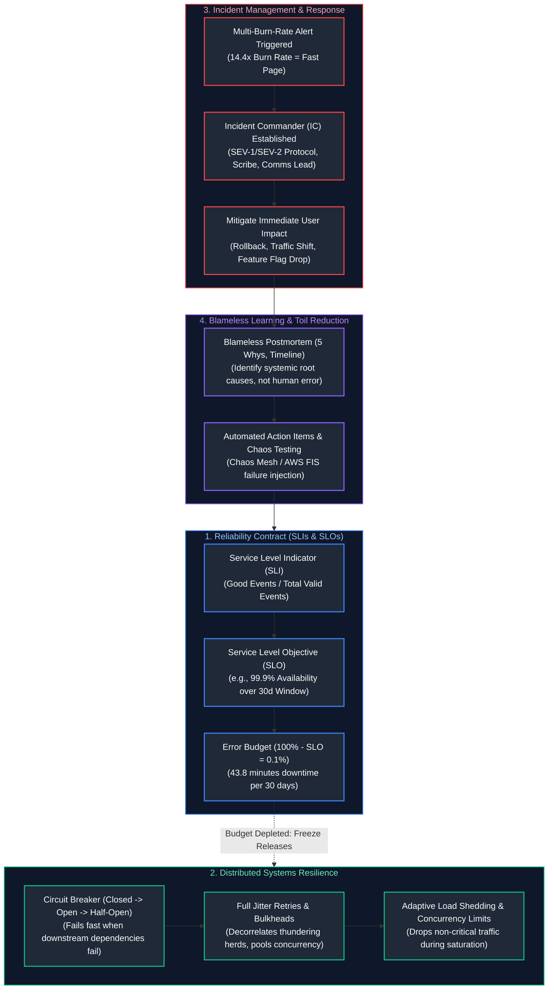
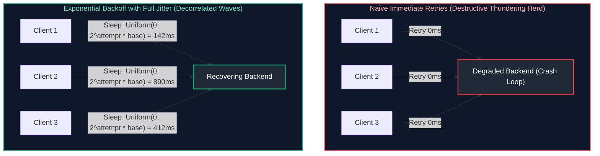

# 11. Site Reliability Engineering (SRE)

A comprehensive, production-grade guide to Site Reliability Engineering (SRE), Service Level Objectives (SLOs), Service Level Indicators (SLIs), Error Budgets, distributed resilience patterns (exponential backoff with jitter, circuit breakers, bulkheads, load shedding), incident command protocols, blameless postmortems, toil reduction, and chaos engineering tailored for Staff SREs, Reliability Architects, and Engineering Leaders.

---

## Architectural Overview: SRE Reliability Loop & Incident Lifecycle



---

## Table of Contents
1. [SLI, SLO, and Error Budget Mathematics](#1-sli-slo-and-error-budget-mathematics)
   - [1.1 Mathematical Formulation of Reliability Metrics](#11-mathematical-formulation-of-reliability-metrics)
   - [1.2 Calculating the "Nines" of Availability and Downtime Allowance](#12-calculating-the-nines-of-availability-and-downtime-allowance)
   - [1.3 Error Budget Policy Enforcement & Release Freezes](#13-error-budget-policy-enforcement-release-freezes)
2. [Incident Management and On-Call Operations](#2-incident-management-and-on-call-operations)
   - [2.1 Incident Command System (ICS) Roles](#21-incident-command-system-ics-roles)
   - [2.2 Severity Classification Matrix (SEV-1 through SEV-4)](#22-severity-classification-matrix-sev-1-through-sev-4)
3. [Blameless Postmortems and Root Cause Analysis](#3-blameless-postmortems-and-root-cause-analysis)
   - [3.1 The Psychology of Blameless Culture](#31-the-psychology-of-blameless-culture)
   - [3.2 The 5 Whys Methodology and Systemic Contributing Factors](#32-the-5-whys-methodology-and-systemic-contributing-factors)
   - [3.3 Action Item Tracking and Preventing Recurring Incidents](#33-action-item-tracking-and-preventing-recurring-incidents)
4. [Toil Reduction and Operational Automation](#4-toil-reduction-and-operational-automation)
   - [4.1 Formal Definition of Toil in Google SRE](#41-formal-definition-of-toil-in-google-sre)
   - [4.2 The 50% Engineering Rule and Runbook Automation](#42-the-50-engineering-rule-and-runbook-automation)
5. [Distributed Systems Resilience Patterns](#5-distributed-systems-resilience-patterns)
   - [5.1 Retries with Exponential Backoff and Full Jitter](#51-retries-with-exponential-backoff-and-full-jitter)
   - [5.2 Circuit Breakers: Closed, Open, and Half-Open States](#52-circuit-breakers-closed-open-and-half-open-states)
   - [5.3 Bulkhead Isolation and Adaptive Load Shedding](#53-bulkhead-isolation-and-adaptive-load-shedding)
6. [Capacity Planning and Load Testing](#6-capacity-planning-and-load-testing)
   - [6.1 Stress Testing vs. Soak Testing vs. Spike Testing with k6](#61-stress-testing-vs-soak-testing-vs-spike-testing-with-k6)
   - [6.2 Headroom Estimation and Organic Growth Modeling](#12-calculating-the-nines-of-availability-and-downtime-allowance)
7. [Chaos Engineering and Fault Injection](#7-chaos-engineering-and-fault-injection)
   - [7.1 Principles of Chaos Engineering](#71-principles-of-chaos-engineering)
   - [7.2 Kubernetes Fault Injection with Chaos Mesh](#72-kubernetes-fault-injection-with-chaos-mesh)
8. [Production Resilience Implementation: Resilient Client with Circuit Breaker](#8-production-resilience-implementation-resilient-client-with-circuit-breaker)
   - [8.1 Production Python Circuit Breaker & Jitter Retry Engine](#81-production-python-circuit-breaker-jitter-retry-engine)
9. [Summary Comparison & Engineering Reference Matrix](#9-summary-comparison-engineering-reference-matrix)
10. [References & Further Reading](#10-references-further-reading)

---

# 1. SLI, SLO, and Error Budget Mathematics

### 1.1 Mathematical Formulation of Reliability Metrics

In Site Reliability Engineering, reliability is quantified through statistical ratios:

$$\text{Service Level Indicator (SLI)} = \frac{\sum \text{Successful Events satisfying Good Criterion}}{\sum \text{Total Valid Events}} \times 100\%$$

- **Good Criterion Example (Availability):** HTTP responses returning status codes not in `5xx` range.
- **Good Criterion Example (Latency):** HTTP requests where round-trip latency $\le 200$ms.
- **Service Level Objective (SLO):** The target percentage agreed upon by engineering and product stakeholders over a specified rolling window (typically 30 days):
  $$\text{SLO} \ge 99.9\% \quad (\text{over rolling 30-day window})$$
- **Service Level Agreement (SLA):** A contractual business agreement with customers attaching financial penalties (e.g. cloud billing credits) if violated. An SLA is intentionally set lower than the SLO:
  $$\text{SLA Target (e.g., } 99.5\%) < \text{Internal SLO Target (e.g., } 99.9\%)$$

---

### 1.2 Calculating the "Nines" of Availability and Downtime Allowance

The **Error Budget** is the allowable unreliability of a system over a rolling period:

$$\text{Error Budget} = 100\% - \text{SLO}$$

| "Nines" Target | Availability % | Allowed Downtime per 30 Days | Allowed Downtime per 365 Days | Typical Architecture Required |
| :---: | :---: | :---: | :---: | :--- |
| **Two Nines** | $99.0\%$ | 7.2 hours | 3.65 days | Single VM, manual backups, no redundant AZ |
| **Three Nines** | $99.9\%$ | 43.2 minutes | 8.76 hours | Multi-AZ load balanced, automated health checks |
| **Three Nines Five**| $99.95\%$| 21.6 minutes | 4.38 hours | Multi-AZ with automated database failover |
| **Four Nines** | $99.99\%$ | 4.32 minutes | 52.6 minutes | Multi-Region Active-Passive or multi-AZ active |
| **Five Nines** | $99.999\%$| 25.9 seconds | 5.26 minutes | Multi-Region Active-Active, automated self-healing |

---

### 1.3 Error Budget Policy Enforcement & Release Freezes

The Error Budget serves as the objective neutral arbiter balancing **feature velocity** against **operational stability**:
- **Budget Remaining $> 0\%$:** Product teams deploy new features, schema updates, and experiments rapidly.
- **Budget Exhausted ($\le 0\%$):** Automated CI/CD deployment freezes engage. Feature deployments halt. 100% of engineering bandwidth pivots strictly to reliability fixes, technical debt remediation, automated testing, and failure resilience.

---

# 2. Incident Management and On-Call Operations

### 2.1 Incident Command System (ICS) Roles

High-pressure production outages require strict hierarchical command structures to eliminate chaos:

```text
+-----------------------------------------------------------------------------------------+
|                               INCIDENT COMMAND STRUCTURE                                |
+------------------------------------+----------------------------------------------------+
| INCIDENT COMMANDER (IC)            | Holds ultimate operational authority. Decides      |
|                                    | rollbacks, coordinates resources, assigns tasks.   |
|                                    | DOES NOT write code or execute debug commands.      |
+------------------------------------+----------------------------------------------------+
| OPERATIONS LEAD / TRIAGE           | Technical investigator executing diagnostic runs,  |
|                                    | checking logs, applying mitigations.               |
+------------------------------------+----------------------------------------------------+
| COMMUNICATIONS LEAD                | Manages internal stakeholder updates (Executive,   |
|                                    | Legal, Support) and public StatusPage notices.    |
+------------------------------------+----------------------------------------------------+
| SCRIBE                             | Records real-time timeline, actions, hypothesis,   |
|                                    | and outputs in the incident document.             |
+------------------------------------+----------------------------------------------------+
```

---

### 2.2 Severity Classification Matrix (SEV-1 through SEV-4)

| Severity | Impact | Customer Scope | SLA Response Time | Escalation Cadence |
| :---: | :--- | :--- | :---: | :--- |
| **SEV-1** | Critical / Outage | Core business blocked; $>25\%$ users impacted | $\le 5$ minutes | Executive updates every 30 mins; 24/7 War Room |
| **SEV-2** | Major Degradation | Severe latency or degraded secondary service | $\le 15$ minutes | Updates every 1 hour; active on-call focus |
| **SEV-3** | Minor / Moderate | Workaround available; small user percentage | $\le 1$ hour | Handled during business hours |
| **SEV-4** | Low / Cosmetic | Minor UI glitch or non-impacting bug | Next business day | Logged in backlog ticket |

---

# 3. Blameless Postmortems and Root Cause Analysis

### 3.1 The Psychology of Blameless Culture

> [!IMPORTANT]
> **The Blameless Postmortem Law:** You cannot "fire" or "punish" your way to reliability. Human beings inherently make mistakes. If an engineer executes a script that drops a production table, **the failure is not the engineer—the failure is the system architecture that permitted a single human keystroke to execute an irreversible catastrophic command.**

---

### 3.2 The 5 Whys Methodology and Systemic Contributing Factors

1. *Why did the service crash?* $\rightarrow$ The database ran out of disk space.
2. *Why did it run out of disk space?* $\rightarrow$ Write-ahead logs (WAL) were not being truncated.
3. *Why were WALs not truncated?* $\rightarrow$ A replica lagged behind and retained replication slots.
4. *Why did the replica lag?* $\rightarrow$ A complex unindexed reporting query saturated replica CPU.
5. *Why was an unindexed query allowed on the replica?* $\rightarrow$ **Root Cause:** No database query guardrails or timeout limits were configured in the query proxy.

---

### 3.3 Action Item Tracking and Preventing Recurring Incidents

Postmortem action items must be treated as P0 engineering deliverables:
- **Prevent:** Architectural changes making the failure impossible (e.g., removing manual write permissions).
- **Mitigate:** Reducing time to detect and time to restore (e.g., automated circuit breaker).
- **Detect:** Adding missing SLO alerts or synthetic probes.

---

# 4. Toil Reduction and Operational Automation

### 4.1 Formal Definition of Toil in Google SRE

**Toil** is the kind of work tied to running a production service that tends to be:
- Manual, repetitive, and automatable.
- Tactical (devoid of enduring engineering value).
- Linearly scaling with service growth (if traffic doubles, manual toil doubles).
- Devoid of creative thought (e.g. manually restarting services, provisioning user accounts, manually rotating SSL certificates).

---

### 4.2 The 50% Engineering Rule and Runbook Automation

Google SRE mandates an organizational limit: **At least 50% of an SRE's time must be dedicated to pure software engineering** (automating infrastructure, writing chaos frameworks, improving telemetry). If operational toil exceeds 50%, excess operational duties are shifted back to the product development team.

---

# 5. Distributed Systems Resilience Patterns

### 5.1 Retries with Exponential Backoff and Full Jitter

When a downstream service degrades, immediate client retries produce a **thundering herd** (retry storm), driving the degraded backend into total failure.



$$\text{Sleep Time} = \text{random\_between}(0, \, \min(\text{cap}, \, \text{base} \times 2^{\text{attempt}}))$$

---

### 5.2 Circuit Breakers: Closed, Open, and Half-Open States

```text
[CLOSED State] ────(Consecutive Failures > Threshold)────> [OPEN State]
      ▲                                                           │
      │                                                           │ (Sleep Duration Elapsed)
      │                                                           ▼
      └─────────(Probe Request Succeeded)─────────────── [HALF-OPEN State]
```

- **Closed:** Normal traffic flows. Errors are counted.
- **Open:** Downstream dependency is failing. The breaker trips immediately: all requests fail fast locally without issuing network calls.
- **Half-Open:** After a sleep window, a single probe request is permitted through. If successful, the breaker resets to Closed; if it fails, it trips back to Open.

---

### 5.3 Bulkhead Isolation and Adaptive Load Shedding

- **Bulkheads:** Partition resources (e.g. separate connection pools for VIP users vs. standard users, or separate thread pools per downstream service) so failure in one subsystem cannot starve resources in another.
- **Load Shedding:** When CPU or queuing latency reaches saturation limits, the server drops non-critical requests (HTTP 503) immediately at the perimeter to protect core transactional operations.

---

# 6. Capacity Planning and Load Testing

### 6.1 Stress Testing vs. Soak Testing vs. Spike Testing with k6

- **Stress Testing:** Increases traffic incrementally until the system breaks to identify breaking points and bottleneck resources (CPU, DB connections, network bandwidth).
- **Soak Testing:** Sustains high traffic over 24-48 hours to discover memory leaks, disk log saturation, and connection pool leaks.
- **Spike Testing:** Delivers sudden 10x traffic surges within seconds to evaluate auto-scaling speed and circuit breaker responses.

---

# 7. Chaos Engineering and Fault Injection

### 7.1 Principles of Chaos Engineering

Chaos engineering is the discipline of experimenting on a system to build confidence in its capability to withstand turbulent conditions in production:
1. Define 'steady state' as normal measurable output (e.g. SLI: 99.9% 200 OKs).
2. Hypothesize that steady state will continue in both control and experimental groups.
3. Introduce real-world variables: simulate network latency, terminate pod replicas, inject disk fill.
4. Attempt to disprove the hypothesis by looking for differences in steady state.

---

### 7.2 Kubernetes Fault Injection with Chaos Mesh

```yaml
# chaos_network_delay.yaml
apiVersion: chaos-mesh.org/v1alpha1
kind: NetworkChaos
metadata:
  name: simulate-az-latency
  namespace: production
spec:
  action: delay
  mode: fixed
  value: "2"
  selector:
    namespaces:
      - production
    labelSelectors:
      app: payment-api
  delay:
    latency: "250ms"
    jitter: "50ms"
  duration: "5m"
  direction: to
  target:
    selector:
      namespaces:
        - production
      labelSelectors:
        app: database
```

---

# 8. Production Resilience Implementation: Resilient Client with Circuit Breaker

### 8.1 Production Python Circuit Breaker & Jitter Retry Engine

Below is a complete, production-grade resilience client implementing exponential backoff with full jitter, circuit breaker state machine, and fallback mechanisms:

```python
#!/usr/bin/env python3
"""
Production SRE Resilience Client: Circuit Breaker & Full Jitter Exponential Backoff.
Protects upstream services from cascading failures and handles transient faults
without third-party external dependencies.
"""

from dataclasses import dataclass
from enum import Enum
import logging
import random
import sys
import time
from typing import Callable, Any, Optional

logging.basicConfig(
    level=logging.INFO,
    format='{"time":"%(asctime)s","level":"%(levelname)s","message":"%(message)s"}',
    handlers=[logging.StreamHandler(sys.stdout)],
)
logger = logging.getLogger("sre_resilience")


class BreakerState(Enum):
    CLOSED = "CLOSED"
    OPEN = "OPEN"
    HALF_OPEN = "HALF_OPEN"


class CircuitBreakerOpenException(Exception):
    """Raised when call is rejected because Circuit Breaker is in OPEN state."""
    pass


class ResilientCaller:
    def __init__(
        self,
        failure_threshold: int = 3,
        recovery_time_sec: float = 10.0,
        base_backoff_sec: float = 0.2,
        max_backoff_sec: float = 2.0,
        max_retries: int = 3,
    ):
        self.failure_threshold = failure_threshold
        self.recovery_time_sec = recovery_time_sec
        self.base_backoff_sec = base_backoff_sec
        self.max_backoff_sec = max_backoff_sec
        self.max_retries = max_retries

        self.state = BreakerState.CLOSED
        self.failure_count = 0
        self.last_state_change = time.time()

    def _update_state(self):
        """Transitions OPEN breaker to HALF_OPEN after recovery window."""
        now = time.time()
        if self.state == BreakerState.OPEN:
            if now - self.last_state_change > self.recovery_time_sec:
                logger.info("Circuit Breaker transitioned to HALF_OPEN (Probing).")
                self.state = BreakerState.HALF_OPEN
                self.last_state_change = now

    def _record_success(self):
        """Handles successful execution."""
        if self.state in (BreakerState.HALF_OPEN, BreakerState.CLOSED):
            if self.failure_count > 0:
                logger.info("Circuit Breaker reset to healthy CLOSED state.")
            self.state = BreakerState.CLOSED
            self.failure_count = 0

    def _record_failure(self):
        """Handles failed execution."""
        self.failure_count += 1
        logger.warning("Call failure recorded. Total consecutive failures: %d", self.failure_count)
        if self.failure_count >= self.failure_threshold or self.state == BreakerState.HALF_OPEN:
            logger.error("Circuit Breaker tripped to OPEN state! Rejecting subsequent calls.")
            self.state = BreakerState.OPEN
            self.last_state_change = time.time()

    def execute_with_resilience(self, func: Callable[[], Any], fallback: Optional[Callable[[], Any]] = None) -> Any:
        """Executes a target function wrapped with Circuit Breaker and Jittered Retries."""
        self._update_state()

        if self.state == BreakerState.OPEN:
            if fallback:
                logger.info("Circuit OPEN: Executing fallback logic.")
                return fallback()
            raise CircuitBreakerOpenException("Circuit breaker is OPEN. Fast fail engaged.")

        for attempt in range(self.max_retries + 1):
            try:
                result = func()
                self._record_success()
                return result
            except Exception as err:
                logger.warning("Attempt %d failed: %s", attempt + 1, err)
                if attempt == self.max_retries:
                    self._record_failure()
                    if fallback:
                        return fallback()
                    raise

                # Full Jitter Exponential Backoff Calculation
                temp_backoff = min(self.max_backoff_sec, self.base_backoff_sec * (2 ** attempt))
                sleep_duration = random.uniform(0, temp_backoff)
                logger.info("Applying full jitter backoff: sleeping for %.3fs", sleep_duration)
                time.sleep(sleep_duration)


if __name__ == "__main__":
    def flaky_upstream_service():
        if random.random() < 0.7:
            raise ConnectionResetError("Simulated network drop / connection reset")
        return {"status": "SUCCESS", "data": "200 OK"}

    def safe_fallback():
        return {"status": "FALLBACK", "data": "Cached degraded response"}

    caller = ResilientCaller(failure_threshold=2, recovery_time_sec=3.0)
    
    for i in range(5):
        try:
            res = caller.execute_with_resilience(flaky_upstream_service, safe_fallback)
            print(f"Call {i+1} result: {res}")
        except Exception as e:
            print(f"Call {i+1} raised: {e}")
```

---

# 9. Summary Comparison & Engineering Reference Matrix

| Resilience Mechanism | Operational Role | Key Trade-Off | Primary Failure Mode Addressed |
| :--- | :--- | :--- | :--- |
| **Exponential Jitter**| Spreads out client retries across random time distributions | Increases client-side latency slightly during recovery | Thundering herd / retry storms overwhelming degraded servers |
| **Circuit Breaker** | Fails fast locally when dependencies are dead | Users experience immediate fast failure until recovery | Resource exhaustion (thread pool / socket starvation) |
| **Bulkheads** | Isolates critical resources into distinct pools | Lower resource sharing efficiency across components | Cascading outages where non-critical service brings down core app |
| **Adaptive Load Shedding**| Drops low-priority requests during saturation | Rejects portion of legitimate traffic | Complete cluster collapse / OOM thrashing under massive traffic spikes |
| **Chaos Engineering** | Validates system steady-state during simulated failure | Requires careful blast-radius containment in production | Unknown architectural dependencies and latent failure modes |

---

# 10. References & Further Reading

- [Site Reliability Engineering: How Google Runs Production Systems](https://sre.google/sre-book/table-of-contents/) — The foundational SRE reference text.
- [The Site Reliability Workbook](https://sre.google/workbook/table-of-contents/) — Practical SLO implementation guidelines.
- [AWS Architecture Blog: Exponential Backoff And Jitter](https://aws.amazon.com/blogs/architecture/exponential-backoff-and-jitter/) — Mathematical modeling of decorrelated jitter algorithms.
- [Michael T. Nygard: Release It! Design and Deploy Production-Ready Software](https://pragprog.com/titles/mnee2/release-it-second-edition/) — Architectural stability patterns.
- [Chaos Mesh Documentation](https://chaos-mesh.org/docs/) — Cloud-native chaos engineering platform for Kubernetes.

