# 12. Databases, Storage & Distributed Systems

A comprehensive, production-grade guide to cloud databases, distributed storage engines, managed relational platforms (Azure SQL, PostgreSQL, Amazon Aurora), globally distributed NoSQL (Cosmos DB, DynamoDB), in-memory caching with Redis, enterprise event streaming (Service Bus, Event Hubs, Kafka), CAP and PACELC theorems, consistency models, Saga distributed transactions, and distributed locking algorithms tailored for Principal Data Architects and Distributed Systems Engineers.

---

## Architectural Overview: Cloud Distributed Data Tier & Decoupled Storage Topology

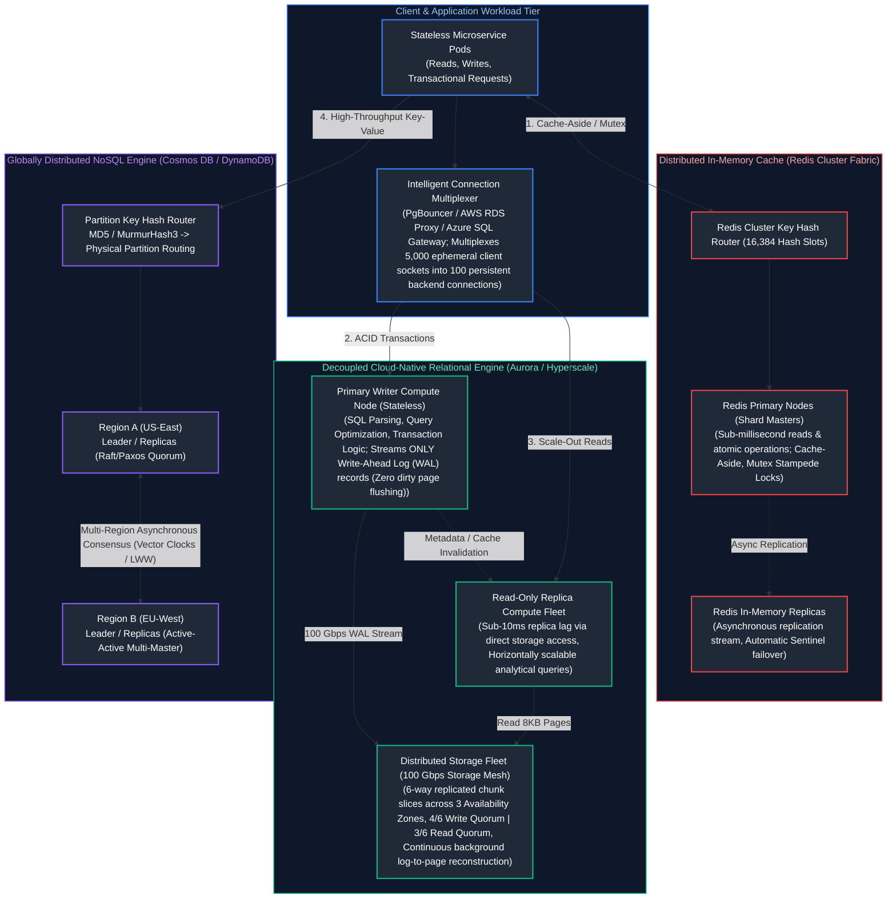

---

## Table of Contents
1. [Distributed Systems Foundations: The Global Banking Analogy & Theoretical Limits](#1-distributed-systems-foundations-the-global-banking-analogy--theoretical-limits)
   - [1.1 Real-World Analogy: Global ATMs and Undersea Cable Cuts](#11-real-world-analogy-global-atms-and-undersea-cable-cuts)
   - [1.2 The CAP Theorem: Formal Trade-Offs Under Partition](#12-the-cap-theorem-formal-trade-offs-under-partition)
   - [1.3 The PACELC Theorem: Latency vs. Consistency in Normal Operations](#13-the-pacelc-theorem-latency-vs-consistency-in-normal-operations)
   - [1.4 Consistency Spectra: Linearizable down to Eventual Consistency](#14-consistency-spectra-linearizable-down-to-eventual-consistency)
2. [Cloud Relational Database Architecture: Azure SQL, PostgreSQL & Aurora](#2-cloud-relational-database-architecture-azure-sql-postgresql--aurora)
   - [2.1 Decoupled Compute and Storage: "The Log is the Database"](#21-decoupled-compute-and-storage-the-log-is-the-database)
   - [2.2 Quorum Slicing: 4/6 Write Quorums and Multi-AZ Fault Tolerance](#22-quorum-slicing-46-write-quorums-and-multi-az-fault-tolerance)
   - [2.3 Connection Exhaustion and Multiplexing with PgBouncer and RDS Proxy](#23-connection-exhaustion-and-multiplexing-with-pgbouncer-and-rds-proxy)
3. [Globally Distributed NoSQL Architecture: Cosmos DB and DynamoDB](#3-globally-distributed-nosql-architecture-cosmos-db-and-dynamodb)
   - [3.1 Physical Partitioning, Hash Rings, and Hot Partition Mathematics](#31-physical-partitioning-hash-rings-and-hot-partition-mathematics)
   - [3.2 The 5 Consistency Tiers of Azure Cosmos DB](#32-the-5-consistency-tiers-of-azure-cosmos-db)
   - [3.3 Throughput Economics: Request Units (RU/s) vs. DynamoDB RCU/WCU](#33-throughput-economics-request-units-rus-vs-dynamodb-rcuwcu)
4. [Distributed In-Memory Caching with Redis](#4-distributed-in-memory-caching-with-redis)
   - [4.1 Caching Patterns: Cache-Aside, Write-Through, Write-Behind, and Refresh-Ahead](#41-caching-patterns-cache-aside-write-through-write-behind-and-refresh-ahead)
   - [4.2 The Three Great Cache Disasters: Penetration, Avalanche, and Stampede](#42-the-three-great-cache-disasters-penetration-avalanche-and-stampede)
   - [4.3 Probabilistic Early Expiration (XFetch Algorithm) & Mutex Locks](#43-probabilistic-early-expiration-xfetch-algorithm--mutex-locks)
5. [Enterprise Messaging & Distributed Event Streaming](#5-enterprise-messaging--distributed-event-streaming)
   - [5.1 Transient Message Brokers (Service Bus / SQS) vs. Partitioned Commit Logs (Kafka / Event Hubs)](#51-transient-message-brokers-service-bus--sqs-vs-partitioned-commit-logs-kafka--event-hubs)
   - [5.2 Dead-Letter Queues (DLQ), Poison Messages, and Backoff Policies](#52-dead-letter-queues-dlq-poison-messages-and-backoff-policies)
6. [Distributed Transactions, Sagas, and Distributed Locking](#6-distributed-transactions-sagas-and-distributed-locking)
   - [6.1 Why Two-Phase Commit (2PC) Fails in Cloud Architectures](#61-why-two-phase-commit-2pc-fails-in-cloud-architectures)
   - [6.2 The Saga Pattern: Orchestration vs. Choreography](#62-the-saga-pattern-orchestration-vs-choreography)
   - [6.3 Idempotency Keys and the Transactional Outbox Pattern](#63-idempotency-keys-and-the-transactional-outbox-pattern)
   - [6.4 Distributed Locking Mechanics: Redis Redlock and Safe Lua Release](#64-distributed-locking-mechanics-redis-redlock-and-safe-lua-release)
7. [Cloud Storage Fabrics: Block vs. Object vs. File Engines](#7-cloud-storage-fabrics-block-vs-object-vs-file-engines)
   - [7.1 Performance Benchmarks: IOPS, Throughput, and Latency Metrics](#71-performance-benchmarks-iops-throughput-and-latency-metrics)
   - [7.2 Erasure Coding (Reed-Solomon) and the Math of 11 Nines of Durability](#72-erasure-coding-reed-solomon-and-the-math-of-11-nines-of-durability)
   - [7.3 Redundancy Topologies: LRS, ZRS, GRS, and Object Versioning](#73-redundancy-topologies-lrs-zrs-grs-and-object-versioning)
8. [Production Code Implementation: Distributed Lock & Idempotent Consumer](#8-production-code-implementation-distributed-lock--idempotent-consumer)
   - [8.1 Production Python Redis Distributed Lease Lock with Safe Lua Releaser](#81-production-python-redis-distributed-lease-lock-with-safe-lua-releaser)
9. [Senior Architect Troubleshooting Runbooks: Distributed Storage Outages](#9-senior-architect-troubleshooting-runbooks-distributed-storage-outages)
   - [9.1 Scenario 1: Redis Cache Stampede Crashing Database Master](#91-scenario-1-redis-cache-stampede-crashing-database-master)
   - [9.2 Scenario 2: Severe NoSQL Hot-Partition Throttling (HTTP 429)](#92-scenario-2-severe-nosql-hot-partition-throttling-http-429)
   - [9.3 Scenario 3: Asynchronous Read-Replica Replication Lag (Stale Reads)](#93-scenario-3-asynchronous-read-replica-replication-lag-stale-reads)
10. [Summary Comparison & Engineering Reference Matrix](#10-summary-comparison--engineering-reference-matrix)
11. [References & Further Reading](#11-references--further-reading)

---

# 1. Distributed Systems Foundations: The Global Banking Analogy & Theoretical Limits

### 1.1 Real-World Analogy: Global ATMs and Undersea Cable Cuts

To understand distributed consistency and storage trade-offs, consider a husband and wife who share a single checking account containing exactly **\$100**:

```mermaid
flowchart TD
    subgraph DisconnectedWorld ["Network Partition: Trans-Pacific Undersea Cable Severed"]
        Husband["Husband at Tokyo ATM<br/>Requests $100 Cash"]
        Wife["Wife at New York ATM<br/>Requests $100 Cash"]
        TokyoDB["Tokyo Data Center"]
        NYDB["New York Data Center"]

        Husband --> TokyoDB
        Wife --> NYDB
        TokyoDB -.x|"NETWORK PARTITION (No Cross-Ocean Traffic)"| NYDB
    end

    subgraph ArchitectureChoice ["The Fundamental Distributed Systems Choice"]
        ChoiceCP["CP Choice (Strict Consistency)<br/>(Tokyo & NY cannot coordinate consensus; ATMs display: 'System Offline - Transaction Rejected'; Bank avoids overdraft, but CUSTOMERS ARE FURIOUS (Zero Availability))"]
        ChoiceAP["AP Choice (High Availability)<br/>(Both ATMs dispense $100 cash immediately, Account balance drops to -$100 (Double Spend), Customers happy; bank reconciles via overdraft fee later)"]
    end

    DisconnectedWorld --> ArchitectureChoice

    style DisconnectedWorld fill:#1e1e2e,stroke:#f87171,stroke-width:2px,color:#fca5a5
    style ArchitectureChoice fill:#1e1e2e,stroke:#38bdf8,stroke-width:2px,color:#bae6fd
    style TokyoDB fill:#2a2b3d,stroke:#f87171,stroke-width:1.5px,color:#fff
    style NYDB fill:#2a2b3d,stroke:#f87171,stroke-width:1.5px,color:#fff
    style ChoiceCP fill:#1e293b,stroke:#f87171,stroke-width:1.5px,color:#fff
    style ChoiceAP fill:#1e293b,stroke:#34d399,stroke-width:1.5px,color:#fff
```

- **The CP Decision (Consistency over Availability):** Because the communication link between Tokyo and New York is severed, neither node can verify if the other is dispensing cash. To guarantee that balance never drops below zero, **both ATMs refuse to dispense money** (throwing an error). The system preserves exact correctness at the cost of total service unavailability.
- **The AP Decision (Availability over Consistency):** Both ATMs prioritize being available. Both dispense \$100. The customer receives \$200 total from a \$100 account. When the trans-oceanic cable reconnects hours later, the systems asynchronously exchange logs, detect the negative balance (-\$100), and charge an overdraft fee. This is **Eventual Consistency** with compensating business logic.

---

### 1.2 The CAP Theorem: Formal Trade-Offs Under Partition

Formulated by Eric Brewer and mathematically proven by Seth Gilbert and Nancy Lynch, the **CAP Theorem** states that any distributed data store can simultaneously guarantee at most two of three properties:

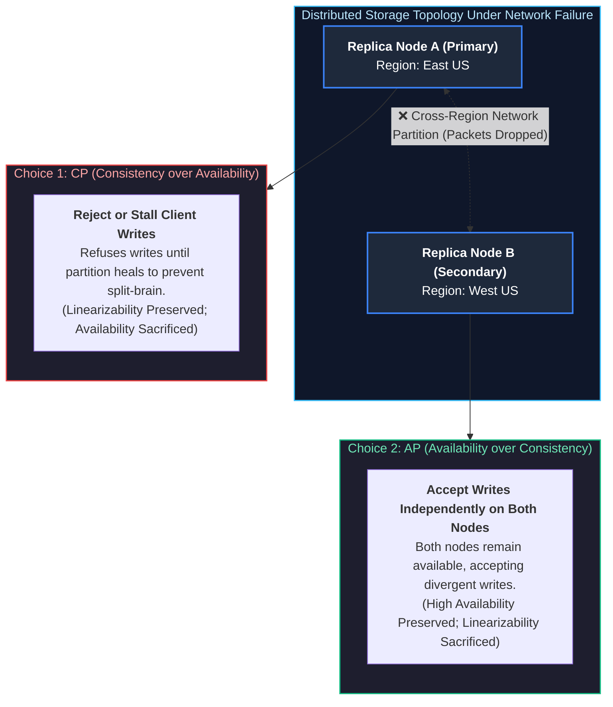

| Distributed Architecture Model | Core Design Choice Under Partition ($P$) | Data Consistency Guarantee | System Availability Guarantee | Representative Cloud Distributed Systems |
| :--- | :--- | :--- | :--- | :--- |
| **CP (Consistent / Partition-Tolerant)** | Prioritize ground-truth accuracy over node uptime. | **Linearizable / Strong:** All clients read the latest committed state. | Non-quorum partitions reject writes with errors. | Google Cloud Spanner, etcd (Kubernetes), Apache ZooKeeper, CockroachDB. |
| **AP (Available / Partition-Tolerant)** | Prioritize 100% uptime over linearizable consistency. | **Eventual:** Nodes accept local writes; divergent data reconciles later (conflict resolution). | Always returns a non-error response ($99.999\%$ uptime). | Apache Cassandra, Amazon DynamoDB (Eventual), Couchbase, ScyllaDB. |
| **CA ("Consistent & Available")** | **Theoretical Myth in Distributed Networks:** Physically impossible because networks cannot guarantee zero dropped packets. | Assumes zero network partitions ever occur. | Crashes completely on network delay or fiber cuts. | Single-node RDBMS: PostgreSQL, MySQL, SQLite on a standalone VM. |

> [!CRITICAL]
> **Partition Tolerance is Non-Negotiable:** You cannot "choose" CA. Physical fiber cables get severed by ship anchors, routers reboot, and top-of-rack switches drop packets. **In any real-world distributed network, Partition ($P$) is a physical certainty.** Therefore, the theorem is realistically framed: **When a network partition occurs, do you choose Consistency ($CP$) or Availability ($AP$)?**

---

### 1.3 The PACELC Theorem: Latency vs. Consistency in Normal Operations

The CAP theorem only describes system behavior *when a network partition is actively taking place*. In enterprise cloud environments, systems spend $99.99\%$ of their lifecycle operating normally without partitions. **Daniel Abadi’s PACELC Theorem** completes the equation:

$$\text{If } \mathbf{P} \text{ (Partition): Choose } \mathbf{A} \text{ or } \mathbf{C}; \quad \mathbf{E} \text{ (Else / Normal Operations): Choose } \mathbf{L} \text{ (Latency) or } \mathbf{C} \text{ (Consistency)}$$

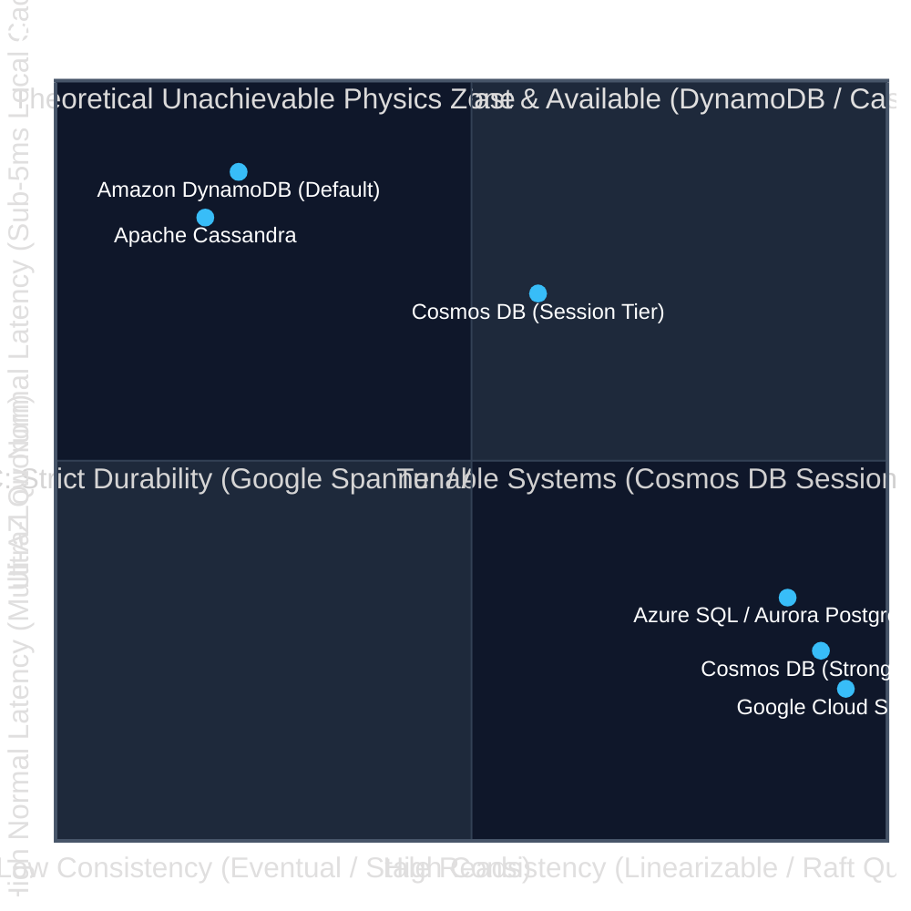

- **PC/EC (e.g., Azure SQL, Aurora, Spanner):** During partitions, prioritizes consistency ($PC$). In normal operations, waits for synchronous replication to maintain strict linearizability, accepting higher write latency ($EC$).
- **PA/EL (e.g., DynamoDB, Cassandra, Couchbase):** During partitions, prioritizes availability ($PA$). In normal operations, replicates asynchronously to deliver sub-10ms read/write response times, accepting eventual consistency ($EL$).

---

### 1.4 Consistency Spectra: Linearizable down to Eventual Consistency

Distributed consistency is not a binary switch; it is a spectrum of mathematical guarantees:
1. **Linearizability (Strict Consistency):** Operations appear to take place instantaneously on a single centralized copy of the data at a discrete point in time between their invocation and completion. A read is guaranteed to return the latest committed write.
2. **Sequential Consistency (Lamport):** Operations take effect in some sequential order that is consistent across all processes, and operations of each process appear in the sequence in the order specified by its program.
3. **Causal Consistency:** Operations that are causally related must be seen by every node in the same order. Operations that are concurrent may be observed in different orders.
4. **Eventual Consistency:** Weakest guarantee. If no new updates are made, all replicas will eventually converge to identical values. Reads can return stale, out-of-order data indefinitely until convergence.

---

# 2. Cloud Relational Database Architecture: Azure SQL, PostgreSQL & Aurora

Relational databases have undergone an architectural revolution in the cloud, transitioning from monolithic single-server installations to horizontally scalable, decoupled storage fabrics.

### 2.1 Decoupled Compute and Storage: "The Log is the Database"

In a traditional monolithic PostgreSQL or SQL Server instance, compute (CPU/RAM) and storage (local SSDs) reside on the same physical host. When a transaction commits, the engine must write both **Write-Ahead Log (WAL) records** and periodically flush modified **dirty 8KB data pages** to disk via background checkpoints:


#### Why Decoupling Revolutionized Cloud Databases:
1. **The Log is the Database:** In Aurora and Azure SQL Hyperscale, the compute node **never flushes dirty 8KB pages across the network**. It streams *only* tiny WAL log descriptors (e.g. "insert value X into page Y at offset Z") over a dedicated 100 Gbps NVMe storage mesh.
2. **Massive Network I/O Reduction:** Eliminates double-write buffers and dirty page checkpoints, cutting database network write bandwidth by over **$80\%$**.
3. **Instant Crash Recovery:** Traditional databases take minutes or hours to reboot after an unclean crash because they must scan the WAL and replay transactions to reconstruct corrupted pages. Decoupled storage nodes apply redo log records continuously in parallel in the background; a rebooted compute node can service queries **in under 5 seconds**.

---

### 2.2 Quorum Slicing: 4/6 Write Quorums and Multi-AZ Fault Tolerance

Amazon Aurora partitions database storage into **10GB Protection Groups (PGs)**. Each 10GB segment is replicated **6 times across 3 distinct Availability Zones** (2 copies per AZ):

$$\text{Write Quorum} = \frac{4}{6} \quad \Big| \quad \text{Read Quorum} = \frac{3}{6}$$

```mermaid
flowchart LR
    Compute["Compute Writer"] -->|"Quorum Write (Needs 4/6 ACKs)"| PGs

    subgraph AZ_A ["Availability Zone A"]
        S1["Segment 1 (Copy A1)"]
        S2["Segment 2 (Copy A2)"]
    end

    subgraph AZ_B ["Availability Zone B (DOWN)"]
        S3["Segment 3 (Copy B1) [X]"]
        S4["Segment 4 (Copy B2) [X]"]
    end

    subgraph AZ_C ["Availability Zone C"]
        S5["Segment 5 (Copy C1)"]
        S6["Segment 6 (Copy C2)"]
    end

    Compute --> S1 & S2 & S5 & S6
    Compute -.x S3 & S4

    classDef ok fill:#1e293b,stroke:#10b981,stroke-width:2px,color:#ffffff;
    classDef fail fill:#3b1e2e,stroke:#ef4444,stroke-width:2px,color:#ffffff;
    class S1,S2,S5,S6 ok;
    class S3,S4 fail;
```

#### Mathematical Resilience of 4/6 Quorums:
- **Tolerating Complete AZ Loss:** If an entire Availability Zone collapses (losing 2 copies), the database still receives $4/6$ acknowledgments from the remaining two AZs. **Writes continue with zero downtime and zero data loss!**
- **Tolerating AZ Loss + Concurrent Disk Fault:** If AZ-B is completely dead (2 copies lost) AND a disk drive in AZ-C simultaneously fails (1 copy lost), the database still retains $3/6$ copies. While writes pause, it satisfies the **Read Quorum ($3/6$)**, allowing read transactions to continue while storage nodes rebuild the missing segment via peer-to-peer gossip repair!

---

### 2.3 Connection Exhaustion and Multiplexing with PgBouncer and RDS Proxy

PostgreSQL operates on a **process-per-connection** model. Each incoming TCP connection spawns a dedicated Linux backend process allocating **5MB to 10MB of private RAM**, plus internal catalog caches:

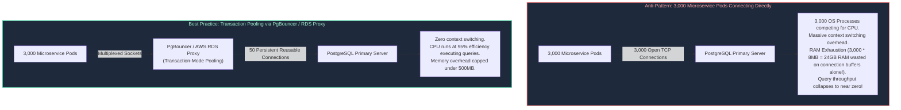

#### Production PgBouncer Configuration Modes:
- **Session Pooling (Default):** Connection assigned to client until client disconnects. Safest, but provides minimal connection reduction.
- **Transaction Pooling (Recommended):** Server connection returned to pool the instant a transaction (`COMMIT`/`ROLLBACK`) completes. Enables 5,000 client applications to run concurrently over just 50 physical database sockets. *Constraint: Applications cannot rely on session-level states (e.g. `SET timezone` or temporary tables).*
- **Statement Pooling:** Connection returned after every single SQL statement. Breaks multi-statement transactions; rarely used in OLTP.

---

# 3. Globally Distributed NoSQL Architecture: Cosmos DB and DynamoDB

Enterprise NoSQL systems achieve horizontal scalability by horizontally partitioning documents across an elastic cluster of commodity storage servers.

### 3.1 Physical Partitioning, Hash Rings, and Hot Partition Mathematics

Azure Cosmos DB and Amazon DynamoDB partition data by applying an internal cryptographic hash function (MD5 or MurmurHash3) to the document's **Partition Key**:

$$\text{Physical Partition Node} = \text{Hash}(\text{PartitionKey}) \pmod{\text{Total Physical Partitions}}$$

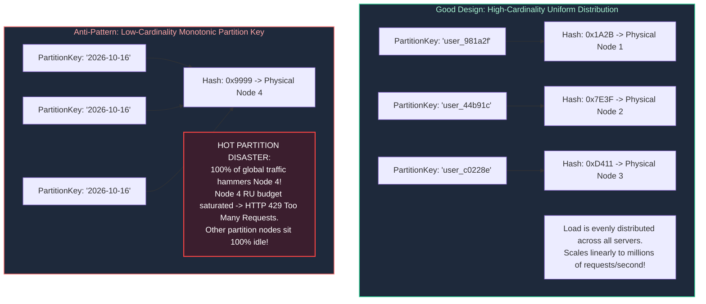

#### Hot Partition Mitigation: Synthetic Partition Key Salting
When write volume naturally concentrates on a single key (e.g., streaming telemetry from a celebrity user or live sporting event), architects apply **synthetic salting**:

$$\text{PartitionKey} = \text{DeviceID} + \text{"\_"} + \text{random\_integer}(0, \, 9)$$

Reads can query all 10 partition suffixes concurrently using fan-out subqueries, scattering write throughput across 10 distinct physical hardware partitions.

---

### 3.2 The 5 Consistency Tiers of Azure Cosmos DB

Azure Cosmos DB offers five mathematically well-defined consistency levels along the PACELC spectrum:

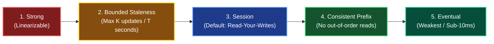

1. **Strong Consistency:** Guarantees linearizability. Reads are guaranteed to return the most recent committed write. Requires global synchronous two-phase commit across all regions. Cannot span multi-region write topologies; highest latency.
2. **Bounded Staleness:** Guarantees that reads lag writes by at most $K$ updates (versions) or $T$ time duration (e.g., maximum 5 seconds or 100 versions). Guarantees monotonic reads and total order within the staleness window.
3. **Session Consistency (Industry Standard):** Scoped to a specific client session token. Guarantees **Read-Your-Own-Writes**, monotonic reads, and monotonic writes for the authoring user. Highly performant because session tokens are propagated inside client HTTP cookies.
4. **Consistent Prefix:** Guarantees that readers never see out-of-order writes. If a sequence of updates occurs: $A \rightarrow B \rightarrow C$, a client might see $A$, or $A \rightarrow B$, but **never** $B$ before $A$.
5. **Eventual Consistency:** Replicas converge asynchronously over time. Delivers the lowest latency and highest throughput, but reads may observe arbitrary stale states.

---

### 3.3 Throughput Economics: Request Units (RU/s) vs. DynamoDB RCU/WCU

- **Azure Cosmos DB Request Units (RU/s):** A normalized, deterministic unit of throughput. Reading a 1KB document via primary key costs exactly **1 RU**. Writing a 1KB document costs **5 to 6 RUs** (due to quorum replication and secondary indexing). 
- **Amazon DynamoDB Capacity Units:**
  - **1 Read Capacity Unit (RCU):** One strongly consistent read per second for an item up to 4KB (or two eventually consistent reads per second).
  - **1 Write Capacity Unit (WCU):** One write per second for an item up to 1KB.

---

# 4. Distributed In-Memory Caching with Redis

In-memory caching prevents relational and NoSQL databases from collapsing under millions of read requests per second.

### 4.1 Caching Patterns: Cache-Aside, Write-Through, Write-Behind, and Refresh-Ahead

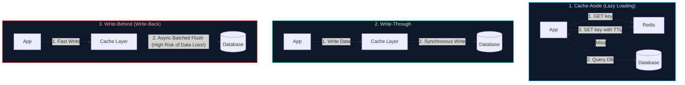

---

### 4.2 The Three Great Cache Disasters: Penetration, Avalanche, and Stampede

| Cache Failure Disaster | Mechanics & Trigger | Architectural Disaster Caused | Engineering Defense |
| :--- | :--- | :--- | :--- |
| **1. Cache Penetration** | Malicious attacker queries non-existent keys (e.g. `user_id = -9999`). Cache always misses. | Every request bypasses the cache and directly queries the database, driving CPU to 100%. | **Bloom Filters:** Probabilistic data structure checks set membership in RAM; rejects non-existent keys before touching DB. Alternatively, cache `NULL` values with a 60-second TTL. |
| **2. Cache Avalanche** | Thousands of cached keys are initialized with the exact same 24-hour expiration time; all expire simultaneously at midnight. | Sudden massive influx of queries misses cache simultaneously, overwhelming DB connections. | **Random TTL Jitter:** Add random variance to expirations: $\text{TTL} = \text{base} + \text{random}(0, 300\text{s})$. |
| **3. Cache Stampede (Thundering Herd)** | A single, heavily requested hot key (e.g., e-commerce home page deals) expires under peak load (50,000 req/s). | Thousands of concurrent threads all detect cache miss at the same millisecond and issue identical heavy SQL queries. | **Distributed Mutex Locking** or **Probabilistic Early Recomputation (XFetch)**. |

---

### 4.3 Probabilistic Early Expiration (XFetch Algorithm) & Mutex Locks

Rather than letting a hot key physically expire, the **XFetch algorithm** causes worker threads to probabilistically recompute and refresh the cached entry *shortly before* its physical TTL expires:

$$\text{Recompute If: } -\beta \times \delta \times \ln(\text{random}()) > \text{TTL}_{\text{remaining}}$$

Where:
- $\beta > 0$: Aggressiveness tuning parameter (typically $1.0$).
- $\delta$: Time taken to execute the underlying database compute query in seconds.
- $\text{random}()$: Uniform random floating-point number between $0$ and $1$.

As remaining TTL approaches zero, the probability of a client recomputing the key approaches $100\%$, ensuring the key is silently refreshed in the background without a single cache miss.

---

# 5. Enterprise Messaging & Distributed Event Streaming

### 5.1 Transient Message Brokers (Service Bus / SQS) vs. Partitioned Commit Logs (Kafka / Event Hubs)

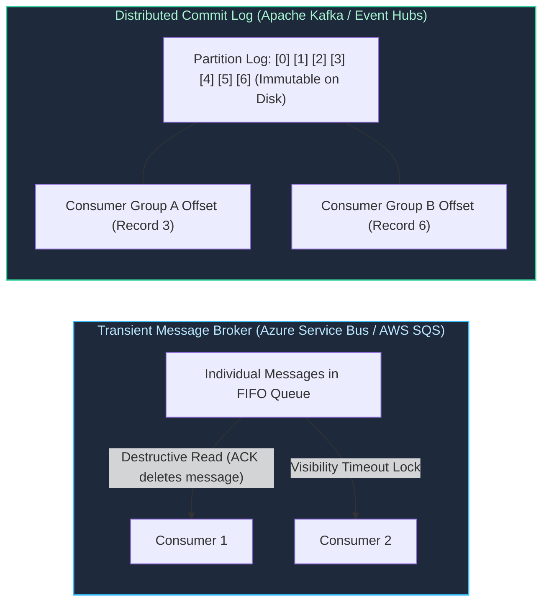

| Dimension | Enterprise Message Broker (Azure Service Bus, AWS SQS) | Distributed Event Log (Apache Kafka, Event Hubs, Kinesis) |
| :--- | :--- | :--- |
| **Storage Model** | Ephemeral: Messages deleted immediately once acknowledged. | Persistent: Append-only immutable log retained on disk for days/months. |
| **Read Model** | Destructive: Message consumed by exactly one worker in competing consumer pattern. | Non-destructive: Consumers maintain independent commit offsets; records can be replayed. |
| **Ordering Scope** | Ordered per Session / FIFO Group; unordered across global queue. | Strictly ordered within individual partition keys. |
| **Throughput** | Moderate (1,000 – 10,000 messages/sec per queue). | Massive (100,000 – 10,000,000 events/sec via partitioned streams). |
| **Primary Use Cases** | Asynchronous job dispatch, distributed workflow orchestration, transactional decoupling. | Event Sourcing, clickstream ingestion, audit logging, real-time streaming analytics. |

---

### 5.2 Dead-Letter Queues (DLQ), Poison Messages, and Backoff Policies

A **Poison Message** is a malformed message (e.g. invalid JSON syntax or unhandled exception) that crashes consumer parsing logic. Without protection, the consumer crashes, the broker releases the visibility timeout, the consumer restarts, picks up the exact same poison message, and crashes again in an infinite loop:

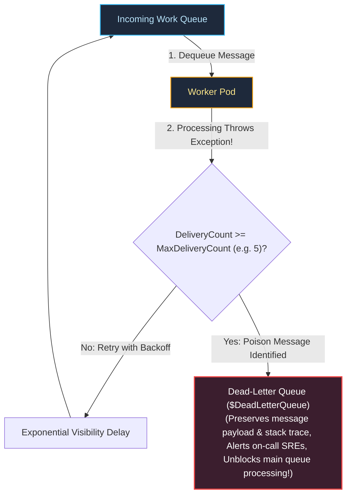

---

# 6. Distributed Transactions, Sagas, and Distributed Locking

### 6.1 Why Two-Phase Commit (2PC) Fails in Cloud Architectures

In classic monolithic databases, distributed transactions across nodes utilized the **Two-Phase Commit (2PC)** protocol:
1. **Prepare Phase:** Coordinator asks all participants: *"Can you commit?"* Participants acquire locks and respond *"Yes"*.
2. **Commit Phase:** Coordinator writes commit decision to disk and broadcasts *"Commit"* to all participants.

#### Why 2PC Collapses in High-Throughput Cloud Microservices:
- **Blocking Protocol:** If the coordinator crashes or a network partition occurs between phases, participants **hold row locks indefinitely**, starving all concurrent transactions.
- **Latency Multiplier:** A 2PC transaction across 4 microservices requires multiple round-trip network hops. If one service responds in 200ms, the entire global transaction stalls at 200ms.
- **Availability Fragility:** The availability of a 2PC transaction is the mathematical *product* of the availabilities of all participating systems: $A_{\text{total}} = A_1 \times A_2 \times A_3 \times A_4$. If each service has $99\%$ availability, overall transaction availability plummets to **$96\%$**!

---

### 6.2 The Saga Pattern: Orchestration vs. Choreography

Modern cloud architectures replace 2PC with the **Saga Pattern**: a sequence of local transactions where each local transaction updates the database and publishes an event. If a step fails, the Saga executes **Compensating Transactions** to undo preceding changes:

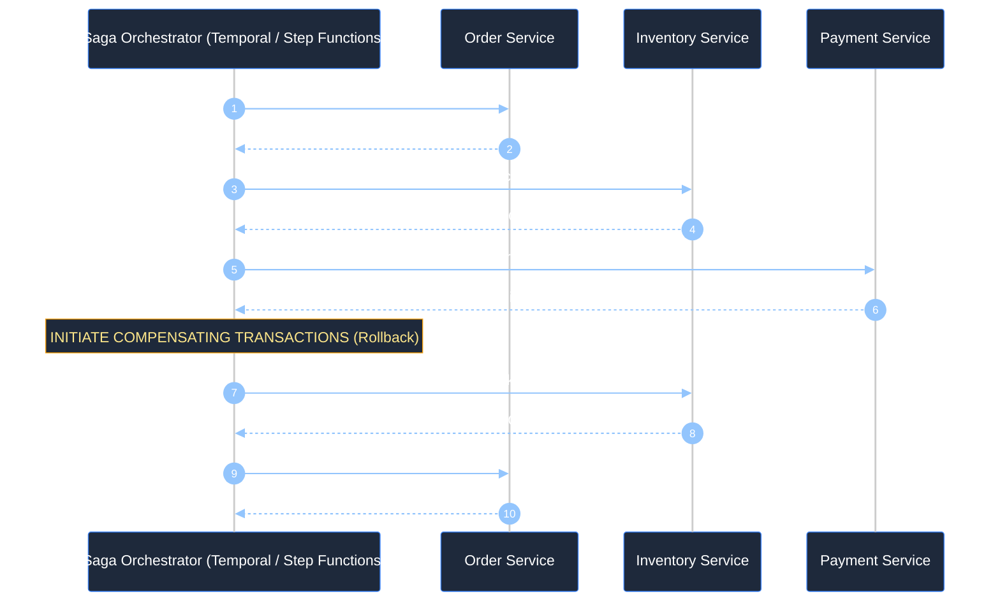

#### Orchestration vs. Choreography:
- **Choreography (Event-Driven Pub/Sub):** Microservices listen to Kafka topics and trigger their own next steps independently. Lightweight for 2–3 services; unmaintainable spaghetti for complex workflows (no central view of execution state).
- **Orchestration (Central Coordinator):** A dedicated state machine (AWS Step Functions, Azure Durable Functions, Temporal.io) centrally commands services to execute steps and handles compensation logic explicitly. Highly recommended for enterprise core transactions.

---

### 6.3 Idempotency Keys and the Transactional Outbox Pattern

To ensure reliable communication without duplicate execution:
1. **Idempotency Key:** Client passes a unique UUID (`Idempotency-Key: 7b9a4c...`) in the HTTP header. The service records this key in a deduplication database table. Subsequent identical requests return the cached original response without re-executing credit card charges.
2. **Transactional Outbox Pattern:** Guarantees that updating the database and publishing a Kafka event succeed or fail atomically:

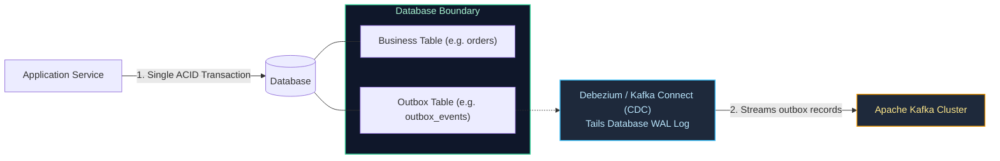

---

### 6.4 Distributed Locking Mechanics: Redis Redlock and Safe Lua Release

Acquiring a distributed lock in Redis requires an atomic `SET NX PX` command:

```bash
# Acquire lock with a 10-second automatic lease expiration
SET lock:invoice:1092 "worker_node_uuid_a81f" NX PX 10000
```

> [!CAUTION]
> **The Lock Expiration Trap:** If Worker A acquires a 10-second lock, encounters a 12-second Java GC pause, the lock expires. Worker B acquires the lock. Worker A awakens and executes `DEL lock:invoice:1092`, **accidentally deleting Worker B's active lock!**

#### The SRE Defense: Atomic Lua Script Release
Locks must **only be released if the caller still owns the lock value**:

```lua
-- Safe Atomic Distributed Lock Release via Redis Lua
if redis.call("get", KEYS[1]) == ARGV[1] then
    return redis.call("del", KEYS[1])
else
    return 0
end
```

---

# 7. Cloud Storage Fabrics: Block vs. Object vs. File Engines

### 7.1 Performance Benchmarks: IOPS, Throughput, and Latency Metrics

| Storage Category | Underlying Access Protocol | Read/Write Latency | Maximum IOPS & Throughput Limits | Concurrency & Mount Topology | Optimal Production Workload |
| :--- | :--- | :--- | :--- | :--- | :--- |
| **Block Storage** | Raw SCSI / NVMe-oF network protocol (unformatted raw blocks) | **Sub-millisecond ($0.5\text{ms} - 1\text{ms}$)** | Up to $160,000$ IOPS; $4,000\text{ MB/s}$ per volume | Exclusive read/write to a single VM (`ReadWriteOnce`) | Transactional relational database data files (PostgreSQL, MySQL, SQL Server). |
| **File Storage** | Network File System (NFSv4.1) / Server Message Block (SMB 3.0) | $5\text{ms} - 15\text{ms}$ | Up to $100,000$ IOPS; $10\text{ GB/s}$ throughput | Shared read/write across thousands of VMs (`ReadWriteMany`) | Legacy enterprise CMS, shared application assets, shared persistent volumes for Kubernetes pods. |
| **Object Storage** | HTTP/HTTPS REST APIs (`GET`, `PUT`, `DELETE` over port 443) | $20\text{ms} - 50\text{ms}$ Time-to-First-Byte | Virtually infinite horizontal scaling (hundreds of GB/s aggregate) | Globally accessible via public/private URLs and IAM credentials | Big Data Lakehouses (Parquet/Delta), AI training datasets, unstructured multimedia, immutable backups. |

---

### 7.2 Erasure Coding (Reed-Solomon) and the Math of 11 Nines of Durability

Cloud object stores (AWS S3, Azure Blob, Google Cloud Storage) advertise **99.999999999% (11 Nines)** of annual data durability. Storing 3 full replicas of every petabyte would be financially unsustainable. Modern clouds use **Reed-Solomon Erasure Coding ($N + M$)**:

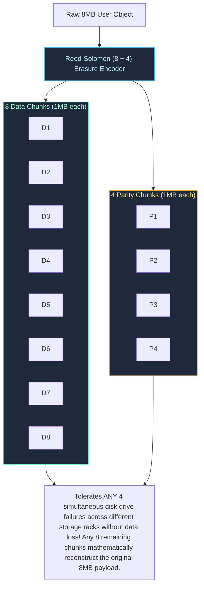

- In an $8 + 4$ scheme, storage overhead is only **$50\%$** (12MB total stored for an 8MB file), compared to **$200\%$** overhead for 3-way mirroring (24MB stored), while delivering superior durability.

---

### 7.3 Redundancy Topologies: LRS, ZRS, GRS, and Object Versioning

- **Locally Redundant Storage (LRS):** 3 synchronous copies within a single physical data center facility. Protects against disk and rack faults; destroyed by facility fires or floods.
- **Zone-Redundant Storage (ZRS):** Synchronously distributed across **three separate physical Availability Zones** within a region. Survives catastrophic loss of an entire data center.
- **Geo-Redundant Storage (GRS):** Synchronously replicated across 3 AZs in primary region, plus **asynchronous replication to a secondary region hundreds of miles away** (e.g. US-East to US-West).

---

# 8. Production Code Implementation: Distributed Lock & Idempotent Consumer

### 8.1 Production Python Redis Distributed Lease Lock with Safe Lua Releaser

Below is a complete, production-grade Python distributed systems component implementing an auto-renewing **Distributed Lease Lock** with safe atomic Lua release and **Idempotent Message Processing**:

```python
#!/usr/bin/env python3
"""
Production Distributed Lease Lock & Idempotent Message Processor.
Implements mutual exclusion with auto-renewal heartbeat, safe atomic Lua script release,
and transaction deduplication tables.
"""

from dataclasses import dataclass
import hashlib
import json
import logging
import sys
import threading
import time
from typing import Any, Callable, Dict, Optional
import uuid

logging.basicConfig(
    level=logging.INFO,
    format='{"time":"%(asctime)s","level":"%(levelname)s","thread":"%(threadName)s","message":"%(message)s"}',
    handlers=[logging.StreamHandler(sys.stdout)],
)
logger = logging.getLogger("distributed_lock")


# ============================================================================
# Mock Atomic Redis Client with Lua Script Evaluation Support
# ============================================================================
class MockRedisCluster:
    """Thread-safe in-memory Redis cluster simulator with atomic TTL and Lua execution."""

    def __init__(self):
        self._lock = threading.Lock()
        self._store: Dict[str, str] = {}
        self._expires: Dict[str, float] = {}

    def _purge(self, now: float):
        expired_keys = [k for k, exp in self._expires.items() if now > exp]
        for k in expired_keys:
            del self._store[k]
            del self._expires[k]

    def set(self, key: str, value: str, nx: bool = False, px: Optional[int] = None) -> bool:
        with self._lock:
            now = time.time()
            self._purge(now)
            if nx and key in self._store:
                return False
            self._store[key] = value
            if px:
                self._expires[key] = now + (px / 1000.0)
            return True

    def get(self, key: str) -> Optional[str]:
        with self._lock:
            now = time.time()
            self._purge(now)
            return self._store.get(key)

    def eval_lua_release(self, script: str, key: str, expected_val: str) -> bool:
        """Simulates atomic execution of safe lock release Lua script."""
        with self._lock:
            now = time.time()
            self._purge(now)
            current_val = self._store.get(key)
            if current_val == expected_val:
                del self._store[key]
                if key in self._expires:
                    del self._expires[key]
                return True
            return False


# ============================================================================
# Distributed Lease Lock with Heartbeat Auto-Renewal Watchdog
# ============================================================================
class DistributedLeaseLock:
    LUA_SAFE_RELEASE = """
    if redis.call("get", KEYS[1]) == ARGV[1] then
        return redis.call("del", KEYS[1])
    else
        return 0
    end
    """

    def __init__(
        self,
        redis_client: MockRedisCluster,
        lock_name: str,
        lease_duration_ms: int = 5000,
        renew_interval_sec: float = 1.5,
    ):
        self.redis = redis_client
        self.lock_key = f"distributed_lock:{lock_name}"
        self.lease_ms = lease_duration_ms
        self.renew_interval = renew_interval_sec
        self.owner_token = str(uuid.uuid4())
        self._is_held = False
        self._watchdog_thread: Optional[threading.Thread] = None
        self._stop_watchdog = threading.Event()

    def acquire(self, timeout_sec: float = 2.0) -> bool:
        """Attempts to acquire lock until timeout elapsed."""
        deadline = time.time() + timeout_sec
        while time.time() < deadline:
            acquired = self.redis.set(
                self.lock_key, self.owner_token, nx=True, px=self.lease_ms
            )
            if acquired:
                self._is_held = True
                self._start_heartbeat_watchdog()
                logger.info("Lock acquired successfully [Key: %s | Owner: %s]", self.lock_key, self.owner_token)
                return True
            time.sleep(0.05)
        logger.warning("Lock acquisition timed out for key: %s", self.lock_key)
        return False

    def _start_heartbeat_watchdog(self):
        """Starts background thread to refresh lease while work is actively processing."""
        self._stop_watchdog.clear()

        def heartbeat_loop():
            while not self._stop_watchdog.is_set():
                time.sleep(self.renew_interval)
                if self._stop_watchdog.is_set():
                    break
                # Extend lease
                current = self.redis.get(self.lock_key)
                if current == self.owner_token:
                    self.redis.set(self.lock_key, self.owner_token, px=self.lease_ms)
                    logger.debug("Heartbeat: Renewed lease for %s", self.lock_key)
                else:
                    logger.error("Heartbeat: Lost ownership of lock %s!", self.lock_key)
                    break

        self._watchdog_thread = threading.Thread(
            target=heartbeat_loop, name=f"Watchdog-{self.owner_token[:8]}", daemon=True
        )
        self._watchdog_thread.start()

    def release(self) -> bool:
        """Releases the lock safely using atomic Lua comparison."""
        self._stop_watchdog.set()
        if self._watchdog_thread:
            self._watchdog_thread.join(timeout=0.5)

        if not self._is_held:
            return False

        success = self.redis.eval_lua_release(
            self.LUA_SAFE_RELEASE, self.lock_key, self.owner_token
        )
        self._is_held = False
        if success:
            logger.info("Lock released cleanly [Key: %s]", self.lock_key)
        else:
            logger.warning("Lock was already expired or stolen [Key: %s]", self.lock_key)
        return success


# ============================================================================
# Idempotent Transaction Consumer
# ============================================================================
class IdempotentEventConsumer:
    def __init__(self, redis_cluster: MockRedisCluster):
        self.redis = redis_cluster

    def process_order_event(
        self,
        event_id: str,
        order_payload: Dict[str, Any],
        business_handler: Callable[[Dict[str, Any]], Dict[str, Any]],
    ) -> Dict[str, Any]:
        """Processes event strictly once using distributed locking and deduplication cache."""
        dedup_key = f"dedup:event:{event_id}"

        # 1. Fast check for duplicate execution
        cached = self.redis.get(dedup_key)
        if cached:
            logger.info("IDEMPOTENCY HIT: Event %s already executed. Returning cached outcome.", event_id)
            return json.loads(cached)

        # 2. Acquire lock to protect critical section
        lock = DistributedLeaseLock(self.redis, lock_name=f"event:{event_id}", lease_duration_ms=4000)
        if not lock.acquire(timeout_sec=1.5):
            return {"status": "CONFLICT", "message": "Concurrent worker currently processing event"}

        try:
            # Double-check deduplication table under lock
            cached_again = self.redis.get(dedup_key)
            if cached_again:
                return json.loads(cached_again)

            # 3. Execute transactional business logic
            logger.info("Executing transactional payment logic for event %s", event_id)
            result = business_handler(order_payload)

            # 4. Commit response into deduplication store with 24h expiration
            self.redis.set(dedup_key, json.dumps(result), px=86400000)
            return result
        finally:
            lock.release()


# ============================================================================
# Verification Run
# ============================================================================
if __name__ == "__main__":
    cluster = MockRedisCluster()
    consumer = IdempotentEventConsumer(cluster)

    def execute_payment(payload: Dict[str, Any]) -> Dict[str, Any]:
        time.sleep(0.2)  # Simulate payment gateway API latency
        return {
            "status": "APPROVED",
            "transaction_id": f"txn_{uuid.uuid4().hex[:12]}",
            "amount_charged": payload.get("amount"),
        }

    evt_id = "evt_payment_order_884102"
    payload = {"order_id": "ord_9901", "amount": 249.50, "currency": "USD"}

    print("--- 1. First Execution: Fresh Event Arrival ---")
    res1 = consumer.process_order_event(evt_id, payload, execute_payment)
    print("Result 1:", json.dumps(res1, indent=2))

    print("\n--- 2. Duplicate Execution: Message Broker Redelivery ---")
    res2 = consumer.process_order_event(evt_id, payload, execute_payment)
    print("Result 2 (Should match Result 1 exactly without re-billing):", json.dumps(res2, indent=2))
```

---

# 9. Senior Architect Troubleshooting Runbooks: Distributed Storage Outages

### 9.1 Scenario 1: Redis Cache Stampede Crashing Database Master
- **Symptom:** Redis CPU is at 20%, but the downstream PostgreSQL master database CPU spikes to 100%, connection pool exhausts, and HTTP 504 gateway timeouts spike across all microservices.
- **Root Cause Isolation:**
  1. Inspect top slow queries on PostgreSQL. Notice 4,000 queries executing `SELECT * FROM featured_products WHERE status = 'active'` at 100 queries/sec.
  2. Query Redis for key `featured_products_home`. The key returns `nil` (it expired 30 seconds ago).
  3. Every single web thread experienced a cache miss simultaneously and attempted to recompute the expensive aggregation.
- **Immediate Mitigation:**
  1. Manually write a temporary stub value to the Redis key via `redis-cli`:
     ```bash
     SET featured_products_home "{...cached_json_data...}" EX 3600
     ```
  2. Once the cache stub is in place, the database connection count immediately drops from 2,000 to 40 connections.
  3. Deploy code hotfix implementing probabilistic early expiration (XFetch) or distributed mutex locking.

---

### 9.2 Scenario 2: Severe NoSQL Hot-Partition Throttling (HTTP 429)
- **Symptom:** Azure Cosmos DB or AWS DynamoDB returns frequent `HTTP 429 RequestRateTooLarge` errors. Total provisioned throughput is 50,000 RU/s, but total consumed throughput across the container is only 8,000 RU/s.
- **Root Cause Isolation:**
  1. Open Azure Portal Metric blade $\rightarrow$ `Consumed RU/s by PartitionKeyRangeID`.
  2. Notice that `PartitionKeyRange 3` is at 100% saturation (10,000 RU/s limit hit), while partitions 0, 1, 2, 4, 5 are operating at $< 5\%$ capacity.
  3. The partition key was selected as `region` (e.g. `"US"`), concentrating 90% of global customer records onto a single physical hardware node.
- **Mitigation Runbook:**
  1. Temporarily enable **Cosmos DB Autoscale** to increase headroom to maximum.
  2. Refactor the data model to introduce **synthetic partition key salting**:
    ```python
        # Write logic update:
        partition_key = f"{region}_{random.randint(0, 9)}"
    ```
  3. Execute background live data migration job reading from old container and rewriting with salted keys into a new collection.

---

### 9.3 Scenario 3: Asynchronous Read-Replica Replication Lag (Stale Reads)
- **Symptom:** A user changes their shipping address, clicks "Save", navigates to the checkout page, and sees their old address. If they refresh the browser, the new address appears.
- **Root Cause:** The address update write completed on the primary database. The subsequent page render read from an asynchronous **read-replica** that was suffering 4.2 seconds of replication lag due to a long-running batch report on the replica.
- **Architectural Solution:**
  1. **Read-Your-Own-Writes Routing:** Route reads to the primary write master for $N$ seconds (e.g. 10 seconds) immediately following any user `PUT`/`POST` write operation.
  2. **Track WAL LSN / Session Tokens:** In PostgreSQL / MySQL, return the Log Sequence Number (LSN) in the write response header. The client passes this LSN on subsequent reads. The connection router only routes to read-replicas whose `pg_last_wal_replay_lsn()` is greater than or equal to the client's write LSN.

---

# 10. Summary Comparison & Engineering Reference Matrix

| Storage & Data Technology | Primary Consistency Model | Scaling Dimension | Failure Domain Tolerance | Best Fit Production Use Case |
| :--- | :--- | :--- | :--- | :--- |
| **Azure SQL / Aurora** | Strong (PC/EC) | Vertical Compute + Storage auto-expansion up to 128TB | Tolerates complete AZ loss (4/6 Quorum) | Financial ledgers, ACID relational transactions, complex joins |
| **Cosmos DB / DynamoDB** | Configurable (Session default) (PA/EL) | Horizontal: Unbounded multi-partition scaling | Active-Active Multi-Region Multi-Master | High-volume user profiles, shopping carts, session data |
| **Redis Cluster** | In-Memory Primary (CP) | Partitioned across 16,384 hash slots | Sentinel automated replica failover | Sub-millisecond caching, rate-limiting counters, distributed locks |
| **Azure Service Bus / SQS**| At-Least-Once Broker (PC) | Queue message concurrency & partitions | Multi-AZ broker replication | Asynchronous decoupling, transactional worker task queues |
| **Apache Kafka / Event Hubs**| Partitioned Immutable Log (PC) | Scale partitions horizontally | ISR (In-Sync Replicas) across 3 AZs | Real-time event streaming, audit logs, Change Data Capture (CDC) |
| **Azure Blob / AWS S3** | Strong Read-After-Write (CP) | Infinite horizontal scale | 11 Nines durability (Reed-Solomon Erasure) | Unstructured images, backups, big data lakehouse parquet files |

---

# 11. References & Further Reading

- [CAP Twelve Years Later: How the "Rules" Have Changed (Eric Brewer)](https://www.infoq.com/articles/cap-twelve-years-later-how-the-rules-have-changed/) — Evolution of CAP theorem in modern cloud systems.
- [Consistency Tradeoffs in Modern Distributed Database System Design: PACELC (Daniel Abadi)](https://www.cs.umd.edu/~abadi/papers/abadi-pacelc.pdf) — PACELC formal mathematical theorem.
- [Amazon Aurora: Design Considerations for High Throughput Cloud-Native Relational Databases (Verbitski et al., ACM SIGMOD)](https://www.allthingsdistributed.com/files/p1041-verbitski.pdf) — Decoupled log-is-the-database architecture.
- [Azure Cosmos DB Consistency Levels Documentation (Microsoft Learn)](https://learn.microsoft.com/en-us/azure/cosmos-db/consistency-levels) — Formal specification of the five consistency tiers.
- [Optimal Probabilistic Cache Stampede Prevention (Vattani, Chierichetti, Lowenstein)](https://www.vldb.org/pvldb/vol8/p886-vattani.pdf) — Mathematical proof of the XFetch algorithm.
- [Distributed Locks with Redis (Salvatore Sanfilippo)](https://redis.io/docs/manual/patterns/distributed-locks/) — Redlock algorithm and atomic Lua release mechanisms.
- [Pattern: Saga (Chris Richardson)](https://microservices.io/patterns/data/saga.html) — Orchestration and choreography in distributed microservices.
