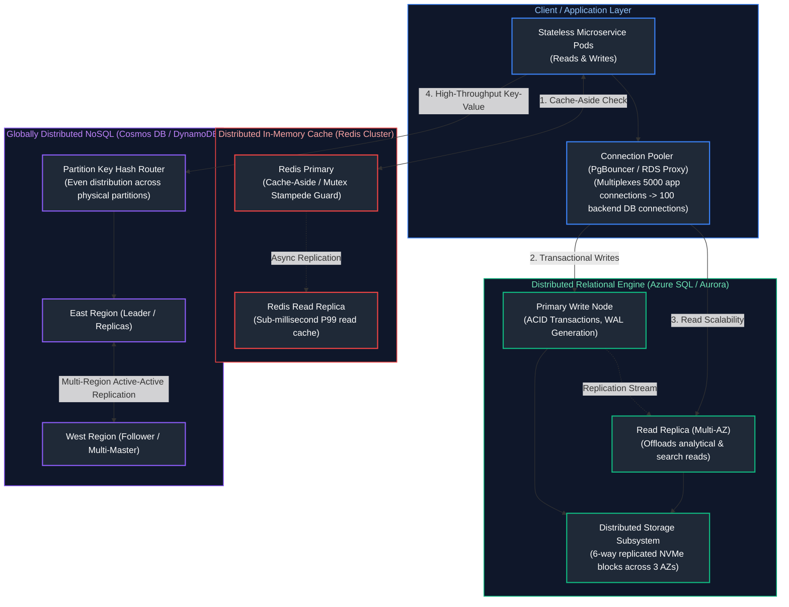

# 12. Databases, Storage & Distributed Systems

A comprehensive, production-grade guide to cloud databases, distributed storage engines, managed relational platforms (Azure SQL, PostgreSQL, Amazon Aurora), globally distributed NoSQL (Cosmos DB, DynamoDB), in-memory caching with Redis, enterprise event streaming (Service Bus, Event Hubs, Kinesis), the CAP and PACELC theorems, and distributed consistency algorithms tailored for Data Architects and Distributed Systems Engineers.

---

## Architectural Overview: Cloud Distributed Data Tier & Caching Topology



---

## Table of Contents
1. [Distributed Systems Foundations: CAP, PACELC, and Consistency Models](#1-distributed-systems-foundations-cap-pacelc-and-consistency-models)
   - [1.1 The CAP Theorem in Cloud Architectures](#11-the-cap-theorem-in-cloud-architectures)
   - [1.2 The PACELC Theorem: Latency vs. Consistency Trade-Offs](#12-the-pacelc-theorem-latency-vs-consistency-trade-offs)
   - [1.3 Strong vs. Bounded Staleness vs. Eventual Consistency](#13-strong-vs-bounded-staleness-vs-eventual-consistency)
2. [Cloud Relational Database Engines: Azure SQL, PostgreSQL & Aurora](#2-cloud-relational-database-engines-azure-sql-postgresql-aurora)
   - [2.1 Decoupled Compute and Distributed Storage Fabrics](#21-decoupled-compute-and-distributed-storage-fabrics)
   - [2.2 High Availability, Failover, and Connection Pooling](#22-high-availability-failover-and-connection-pooling)
3. [NoSQL Architecture: Cosmos DB and DynamoDB](#3-nosql-architecture-cosmos-db-and-dynamodb)
   - [3.1 Partition Key Design & Hot Partition Mitigation](#31-partition-key-design-hot-partition-mitigation)
   - [3.2 Throughput Provisioning: Request Units (RUs) vs. RCU/WCU](#32-throughput-provisioning-request-units-rus-vs-rcuwcu)
4. [Distributed Caching with Redis](#4-distributed-caching-with-redis)
   - [4.1 Caching Patterns: Cache-Aside, Write-Through, and Write-Behind](#41-caching-patterns-cache-aside-write-through-and-write-behind)
   - [4.2 Cache Stampede (Thundering Herd) and Mutex Locking](#42-cache-stampede-thundering-herd-and-mutex-locking)
5. [Messaging Queues and Event Streaming](#5-messaging-queues-and-event-streaming)
   - [5.1 Message Broker vs. Append-Only Distributed Log](#51-message-broker-vs-append-only-distributed-log)
   - [5.2 Azure Service Bus vs. AWS SQS/SNS Deep Dive](#52-azure-service-bus-vs-aws-sqssns-deep-dive)
   - [5.3 High-Throughput Streaming: Azure Event Hubs vs. AWS Kinesis](#52-azure-service-bus-vs-aws-sqssns-deep-dive)
6. [Distributed Idempotency and Transaction Coordination](#6-distributed-idempotency-and-transaction-coordination)
   - [6.1 Exactly-Once Semantics vs. At-Least-Once Delivery](#61-exactly-once-semantics-vs-at-least-once-delivery)
   - [6.2 Idempotency Keys and Distributed Deduplication Tables](#62-idempotency-keys-and-distributed-deduplication-tables)
   - [6.3 Distributed Locking with Redis (Redlock) and Lease Locks](#63-distributed-locking-with-redis-redlock-and-lease-locks)
7. [Cloud Storage Lifecycle, Encryption, and Replication](#7-cloud-storage-lifecycle-encryption-and-replication)
   - [7.1 Block vs. Object vs. File Storage Performance Metrics](#71-block-vs-object-vs-file-storage-performance-metrics)
   - [7.2 Redundancy Tiers: LRS, ZRS, GRS vs. S3 Multi-Region Replication](#72-redundancy-tiers-lrs-zrs-grs-vs-s3-multi-region-replication)
8. [Production Distributed Locking and Idempotency Implementation](#8-production-distributed-locking-and-idempotency-implementation)
   - [8.1 Production Python Redis Distributed Lock & Deduplication Consumer](#81-production-python-redis-distributed-lock-deduplication-consumer)
9. [Summary Comparison & Engineering Reference Matrix](#9-summary-comparison-engineering-reference-matrix)
10. [References & Further Reading](#10-references-further-reading)

---

# 1. Distributed Systems Foundations: CAP, PACELC, and Consistency Models

### 1.1 The CAP Theorem in Cloud Architectures

In a distributed network where network partitions ($P$) are inevitable across physical cables, an architecture must choose between:
- **Consistency ($C$):** Every read receives the most recent write or an error. (e.g. Traditional RDBMS with synchronous two-phase commit).
- **Availability ($A$):** Every non-failing node returns a non-error response, but without guaranteeing it is the most recent write. (e.g. DNS, Amazon DynamoDB).

```text
       Consistency (C)
          /       \
         /  (RDBMS)\
        /   CP     CA
       /             \
Partition (P) ────── Availability (A)
           \   AP    /
            \ (DNS) /
             \     /
```

---

### 1.2 The PACELC Theorem: Latency vs. Consistency Trade-Offs

The CAP theorem only describes behavior *during an active partition*. **PACELC** extends this to normal steady-state operations:

$$\text{If } \mathbf{P} \text{ (Partition): Choose } \mathbf{A} \text{ or } \mathbf{C}; \quad \mathbf{E} \text{ (Else / Normal): Choose } \mathbf{L} \text{ (Latency) or } \mathbf{C} \text{ (Consistency)}$$

- **PC/EC (e.g., Spanner, Azure SQL):** Guarantees consistency during partitions; preserves strict consistency during normal operation at the expense of higher latency.
- **PA/EL (e.g., DynamoDB, Cosmos DB Eventual):** Chooses availability during partitions; optimizes for sub-10ms read/write latency during normal operations by sacrificing real-time consistency.

---

### 1.3 Strong vs. Bounded Staleness vs. Eventual Consistency

Azure Cosmos DB formally provides five mathematically bounded consistency tiers:
1. **Strong:** Linearizable reads. Guarantees that reads always return the most recent committed write. Requires global synchronous commit across all regions (highest write latency).
2. **Bounded Staleness:** Reads lag behind writes by at most $K$ versions or $T$ time intervals (e.g. max 5 seconds or 100 updates).
3. **Session (Default):** Guarantees monotonic reads, monotonic writes, and Read-Your-Own-Writes within a single client session token.
4. **Consistent Prefix:** Guarantees reads never see out-of-order updates.
5. **Eventual:** Out-of-order, lowest latency reads. Replicas converge over time.

---

# 2. Cloud Relational Database Engines: Azure SQL, PostgreSQL & Aurora

### 2.1 Decoupled Compute and Distributed Storage Fabrics

Modern cloud-native databases (Amazon Aurora and Azure SQL Hyperscale) discard traditional monolithic monolithic architecture where compute and local disks were coupled:

```text
Traditional Monolithic RDBMS:
[Compute Node] ──(Flushes Dirty Pages + WAL to local disk)──> [Local SSD Raid]

Cloud-Native Decoupled RDBMS (Aurora / Hyperscale):
[Compute Node (Stateless)] ──(Pushes ONLY Write-Ahead Log Stream via 100Gbps network)──> [Distributed Storage Cluster]
                                                                                              │
                                                                                              ▼
                                                                           [Storage Nodes Apply Redo Logs in Parallel]
```

- **Zero Dirty Page I/O:** The compute engine never pushes dirty pages to disk, reducing network write traffic by $>80\%$.
- **Instant Crash Recovery:** Recovery is continuous because storage nodes apply log records asynchronously in the background. No lengthy crash-recovery replay cycles upon database reboot.

---

### 2.2 High Availability, Failover, and Connection Pooling

- **Read Replica Lag:** Replicas stream WAL logs asynchronously. Under high write loads, replicas experience **replication lag**, serving stale data.
- **Connection Multiplexing:** PostgreSQL spawns an entire dedicated operating system process per client connection (consuming 5-10MB RAM per connection). At 2,000 connections, context switching degrades throughput.
- **Connection Poolers (PgBouncer / AWS RDS Proxy):** Sits in front of PostgreSQL in transaction-pooling mode. Thousands of microservices share a compact pool of 50-100 real database connections, eliminating connection starvation.

---

# 3. NoSQL Architecture: Cosmos DB and DynamoDB

### 3.1 Partition Key Design & Hot Partition Mitigation

Distributed NoSQL databases partition data across storage nodes using a **Hash Function** applied to the Partition Key:

$$\text{Physical Partition Node} = \text{MD5}(\text{PartitionKey}) \pmod{\text{Total Partitions}}$$

```text
ANTI-PATTERN (HOT PARTITION):
Partition Key: CreatedDate ("2026-10-10")
Result: ALL writes for today hit Partition 1 (100% saturation / HTTP 429 Throttling).
        Partitions 2, 3, and 4 sit completely idle.

BEST PRACTICE (UNIFORM HASH DISTRIBUTION):
Partition Key: CustomerUUID or Synthetic Suffix (CustomerID + "_" + Random(0,9))
Result: Writes scatter uniformly across all physical partitions.
```

---

### 3.2 Throughput Provisioning: Request Units (RUs) vs. RCU/WCU

- **Azure Cosmos DB Request Units (RU/s):** A normalized currency measuring compute, memory, and IOPS. Reading a 1KB document via point-read costs exactly $1$ RU. Complex multi-partition SQL queries cost dozens or hundreds of RUs.
- **Amazon DynamoDB:** Allocates separate Read Capacity Units (1 RCU = one strongly consistent read of 4KB/s) and Write Capacity Units (1 WCU = one write of 1KB/s).

---

# 4. Distributed Caching with Redis

### 4.1 Caching Patterns: Cache-Aside, Write-Through, and Write-Behind

- **Cache-Aside (Lazy Loading):** Application queries Redis first. On cache miss, it reads from the database, writes the result to Redis with a TTL, and returns it. Most common and resilient.
- **Write-Through:** Application writes to the cache; the cache synchronously writes to the database before acknowledging the write.
- **Write-Behind (Write-Back):** Application writes to the cache immediately; the cache queues asynchronous batched writes to the database. Extreme write throughput, but risks data loss during cache crashes.

---

### 4.2 Cache Stampede (Thundering Herd) and Mutex Locking

When an expensive, highly requested cache key expires under heavy load, thousands of concurrent requests miss simultaneously, all attempting to query the database and recompute the key at the same instant, crushing the database.

> [!TIP]
> **Mitigating Cache Stampedes:**
> 1. **Distributed Mutex (Locking):** Only the first request acquiring the Redis lock queries the database; all other requests wait or return stale data.
> 2. **Probabilistic Early Expiration (XFetch Algorithm):** Background threads randomly recompute keys slightly before their physical TTL expires:
>    $$\Delta - \beta \times \ln(\text{random}()) > \text{TTL}$$

---

# 5. Messaging Queues and Event Streaming

### 5.1 Message Broker vs. Append-Only Distributed Log

| Dimension | Message Queue (Azure Service Bus / SQS) | Event Stream (Kafka / Event Hubs / Kinesis) |
| :--- | :--- | :--- |
| **Data Structure** | Transient Queue (Message deleted once consumed/acked) | Immutable Append-Only Partitioned Commit Log |
| **Message Deletion** | Destructive read (ACK deletes message) | Non-destructive (Message retained for 7+ days; consumer moves offset) |
| **Ordering** | Ordered per Session or FIFO group | Strictly ordered per partition key |
| **Replayability** | Cannot replay processed messages | Any consumer can rewind offset to replay from beginning |
| **Use Case** | Task distribution, job queues, transactional commands | Event sourcing, clickstream telemetry, real-time analytics |

---

### 5.2 Azure Service Bus vs. AWS SQS/SNS Deep Dive

- **Dead-Letter Queuing (DLQ):** Messages failing processing $N$ times (exceeding `maxDeliveryCount`) are automatically moved to a sub-queue (`$DeadLetterQueue`) for inspection without blocking valid messages.
- **Message Sessions:** In Azure Service Bus, setting `SessionId` guarantees strict first-in, first-out (FIFO) processing across concurrent consumers.

---

# 6. Distributed Idempotency and Transaction Coordination

### 6.1 Exactly-Once Semantics vs. At-Least-Once Delivery

In distributed networks, true network-level exactly-once delivery is physically impossible (Two Generals' Problem). Cloud messaging brokers guarantee **At-Least-Once Delivery**. Network timeouts or consumer crashes during ACK transmission result in **duplicate message delivery**.

---

### 6.2 Idempotency Keys and Distributed Deduplication Tables

An operation is **idempotent** if applying it multiple times produces the exact same outcome as applying it once ($f(f(x)) = f(x)$):

```sql
-- Idempotent Transaction Record Table
CREATE TABLE processed_transactions (
    idempotency_key VARCHAR(64) PRIMARY KEY,
    response_payload JSONB NOT NULL,
    created_at TIMESTAMP WITH TIME ZONE DEFAULT CURRENT_TIMESTAMP
);
```

When receiving a message, the consumer initiates a database transaction:
1. Attempt `INSERT INTO processed_transactions (idempotency_key, ...)`.
2. If primary key collision occurs, abort business logic and return pre-computed `response_payload`.
3. If successful, execute the payment/order logic.

---

### 6.3 Distributed Locking with Redis (Redlock) and Lease Locks

To coordinate actions across multiple nodes (e.g. running a scheduled cron job on only one instance):
```bash
# Acquire lock with a 10-second automatic lease expiration
SET resource_lock "unique_worker_id_123" NX PX 10000
```
- `NX`: Only set if key does not exist.
- `PX 10000`: Expire lock automatically in 10,000 milliseconds to prevent permanent deadlock if the worker node crashes.

---

# 7. Cloud Storage Lifecycle, Encryption, and Replication

### 7.1 Block vs. Object vs. File Storage Performance Metrics

- **Block Storage (Azure Managed Disks / AWS EBS):** Raw disk blocks attached via iSCSI/NVMe-oF. Ultra-low sub-millisecond latency for databases. Cannot be mounted concurrently across multiple VMs without shared disk clustering.
- **Object Storage (Azure Blob / AWS S3):** Key-value HTTP REST access. Infinite horizontal scale, 99.999999999% (11 9s) durability, high throughput, but 20-50ms latency.
- **File Storage (Azure Files / AWS EFS):** Shared network file system (NFSv4 / SMB 3.0) mountable concurrently across thousands of compute nodes.

---

### 7.2 Redundancy Tiers: LRS, ZRS, GRS vs. S3 Multi-Region Replication

- **Locally Redundant Storage (LRS):** 3 synchronous copies within a single physical data center. Vulnerable to data center flooding or power failure.
- **Zone-Redundant Storage (ZRS):** 3 synchronous copies distributed across three distinct Availability Zones within a region. Survives catastrophic AZ loss.
- **Geo-Redundant Storage (GRS):** Replicates data synchronously across 3 AZs in the primary region, plus asynchronous replication to a paired secondary region 500+ miles away.

---

# 8. Production Distributed Locking and Idempotency Implementation

### 8.1 Production Python Redis Distributed Lock & Deduplication Consumer

Below is a production-grade Python script implementing an auto-renewing distributed lease lock with idempotency tracking:

```python
#!/usr/bin/env python3
"""
Distributed Lock & Idempotent Message Processor.
Implements mutual exclusion locking with TTL fencing and transaction deduplication
using Redis semantics without external third-party abstractions.
"""

from dataclasses import dataclass
import hashlib
import json
import logging
import sys
import time
from typing import Callable, Dict, Optional

logging.basicConfig(
    level=logging.INFO,
    format='{"time":"%(asctime)s","level":"%(levelname)s","message":"%(message)s"}',
    handlers=[logging.StreamHandler(sys.stdout)],
)
logger = logging.getLogger("distributed_systems")


class MockRedisClient:
    """In-memory mock reproducing Redis SETNX, GET, and DEL atomic behaviors."""
    def __init__(self):
        self.store = {}
        self.expires = {}

    def set(self, key: str, value: str, nx: bool = False, px: Optional[int] = None) -> bool:
        now = time.time()
        # Clean expired
        if key in self.expires and now > self.expires[key]:
            del self.store[key]
            del self.expires[key]

        if nx and key in self.store:
            return False

        self.store[key] = value
        if px:
            self.expires[key] = now + (px / 1000.0)
        return True

    def get(self, key: str) -> Optional[str]:
        now = time.time()
        if key in self.expires and now > self.expires[key]:
            del self.store[key]
            del self.expires[key]
            return None
        return self.store.get(key)

    def delete(self, key: str) -> bool:
        if key in self.store:
            del self.store[key]
            if key in self.expires:
                del self.expires[key]
            return True
        return False


class DistributedIdempotencyManager:
    def __init__(self, redis_client: MockRedisClient):
        self.redis = redis_client

    def process_idempotent_event(
        self,
        event_id: str,
        payload: Dict,
        handler: Callable[[Dict], Dict],
        lease_ms: int = 5000,
    ) -> Dict:
        """Executes event handler under a distributed lock, caching outcome."""
        lock_key = f"lock:event:{event_id}"
        result_key = f"result:event:{event_id}"

        # 1. Check if event was already processed previously
        cached_result = self.redis.get(result_key)
        if cached_result:
            logger.info("Idempotent hit: Event %s already executed. Returning cached response.", event_id)
            return json.loads(cached_result)

        # 2. Acquire distributed mutual exclusion lock
        worker_id = f"worker_{time.time_ns()}"
        acquired = self.redis.set(lock_key, worker_id, nx=True, px=lease_ms)
        if not acquired:
            logger.warning("Concurrency conflict: Another worker holds lock for event %s. Aborting.", event_id)
            return {"status": "CONFLICT", "message": "Event currently being processed"}

        try:
            logger.info("Executing transactional logic for event %s", event_id)
            outcome = handler(payload)
            # Store result with 24-hour expiration for deduplication
            self.redis.set(result_key, json.dumps(outcome), px=86400000)
            return outcome
        finally:
            # Release lock only if we still own it
            current_owner = self.redis.get(lock_key)
            if current_owner == worker_id:
                self.redis.delete(lock_key)
                logger.info("Lock released for event %s", event_id)


if __name__ == "__main__":
    redis = MockRedisClient()
    manager = DistributedIdempotencyManager(redis)

    def charge_credit_card(data: Dict) -> Dict:
        return {"status": "SUCCESS", "tx_id": "tx_9981", "amount": data.get("amount")}

    event = "evt_order_created_12345"
    payload_data = {"amount": 149.99, "currency": "USD"}

    # Run 1: Executes business logic
    res1 = manager.process_idempotent_event(event, payload_data, charge_credit_card)
    print("Execution 1:", res1)

    # Run 2: Duplicate arrival intercepted by idempotency table
    res2 = manager.process_idempotent_event(event, payload_data, charge_credit_card)
    print("Execution 2 (Duplicate):", res2)
```

---

# 9. Summary Comparison & Engineering Reference Matrix

| Storage / Database Engine | CAP / PACELC Classification | Primary Scaling Bottleneck | Concurrency & Isolation | Replication Standard |
| :--- | :--- | :--- | :--- | :--- |
| **Azure SQL / Aurora** | PC / EC (Strict Consistency) | Write node CPU / Connection counts | Multi-Version Concurrency Control (MVCC) | 6-way synchronous storage fabric across 3 AZs |
| **Cosmos DB / DynamoDB** | PA / EL (Configurable Session/Eventual) | Hot partition key saturation ($>10$k RU/sec per key) | Optimistic Concurrency Control (ETags) | Active-Active Multi-Region Multi-Master |
| **Redis Cluster** | CP (Strict in-memory primary) | Single-threaded CPU event loop & network I/O | In-memory atomic commands & Lua scripts | Asynchronous replica streaming with sentinel failover |
| **Azure Service Bus / SQS**| PC / EC (Transactional Queuing) | Max queue message throughput | Message sessions & visibility timeouts | 3-way replicated broker storage |
| **Azure Blob / AWS S3** | CP (Strong read-after-write) | Prefix request rate (3,500 writes/s per prefix) | Versioned immutable object overwrite | Zone-Redundant (ZRS) across 3 AZs |

---

# 10. References & Further Reading

- [Eric Brewer: CAP Twelve Years Later: How the "Rules" Have Changed](https://www.infoq.com/articles/cap-twelve-years-later-how-the-rules-have-changed/) — Foundational theory.
- [Daniel Abadi: Consistency Tradeoffs in Modern Distributed Database System Design (PACELC)](https://www.cs.umd.edu/~abadi/papers/abadi-pacelc.pdf) — PACELC formal proof.
- [Amazon Aurora Architecture Paper (SIGMOD 2017)](https://www.allthingsdistributed.com/files/p1041-verbitski.pdf) — Log-is-the-database decoupled storage design.
- [Microsoft Learn: Consistency levels in Azure Cosmos DB](https://learn.microsoft.com/en-us/azure/cosmos-db/consistency-levels) — Formal consistency bounds.
- [Redis Documentation: Distributed Locks with Redlock](https://redis.io/docs/manual/patterns/distributed-locks/) — Algorithmic locking patterns.

