# 13. Serverless & Cloud-Native Application Architecture

A comprehensive, production-grade guide to serverless computing paradigms (Azure Functions vs. AWS Lambda), containerized serverless runtimes (Azure Container Apps, ECS Fargate, Cloud Run), event-driven architectures (EDA), distributed workflow orchestration with Durable Functions and AWS Step Functions, cold start physics and SnapStart acceleration, API gateways, and distributed transaction management via the Saga pattern tailored for Cloud-Native Architects and Principal Engineers.

---

## Architectural Overview: Event-Driven Serverless Microservice Ecosystem

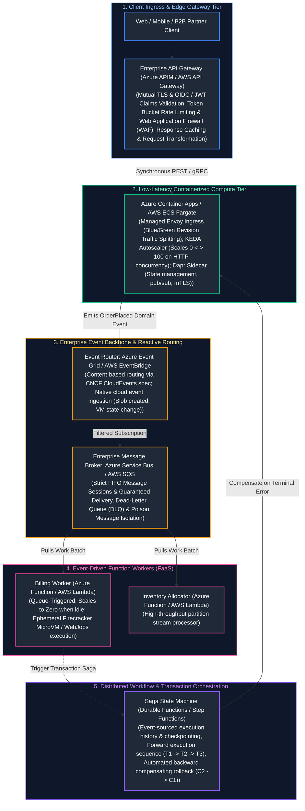

---

## Table of Contents
1. [Serverless Foundations: The Pop-Up Food Truck Analogy & Core Paradigms](#1-serverless-foundations-the-pop-up-food-truck-analogy--core-paradigms)
   - [1.1 Real-World Analogy: Brick-and-Mortar Restaurants vs. On-Demand Pop-Up Trucks](#11-real-world-analogy-brick-and-mortar-restaurants-vs-on-demand-pop-up-trucks)
   - [1.2 Serverless Definition: The 4 Tenets of True Serverless](#12-serverless-definition-the-4-tenets-of-true-serverless)
2. [FaaS Compute Mechanics: Azure Functions vs. AWS Lambda Internals](#2-faas-compute-mechanics-azure-functions-vs-aws-lambda-internals)
   - [2.1 Virtualization & Sandboxing: Firecracker MicroVMs vs. WebJobs Host](#21-virtualization--sandboxing-firecracker-microvms-vs-webjobs-host)
   - [2.2 Cold Start Physics: Phases of Execution and Root Causes](#22-cold-start-physics-phases-of-execution-and-root-causes)
   - [2.3 Advanced Cold-Start Elimination: SnapStart, CRaC, and Provisioned Concurrency](#23-advanced-cold-start-elimination-snapstart-crac-and-provisioned-concurrency)
   - [2.4 Azure Functions Programming Model: In-Process vs. Isolated Worker](#24-azure-functions-programming-model-in-process-vs-isolated-worker)
3. [Containerized Serverless Platforms: Azure Container Apps & AWS Fargate](#3-containerized-serverless-platforms-azure-container-apps--aws-fargate)
   - [3.1 Architectural Underpinnings of ACA: KEDA, Envoy, and Dapr](#31-architectural-underpinnings-of-aca-keda-envoy-and-dapr)
   - [3.2 Serverless Containers vs. FaaS vs. Dedicated Kubernetes (AKS/EKS)](#32-serverless-containers-vs-faas-vs-dedicated-kubernetes-akseks)
4. [Event-Driven Architecture (EDA) & Reactive Cloud Routing](#4-event-driven-architecture-eda--reactive-cloud-routing)
   - [4.1 The Three Event Archetypes: Notification, State Transfer, and Event Sourcing](#41-the-three-event-archetypes-notification-state-transfer-and-event-sourcing)
   - [4.2 CNCF CloudEvents Standard and Content-Based Routing](#42-cncf-cloudevents-standard-and-content-based-routing)
   - [4.3 Azure Event Grid vs. AWS EventBridge Deep Dive](#43-azure-event-grid-vs-aws-eventbridge-deep-dive)
5. [Distributed Workflow Orchestration: Durable Functions & AWS Step Functions](#5-distributed-workflow-orchestration-durable-functions--aws-step-functions)
   - [5.1 Durable Task Framework (DTFx): Event Sourcing and the Determinism Law](#51-durable-task-framework-dtfx-event-sourcing-and-the-determinism-law)
   - [5.2 AWS Step Functions: Amazon States Language (ASL), Task Tokens, and Distributed Map](#52-aws-step-functions-amazon-states-language-asl-task-tokens-and-distributed-map)
6. [The Distributed Saga Pattern: Managing Cross-Service Transactions](#6-the-distributed-saga-pattern-managing-cross-service-transactions)
   - [6.1 Choreography vs. Orchestration: The Complexity Curve](#61-choreography-vs-orchestration-the-complexity-curve)
   - [6.2 The Pivot Transaction and Semantic Compensations](#62-the-pivot-transaction-and-semantic-compensations)
   - [6.3 Semantic Anomalies in Sagas: Lost Updates and Dirty Reads](#63-semantic-anomalies-in-sagas-lost-updates-and-dirty-reads)
7. [Enterprise API Management & Edge Gateways](#7-enterprise-api-management--edge-gateways)
   - [7.1 Azure APIM Policy Pipeline: Inbound, Backend, Outbound, and On-Error](#71-azure-apim-policy-pipeline-inbound-backend-outbound-and-on-error)
   - [7.2 Token Bucket Rate Limiting and Circuit Breaking at the Edge](#72-token-bucket-rate-limiting-and-circuit-breaking-at-the-edge)
8. [Total Cost of Ownership (TCO) & Inflection Point Mathematics](#8-total-cost-of-ownership-tco--inflection-point-mathematics)
   - [8.1 The Serverless Economic Curve: Pay-Per-Execution vs. Baseline Compute](#81-the-serverless-economic-curve-pay-per-execution-vs-baseline-compute)
   - [8.2 Mathematical TCO Inflection Model](#82-mathematical-tco-inflection-model)
9. [Production Code Implementation: Distributed Saga Orchestration Engine](#9-production-code-implementation-distributed-saga-orchestration-engine)
   - [9.1 Production Python Saga Orchestrator with Persistent State & Idempotent Compensation](#91-production-python-saga-orchestrator-with-persistent-state--idempotent-compensation)
10. [Senior Cloud Architect Troubleshooting Runbooks: Serverless Incidents](#10-senior-cloud-architect-troubleshooting-runbooks-serverless-incidents)
   - [10.1 Scenario 1: Uncontrolled Autoscaling Crashing Downstream Relational Databases](#101-scenario-1-uncontrolled-autoscaling-crashing-downstream-relational-databases)
   - [10.2 Scenario 2: Non-Deterministic Replay Crash in Azure Durable Functions](#102-scenario-2-non-deterministic-replay-crash-in-azure-durable-functions)
   - [10.3 Scenario 3: Cold-Start Latency Cascading into API Gateway 504 Timeouts](#103-scenario-3-cold-start-latency-cascading-into-api-gateway-504-timeouts)
11. [Summary Comparison & Engineering Reference Matrix](#11-summary-comparison--engineering-reference-matrix)
12. [References & Further Reading](#12-references--further-reading)

---

# 1. Serverless Foundations: The Pop-Up Food Truck Analogy & Core Paradigms

### 1.1 Real-World Analogy: Brick-and-Mortar Restaurants vs. On-Demand Pop-Up Trucks

To appreciate the paradigm shift represented by serverless cloud architecture, contrast the economics and operational overhead of a **traditional brick-and-mortar restaurant** with an **on-demand pop-up catering fleet**:

| Architectural Dimension | Traditional Provisioned Compute (VMs / Static K8s) | Serverless FaaS (AWS Lambda / Azure Functions) | Real-World Food Truck Analogy |
| :--- | :--- | :--- | :--- |
| **Baseline Idle Cost** | **24/7 Continuous Billing:** Billed every second VMs remain powered on, even at 0% CPU utilization. | **Strictly \$0.00 Idle Cost:** Compute environments do not exist on the ledger until an event arrives. | Fixed monthly building lease and utilities vs. zero real-estate footprint when closed. |
| **Scaling Dynamic** | **Reactive & Slow:** Autoscaling groups take 3–8 minutes to boot OS, initialize containers, and pass health checks. | **Instantaneous Horizontal Burst:** Cloud provider provisions dozens or hundreds of microVMs concurrently in milliseconds. | Fixed 50-seat dining hall turning away rushes vs. 100 pop-up trucks materializing in parallel. |
| **Capacity Management** | **Over-Provisioned Headroom:** Capacity must be pre-allocated for peak load, resulting in 70–80% average idle waste. | **Event-Driven Concurrency:** Exact sizing matching incoming event queue depth up to account safety quotas. | Paying full-time chef salaries 24/7 vs. activating chefs only when orders are placed. |
| **Latency & Cold Starts** | **Deterministic & Warm:** Processes run in memory continuously; predictable sub-millisecond execution latency. | **Cold-Start Penalty:** First invocation or scaled worker requires sandbox initialization (50ms–2s depending on runtime). | Always-hot kitchen stove vs. unpacking truck equipment from scratch before cooking. |
| **Operational Burden** | **Heavy Infrastructure Ops:** OS patching, kernel vulnerabilities, AMI maintenance, hypervisor networking. | **Zero Server Ops:** Vendor manages underlying physical host, hypervisor, isolation boundaries, and runtime security. | Maintaining building structure and plumbing vs. turnkey food service. |

- **In the provisioned model (VMs, Kubernetes clusters):** You lease virtual hardware continuously. Even if your e-commerce storefront receives zero visitors between 2:00 AM and 5:00 AM, you pay for 32 vCPUs, 128GB RAM, hypervisor licensing, and operating system patching. If a flash sale abruptly brings 100,000 users, your fixed 50 worker nodes choke and crash before autoscalers can provision new virtual machines.
- **In the serverless model (Azure Functions, AWS Lambda):** The underlying infrastructure does not exist in your billing ledger until an HTTP packet hits the edge or a message lands on a queue. The cloud vendor spins up ephemeral compute, executes your code, charges you down to the exact millisecond of CPU consumption, and immediately tears down the environment. When traffic drops to zero, **your operational bill is precisely \$0.00**.

---

### 1.2 Serverless Definition: The 4 Tenets of True Serverless

Not everything branded as "cloud-native" is serverless. Industry consensus defines a technology as genuinely serverless only if it satisfies all four criteria:
1. **Zero Server Management:** Zero operating system installations, kernel security patching, AMI baking, or SSH key management.
2. **True Scale-to-Zero:** When idle, resource consumption and compute billing drop to zero.
3. **Pay Strictly for Value (Sub-Second Metering):** Billed by execution invocations and duration in 1ms increments, not by allocated virtual core hours.
4. **Built-in High Availability & Fault Tolerance:** Automatic multi-availability zone redundancy without manual clustering or load-balancer target group management.

---

# 2. FaaS Compute Mechanics: Azure Functions vs. AWS Lambda Internals

### 2.1 Virtualization & Sandboxing: Firecracker MicroVMs vs. WebJobs Host

The internal execution architecture of AWS Lambda and Azure Functions differs fundamentally at the hypervisor and process sandboxing layers:

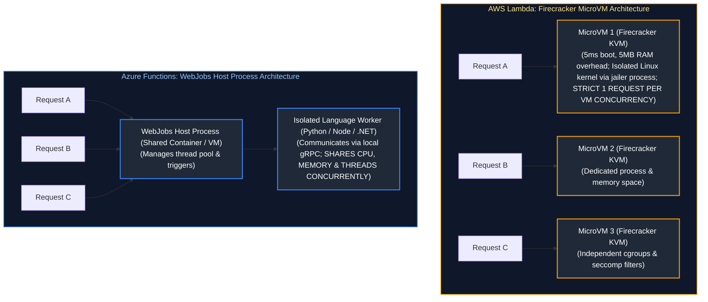

#### 1. AWS Lambda & Firecracker MicroVMs
AWS developed **Firecracker**, an open-source Rust-based Virtual Machine Monitor (VMM) utilizing the Linux Kernel-based Virtual Machine (KVM).
- **Security Sandboxing:** Each microVM strips away legacy BIOS and emulated PCI devices, booting an isolated Linux kernel with minimal device drivers in **$< 5$ms**.
- **Concurrency Isolation:** AWS Lambda enforces a **single-concurrency execution model**. A single Firecracker microVM instance processes **exactly one request at any given instant**. If 500 concurrent requests arrive, AWS spawns 500 separate Firecracker microVMs.

#### 2. Azure Functions & The WebJobs Host
Azure Functions groups multiple functions into a **Function App**, hosted inside a containerized App Service Environment.
- **Shared Host Runtime:** The .NET-based WebJobs Host runs as a daemon, listening to trigger sources (queues, timers, HTTP).
- **Multi-Threaded Concurrency:** Unlike AWS Lambda, a single Azure Functions host instance can process **dozens or hundreds of concurrent requests simultaneously**, multiplexing requests across a shared thread pool and memory heap.

---

### 2.2 Cold Start Physics: Phases of Execution and Root Causes

A **Cold Start** is the latency tax incurred when a request arrives and no pre-warmed, idle execution sandbox exists:

$$\text{Total Cold Start Latency} = T_{\text{Sandbox Init}} + T_{\text{ENI/VPC Attach}} + T_{\text{Runtime Init}} + T_{\text{App Init (User Code)}}$$

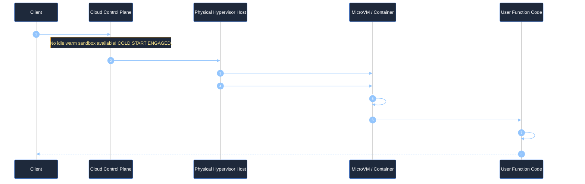

#### Cold Start Drivers by Language Runtime:
- **Compiled / Static Runtimes (Go, Rust):** Minimal cold starts (**~50ms to 150ms**). No virtual machine interpreter initialization required.
- **Lightweight Interpreted Runtimes (Node.js, Python):** Moderate cold starts (**~150ms to 400ms**). Overhead driven by parsing large imported dependency trees (e.g. `import boto3`, `import pandas`).
- **Heavy Managed Runtimes (Java, .NET, Spring Boot):** Severe cold starts (**~1,500ms to 6,000ms+**). Driven by JVM class-loading, bytecode JIT compilation, and reflection-based dependency injection frameworks.

---

### 2.3 Advanced Cold-Start Elimination: SnapStart, CRaC, and Provisioned Concurrency

To eliminate JVM and container cold-start delays, cloud providers have engineered snapshot-based acceleration:

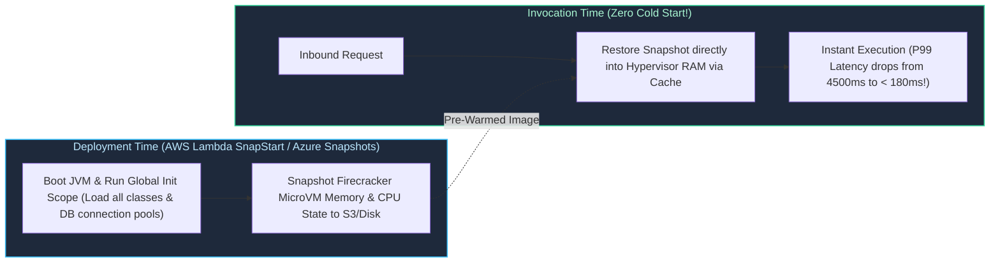

1. **AWS Lambda SnapStart (CRaC - Coordinated Restore at Checkpoint):** During deployment, Lambda initializes your function, executes all static initializers, loads all JVM classes, takes an immutable snapshot of the microVM memory and disk, and caches it in a tiered multi-level cache. Subsequent cold invocations bypass initialization entirely and restore the running state in **$< 200\text{ms}$**.
2. **Provisioned Concurrency:** Cloud providers pre-allocate and keep warm a dedicated pool of initialized microVM execution environments 24/7. Invocations routed to provisioned instances experience zero cold starts.

---

### 2.4 Azure Functions Programming Model: In-Process vs. Isolated Worker

Azure Functions transitioned from the legacy **In-Process Model** to the modern **Isolated Worker Model**:

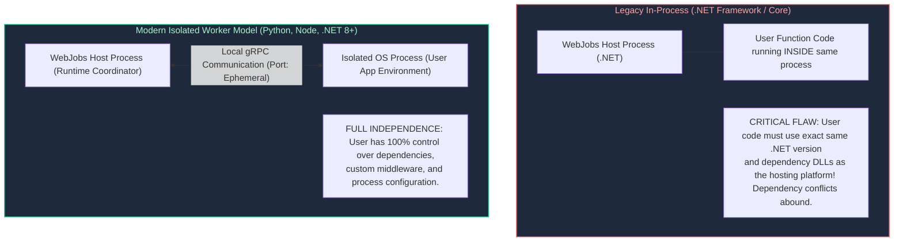

---

# 3. Containerized Serverless Platforms: Azure Container Apps & AWS Fargate

While Function-as-a-Service (FaaS) is ideal for short-lived, event-driven tasks, enterprise architectures require containerized serverless solutions to host complex microservices.

### 3.1 Architectural Underpinnings of ACA: KEDA, Envoy, and Dapr

**Azure Container Apps (ACA)** abstracts underlying Kubernetes (AKS) clusters, delivering a serverless container platform composed of three best-of-breed open-source projects:

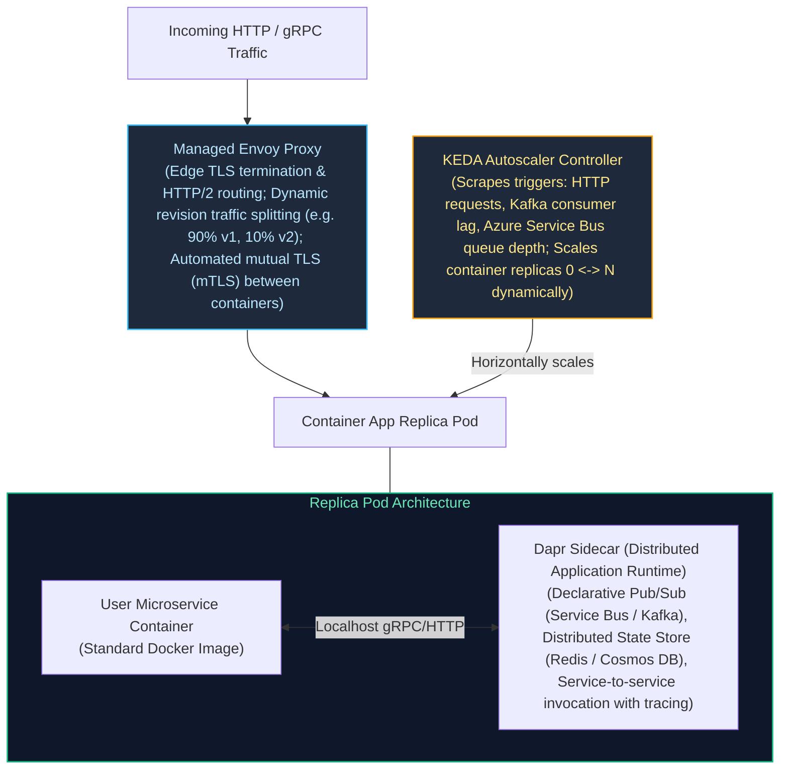

---

### 3.2 Serverless Containers vs. FaaS vs. Dedicated Kubernetes (AKS/EKS)

| Architectural Dimension | Function-as-a-Service (Lambda / Azure Functions) | Serverless Containers (Azure Container Apps / Fargate) | Dedicated Kubernetes (AKS / EKS) |
| :--- | :--- | :--- | :--- |
| **Packaging & Portability** | Vendor-specific zip packages or specialized container images | Standard Docker / OCI containers; 100% cloud-portable | Standard Docker / OCI containers + Helm / Kustomize |
| **Max Execution Duration** | Strict limit: **15 minutes** (AWS Lambda) | **Unbounded** (Can run 24/7 background worker processes) | **Unbounded** |
| **Concurrency Model** | 1 req/microVM (Lambda) or host-level (Azure Functions) | Configurable HTTP concurrent requests per container | Completely configurable via pod resources and ingress |
| **Scale-to-Zero Capability** | Sub-second native scale-to-zero | Native scale-to-zero via KEDA (HTTP or queue triggers) | Requires custom installation of Knative or KEDA |
| **Operational Maintenance** | Zero infrastructure management | Zero node management; configure container resources | High: Node pool upgrades, CNI networking, ingress controllers |

---

# 4. Event-Driven Architecture (EDA) & Reactive Cloud Routing

In an Event-Driven Architecture, state changes trigger asynchronous decoupled processing across independent services.

### 4.1 The Three Event Archetypes: Notification, State Transfer, and Event Sourcing

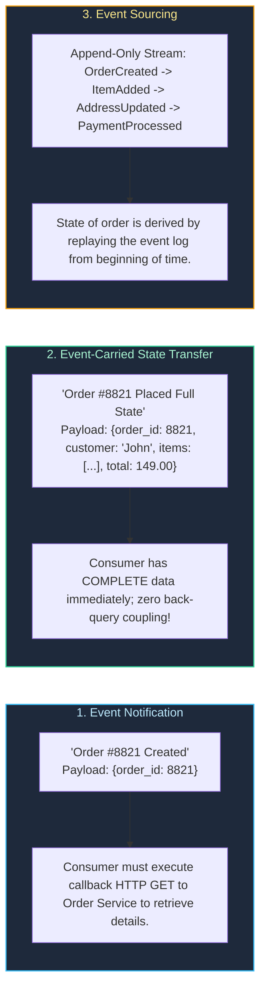

---

### 4.2 CNCF CloudEvents Standard and Content-Based Routing

The Cloud Native Computing Foundation (CNCF) created the **CloudEvents** specification to standardize event metadata across cloud providers:

```json
{
  "specversion": "1.0",
  "type": "com.retail.orders.order_placed",
  "source": "https://orders.retail.corp/eastus",
  "id": "e82f8102-54a8-4412-a1b9-373618192a01",
  "time": "2026-10-16T14:30:00Z",
  "datacontenttype": "application/json",
  "dataschema": "https://schemas.retail.corp/order_placed.v1.json",
  "data": {
    "order_id": "ord_99014",
    "customer_id": "cust_4412",
    "total_usd": 489.95,
    "payment_method": "CREDIT_CARD",
    "shipping_tier": "EXPEDITED"
  }
}
```

---

### 4.3 Azure Event Grid vs. AWS EventBridge Deep Dive

Both platforms deliver high-throughput, serverless **event routers** capable of evaluating rules against JSON event bodies to direct traffic:

| Feature Dimension | Azure Event Grid | AWS EventBridge |
| :--- | :--- | :--- |
| **Underlying Ingestion Latency** | Sub-10ms P99 routing | Sub-50ms routing |
| **Schema Registry** | Azure Event Grid Schema Registry (Avro / JSON Schema) | EventBridge Schema Registry with automated schema discovery |
| **Filtering Capabilities** | Advanced operators: StringBeginsWith, NumberInRange, AdvancedFilters | Complex JSON matching patterns (prefix, wildcard, numeric comparison) |
| **Retry & Dead-Lettering** | Up to 24 hours with exponential backoff; dead-letters to Azure Storage Blob | Up to 24 hours retry; dead-letters to AWS SQS queue |

---

# 5. Distributed Workflow Orchestration: Durable Functions & AWS Step Functions

Long-running business processes (human-in-the-loop approvals, multi-step checkout pipelines) cannot run inside standard 15-minute stateless functions.

### 5.1 Durable Task Framework (DTFx): Event Sourcing and the Determinism Law

**Azure Durable Functions** uses the **Durable Task Framework**. Orchestrator code is written in ordinary imperative sequential code, but under the hood, it is **event-sourced and executed via replays**:

```mermaid
%%{init: {'theme': 'dark', 'themeVariables': { 'actorBkg': '#1e293b', 'actorBorder': '#3b82f6', 'actorTextColor': '#ffffff', 'signalColor': '#93c5fd', 'signalTextColor': '#ffffff', 'noteBkgColor': '#1e293b', 'noteBorderColor': '#f59e0b', 'noteTextColor': '#fde68a', 'activationBkgColor': '#3b82f6', 'sequenceNumberColor': '#ffffff' }}}%%
sequenceDiagram
    autonumber
    participant App as Orchestrator Function
    participant DTFx as Durable Task Framework (DTFx Engine)
    participant Storage as Azure Storage (Queues & Tables)
    participant Act1 as Activity 1 (Charge Card)
    participant Act2 as Activity 2 (Reserve Stock)

    App->>DTFx: Call Activity 1: Charge Card
    DTFx->>Storage: Enqueue WorkItem for Activity 1; Record checkpoint in History Table
    DTFx-->>App: Suspend Orchestrator Execution (Thread freed! Scale to zero!)
    
    Storage->>Act1: Worker executes Activity 1
    Act1-->>Storage: Enqueue Result ($150 Charged OK)
    
    Storage->>DTFx: Notify Activity 1 Complete
    Note over DTFx,App: REPLAY PHASE: Replay Orchestrator from Line 1!
    DTFx->>App: Resume Orchestrator. Checks History Table -> Activity 1 already done!
    App->>DTFx: Call Activity 2: Reserve Stock
    DTFx->>Storage: Enqueue WorkItem for Activity 2; Checkpoint history
    DTFx-->>App: Suspend Orchestrator Execution again!
```

> [!CRITICAL]
> **The Golden Law of Orchestrator Determinism:** Because DTFx replays the orchestrator function from line 1 multiple times to reconstruct state, **orchestrators must be 100% deterministic**.
> - **FORBIDDEN:** Calling `datetime.now()`, generating random GUIDs (`uuid.uuid4()`), querying databases, or making direct HTTP calls.
> - **REQUIRED:** Use `context.current_utc_datetime` and delegate all I/O, randomness, and network calls to **Activity Functions**.

---

### 5.2 AWS Step Functions: Amazon States Language (ASL), Task Tokens, and Distributed Map

AWS Step Functions defines visual state machines using JSON/YAML:
- **Task Tokens (`.waitForTaskToken`):** The state machine pauses execution indefinitely (up to 1 year) and waits for an external callback signal (e.g. human manager clicking "Approve Expense" in an email), consuming **zero compute cost while paused**.
- **Distributed Map:** Iterates over millions of objects in an S3 bucket in parallel, spawning up to 10,000 concurrent Lambda workers to process petabytes of data within minutes.

---

# 6. The Distributed Saga Pattern: Managing Cross-Service Transactions

### 6.1 Choreography vs. Orchestration: The Complexity Curve

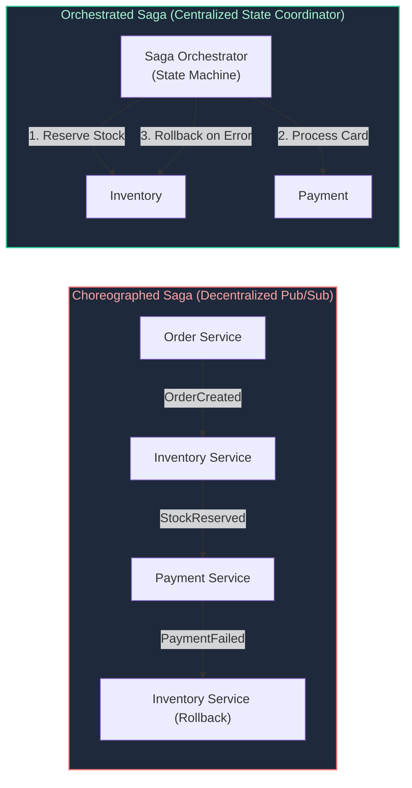

- **Choreography:** Great for small systems (2 to 3 microservices). Above 5 services, it produces cyclic event loops, untraceable bugs, and distributed deadlocks.
- **Orchestration:** Recommended for enterprise production. The orchestrator explicitly commands participants, monitors timeouts, and tracks the exact state of every transaction.

---

### 6.2 The Pivot Transaction and Semantic Compensations

In any distributed Saga, transactions fall into three categories:
1. **Compensable Transactions:** Transactions that precede the pivot and can be semantically undone (e.g., reserving temporary stock).
2. **Pivot Transaction:** The **point of no return**. Once the pivot transaction commits, the Saga **cannot be rolled back**. It must proceed forward to completion. (e.g., executing the actual bank wire transfer).
3. **Retriable Transactions:** Transactions that follow the pivot transaction; guaranteed to succeed eventually via idempotent retries (e.g., sending confirmation email).

---

### 6.3 Semantic Anomalies in Sagas: Lost Updates and Dirty Reads

Because Sagas lack the strict ACID isolation ($I$) of relational databases, they are vulnerable to concurrency anomalies:
- **Dirty Reads:** Service A updates account balance; Service B reads the balance; Service A fails and executes a compensating rollback. Service B operated on dirty, discarded data!
- **Mitigation (Semantic Locks):** When Service A begins a transaction, it marks the record state as `PENDING_APPROVAL`. Other transactions inspecting the record must block or handle the pending flag explicitly.

---

# 7. Enterprise API Management & Edge Gateways

### 7.1 Azure APIM Policy Pipeline: Inbound, Backend, Outbound, and On-Error

Azure API Management (APIM) intercepts all client traffic, executing XML policy definitions along a structured four-stage pipeline:

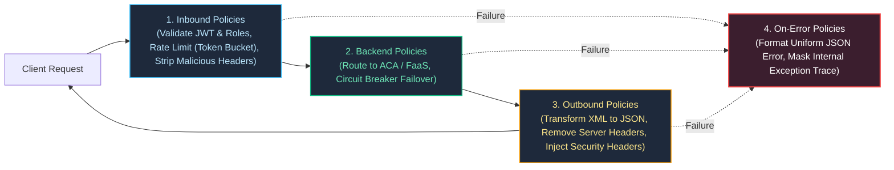

#### Production Azure APIM Policy XML:
```xml
<policies>
    <inbound>
        <base />
        <!-- Enforce Entra ID JWT validation with aud and scope claims -->
        <validate-jwt header-name="Authorization" failed-validation-httpcode="401" failed-validation-error-message="Access Denied: Invalid Bearer Token">
            <openid-config url="https://login.microsoftonline.com/your-tenant-uuid/v2.0/.well-known/openid-configuration" />
            <required-claims>
                <claim name="aud" match="all">
                    <value>api://orders-platform</value>
                </claim>
            </required-claims>
        </validate-jwt>

        <!-- Rate limit: 200 requests per 60 seconds per client IP -->
        <rate-limit-by-key calls="200" renewal-period="60" counter-key="@(context.Request.IpAddress)" />
    </inbound>
    <backend>
        <base />
    </backend>
    <outbound>
        <base />
        <!-- Prevent information disclosure -->
        <set-header name="X-Powered-By" exists-action="delete" />
        <set-header name="Server" exists-action="delete" />
    </outbound>
    <on-error>
        <base />
    </on-error>
</policies>
```

---

### 7.2 Token Bucket Rate Limiting and Circuit Breaking at the Edge

To prevent cascading microservice collapse and runaway serverless billing from distributed denial-of-service (DDoS) spikes, API Gateways enforce token bucket rate limiting and circuit breaking directly at the perimeter network:

#### 1. Token Bucket Algorithm Mechanics:
A token bucket holds a maximum capacity of $B$ tokens. Tokens refill continuously at a sustained rate of $r$ tokens/second. Each arriving request consumes 1 token. If the bucket is empty, the request is immediately rejected with `HTTP 429 Too Many Requests` without touching backend compute.

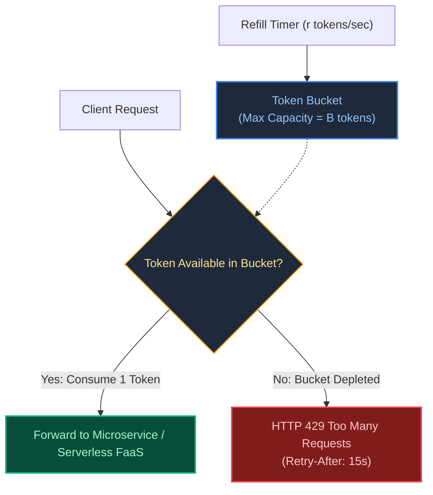

#### 2. APIM Circuit Breaker Backend Policy:
```xml
<backend>
    <!-- Trip circuit breaker if backend fails > 10% over 60 seconds -->
    <circuit-breaker trip-duration="30s">
        <failure-condition>
            <status-code min="500" max="599" />
        </failure-condition>
    </circuit-breaker>
    <forward-request timeout="10" />
</backend>
```

---

# 8. Total Cost of Ownership (TCO) & Inflection Point Mathematics

### 8.1 The Serverless Economic Curve: Pay-Per-Execution vs. Baseline Compute

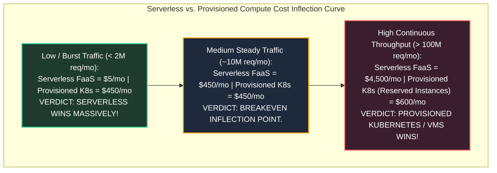

---

### 8.2 Mathematical TCO Inflection Model

$$\text{Cost}_{\text{Serverless}} = N_{\text{requests}} \times \left( C_{\text{invoc}} + (M_{\text{GB}} \times T_{\text{duration}} \times C_{\text{GB-sec}}) \right)$$

$$\text{Cost}_{\text{Provisioned}} = N_{\text{nodes}} \times \text{HourlyRate}_{\text{VM}} \times 730\text{ hours} + \text{ClusterControlPlaneFee}$$

- **Serverless Rule of Thumb:** If a service has **high variance**, unpredictable traffic spikes, or long periods of near-zero activity, serverless FaaS is dramatically more cost-effective.
- **Provisioned Compute Rule of Thumb:** If a service sustains **predictable, continuous, 24/7 high concurrency** (e.g. streaming telemetry, large-scale payment processors), the linear execution cost of FaaS exceeds the cost of reserved Kubernetes node pools.

---

# 9. Production Code Implementation: Distributed Saga Orchestration Engine

### 9.1 Production Python Saga Orchestrator with Persistent State & Idempotent Compensation

Below is a production-grade Python implementation of an **Orchestrated Saga State Machine**, featuring step timeout tracking, persistent audit logging, and reverse-order compensating rollback logic:

```python
#!/usr/bin/env python3
"""
Production Distributed Saga Orchestrator Engine.
Coordinates multi-service distributed transactions with deterministic state logging,
step-level timeout enforcement, and automated reverse compensating rollbacks.
"""

from dataclasses import dataclass, field
from enum import Enum
import json
import logging
import sys
import time
from typing import Any, Callable, Dict, List, Optional
import uuid

logging.basicConfig(
    level=logging.INFO,
    format='{"time":"%(asctime)s","level":"%(levelname)s","saga_id":"%(name)s","message":"%(message)s"}',
    handlers=[logging.StreamHandler(sys.stdout)],
)


class StepStatus(Enum):
    PENDING = "PENDING"
    SUCCESS = "SUCCESS"
    FAILED = "FAILED"
    COMPENSATED = "COMPENSATED"
    COMPENSATION_FAILED = "COMPENSATION_FAILED"


@dataclass
class SagaStep:
    name: str
    action: Callable[[Dict[str, Any]], bool]
    compensate: Callable[[Dict[str, Any]], bool]
    timeout_sec: float = 5.0
    status: StepStatus = StepStatus.PENDING
    error_message: Optional[str] = None


class SagaOrchestrator:
    def __init__(self, saga_name: str, context_data: Dict[str, Any]):
        self.saga_id = f"saga_{uuid.uuid4().hex[:8]}"
        self.saga_name = saga_name
        self.context = context_data
        self.steps: List[SagaStep] = []
        self.completed_steps: List[SagaStep] = []
        self.logger = logging.getLogger(self.saga_id)

    def add_step(self, step: SagaStep) -> "SagaOrchestrator":
        self.steps.append(step)
        return self

    def execute(self) -> bool:
        """Executes forward transactions; triggers rollback immediately upon any failure."""
        self.logger.info("Starting Saga execution [%s] with context: %s", self.saga_name, self.context)

        for step in self.steps:
            self.logger.info("Executing Forward Action: [%s]", step.name)
            start_time = time.time()
            try:
                success = step.action(self.context)
                elapsed = time.time() - start_time

                if success and elapsed <= step.timeout_sec:
                    step.status = StepStatus.SUCCESS
                    self.completed_steps.append(step)
                    self.logger.info("Step [%s] COMPLETED in %.3fs", step.name, elapsed)
                else:
                    reason = "Explicit Failure" if not success else f"Timeout ({elapsed:.2f}s > {step.timeout_sec}s)"
                    step.status = StepStatus.FAILED
                    step.error_message = reason
                    self.logger.error("Step [%s] FAILED: %s. Initiating Compensation!", step.name, reason)
                    self._execute_compensation()
                    return False

            except Exception as err:
                step.status = StepStatus.FAILED
                step.error_message = str(err)
                self.logger.critical("Step [%s] threw uncaught exception: %s. Initiating Compensation!", step.name, err)
                self._execute_compensation()
                return False

        self.logger.info("Saga [%s] COMMITTED successfully. All steps passed.", self.saga_name)
        return True

    def _execute_compensation(self):
        """Executes compensating transactions in strict REVERSE order of completion."""
        self.logger.warning("Commencing reverse compensating transactions for %d steps", len(self.completed_steps))

        for step in reversed(self.completed_steps):
            self.logger.info("Compensating step: [%s]", step.name)
            try:
                comp_ok = step.compensate(self.context)
                if comp_ok:
                    step.status = StepStatus.COMPENSATED
                    self.logger.info("Compensation for [%s] SUCCESSFUL.", step.name)
                else:
                    step.status = StepStatus.COMPENSATION_FAILED
                    self.logger.critical("ALERT: Compensation for [%s] FAILED! Flagged for human review.", step.name)
            except Exception as comp_err:
                step.status = StepStatus.COMPENSATION_FAILED
                self.logger.critical("FATAL: Compensation for [%s] CRASHED: %s", step.name, comp_err)


# ============================================================================
# Verification Run & Failure Simulation
# ============================================================================
if __name__ == "__main__":
    # Mock Microservice APIs
    def reserve_inventory(ctx: Dict[str, Any]) -> bool:
        ctx["stock_reservation_id"] = f"resv_{uuid.uuid4().hex[:6]}"
        return True

    def release_inventory(ctx: Dict[str, Any]) -> bool:
        # Reverses inventory reservation
        res_id = ctx.get("stock_reservation_id")
        return True

    def charge_customer_card(ctx: Dict[str, Any]) -> bool:
        # Simulate payment failure (card declined)
        raise ValueError("Payment Gateway error: INSUFFICIENT_FUNDS")

    def refund_customer_card(ctx: Dict[str, Any]) -> bool:
        return True

    def dispatch_shipping(ctx: Dict[str, Any]) -> bool:
        return True

    def cancel_shipping(ctx: Dict[str, Any]) -> bool:
        return True

    order_payload = {"order_id": "ord_5521", "amount": 299.00, "customer": "Alice"}
    saga = (
        SagaOrchestrator("OrderCheckoutSaga", order_payload)
        .add_step(SagaStep("ReserveInventory", reserve_inventory, release_inventory))
        .add_step(SagaStep("ChargePayment", charge_customer_card, refund_customer_card))
        .add_step(SagaStep("DispatchShipping", dispatch_shipping, cancel_shipping))
    )

    success = saga.execute()
    print("\n--- Saga Execution Summary ---")
    print("Outcome:", "SUCCESS" if success else "COMPENSATED_FAILURE")
    for s in saga.steps:
        print(f"Step: {s.name:<20} | Status: {s.status.value:<12} | Error: {s.error_message}")
```

---

# 10. Senior Cloud Architect Troubleshooting Runbooks: Serverless Incidents

### 10.1 Scenario 1: Uncontrolled Autoscaling Crashing Downstream Relational Databases
- **Symptom:** During a major promotional campaign, an event-driven AWS Lambda or Azure Function auto-scaled to **1,200 concurrent instances**. The downstream Azure SQL / RDS PostgreSQL database immediately crashed with `FATAL: remaining connection slots are reserved for non-replication superuser connections`.
- **Root Cause:** Stateless serverless functions scale horizontally without constraint. If 1,200 functions open direct database connections, 1,200 connections overwhelm database memory and CPU.
- **Immediate Mitigation Runbook:**
  1. **Cap Function Concurrency:** Instantly throttle function concurrency at the cloud control plane:
     ```bash
     # Restrict AWS Lambda to max 40 concurrent executions
     aws lambda put-function-concurrency \
       --function-name process-order \
       --reserved-concurrent-executions 40
     ```
  2. **Deploy Managed Connection Pooler:** Route function traffic through **AWS RDS Proxy** or **Azure Database Gateway (PgBouncer)** to multiplex thousands of ephemeral function calls into 50 persistent connections.
  3. **Transition to Queue Decoupling:** Place a message queue (SQS / Service Bus) between the API and the function, configuring batch size and maximum batch concurrency.

---

### 10.2 Scenario 2: Non-Deterministic Replay Crash in Azure Durable Functions
- **Symptom:** Durable Functions orchestrator instances enter `Failed` status with `NonDeterministicOrchestrationException: Multithreaded execution was detected or code violated determinism invariants`.
- **Root Cause Isolation:**
  1. Inspect git commit history for the orchestrator function.
  2. A developer inserted `current_time = datetime.datetime.now()` or an un-awaited `requests.get()` inside the orchestrator function body instead of an Activity Function.
  3. During replay phase, the reconstructed history did not match the new execution timestamp, causing the Durable Task Framework to abort to protect database integrity.
- **Resolution:**
  1. Replace `datetime.now()` with `context.current_utc_datetime`.
  2. Move all external network I/O into `@app.activity_trigger` functions.
  3. Update the task hub name in `host.json` to create a clean execution partition for in-flight instances.

---

### 10.3 Scenario 3: Cold-Start Latency Cascading into API Gateway 504 Timeouts
- **Symptom:** First-time morning traffic experiences 5% failure rates with `HTTP 504 Gateway Timeout`. Gateway integration timeout is configured at 3,000ms.
- **Root Cause:** A heavy Java Spring Cloud function requires 4,200ms to boot the JVM, download dependency classes, and establish VPC ENI connections. Because the gateway timeout is 3,000ms, the gateway returns 504 before the function handler executes.
- **Resolution:**
  1. Enable **AWS Lambda SnapStart** or **Azure Functions Always Ready Instances**.
  2. Increase API Gateway integration timeout to 6,000ms as an emergency stopgap.
  3. Refactor the Java runtime to compile using **GraalVM Native Image**, slashing cold start duration to $< 150\text{ms}$.

---

# 11. Summary Comparison & Engineering Reference Matrix

| Feature / Dimension | AWS Lambda | Azure Functions | Azure Container Apps | Dedicated Kubernetes (AKS/EKS) |
| :--- | :--- | :--- | :--- | :--- |
| **Runtime Isolation** | Firecracker MicroVM (1 req/VM) | WebJobs Host Process (Multi-threaded) | Container Pods (Envoy + KEDA) | Container Pods (Custom CNI) |
| **Max Execution Time** | 15 Minutes | 10 Min (Consumption) / Unbounded (Premium) | Unbounded | Unbounded |
| **Scaling Metric** | Concurrency / Queue event depth | Scale Controller polling trigger metrics | KEDA metrics (HTTP reqs, Kafka lag) | HPA (CPU, Memory, Custom metrics) |
| **Cold Start Mitigation** | SnapStart (Java) / Provisioned Concurrency | Always Ready Instances / Premium Plan | Min Replicas set to 1 | Nodes pre-warmed in node pools |
| **Distributed Workflows** | AWS Step Functions (ASL) | Azure Durable Functions (DTFx) | Dapr Workflows / Temporal | Temporal / Argo Workflows |
| **Best Architectural Fit** | Asynchronous events, S3 pipelines, APIs | Azure ecosystem events, enterprise queues | Microservices, gRPC, containerized APIs | Multi-tenant platforms, heavy stateful workloads |

---

# 12. References & Further Reading

- [Firecracker: Lightweight MicroVMs for Serverless Computing (Agache et al., USENIX NSDI)](https://www.usenix.org/conference/nsdi20/presentation/agache) — Hypervisor sandboxing paper.
- [Azure Functions Architecture & Host Internals (Microsoft Learn)](https://learn.microsoft.com/en-us/azure/azure-functions/functions-reference) — WebJobs SDK and Isolated Worker mechanics.
- [CloudEvents Specification v1.0 (CNCF)](https://github.com/cloudevents/spec) — Standardized event metadata standard.
- [Pattern: Saga Distributed Transactions (Chris Richardson)](https://microservices.io/patterns/data/saga.html) — Orchestration and compensation models.
- [KEDA: Kubernetes Event-driven Autoscaling Documentation](https://keda.sh/docs/latest/concepts/) — Cloud-native autoscaling specification.
