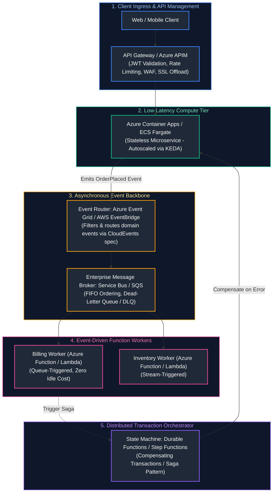
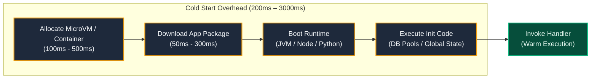
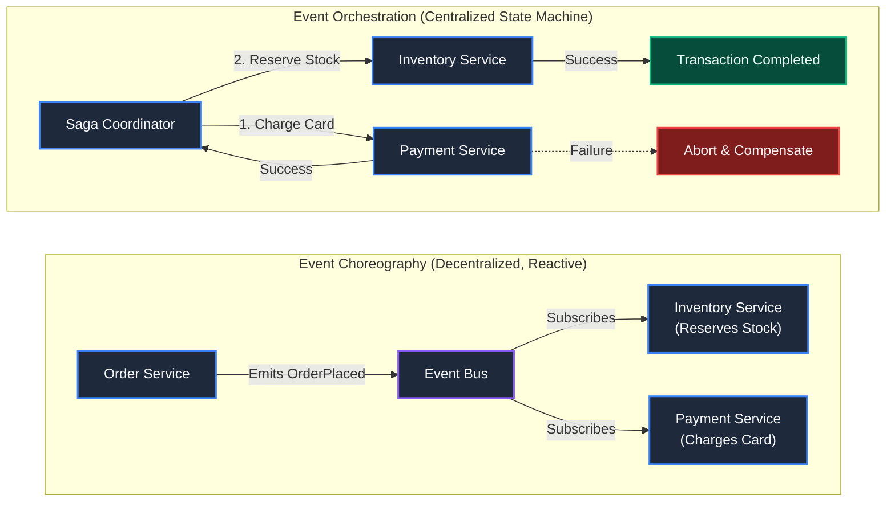
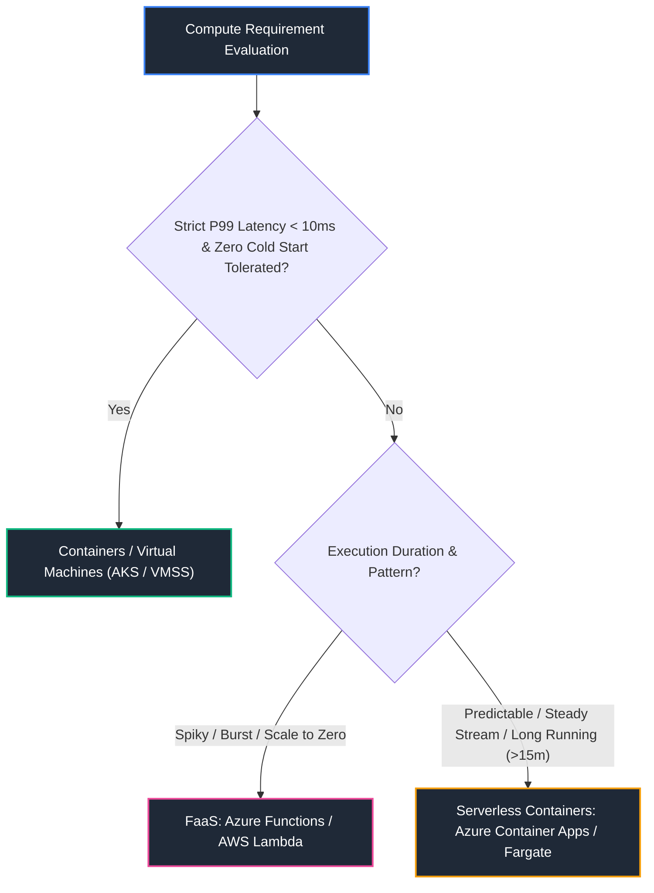

# 13. Serverless & Cloud-Native Application Architecture

A comprehensive, production-grade guide to serverless computing paradigms (Azure Functions vs. AWS Lambda), containerized serverless runtimes (Azure Container Apps, ECS Fargate), event-driven architectures (EDA), distributed workflow orchestration with Durable Functions and AWS Step Functions, cold start mitigation, API gateways, and distributed transaction management via the Saga pattern tailored for Cloud-Native Architects and Principal Engineers.

---

## Architectural Overview: Event-Driven Serverless Microservice Ecosystem



---

## Table of Contents
1. [Serverless Compute Execution Mechanics (Azure Functions Primary & AWS Lambda Counterpart)](#1-serverless-compute-execution-mechanics-azure-functions-primary--aws-lambda-counterpart)
   - [1.1 Execution Environments: WebJobs Host (Primary) & Firecracker MicroVM Counterpart](#11-execution-environments-webjobs-host-primary--firecracker-microvm-counterpart)
   - [1.2 Cold Start Physics, Init Phase, and Provisioned Concurrency](#12-cold-start-physics-init-phase-and-provisioned-concurrency)
   - [1.3 Input/Output Bindings vs. Direct Cloud SDK Clients](#13-inputoutput-bindings-vs-direct-cloud-sdk-clients)
2. [Containerized Serverless Application Platforms (Azure Container Apps Primary & ECS Fargate Counterpart)](#2-containerized-serverless-application-platforms-azure-container-apps-primary--ecs-fargate-counterpart)
   - [2.1 When to Choose Serverless Containers over FaaS](#21-when-to-choose-serverless-containers-over-faas)
   - [2.2 KEDA, Envoy, and Dapr Integration in ACA](#22-keda-envoy-and-dapr-integration-in-aca)
3. [Event-Driven Architecture (EDA) & Reactive Routing](#3-event-driven-architecture-eda-reactive-routing)
   - [3.1 Event Choreography vs. Event Orchestration](#31-event-choreography-vs-event-orchestration)
   - [3.2 CloudEvents Specification and Schema Registry Validation](#32-cloudevents-specification-and-schema-registry-validation)
4. [Distributed Workflow Orchestration (Azure Durable Functions Primary & AWS Step Functions Counterpart)](#4-distributed-workflow-orchestration-azure-durable-functions-primary--aws-step-functions-counterpart)
   - [4.1 Durable Functions State Storage: Azure Storage Queues & Tables](#41-durable-functions-state-storage-azure-storage-queues-tables)
   - [4.2 AWS Step Functions: States Language, Task Tokens, and Parallel Branches](#42-aws-step-functions-states-language-task-tokens-and-parallel-branches)
5. [The Saga Pattern: Managing Distributed Transactions](#5-the-saga-pattern-managing-distributed-transactions)
   - [5.1 Choreographed Sagas vs. Orchestrated Sagas](#51-choreographed-sagas-vs-orchestrated-sagas)
   - [5.2 Compensating Transactions and Idempotent Rollbacks](#52-compensating-transactions-and-idempotent-rollbacks)
6. [API Management and Edge Routing](#6-api-management-and-edge-routing)
   - [6.1 Azure APIM Policy Processing: Inbound, Backend, Outbound, On-Error](#61-azure-apim-policy-processing-inbound-backend-outbound-on-error)
   - [6.2 AWS API Gateway: HTTP APIs vs. REST APIs vs. WebSocket APIs](#1-serverless-compute-mechanics-azure-functions-vs-aws-lambda)
7. [Architectural Decision Framework: Serverless vs. Containers vs. VMs](#7-architectural-decision-framework-serverless-vs-containers-vs-vms)
   - [7.1 Concurrency, Cold Start, and Latency Thresholds](#71-concurrency-cold-start-and-latency-thresholds)
   - [7.2 Total Cost of Ownership (TCO) Inflection Point Analysis](#72-total-cost-of-ownership-tco-inflection-point-analysis)
8. [Production Distributed Saga Orchestration Implementation](#8-production-distributed-saga-orchestration-implementation)
   - [8.1 Production Python Orchestrated Saga Coordinator](#81-production-python-orchestrated-saga-coordinator)
9. [Summary Comparison & Engineering Reference Matrix](#9-summary-comparison-engineering-reference-matrix)
10. [References & Further Reading](#10-references-further-reading)

---

# 1. Serverless Compute Execution Mechanics (Azure Functions Primary & AWS Lambda Counterpart)

### 1.1 Execution Environments: WebJobs Host (Primary) & Firecracker MicroVM Counterpart

The underlying virtualization engines differ fundamentally between cloud providers:
- **AWS Lambda & Firecracker MicroVMs:** AWS spins up an isolated, lightweight KVM microVM using **Firecracker** in $<5$ms. Each microVM handles **exactly one concurrent request at a time**. If 100 concurrent requests arrive, AWS spins up 100 distinct microVMs.
- **Azure Functions & The WebJobs Host:** Azure Functions groups multiple functions within a **Function App**, hosted on a single container/VM instance. A single Function App instance processes **multiple concurrent requests simultaneously**, sharing memory space, thread pools, and CPU cycles across concurrent executions.

---

### 1.2 Cold Start Physics, Init Phase, and Provisioned Concurrency

A **Cold Start** occurs when a serverless request arrives and no pre-warmed execution worker is available in the pool:



- **Mitigation Techniques:**
  - **Provisioned Concurrency (AWS Lambda) / Always Ready Instances (Azure Functions Premium):** Pre-initializes a fixed pool of execution environments so invocations experience zero initialization delay.
  - **Package Trimming:** Minimize deployment zip sizes; use tree-shaking and avoid importing heavyweight monolithic SDKs.
  - **Connection Reuse:** Initialize database connection pools and HTTP clients **outside the function handler** in the global init scope.

---

### 1.3 Input/Output Bindings vs. Direct Cloud SDK Clients

Azure Functions provides declarative **Bindings**, completely abstracting SDK boilerplate from application code:

```python
# Azure Functions v2 Python Programming Model (function_app.py)
import azure.functions as func
import json
import logging

app = func.FunctionApp()

# Queue Trigger + Cosmos DB Output Binding
@app.queue_trigger(arg_name="msg", queue_name="orders", connection="AzureWebJobsStorage")
@app.cosmos_db_output(arg_name="document", database_name="StoreDB", container_name="Orders", connection="CosmosDBConnection")
def process_order(msg: func.QueueMessage, document: func.Out[func.Document]) -> None:
    order_data = json.loads(msg.get_body().decode("utf-8"))
    logging.info(f"Processing order ID: {order_data.get('id')}")
    
    # Declaratively writes directly to Cosmos DB without manual client instantiation
    document.set(func.Document.from_dict(order_data))
```

---

# 2. Containerized Serverless Application Platforms (Azure Container Apps Primary & ECS Fargate Counterpart)

### 2.1 When to Choose Serverless Containers over FaaS

While Functions (FaaS) are ideal for simple event processing, **Serverless Containers (Azure Container Apps / ECS Fargate)** are superior when:
- Workloads require complex legacy runtime dependencies, C-libraries, or long-running processing exceeding the 15-minute FaaS execution limit.
- Microservices need sub-millisecond inter-service communication over gRPC.
- The application relies on standard container packaging (Dockerfiles) without cloud vendor-specific FaaS SDK lock-in.

---

### 2.2 KEDA, Envoy, and Dapr Integration in ACA

**Azure Container Apps (ACA)** wraps enterprise open-source components into a turnkey serverless platform:
- **KEDA (Kubernetes Event-driven Autoscaling):** Scales container replicas from 0 to hundreds based on incoming HTTP traffic or queue depths (e.g. Service Bus messages).
- **Envoy Proxy:** Handles automatic ingress, blue-green traffic splitting (e.g. 80% to revision 1, 20% to revision 2), and mutual TLS (mTLS).
- **Dapr (Distributed Application Runtime):** Provides sidecar APIs for state management, pub/sub messaging, and distributed secret management.

---

# 3. Event-Driven Architecture (EDA) & Reactive Routing

### 3.1 Event Choreography vs. Event Orchestration



> - **Choreography Trade-off:** High architectural decoupling; difficult to visualize distributed failure states or monitor cross-service timeouts.
> - **Orchestration Trade-off:** Explicit visibility and robust end-to-end failure recovery; introduces a centralized coordinator dependency.

---

### 3.2 CloudEvents Specification and Schema Registry Validation

Enterprise events adhere to the CNCF **CloudEvents** specification to ensure interoperability:

```json
{
  "specversion": "1.0",
  "type": "com.corp.order.placed",
  "source": "/orders/service/eastus",
  "id": "A234-1234-1234",
  "time": "2026-10-10T12:00:00Z",
  "datacontenttype": "application/json",
  "data": {
    "order_id": "ord_88291",
    "customer_id": "cust_9912",
    "total_usd": 199.50
  }
}
```

---

# 4. Distributed Workflow Orchestration (Azure Durable Functions Primary & AWS Step Functions Counterpart)

### 4.1 Durable Functions State Storage: Azure Storage Queues & Tables

**Azure Durable Functions** uses the **Durable Task Framework (DTFx)**. Orchestrator code looks like ordinary sequential code, but execution is **event-sourced**:
1. When an `await context.call_activity()` is encountered, the orchestrator enqueues an execution message and **suspends execution**.
2. When the activity finishes, DTFx replays the orchestrator from line 1, retrieving previously executed values from an execution history table without re-running completed tasks.

> [!CAUTION]
> **Orchestrator Code Invariant:** Orchestrator functions **must be strictly deterministic**. You must **never** call `datetime.now()`, generate random GUIDs, or execute direct I/O calls inside an orchestrator function. Doing so causes non-deterministic replay errors, corrupting workflow state. Use `context.current_utc_datetime` instead.

---

### 4.2 AWS Step Functions: States Language, Task Tokens, and Parallel Branches

AWS Step Functions models workflows as visual JSON-defined state machines using Amazon States Language (ASL):

```json
{
  "Comment": "E-Commerce Checkout Workflow",
  "StartAt": "ProcessPayment",
  "States": {
    "ProcessPayment": {
      "Type": "Task",
      "Resource": "arn:aws:lambda:us-east-1:123456789012:function:ChargeCard",
      "Next": "ReserveInventory",
      "Catch": [
        {
          "ErrorEquals": ["PaymentDeclinedException"],
          "Next": "NotifyCustomerPaymentFailed"
        }
      ]
    },
    "ReserveInventory": {
      "Type": "Task",
      "Resource": "arn:aws:lambda:us-east-1:123456789012:function:ReserveStock",
      "End": true
    },
    "NotifyCustomerPaymentFailed": {
      "Type": "Task",
      "Resource": "arn:aws:lambda:us-east-1:123456789012:function:SendFailureEmail",
      "End": true
    }
  }
}
```

---

# 5. The Saga Pattern: Managing Distributed Transactions

### 5.1 Choreographed Sagas vs. Orchestrated Sagas

Traditional monolithic applications rely on ACID database transactions (`BEGIN TRANSACTION ... COMMIT`). In microservice architectures where each service owns its own private database, distributed two-phase commit (2PC) does not scale.

The **Saga Pattern** structures a distributed business transaction as a sequence of local transactions:
- Every transaction updates local databases and produces an event.
- If a step fails, the Saga executes **Compensating Transactions** backwards to undo the changes made by preceding steps.

---

### 5.2 Compensating Transactions and Idempotent Rollbacks

Compensating transactions do not "rollback" time; they apply **semantic reversals**:
- *Action:* Deduct \$50 from customer bank account $\rightarrow$ *Compensation:* Refund \$50 to customer bank account.
- *Action:* Reserve 2 seats on flight 101 $\rightarrow$ *Compensation:* Cancel 2 seat reservations on flight 101.

---

# 6. API Management and Edge Routing

### 6.1 Azure APIM Policy Processing: Inbound, Backend, Outbound, On-Error

Azure API Management enforces centralized governance through XML policy blocks:

```xml
<policies>
    <inbound>
        <base />
        <!-- Validate JWT Token issued by Entra ID -->
        <validate-jwt header-name="Authorization" failed-validation-httpcode="401" failed-validation-error-message="Unauthorized">
            <openid-config url="https://login.microsoftonline.com/tenant-id/v2.0/.well-known/openid-configuration" />
            <required-claims>
                <claim name="aud" match="all">
                    <value>api://cloud-backend</value>
                </claim>
            </required-claims>
        </validate-jwt>
        <!-- Enforce Token Bucket Rate Limiting: 100 requests per 60 seconds per client IP -->
        <rate-limit-by-key calls="100" renewal-period="60" counter-key="@(context.Request.IpAddress)" />
    </inbound>
    <backend>
        <base />
    </backend>
    <outbound>
        <base />
        <!-- Strip internal cloud headers -->
        <set-header name="X-Powered-By" exists-action="delete" />
    </outbound>
</policies>
```

---

# 7. Architectural Decision Framework: Serverless vs. Containers vs. VMs

### 7.1 Concurrency, Cold Start, and Latency Thresholds



---

### 7.2 Total Cost of Ownership (TCO) Inflection Point Analysis

| Operating Regime | Request Volume | Serverless Cost (FaaS / Invocations) | Provisioned Baseline (e.g. 3x K8s Nodes) | Architectural Verdict |
| :--- | :--- | :--- | :--- | :--- |
| **Below Inflection Point** | Low / Variable / Burst-heavy ($< 1\text{M}$ req/mo) | **\$0 – \$15/mo** (Scales to absolute zero when idle) | **\$300 – \$450/mo** (Fixed baseline cost regardless of traffic) | **Serverless (FaaS / ACA)**: Avoids paying for idle VMs. |
| **At Inflection Point** | Medium steady-state (~$5\text{M} - 10\text{M}$ req/mo) | **~\$350/mo** (Cost parity reached) | **~\$350/mo** (Even breakeven point) | **Hybrid / Transition**: Evaluate operational overhead vs compute. |
| **Above Inflection Point** | High continuous throughput ($> 50\text{M}$ req/mo) | **\$1,500 – \$5,000+/mo** (Linear per-call cost explosion) | **\$350 – \$600/mo** (Reserved Instances / Savings Plans amortize load) | **Provisioned Cluster (AKS / EKS / VMs)**: Dedicated compute wins. |

- **Below Inflection Point:** Serverless is vastly cheaper because you pay strictly for compute time used ($0 baseline idle cost).
- **Above Inflection Point (High, Steady-State Throughput):** Serverless becomes significantly more expensive than running dedicated, right-sized virtual machines or reserved Kubernetes instances.

---

# 8. Production Distributed Saga Orchestration Implementation

### 8.1 Production Python Orchestrated Saga Coordinator

Below is a production-grade Python implementation of an Orchestrated Saga Coordinator managing local actions and executing compensating rollbacks upon failure:

```python
#!/usr/bin/env python3
"""
Production Orchestrated Saga Coordinator.
Executes multi-step distributed transactions across microservice boundaries.
Guarantees sequential execution of forward actions and automatic triggering
of compensating transactions in reverse order upon failure.
"""

from dataclasses import dataclass
import logging
import sys
from typing import Callable, List, Optional

logging.basicConfig(
    level=logging.INFO,
    format='{"time":"%(asctime)s","level":"%(levelname)s","message":"%(message)s"}',
    handlers=[logging.StreamHandler(sys.stdout)],
)
logger = logging.getLogger("saga_coordinator")


@dataclass
class SagaStep:
    name: str
    action: Callable[[], bool]
    compensate: Callable[[], bool]


class SagaCoordinator:
    def __init__(self, saga_id: str):
        self.saga_id = saga_id
        self.steps: List[SagaStep] = []
        self.executed_steps: List[SagaStep] = []

    def add_step(self, step: SagaStep):
        self.steps.append(step)

    def execute(self) -> bool:
        """Executes saga steps sequentially; initiates rollback on any step failure."""
        logger.info("Initiating Saga execution [ID: %s]", self.saga_id)

        for step in self.steps:
            logger.info("Executing Forward Step: %s", step.name)
            try:
                success = step.action()
                if not success:
                    logger.error("Step %s failed explicitly! Triggering compensation.", step.name)
                    self._rollback()
                    return False
                self.executed_steps.append(step)
            except Exception as err:
                logger.error("Step %s crashed with exception: %s! Triggering compensation.", step.name, err)
                self._rollback()
                return False

        logger.info("Saga [ID: %s] completed all steps successfully.", self.saga_id)
        return True

    def _rollback(self):
        """Executes compensating transactions in REVERSE order of completion."""
        logger.warning("Commencing compensating rollback for Saga [ID: %s]", self.saga_id)
        for step in reversed(self.executed_steps):
            logger.info("Executing Compensating Transaction for: %s", step.name)
            try:
                comp_success = step.compensate()
                if not comp_success:
                    logger.critical("FATAL: Compensation failed for step %s! Human intervention required.", step.name)
            except Exception as comp_err:
                logger.critical("FATAL: Compensation threw exception for %s: %s", step.name, comp_err)


if __name__ == "__main__":
    # Define microservice mock handlers
    def reserve_credit():
        logger.info("Payment Service: $150 credit reserved successfully.")
        return True

    def refund_credit():
        logger.info("Payment Service: $150 credit refunded.")
        return True

    def reserve_inventory():
        logger.info("Inventory Service: SKU-990 items reserved.")
        return True

    def release_inventory():
        logger.info("Inventory Service: SKU-990 items released back to stock.")
        return True

    def dispatch_carrier():
        # Simulate third-party failure
        raise ConnectionError("Logistics API unreachable (HTTP 503)")

    def cancel_carrier():
        logger.info("Logistics Service: Carrier booking canceled.")
        return True

    saga = SagaCoordinator("order_tx_77192")
    saga.add_step(SagaStep("ReservePayment", reserve_credit, refund_credit))
    saga.add_step(SagaStep("ReserveInventory", reserve_inventory, release_inventory))
    saga.add_step(SagaStep("DispatchCarrier", dispatch_carrier, cancel_carrier))

    saga_result = saga.execute()
    print("Saga Final Status:", "COMMITTED" if saga_result else "COMPENSATED_AND_ROLLED_BACK")
```

---

# 9. Summary Comparison & Engineering Reference Matrix

| Cloud Architecture Paradigm | Scale-to-Zero Capability | Max Execution Duration | Concurrency Model | Best Suited Workload |
| :--- | :--- | :--- | :--- | :--- |
| **AWS Lambda** | Native | 15 Minutes | 1 concurrent request per microVM instance | Spiky event-driven queues, S3 processing, lightweight APIs |
| **Azure Functions** | Native (Consumption Plan) | 10 Minutes (Consumption) / Unbounded (Premium) | Multi-threaded concurrent execution per host instance | Azure event hub ingestion, background scheduled tasks |
| **Azure Container Apps** | Native (via KEDA) | Unbounded (HTTP or Background jobs) | Replicas scale horizontally on request rate or queue depth | Complex microservices, gRPC backends, Dapr workflows |
| **Kubernetes (AKS / EKS)**| Requires Knative / KEDA | Unbounded | Multi-container pods on persistent VMs | Heavy enterprise platforms, low-level networking control |
| **Virtual Machines (IaaS)**| No (Always Running) | Unbounded | Operating system process concurrency | Legacy commercial off-the-shelf (COTS) software |

---

# 10. References & Further Reading

- [AWS Lambda Execution Environment](https://docs.aws.amazon.com/lambda/latest/dg/runtimes-context.html) — MicroVM lifecycle and Firecracker internals.
- [Azure Functions Developer Guide](https://learn.microsoft.com/en-us/azure/azure-functions/functions-reference) — WebJobs SDK and binding architecture.
- [CloudEvents Specification (CNCF)](https://cloudevents.io/) — Vendor-neutral event metadata standard.
- [Chris Richardson: Microservices Patterns (Saga Pattern)](https://microservices.io/patterns/data/saga.html) — Distributed transaction design.
- [Azure Container Apps Architecture](https://learn.microsoft.com/en-us/azure/container-apps/overview) — KEDA and Envoy orchestration platform.

