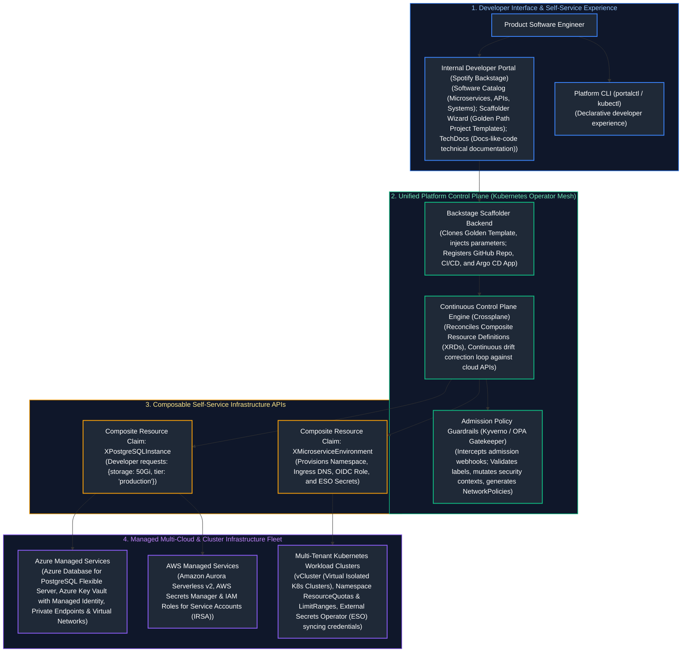
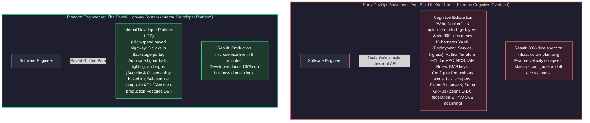
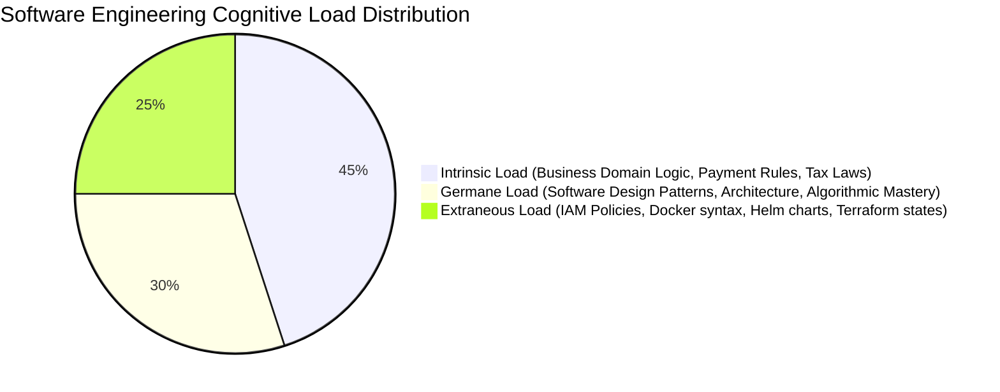
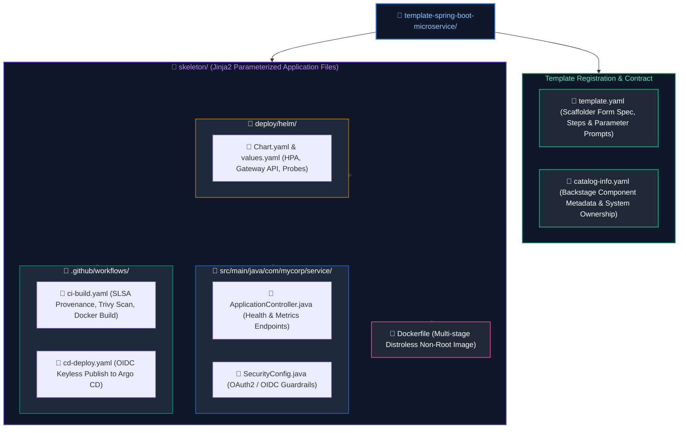
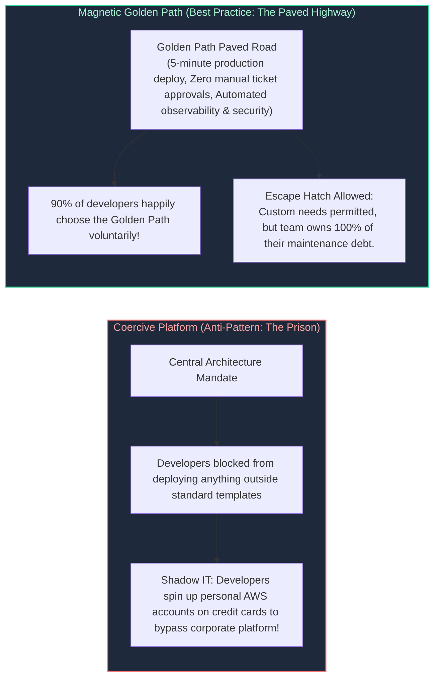
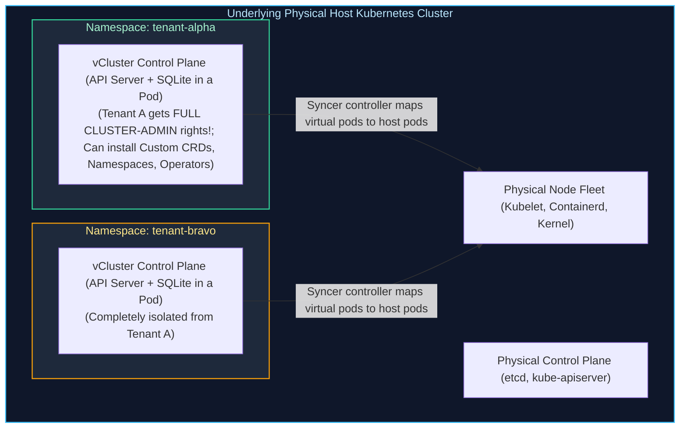
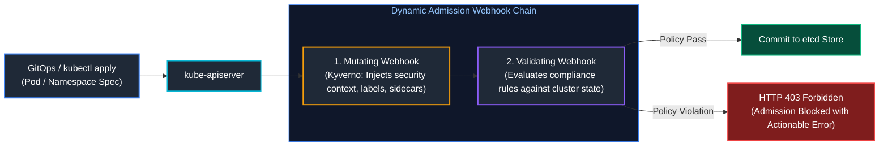
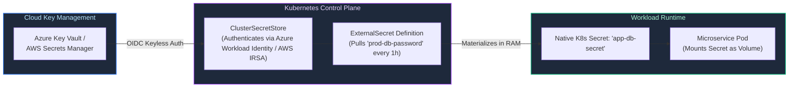
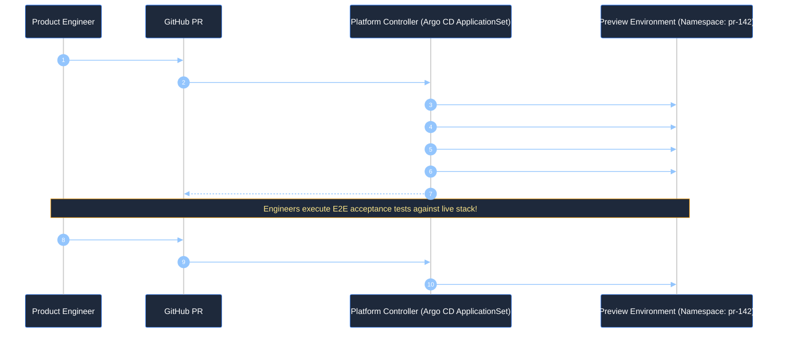

# 14. Platform Engineering & Developer Experience

A comprehensive, production-grade guide to Internal Developer Platforms (IDPs), developer self-service portals with Spotify Backstage, Golden Paths (Paved Roads), Kubernetes-native infrastructure control planes with Crossplane, multi-tenant cluster isolation (Namespaces vs. vCluster), automated policy guardrails with Kyverno, External Secrets Operator (ESO), ephemeral pull-request environments, and DORA/SPACE engineering effectiveness metrics tailored for Staff Platform Engineers and Enterprise Platform Architects.

---

## Architectural Overview: Internal Developer Platform (IDP) Control Plane



---

## Table of Contents
1. [The Platform Engineering Paradigm: Municipal Highway Analogy](#1-the-platform-engineering-paradigm-municipal-highway-analogy)
   - [1.1 Real-World Analogy: Paved Highways vs. Clearing Jungle Dirt Roads](#11-real-world-analogy-paved-highways-vs-clearing-jungle-dirt-roads)
   - [1.2 Cognitive Load Theory & Team Topologies](#12-cognitive-load-theory--team-topologies)
   - [1.3 Treating the Platform as a Product: Customer Focus & Internal Adoption](#13-treating-the-platform-as-a-product-customer-focus--internal-adoption)
2. [Internal Developer Portals: Spotify Backstage Architecture](#2-internal-developer-portals-spotify-backstage-architecture)
   - [2.1 Core Subsystems: Software Catalog, TechDocs, and Software Templates (Scaffolder)](#21-core-subsystems-software-catalog-techdocs-and-software-templates-scaffolder)
   - [2.2 The Golden Path (Paved Road) Philosophy: Magnetic vs. Coercive Adoption](#22-the-golden-path-paved-road-philosophy-magnetic-vs-coercive-adoption)
   - [2.3 Production Backstage Scaffolder Template Definition](#23-production-backstage-scaffolder-template-definition)
3. [Infrastructure Control Planes with Crossplane](#3-infrastructure-control-planes-with-crossplane)
   - [3.1 Moving Beyond Static IaC: Continuous Reconciliation Loops vs. Pipeline Runs](#31-moving-beyond-static-iac-continuous-reconciliation-loops-vs-pipeline-runs)
   - [3.2 Crossplane Building Blocks: Providers, Managed Resources (MRs), and Composite Resource Definitions (XRDs)](#32-crossplane-building-blocks-providers-managed-resources-mrs-and-composite-resource-definitions-xrds)
   - [3.3 Production Composition: Abstracting Cloud Relational Databases](#33-production-composition-abstracting-cloud-relational-databases)
4. [Kubernetes Multi-Tenancy & Platform Abstractions](#4-kubernetes-multi-tenancy--platform-abstractions)
   - [4.1 Soft Multi-Tenancy: Namespaces, ResourceQuotas, and LimitRanges](#41-soft-multi-tenancy-namespaces-resourcequotas-and-limitranges)
   - [4.2 Hard Multi-Tenancy: Virtual Clusters (vCluster) vs. Physical Isolation](#42-hard-multi-tenancy-virtual-clusters-vcluster-vs-physical-isolation)
5. [Automated Policy Guardrails with Kyverno](#5-automated-policy-guardrails-with-kyverno)
   - [5.1 Kyverno vs. OPA Gatekeeper: Declarative YAML vs. Imperative Rego](#51-kyverno-vs-opa-gatekeeper-declarative-yaml-vs-imperative-rego)
   - [5.2 Admission Webhooks: Validate, Mutate, and Generate Rules](#52-admission-webhooks-validate-mutate-and-generate-rules)
6. [Platform Secret Management: External Secrets Operator (ESO)](#6-platform-secret-management-external-secrets-operator-eso)
   - [6.1 The Security Hazard of Storing Secrets in Git and etcd](#61-the-security-hazard-of-storing-secrets-in-git-and-etcd)
   - [6.2 ESO Architecture: ClusterSecretStore, ExternalSecret, and Workload Identity](#62-eso-architecture-clustersecretstore-externalsecret-and-workload-identity)
7. [Ephemeral Development Environments & Preview Stacks](#7-ephemeral-development-environments--preview-stacks)
   - [7.1 Pull-Request-Driven Preview Lifecycle Orchestration](#71-pull-request-driven-preview-lifecycle-orchestration)
   - [7.2 Automated Garbage Collection, Resource TTLs, and Cloud Cost Containment](#72-automated-garbage-collection-resource-ttls-and-cloud-cost-containment)
8. [Developer Experience (DevEx) & Engineering Effectiveness Metrics](#8-developer-experience-devex--engineering-effectiveness-metrics)
   - [8.1 DORA Metrics: Deployment Frequency, Lead Time, CFR, and MTTR](#81-dora-metrics-deployment-frequency-lead-time-cfr-and-mttr)
   - [8.2 The SPACE Framework for Developer Productivity](#82-the-space-framework-for-developer-productivity)
9. [Production Code Implementation: Automated Golden Path Repository Auditor](#9-production-code-implementation-automated-golden-path-repository-auditor)
   - [9.1 Production Python Platform Catalog & Golden Path Compliance Auditor](#91-production-python-platform-catalog--golden-path-compliance-auditor)
10. [Senior Platform Architect Troubleshooting Runbooks: Platform Failures](#10-senior-platform-architect-troubleshooting-runbooks-platform-failures)
    - [10.1 Scenario 1: Crossplane Cloud API Rate-Limit Throttling Storm](#101-scenario-1-crossplane-cloud-api-rate-limit-throttling-storm)
    - [10.2 Scenario 2: External Secrets Operator Token Desynchronization](#102-scenario-2-external-secrets-operator-token-desynchronization)
    - [10.3 Scenario 3: Zombie Ephemeral Pull-Request Environments Leaking Cloud Spend](#103-scenario-3-zombie-ephemeral-pull-request-environments-leaking-cloud-spend)
11. [Summary Comparison & Engineering Reference Matrix](#11-summary-comparison--engineering-reference-matrix)
12. [References & Further Reading](#12-references--further-reading)

---

# 1. The Platform Engineering Paradigm: Municipal Highway Analogy

### 1.1 Real-World Analogy: Paved Highways vs. Clearing Jungle Dirt Roads

To understand why the software industry has transitioned from early DevOps into Platform Engineering, consider the difference between a **civil highway department** and asking commuters to build their own roads:



- **Early DevOps (Clearing the Jungle):** The noble slogan *"You build it, you run it"* was misinterpreted as *"You write code, you also design the VPC, write the Terraform, configure the CNI network plugin, rotate the TLS certificates, tune the Prometheus scrapers, and manage the ingress controller."* Product developers were overwhelmed with infrastructure trivia, leading to massive context switching, configuration errors, and slow feature delivery.
- **Platform Engineering (The Municipal Highway Department):** A dedicated Platform Team acts as civil engineers. They build the **Internal Developer Platform (IDP)**: well-lit highways with safety guardrails, clear speed limits, and emergency services. Developers don't need a civil engineering license to drive to work. If an engineer has specialized needs (an off-road vehicle requiring custom kernel parameters), they can take the dirt road—with the understanding that they are responsible for their own towing if they get stuck.

---

### 1.2 Cognitive Load Theory & Team Topologies

Platform engineering is grounded in educational psychologist John Sweller's **Cognitive Load Theory**, adapted for software organizations by Matthew Skelton and Manuel Pais in *Team Topologies*:

$$\text{Total Cognitive Load} = \text{Intrinsic Load} + \text{Germane Load} + \text{Extraneous Load}$$



- **Intrinsic Cognitive Load:** The fundamental complexity of the problem space (e.g., how the business calculates European VAT taxes). This cannot be eliminated.
- **Germane Cognitive Load:** The mental processing devoted to creating mental schemas and long-term learning (e.g., designing clean domain models). This should be maximized.
- **Extraneous Cognitive Load:** Mental energy wasted on operational friction (e.g., *"What was the exact syntax for an AWS IAM Trust Policy JSON?"* or *"Why is my Kubernetes ingress throwing 404 because of an annotation typo?"*). **The sole objective of platform engineering is to ruthlessly eradicate extraneous cognitive load.**

#### Team Topologies Interaction Framework:
1. **Stream-Aligned Teams:** Product-focused engineering teams delivering customer value directly.
2. **Platform Teams:** Internal product teams providing an underlying platform that enables stream-aligned teams to deliver work autonomously without direct operational handoffs.
3. **Enabling Teams:** Specialists (e.g., security, testing) who temporarily embed with stream-aligned teams to transfer skills.
4. **Complicated-Subsystem Teams:** Specialized teams owning deeply technical domains (e.g., real-time cryptography engines).

---

### 1.3 Treating the Platform as a Product: Customer Focus & Internal Adoption

A fatal failure mode for platform engineering teams is operating like a legacy central IT department, issuing bureaucratic mandates (*"All teams MUST use this platform by Q3"*).

> [!CRITICAL]
> **The Golden Law of Platform Adoption:** **Treat the platform as a product, and treat internal developers as customers.** If developers circumvent your platform using shadow cloud accounts, **the platform is flawed, not the developers**. Platforms must win adoption through superior developer ergonomics, faster velocity, and self-evident value, not organizational coercion.

---

# 2. Internal Developer Portals: Spotify Backstage Architecture

**Spotify Backstage** (donated to the CNCF) has emerged as the industry-standard framework for building Internal Developer Portals.

### 2.1 Core Subsystems: Software Catalog, TechDocs, and Software Templates (Scaffolder)

#### Spotify Backstage Core Subsystems Reference Matrix

| Subsystem | Architectural Role | Source Artifact / Manifest | Processing Engine & Protocols | Developer Experience Outcome |
| :--- | :--- | :--- | :--- | :--- |
| **1. Software Catalog** | Centralized entity graph tracking software ownership, metadata, and dependencies. | `catalog-info.yaml` stored in every service repository. | Ingestion engine continuously polls Git providers; builds in-memory relational entity graph. | Instant discovery of microservice ownership, maintainers, deployed environments, and API contracts. |
| **2. TechDocs** | Docs-like-code technical documentation reader and search engine. | Markdown files stored in `/docs` directory in source repo (`mkdocs.yml`). | CI pipeline or Backstage worker runs `mkdocs build`, pushing static HTML to AWS S3 or Azure Blob Storage. | Eliminates outdated Confluence wikis; documentation is versioned, reviewed, and published alongside code. |
| **3. Software Templates (Scaffolder)** | Self-service golden path provisioning wizard for bootstraping new projects. | `template.yaml` defining parameters and execution steps. | Scaffolder execution engine parameterizes Cookiecutter/Jinja templates, creates Git repo, and triggers CI. | Reduces service bootstrapping time from 2–3 weeks of ticket requests to $< 5$ minutes of automated provisioning. |
| **4. Dynamic Plugin Architecture** | Extensible micro-frontend integrating enterprise cloud toolchains. | React frontend components & Node.js backend proxy plugins. | Pluggable REST / GraphQL aggregators querying third-party APIs (Kubernetes, PagerDuty, SonarQube). | Unified single-pane-of-glass dashboard displaying real-time pod health, code quality, and on-call schedules. |

#### Backstage Entity Data Model:
Backstage organizes software assets into a structured, bidirectional entity graph defined via `catalog-info.yaml` files committed inside each repository:
- **Component:** An individual unit of software (service, website, library).
- **API:** The explicit contract exposed by a component (OpenAPI, gRPC Protobuf, AsyncAPI).
- **Resource:** Infrastructure dependencies needed by components (PostgreSQL databases, Redis caches, S3 buckets).
- **System:** A collection of components and resources cooperating to provide user-facing capabilities (e.g., `checkout-system`).
- **Domain:** High-level business boundary grouping multiple systems (e.g., `e-commerce-domain`).

#### Spotify Backstage Software Template Repository Folder Treeview

A standardized Backstage Scaffolder template repository couples parameterized user input forms (`template.yaml`) with a Jinja-templated application skeleton:



---

### 2.2 The Golden Path (Paved Road) Philosophy: Magnetic vs. Coercive Adoption



---

### 2.3 Production Backstage Scaffolder Template Definition

Below is a production `template.yaml` defining a self-service Scaffolder template that provisions a new Spring Boot / Python microservice, creates the GitHub repository, publishes the initial commit, and registers it in the catalog:

```yaml
# /templates/spring-microservice/template.yaml
apiVersion: scaffolder.backstage.io/v1beta3
kind: Template
metadata:
  name: standard-microservice-template
  title: Production-Grade Microservice Golden Path
  description: Scaffolds a production-ready microservice with Docker, GitHub Actions CI/CD, Argo CD GitOps, and Datadog tracing baked in.
  tags:
    - recommended
    - python
    - fastapi
    - kubernetes
spec:
  owner: platform-team
  type: service

  parameters:
    - title: Service Metadata
      required:
        - service_name
        - owner_team
        - description
      properties:
        service_name:
          title: Service Identifier
          type: string
          description: Unique kebab-case name (e.g., payment-processor)
          pattern: "^[a-z0-9-]+$"
        owner_team:
          title: Owning Team
          type: string
          description: Team responsible for service maintenance
          ui:field: OwnerPicker
          ui:options:
            allowedKinds: [Group]
        description:
          title: Description
          type: string
          description: Brief summary of business purpose

    - title: Deployment & Infrastructure Settings
      required:
        - environment_tier
        - needs_database
      properties:
        environment_tier:
          title: Initial Target Tier
          type: string
          default: non-production
          enum:
            - non-production
            - production
        needs_database:
          title: Provision Dedicated PostgreSQL DB?
          type: boolean
          default: false

  steps:
    # 1. Fetch cookiecutter skeleton template from Git
    - id: fetch-template
      name: Rendering Golden Skeleton
      action: fetch:template
      input:
        url: ./skeleton
        values:
          service_name: ${{ parameters.service_name }}
          owner_team: ${{ parameters.owner_team }}
          description: ${{ parameters.description }}
          needs_database: ${{ parameters.needs_database }}

    # 2. Publish repository to corporate GitHub organization
    - id: publish-github
      name: Creating Remote GitHub Repository
      action: publish:github
      input:
        allowedHosts: ["github.com"]
        description: ${{ parameters.description }}
        repoUrl: github.com?owner=enterprise-org&repo=${{ parameters.service_name }}
        defaultBranch: main
        protectDefaultBranch: true
        repoVisibility: internal

    # 3. Register service in Backstage Software Catalog
    - id: register-catalog
      name: Registering Component in Backstage Catalog
      action: catalog:register
      input:
        repoContentsUrl: ${{ steps['publish-github'].output.repoContentsUrl }}
        catalogInfoPath: "/catalog-info.yaml"

  output:
    links:
      - title: View Source Repository
        url: ${{ steps['publish-github'].output.remoteUrl }}
      - title: Open in Backstage Catalog
        icon: catalog
        entityRef: ${{ steps['register-catalog'].output.entityRef }}
```

---

# 3. Infrastructure Control Planes with Crossplane

### 3.1 Moving Beyond Static IaC: Continuous Reconciliation Loops vs. Pipeline Runs

```mermaid
flowchart TD
    subgraph StaticIaC ["Static Infrastructure as Code (Terraform / OpenTofu)"]
        T_Git["Git Commit"] --> T_Pipe["CI/CD Pipeline Executes 'terraform apply'"]
        T_Pipe --> T_Cloud["Cloud API Mutated"]
        T_Cloud -.->|"Out-of-band drift occurs (Engineer changes Security Group in Web Console)"| T_Blind["Terraform is BLIND to drift until the next pipeline runs days later!"]
    end

    subgraph ControlPlane ["Continuous Kubernetes Control Plane (Crossplane)"]
        C_CRD["Custom Resource in etcd"] <-->|"Continuous Active Reconciliation Loop (Every 60s)"| Controller["Crossplane Provider Controller"]
        Controller <-->|"Interrogates Live Cloud API via gRPC"| C_Cloud["Live Cloud Infrastructure"]
        C_Cloud -.->|"Out-of-band mutation"| Detected["Drift instantly detected! Controller automatically self-heals & resets cloud state back to declared manifest!"]
    end

    style StaticIaC fill:#1e293b,stroke:#f87171,stroke-width:1.5px,color:#fca5a5
    style ControlPlane fill:#1e293b,stroke:#34d399,stroke-width:1.5px,color:#a7f3d0
    style Detected fill:#1e3b2e,stroke:#34d399,stroke-width:1.5px,color:#fff
```



---

### 3.2 Crossplane Building Blocks: Providers, Managed Resources (MRs), and Composite Resource Definitions (XRDs)

Crossplane extends the Kubernetes API with four core primitives:
1. **Providers (e.g. `provider-azure`, `provider-aws`):** Kubernetes operators that package CRDs mapping 1:1 with cloud primitives.
2. **Managed Resources (MRs):** Low-level granular resources (e.g., `VirtualNetwork`, `FlexibleServer`, `KeyVaultKey`). Owned exclusively by platform teams.
3. **Composite Resource Definitions (XRDs):** Defines the **custom API contract** exposed to application developers (e.g., `DatabaseInstance.platform.corp/v1`).
4. **Compositions:** The operational engine that translates an abstract XRD claim into dozens of fully configured, hardened, interconnected Managed Resources across cloud providers.

---

### 3.3 Production Composition: Abstracting Cloud Relational Databases

Below is a production Crossplane Composition provisioning an enterprise Azure Database for PostgreSQL Flexible Server, generating an Azure Key Vault secret, and binding network security rules:

```yaml
# /crossplane/compositions/azure-postgres-composition.yaml
apiVersion: apiextensions.crossplane.io/v1
kind: Composition
metadata:
  name: postgres-flexible.azure.platform.corp
  labels:
    provider: azure
    service: postgres
spec:
  compositeTypeRef:
    apiVersion: database.corp.platform/v1alpha1
    kind: XDatabaseInstance

  resources:
    # Resource 1: Azure PostgreSQL Flexible Server
    - name: postgresServer
      base:
        apiVersion: dbforpostgresql.azure.upbound.io/v1beta1
        kind: FlexibleServer
        spec:
          forProvider:
            location: eastus
            administratorLogin: cloudadmin
            autoGrowEnabled: true
            backupRetentionDays: 30
            geoRedundantBackupEnabled: true
            version: "15"
            skuName: GP_Standard_D2ds_v4
            storageMb: 32768
            delegatedSubnetIdSelector:
              matchLabels:
                tier: database-subnet
      patches:
        # Patch storage size from developer claim
        - type: FromCompositeFieldPath
          fromFieldPath: spec.parameters.storageGB
          toFieldPath: spec.forProvider.storageMb
          transforms:
            - type: math
              math:
                multiply: 1024

    # Resource 2: Firewall Rule permitting Kubernetes VNet Ingress
    - name: firewallRule
      base:
        apiVersion: dbforpostgresql.azure.upbound.io/v1beta1
        kind: FlexibleServerFirewallRule
        spec:
          forProvider:
            serverNameSelector:
              matchControllerRef: true
            startIpAddress: "10.240.0.0"
            endIpAddress: "10.240.255.255"

    # Resource 3: Connection Secret Written directly to Developer Namespace
    - name: connectionSecret
      base:
        apiVersion: kubernetes.crossplane.io/v1alpha1
        kind: Object
        spec:
          forProvider:
            manifest:
              apiVersion: v1
              kind: Secret
              metadata:
                name: db-connection-credentials
```

---

# 4. Kubernetes Multi-Tenancy & Platform Abstractions

Platform engineers must balance multi-tenant resource density against security isolation.

### 4.1 Soft Multi-Tenancy: Namespaces, ResourceQuotas, and LimitRanges

In soft multi-tenancy, multiple teams share a single large Kubernetes cluster. Tenants are partitioned via Namespaces with hard compute boundaries:

```yaml
# /manifests/tenants/checkout-tenant-policy.yaml
apiVersion: v1
kind: ResourceQuota
metadata:
  name: team-checkout-quota
  namespace: team-checkout
spec:
  hard:
    requests.cpu: "16"
    requests.memory: 32Gi
    limits.cpu: "32"
    limits.memory: 64Gi
    persistentvolumeclaims: "10"
    services.loadbalancers: "0"  # Prevent accidental public IP exposure!
---
apiVersion: v1
kind: LimitRange
metadata:
  name: team-checkout-limitrange
  namespace: team-checkout
spec:
  limits:
    - type: Container
      default:
        cpu: "500m"
        memory: "512Mi"
      defaultRequest:
        cpu: "100m"
        memory: "128Mi"
      max:
        cpu: "4"
        memory: "8Gi"
```

---

### 4.2 Hard Multi-Tenancy: Virtual Clusters (vCluster) vs. Physical Isolation



| Dimension | Soft Multi-Tenancy (Namespaces) | Virtual Clusters (vCluster) | Separate Physical Clusters |
| :--- | :--- | :--- | :--- |
| **Cluster-Scoped Resources (CRDs)**| Shared; collision risk between teams | Completely isolated per virtual cluster | 100% physically isolated |
| **Kubernetes Versioning** | Locked to host cluster version | Tenants can run different minor K8s versions | Fully independent |
| **Cluster Admin Access** | Strictly forbidden for developers | Safe: Tenants have `cluster-admin` inside vCluster | Tenants have root cluster access |
| **Infrastructure Cost** | Lowest (maximum bin-packing efficiency) | Near-zero overhead (~1 lightweight pod per tenant) | Highest (massive baseline control plane fees) |

---

# 5. Automated Policy Guardrails with Kyverno

### 5.1 Kyverno vs. OPA Gatekeeper: Declarative YAML vs. Imperative Rego

| Policy Engine Dimension | Kyverno (Kubernetes Native) | OPA Gatekeeper (General Purpose) |
| :--- | :--- | :--- |
| **Policy Language Syntax** | **100% Native Kubernetes YAML:** Policies look and behave like standard Kubernetes resources. | **Rego Domain-Specific Language (DSL):** Requires developers to learn query-based Datalog syntax. |
| **Dynamic Resource Generation** | **Natively Supported:** Automatically generates default `NetworkPolicy`, `ResourceQuota`, or `RoleBinding` on namespace creation. | **Not Supported Natively:** Requires auxiliary custom controllers or complex external operators. |
| **Mutation Capabilities** | **Native JSON Patch / Overlay:** Modifies incoming manifests easily using familiar YAML structure. | Supported via specialized `Assign` and `AssignMetadata` Custom Resource Definitions. |
| **Developer Learning Curve** | **Zero new languages:** Any engineer who knows Kubernetes YAML can author and debug policies in minutes. | **Steep:** Writing, unit testing, and debugging Rego rule evaluation requires specialized training. |
| **Non-Kubernetes Scope** | Limited strictly to Kubernetes admission and background cluster scanning. | **Universal Scope:** OPA evaluates policies for Terraform IaC, Envoy proxies, Linux PAM, and HTTP APIs. |
| **Recommended Platform Role** | The preferred standard for pure Kubernetes platform governance and golden path automation. | Best suited for multi-system enterprise compliance spanning cloud IaC, service mesh, and Kubernetes. |

#### Admission Controller Webhook Processing Flowchart



---

### 5.2 Admission Webhooks: Validate, Mutate, and Generate Rules

#### Production Kyverno Policy: Auto-Generating Default-Deny NetworkPolicies
Whenever a developer creates a new namespace, Kyverno **automatically generates** a zero-trust default-deny NetworkPolicy:

```yaml
# /kyverno/policies/generate-default-network-policy.yaml
apiVersion: kyverno.io/v1
kind: ClusterPolicy
metadata:
  name: generate-default-network-policy
  annotations:
    policies.kyverno.io/title: Auto-Generate Default Deny Ingress
    policies.kyverno.io/category: Multi-Tenancy & Zero Trust
spec:
  rules:
    - name: generate-deny-all-ingress
      match:
        any:
          - resources:
              kinds: ["Namespace"]
      exclude:
        any:
          - resources:
              namespaces: ["kube-system", "kube-public", "kyverno", "monitoring"]
      generate:
        apiVersion: networking.k8s.io/v1
        kind: NetworkPolicy
        name: default-deny-all-ingress
        namespace: "{{request.object.metadata.name}}"
        synchronize: true
        data:
          spec:
            podSelector: {}
            policyTypes:
              - Ingress
```

---

# 6. Platform Secret Management: External Secrets Operator (ESO)

### 6.1 The Security Hazard of Storing Secrets in Git and etcd

1. **Base64 is NOT Encryption:** Kubernetes `Secret` objects store data in unencrypted base64 strings in etcd. Anyone with read access to the namespace or etcd backups can trivially decode credentials.
2. **GitOps Anti-Pattern:** Committing raw secrets to Git repositories exposes credentials to all repository viewers and Git history clones.

---

### 6.2 ESO Architecture: ClusterSecretStore, ExternalSecret, and Workload Identity

**External Secrets Operator (ESO)** continuously reads credentials from external enterprise vaults (Azure Key Vault, AWS Secrets Manager, HashiCorp Vault) and materializes them as ephemeral native Kubernetes Secrets:



---

# 7. Ephemeral Development Environments & Preview Stacks

### 7.1 Pull-Request-Driven Preview Lifecycle Orchestration

Preview environments allow developers and QA engineers to test pull requests against real cloud infrastructure before merging to main:



---

### 7.2 Automated Garbage Collection, Resource TTLs, and Cloud Cost Containment

Without automated garbage collection, developers abandon PRs, leaving hundreds of orphan databases and load balancers running, accumulating massive cloud waste:
- **Namespace TTL Annotations:** Annotate preview namespaces with `platform.corp/ttl: "72h"`.
- **Kube-Janitor / Custom Cleanup Cron:** A platform daemon scans namespaces hourly. If `now() > creation_timestamp + TTL`, the janitor executes an automated cascade deletion.

---

# 8. Developer Experience (DevEx) & Engineering Effectiveness Metrics

### 8.1 DORA Metrics: Deployment Frequency, Lead Time, CFR, and MTTR

The DevOps Research and Assessment (DORA) metrics measure engineering velocity and platform stability:

| DORA Metric | Elite Performer Standard | How Platform Engineering Drives the Metric |
| :--- | :---: | :--- |
| **Deployment Frequency** | Multiple deploys per day | Self-service Backstage templates & automated GitOps pipelines |
| **Lead Time for Changes** | $< 1$ Hour (Commit to Prod) | Standardized CI/CD templates with pre-baked security scanning |
| **Change Failure Rate (CFR)**| $< 5\%$ | Automated canary rollouts (Argo Rollouts) & Kyverno policy gates |
| **Time to Restore (MTTR)**| $< 1$ Hour | One-click GitOps rollback via Argo CD or Helm history rollback |

---

### 8.2 The SPACE Framework for Developer Productivity

DORA measures delivery pipeline throughput; GitHub and Microsoft's **SPACE Framework** measures the holistic human experience:
- **S - Satisfaction and Well-Being:** How healthy and happy are developers? (Measured via quarterly DevEx surveys).
- **P - Performance:** Quality and impact of software outcomes (Bug escape rate, customer adoption).
- **A - Activity:** Count of actions completed (PRs merged, commits, incidents handled).
- **C - Communication & Collaboration:** Discoverability of internal documentation and APIs (Search queries in Backstage).
- **E - Efficiency and Flow:** Minimizing context switching and interruptions (Time spent waiting for CI pipelines or waiting for infrastructure tickets).

---

# 9. Production Code Implementation: Automated Golden Path Repository Auditor

### 9.1 Production Python Platform Catalog & Golden Path Compliance Auditor

Below is a production-grade Python tool that audits git repositories for **Golden Path compliance**, verifies `catalog-info.yaml` syntax, checks for security scanning workflows, and outputs structured JSON reports for Backstage:

```python
#!/usr/bin/env python3
"""
Platform Engineering Golden Path & Catalog Compliance Auditor.
Interrogates Git repositories for compliance with internal developer platform standards:
Backstage catalog-info.yaml, Dockerfile optimization, CI/CD pipelines, and security guardrails.
"""

from dataclasses import asdict, dataclass
import json
import logging
from pathlib import Path
import sys
from typing import Any, Dict, List
import yaml

logging.basicConfig(
    level=logging.INFO,
    format='{"time":"%(asctime)s","level":"%(levelname)s","logger":"%(name)s","message":"%(message)s"}',
    handlers=[logging.StreamHandler(sys.stdout)],
)
logger = logging.getLogger("platform_auditor")


@dataclass(frozen=True)
class ComplianceCheck:
    check_id: str
    category: str
    status: str  # PASSED, FAILED, WARNING
    remediation: str


class GoldenPathComplianceEngine:
    def __init__(self, target_repo_path: Path):
        self.repo = target_repo_path

    def audit_all(self) -> Dict[str, Any]:
        """Runs the complete suite of Golden Path compliance checks."""
        logger.info("Initiating Golden Path compliance audit against: %s", self.repo)
        results: List[ComplianceCheck] = []

        results.extend(self._check_backstage_catalog())
        results.extend(self._check_containerization())
        results.extend(self._check_cicd_pipelines())
        results.extend(self._check_security_policies())

        total = len(results)
        passed = sum(1 for c in results if c.status == "PASSED")
        score = (passed / total) * 100 if total > 0 else 0

        return {
            "repository": str(self.repo.resolve()),
            "compliance_score_percent": round(score, 1),
            "overall_status": "COMPLIANT" if score >= 80 else "NON_COMPLIANT",
            "findings": [asdict(c) for c in results],
        }

    def _check_backstage_catalog(self) -> List[ComplianceCheck]:
        catalog_path = self.repo / "catalog-info.yaml"
        if not catalog_path.exists():
            return [
                ComplianceCheck(
                    check_id="CATALOG_INFO_EXISTS",
                    category="Cataloging",
                    status="FAILED",
                    remediation="Add catalog-info.yaml to repository root to register service in Backstage.",
                )
            ]

        try:
            with open(catalog_path, "r", encoding="utf-8") as f:
                data = yaml.safe_load(f)

            if not data or data.get("apiVersion") != "backstage.io/v1alpha1":
                return [
                    ComplianceCheck(
                        check_id="CATALOG_API_VERSION",
                        category="Cataloging",
                        status="FAILED",
                        remediation="catalog-info.yaml must use apiVersion: backstage.io/v1alpha1.",
                    )
                ]

            metadata = data.get("metadata", {})
            spec = data.get("spec", {})

            if not metadata.get("name") or not spec.get("owner"):
                return [
                    ComplianceCheck(
                        check_id="CATALOG_METADATA_FIELDS",
                        category="Cataloging",
                        status="FAILED",
                        remediation="Ensure metadata.name and spec.owner are populated in catalog-info.yaml.",
                    )
                ]

            return [
                ComplianceCheck(
                    check_id="CATALOG_METADATA_FIELDS",
                    category="Cataloging",
                    status="PASSED",
                    remediation="Catalog definition valid.",
                )
            ]
        except Exception as err:
            return [
                ComplianceCheck(
                    check_id="CATALOG_SYNTAX_VALID",
                    category="Cataloging",
                    status="FAILED",
                    remediation=f"Invalid YAML syntax in catalog-info.yaml: {err}",
                )
            ]

    def _check_containerization(self) -> List[ComplianceCheck]:
        dockerfile = self.repo / "Dockerfile"
        if not dockerfile.exists():
            return [
                ComplianceCheck(
                    check_id="DOCKERFILE_PRESENT",
                    category="Build & Packaging",
                    status="FAILED",
                    remediation="Create standard multi-stage Dockerfile adhering to Golden Path templates.",
                )
            ]

        content = dockerfile.read_text(encoding="utf-8")
        findings = [
            ComplianceCheck(
                check_id="DOCKERFILE_PRESENT",
                category="Build & Packaging",
                status="PASSED",
                remediation="Dockerfile exists.",
            )
        ]

        if "latest" in content:
            findings.append(
                ComplianceCheck(
                    check_id="DOCKER_NO_LATEST_TAG",
                    category="Build & Packaging",
                    status="WARNING",
                    remediation="Avoid using ':latest' base image tags; pin explicit SHA256 digests or semver versions.",
                )
            )

        if "USER root" in content or "USER 0" in content:
            findings.append(
                ComplianceCheck(
                    check_id="DOCKER_NON_ROOT",
                    category="Security",
                    status="FAILED",
                    remediation="Configure a non-root USER in the Dockerfile to adhere to least-privilege security.",
                )
            )

        return findings

    def _check_cicd_pipelines(self) -> List[ComplianceCheck]:
        workflow_dir = self.repo / ".github" / "workflows"
        if not workflow_dir.exists() or not list(workflow_dir.glob("*.yml")):
            return [
                ComplianceCheck(
                    check_id="CI_WORKFLOW_PRESENT",
                    category="CI/CD",
                    status="FAILED",
                    remediation="Add GitHub Actions workflow under .github/workflows/ using the Golden Path action.",
                )
            ]

        return [
            ComplianceCheck(
                check_id="CI_WORKFLOW_PRESENT",
                category="CI/CD",
                status="PASSED",
                remediation="GitHub Actions workflows present.",
            )
        ]

    def _check_security_policies(self) -> List[ComplianceCheck]:
        dependabot = self.repo / ".github" / "dependabot.yml"
        if not dependabot.exists():
            return [
                ComplianceCheck(
                    check_id="DEPENDABOT_ENABLED",
                    category="Security",
                    status="WARNING",
                    remediation="Enable Dependabot or Renovate for automated vulnerability dependency updates.",
                )
            ]

        return [
            ComplianceCheck(
                check_id="DEPENDABOT_ENABLED",
                category="Security",
                status="PASSED",
                remediation="Automated dependency security updates configured.",
            )
        ]


# ============================================================================
# Verification Run
# ============================================================================
if __name__ == "__main__":
    # Create temporary mock microservice directory for demonstration
    mock_dir = Path("/tmp/mock_golden_path_service")
    mock_dir.mkdir(parents=True, exist_ok=True)
    (mock_dir / ".github" / "workflows").mkdir(parents=True, exist_ok=True)

    # Write compliant files
    (mock_dir / "catalog-info.yaml").write_text(
        "apiVersion: backstage.io/v1alpha1\nkind: Component\nmetadata:\n  name: payments-service\nspec:\n  type: service\n  owner: team-billing\n"
    )
    (mock_dir / "Dockerfile").write_text(
        "FROM python:3.11-slim\nUSER 10001\nCMD ['python', 'main.py']\n"
    )
    (mock_dir / ".github" / "workflows" / "build.yml").write_text("name: Build\non: [push]\n")
    (mock_dir / ".github" / "dependabot.yml").write_text("version: 2\n")

    auditor = GoldenPathComplianceEngine(mock_dir)
    report = auditor.audit_all()
    print(json.dumps(report, indent=2))
```

---

# 10. Senior Platform Architect Troubleshooting Runbooks: Platform Failures

### 10.1 Scenario 1: Crossplane Cloud API Rate-Limit Throttling Storm
- **Symptom:** Crossplane logs are inundated with `HTTP 429 Too Many Requests` from Azure Resource Manager (ARM) or AWS Cloud Control API. Cloud resource creation stalls; developer claims remain stuck in `Syncing` status indefinitely.
- **Root Cause:** 2,000 Managed Resources (MRs) in Crossplane are operating on default **1-minute poll intervals**. The cumulative reconciliation queries exhaust the cloud provider's regional subscription API rate limits.
- **Immediate Mitigation Runbook:**
  1. Increase poll interval across all Crossplane Providers:
     ```yaml
     # Update Provider deployment flags
     args:
       - --poll-interval=15m
       - --max-reconcile-rate=10
     ```
  2. Implement caching proxies or enable native cloud resource event subscriptions (e.g. Azure Event Grid notification hooks) to trigger reconciliations reactively instead of polling continuously.

---

### 10.2 Scenario 2: External Secrets Operator Token Desynchronization
- **Symptom:** Kubernetes pods fail to start with `CreateContainerConfigError`. The target Kubernetes Secret is missing or contains stale credentials.
- **Root Cause Isolation:**
  1. Inspect the `ExternalSecret` custom resource:
     ```bash
     kubectl describe externalsecret/db-credentials -n team-checkout
     ```
  2. Notice the error: `SecretStoreProviderError: Azure Key Vault returned 403 Forbidden: Client address not authorized by firewall`.
  3. The workload cluster's egress IP was altered or a Private Endpoint DNS resolution failed.
- **Resolution:**
  1. Verify the cluster's Managed Identity has `Key Vault Secrets User` role assignment.
  2. Ensure the Virtual Network hosting the cluster has proper Private Endpoint peering to Azure Key Vault.

---

### 10.3 Scenario 3: Zombie Ephemeral Pull-Request Environments Leaking Cloud Spend
- **Symptom:** Monthly AWS / Azure bill spikes unexpectedly by \$18,000. Finance alerts the platform team that 350 preview databases and load balancers are active in non-production accounts.
- **Root Cause:** Developers regularly close pull requests using GitHub UI without triggering the GitHub Actions webhook (or the cleanup job failed silently due to an expired PAT token).
- **Remediation Runbook:**
  1. Run an emergency cleanup script filtering namespaces with `env: preview` older than 7 days:
     ```bash
     kubectl get ns -l environment=preview -o json | jq -r '.items[] | select(.metadata.creationTimestamp < (now - 604800 | todate)) | .metadata.name' | xargs -I {} kubectl delete ns {}
     ```
  2. Enforce **Kube-Janitor** or **Kyverno TTL Controller** with automated cloud resource reaping.

---

# 11. Summary Comparison & Engineering Reference Matrix

| Platform Dimension | Legacy Central IT Model | Early DevOps Movement | Modern Platform Engineering Standard |
| :--- | :--- | :--- | :--- |
| **Provisioning Interface** | Jira tickets & email requests | Raw Terraform HCL & AWS Console | Backstage Self-Service Portal & Crossplane XRDs |
| **Developer Cognitive Load**| Zero (Wait weeks for ops to build) | **Extreme Overload** (Must master full cloud stack) | **Minimal** (Paved Roads eliminate extraneous trivia) |
| **Drift Management** | Manual ad-hoc audits | Periodic CI/CD `terraform plan` | Continuous Kubernetes reconciliation loops |
| **Multi-Tenancy Model** | Dedicated physical VMs | Shared unconstrained namespaces | vCluster & Namespace ResourceQuotas |
| **Secret Management** | Shared passwords in Wiki / Slack | Base64 Secrets checked into Git | External Secrets Operator (Keyless Workload Identity) |
| **Success Metrics** | Server uptime (Four 9s) | Velocity of code commits | DORA 4 Metrics & SPACE Developer Satisfaction |

---

# 12. References & Further Reading

- [Team Topologies: Organizing Business and Technology Teams for Fast Flow (Skelton & Pais)](https://teamtopologies.com/) — Foundational organizational model for platform teams.
- [Platform Engineering Community Guide](https://platformengineering.org/) — Definitions, patterns, and reference architectures for IDPs.
- [Spotify Backstage Architecture Documentation](https://backstage.io/docs/overview/what-is-backstage) — Software Catalog, Scaffolder, and TechDocs internals.
- [Crossplane Documentation](https://docs.crossplane.io/) — Composable infrastructure control planes on Kubernetes.
- [Kyverno: Kubernetes Native Policy Management](https://kyverno.io/docs/) — Declarative validation, mutation, and resource generation.
- [Accelerate: The Science of Lean Software and DevOps (Forsgren, Humble, Kim)](https://itrevolution.com/book/accelerate/) — Empirical research behind the DORA metrics.
