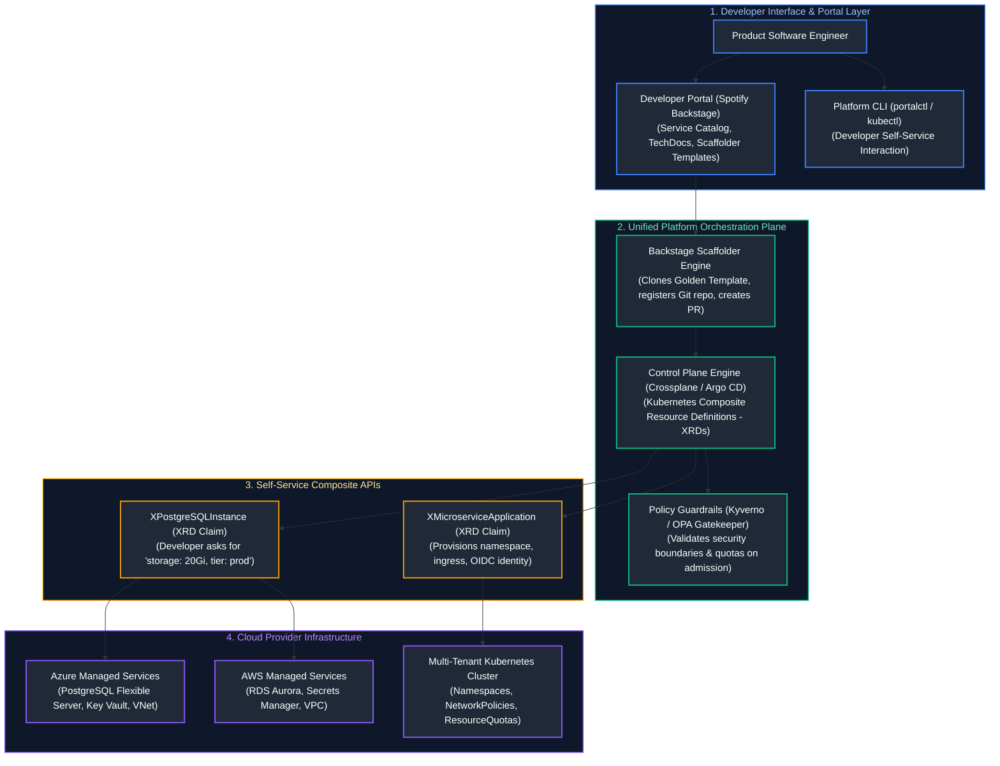
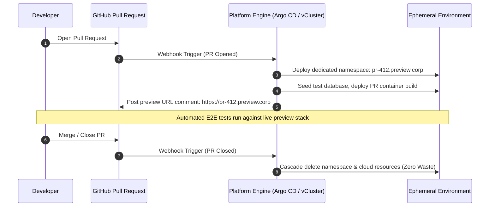

# 14. Platform Engineering & Developer Experience

A comprehensive, production-grade guide to Internal Developer Platforms (IDPs), developer self-service portals with Spotify Backstage, Golden Paths (Paved Roads), Kubernetes-native infrastructure control planes with Crossplane, multi-tenant Kubernetes namespace abstractions, admission policy guardrails, ephemeral pull request environments, and DORA engineering effectiveness metrics tailored for Staff Platform Engineers and Platform Architects.

---

## Architectural Overview: Internal Developer Platform (IDP) Control Plane



---

## Table of Contents
1. [The Platform Engineering Paradigm & Internal Developer Platforms](#1-the-platform-engineering-paradigm-internal-developer-platforms)
   - [1.1 Evolution from SysOps to DevOps to Platform Engineering](#11-evolution-from-sysops-to-devops-to-platform-engineering)
   - [1.2 Treating the Platform as a Product & Reducing Cognitive Load](#12-treating-the-platform-as-a-product-reducing-cognitive-load)
2. [Internal Developer Portals and Backstage](#2-internal-developer-portals-and-backstage)
   - [2.1 Spotify Backstage Architecture: Catalog, TechDocs, and Scaffolder](#21-spotify-backstage-architecture-catalog-techdocs-and-scaffolder)
   - [2.2 Golden Paths (Paved Roads) vs. Mandatory Choke Points](#22-golden-paths-paved-roads-vs-mandatory-choke-points)
3. [Infrastructure Control Planes with Crossplane](#3-infrastructure-control-planes-with-crossplane)
   - [3.1 Moving Beyond Static IaC to Continuous Kubernetes Control Planes](#31-moving-beyond-static-iac-to-continuous-kubernetes-control-planes)
   - [3.2 Composite Resource Definitions (XRDs) and Compositions](#32-composite-resource-definitions-xrds-and-compositions)
4. [Kubernetes Platform Abstractions & Multi-Tenancy](#4-kubernetes-platform-abstractions-multi-tenancy)
   - [4.1 Soft Multi-Tenancy: Namespaces, ResourceQuotas, and LimitRanges](#41-soft-multi-tenancy-namespaces-resourcequotas-and-limitranges)
   - [4.2 Hard Multi-Tenancy: Virtual Clusters (vCluster) and Capsule](#42-hard-multi-tenancy-virtual-clusters-vcluster-and-capsule)
5. [Policy Guardrails and Automated Governance](#5-policy-guardrails-and-automated-governance)
   - [5.1 Kyverno Admission Policies vs. OPA Gatekeeper](#51-kyverno-admission-policies-vs-opa-gatekeeper)
   - [5.2 Validating, Mutating, and Generating Platform Resources](#52-validating-mutating-and-generating-platform-resources)
6. [Platform Secrets, Identity, and External Secrets Operator](#6-platform-secrets-identity-and-external-secrets-operator)
   - [6.1 The External Secrets Operator (ESO) Synchronization Model](#61-the-external-secrets-operator-eso-synchronization-model)
   - [6.2 Synchronizing Azure Key Vault / AWS Secrets Manager to Kubernetes](#31-moving-beyond-static-iac-to-continuous-kubernetes-control-planes)
7. [Ephemeral Development Environments & Preview Stacks](#7-ephemeral-development-environments-preview-stacks)
   - [7.1 Pull-Request-Driven Ephemeral Lifecycle Orchestration](#71-pull-request-driven-ephemeral-lifecycle-orchestration)
   - [7.2 Automatic Garbage Collection and TTL Expiration](#2-internal-developer-portals-and-backstage)
8. [DevEx Metrics and Measuring Platform ROI](#8-devex-metrics-and-measuring-platform-roi)
   - [8.1 DORA Metrics (Deployment Frequency, Lead Time, CFR, MTTR)](#81-dora-metrics-deployment-frequency-lead-time-cfr-mttr)
   - [8.2 Automated Python Backstage Template Validator](#82-automated-python-backstage-template-validator)
9. [Summary Comparison & Engineering Reference Matrix](#9-summary-comparison-engineering-reference-matrix)
10. [References & Further Reading](#10-references-further-reading)

---

# 1. The Platform Engineering Paradigm & Internal Developer Platforms

### 1.1 Evolution from SysOps to DevOps to Platform Engineering

```text
ERA 1: TRADITIONAL SYSOPS (Ticket-Driven)
Developer writes code ──(Opens Jira Ticket)──> SysAdmin manually provisions VM (Takes 2-4 weeks)

ERA 2: DEVOPS "YOU BUILD IT, YOU RUN IT" (Cognitive Overload)
Developer forced to learn Terraform, Helm, Docker, IAM, BGP routing, Istio, Prometheus, and TLS.
Result: Developer cognitive overload; velocity grinds to a halt.

ERA 3: PLATFORM ENGINEERING (Self-Service Paved Road)
Platform Team builds an Internal Developer Platform (IDP) exposing self-service APIs.
Developer self-provisions production-ready stacks in 5 minutes within security guardrails.
```

---

### 1.2 Treating the Platform as a Product & Reducing Cognitive Load

> [!IMPORTANT]
> **Platform as a Product:** Internal Developer Platforms must offer frictionless Golden Paths rather than mandatory enforcement. Teams should be empowered to build with standardized self-service templates while retaining escape hatches for specialized requirements.

The core mission of Platform Engineering is **reducing cognitive load** for product engineering teams:
- The platform team operates as product managers; software developers are the platform's customers.
- **Thick vs. Thin Platform:** Avoid monolithic platform abstractions that leak complexity. Build thin, composable paved roads that allow developers to ship code quickly without managing raw cloud primitives.

---

# 2. Internal Developer Portals and Backstage

### 2.1 Spotify Backstage Architecture: Catalog, TechDocs, and Scaffolder

**Backstage** (donated by Spotify to the CNCF) is an extensible open-source developer portal framework built on Node.js and React:

```text
+-----------------------------------------------------------------------------------------+
|                                SPOTIFY BACKSTAGE ARCHITECTURE                           |
+---------------------+-------------------+---------------------+-------------------------+
| SOFTWARE CATALOG    | TECHDOCS          | SOFTWARE TEMPLATES  | PLUGINS ECOSYSTEM       |
+---------------------+-------------------+---------------------+-------------------------+
| Central inventory of| Markdown docs     | "Scaffolder" wizard | Kubernetes status,      |
| all microservices,  | stored alongside  | creating new repo,  | CI/CD pipeline views,   |
| APIs, databases,    | code; compiled to | CI/CD, and infra in | PagerDuty on-call,      |
| owners, and repos.  | portal pages.     | 3 clicks.           | Cost tracking.          |
+---------------------+-------------------+---------------------+-------------------------+
```

---

### 2.2 Golden Paths (Paved Roads) vs. Mandatory Choke Points

> [!TIP]
> **Ephemeral Resource Teardown Automation:** Always configure automated TTL destruction policies on PR preview environments. Stale uncollected cloud databases, load balancers, and container pods from closed PRs quickly become major contributors to cloud waste.

- **Golden Path (Paved Road):** A fully supported, opinionated, automated template incorporating logging, CI/CD, security scanning, and monitoring by default.
  - *The Golden Path Law:* **The paved road must be optional, not a prison.** If a team requires specialized technology not supported by the platform, they can step off the paved road, taking on the maintenance responsibility for their custom infrastructure.

---

# 3. Infrastructure Control Planes with Crossplane

### 3.1 Moving Beyond Static IaC to Continuous Kubernetes Control Planes

Traditional Terraform workflows are **static and batch-driven**: changes only execute when someone runs a pipeline. If an out-of-band mutation occurs in the cloud console, Terraform does not self-heal until the next pipeline run.

**Crossplane** transforms Kubernetes into a **universal cloud control plane**:
- Models cloud resources (Azure Databases, S3 Buckets, VPCs) directly as Kubernetes Custom Resources (CRDs).
- Operates a continuous, active reconciliation loop: if someone deletes a cloud database via the web console, Crossplane instantly detects the drift and re-provisions it.

---

### 3.2 Composite Resource Definitions (XRDs) and Compositions

Crossplane cleanly separates developer consumption from infrastructure definition:

```yaml
# 1. Developer Claims an Abstract Platform Resource (claim.yaml)
apiVersion: database.corp.platform/v1alpha1
kind: PostgreSQLInstance
metadata:
  name: my-app-db
  namespace: team-payments
spec:
  parameters:
    storageGB: 50
    tier: production
```

```yaml
# 2. Platform Team Declares the Underlying Composition (composition.yaml)
apiVersion: apiextensions.crossplane.io/v1
kind: Composition
metadata:
  name: azure-postgres-flexible.database.corp.platform
spec:
  compositeTypeRef:
    apiVersion: database.corp.platform/v1alpha1
    kind: XPostgreSQLInstance
  resources:
    - name: azurePostgresFlexible
      base:
        apiVersion: dbforpostgresql.azure.upbound.io/v1beta1
        kind: FlexibleServer
        spec:
          forProvider:
            location: eastus
            skuName: GP_Standard_D2ds_v4
            version: "15"
```

---

# 4. Kubernetes Platform Abstractions & Multi-Tenancy

### 4.1 Soft Multi-Tenancy: Namespaces, ResourceQuotas, and LimitRanges

In soft multi-tenancy, multiple teams share a single large Kubernetes cluster, isolated via namespaces:

```yaml
# tenant_namespace_guardrails.yaml
apiVersion: v1
kind: ResourceQuota
metadata:
  name: tenant-compute-quota
  namespace: team-checkout
spec:
  hard:
    requests.cpu: "8"
    requests.memory: 16Gi
    limits.cpu: "16"
    limits.memory: 32Gi
    pods: "20"
---
apiVersion: v1
kind: LimitRange
metadata:
  name: tenant-default-limits
  namespace: team-checkout
spec:
  limits:
    - default:
        memory: 1Gi
        cpu: 500m
      defaultRequest:
        memory: 256Mi
        cpu: 100m
      type: Container
```

---

### 4.2 Hard Multi-Tenancy: Virtual Clusters (vCluster) and Capsule

- **The Soft Multi-Tenancy Limitation:** Namespaces cannot isolate cluster-scoped resources: CRDs, ClusterRoles, Ingress Classes, or different Kubernetes API versions.
- **vCluster:** Spins up a lightweight, fully functional virtual Kubernetes cluster inside a namespace of the host cluster. Tenants get full `cluster-admin` access to their virtual control plane without risking the underlying physical host cluster.

---

# 5. Policy Guardrails and Automated Governance

### 5.1 Kyverno Admission Policies vs. OPA Gatekeeper

- **OPA Gatekeeper:** Uses Rego programming language. Powerful but requires maintaining external logic and Rego knowledge.
- **Kyverno:** Kubernetes-native policy engine written entirely in standard YAML:
  - Can **Validate** (reject non-compliant manifests).
  - Can **Mutate** (automatically inject missing tags, default security contexts).
  - Can **Generate** (automatically create default NetworkPolicies or RoleBindings whenever a new namespace is created).

---

### 5.2 Validating, Mutating, and Generating Platform Resources

```yaml
# kyverno_generate_network_policy.yaml
apiVersion: kyverno.io/v1
kind: ClusterPolicy
metadata:
  name: generate-default-network-policy
spec:
  rules:
    - name: auto-generate-deny-all
      match:
        any:
          - resources:
              kinds: ["Namespace"]
      generate:
        apiVersion: networking.k8s.io/v1
        kind: NetworkPolicy
        name: default-deny-all-ingress
        namespace: "{{request.object.metadata.name}}"
        synchronize: true
        data:
          spec:
            podSelector: {}
            policyTypes:
              - Ingress
```

---

# 6. Platform Secrets, Identity, and External Secrets Operator

### 6.1 The External Secrets Operator (ESO) Synchronization Model

Kubernetes Secrets are simply base64-encoded strings stored in etcd. Storing credentials directly in Git manifests violates security policies.

**External Secrets Operator (ESO)** bridges cloud key management and Kubernetes:

```text
[Azure Key Vault / AWS Secrets Manager] ──(Pulls Secret via OIDC Workload Identity)──> [External Secrets Operator] ──(Generates K8s Secret)──> [Pod Volume / Env Var]
```

```yaml
# external_secret.yaml
apiVersion: external-secrets.io/v1beta1
kind: ExternalSecret
metadata:
  name: database-credentials
  namespace: team-checkout
spec:
  refreshInterval: 1h
  secretStoreRef:
    name: azure-keyvault-store
    kind: ClusterSecretStore
  target:
    name: db-app-secret  # Creates native Kubernetes Secret
  data:
    - secretKey: DB_PASSWORD
      remoteRef:
        key: production-db-password
```

---

# 7. Ephemeral Development Environments & Preview Stacks

### 7.1 Pull-Request-Driven Ephemeral Lifecycle Orchestration



---

# 8. DevEx Metrics and Measuring Platform ROI

### 8.1 DORA Metrics (Deployment Frequency, Lead Time, CFR, MTTR)

The platform's success is quantified via the four **DORA (DevOps Research and Assessment)** metrics:

| DORA Metric | High-Performing Benchmark | Platform Engineering Improvement Vector |
| :--- | :--- | :--- |
| **Deployment Frequency** | Multiple deploys per day | Self-service automated CI/CD and GitOps sync |
| **Lead Time for Changes** | $< 1$ Hour (Commit to Production) | Pre-configured Scaffolder templates and automated testing |
| **Change Failure Rate (CFR)**| $< 5\%$ | Automated canary rollouts and pre-admission Kyverno policy gates |
| **Time to Restore (MTTR)**| $< 1$ Hour | Automated GitOps rollback to previous commit |

---

### 8.2 Automated Python Backstage Template Validator

Below is a production Python automation script validating that an internal microservice repository conforms to all Golden Path platform contracts before being onboarded into the Backstage Software Catalog:

```python
#!/usr/bin/env python3
"""
Platform Engineering Golden Path & Catalog Validator.
Audits repository structure, validates catalog-info.yaml schema,
and verifies mandatory CI/CD pipelines, Dockerfiles, and security configs.
"""

from dataclasses import asdict, dataclass
import json
import logging
from pathlib import Path
import sys
from typing import Dict, List, Optional
import yaml

logging.basicConfig(
    level=logging.INFO,
    format='{"time":"%(asctime)s","level":"%(levelname)s","message":"%(message)s"}',
    handlers=[logging.StreamHandler(sys.stdout)],
)
logger = logging.getLogger("platform_validator")


@dataclass(frozen=True)
class ValidationFinding:
    check_name: str
    status: str
    message: str


class GoldenPathAuditor:
    def __init__(self, repo_dir: Path):
        self.repo_dir = repo_dir

    def audit_backstage_manifest(self) -> List[ValidationFinding]:
        """Validates Backstage catalog-info.yaml exists and contains metadata."""
        catalog_file = self.repo_dir / "catalog-info.yaml"
        if not catalog_file.exists():
            return [
                ValidationFinding(
                    "BACKSTAGE_CATALOG_EXISTS",
                    "FAILED",
                    "Missing mandatory catalog-info.yaml in repository root.",
                )
            ]

        try:
            with open(catalog_file, "r", encoding="utf-8") as f:
                data = yaml.safe_load(f)
            
            metadata = data.get("metadata", {})
            if not metadata.get("name") or not data.get("spec", {}).get("owner"):
                return [
                    ValidationFinding(
                        "BACKSTAGE_METADATA_VALID",
                        "FAILED",
                        "catalog-info.yaml missing required 'name' or 'spec.owner' fields.",
                    )
                ]
            return [
                ValidationFinding(
                    "BACKSTAGE_METADATA_VALID",
                    "PASSED",
                    f"Registered as service '{metadata.get('name')}' owned by '{data.get('spec', {}).get('owner')}'.",
                )
            ]
        except Exception as err:
            return [
                ValidationFinding(
                    "BACKSTAGE_CATALOG_SYNTAX",
                    "FAILED",
                    f"YAML syntax error in catalog-info.yaml: {err}",
                )
            ]

    def audit_security_and_container(self) -> List[ValidationFinding]:
        """Checks for Dockerfile and security scanning pipelines."""
        findings = []
        dockerfile = self.repo_dir / "Dockerfile"
        if not dockerfile.exists():
            findings.append(
                ValidationFinding(
                    "DOCKERFILE_PRESENT",
                    "FAILED",
                    "Missing Dockerfile for containerization.",
                )
            )
        else:
            findings.append(ValidationFinding("DOCKERFILE_PRESENT", "PASSED", "Dockerfile present."))

        ci_dir = self.repo_dir / ".github" / "workflows"
        if not ci_dir.exists() or not list(ci_dir.glob("*.yml")):
            findings.append(
                ValidationFinding(
                    "CI_PIPELINE_PRESENT",
                    "FAILED",
                    "No CI/CD pipeline definitions discovered in .github/workflows/.",
                )
            )
        else:
            findings.append(ValidationFinding("CI_PIPELINE_PRESENT", "PASSED", "CI pipeline configured."))

        return findings


if __name__ == "__main__":
    # Test against simulated directory
    test_path = Path("/tmp/mock_service_repo")
    test_path.mkdir(parents=True, exist_ok=True)
    (test_path / "catalog-info.yaml").write_text(
        "apiVersion: backstage.io/v1alpha1\nkind: Component\nmetadata:\n  name: order-api\nspec:\n  type: service\n  owner: team-checkout\n"
    )
    (test_path / "Dockerfile").write_text("FROM alpine:3.19\n")

    auditor = GoldenPathAuditor(test_path)
    results = []
    results.extend(auditor.audit_backstage_manifest())
    results.extend(auditor.audit_security_and_container())

    passed_count = sum(1 for r in results if r.status == "PASSED")
    report = {
        "status": "APPROVED" if passed_count == len(results) else "BLOCKED",
        "passed_checks": f"{passed_count}/{len(results)}",
        "findings": [asdict(r) for r in results],
    }
    print(json.dumps(report, indent=2))
```

---

# 9. Summary Comparison & Engineering Reference Matrix

| Platform Capability | Legacy Approach | Modern Platform Engineering Standard | Primary Developer Benefit |
| :--- | :--- | :--- | :--- |
| **Service Scaffolding** | Copy-pasting old repos, broken configs | Backstage Software Templates | Production-ready service bootstrapped in 5 minutes |
| **Cloud Provisioning** | Manual Terraform PRs & slow approvals | Crossplane Composite Resources (XRDs) | Declarative self-service via standard Kubernetes YAML |
| **Cluster Multi-Tenancy**| Provisioning separate physical K8s clusters | vCluster & Namespace ResourceQuotas | Rapid spin-up of isolated dev clusters at 90% lower cost |
| **Secret Distribution**| Copying static secrets across environments | External Secrets Operator (ESO) | Zero secrets stored in Git; auto-synced from Key Vault |
| **Governance & Policy**| Manual architecture review boards | Kyverno Admission Control Policies | Instant policy feedback directly in PR or kubectl apply |

---

# 10. References & Further Reading

- [Platform Engineering Community Guide](https://platformengineering.org/) — Principles and architecture of modern Internal Developer Platforms.
- [Spotify Backstage Documentation](https://backstage.io/docs/overview/what-is-backstage) — Service catalog, TechDocs, and Scaffolder architecture.
- [Crossplane Documentation](https://docs.crossplane.io/) — Kubernetes-native infrastructure control planes.
- [Team Topologies: Organizing Business and Technology Teams for Fast Flow](https://teamtopologies.com/) — Foundational organizational model for Platform Teams.
- [Accelerate: The Science of Lean Software and DevOps (DORA)](https://itrevolution.com/book/accelerate/) — Empirical measurement of software delivery performance.

