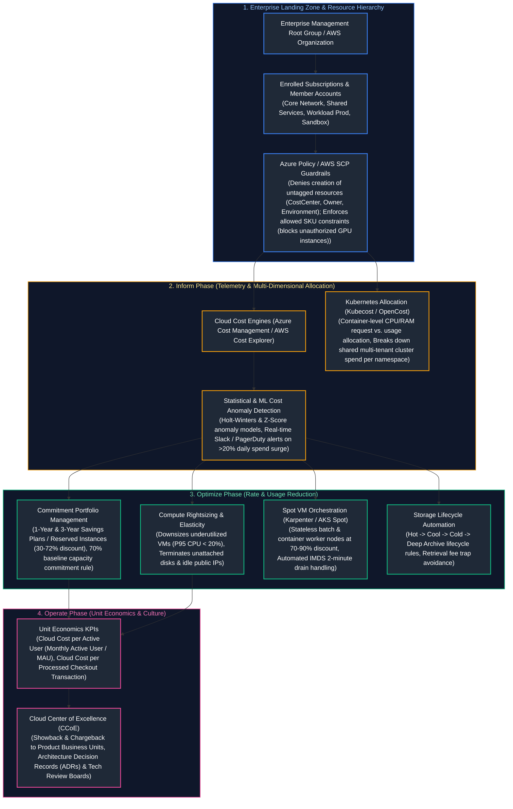
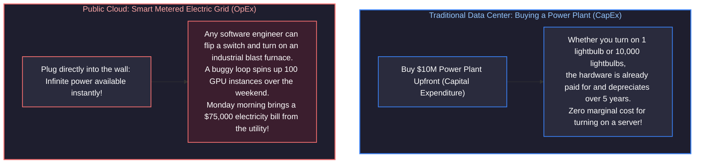
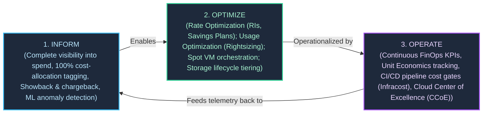
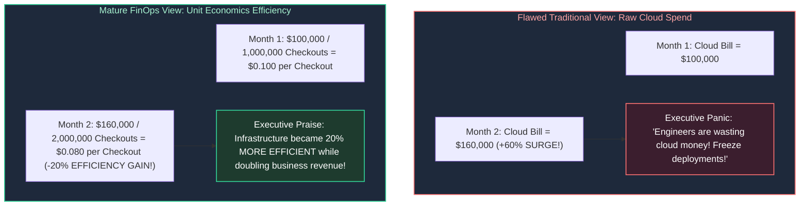
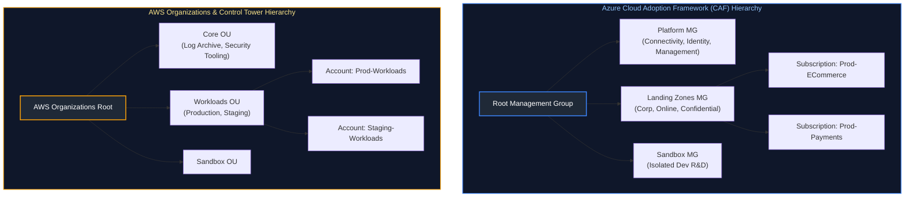
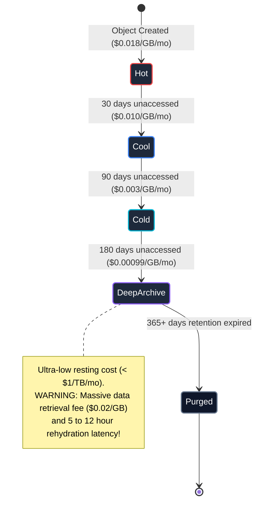
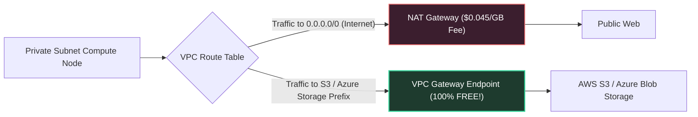
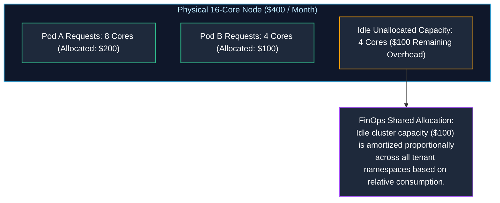

# 15. FinOps, Governance & Enterprise Cloud Operations

A comprehensive, production-grade guide to cloud financial operations (FinOps), enterprise landing zones, mandatory cost allocation tagging policies, commitment discounts (Reserved Instances, Savings Plans), Spot VM interruption handling, storage lifecycle tiering, network egress cost mitigation, Kubernetes workload cost attribution with Kubecost, and architectural governance with Architecture Decision Records (ADRs) tailored for Principal Cloud Architects, FinOps Practitioners, and Engineering Directors.

---

## Architectural Overview: Enterprise FinOps Governance & Cost Optimization Engine



---

## Table of Contents
1. [The FinOps Framework: The Smart Metered Electric Grid Analogy](#1-the-finops-framework-the-smart-metered-electric-grid-analogy)
   - [1.1 Real-World Analogy: Buying a Power Plant (CapEx) vs. The Metered Electric Grid (OpEx)](#11-real-world-analogy-buying-a-power-plant-capex-vs-the-metered-electric-grid-opex)
   - [1.2 The Three FinOps Phases: Inform, Optimize, Operate](#12-the-three-finops-phases-inform-optimize-operate)
   - [1.3 Unit Economics: Shifting from Raw Spend to Business Efficiency Metrics](#13-unit-economics-shifting-from-raw-spend-to-business-efficiency-metrics)
2. [Enterprise Resource Hierarchy & Landing Zone Governance](#2-enterprise-resource-hierarchy--landing-zone-governance)
   - [2.1 Enterprise Cloud Landing Zones: Azure CAF vs. AWS Control Tower](#21-enterprise-cloud-landing-zones-azure-caf-vs-aws-control-tower)
   - [2.2 Mandatory Cost-Allocation Tagging Governance via Policy-as-Code](#22-mandatory-cost-allocation-tagging-governance-via-policy-as-code)
   - [2.3 Preventive Guardrails: Service Control Policies (SCPs) and Azure Policy](#23-preventive-guardrails-service-control-policies-scps-and-azure-policy)
3. [Cost Visibility, Showback vs. Chargeback, and ML Anomaly Detection](#3-cost-visibility-showback-vs-chargeback-and-ml-anomaly-detection)
   - [3.1 Showback vs. Chargeback Accounting Models](#31-showback-vs-chargeback-accounting-models)
   - [3.2 Statistical Anomaly Detection: Holt-Winters and Z-Scores](#32-statistical-anomaly-detection-holt-winters-and-z-scores)
4. [Compute and Storage Cost Optimization: Rate vs. Usage Levers](#4-compute-and-storage-cost-optimization-rate-vs-usage-levers)
   - [4.1 Compute Rightsizing Analytics and Elastic Scaling](#41-compute-rightsizing-analytics-and-elastic-scaling)
   - [4.2 Commitment Discounts: Reserved Instances vs. Savings Plans](#42-commitment-discounts-reserved-instances-vs-savings-plans)
   - [4.3 Spot Instances / Spot VMs: Auction Physics & Graceful IMDS Drain Handling](#43-spot-instances--spot-vms-auction-physics--graceful-imds-drain-handling)
   - [4.4 Storage Lifecycle Policies: Hot, Cool, Cold, Archive and the Retrieval Fee Trap](#44-storage-lifecycle-policies-hot-cool-cold-archive-and-the-retrieval-fee-trap)
5. [Network Egress and Data Transfer Economics](#5-network-egress-and-data-transfer-economics)
   - [5.1 The Hidden Tax of Cloud Networking: Inter-AZ, Inter-Region, and Egress](#51-the-hidden-tax-of-cloud-networking-inter-az-inter-region-and-egress)
   - [5.2 Mitigating NAT Gateway Data Processing Surcharges](#52-mitigating-nat-gateway-data-processing-surcharges)
6. [Kubernetes Workload Cost Attribution (Kubecost & OpenCost)](#6-kubernetes-workload-cost-attribution-kubecost--opencost)
   - [6.1 The Shared Multi-Tenant Cluster Allocation Problem](#61-the-shared-multi-tenant-cluster-allocation-problem)
   - [6.2 Kubecost Allocation Mathematics: Requests vs. Usage vs. Idle Overhead](#62-kubecost-allocation-mathematics-requests-vs-usage-vs-idle-overhead)
7. [Enterprise Architecture Governance and ADRs](#7-enterprise-architecture-governance-and-adrs)
   - [7.1 Architecture Decision Records (ADRs) Framework](#71-architecture-decision-records-adrs-framework)
   - [7.2 Cloud Center of Excellence (CCoE) Operating Model](#72-cloud-center-of-excellence-ccoe-operating-model)
8. [Production Code Implementation: Automated Cloud Waste & Zombie Asset Auditor](#8-production-code-implementation-automated-cloud-waste--zombie-asset-auditor)
   - [8.1 Production Python Cloud FinOps Waste Auditor](#81-production-python-cloud-finops-waste-auditor)
9. [Senior FinOps Troubleshooting Runbooks: Outage & Bill Shock Scenarios](#9-senior-finops-troubleshooting-runbooks-outage--bill-shock-scenarios)
   - [9.1 Scenario 1: Overnight Cloud Cost Explosion from an Unthrottled Distributed Loop](#91-scenario-1-overnight-cloud-cost-explosion-from-an-unthrottled-distributed-loop)
   - [9.2 Scenario 2: Massive Unexpected NAT Gateway Data Processing Surcharge](#92-scenario-2-massive-unexpected-nat-gateway-data-processing-surcharge)
   - [9.3 Scenario 3: Glacier Deep Archive Emergency Retrieval Fee Shock](#93-scenario-3-glacier-deep-archive-emergency-retrieval-fee-shock)
10. [Summary Comparison & Engineering Reference Matrix](#10-summary-comparison--engineering-reference-matrix)
11. [References & Further Reading](#11-references--further-reading)

---

# 1. The FinOps Framework: The Smart Metered Electric Grid Analogy

### 1.1 Real-World Analogy: Buying a Power Plant (CapEx) vs. The Metered Electric Grid (OpEx)

To understand why enterprise organizations experience catastrophic cloud billing shocks without a mature FinOps practice, consider the structural difference between **building your own power plant** and **plugging into a smart municipal electric grid**:



- **In the traditional data center (CapEx):** Procurement was slow, bureaucratic, and gated by physical purchase orders. A server took 3 months to be delivered, racked, and cabled. However, once installed, running an extra batch job cost virtually nothing extra. Engineers never had to worry about hourly financial burn.
- **In the public cloud (OpEx):** Cloud resources are variable operating expenditures billed by the second. Any developer with `Contributor` IAM permissions can execute `terraform apply` or click a button in the web console, committing the enterprise to thousands of dollars per hour. **FinOps is not about "saving money"—FinOps is about maximizing business value per dollar spent.**

---

### 1.2 The Three FinOps Phases: Inform, Optimize, Operate

The FinOps Foundation defines an iterative, continuous three-phase lifecycle:



---

### 1.3 Unit Economics: Shifting from Raw Spend to Business Efficiency Metrics

A common anti-pattern in cloud governance is celebrating raw cost cuts when the business is booming, or panicking when the cloud bill increases because revenue doubled. Mature FinOps measures **Unit Economics**:

$$\text{Cloud Unit Metric} = \frac{\text{Total Attributed Cloud Infrastructure Cost}}{\text{Core Business Value Metric}}$$



#### Canonical Enterprise Unit Metric Formulations:
- **E-Commerce:** $\text{Cloud Cost per Completed Order}$ (Target: $< \$0.05$).
- **SaaS B2B:** $\text{Cloud Cost per Monthly Active User (MAU)}$ (Target: $< \$0.12$).
- **Fintech / Payment Processing:** $\text{Cloud Cost per \$1,000 Payment Volume Processed}$.
- **Streaming / Media:** $\text{Cloud Cost per Gigabyte Streamed to Subscribers}$.

---

# 2. Enterprise Resource Hierarchy & Landing Zone Governance

Enterprise landing zones establish organizational hierarchies, security boundaries, and billing ownership before application workloads deploy.

### 2.1 Enterprise Cloud Landing Zones: Azure CAF vs. AWS Control Tower



---

### 2.2 Mandatory Cost-Allocation Tagging Governance via Policy-as-Code

Untagged cloud resources represent financial black holes that cannot be attributed to specific departments or products. Enterprises enforce **Policy-as-Code** gates at the management root, causing cloud APIs to **reject non-compliant provisioning requests**:

```json
// Azure Policy: Deny Resource Deployment if CostCenter Tag is Missing
{
  "properties": {
    "displayName": "Enforce Mandatory CostCenter Tag on Resource Groups",
    "description": "Denies creation of any resource group that does not include the CostCenter financial ledger tag.",
    "mode": "All",
    "policyRule": {
      "if": {
        "allOf": [
          {
            "field": "type",
            "equals": "Microsoft.Resources/subscriptions/resourceGroups"
          },
          {
            "field": "tags['CostCenter']",
            "exists": "false"
          }
        ]
      },
      "then": {
        "effect": "deny"
      }
    }
  }
}
```

---

### 2.3 Preventive Guardrails: Service Control Policies (SCPs) and Azure Policy

Preventive policies establish non-negotiable financial and regional guardrails:
1. **Restricting Deployment Regions:** Prevent developers from launching resources in expensive or non-compliant regions:
   ```json
   // AWS Service Control Policy (SCP): Restrict Deployment to approved regions
   {
     "Version": "2012-10-17",
     "Statement": [
       {
         "Sid": "DenyUnapprovedRegions",
         "Effect": "Deny",
         "NotAction": [
           "iam:*", "route53:*", "cloudfront:*", "waf:*"
         ],
         "Resource": "*",
         "Condition": {
           "StringNotEquals": {
             "aws:RequestedRegion": ["us-east-1", "eu-west-1"]
           }
         }
       }
     ]
   }
   ```
2. **Denying Monster Compute SKUs:** Deny developer creation of massive GPU instances (`p4d.24xlarge` at \$32/hr) or mega-RAM virtual machines without executive architecture review.

---

# 3. Cost Visibility, Showback vs. Chargeback, and ML Anomaly Detection

### 3.1 Showback vs. Chargeback Accounting Models

| Governance Dimension | Showback Model (Inform / Crawl Phase) | Chargeback Model (Operate / Run Phase) |
| :--- | :--- | :--- |
| **Financial Mechanism** | Informational reports issued monthly showing attributed cloud expenditure. | Actual inter-departmental balance transfers debited from team budgets. |
| **P&L General Ledger Impact** | Centralized IT/Cloud budget absorbs all invoices; zero direct P&L impact on squads. | Product teams carry direct P&L accountability; cloud spend reduces squad operating margins. |
| **Engineering Incentive** | Voluntary optimization; depends on good citizenship and moral persuasion. | Direct structural incentive: every dollar saved on cloud can fund headcounts or bonuses. |
| **Implementation Complexity** | Low: Requires cost allocation tagging and dashboards (Grafana / CloudHealth). | High: Requires corporate ERP integration, cross-charging codes, and dispute mediation. |
| **Cultural Friction** | Low initial resistance; introduces cost awareness without budget anxiety. | High initial friction; leads to disputes over shared platform overhead (e.g. who pays for network transit?). |
| **Organizational Maturity** | Recommended starting point for organizations in FinOps "Crawl" and "Walk" stages. | Standard operational state for mature "Run" phase enterprises with dedicated FinOps teams. |

---

### 3.2 Statistical Anomaly Detection: Holt-Winters and Z-Scores

Static dollar thresholds fail to catch cloud waste because spend naturally grows as the business expands. Modern FinOps platforms use statistical time-series algorithms:
- **Z-Score Detection:** Calculates standard deviations from a rolling 14-day moving mean:
  $$Z = \frac{X_t - \mu_{14}}{\sigma_{14}}$$
  If $Z > 2.5$, a statistical anomaly is declared, immediately paging on-call engineers via PagerDuty.
- **Holt-Winters Triple Exponential Smoothing:** Accounts for cyclical business patterns (e.g., lower traffic on Sundays vs. peak spikes on Cyber Monday).

---

# 4. Compute and Storage Cost Optimization: Rate vs. Usage Levers

FinOps divides optimization into two distinct levers:
1. **Usage Optimization (Engineering):** Using fewer resources (downsizing VMs, terminating idle disks, cleaning preview stacks).
2. **Rate Optimization (Finance/Architecture):** Paying less per resource unit for the exact same infrastructure (Savings Plans, Spot instances).

### 4.1 Compute Rightsizing Analytics and Elastic Scaling

Over $40\%$ of cloud virtual machines operate at **$< 10\%$ average CPU and memory utilization**:
- **The Rightsizing Rule:** If an instance exhibits **P95 CPU $\le 20\%$** and **P95 RAM $\le 30\%$** over a rolling 14-day observation window, immediately downsize the instance by one size tier (e.g. `Standard_D8s_v5` $\rightarrow$ `Standard_D4s_v5`), slashing compute spend by **$50\%$**.

---

### 4.2 Commitment Discounts: Reserved Instances vs. Savings Plans

| Commitment Discount Model | Geographic & Regional Scope | Instance Family & OS Flexibility | Maximum Discount | Cross-Service Coverage | Marketplace Resale | Best Production Use Case |
| :--- | :--- | :--- | :---: | :--- | :---: | :--- |
| **Standard Reserved Instances (RI)** | Locked to a specific Region, Availability Zone, and exact instance type. | **None:** Locked to specific instance type, size, operating system, and tenancy. | **Up to ~72%** | Virtual Machines only (EC2 / Azure Reserved VM). | **Yes** (Can sell unused capacity on AWS Marketplace). | Mission-critical monolithic databases running 24/7 on fixed hardware specifications. |
| **EC2 / VM Instance Savings Plans** | Locked to a specific Region and a specific instance family (e.g. `m6i` or `Dsv5`). | **Moderate:** Automatically applies regardless of instance size, OS, or tenancy within the family. | **Up to ~66%** | Virtual Machines within the committed family only. | **No** | Stable workload fleets where the VM family is fixed, but individual sizes scale up/down. |
| **Compute Savings Plans** | **Global:** Applies across any Region automatically. | **Complete:** Automatically applies regardless of family, size, AZ, OS, or tenancy. | **Up to ~60%** | Comprehensive: Applies to EC2, AWS Fargate, and AWS Lambda seamlessly. | **No** | Dynamic containerized microservice fleets, serverless workloads, and rapid architecture evolutions. |

> [!CRITICAL]
> **The 70% Commitment Portfolio Law:** **Never commit to 100% of your current cloud fleet.** Workloads naturally fluctuate, and architectural refactorings (e.g. moving a monolithic VM to serverless containers) can strand unused commitments. The industry standard is committing to **$70\% - 80\%$ of steady-state baseline capacity**, absorbing elastic peaks with On-Demand and Spot instances.

---

### 4.3 Spot Instances / Spot VMs: Auction Physics & Graceful IMDS Drain Handling

Cloud providers sell surplus, unallocated hypervisor capacity at a **$60\% - 90\%$ discount** as **Spot Instances (AWS) / Spot VMs (Azure)**:
- **The Catch:** The cloud provider can evict the instance at any time with minimal warning (**2-minute notice in AWS** via EventBridge/IMDS; **30-second notice in Azure** via Scheduled Events API).
- **Graceful Drain Controller:** Workload clusters run an automated daemon that polls the Instance Metadata Service (IMDS) every 5 seconds. The moment an eviction token is detected, it automatically drains pods to surviving nodes:

```bash
# SRE Drain Automation: Poll AWS IMDS for Spot Eviction Action
TOKEN=$(curl -s -X PUT "http://169.254.169.254/latest/api/token" -H "X-aws-ec2-metadata-token-ttl-seconds: 60")
ACTION=$(curl -s -H "X-aws-ec2-metadata-token: $TOKEN" "http://169.254.169.254/latest/meta-data/spot/instance-action")

if [ "$ACTION" != "" ]; then
  echo "SPOT INTERRUPTION NOTICE RECEIVED: Draining Kubernetes Node..."
  kubectl cordon $(hostname)
  kubectl drain $(hostname) --ignore-daemonsets --delete-emptydir-data --force --grace-period=90
fi
```

---

### 4.4 Storage Lifecycle Policies: Hot, Cool, Cold, Archive and the Retrieval Fee Trap



> [!CAUTION]
> **The Archive Retrieval Fee Trap:** Deep Archive / Glacier Deep Archive costs less than \$1 per terabyte per month to store. However, **retrieving that data incurs massive per-gigabyte retrieval surcharges and takes up to 12 hours**. Never transition files to Archive tiers if analytical queries (Athena, BigQuery, Databricks) regularly scan those directories!

---

# 5. Network Egress and Data Transfer Economics

### 5.1 The Hidden Tax of Cloud Networking: Inter-AZ, Inter-Region, and Egress

Inbound data transfer into public clouds is almost universally **free** (the "Hotel California" model). Cloud providers charge aggressively for outbound movement:

| Network Traffic Scope | Physical Path | Billing Rate | FinOps Architectural Mitigation |
| :--- | :--- | :--- | :--- |
| **Intra-AZ Traffic** | Same Subnet / Availability Zone | **Free (\$0.00 / GB)** | Co-locate high-chatter microservices (App to Redis) in the same AZ. |
| **Inter-AZ Traffic** | Cross-AZ within same Region | **\$0.01 / GB each way** (\$0.02 / GB roundtrip) | Enable Kubernetes Topology Aware Hints; configure local in-memory caches. |
| **Inter-Region Traffic** | Across cloud regions (e.g. East to West) | **\$0.02 / GB** | Replicate only deduplicated, compressed delta streams (Kafka / CDC). |
| **Public Internet Egress** | Cloud out to Public Internet | **\$0.08 – \$0.12 / GB** | Place Cloudflare / CloudFront CDN at perimeter to cache static & API payloads. |

---

### 5.2 Mitigating NAT Gateway Data Processing Surcharges

Managed NAT Gateways (AWS NAT Gateway / Azure NAT Gateway) are silent cost exploders:
- **Fixed Fee:** ~\$0.045 per hour per gateway (~$32/mo).
- **Data Processing Surcharge:** **\$0.045 per Gigabyte processed**!
- If a data pipeline downloads 50 Terabytes of training data from an S3 bucket or Azure Blob through a NAT Gateway, the company incurs **\$2,250 in unnecessary data processing fees**!

#### The Architectural Solution: VPC Gateway Endpoints
Route cloud service traffic directly through **free Gateway Endpoints**:


---

# 6. Kubernetes Workload Cost Attribution (Kubecost & OpenCost)

### 6.1 The Shared Multi-Tenant Cluster Allocation Problem

When 40 teams deploy microservices to a single 200-node shared Kubernetes cluster, the cloud bill arrives as a monolithic itemized charge for "200 Virtual Machines". Infrastructure leaders cannot determine which team is responsible for which portion of the bill.

---

### 6.2 Kubecost Allocation Mathematics: Requests vs. Usage vs. Idle Overhead

**OpenCost (CNCF)** and **Kubecost** resolve this by calculating cost allocation per container pod:

$$\text{Pod Cost} = \max(\text{CPU}_{\text{Requests}}, \text{CPU}_{\text{Usage}}) \times \text{Rate}_{\text{CPU}} + \max(\text{RAM}_{\text{Requests}}, \text{RAM}_{\text{Usage}}) \times \text{Rate}_{\text{RAM}}$$



---

# 7. Enterprise Architecture Governance and ADRs

### 7.1 Architecture Decision Records (ADRs) Framework

An **Architecture Decision Record (ADR)** documents significant technical decisions, architectural trade-offs, and financial implications in an immutable, version-controlled markdown file:

```markdown
# ADR-014: Standardizing Multi-Region Relational Tier on Azure Cosmos DB vs. Aurora

**Date:** 2026-10-14  
**Status:** Approved  
**Deciders:** Principal Architect, Staff SRE, FinOps Lead  

---

## 1. Context & Business Problem
Our checkout platform is expanding to Europe. We require active-active write capability across `eastus` and `westeurope` with sub-10ms write latency and automated regional failover. Operating cross-region PostgreSQL clusters requires complex replication proxies and manual split-brain reconciliation.

---

## 2. Decision
We will adopt **Azure Cosmos DB** with the NoSQL (Core) API, Session Consistency, and Multi-Region Writes enabled.

---

## 3. Financial & Operational Consequences
### Positive Consequences:
- Multi-Region Writes guarantee a 99.999% availability SLA.
- Zero server maintenance, OS patching, or cross-region replication toil.
### Negative Consequences & Financial Risks:
- Request Unit (RU/s) consumption-based pricing can surge rapidly under unindexed cross-partition queries.
- Mandatory Mitigation: We will enforce Cosmos DB Autoscale capped at 20,000 RU/s and alert on partition hot-spotting via Datadog.
```

---

### 7.2 Cloud Center of Excellence (CCoE) Operating Model

The **Cloud Center of Excellence (CCoE)** is a cross-functional governing council:
- **Composition:** Lead Enterprise Architect, Head of Information Security, Lead SRE, FinOps Director, and Product Engineering VP.
- **Cadence:** Bi-weekly operational review inspecting cloud budget variances, reviewing new ADR proposals, and auditing compliance tag scores.

---

# 8. Production Code Implementation: Automated Cloud Waste & Zombie Asset Auditor

### 8.1 Production Python Cloud FinOps Waste Auditor

Below is a production-grade Python utility that interrogates cloud inventory data, detects orphaned block storage disks, unassociated public IPs, idle load balancers, and calculates exact monthly financial waste:

```python
#!/usr/bin/env python3
"""
Production Cloud FinOps Waste & Zombie Asset Auditor.
Scans cloud infrastructure inventories for detached storage volumes,
unassociated public IPs, and abandoned database snapshots to quantify financial leakage.
"""

from dataclasses import asdict, dataclass
import json
import logging
import sys
from typing import Any, Dict, List, Optional

logging.basicConfig(
    level=logging.INFO,
    format='{"time":"%(asctime)s","level":"%(levelname)s","logger":"%(name)s","message":"%(message)s"}',
    handlers=[logging.StreamHandler(sys.stdout)],
)
logger = logging.getLogger("finops_waste_scanner")


@dataclass(frozen=True)
class WasteFinding:
    resource_id: str
    resource_type: str
    region: str
    age_days: int
    monthly_waste_usd: float
    remediation_action: str


class EnterpriseFinOpsAuditor:
    # Monthly cost benchmarks (US-East Average)
    PRICE_PER_GB_SSD = 0.10        # $0.10/GB/month for GP3 / Premium SSD
    PRICE_PER_IDLE_IP = 3.65       # $0.005/hour idle public IP reservation fee
    PRICE_PER_IDLE_ALB = 18.25     # $0.025/hour idle application load balancer base charge

    def __init__(self, inventory_data: Dict[str, Any]):
        self.data = inventory_data

    def audit_all(self) -> Dict[str, Any]:
        """Executes full suite of cloud waste audits."""
        logger.info("Executing comprehensive enterprise FinOps audit...")
        findings: List[WasteFinding] = []

        findings.extend(self._audit_unattached_disks())
        findings.extend(self._audit_unassociated_ips())
        findings.extend(self._audit_idle_load_balancers())

        total_monthly_waste = sum(f.monthly_waste_usd for f in findings)

        return {
            "audit_summary": {
                "total_waste_items_flagged": len(findings),
                "projected_monthly_waste_usd": round(total_monthly_waste, 2),
                "projected_annual_waste_usd": round(total_monthly_waste * 12, 2),
                "financial_status": "ACTION_REQUIRED" if total_monthly_waste > 500 else "OPTIMIZED",
            },
            "itemized_findings": [asdict(f) for f in findings],
        }

    def _audit_unattached_disks(self) -> List[WasteFinding]:
        disks = self.data.get("disks", [])
        findings = []
        for d in disks:
            if not d.get("attached_vm_id"):
                size_gb = d.get("size_gb", 0)
                cost = round(size_gb * self.PRICE_PER_GB_SSD, 2)
                findings.append(
                    WasteFinding(
                        resource_id=d.get("disk_id", "unknown"),
                        resource_type="Unattached_Block_Disk",
                        region=d.get("region", "global"),
                        age_days=d.get("age_days", 0),
                        monthly_waste_usd=cost,
                        remediation_action="Take final cold snapshot and execute disk deletion.",
                    )
                )
        return findings

    def _audit_unassociated_ips(self) -> List[WasteFinding]:
        ips = self.data.get("public_ips", [])
        findings = []
        for ip in ips:
            if not ip.get("associated_nic_id"):
                findings.append(
                    WasteFinding(
                        resource_id=ip.get("ip_address", "unknown"),
                        resource_type="Unassociated_Public_IP",
                        region=ip.get("region", "global"),
                        age_days=ip.get("age_days", 0),
                        monthly_waste_usd=self.PRICE_PER_IDLE_IP,
                        remediation_action="Release unassociated public IP to stop idle reservation charges.",
                    )
                )
        return findings

    def _audit_idle_load_balancers(self) -> List[WasteFinding]:
        albs = self.data.get("load_balancers", [])
        findings = []
        for lb in albs:
            # An ALB with 0 registered targets is idle waste
            if lb.get("registered_targets_count", 0) == 0:
                findings.append(
                    WasteFinding(
                        resource_id=lb.get("lb_name", "unknown"),
                        resource_type="Zero_Target_Load_Balancer",
                        region=lb.get("region", "global"),
                        age_days=lb.get("age_days", 0),
                        monthly_waste_usd=self.PRICE_PER_IDLE_ALB,
                        remediation_action="Deregister idle load balancer lacking backend targets.",
                    )
                )
        return findings


# ============================================================================
# Verification Run
# ============================================================================
if __name__ == "__main__":
    sample_cloud_inventory = {
        "disks": [
            {"disk_id": "vol-084a91b2c", "size_gb": 500, "attached_vm_id": None, "age_days": 42, "region": "us-east-1"},
            {"disk_id": "vol-991bc220f", "size_gb": 1000, "attached_vm_id": None, "age_days": 18, "region": "us-east-1"},
            {"disk_id": "vol-11002233a", "size_gb": 100, "attached_vm_id": "i-0a811c", "age_days": 120, "region": "us-east-1"},
        ],
        "public_ips": [
            {"ip_address": "52.14.88.102", "associated_nic_id": None, "age_days": 60, "region": "us-east-2"},
            {"ip_address": "54.210.12.5", "associated_nic_id": "nic-8812", "age_days": 90, "region": "us-east-1"},
        ],
        "load_balancers": [
            {"lb_name": "app/abandoned-preview-alb/5501", "registered_targets_count": 0, "age_days": 35, "region": "us-east-1"},
            {"lb_name": "app/prod-checkout-alb/9901", "registered_targets_count": 8, "age_days": 365, "region": "us-east-1"},
        ],
    }

    auditor = EnterpriseFinOpsAuditor(sample_cloud_inventory)
    report = auditor.audit_all()
    print(json.dumps(report, indent=2))
```

---

# 9. Senior FinOps Troubleshooting Runbooks: Outage & Bill Shock Scenarios

### 9.1 Scenario 1: Overnight Cloud Cost Explosion from an Unthrottled Distributed Loop
- **Symptom:** Engineering VP receives an urgent Monday morning call from Finance. The cloud bill spiked by **\$48,000 over the weekend**.
- **Root Cause Isolation:**
  1. Open Cost Management $\rightarrow$ Group by Service & Resource.
  2. Notice `AWS Lambda` / `Azure Functions` executed **450,000,000 invocations** between Saturday 02:00 UTC and Sunday 22:00 UTC.
  3. A developer committed a recursive event loop: Function A wrote a message to an S3 bucket; S3 bucket creation triggered Function A; repeat infinitely.
- **Immediate Mitigation:**
  1. Set function reserved concurrency to **0** via cloud CLI to halt all executions instantly:
     ```bash
     aws lambda put-function-concurrency --function-name recursive-processor --reserved-concurrent-executions 0
     ```
  2. Sever the event source trigger at the S3 bucket configuration.
  3. Deploy preventive **CloudWatch / Azure Cost Anomaly Alerts** with automated circuit-breaker webhooks.

---

### 9.2 Scenario 2: Massive Unexpected NAT Gateway Data Processing Surcharge
- **Symptom:** Monthly AWS invoice shows a line item for `EC2: NATGateway-Bytes` totaling **\$14,500** ($320\text{TB}$ processed).
- **Root Cause:** A newly deployed machine learning training pipeline in a private subnet was downloading terabytes of training images from S3 through the NAT Gateway rather than through a free VPC Gateway Endpoint.
- **Remediation Runbook:**
  1. Deploy an **S3 VPC Gateway Endpoint** (100% free of charge) and associate it with all private subnet route tables via Terraform:
     ```hcl
     resource "aws_vpc_endpoint" "s3_gateway" {
       vpc_id          = aws_vpc.main.id
       service_name    = "com.amazonaws.us-east-1.s3"
       route_table_ids = [aws_route_table.private.id]
     }
     ```
  2. S3 traffic immediately diverts from the NAT Gateway directly to the AWS internal network fabric, dropping the monthly NAT processing bill from \$14,500 to **\$0**.

---

### 9.3 Scenario 3: Glacier Deep Archive Emergency Retrieval Fee Shock
- **Symptom:** A security audit required analyzing 80TB of historical raw security logs stored in Glacier Deep Archive. An engineer submitted an bulk retrieval request. The following month's bill included a surprise **\$18,000 data retrieval fee**.
- **Root Cause:** The engineer selected **Expedited / Standard Retrieval** on 80TB of deep cold data instead of evaluating whether the data could be filtered before retrieval or querying metadata logs.
- **Remediation Policy:**
  1. Enforce IAM boundary permissions restricting `glacier:RestoreObject` permissions.
  2. Require FinOps approval for any storage restore job exceeding 5TB.

---

# 10. Summary Comparison & Engineering Reference Matrix

| FinOps Dimension | Reactive Tactical Approach | Mature Proactive Enterprise Standard | Primary Financial Benefit |
| :--- | :--- | :--- | :--- |
| **Billing Visibility** | Reviewing monthly PDF invoice | Real-time Datadog / Kubecost dashboards | Eliminates surprise bill shock; detects anomalies in hours |
| **Cost Allocation** | Shared corporate IT cost center | Granular showback/chargeback to product teams | Direct accountability motivates engineering teams to clean waste |
| **Compute Purchasing**| 100% On-Demand pricing | 70% Savings Plans + 20% Spot + 10% On-Demand | 30% to 60% overall compute rate reduction |
| **Storage Lifecycle** | Infinite retention in Hot Tier | Automated Hot $\rightarrow$ Cool $\rightarrow$ Archive $\rightarrow$ Purge rules | 70% to 90% storage bill reduction |
| **Network Egress** | Routing all traffic through NAT Gateways | Gateway Endpoints, Topology Hints, CloudFront CDN | Eliminates thousands in data processing & cross-AZ fees |
| **Governance Model**| Manual spreadsheets & approvals | Policy-as-Code (Azure Policy / AWS SCPs) | Rejects non-compliant and oversized resources at admission |

---

# 11. References & Further Reading

- [FinOps Foundation: Framework & Principles](https://www.finops.org/framework/) — Official standards body for Cloud Financial Management.
- [Cloud FinOps: Collaborative, Real-Time Cloud Value Decision Making (Storment & Fuller)](https://www.oreilly.com/library/view/cloud-finops/9781492054610/) — The definitive FinOps reference manual.
- [Microsoft Cloud Adoption Framework for Azure](https://learn.microsoft.com/en-us/azure/cloud-adoption-framework/) — Landing zone architectures and governance.
- [OpenCost Specification (CNCF)](https://www.opencost.io/) — Open-source Kubernetes cost attribution model.
- [Architecture Decision Records (Michael Nygard)](https://cognitect.com/blog/2011/11/15/documenting-architecture-decisions) — Documenting architectural trade-offs.
