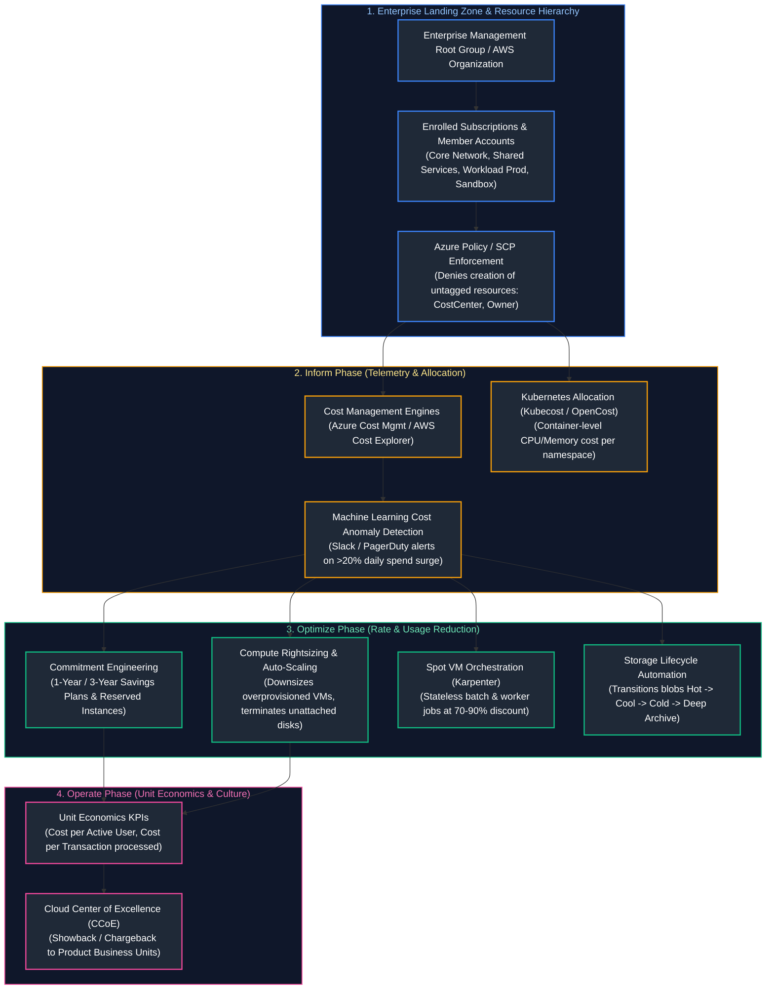

# 15. FinOps, Governance & Enterprise Cloud Operations

A comprehensive, production-grade guide to cloud financial operations (FinOps), enterprise landing zones, mandatory cost allocation tagging policies, commitment discounts (Reserved Instances, Savings Plans), Spot VM interruption handling, storage lifecycle tiering, network egress cost mitigation, Kubernetes workload cost attribution with Kubecost, and architectural governance with Architecture Decision Records (ADRs) tailored for Principal Cloud Architects, FinOps Practitioners, and Engineering Directors.

---

## Architectural Overview: Enterprise FinOps Governance & Cost Optimization Engine



---

## Table of Contents
1. [The FinOps Framework: Inform, Optimize, Operate](#1-the-finops-framework-inform-optimize-operate)
   - [1.1 Cultural Shift from Capital Expenditure (CapEx) to Operational Expenditure (OpEx)](#11-cultural-shift-from-capital-expenditure-capex-to-operational-expenditure-opex)
   - [1.2 The Three FinOps Phases](#12-the-three-finops-phases)
2. [Resource Hierarchy and Mandatory Tagging Policies](#2-resource-hierarchy-and-mandatory-tagging-policies)
   - [2.1 Enterprise Cloud Landing Zones (Azure CAF vs. AWS Control Tower)](#21-enterprise-cloud-landing-zones-azure-caf-vs-aws-control-tower)
   - [2.2 Mandatory Cost-Allocation Tagging Governance](#22-mandatory-cost-allocation-tagging-governance)
3. [Cost Visibility, Showback, Chargeback, and Anomaly Detection](#3-cost-visibility-showback-chargeback-and-anomaly-detection)
   - [3.1 Showback vs. Chargeback Accounting Models](#31-showback-vs-chargeback-accounting-models)
   - [3.2 Cloud Cost Anomaly Detection Algorithms](#32-cloud-cost-anomaly-detection-algorithms)
4. [Compute and Storage Cost Optimization](#4-compute-and-storage-cost-optimization)
   - [4.1 Rightsizing Analysis and CPU/Memory Elasticity](#41-rightsizing-analysis-and-cpumemory-elasticity)
   - [4.2 Reserved Instances (RI) vs. Savings Plans (Compute vs. EC2)](#42-reserved-instances-ri-vs-savings-plans-compute-vs-ec2)
   - [4.3 Spot Instances / Spot VMs and Graceful Drain Handling](#43-spot-instances-spot-vms-and-graceful-drain-handling)
   - [4.4 Storage Lifecycle Policies: Hot, Cool, Cold, Archive](#44-storage-lifecycle-policies-hot-cool-cold-archive)
5. [Network Egress and Data Transfer Optimization](#5-network-egress-and-data-transfer-optimization)
   - [5.1 The Hidden Cost of Cloud Networking](#51-the-hidden-cost-of-cloud-networking)
   - [5.2 Cross-AZ and Cross-Region Traffic Cost Mitigation](#52-cross-az-and-cross-region-traffic-cost-mitigation)
6. [Kubernetes Workload Cost Allocation](#6-kubernetes-workload-cost-allocation)
   - [6.1 The Shared Multi-Tenant Cluster Allocation Problem](#61-the-shared-multi-tenant-cluster-allocation-problem)
   - [6.2 Kubecost and OpenCost In-Cluster Accounting](#62-kubecost-and-opencost-in-cluster-accounting)
7. [Enterprise Architecture Governance and ADRs](#7-enterprise-architecture-governance-and-adrs)
   - [7.1 Architecture Decision Records (ADRs)](#71-architecture-decision-records-adrs)
   - [7.2 Cloud Center of Excellence (CCoE) Operating Model](#72-cloud-center-of-excellence-ccoe-operating-model)
8. [Automated Cloud Waste Detection and Cleanup Automation](#8-automated-cloud-waste-detection-and-cleanup-automation)
   - [8.1 Idle Asset Identification Logic](#81-idle-asset-identification-logic)
   - [8.2 Automated Python Orphaned Cloud Asset Discovery Utility](#82-automated-python-orphaned-cloud-asset-discovery-utility)
9. [Summary Comparison & Engineering Reference Matrix](#9-summary-comparison-engineering-reference-matrix)
10. [References & Further Reading](#10-references-further-reading)

---

# 1. The FinOps Framework: Inform, Optimize, Operate

### 1.1 Cultural Shift from Capital Expenditure (CapEx) to Operational Expenditure (OpEx)

In traditional data centers, IT spending was **Capital Expenditure (CapEx)**: hardware was purchased in multi-million-dollar upfront tranches and depreciated over 3-5 years.

In cloud computing, spending is variable **Operational Expenditure (OpEx)**: any engineer with API credentials can execute `terraform apply` and commit the company to thousands of dollars per hour. **FinOps (Cloud Financial Operations)** is the operational framework and cultural discipline that bridges engineering, finance, and business to maximize business value from cloud spending.

---

### 1.2 The Three FinOps Phases

```text
[INFORM] ──(Visibility & Allocation)──> [OPTIMIZE] ──(Rate & Usage Reduction)──> [OPERATE] ──(Unit Economics KPIs)
   ▲                                                                                                    │
   └─────────────────────────────── Continuous Iterative Feedback ──────────────────────────────────────┘
```

1. **Inform:** Provides visibility into where every dollar is spent. Tagging, showback, chargeback, and real-time anomaly detection.
2. **Optimize:** Identifying waste and reducing costs:
   - *Rate Optimization:* Paying less per resource (Commitment discounts, Savings Plans, Spot VMs).
   - *Usage Optimization:* Using fewer resources (Rightsizing, shutting down idle dev environments, storage lifecycle tiering).
3. **Operate:** Embedding FinOps practices into daily CI/CD pipelines, architectural reviews, and product KPI scorecards.

---

# 2. Resource Hierarchy and Mandatory Tagging Policies

### 2.1 Enterprise Cloud Landing Zones (Azure CAF vs. AWS Control Tower)

An **Enterprise Landing Zone** is the multi-account / multi-subscription foundation providing identity, governance, security, networking, and billing scaffolding before deploying application workloads:
- **Azure Cloud Adoption Framework (CAF) Landing Zone:** Management Groups structure subscriptions into Platform (Connectivity, Management, Identity) and Application Landing Zones (Online, Corp).
- **AWS Control Tower & Organizations:** Automated multi-account provisioning creating Core Accounts (Log Archive, Security Tooling) and Workload OUs governed by Service Control Policies.

---

### 2.2 Mandatory Cost-Allocation Tagging Governance

Untagged cloud resources represent an unallocated financial black hole. Organizations enforce automated **Policy-as-Code** guardrails preventing resource deployment if mandatory tags are missing:

| Mandatory Tag | Production Purpose | Example Value |
| :--- | :--- | :--- |
| `Environment` | Distinguishes non-prod from mission-critical prod | `production`, `staging`, `sandbox` |
| `CostCenter` | Financial ledger code for internal accounting | `CC-4102-ENG` |
| `Owner` | Team or individual responsible for resource lifecycle | `team-checkout@corp.com` |
| `Project` | Specific business product or initiative | `checkout-redesign` |
| `DataClassification`| Security compliance classification | `Confidential`, `PII`, `Public` |

```json
// Azure Policy: Deny resource creation if CostCenter tag is missing
{
  "properties": {
    "displayName": "Enforce CostCenter Tag on Resource Groups",
    "policyRule": {
      "if": {
        "field": "tags['CostCenter']",
        "exists": "false"
      },
      "then": {
        "effect": "deny"
      }
    }
  }
}
```

---

# 3. Cost Visibility, Showback, Chargeback, and Anomaly Detection

### 3.1 Showback vs. Chargeback Accounting Models

- **Showback:** Finance generates monthly reports displaying exactly how much cloud spend each product team consumed, promoting awareness without transferring money.
- **Chargeback:** Real internal financial cross-charging. Cloud costs are deducted directly from each engineering department's quarterly budget. Strongly incentivizes engineering managers to eliminate idle infrastructure.

---

### 3.2 Cloud Cost Anomaly Detection Algorithms

Static budget alerts (e.g., "Alert when spend hits \$10,000") fail because cloud spending varies dynamically. Modern cost platforms use machine learning to detect statistical spend anomalies:
- Evaluates rolling historical trends using Holt-Winters exponential smoothing or ARIMA models.
- Fires high-priority alerts when daily spending deviates $>2$ standard deviations from predicted baseline (e.g. an unthrottled loop spinning up 100 GPU instances).

---

# 4. Compute and Storage Cost Optimization

### 4.1 Rightsizing Analysis and CPU/Memory Elasticity

Studies show over 40% of cloud IaaS virtual machines are provisioned with less than 10% average CPU and memory utilization:
- **Rightsizing Rule:** If P95 CPU utilization is $\le 20\%$ and peak memory consumption is $\le 30\%$ over a 14-day evaluation window, downsize the instance by one size tier (e.g. `Standard_D8s_v5` $\rightarrow$ `Standard_D4s_v5`), instantly cutting compute cost by 50%.

---

### 4.2 Reserved Instances (RI) vs. Savings Plans (Compute vs. EC2)

Cloud providers offer deep discounts ($30\% - 72\%$) in exchange for a 1-year or 3-year financial commitment:

```text
FLEXIBILITY SPECTRUM:
Low Flexibility ───────────────────────────────────────────────────────────────────► High Flexibility
[Standard Reserved Instance]  -->  [EC2 Instance Savings Plan]  -->  [Compute Savings Plan]
(Locked to instance type,          (Locked to instance family        (Applies flexibly across EC2,
AZ, and region. Highest discount)  in a specific region)             Fargate, and Lambda anywhere)
```

- **Commitment Sizing Invariant:** Only commit to baseline steady-state utilization (typically 60-70% of total fleet capacity). Spiky, elastic peaks must run on On-Demand or Spot instances to avoid committing to unused capacity.

---

### 4.3 Spot Instances / Spot VMs and Graceful Drain Handling

Cloud providers sell surplus, unused data center capacity at a **60% to 90% discount** as **Spot Instances (AWS) / Spot VMs (Azure)**:
- **The Catch:** The cloud provider can reclaim the physical hardware with only a **2-minute notification (AWS)** or **30-second notification (Azure)** when regular paying customers demand capacity.
- **Workload Fit:** Optimal for stateless batch jobs, machine learning training, and non-critical Kubernetes worker nodes.
- **Graceful Drain Handling:** SREs run daemon controllers listening to the Instance Metadata Service (IMDS) termination notice (`/latest/meta-data/spot/instance-action`). The controller immediately issues a `kubectl drain --force` to reschedule pods to surviving nodes before the VM is terminated.

---

### 4.4 Storage Lifecycle Policies: Hot, Cool, Cold, Archive

Object storage costs grow exponentially if older logs and backups sit in Hot storage indefinitely:

```text
Hot Storage ($0.018/GB/mo) ──(30 Days)──> Cool ($0.010/GB/mo) ──(90 Days)──> Cold ($0.003/GB/mo) ──(180 Days)──> Archive ($0.00099/GB/mo)
```

> [!CAUTION]
> **Data Retrieval Fees in Deep Archive:** While Archive tier storage costs under \$1 per terabyte per month, **retrieving data from Archive incurs heavy data retrieval fees and takes 3-15 hours to rehydrate.** Never transition objects to Archive if they will be queried regularly by analytics jobs.

---

# 5. Network Egress and Data Transfer Optimization

### 5.1 The Hidden Cost of Cloud Networking

Inbound data transfer into cloud environments is almost always **free**. However, **outbound data transfer (Network Egress) is charged aggressively**:

```text
NETWORK TRAFFIC PRICING MATRIX:
1. Intra-AZ Traffic (Same Subnet / AZ):            $0.00 / GB (Free)
2. Inter-AZ Traffic (Cross-AZ within same Region):  $0.01 / GB each way ($0.02 / GB total roundtrip)
3. Inter-Region Traffic (East US to West US):       $0.02 / GB
4. Internet Egress (Cloud to Public Internet):      $0.08 - $0.12 / GB
```

---

### 5.2 Cross-AZ and Cross-Region Traffic Cost Mitigation

- **Co-locate Communicating Microservices:** Ensure high-volume chatter (e.g. App to Redis) occurs within the same Availability Zone.
- **Bypass NAT Gateways for Cloud Services:** Route traffic to S3 or Azure Blob via **Gateway Endpoints** (free) rather than routing through managed NAT Gateways (\$0.045/hour + \$0.045/GB data processing fee).

---

# 6. Kubernetes Workload Cost Allocation

### 6.1 The Shared Multi-Tenant Cluster Allocation Problem

When 50 development teams share a single 100-node Kubernetes cluster, the cloud bill arrives as a monolithic charge for "100 Virtual Machines". Traditional cloud billing engines cannot attribute which microservice, namespace, or team consumed what percentage of cluster costs.

---

### 6.2 Kubecost and OpenCost In-Cluster Accounting

**OpenCost (CNCF)** and **Kubecost** solve this by inspecting live Kubernetes scheduler metrics:
- Measures CPU and Memory **Requests vs. Actual Usage** per container.
- Multiplies resource consumption by live cloud provider hourly node pricing.
- Generates precise departmental spend breakdowns:

$$\text{Pod Cost} = (\text{Allocated CPU} \times \text{Hourly Node CPU Rate}) + (\text{Allocated RAM} \times \text{Hourly Node RAM Rate})$$

---

# 7. Enterprise Architecture Governance and ADRs

### 7.1 Architecture Decision Records (ADRs)

An **Architecture Decision Record (ADR)** is a lightweight document capturing an important architectural decision, the context in which it was made, and the consequences (both positive and negative):

```markdown
# ADR-008: Adoption of Azure Cosmos DB over Self-Hosted MongoDB

## Status
Accepted (2026-10-10)

## Context
Our e-commerce checkout tier requires active-active multi-region deployment across East US and West Europe with sub-10ms P99 latency. Operating self-hosted MongoDB clusters across cross-region VPNs introduced operational toil and network replication management overhead.

## Decision
We will migrate our order document store to managed Azure Cosmos DB using the Core (SQL) API with Session Consistency and Multi-Region Writes enabled.

## Consequences
### Positive
- Fully managed global replication with a 99.999% SLA.
- Zero server maintenance, OS patching, or manual failover toil.
### Negative
- Vendor lock-in to Microsoft Azure.
- Consumption-based pricing requires strict Request Unit (RU/s) monitoring to prevent cost overruns.
```

---

### 7.2 Cloud Center of Excellence (CCoE) Operating Model

The **Cloud Center of Excellence (CCoE)** is a cross-functional governing body spanning Architecture, Security, FinOps, and Operations:
- Defines enterprise landing zone standards and golden paths.
- Evaluates high-impact Architecture Decision Records.
- Audits cloud spend variance and conducts quarterly reliability reviews.

---

# 8. Automated Cloud Waste Detection and Cleanup Automation

### 8.1 Idle Asset Identification Logic

A substantial portion of cloud waste consists of **orphaned zombie assets**:
1. Unattached block storage disks left behind after VM deletion.
2. Unassociated public IP addresses incurring hourly idle reservation fees.
3. Obsolete database snapshots older than 90 days.

---

### 8.2 Automated Python Orphaned Cloud Asset Discovery Utility

Below is a production Python automation script auditing simulated cloud assets, identifying unattached persistent disks and idle public IPs, and calculating estimated monthly cost waste:

```python
#!/usr/bin/env python3
"""
Enterprise Cloud Waste & Orphaned Asset Auditor.
Scans cloud infrastructure inventories, discovers detached storage disks,
unassociated public IPs, and calculates projected monthly cost leakage.
"""

from dataclasses import asdict, dataclass
import json
import logging
import sys
from typing import Dict, List

logging.basicConfig(
    level=logging.INFO,
    format='{"time":"%(asctime)s","level":"%(levelname)s","message":"%(message)s"}',
    handlers=[logging.StreamHandler(sys.stdout)],
)
logger = logging.getLogger("finops_auditor")


@dataclass(frozen=True)
class OrphanedResource:
    resource_id: str
    resource_type: str
    age_days: int
    estimated_monthly_waste_usd: float
    recommendation: str


class CloudFinOpsScanner:
    # Monthly cost assumptions
    PRICE_PER_GB_SSD = 0.12     # $0.12 / GB / month for Premium SSD
    PRICE_PER_IDLE_IP = 3.60    # ~$0.005 / hour for unassociated public IP

    def audit_managed_disks(self, disks: List[Dict]) -> List[OrphanedResource]:
        """Finds unattached managed disks and calculates wasted storage spend."""
        findings = []
        for disk in disks:
            name = disk.get("name")
            size_gb = disk.get("size_gb", 0)
            attached_vm = disk.get("attached_to")
            age_days = disk.get("age_days", 0)

            if not attached_vm:
                monthly_cost = round(size_gb * self.PRICE_PER_GB_SSD, 2)
                findings.append(
                    OrphanedResource(
                        resource_id=name,
                        resource_type="Unattached_Managed_Disk",
                        age_days=age_days,
                        estimated_monthly_waste_usd=monthly_cost,
                        recommendation="Create final snapshot and delete unattached disk.",
                    )
                )
        return findings

    def audit_public_ips(self, ips: List[Dict]) -> List[OrphanedResource]:
        """Finds idle, unassociated public IP addresses."""
        findings = []
        for ip in ips:
            name = ip.get("name")
            is_associated = ip.get("is_associated", False)
            age_days = ip.get("age_days", 0)

            if not is_associated:
                findings.append(
                    OrphanedResource(
                        resource_id=name,
                        resource_type="Unassociated_Public_IP",
                        age_days=age_days,
                        estimated_monthly_waste_usd=self.PRICE_PER_IDLE_IP,
                        recommendation="Release unassociated public IP to stop reservation fees.",
                    )
                )
        return findings


if __name__ == "__main__":
    scanner = CloudFinOpsScanner()

    sample_disks = [
        {"name": "osdisk-web-prod-01", "size_gb": 128, "attached_to": "vm-web-01", "age_days": 45},
        {"name": "datadisk-abandoned-analytics", "size_gb": 1024, "attached_to": None, "age_days": 62},
        {"name": "temp-scratch-disk", "size_gb": 512, "attached_to": None, "age_days": 14},
    ]

    sample_ips = [
        {"name": "pip-appgateway", "is_associated": True, "age_days": 90},
        {"name": "pip-orphaned-bastion", "is_associated": False, "age_days": 30},
    ]

    all_orphans = []
    all_orphans.extend(scanner.audit_managed_disks(sample_disks))
    all_orphans.extend(scanner.audit_public_ips(sample_ips))

    total_monthly_waste = sum(r.estimated_monthly_waste_usd for r in all_orphans)

    report = {
        "status": "WASTE_DISCOVERED" if all_orphans else "CLEAN",
        "total_orphaned_assets": len(all_orphans),
        "projected_monthly_waste_usd": round(total_monthly_waste, 2),
        "projected_annual_waste_usd": round(total_monthly_waste * 12, 2),
        "orphaned_resources": [asdict(r) for r in all_orphans],
    }
    print(json.dumps(report, indent=2))
```

---

# 9. Summary Comparison & Engineering Reference Matrix

| Cost Optimization Lever | Effort to Implement | Financial Impact | Operational Risk | Primary Architectural Hazard |
| :--- | :--- | :--- | :--- | :--- |
| **Orphaned Disk / IP Cleanup** | Low (Automated script) | Immediate 5-15% reduction | Low (With snapshot guardrails) | Accidental deletion of unattached disaster recovery disk |
| **Compute Rightsizing** | Medium (Requires performance audit) | 20-40% compute reduction | Medium | Downsizing node leading to CPU throttling or OOM under load |
| **Savings Plans / RIs** | Low (Financial commitment) | 30-60% rate discount | Low to Medium | Overcommitting beyond baseline steady-state capacity |
| **Spot Instances (Karpenter)**| Medium to High (Graceful drain logic)| 70-90% compute discount | High (Instance interruption) | Spot pool depletion causing job failure during regional surges |
| **Storage Lifecycle Tiering** | Low (Lifecycle rule) | 50-80% storage reduction | Low | Data retrieval fee shocks if archived data is accessed |

---

# 10. References & Further Reading

- [FinOps Foundation: Framework & Principles](https://www.finops.org/framework/) — Official FinOps standards body.
- [Microsoft Cloud Adoption Framework for Azure](https://learn.microsoft.com/en-us/azure/cloud-adoption-framework/) — Enterprise landing zones and governance.
- [AWS Cost Management Documentation](https://docs.aws.amazon.com/cost-management/) — Cost Explorer, Budgets, and Savings Plans.
- [OpenCost Specification (CNCF)](https://www.opencost.io/) — Open-source Kubernetes cost attribution model.
- [Michael Nygard: Architecture Decision Records](https://cognitect.com/blog/2011/11/15/documenting-architecture-decisions) — Documenting architectural evolution.

