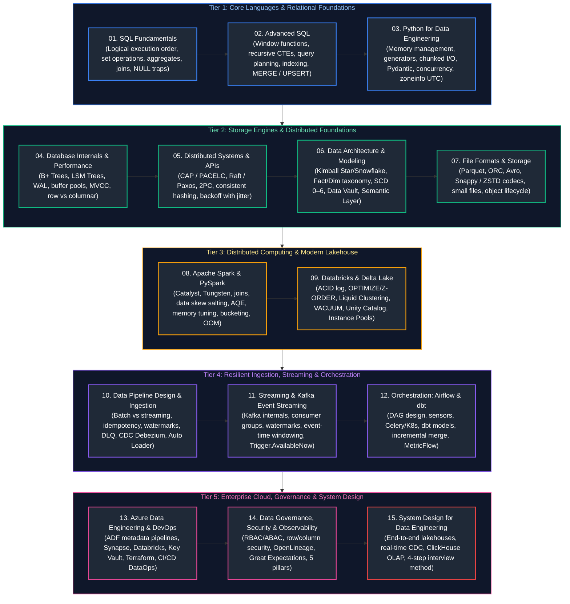

# Data Engineering Master Curriculum & Comprehensive Study Guide

This master guide provides the definitive, production-grade learning roadmap, conceptual index, and chronological study order for modern Data Engineering. The curriculum spans distributed systems fundamentals, relational and analytical SQL, Python systems engineering, database storage engines, Lakehouse internals (Apache Spark, Databricks, Delta Lake), streaming architectures (Kafka, Event Hubs), orchestration (Airflow, dbt), cloud engineering, governance, and end-to-end system design.

Every guide includes formal architectural definitions, Mermaid topological diagrams, memory/hardware mechanics, production code implementations with detailed line-by-line commentary, edge-case mitigation, and production troubleshooting playbooks.

---

## Recommended Chronological Study Order

---

## Master Topic Guides & Curriculum Coverage Overview

| Study Order | Guide File | Conceptual Domain | Corresponding Interview Guide | Key Topics & Production Scenarios Covered |
| :---: | :--- | :--- | :--- | :--- |
| **01** | [`01_sql_fundamentals.md`](01_sql_fundamentals.md) | Relational Query Fundamentals | [`01_sql_interview_questions_and_answers.md`](frequently_asked_questions/01_sql_interview_questions_and_answers.md) | Logical SQL query execution order, set operations (UNION vs UNION ALL, INTERSECT, EXCEPT), aggregate mechanics, NULL three-valued logic and NOT IN traps, safe type casting, and standard DDL/DML. |
| **02** | [`02_advanced_sql.md`](02_advanced_sql.md) | Analytical SQL & Query Optimization | [`01_sql_interview_questions_and_answers.md`](frequently_asked_questions/01_sql_interview_questions_and_answers.md) | Window functions (ROW_NUMBER, DENSE_RANK, LEAD, LAG, running frames), recursive CTEs, query plan diagnosis (EXPLAIN), B-Tree / Bitmap indexing, MERGE / UPSERT semantics, and ANSI isolation levels. |
| **03** | [`03_python_for_data_engineering.md`](03_python_for_data_engineering.md) | Python Systems & Memory Engineering | [`02_python_and_programming_interview_questions_and_answers.md`](frequently_asked_questions/02_python_and_programming_interview_questions_and_answers.md) | Python memory manager and GIL internals, generator streaming for 10GB+ files, custom decorators, Pydantic data validation, Polars vs Pandas benchmarks, DuckDB OLAP, and zoneinfo UTC timestamp normalization. |
| **04** | [`04_database_internals_and_performance.md`](04_database_internals_and_performance.md) | Database Engines & Storage Internals | [`04_cloud_and_distributed_systems_interview_questions_and_answers.md`](frequently_asked_questions/04_cloud_and_distributed_systems_interview_questions_and_answers.md) | B+ Trees vs Log-Structured Merge (LSM) Trees, Write-Ahead Logging (WAL), Buffer Pool cache eviction, row-oriented (Slotted Page) vs columnar engines, MVCC snapshot isolation, and table partitioning. |
| **05** | [`05_distributed_systems_and_apis.md`](05_distributed_systems_and_apis.md) | Distributed Computing & API Resilience | [`04_cloud_and_distributed_systems_interview_questions_and_answers.md`](frequently_asked_questions/04_cloud_and_distributed_systems_interview_questions_and_answers.md) | CAP and PACELC trade-offs, consensus algorithms (Raft, Paxos, 2PC), consistent hashing rings, distributed locks, API rate limiting (Token/Leaky Bucket), and exponential backoff with full jitter. |
| **06** | [`06_data_architecture_and_modeling.md`](06_data_architecture_and_modeling.md) | Dimensional Modeling & Enterprise Architecture | [`03_data_modeling_and_warehousing_interview_questions_and_answers.md`](frequently_asked_questions/03_data_modeling_and_warehousing_interview_questions_and_answers.md) | Kimball dimensional design (Star vs Snowflake), Fact and Dimension taxonomies, SCD Types 0–6, Data Vault 2.0, Medallion Lakehouse, Data Mesh, Centralized Semantic Layer, and orphan record prevention. |
| **07** | [`07_file_formats_and_storage.md`](07_file_formats_and_storage.md) | Columnar File Formats & Object Storage | [`03_data_modeling_and_warehousing_interview_questions_and_answers.md`](frequently_asked_questions/03_data_modeling_and_warehousing_interview_questions_and_answers.md) | Parquet footer metadata and row groups, ORC stripes, Avro row schemas, compression codecs (Snappy vs ZSTD vs GZIP), small file problem, file bin-packing compaction, and ADLS Gen2 Hierarchical Namespace. |
| **08** | [`08_apache_spark_pyspark.md`](08_apache_spark_pyspark.md) | Distributed Cluster Computing & PySpark | [`05_apache_spark_and_pyspark_interview_questions_and_answers.md`](frequently_asked_questions/05_apache_spark_and_pyspark_interview_questions_and_answers.md) | Spark Driver/Executor architecture, Catalyst optimizer phases, Project Tungsten, join strategies (BHJ, SMJ), data skew salting, AQE dynamic optimizations, bucketing for large joins, and OOM debugging playbook. |
| **09** | [`09_databricks_and_delta_lake.md`](09_databricks_and_delta_lake.md) | Enterprise Databricks & Delta Lake ACID | [`06_databricks_and_delta_lake_interview_questions_and_answers.md`](frequently_asked_questions/06_databricks_and_delta_lake_interview_questions_and_answers.md) [`07_unity_catalog_interview_questions_and_answers.md`](frequently_asked_questions/07_unity_catalog_interview_questions_and_answers.md) | Delta transaction log (`_delta_log`), ACID transactions, OPTIMIZE with Z-ORDER, Liquid Clustering, VACUUM retention, Unity Catalog 3-level governance, Databricks Instance Pools (<30s start), and DR Deep Clone. |
| **10** | [`10_data_pipeline_design_and_ingestion.md`](10_data_pipeline_design_and_ingestion.md) | Resilient Ingestion & Pipeline Design | [`09_etl_data_pipelines_and_adf_interview_questions_and_answers.md`](frequently_asked_questions/09_etl_data_pipelines_and_adf_interview_questions_and_answers.md) | Batch vs streaming ingestion, pipeline idempotency, checkpoint state stores, Dead Letter Queues (DLQ), watermarks, Great Expectations / Soda quality gates, Debezium CDC, and the 50-topic Problem-Solution Matrix. |
| **11** | [`11_streaming_and_kafka_event_streaming.md`](11_streaming_and_kafka_event_streaming.md) | Real-Time Streaming & Apache Kafka | [`08_streaming_kafka_and_autoloader_interview_questions_and_answers.md`](frequently_asked_questions/08_streaming_kafka_and_autoloader_interview_questions_and_answers.md) | Kafka partitions, offsets, and consumer groups, KRaft metadata consensus, watermark state expiration, tumbling/sliding/session windows, exactly-once delivery, and streaming backlog draining via `Trigger.AvailableNow`. |
| **12** | [`12_orchestration_airflow_and_dbt.md`](12_orchestration_airflow_and_dbt.md) | Workflow Orchestration & Analytics Engineering | [`09_etl_data_pipelines_and_adf_interview_questions_and_answers.md`](frequently_asked_questions/09_etl_data_pipelines_and_adf_interview_questions_and_answers.md) | Apache Airflow DAGs, dynamic task generation, deferrable operators, Celery vs Kubernetes executors, SLA alerting, dbt incremental merge models, schema assertions, and MetricFlow Semantic Layer metrics. |
| **13** | [`13_azure_data_engineering_and_devops.md`](13_azure_data_engineering_and_devops.md) | Enterprise Cloud Engineering & DataOps | [`09_etl_data_pipelines_and_adf_interview_questions_and_answers.md`](frequently_asked_questions/09_etl_data_pipelines_and_adf_interview_questions_and_answers.md) | End-to-end Azure lakehouse blueprint, ADF metadata-driven copy pipelines, Synapse Dedicated vs Serverless pools, Azure Key Vault integration, Terraform IaC deployment, and Azure DevOps CI/CD automation. |
| **14** | [`14_data_governance_security_and_observability.md`](14_data_governance_security_and_observability.md) | Governance, Zero-Trust & Observability | [`07_unity_catalog_interview_questions_and_answers.md`](frequently_asked_questions/07_unity_catalog_interview_questions_and_answers.md) | RBAC vs ABAC, Row-Level Security (RLS), Column-Level Security (CLS), dynamic data masking, GDPR "Right to be Forgotten" cryptographic erasure, OpenLineage, and the 5 Pillars of Data Observability. |
| **15** | [`15_system_design_for_data_engineering.md`](15_system_design_for_data_engineering.md) | End-to-End Enterprise System Design | [`10_system_design_and_architecture_interview_questions_and_answers.md`](frequently_asked_questions/10_system_design_and_architecture_interview_questions_and_answers.md) | End-to-end real-time Lakehouse blueprint, Change Data Capture (CDC) pipeline, ClickHouse / Pinot real-time OLAP platform, metadata platform, quantitative back-of-the-envelope estimation, and 4-step interview method. |

---

## Production Problem-Solution Cross-Reference Index

The table below maps the **50 canonical data engineering production problems** to their architectural solutions and corresponding curriculum chapters.

| Problem | Canonical Solution | Module Reference |
| :--- | :--- | :--- |
| **Duplicate Records** | Deduplication via Window Ranking & Delta MERGE | [`01_sql_fundamentals.md`](01_sql_fundamentals.md#3-aggregate-functions-null-handling--filtering-semantics) [`02_advanced_sql.md`](02_advanced_sql.md#1-ranking-functions-row_number-rank-dense_rank) [`10_data_pipeline_design_and_ingestion.md`](10_data_pipeline_design_and_ingestion.md#26-deduplication-patterns) |
| **Late Arriving Data** | Event-Time Watermarking with Allowed Lateness | [`10_data_pipeline_design_and_ingestion.md`](10_data_pipeline_design_and_ingestion.md#28-watermarking) [`11_streaming_and_kafka_event_streaming.md`](11_streaming_and_kafka_event_streaming.md#56-watermarking--state-expiration) |
| **CDC Processing** | Change Data Feed (CDF) & Log-Based CDC | [`09_databricks_and_delta_lake.md`](09_databricks_and_delta_lake.md#101-change-data-feed-cdf) [`10_data_pipeline_design_and_ingestion.md`](10_data_pipeline_design_and_ingestion.md#51-log-based-cdc-debezium--kafka-connect) |
| **Data Skew** | Key Salting & AQE Skew Join Handling | [`02_advanced_sql.md`](02_advanced_sql.md#61-query-optimization-techniques--execution-plan-analysis) [`08_apache_spark_pyspark.md`](08_apache_spark_pyspark.md#51-key-salting-for-extreme-data-skew) |
| **Small Files** | File Compaction & Delta OPTIMIZE / Z-ORDER | [`07_file_formats_and_storage.md`](07_file_formats_and_storage.md#27-the-small-file-problem) [`09_databricks_and_delta_lake.md`](09_databricks_and_delta_lake.md#91-optimize--file-bin-packing) |
| **Schema Changes** | Automated Schema Evolution (`mergeSchema`) | [`09_databricks_and_delta_lake.md`](09_databricks_and_delta_lake.md#86-schema-evolution-mergeschema) [`10_data_pipeline_design_and_ingestion.md`](10_data_pipeline_design_and_ingestion.md#48-schema-inference--automated-evolution) |
| **Pipeline Failures** | Dead Letter Queue (DLQ) & Quarantine Routing | [`10_data_pipeline_design_and_ingestion.md`](10_data_pipeline_design_and_ingestion.md#29-dead-letter-queues-dlq--quarantine-routing) [`11_streaming_and_kafka_event_streaming.md`](11_streaming_and_kafka_event_streaming.md#44-kafka-to-delta-lake-streaming-ingestion--dead-letter-queue-dlq-isolation) |
| **Data Quality Issues** | Automated Data Quality Frameworks & Assertions | [`09_databricks_and_delta_lake.md`](09_databricks_and_delta_lake.md#37-dlt-expectations--data-quality-enforcement) [`10_data_pipeline_design_and_ingestion.md`](10_data_pipeline_design_and_ingestion.md#32-great-expectations-framework) [`12_orchestration_airflow_and_dbt.md`](12_orchestration_airflow_and_dbt.md#26-dbt-testing--assertions) |
| **Missing Data / Nulls** | Statistical Imputation & Domain Default Values | [`01_sql_fundamentals.md`](01_sql_fundamentals.md#3-aggregate-functions-null-handling--filtering-semantics) [`03_python_for_data_engineering.md`](03_python_for_data_engineering.md#29-missing-data-imputation--default-value-fallbacks) [`08_apache_spark_pyspark.md`](08_apache_spark_pyspark.md#38-handling-nulls--missing-data-in-pyspark) |
| **Inconsistent Data Formats** | Canonical Schema Standardization (Silver Layer) | [`06_data_architecture_and_modeling.md`](06_data_architecture_and_modeling.md#16-medallion-architecture-bronze--silver--gold) [`08_apache_spark_pyspark.md`](08_apache_spark_pyspark.md#32-pyspark-sql-functions--transformations) |
| **Large Data Volume** | Physical Partitioning & Granularity Management | [`04_database_internals_and_performance.md`](04_database_internals_and_performance.md#11-partitioning-mechanics) [`07_file_formats_and_storage.md`](07_file_formats_and_storage.md#25-partitioning-strategies--hive-directory-layout) |
| **Slow Queries** | Partition Pruning, B-Tree Indexing & Liquid Clustering | [`02_advanced_sql.md`](02_advanced_sql.md#61-query-optimization-techniques--execution-plan-analysis) [`04_database_internals_and_performance.md`](04_database_internals_and_performance.md#2-indexing-architecture--mechanics) [`09_databricks_and_delta_lake.md`](09_databricks_and_delta_lake.md#93-liquid-clustering) |
| **High Latency** | Multi-Tier Caching (Redis, Spark Cache, Disk Cache) | [`05_distributed_systems_and_apis.md`](05_distributed_systems_and_apis.md#3-distributed-caching-architectures) [`08_apache_spark_pyspark.md`](08_apache_spark_pyspark.md#53-caching--persistence-strategies) |
| **Frequent Reprocessing** | Incremental Processing & High-Water-Mark Slicing | [`10_data_pipeline_design_and_ingestion.md`](10_data_pipeline_design_and_ingestion.md#41-batch-file-ingestion-vs-incremental-processing) [`12_orchestration_airflow_and_dbt.md`](12_orchestration_airflow_and_dbt.md#23-materialization-strategies) |
| **Unnecessary Full Loads** | Incremental Loads via Watermark Extraction & CDC | [`10_data_pipeline_design_and_ingestion.md`](10_data_pipeline_design_and_ingestion.md#5-change-data-capture-cdc-patterns) [`13_azure_data_engineering_and_devops.md`](13_azure_data_engineering_and_devops.md#23-azure-data-factory-adf-overview) |
| **Manual Interventions** | Scheduled Workflow Automation & CI/CD Pipelines | [`12_orchestration_airflow_and_dbt.md`](12_orchestration_airflow_and_dbt.md#11-dags-tasks-and-operators) [`13_azure_data_engineering_and_devops.md`](13_azure_data_engineering_and_devops.md#3-devops--ci-cd-for-data-platforms) |
| **Monitoring Gaps** | Automated Observability, Logging & SLA Alerting | [`10_data_pipeline_design_and_ingestion.md`](10_data_pipeline_design_and_ingestion.md#212-pipeline-monitoring--observability) [`12_orchestration_airflow_and_dbt.md`](12_orchestration_airflow_and_dbt.md#16-sla-miss-callbacks-alerting-webhooks--email-notifications) [`14_data_governance_security_and_observability.md`](14_data_governance_security_and_observability.md#7-data-observability--reliability-engineering) |
| **Backfill Challenges** | Idempotent Batch Backfill Strategy & Catchup Slicing | [`10_data_pipeline_design_and_ingestion.md`](10_data_pipeline_design_and_ingestion.md#214-backfilling-historical-data) [`12_orchestration_airflow_and_dbt.md`](12_orchestration_airflow_and_dbt.md#15-backfilling-catchup-and-reruns) |
| **Data Loss** | Durable Checkpointing & Write-Ahead Logs (WAL) | [`08_apache_spark_pyspark.md`](08_apache_spark_pyspark.md#54-spark-storage-levels) [`10_data_pipeline_design_and_ingestion.md`](10_data_pipeline_design_and_ingestion.md#23-checkpointing--state-stores) [`11_streaming_and_kafka_event_streaming.md`](11_streaming_and_kafka_event_streaming.md#54-checkpointing--offset-commit-management) |
| **Out-of-Order Events** | Event Time Processing & Time-Window Aggregations | [`10_data_pipeline_design_and_ingestion.md`](10_data_pipeline_design_and_ingestion.md#27-late-arriving--out-of-order-data) [`11_streaming_and_kafka_event_streaming.md`](11_streaming_and_kafka_event_streaming.md#55-event-time-vs-processing-time-semantics) |
| **Streaming Backlog** | Trigger Optimization (`Trigger.AvailableNow` + Rate Limits) | [`11_streaming_and_kafka_event_streaming.md`](11_streaming_and_kafka_event_streaming.md#52-sources-sinks-and-triggers) |
| **Memory Pressure (OOM)** | Driver / Executor Memory Right-Sizing & Spill Diagnosis | [`08_apache_spark_pyspark.md`](08_apache_spark_pyspark.md#63-diagnosing-out-of-memory-oom-errors) |
| **Shuffle Bottlenecks** | Adaptive Query Execution (AQE) Partition Coalescing | [`08_apache_spark_pyspark.md`](08_apache_spark_pyspark.md#19-shuffling-mechanics--network-spill) [`08_apache_spark_pyspark.md`](08_apache_spark_pyspark.md#22-adaptive-query-execution-aqe) |
| **Slow Joins** | Broadcast Hash Join (`broadcast(df)`) | [`02_advanced_sql.md`](02_advanced_sql.md#61-query-optimization-techniques--execution-plan-analysis) [`08_apache_spark_pyspark.md`](08_apache_spark_pyspark.md#41-broadcast-hash-join-bhj) |
| **Large Joins** | Pre-Bucketing & Pre-Sorting to Eliminate Network Shuffle | [`07_file_formats_and_storage.md`](07_file_formats_and_storage.md#26-bucketing--clustering) [`08_apache_spark_pyspark.md`](08_apache_spark_pyspark.md#46-bucketing-for-large-joins) |
| **High Cost** | Job Compute, Spot Instances & Single-Node Sizing | [`09_databricks_and_delta_lake.md`](09_databricks_and_delta_lake.md#21-all-purpose-compute-vs-job-compute) [`09_databricks_and_delta_lake.md`](09_databricks_and_delta_lake.md#26-spot-instances--cost-optimization) |
| **Underutilized Clusters** | Dynamic Autoscaling & Idle Auto-Termination Timeouts | [`09_databricks_and_delta_lake.md`](09_databricks_and_delta_lake.md#25-autoscaling--optimized-autoscaling) |
| **Cluster Startup Delays** | Databricks Instance Pools / Warm Pools (<30s Launch) | [`09_databricks_and_delta_lake.md`](09_databricks_and_delta_lake.md#211-instance-pools--warm-pools) |
| **Security Issues** | Role-Based Access Control (RBAC) & Unity Catalog Governance | [`09_databricks_and_delta_lake.md`](09_databricks_and_delta_lake.md#5-security--unity-catalog-governance) [`14_data_governance_security_and_observability.md`](14_data_governance_security_and_observability.md#1-identity--access-governance) |
| **Access Control Problems** | Row-Level Security (RLS) & Dynamic Column Masking | [`09_databricks_and_delta_lake.md`](09_databricks_and_delta_lake.md#54-row-level-security-row-filters) [`14_data_governance_security_and_observability.md`](14_data_governance_security_and_observability.md#4-fine-grained-access-control-row--column-level-security) |
| **Secrets Management** | Key Vault-Backed Secret Scopes with Output Redaction | [`09_databricks_and_delta_lake.md`](09_databricks_and_delta_lake.md#57-secrets-management-secret-scopes--key-vault) [`13_azure_data_engineering_and_devops.md`](13_azure_data_engineering_and_devops.md#11-architecture-blueprint--security-fundamentals) |
| **Data Lineage Gaps** | Automated Runtime Lineage (Unity Catalog, OpenLineage) | [`06_data_architecture_and_modeling.md`](06_data_architecture_and_modeling.md#31-data-lineage) [`14_data_governance_security_and_observability.md`](14_data_governance_security_and_observability.md#6-data-lineage--metadata-provenance) |
| **Poor Documentation** | Centralized Data Dictionaries & dbt Documentation Generators | [`06_data_architecture_and_modeling.md`](06_data_architecture_and_modeling.md#32-data-catalog) [`12_orchestration_airflow_and_dbt.md`](12_orchestration_airflow_and_dbt.md#27-documentation--interactive-lineage-graphs) |
| **Inconsistent Metrics** | Centralized Metric Standardization (MetricFlow / Cube) | [`06_data_architecture_and_modeling.md`](06_data_architecture_and_modeling.md#211-the-semantic-layer--metric-standardization) [`12_orchestration_airflow_and_dbt.md`](12_orchestration_airflow_and_dbt.md#210-exposures--the-dbt-semantic-layer) |
| **Data Drift** | Automated Statistical Drift Detection (Evidently AI, PSI, KS) | [`10_data_pipeline_design_and_ingestion.md`](10_data_pipeline_design_and_ingestion.md#36-schema-drift-detection) [`14_data_governance_security_and_observability.md`](14_data_governance_security_and_observability.md#7-data-observability--reliability-engineering) |
| **Dimension Changes (SCD)** | SCD Type 2 Historical Versioning with Effective Dates | [`02_advanced_sql.md`](02_advanced_sql.md#42-merge-statement-upsert-mechanics) [`06_data_architecture_and_modeling.md`](06_data_architecture_and_modeling.md#28-slowly-changing-dimensions-scd-types-0-6) |
| **Reference Data Updates** | Dimension Refresh Strategies (Rebuild, CDC Merge, Cache) | [`06_data_architecture_and_modeling.md`](06_data_architecture_and_modeling.md#212-dimension-refresh-strategies--reference-data-updates) |
| **External API Failures** | Exponential Backoff with Full Jitter & Circuit Breakers | [`05_distributed_systems_and_apis.md`](05_distributed_systems_and_apis.md#2-api-reliability--resilience-patterns) [`10_data_pipeline_design_and_ingestion.md`](10_data_pipeline_design_and_ingestion.md#72-rate-limiting-handling-exponential-backoff--jitter) |
| **Rate Limiting** | Token Bucket Throttling & Message Queue Buffering | [`05_distributed_systems_and_apis.md`](05_distributed_systems_and_apis.md#2-api-reliability--resilience-patterns) [`10_data_pipeline_design_and_ingestion.md`](10_data_pipeline_design_and_ingestion.md#72-rate-limiting-handling-exponential-backoff--jitter) |
| **File Corruption** | Cryptographic Checksum Validation & Spark `PERMISSIVE` Mode | [`03_python_for_data_engineering.md`](03_python_for_data_engineering.md#28-file-validation--checksums-hashlib) [`08_apache_spark_pyspark.md`](08_apache_spark_pyspark.md#311-file-corruption--malformed-record-handling) |
| **Inconsistent Timestamps** | Mandatory Bronze Normalization to Canonical UTC | [`03_python_for_data_engineering.md`](03_python_for_data_engineering.md#26-date-time--timezone-management-zoneinfo) [`08_apache_spark_pyspark.md`](08_apache_spark_pyspark.md#310-inconsistent-timestamps--time-zone-normalization-in-pyspark) |
| **Time Zone Issues** | Time Zone Normalization & DST Fold Disambiguation | [`03_python_for_data_engineering.md`](03_python_for_data_engineering.md#26-date-time--timezone-management-zoneinfo) [`08_apache_spark_pyspark.md`](08_apache_spark_pyspark.md#310-inconsistent-timestamps--time-zone-normalization-in-pyspark) |
| **Orphan Records** | Sentinel `-1` Fallbacks, Stubs & Referential Tests | [`06_data_architecture_and_modeling.md`](06_data_architecture_and_modeling.md#213-referential-integrity--orphan-record-prevention) [`12_orchestration_airflow_and_dbt.md`](12_orchestration_airflow_and_dbt.md#26-dbt-testing--assertions) |
| **Data Duplication Across Systems** | Deterministic Natural Hash Keys & Idempotent Upserts | [`05_distributed_systems_and_apis.md`](05_distributed_systems_and_apis.md#1-core-distributed-systems-concepts) [`10_data_pipeline_design_and_ingestion.md`](10_data_pipeline_design_and_ingestion.md#21-idempotency) |
| **Slow ETL Jobs** | Spark Optimization Playbook: Vectorized Arrow UDFs & AQE | [`08_apache_spark_pyspark.md`](08_apache_spark_pyspark.md#66-end-to-end-spark-etl-optimization-playbook) |
| **High I/O Costs** | Columnar Compression Codecs (Snappy vs Zstandard / ZSTD) | [`07_file_formats_and_storage.md`](07_file_formats_and_storage.md#17-compression-codecs) |
| **Data Retention Issues** | Storage Lifecycle Tiering & Delta `VACUUM` Governance | [`07_file_formats_and_storage.md`](07_file_formats_and_storage.md#23-storage-lifecycle-management-policies) [`09_databricks_and_delta_lake.md`](09_databricks_and_delta_lake.md#103-vacuum--retention-period-governance) |
| **Compliance & Governance** | Data Governance Framework & Cryptographic Erasure | [`14_data_governance_security_and_observability.md`](14_data_governance_security_and_observability.md#3-regulatory-compliance--privacy-engineering) |
| **Disaster Recovery** | Multi-Region Geo-Redundancy & Delta `DEEP CLONE` Replication | [`09_databricks_and_delta_lake.md`](09_databricks_and_delta_lake.md#102-shallow-clone-vs-deep-clone) [`09_databricks_and_delta_lake.md`](09_databricks_and_delta_lake.md#88-restore-table-disaster-recovery) [`13_azure_data_engineering_and_devops.md`](13_azure_data_engineering_and_devops.md#22-adls-gen2) |
| **End-to-End Visibility** | 5 Pillars of Unified Data Observability & Reliability | [`10_data_pipeline_design_and_ingestion.md`](10_data_pipeline_design_and_ingestion.md#212-pipeline-monitoring--observability) [`14_data_governance_security_and_observability.md`](14_data_governance_security_and_observability.md#7-data-observability--reliability-engineering) |

---

## Practical Interview Preparation Track

For scenario-based interview questions, technical cross-examinations, and live coding exercises, see the companion guides in [`frequently_asked_questions/`](frequently_asked_questions/00_de_faq_study_guide_and_index.md):
- [SQL Real-Time & Advanced Scenarios (Q1–Q39)](frequently_asked_questions/01_sql_interview_questions_and_answers.md)
- [Python & Memory Chunking (Q1–Q8 + Prefix Sum)](frequently_asked_questions/02_python_and_programming_interview_questions_and_answers.md)
- [Data Modeling & Warehousing (Q1–Q12)](frequently_asked_questions/03_data_modeling_and_warehousing_interview_questions_and_answers.md)
- [Cloud & Distributed Systems (Q1–Q16)](frequently_asked_questions/04_cloud_and_distributed_systems_interview_questions_and_answers.md)
- [Apache Spark & PySpark Architecture (Q1–Q45)](frequently_asked_questions/05_apache_spark_and_pyspark_interview_questions_and_answers.md)
- [Databricks & Delta Lake (Q1–Q22)](frequently_asked_questions/06_databricks_and_delta_lake_interview_questions_and_answers.md)
- [Unity Catalog & Data Governance (Q1–Q14)](frequently_asked_questions/07_unity_catalog_interview_questions_and_answers.md)
- [Auto Loader & Structured Streaming (Q1–Q17)](frequently_asked_questions/08_streaming_kafka_and_autoloader_interview_questions_and_answers.md)
- [Azure Data Factory (ADF) & ETL Pipelines (Q1–Q17)](frequently_asked_questions/09_etl_data_pipelines_and_adf_interview_questions_and_answers.md)
- [Data Engineering Architecture & System Design (Q1–Q3 + Capstone)](frequently_asked_questions/10_system_design_and_architecture_interview_questions_and_answers.md)
