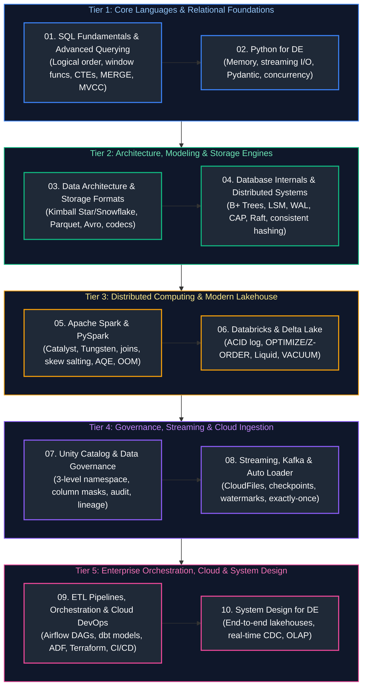

# Data Engineering Master Curriculum & Comprehensive Study Guide

This master guide provides the definitive, production-grade learning roadmap, conceptual index, and chronological study order for modern Data Engineering. The curriculum spans distributed systems fundamentals, relational and analytical SQL, Python systems engineering, database storage engines, Lakehouse internals (Apache Spark, Databricks, Delta Lake), streaming architectures (Kafka, Event Hubs), orchestration (Airflow, dbt), cloud engineering, governance, and end-to-end system design.

Every guide includes formal architectural definitions, Mermaid topological diagrams, memory/hardware mechanics, production code implementations with detailed line-by-line commentary, edge-case mitigation, and production troubleshooting playbooks.

---

## Recommended Chronological Study Order

---

## Master Topic Guides & Curriculum Coverage Overview

| Study Order | Guide File | Conceptual Domain | Corresponding Interview Guide | Key Topics & Production Scenarios Covered |
| :---: | :--- | :--- | :--- | :--- |
| **01** | [`01_sql_and_advanced_querying.md`](01_sql_and_advanced_querying.md) | Relational & Analytical SQL Engineering | [`01_sql_and_advanced_querying_faq.md`](frequently_asked_questions/01_sql_and_advanced_querying_faq.md) | Logical query processing order, window functions, recursive CTEs, distributed joins (BHJ, SMJ), skew salting, MERGE/UPSERT, MVCC, and query plan optimization. |
| **02** | [`02_python_for_data_engineering.md`](02_python_for_data_engineering.md) | Python Systems & Memory Engineering | [`02_python_for_data_engineering_faq.md`](frequently_asked_questions/02_python_for_data_engineering_faq.md) | Python memory manager and GIL internals, generator streaming for 10GB+ files, custom decorators, Pydantic data validation, Polars vs Pandas benchmarks, and DuckDB OLAP. |
| **03** | [`03_data_modeling_and_warehousing.md`](03_data_modeling_and_warehousing.md) | Dimensional Modeling & Columnar Storage | [`03_data_modeling_and_warehousing_faq.md`](frequently_asked_questions/03_data_modeling_and_warehousing_faq.md) | Kimball dimensional design (Star vs Snowflake), Fact/Dim taxonomies, SCD Types 0–6, Data Vault 2.0, Medallion Lakehouse, Parquet/ORC/Avro internals, compression codecs, and compaction. |
| **04** | [`04_database_internals_and_distributed_systems.md`](04_database_internals_and_distributed_systems.md) | Storage Engines & Distributed Systems | [`04_database_internals_and_distributed_systems_faq.md`](frequently_asked_questions/04_database_internals_and_distributed_systems_faq.md) | B+ Trees vs LSM Trees, WAL, Buffer Pool cache eviction, MVCC, CAP/PACELC theorems, consensus (Raft, 2PC), consistent hashing, distributed locks, rate limiting, and API resilience. |
| **05** | [`05_apache_spark_and_pyspark.md`](05_apache_spark_and_pyspark.md) | Distributed Cluster Computing & PySpark | [`05_apache_spark_and_pyspark_faq.md`](frequently_asked_questions/05_apache_spark_and_pyspark_faq.md) | Spark Driver/Executor architecture, Catalyst optimizer phases, Project Tungsten, join strategies, data skew salting, AQE dynamic optimizations, and OOM debugging playbook. |
| **06** | [`06_databricks_and_delta_lake.md`](06_databricks_and_delta_lake.md) | Enterprise Databricks & Delta Lake ACID | [`06_databricks_and_delta_lake_faq.md`](frequently_asked_questions/06_databricks_and_delta_lake_faq.md) | Delta transaction log (`_delta_log`), ACID transactions, OPTIMIZE with Z-ORDER, Liquid Clustering, VACUUM retention, Databricks Instance Pools, and DR Deep Clone. |
| **07** | [`07_unity_catalog_and_governance.md`](07_unity_catalog_and_governance.md) | Governance, Zero-Trust & Observability | [`07_unity_catalog_and_governance_faq.md`](frequently_asked_questions/07_unity_catalog_and_governance_faq.md) | Unity Catalog 3-level namespace, RBAC vs ABAC, Row-Level Security (RLS), Column-Level Security (CLS), dynamic data masking, GDPR compliance, OpenLineage, and data observability. |
| **08** | [`08_streaming_kafka_and_auto_loader.md`](08_streaming_kafka_and_auto_loader.md) | Real-Time Streaming & Auto Loader | [`08_streaming_kafka_and_auto_loader_faq.md`](frequently_asked_questions/08_streaming_kafka_and_auto_loader_faq.md) | Kafka commit log, consumer groups, KRaft consensus, Databricks Auto Loader, event-time watermarks, exactly-once delivery, and streaming backlog draining via `Trigger.AvailableNow`. |
| **09** | [`09_etl_pipelines_and_orchestration.md`](09_etl_pipelines_and_orchestration.md) | Ingestion Pipelines, Airflow, dbt & DevOps | [`09_etl_pipelines_and_orchestration_faq.md`](frequently_asked_questions/09_etl_pipelines_and_orchestration_faq.md) | Batch vs streaming ingestion, pipeline idempotency, checkpoint stores, Dead Letter Queues, Airflow DAGs, dynamic task mapping, dbt incremental models, ADF pipelines, and Terraform IaC. |
| **10** | [`10_system_design_for_data_engineering.md`](10_system_design_for_data_engineering.md) | End-to-End Enterprise System Design | [`10_system_design_for_data_engineering_faq.md`](frequently_asked_questions/10_system_design_for_data_engineering_faq.md) | End-to-end real-time Lakehouse blueprint, Change Data Capture (CDC) pipeline, ClickHouse/Pinot OLAP, metadata platforms, back-of-the-envelope estimation, and 4-step interview method. |

---

## Production Problem-Solution Cross-Reference Index

The table below maps the **50 canonical data engineering production problems** to their architectural solutions and corresponding curriculum chapters.

| Problem | Canonical Solution | Module Reference |
| :--- | :--- | :--- |
| **Duplicate Records** | Deduplication via Window Ranking & Delta MERGE | [`01_sql_and_advanced_querying.md`](01_sql_and_advanced_querying.md#3-three-valued-logic--null-handling) [`01_sql_and_advanced_querying.md`](01_sql_and_advanced_querying.md#134-ranking-functions-row_number-rank-dense_rank-ntile) [`09_etl_pipelines_and_orchestration.md`](09_etl_pipelines_and_orchestration.md#136-deduplication-patterns-at-least-once-to-exactly-once) |
| **Late Arriving Data** | Event-Time Watermarking with Allowed Lateness | [`09_etl_pipelines_and_orchestration.md`](09_etl_pipelines_and_orchestration.md#138-watermarking-mechanics--state-eviction) [`08_streaming_kafka_and_auto_loader.md`](08_streaming_kafka_and_auto_loader.md#25-log-compaction--tombstones-state-store-mechanics) |
| **CDC Processing** | Change Data Feed (CDF) & Log-Based CDC | [`06_databricks_and_delta_lake.md`](06_databricks_and_delta_lake.md#141-change-data-feed-cdf) [`09_etl_pipelines_and_orchestration.md`](09_etl_pipelines_and_orchestration.md#231-log-based-cdc-debezium--kafka-connect) |
| **Data Skew** | Key Salting & AQE Skew Join Handling | [`01_sql_and_advanced_querying.md`](01_sql_and_advanced_querying.md#113-distributed-join-strategies-broadcast-hash-join-bhj) [`05_apache_spark_and_pyspark.md`](05_apache_spark_and_pyspark.md#141-key-salting-for-extreme-data-skew) |
| **Small Files** | File Compaction & Delta OPTIMIZE / Z-ORDER | [`03_data_modeling_and_warehousing.md`](03_data_modeling_and_warehousing.md#77-the-small-file-problem-root-causes--engine-impact) [`06_databricks_and_delta_lake.md`](06_databricks_and_delta_lake.md#131-optimize--file-bin-packing) |
| **Schema Changes** | Automated Schema Evolution (`mergeSchema`) | [`06_databricks_and_delta_lake.md`](06_databricks_and_delta_lake.md#126-schema-evolution-mergeschema) [`09_etl_pipelines_and_orchestration.md`](09_etl_pipelines_and_orchestration.md#228-automated-schema-inference--evolution-policies) |
| **Pipeline Failures** | Dead Letter Queue (DLQ) & Quarantine Routing | [`09_etl_pipelines_and_orchestration.md`](09_etl_pipelines_and_orchestration.md#139-dead-letter-queues-dlq--quarantine-routing) [`08_streaming_kafka_and_auto_loader.md`](08_streaming_kafka_and_auto_loader.md#8-practical-case-study-high-throughput-real-time-fraud-detection-pipeline) |
| **Data Quality Issues** | Automated Data Quality Frameworks & Assertions | [`06_databricks_and_delta_lake.md`](06_databricks_and_delta_lake.md#57-dlt-expectations--data-quality-enforcement) [`09_etl_pipelines_and_orchestration.md`](09_etl_pipelines_and_orchestration.md#172-great-expectations-gx-framework) [`09_etl_pipelines_and_orchestration.md`](09_etl_pipelines_and_orchestration.md#356-dbt-testing--assertions) |
| **Missing Data / Nulls** | Statistical Imputation & Domain Default Values | [`01_sql_and_advanced_querying.md`](01_sql_and_advanced_querying.md#3-three-valued-logic--null-handling) [`02_python_for_data_engineering.md`](02_python_for_data_engineering.md#02-python-for-data-engineering-master-engineering--learning-guide) [`05_apache_spark_and_pyspark.md`](05_apache_spark_and_pyspark.md#68-handling-nulls--missing-data-in-pyspark-imputation--default-values) |
| **Inconsistent Data Formats** | Canonical Schema Standardization (Silver Layer) | [`03_data_modeling_and_warehousing.md`](03_data_modeling_and_warehousing.md#16-medallion-architecture-bronze--silver--gold) [`05_apache_spark_and_pyspark.md`](05_apache_spark_and_pyspark.md#32-pyspark-sql-functions--transformations) |
| **Large Data Volume** | Physical Partitioning & Granularity Management | [`04_database_internals_and_distributed_systems.md`](04_database_internals_and_distributed_systems.md#34-optimization-primitives-predicate-pushdown-projection-pushdown--partition-pruning) [`03_data_modeling_and_warehousing.md`](03_data_modeling_and_warehousing.md#74-partitioning-strategies-hive-style-directory-layouts--pruning-mechanics) |
| **Slow Queries** | Partition Pruning, B-Tree Indexing & Liquid Clustering | [`01_sql_and_advanced_querying.md`](01_sql_and_advanced_querying.md#113-distributed-join-strategies-broadcast-hash-join-bhj) [`04_database_internals_and_distributed_systems.md`](04_database_internals_and_distributed_systems.md#2-indexing-mechanisms--physical-access-paths) [`06_databricks_and_delta_lake.md`](06_databricks_and_delta_lake.md#133-liquid-clustering) |
| **High Latency** | Multi-Tier Caching (Redis, Spark Cache, Disk Cache) | [`04_database_internals_and_distributed_systems.md`](04_database_internals_and_distributed_systems.md#95-distributed-locks--fencing-tokens) [`05_apache_spark_and_pyspark.md`](05_apache_spark_and_pyspark.md#173-caching--persistence-strategies) |
| **Frequent Reprocessing** | Incremental Processing & High-Water-Mark Slicing | [`09_etl_pipelines_and_orchestration.md`](09_etl_pipelines_and_orchestration.md#221-batch-file-ingestion-vs-incremental-file-processing) [`09_etl_pipelines_and_orchestration.md`](09_etl_pipelines_and_orchestration.md#353-materialization-strategies) |
| **Unnecessary Full Loads** | Incremental Loads via Watermark Extraction & CDC | [`09_etl_pipelines_and_orchestration.md`](09_etl_pipelines_and_orchestration.md#23-change-data-capture-cdc-patterns) [`09_etl_pipelines_and_orchestration.md`](09_etl_pipelines_and_orchestration.md#453-azure-data-factory-adf-overview) |
| **Manual Interventions** | Scheduled Workflow Automation & CI/CD Pipelines | [`09_etl_pipelines_and_orchestration.md`](09_etl_pipelines_and_orchestration.md#341-dags-tasks-and-operators) [`09_etl_pipelines_and_orchestration.md`](09_etl_pipelines_and_orchestration.md#49-dataops-cicd--version-control) |
| **Monitoring Gaps** | Automated Observability, Logging & SLA Alerting | [`09_etl_pipelines_and_orchestration.md`](09_etl_pipelines_and_orchestration.md#1612-pipeline-observability-metrics-logs--traces) [`09_etl_pipelines_and_orchestration.md`](09_etl_pipelines_and_orchestration.md#3412-slas-callbacks--enterprise-alerting) [`07_unity_catalog_and_governance.md`](07_unity_catalog_and_governance.md#5-the-5-pillars-of-data-observability) |
| **Backfill Challenges** | Idempotent Batch Backfill Strategy & Catchup Slicing | [`09_etl_pipelines_and_orchestration.md`](09_etl_pipelines_and_orchestration.md#1614-historical-backfilling-strategies) [`09_etl_pipelines_and_orchestration.md`](09_etl_pipelines_and_orchestration.md#349-backfilling-scheduling-timetables-and-data-intervals) |
| **Data Loss** | Durable Checkpointing & Write-Ahead Logs (WAL) | [`05_apache_spark_and_pyspark.md`](05_apache_spark_and_pyspark.md#174-spark-storage-levels) [`09_etl_pipelines_and_orchestration.md`](09_etl_pipelines_and_orchestration.md#133-checkpointing--streaming-state-stores) [`08_streaming_kafka_and_auto_loader.md`](08_streaming_kafka_and_auto_loader.md#43-offset-commit-management-auto-commit-vs-manual-synchronousasync) |
| **Out-of-Order Events** | Event Time Processing & Time-Window Aggregations | [`09_etl_pipelines_and_orchestration.md`](09_etl_pipelines_and_orchestration.md#137-late-arriving--out-of-order-data-handling) [`08_streaming_kafka_and_auto_loader.md`](08_streaming_kafka_and_auto_loader.md#1-event-time-vs-processing-time) |
| **Streaming Backlog** | Trigger Optimization (`Trigger.AvailableNow` + Rate Limits) | [`08_streaming_kafka_and_auto_loader.md`](08_streaming_kafka_and_auto_loader.md#21-topics-partitions-and-monotonic-offsets) |
| **Memory Pressure (OOM)** | Driver / Executor Memory Right-Sizing & Spill Diagnosis | [`05_apache_spark_and_pyspark.md`](05_apache_spark_and_pyspark.md#183-diagnosing-out-of-memory-oom-errors) |
| **Shuffle Bottlenecks** | Adaptive Query Execution (AQE) Partition Coalescing | [`05_apache_spark_and_pyspark.md`](05_apache_spark_and_pyspark.md#19-shuffling-mechanics--network-spill) [`05_apache_spark_and_pyspark.md`](05_apache_spark_and_pyspark.md#22-adaptive-query-execution-aqe) |
| **Slow Joins** | Broadcast Hash Join (`broadcast(df)`) | [`01_sql_and_advanced_querying.md`](01_sql_and_advanced_querying.md#113-distributed-join-strategies-broadcast-hash-join-bhj) [`05_apache_spark_and_pyspark.md`](05_apache_spark_and_pyspark.md#111-broadcast-hash-join-bhj) |
| **Large Joins** | Pre-Bucketing & Pre-Sorting to Eliminate Network Shuffle | [`03_data_modeling_and_warehousing.md`](03_data_modeling_and_warehousing.md#76-bucketing-vs-z-ordering-vs-liquid-clustering) [`05_apache_spark_and_pyspark.md`](05_apache_spark_and_pyspark.md#116-bucketing-for-large-joins-eliminating-shuffle-exchange) |
| **High Cost** | Job Compute, Spot Instances & Single-Node Sizing | [`06_databricks_and_delta_lake.md`](06_databricks_and_delta_lake.md#21-all-purpose-compute-vs-job-compute) [`06_databricks_and_delta_lake.md`](06_databricks_and_delta_lake.md#26-spot-instances--cost-optimization) |
| **Underutilized Clusters** | Dynamic Autoscaling & Idle Auto-Termination Timeouts | [`06_databricks_and_delta_lake.md`](06_databricks_and_delta_lake.md#25-autoscaling--optimized-autoscaling) |
| **Cluster Startup Delays** | Databricks Instance Pools / Warm Pools (<30s Launch) | [`06_databricks_and_delta_lake.md`](06_databricks_and_delta_lake.md#211-instance-pools--warm-pools) |
| **Security Issues** | Role-Based Access Control (RBAC) & Unity Catalog Governance | [`06_databricks_and_delta_lake.md`](06_databricks_and_delta_lake.md#7-security--unity-catalog-governance) [`07_unity_catalog_and_governance.md`](07_unity_catalog_and_governance.md#1-access-control-paradigms) |
| **Access Control Problems** | Row-Level Security (RLS) & Dynamic Column Masking | [`06_databricks_and_delta_lake.md`](06_databricks_and_delta_lake.md#74-row-level-security-row-filters) [`07_unity_catalog_and_governance.md`](07_unity_catalog_and_governance.md#1-access-control-paradigms) |
| **Secrets Management** | Key Vault-Backed Secret Scopes with Output Redaction | [`06_databricks_and_delta_lake.md`](06_databricks_and_delta_lake.md#77-secrets-management-secret-scopes--key-vault) [`09_etl_pipelines_and_orchestration.md`](09_etl_pipelines_and_orchestration.md#361-enterprise-architecture-blueprint--security-fundamentals) |
| **Data Lineage Gaps** | Automated Runtime Lineage (Unity Catalog, OpenLineage) | [`03_data_modeling_and_warehousing.md`](03_data_modeling_and_warehousing.md#31-data-lineage-column-level-tracking--openlineage) [`07_unity_catalog_and_governance.md`](07_unity_catalog_and_governance.md#84-end-to-end-root-cause-analysis-rca-playbook) |
| **Poor Documentation** | Centralized Data Dictionaries & dbt Documentation Generators | [`03_data_modeling_and_warehousing.md`](03_data_modeling_and_warehousing.md#32-data-catalog--metadata-management) [`09_etl_pipelines_and_orchestration.md`](09_etl_pipelines_and_orchestration.md#357-documentation--interactive-lineage-graphs) |
| **Inconsistent Metrics** | Centralized Metric Standardization (MetricFlow / Cube) | [`03_data_modeling_and_warehousing.md`](03_data_modeling_and_warehousing.md#211-the-semantic-layer--metric-standardization) [`09_etl_pipelines_and_orchestration.md`](09_etl_pipelines_and_orchestration.md#3510-exposures--the-dbt-semantic-layer-metric-standardization) |
| **Data Drift** | Automated Statistical Drift Detection (Evidently AI, PSI, KS) | [`09_etl_pipelines_and_orchestration.md`](09_etl_pipelines_and_orchestration.md#216-automated-schema-drift-detection) [`07_unity_catalog_and_governance.md`](07_unity_catalog_and_governance.md#5-the-5-pillars-of-data-observability) |
| **Dimension Changes (SCD)** | SCD Type 2 Historical Versioning with Effective Dates | [`01_sql_and_advanced_querying.md`](01_sql_and_advanced_querying.md#151-merge--upsert-mechanics--change-data-capture-cdc) [`03_data_modeling_and_warehousing.md`](03_data_modeling_and_warehousing.md#28-slowly-changing-dimensions-scd-types-06) |
| **Reference Data Updates** | Dimension Refresh Strategies (Rebuild, CDC Merge, Cache) | [`03_data_modeling_and_warehousing.md`](03_data_modeling_and_warehousing.md#214-dimension-refresh-strategies--reference-data-updates) |
| **External API Failures** | Exponential Backoff with Full Jitter & Circuit Breakers | [`04_database_internals_and_distributed_systems.md`](04_database_internals_and_distributed_systems.md#13-rate-limiting-throttling--pipeline-resilience) [`09_etl_pipelines_and_orchestration.md`](09_etl_pipelines_and_orchestration.md#272-rate-limiting-exponential-backoff-with-full-jitter) |
| **Rate Limiting** | Token Bucket Throttling & Message Queue Buffering | [`04_database_internals_and_distributed_systems.md`](04_database_internals_and_distributed_systems.md#13-rate-limiting-throttling--pipeline-resilience) [`09_etl_pipelines_and_orchestration.md`](09_etl_pipelines_and_orchestration.md#272-rate-limiting-exponential-backoff-with-full-jitter) |
| **File Corruption** | Cryptographic Checksum Validation & Spark `PERMISSIVE` Mode | [`02_python_for_data_engineering.md`](02_python_for_data_engineering.md#87-cryptographic-checksums--file-integrity-auditing-hashlib) [`05_apache_spark_and_pyspark.md`](05_apache_spark_and_pyspark.md#1011-file-corruption--malformed-record-handling) |
| **Inconsistent Timestamps** | Mandatory Bronze Normalization to Canonical UTC | [`02_python_for_data_engineering.md`](02_python_for_data_engineering.md#66-timezones-timestamps--daylight-saving-traps-zoneinfo) [`05_apache_spark_and_pyspark.md`](05_apache_spark_and_pyspark.md#1010-inconsistent-timestamps--time-zone-normalization-in-pyspark) |
| **Time Zone Issues** | Time Zone Normalization & DST Fold Disambiguation | [`02_python_for_data_engineering.md`](02_python_for_data_engineering.md#66-timezones-timestamps--daylight-saving-traps-zoneinfo) [`05_apache_spark_and_pyspark.md`](05_apache_spark_and_pyspark.md#1010-inconsistent-timestamps--time-zone-normalization-in-pyspark) |
| **Orphan Records** | Sentinel `-1` Fallbacks, Stubs & Referential Tests | [`03_data_modeling_and_warehousing.md`](03_data_modeling_and_warehousing.md#215-referential-integrity--orphan-record-prevention-in-distributed-systems) [`09_etl_pipelines_and_orchestration.md`](09_etl_pipelines_and_orchestration.md#356-dbt-testing--assertions) |
| **Data Duplication Across Systems** | Deterministic Natural Hash Keys & Idempotent Upserts | [`04_database_internals_and_distributed_systems.md`](04_database_internals_and_distributed_systems.md#5-distributed-computing-principles) [`09_etl_pipelines_and_orchestration.md`](09_etl_pipelines_and_orchestration.md#101-pipeline-idempotency-the-gold-standard) |
| **Slow ETL Jobs** | Spark Optimization Playbook: Vectorized Arrow UDFs & AQE | [`05_apache_spark_and_pyspark.md`](05_apache_spark_and_pyspark.md#186-end-to-end-spark-etl-optimization-playbook) |
| **High I/O Costs** | Columnar Compression Codecs (Snappy vs Zstandard / ZSTD) | [`03_data_modeling_and_warehousing.md`](03_data_modeling_and_warehousing.md#6-compression-codecs--splittability) |
| **Data Retention Issues** | Storage Lifecycle Tiering & Delta `VACUUM` Governance | [`03_data_modeling_and_warehousing.md`](03_data_modeling_and_warehousing.md#73-storage-lifecycle-management-policies--worm-compliance) [`06_databricks_and_delta_lake.md`](06_databricks_and_delta_lake.md#143-vacuum--retention-period-governance) |
| **Compliance & Governance** | Data Governance Framework & Cryptographic Erasure | [`07_unity_catalog_and_governance.md`](07_unity_catalog_and_governance.md#3-regulatory-compliance--lakehouse-privacy-engineering) |
| **Disaster Recovery** | Multi-Region Geo-Redundancy & Delta `DEEP CLONE` Replication | [`06_databricks_and_delta_lake.md`](06_databricks_and_delta_lake.md#142-shallow-clone-vs-deep-clone-disaster-recovery--replication) [`06_databricks_and_delta_lake.md`](06_databricks_and_delta_lake.md#128-restore-table-disaster-recovery) [`09_etl_pipelines_and_orchestration.md`](09_etl_pipelines_and_orchestration.md#452-adls-gen2-hierarchical-namespace-hns-internals--posix-acls) |
| **End-to-End Visibility** | 5 Pillars of Unified Data Observability & Reliability | [`09_etl_pipelines_and_orchestration.md`](09_etl_pipelines_and_orchestration.md#1612-pipeline-observability-metrics-logs--traces) [`07_unity_catalog_and_governance.md`](07_unity_catalog_and_governance.md#5-the-5-pillars-of-data-observability) |

---

## Practical Interview Preparation Track

For scenario-based interview questions, technical cross-examinations, and live coding exercises, see the companion guides in [`frequently_asked_questions/`](frequently_asked_questions/00_de_faq_study_guide_and_index.md):
- [SQL Real-Time & Advanced Scenarios (Q1–Q67)](frequently_asked_questions/01_sql_and_advanced_querying_faq.md)
- [Python & Programming Concepts (Q1–Q28)](frequently_asked_questions/02_python_for_data_engineering_faq.md)
- [Data Modeling & Warehousing (Q1–Q25)](frequently_asked_questions/03_data_modeling_and_warehousing_faq.md)
- [Cloud & Distributed Systems (Q1–Q16)](frequently_asked_questions/04_database_internals_and_distributed_systems_faq.md)
- [Apache Spark & PySpark Architecture (Q1–Q65)](frequently_asked_questions/05_apache_spark_and_pyspark_faq.md)
- [Databricks & Delta Lake (Q1–Q32)](frequently_asked_questions/06_databricks_and_delta_lake_faq.md)
- [Unity Catalog & Data Governance (Q1–Q15)](frequently_asked_questions/07_unity_catalog_and_governance_faq.md)
- [Auto Loader & Structured Streaming (Q1–Q29)](frequently_asked_questions/08_streaming_kafka_and_auto_loader_faq.md)
- [Azure Data Factory (ADF) & ETL Pipelines (Q1–Q53)](frequently_asked_questions/09_etl_pipelines_and_orchestration_faq.md)
- [Data Engineering Architecture & System Design (Q1–Q21)](frequently_asked_questions/10_system_design_for_data_engineering_faq.md)

---

## Production Engineering Takeaways & Architectural Invariants

1. **Storage Decoupling & ACID Invariants:**
   Modern lakehouses decouple compute engines from object storage through ACID transaction logs (Delta Lake / Iceberg). Never mutate raw parquet files directly; always rely on transaction-managed append, upsert, and compaction operations.

2. **Skew Mitigation & Distributed Join Physics:**
   Broadcast hash joins eliminate shuffle overhead for small dimension tables (<100MB). For large skewed keys, apply salting and rely on Adaptive Query Execution (AQE) partition coalescing to avoid executor OOM and straggler tasks.

3. **Schema Evolution & Data Quality Gates:**
   Streaming ingestion pipelines must enforce rescued data columns and schema evolution controls to ingest valid events continuously while dead-lettering malformed records without pipeline crashes.

4. **Idempotent Orchestration:**
   Production pipelines must guarantee end-to-end idempotency through deterministic partition overwrites, stateful checkpointing, and deduplication keys across pipeline retries.

---

## References & Further Reading

- [PostgreSQL Documentation: The SQL Language](https://www.postgresql.org/docs/current/sql.html)
- [Databricks Documentation: Delta Lake Guide](https://docs.delta.io/latest/index.html)
- [Apache Spark Documentation: Programming Guides](https://spark.apache.org/docs/latest/)
- [Designing Data-Intensive Applications (Martin Kleppmann)](https://dataintensive.net/)
- [Database Internals (Alex Petrov)](https://www.databass.dev/)
