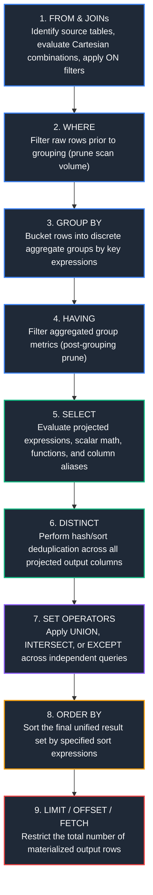
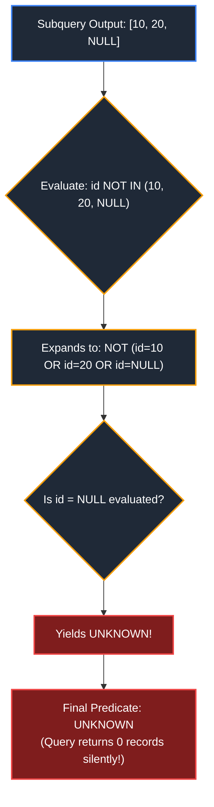
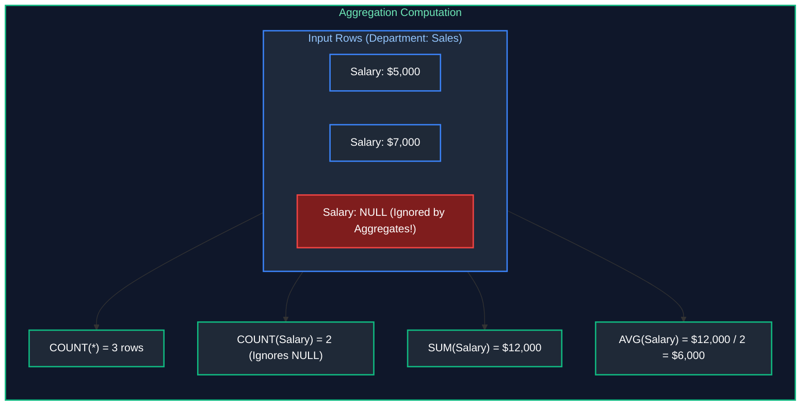
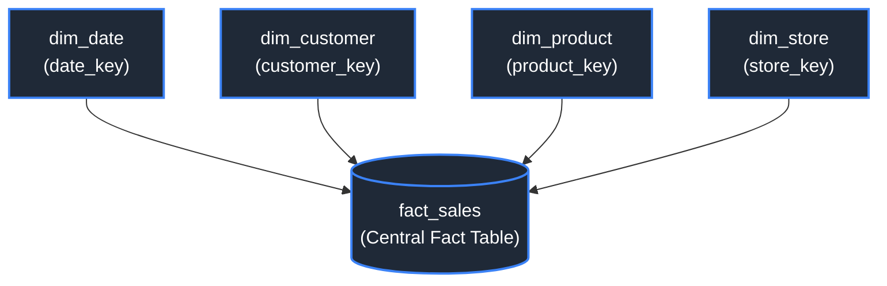

# 01. SQL Fundamentals

A comprehensive, production-grade guide to SQL fundamentals, relational query architecture, filtering, aggregations, data types, joins, set operations, basic DML operations, and foundational database objects tailored for Data Engineering and AI Engineering workflows.

---

## Table of Contents
1. [SQL Query Architecture & Logical Processing Order](#1-sql-query-architecture--logical-processing-order)
   - [1.1 Declarative Paradigm & Execution Order](#11-declarative-paradigm--execution-order)
   - [1.2 Core Clauses: SELECT, FROM, WHERE, GROUP BY, HAVING, ORDER BY, LIMIT](#12-core-clauses-select-from-where-group-by-having-order-by-limit)
2. [Data Types, Casting & Defensive Conversions](#2-data-types-casting--defensive-conversions)
   - [2.1 Core SQL Data Types](#21-core-sql-data-types)
   - [2.2 Type Casting & Safe Conversions (CAST, TRY_CAST)](#22-type-casting--safe-conversions-cast-try_cast)
3. [Three-Valued Logic & NULL Handling](#3-three-valued-logic--null-handling)
   - [3.1 Three-Valued Logic (3VL) Truth Semantics](#31-three-valued-logic-3vl-truth-semantics)
   - [3.2 IS NULL, IS NOT NULL & The NOT IN NULL Trap](#32-is-null-is-not-null--the-not-in-null-trap)
   - [3.3 Conditional Fallbacks (COALESCE, NULLIF)](#33-conditional-fallbacks-coalesce-nullif)
4. [Filtering, Sorting & Conditional Expressions](#4-filtering-sorting--conditional-expressions)
   - [4.1 Comparison, Range & Pattern Matching (LIKE, ILIKE, BETWEEN)](#41-comparison-range--pattern-matching-like-ilike-between)
   - [4.2 DISTINCT Deduplication](#42-distinct-deduplication)
   - [4.3 CASE WHEN Conditional Branching](#43-case-when-conditional-branching)
   - [4.4 Row-Level Comparisons (GREATEST, LEAST)](#44-row-level-comparisons-greatest-least)
5. [Scalar Functions: String & Temporal Manipulation](#5-scalar-functions-string--temporal-manipulation)
   - [5.1 String Manipulation Functions](#51-string-manipulation-functions)
   - [5.2 Date & Time Functions](#52-date--time-functions)
6. [Aggregations & Grouping](#6-aggregations--grouping)
   - [6.1 Standard Aggregation Functions (COUNT, SUM, AVG, MIN, MAX)](#61-standard-aggregation-functions-count-sum-avg-min-max)
   - [6.2 Set & Array Aggregations (COUNT DISTINCT, STRING_AGG, ARRAY_AGG)](#62-set--array-aggregations-count-distinct-string_agg-array_agg)
   - [6.3 Statistical Aggregates (STDDEV, VARIANCE)](#63-statistical-aggregates-stddev-variance)
7. [Relational Joins & Multi-Table Querying](#7-relational-joins--multi-table-querying)
   - [7.1 Relational Join Foundations](#71-relational-join-foundations)
   - [7.2 INNER JOIN](#72-inner-join)
   - [7.3 LEFT (OUTER) JOIN](#73-left-outer-join)
   - [7.4 RIGHT (OUTER) JOIN](#74-right-outer-join)
   - [7.5 FULL OUTER JOIN](#75-full-outer-join)
   - [7.6 CROSS JOIN](#76-cross-join)
   - [7.7 Equi-Joins vs. Non-Equi Joins](#77-equi-joins-vs-non-equi-joins)
   - [7.8 Multiple-Table Joins & Star Schema Patterns](#78-multiple-table-joins--star-schema-patterns)
8. [Set Operators](#8-set-operators)
   - [8.1 UNION vs. UNION ALL](#81-union-vs-union-all)
   - [8.2 INTERSECT](#82-intersect)
   - [8.3 EXCEPT / MINUS](#83-except--minus)
9. [Subqueries Fundamentals](#9-subqueries-fundamentals)
   - [9.1 Scalar Subqueries](#91-scalar-subqueries)
   - [9.2 Multi-Row Subqueries (IN, ANY, ALL)](#92-multi-row-subqueries-in-any-all)
   - [9.3 Table Subqueries & Derived Tables](#93-table-subqueries--derived-tables)
10. [Foundational Data Modification (DML) & Database Objects](#10-foundational-data-modification-dml--database-objects)
    - [10.1 INSERT Operations](#101-insert-operations)
    - [10.2 UPDATE Operations](#102-update-operations)
    - [10.3 DELETE vs. TRUNCATE](#103-delete-vs-truncate)
    - [10.4 Standard Views](#104-standard-views)
    - [10.5 Session Temporary Tables](#105-session-temporary-tables)

---

# 1. SQL Query Architecture & Logical Processing Order

SQL (Structured Query Language) is a declarative domain-specific language designed to manage and query relational data. In declarative programming, the software engineer specifies **what data to retrieve** rather than **how to retrieve it step-by-step**. The database engine's query optimizer handles the physical procedural plan.

---

### 1.1 Declarative Paradigm & Execution Order

Although a standard query begins syntactically with the `SELECT` clause, the SQL engine executes query components in a strictly defined logical pipeline. Understanding this logical order is vital for writing performant queries, resolving column alias scoping issues, and avoiding subtle runtime bugs.



#### Implications for Engineers
- **Aliases in WHERE:** You cannot reference a column alias created in `SELECT` within the `WHERE` clause because `WHERE` (Step 2) is evaluated long before `SELECT` (Step 5).
- **Aliases in ORDER BY:** You *can* reference `SELECT` aliases inside `ORDER BY` (Step 8) because sorting occurs after projection.
- **HAVING vs. WHERE:** `WHERE` reduces row volume before expensive distributed hash grouping; `HAVING` filters only after aggregation occurs.

---

### 1.2 Core Clauses: SELECT, FROM, WHERE, GROUP BY, HAVING, ORDER BY, LIMIT

#### Definition & Purpose
These core clauses form the foundational syntax of data extraction, filtering, summarization, and sorting across relational databases (PostgreSQL, MySQL, SQL Server) and distributed data warehouses (Snowflake, BigQuery, Databricks).

#### Code Example
```sql
-- Comprehensive foundational aggregation pipeline
-- Scenario: Find active product categories that generated over $50,000 in completed Q1 orders,
-- sorted by gross sales descending, taking the top 5 highest-grossing categories.

SELECT 
    o.category_id,                                           -- Grouping key: Category identifier
    COUNT(o.order_id)                  AS total_orders,       -- Aggregate: Total count of completed orders
    COUNT(DISTINCT o.customer_id)       AS unique_buyers,      -- Aggregate: Cardinality of unique customers
    SUM(o.order_amount)                AS total_revenue,      -- Aggregate: Gross sum of revenue
    ROUND(AVG(o.order_amount), 2)      AS avg_order_value     -- Aggregate: Mean ticket size rounded to cents
FROM sales.orders AS o                                       -- Step 1: Scan base fact table
WHERE o.order_status = 'COMPLETED'                           -- Step 2: Filter out cancelled/pending rows early
  AND o.order_date >= '2024-01-01'                           -- Step 2: Date boundary lower bound
  AND o.order_date <  '2024-04-01'                           -- Step 2: Date boundary upper bound (half-open interval)
GROUP BY o.category_id                                       -- Step 3: Bucket remaining rows by category_id
HAVING SUM(o.order_amount) > 50000.00                        -- Step 4: Keep only category buckets exceeding $50k
ORDER BY total_revenue DESC                                  -- Step 5: Sort final aggregated groups by revenue descending
LIMIT 5;                                                     -- Step 6: Materialize only top 5 rows
```

#### Key Points & Common Pitfalls
- **Half-Open Intervals for Dates:** Notice `order_date >= '2024-01-01' AND order_date < '2024-04-01'`. Avoid `BETWEEN` on timestamps because `'2024-03-31'` excludes records occurring on that date with timestamps after midnight (`2024-03-31 14:30:00`).
- **Memory Overhead in High-Cardinality Grouping:** Grouping by high-cardinality keys (such as `UUID` or `session_id`) without adequate filtering causes memory exhaustion (OOM) or heavy disk spilling in analytical engines.
- **Related Performance Concepts:** For in-depth query planning, Cost-Based Optimization, and statistics collection, see [04. Database Internals & Performance](04_database_internals_and_performance.md#3-query-performance--optimization).

#### References
- [GeeksforGeeks: SQL Queries Order of Execution](https://www.geeksforgeeks.org/order-of-execution-of-sql-queries/)
- [PostgreSQL Documentation: Queries - SELECT](https://www.postgresql.org/docs/current/queries.html)

---

# 2. Data Types, Casting & Defensive Conversions

Data types establish the storage blueprint, precision guarantees, and valid operations for every column in a relational engine.

---

### 2.1 Core SQL Data Types

| Category | Canonical SQL Types | Typical Byte Size | Engineering Use Case |
| :--- | :--- | :--- | :--- |
| **Exact Numerics** | `SMALLINT`, `INT`, `BIGINT` | 2, 4, 8 Bytes | Primary keys, foreign keys, physical counts |
| **Fixed-Point Decimals** | `DECIMAL(p, s)`, `NUMERIC(p, s)` | Variable | Financial balances, tax calculations, precision currencies |
| **Approximate Numerics**| `REAL`, `FLOAT`, `DOUBLE PRECISION`| 4, 8 Bytes | Scientific metrics, GPS coordinates, ML features |
| **Character Strings** | `CHAR(n)`, `VARCHAR(n)`, `TEXT` | Variable | Fixed codes (`CHAR(2)` for country codes), names, descriptions |
| **Temporal Data** | `DATE`, `TIME`, `TIMESTAMP`, `TIMESTAMPTZ` | 4 to 8 Bytes | Calendar dates, event logs, time-series streams |
| **Boolean** | `BOOLEAN` | 1 Byte | Binary flags (`TRUE`, `FALSE`, `UNKNOWN`) |
| **Semi-Structured** | `JSON`, `JSONB`, `ARRAY`, `STRUCT` | Variable | Unstructured event payloads, nested API responses |

#### Exact vs. Approximate Numerics
```
Exact Decimal:   DECIMAL(10, 2): 10 total digits, 2 fractional digits -> Guarantees exact representation.
Floating Point:  FLOAT / DOUBLE: IEEE-754 binary representation -> Prone to rounding anomalies:
                 0.1 + 0.2 = 0.30000000000000004
```
> [!CAUTION]
> Never store financial transactions or ledger balances in `FLOAT` or `DOUBLE`. Always enforce `DECIMAL(precision, scale)` or `NUMERIC(precision, scale)` to prevent precision truncation during audits.

---

### 2.2 Type Casting & Safe Conversions (CAST, TRY_CAST)

#### Definition
Type casting converts an expression from one explicit data type to another.
- **ANSI Standard:** `CAST(expression AS target_type)`
- **PostgreSQL / DuckDB shorthand:** `expression::target_type`
- **Defensive Casting:** `TRY_CAST(expression AS target_type)` (or `SAFE_CAST` in BigQuery) returns `NULL` rather than crashing the batch job when parsing corrupt strings.

#### Code Example
```sql
-- Defensive data ingestion from raw unvalidated string staging tables
-- Scenario: Clean and standardize raw clickstream telemetry before loading into core tables.

SELECT 
    raw_event_id,
    
    -- ANSI SQL standard cast: parse ISO-8601 date string to standard DATE
    CAST(raw_event_date AS DATE)                                  AS event_date,
    
    -- PostgreSQL / DuckDB shorthand: cast integer string to BIGINT
    raw_user_id::BIGINT                                           AS user_id,
    
    -- Safe conversion: TRY_CAST prevents batch ETL crashes when dirty data ('N/A', 'NULL', 'err') is encountered
    -- Returns NULL instead of raising fatal error "invalid input syntax for type numeric"
    TRY_CAST(raw_dwell_time_ms AS NUMERIC(10, 2))                 AS dwell_time_ms,
    
    -- Force floating-point arithmetic to prevent integer truncation
    -- 5 / 2 = 2 (in integer math), whereas CAST(5 AS NUMERIC) / 2 = 2.50
    CAST(raw_click_count AS NUMERIC(10, 2)) / NULLIF(raw_view_count, 0) AS click_through_rate
FROM staging.raw_web_telemetry;
```

#### Key Points & Common Pitfalls
- **SARGability Hazard:** Writing `WHERE CAST(created_at AS DATE) = '2024-01-01'` wraps the indexed column in a function, blinding the B-Tree index and forcing a full table scan. Rewrite as a range predicate: `WHERE created_at >= '2024-01-01' AND created_at < '2024-01-02'`.
- **Related Storage Formats:** For physical columnar representation of types in Parquet and ORC, see [07. File Formats & Storage](07_file_formats_and_storage.md).

#### References
- [GeeksforGeeks: SQL CAST Function](https://www.geeksforgeeks.org/sql-cast-function/)
- [PostgreSQL Documentation: Type Conversion](https://www.postgresql.org/docs/current/typeconv.html)

---

# 3. Three-Valued Logic & NULL Handling

In SQL, `NULL` represents missing, unrecorded, or unknown data. It is not equivalent to zero, an empty string `''`, or a boolean `FALSE`.

---

### 3.1 Three-Valued Logic (3VL) Truth Semantics

Because `NULL` signifies unknown information, direct equality evaluations like `column = NULL` or `NULL = NULL` do not evaluate to `TRUE` or `FALSE`. Instead, they evaluate to `UNKNOWN`. SQL evaluates logical expressions under **Three-Valued Logic (3VL)**.

#### Truth Tables for 3VL
```
AND Logic:                         OR Logic:                          NOT Logic:
+---------+---------+---------+    +---------+---------+---------+    +---------+---------+
| A       | B       | A AND B |    | A       | B       | A OR B  |    | A       | NOT A   |
+---------+---------+---------+    +---------+---------+---------+    +---------+---------+
| TRUE    | UNKNOWN | UNKNOWN |    | TRUE    | UNKNOWN | TRUE    |    | TRUE    | FALSE   |
| FALSE   | UNKNOWN | FALSE   |    | FALSE   | UNKNOWN | UNKNOWN |    | FALSE   | TRUE    |
| UNKNOWN | UNKNOWN | UNKNOWN |    | UNKNOWN | UNKNOWN | UNKNOWN |    | UNKNOWN | UNKNOWN |
+---------+---------+---------+    +---------+---------+---------+    +---------+---------+
```

> [!IMPORTANT]
> The `WHERE` clause retains rows **only if the predicate evaluates strictly to `TRUE`**. Rows where the predicate evaluates to `FALSE` or `UNKNOWN` are discarded!

---

### 3.2 IS NULL, IS NOT NULL & The NOT IN NULL Trap

To check for the presence or absence of values, SQL provides dedicated predicates: `IS NULL` and `IS NOT NULL`.

#### The Lethal `NOT IN` with `NULL` Trap
When using `IN` or `NOT IN` against a subquery or value set containing a `NULL`, the entire logical condition collapses:

```sql
-- Suppose subquery returns: (10, 20, NULL)
-- Condition: status_id NOT IN (10, 20, NULL)
-- Expands to: NOT (status_id = 10 OR status_id = 20 OR status_id = NULL)
-- If status_id is 30:
-- NOT (FALSE OR FALSE OR UNKNOWN) -> NOT (UNKNOWN) -> UNKNOWN
```
Because the result is `UNKNOWN`, the `WHERE` clause discards the row. As a consequence, **the query returns zero rows**, silently dropping all data!



#### Safe Alternative
Always use `NOT EXISTS` or ensure `WHERE column IS NOT NULL` inside the inner subquery:
```sql
-- Safe approach using NOT EXISTS (immunized against NULLs)
SELECT c.customer_id, c.customer_name
FROM crm.customers AS c
WHERE NOT EXISTS (
    SELECT 1 
    FROM sales.orders AS o 
    WHERE o.customer_id = c.customer_id
);
```

---

### 3.3 Conditional Fallbacks (COALESCE, NULLIF)

#### Function Definitions
- `COALESCE(val1, val2, ...)`: Evaluates arguments from left to right and returns the first non-null expression.
- `NULLIF(val1, val2)`: Compares two expressions. If `val1 = val2`, it returns `NULL`; otherwise, it returns `val1`.

#### Code Example
```sql
-- Comprehensive defensive NULL handling in customer communications pipeline
SELECT 
    customer_id,
    
    -- Fallback ladder: prefer mobile phone, fallback to office phone, then fallback literal
    COALESCE(mobile_phone, office_phone, 'NO_PHONE_REGISTERED') AS active_phone_contact,
    
    -- Safe division pattern:
    -- If total_orders is 0, NULLIF turns 0 into NULL.
    -- Any number divided by NULL safely evaluates to NULL, preventing division-by-zero crashes.
    gross_spend / NULLIF(total_orders, 0)                        AS avg_spend_per_order,
    
    -- Handling empty strings by converting them to NULL first, then coalescing
    COALESCE(NULLIF(TRIM(tax_identifier), ''), 'PENDING_VERIFICATION') AS validated_tax_id
FROM crm.customer_profiles;
```

#### References
- [GeeksforGeeks: SQL NULL Values](https://www.geeksforgeeks.org/sql-null-values/)
- [PostgreSQL Documentation: Conditional Expressions](https://www.postgresql.org/docs/current/functions-conditional.html)

---

# 4. Filtering, Sorting & Conditional Expressions

---

### 4.1 Comparison, Range & Pattern Matching (LIKE, ILIKE, BETWEEN)

SQL provides scalar operators to isolate specific row slices:
- `=, !=, <>, <, <=, >, >=`: Basic relational comparisons.
- `BETWEEN val1 AND val2`: Inclusive range check (`val >= val1 AND val <= val2`).
- `IN (list)`: Membership check against a literal set or subquery.
- `LIKE`: Pattern matching using wildcards (`%` matches zero or more characters; `_` matches exactly one character).
- `ILIKE`: Case-insensitive pattern matching (PostgreSQL, Snowflake, DuckDB).

#### Code Example
```sql
-- Detailed multi-predicate filtering on logistics data
SELECT 
    shipment_id,
    tracking_code,
    destination_country,
    weight_kg,
    created_at
FROM logistics.shipments
WHERE destination_country IN ('USA', 'CAN', 'MEX')             -- Explicit discrete membership list
  AND weight_kg BETWEEN 5.0 AND 50.0                           -- Inclusive boundary check [5.0, 50.0]
  AND tracking_code LIKE 'EXP-%-2024'                          -- Starts with 'EXP-', ends with '-2024', wildcard in middle
  AND sender_email ILIKE '%@FEDEX.COM';                        -- Case-insensitive match on email domain
```

---

### 4.2 DISTINCT Deduplication

#### Definition
`DISTINCT` removes duplicate records from the projected result set, guaranteeing that every returned row is unique across all projected columns.

```sql
-- Retrieve the unique set of active warehouse facilities and destination countries
SELECT DISTINCT 
    origin_warehouse_id,                                       -- Attribute 1 of composite uniqueness
    destination_country                                        -- Attribute 2 of composite uniqueness
FROM logistics.shipment_logs
WHERE dispatch_status = 'SHIPPED';
```

#### Key Points & Common Pitfalls
- **Distributed Cost:** `DISTINCT` forces a cluster-wide hash aggregate or sort shuffle to identify and eliminate duplicates across nodes.
- **Root-Cause Masking:** Slapping `DISTINCT` on a query that outputs duplicates due to a buggy join hides the structural bug while degrading query performance.

---

### 4.3 CASE WHEN Conditional Branching

`CASE WHEN` is SQL’s conditional branching construct (`if-then-else`). It comes in two flavors:
1. **Searched CASE:** Evaluates arbitrary boolean expressions sequentially.
2. **Simple CASE:** Compares a single target expression to a series of discrete equality values.

#### Code Example
```sql
-- Data binning, tiering, and conditional metric pivoting
SELECT 
    merchant_id,
    
    -- Simple CASE: Maps discrete categorical codes to descriptive labels
    CASE operational_status
        WHEN 'A' THEN 'Active'
        WHEN 'S' THEN 'Suspended'
        WHEN 'P' THEN 'Pending Onboarding'
        ELSE 'Unknown Status'
    END AS status_label,
    
    -- Searched CASE: Evaluates complex continuous ranges
    CASE 
        WHEN annual_volume >= 1000000.00 THEN 'Enterprise Tier'
        WHEN annual_volume >= 250000.00  THEN 'Mid-Market Tier'
        WHEN annual_volume >  0.00       THEN 'Small Business Tier'
        ELSE 'Dormant Tier'
    END AS merchant_segment,
    
    -- Conditional aggregation pattern: Pivot row-level event counts into horizontal columns
    SUM(CASE WHEN transaction_type = 'DEBIT'  THEN amount ELSE 0.00 END) AS total_debit_volume,
    SUM(CASE WHEN transaction_type = 'CREDIT' THEN amount ELSE 0.00 END) AS total_credit_volume
FROM billing.merchant_accounts
GROUP BY merchant_id, operational_status, annual_volume;
```

---

### 4.4 Row-Level Comparisons (GREATEST, LEAST)

While `MAX()` and `MIN()` aggregate values vertically across multiple rows, `GREATEST()` and `LEAST()` evaluate scalar expressions horizontally across multiple columns within the **same row**.

```sql
SELECT 
    employee_id,
    base_salary,
    -- Horizontal evaluation: pick the highest bonus earned across any single quarter
    GREATEST(q1_bonus, q2_bonus, q3_bonus, q4_bonus)           AS peak_quarterly_bonus,
    -- Horizontal evaluation: guarantee minimum baseline compensation
    LEAST(guaranteed_minimum, contract_rate)                  AS effective_baseline
FROM payroll.compensation_packages;
```

---

# 5. Scalar Functions: String & Temporal Manipulation

---

### 5.1 String Manipulation Functions

| Function | Operation | Example |
| :--- | :--- | :--- |
| `CONCAT(a, b, ...)` | String concatenation | `CONCAT('Data', ' ', 'Eng') -> 'Data Eng'` |
| `SUBSTRING(s, pos, len)` | Extracts substring (1-based index) | `SUBSTRING('Apache Spark', 1, 6) -> 'Apache'` |
| `TRIM(s)` | Strips leading and trailing whitespace | `TRIM('  val  ') -> 'val'` |
| `UPPER(s)` / `LOWER(s)` | Standardizes casing | `LOWER('Snowflake') -> 'snowflake'` |
| `REPLACE(s, from, to)` | Substitutes target substring | `REPLACE('v1_raw', 'v1', 'v2') -> 'v2_raw'` |
| `POSITION(sub IN s)` | Returns 1-based offset index | `POSITION('@' IN 'dev@org.com') -> 4` |
| `LENGTH(s)` | Character count | `LENGTH('SQL') -> 3` |

#### Code Example
```sql
-- Production string parsing and data cleaning pipeline
SELECT 
    raw_user_token,
    
    -- Standardize casing and strip trailing carriage returns
    TRIM(LOWER(email_address))                                AS clean_email,
    
    -- Extract username prefix before '@' symbol using dynamic positional parsing
    SUBSTRING(
        TRIM(LOWER(email_address)), 
        1, 
        POSITION('@' IN TRIM(LOWER(email_address))) - 1
    )                                                         AS extracted_user_name,
    
    -- String formatting: standardize telephone country format
    CONCAT('+1-', SUBSTRING(phone_digits, 1, 3), '-', SUBSTRING(phone_digits, 4, 3), '-', SUBSTRING(phone_digits, 7, 4)) AS formatted_phone
FROM raw_crm.inbound_leads;
```

---

### 5.2 Date & Time Functions

Temporal transformations allow data engineers to calculate latencies, construct cohort boundaries, and partition continuous data into time buckets.

```sql
-- Comprehensive temporal arithmetic, truncations, and component extractions
SELECT 
    event_id,
    event_timestamp,
    
    -- Truncate timestamp down to the first day of its calendar month (standard cohort key)
    DATE_TRUNC('month', event_timestamp)                       AS cohort_month,
    
    -- Truncate timestamp down to the start of the hour (used in streaming rollups)
    DATE_TRUNC('hour', event_timestamp)                        AS event_hour_bucket,
    
    -- Extract specific temporal attributes
    EXTRACT(YEAR FROM event_timestamp)                         AS event_year,
    EXTRACT(DOW  FROM event_timestamp)                         AS day_of_week_index, -- (0 = Sunday, 6 = Saturday)
    
    -- Interval arithmetic: compute expiration timestamp exactly 30 days into the future
    event_timestamp + INTERVAL '30 days'                       AS token_expiration_time,
    
    -- Compute latency between event generation and system ingestion (PostgreSQL / Snowflake)
    DATEDIFF('minute', event_timestamp, ingestion_timestamp)   AS ingestion_lag_minutes
FROM streaming.telemetry_events
WHERE event_timestamp >= CURRENT_DATE - INTERVAL '7 days';    -- Sliding 7-day lookback window
```

---

# 6. Aggregations & Grouping

Aggregation functions summarize multiple records to compute summary statistics per group.

---

### 6.1 Standard Aggregation Functions (COUNT, SUM, AVG, MIN, MAX)



#### Code Example
```sql
-- Standard departmental compensation analysis
SELECT 
    department_id,
    COUNT(*)                                                  AS total_headcount,       -- Counts every row including NULLs
    COUNT(commission_pct)                                     AS commissioned_staff,    -- Counts only non-NULL commission rows
    SUM(salary)                                               AS total_monthly_payroll, -- Sum of base wages
    ROUND(AVG(salary), 2)                                     AS mean_monthly_salary,   -- Mean salary (NULL salaries omitted)
    MIN(salary)                                               AS floor_salary,          -- Minimum observed salary
    MAX(salary)                                               AS ceiling_salary         -- Maximum observed salary
FROM corporate.employees
GROUP BY department_id;
```

---

### 6.2 Set & Array Aggregations (COUNT DISTINCT, STRING_AGG, ARRAY_AGG)

- `COUNT(DISTINCT col)`: Computes exact unique cardinality of a column.
- `STRING_AGG(col, delimiter [ORDER BY ...])` (or `GROUP_CONCAT`): Concatenates values from multiple rows into a single string.
- `ARRAY_AGG(col [ORDER BY ...])`: Collects column values into an array data structure.

```sql
SELECT 
    order_id,
    COUNT(DISTINCT item_sku)                                   AS unique_skus_count,
    -- Concatenate all purchased product names into a readable CSV string ordered by price
    STRING_AGG(item_name, ', ' ORDER BY unit_price DESC)       AS purchased_items_summary,
    -- Collect item IDs into a typed array for downstream JSON/Python consumption
    ARRAY_AGG(item_id ORDER BY item_id ASC)                    AS item_id_array
FROM retail.order_line_items
GROUP BY order_id;
```

---

### 6.3 Statistical Aggregates (STDDEV, VARIANCE)

Analytical engines provide statistical functions to measure data dispersion and correlation:
- `STDDEV(col)` (or `STDDEV_SAMP`): Sample standard deviation ($\sigma$).
- `VARIANCE(col)` (or `VAR_SAMP`): Sample variance ($\sigma^2$).
- `CORR(y, x)`: Pearson correlation coefficient ($r$).

```sql
SELECT 
    sensor_model_id,
    COUNT(reading_id)                                         AS total_readings,
    ROUND(AVG(temperature_celsius), 2)                       AS mean_temp,
    ROUND(STDDEV(temperature_celsius), 4)                     AS std_dev_temp,
    ROUND(VARIANCE(temperature_celsius), 4)                   AS variance_temp
FROM iot.sensor_telemetry
GROUP BY sensor_model_id;
```

---

# 7. Relational Joins & Multi-Table Querying

Relational joins combine columns from two or more tables based on common logical keys.

---

### 7.1 Relational Join Foundations

```mermaid
flowchart TD
    subgraph InnerJoin ["INNER JOIN (A ∩ B)"]
        direction LR
        IA["Table A: [1, 2]"] --- IB["Table B: [2, 3]"] ==> IRes["[2]"]
    end
    subgraph LeftJoin ["LEFT JOIN (All A + Matched B)"]
        direction LR
        LA["Table A: [1, 2]"] --- LB["Table B: [2, 3]"] ==> LRes["[1 (NULL), 2 (Matched)]"]
    end
    subgraph FullJoin ["FULL OUTER JOIN (A ∪ B)"]
        direction LR
        FA["Table A: [1, 2]"] --- FB["Table B: [2, 3]"] ==> FRes["[1 (NULL), 2 (Both), 3 (NULL)]"]
    end
    subgraph CrossJoin ["CROSS JOIN (A × B)"]
        direction LR
        CA["Table A: [1, 2]"] --- CB["Table B: ['X', 'Y']"] ==> CRes["[(1,'X'), (1,'Y'), (2,'X'), (2,'Y')]"]
    end

    style InnerJoin fill:#0f172a,stroke:#3b82f6,stroke-width:1.5px,color:#93c5fd
    style LeftJoin fill:#0f172a,stroke:#06b6d4,stroke-width:1.5px,color:#67e8f9
    style FullJoin fill:#0f172a,stroke:#8b5cf6,stroke-width:1.5px,color:#c084fc
    style CrossJoin fill:#0f172a,stroke:#f59e0b,stroke-width:1.5px,color:#fde68a

    style IA fill:#1f2937,stroke:#3b82f6,stroke-width:2px,color:#fff
    style IB fill:#1f2937,stroke:#3b82f6,stroke-width:2px,color:#fff
    style IRes fill:#1f2937,stroke:#3b82f6,stroke-width:2px,color:#fff
    style LA fill:#1f2937,stroke:#06b6d4,stroke-width:2px,color:#fff
    style LB fill:#1f2937,stroke:#06b6d4,stroke-width:2px,color:#fff
    style LRes fill:#1f2937,stroke:#06b6d4,stroke-width:2px,color:#fff
    style FA fill:#1f2937,stroke:#8b5cf6,stroke-width:2px,color:#fff
    style FB fill:#1f2937,stroke:#8b5cf6,stroke-width:2px,color:#fff
    style FRes fill:#1f2937,stroke:#8b5cf6,stroke-width:2px,color:#fff
    style CA fill:#1f2937,stroke:#f59e0b,stroke-width:2px,color:#fff
    style CB fill:#1f2937,stroke:#f59e0b,stroke-width:2px,color:#fff
    style CRes fill:#1f2937,stroke:#f59e0b,stroke-width:2px,color:#fff
```



---

### 7.2 INNER JOIN

Returns records only when an exact match satisfies the join predicate in both datasets.

```sql
-- Inner join matching orders to registered customer records
SELECT 
    o.order_id,
    o.order_date,
    o.order_amount,
    c.customer_id,
    c.customer_name,
    c.email
FROM sales.orders AS o
INNER JOIN crm.customers AS c 
    ON o.customer_id = c.customer_id; -- Join condition: orders without customers or customers without orders are omitted
```

---

### 7.3 LEFT (OUTER) JOIN

Returns **all records from the left table** and matching rows from the right table. Unmatched right-side columns are filled with `NULL`.

```sql
-- Left join identifying all registered customers and their historical purchase summary
SELECT 
    c.customer_id,
    c.customer_name,
    COUNT(o.order_id)                   AS total_orders_placed, -- Evaluates to 0 if no orders exist
    COALESCE(SUM(o.order_amount), 0.00) AS total_gross_spend    -- Coalesce prevents NULL spend for new users
FROM crm.customers AS c
LEFT JOIN sales.orders AS o 
    ON c.customer_id = o.customer_id                           -- Left side preserved unconditionally
GROUP BY c.customer_id, c.customer_name;
```

> [!WARNING]
> **The Right-Table WHERE Filter Trap:**
> If you write `WHERE o.order_status = 'COMPLETED'`, any row where `o.order_status` is `NULL` (i.e. customers who never bought anything) is discarded by the `WHERE` clause! This silently converts your `LEFT JOIN` into an `INNER JOIN`. To preserve all customers, move the filter to the `ON` clause:
> `ON c.customer_id = o.customer_id AND o.order_status = 'COMPLETED'`.

---

### 7.4 RIGHT (OUTER) JOIN

Returns all records from the right table and matching rows from the left table.

```sql
-- Right join matching products against warehouse stock
SELECT 
    p.product_id,
    p.product_name,
    s.warehouse_id,
    s.units_on_hand
FROM inventory.stock AS s
RIGHT JOIN catalog.products AS p 
    ON s.product_id = p.product_id;
```
*Note:* Standard enterprise style guides (e.g. dbt Labs style conventions) discourage `RIGHT JOIN` because reading tables right-to-left impairs readability. Always rewrite as a `LEFT JOIN` by reversing table positions.

---

### 7.5 FULL OUTER JOIN

Returns all records when a match exists in either table. Non-matching columns from either side are padded with `NULL`.

```sql
-- Ledger reconciliation: Identify matching and unmatched records between Internal Accounts and Bank Statements
SELECT 
    COALESCE(i.transaction_id, b.transaction_id)               AS unified_txn_id,
    i.amount                                                   AS internal_recorded_amount,
    b.amount                                                   AS bank_cleared_amount,
    CASE 
        WHEN b.transaction_id IS NULL THEN 'Missing on Bank Feed'
        WHEN i.transaction_id IS NULL THEN 'Missing in Internal Ledger'
        WHEN i.amount != b.amount     THEN 'Amount Mismatch / Discrepancy'
        ELSE 'Reconciled & Balanced'
    END                                                        AS audit_status
FROM finance.internal_ledger AS i
FULL OUTER JOIN finance.bank_statements AS b 
    ON i.transaction_id = b.transaction_id;
```

---

### 7.6 CROSS JOIN

Computes the Cartesian product ($N \times M$ rows), pairing every row from Table A with every row from Table B.

```sql
-- Generate a reporting skeleton for all stores across all product categories
SELECT 
    s.store_id,
    s.store_city,
    c.category_id,
    c.category_name
FROM enterprise.stores AS s
CROSS JOIN catalog.categories AS c;
```

---

### 7.7 Equi-Joins vs. Non-Equi Joins

- **Equi-Join:** Employs strictly equality operators (`ON a.id = b.id`). Fast hash joins can be utilized.
- **Non-Equi Join:** Employs comparison operators (`<`, `>`, `<=`, `>=`, `!=`, `BETWEEN`).

```sql
-- Non-equi join: Map an employee's salary to an HR compensation grade band
SELECT 
    e.employee_id,
    e.first_name,
    e.salary,
    g.grade_level,
    g.min_salary,
    g.max_salary
FROM hr.employees AS e
INNER JOIN hr.salary_grades AS g 
    ON e.salary >= g.min_salary 
   AND e.salary <= g.max_salary; -- Evaluates non-equi range boundaries
```

---

### 7.8 Multiple-Table Joins & Star Schema Patterns

In enterprise data modeling, multi-table joins connect a central Fact table to surrounding radial Dimension tables.



```sql
-- Star Schema multi-table join for dimensional business intelligence
SELECT 
    d.calendar_year,
    d.calendar_quarter,
    p.category_name,
    c.country,
    SUM(f.quantity)                                           AS total_units_sold,
    SUM(f.gross_revenue)                                      AS total_revenue
FROM warehouse.fact_sales AS f                                -- Fact table holding measures
INNER JOIN warehouse.dim_date     AS d ON f.date_key     = d.date_key     -- Conformed date dimension
INNER JOIN warehouse.dim_product  AS p ON f.product_key  = p.product_key  -- Product dimension
INNER JOIN warehouse.dim_customer AS c ON f.customer_key = c.customer_key -- Customer dimension
WHERE d.calendar_year = 2024
GROUP BY d.calendar_year, d.calendar_quarter, p.category_name, c.country;
```
> [!NOTE]
> For advanced dimensional design, dimensional modeling rules, and Kimball architectures, see [06. Data Architecture & Modeling](06_data_architecture_and_modeling.md). For advanced join algorithms (Broadcast Hash Joins, Shuffle Hash Joins, Sort-Merge Joins, and Join Fan-Out prevention), see [02. Advanced SQL](02_advanced_sql.md#1-advanced-joins--distributed-execution-mechanics).

---

# 8. Set Operators

Set operators combine the result sets of two or more independent `SELECT` statements into a single unified relation.
**Prerequisites:** All queries must project the identical number of columns with compatible data types in corresponding ordinal positions.

---

### 8.1 UNION vs. UNION ALL

- `UNION`: Combines results and performs a global deduplication pass across all columns.
- `UNION ALL`: Directly appends result sets without checking duplicates (substantially faster).

```sql
-- Fast audit log concatenation combining active and archive partitions
SELECT event_id, user_id, event_type, created_at, 'HOT_STORAGE'  AS source_layer 
FROM logs.live_events
WHERE created_at >= CURRENT_DATE - INTERVAL '30 days'

UNION ALL -- Preferred: skips expensive sorting and hashing deduplication

SELECT event_id, user_id, event_type, created_at, 'COLD_STORAGE' AS source_layer 
FROM logs.archived_events
WHERE created_at < CURRENT_DATE - INTERVAL '30 days';
```

---

### 8.2 INTERSECT

Returns only distinct records that exist in **both** participating queries ($A \cap B$).

```sql
-- Find customer IDs who made a purchase in both 2023 AND 2024
SELECT customer_id FROM sales.orders WHERE order_date >= '2023-01-01' AND order_date < '2024-01-01'
INTERSECT
SELECT customer_id FROM sales.orders WHERE order_date >= '2024-01-01' AND order_date < '2025-01-01';
```

---

### 8.3 EXCEPT / MINUS

Returns distinct records present in the first query that **do not appear** in the second query ($A - B$).

```sql
-- Find registered users who have NEVER completed a KYC onboarding step
SELECT user_id FROM crm.registered_users
EXCEPT -- Syntax is MINUS in Oracle
SELECT user_id FROM compliance.kyc_verifications WHERE status = 'APPROVED';
```

---

# 9. Subqueries Fundamentals

A subquery is a nested `SELECT` statement embedded within an outer SQL statement.

---

### 9.1 Scalar Subqueries

Returns exactly **one row and one column** (a single value).

```sql
-- Scalar subquery computing delta from the organization-wide average salary
SELECT 
    employee_id,
    first_name,
    salary,
    -- Scalar subquery in projection: returns single global numeric value
    (SELECT ROUND(AVG(salary), 2) FROM hr.employees)           AS company_avg_salary,
    -- Compute variance directly
    salary - (SELECT ROUND(AVG(salary), 2) FROM hr.employees)   AS variance_from_average
FROM hr.employees;
```
> [!WARNING]
> If a scalar subquery returns more than 1 row at runtime, the query terminates immediately with a runtime execution error: `more than one row returned by a subquery used as an expression`.

---

### 9.2 Multi-Row Subqueries (IN, ANY, ALL)

Returns a single column with multiple rows for evaluation by set comparison predicates.

```sql
-- Multi-row subquery retrieving orders from top-tier VIP accounts
SELECT 
    order_id,
    customer_id,
    order_amount,
    order_date
FROM sales.orders
WHERE customer_id IN (
    -- Multi-row subquery returning set of matching VIP customer keys
    SELECT customer_id 
    FROM crm.customers 
    WHERE account_tier = 'VIP' AND is_active = TRUE
);
```

---

### 9.3 Table Subqueries & Derived Tables

A subquery located inside the `FROM` clause acts as a temporary virtual table and must be given an alias.

```sql
-- Derived table pre-aggregating line items before joining
SELECT 
    o.order_id,
    o.order_date,
    o.customer_id,
    summary.total_line_items,
    summary.calculated_subtotal
FROM sales.orders AS o
INNER JOIN (
    -- Derived table: Computes aggregations prior to joining
    SELECT 
        order_id,
        COUNT(item_id)   AS total_line_items,
        SUM(line_total)  AS calculated_subtotal
    FROM sales.order_items
    GROUP BY order_id
) AS summary 
    ON o.order_id = summary.order_id;
```
> [!TIP]
> For complex multi-step queries, Common Table Expressions (CTEs) are preferred over nested derived tables for readability. For CTEs, Recursive CTEs, and Correlated Subqueries, see [02. Advanced SQL](02_advanced_sql.md#2-advanced-subqueries-ctes--hierarchical-recursion).

---

# 10. Foundational Data Modification (DML) & Database Objects

---

### 10.1 INSERT Operations

The `INSERT` statement adds new records to an existing table.

```sql
-- 1. Direct Literal Values Insert
INSERT INTO inventory.warehouses (warehouse_id, warehouse_name, country_code, capacity_sqft)
VALUES 
    (101, 'Seattle Logistics Center', 'USA', 250000),
    (102, 'Frankfurt Hub',           'DEU', 180000);

-- 2. Bulk Programmatic Ingestion via INSERT INTO ... SELECT
INSERT INTO analytics.daily_active_users (user_id, metric_date, total_actions)
SELECT 
    user_id,
    CAST(event_time AS DATE) AS metric_date,
    COUNT(event_id)          AS total_actions
FROM telemetry.raw_events
WHERE event_time >= CURRENT_DATE - INTERVAL '1 day'
  AND event_time <  CURRENT_DATE
GROUP BY user_id, CAST(event_time AS DATE);
```

---

### 10.2 UPDATE Operations

Modifies existing column attributes for records satisfying an optional filter.

```sql
-- Filtered atomic update modifying specific target rows
UPDATE sales.orders
SET 
    order_status = 'PROCESSED',
    updated_at   = CURRENT_TIMESTAMP
WHERE order_status = 'PENDING'
  AND order_date < CURRENT_DATE;
```
> [!CAUTION]
> Omitting the `WHERE` clause updates **every single row** across the entire table. Always run a `SELECT COUNT(*)` with the identical `WHERE` condition prior to executing mass updates in production.

---

### 10.3 DELETE vs. TRUNCATE

| Dimension | `DELETE` | `TRUNCATE` |
| :--- | :--- | :--- |
| **Command Classification** | DML (Data Manipulation Language) | DDL (Data Definition Language) |
| **Filtering Capability** | Supports granular `WHERE` clause | Deletes **all rows** unconditionally |
| **Physical Mechanism** | Row-by-row scanning and WAL logging ($O(N)$) | Deallocates data pages / extents ($O(1)$) |
| **Performance Profile** | Slow on large tables; generates massive logs | Sub-second execution even on multi-terabyte tables |
| **Triggers** | Fires row-level `ON DELETE` triggers | Bypasses triggers |
| **Identity Reset** | Keeps identity / auto-increment counter intact | Resets identity counter back to seed value |

```mermaid
flowchart TD
    subgraph DeleteOp ["DELETE (Row-by-Row WAL Logging - O(N))"]
        D1["Scan & Lock Target Row 1"] --> D2["Write Undo/Redo Record to WAL"] --> D3["Mark Row 1 Dead"]
        D3 --> D4["Repeat for Row 2, Row 3... (Significant WAL & I/O Overhead)"]
    end

    subgraph TruncateOp ["TRUNCATE (Data Page Pointer Deallocation - O(1))"]
        T1["Target Table Metadata"] --> T2["Deallocate Extents / Data Pages from Table Header"]
        T2 --> T3["Reset High Watermark & Identity Sequence (Near-Instantaneous!)"]
    end

    style DeleteOp fill:#0f172a,stroke:#ef4444,stroke-width:1.5px,color:#fca5a5
    style TruncateOp fill:#0f172a,stroke:#10b981,stroke-width:1.5px,color:#6ee7b7

    style D1 fill:#1f2937,stroke:#ef4444,stroke-width:2px,color:#fff
    style D2 fill:#1f2937,stroke:#ef4444,stroke-width:2px,color:#fff
    style D3 fill:#7f1d1d,stroke:#ef4444,stroke-width:2px,color:#fecaca
    style D4 fill:#1f2937,stroke:#ef4444,stroke-width:2px,color:#fff
    style T1 fill:#1f2937,stroke:#10b981,stroke-width:2px,color:#fff
    style T2 fill:#1f2937,stroke:#10b981,stroke-width:2px,color:#fff
    style T3 fill:#064e3b,stroke:#10b981,stroke-width:2px,color:#a7f3d0
```



```sql
-- Selective removal of expired user sessions via DELETE
DELETE FROM security.user_sessions
WHERE expires_at < CURRENT_TIMESTAMP - INTERVAL '14 days';

-- High-speed truncation of staging table before batch reload via TRUNCATE
TRUNCATE TABLE staging.stg_daily_sales;
```

---

### 10.4 Standard Views

A Standard View is a virtual table defined by a saved SQL query. It does not store physical data on disk; each time it is queried, the query optimizer evaluates the view's underlying query dynamically.


```sql
-- Create an abstraction view masking PII and filtering inactive rows
CREATE OR REPLACE VIEW reporting.vw_active_customer_directory AS
SELECT 
    customer_id,
    company_name,
    contact_email,
    assigned_region,
    signup_date
FROM crm.customers
WHERE account_status = 'ACTIVE' 
  AND is_deleted = FALSE;
```

---

### 10.5 Session Temporary Tables

A Temporary Table is a session-scoped table created in a temporary database space (such as `tempdb` or `pg_temp`). It automatically drops when the database session terminates.

```sql
-- Create and index a session-scoped temporary table for intermediate staging
CREATE TEMPORARY TABLE temp_high_value_orders (
    order_id     BIGINT PRIMARY KEY,
    customer_id  BIGINT NOT NULL,
    order_amount NUMERIC(12, 2) NOT NULL
);

-- Populate temporary table from main fact table
INSERT INTO temp_high_value_orders (order_id, customer_id, order_amount)
SELECT order_id, customer_id, order_amount
FROM sales.orders
WHERE order_amount >= 1000.00
  AND order_date >= '2024-01-01';

-- Create an index on the temporary table to accelerate downstream joins
CREATE INDEX idx_temp_cust ON temp_high_value_orders (customer_id);

-- Join intermediate temporary table with customer metadata
SELECT 
    t.customer_id,
    c.customer_name,
    COUNT(t.order_id)    AS total_large_orders,
    SUM(t.order_amount)  AS aggregate_spend
FROM temp_high_value_orders AS t
INNER JOIN crm.customers AS c ON t.customer_id = c.customer_id
GROUP BY t.customer_id, c.customer_name;
```
