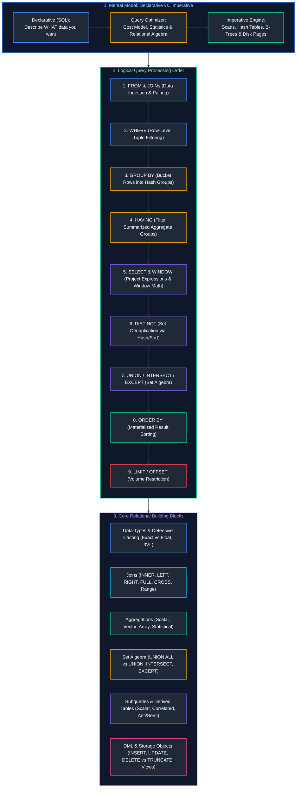
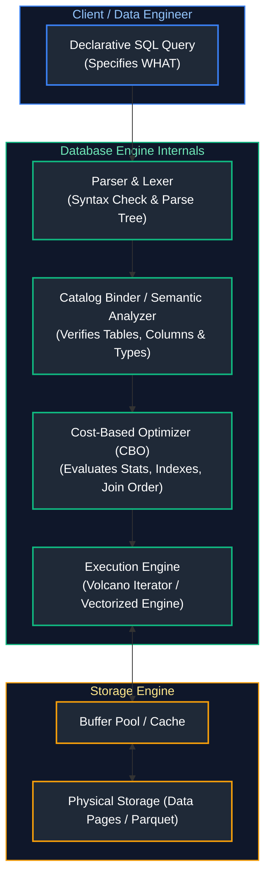
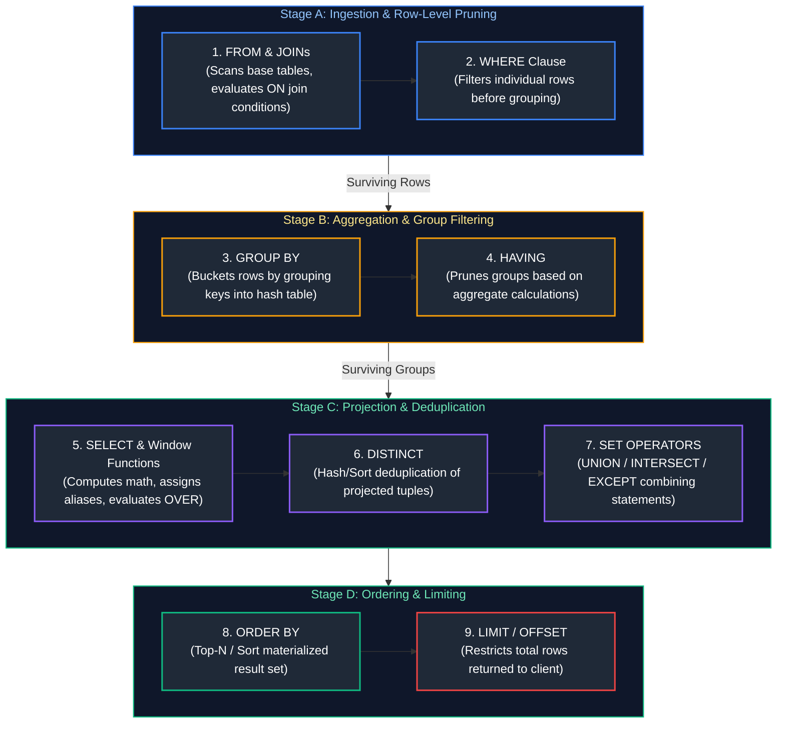
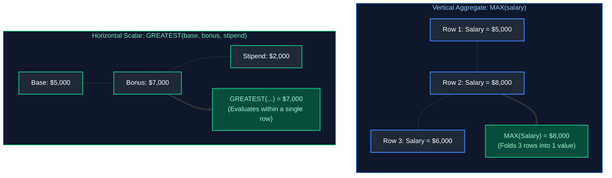
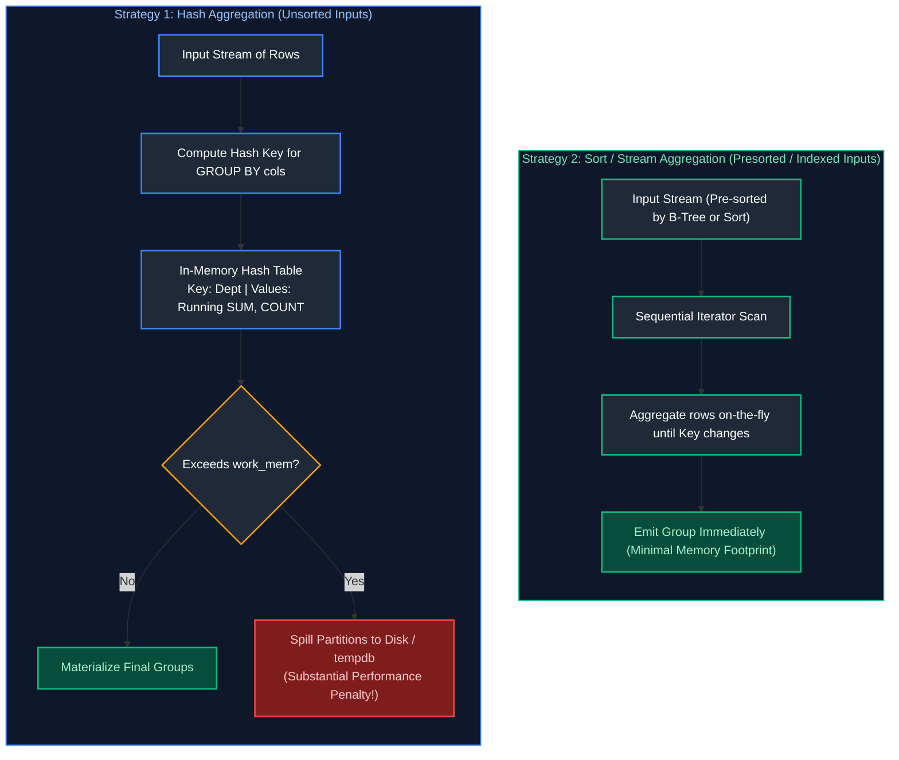
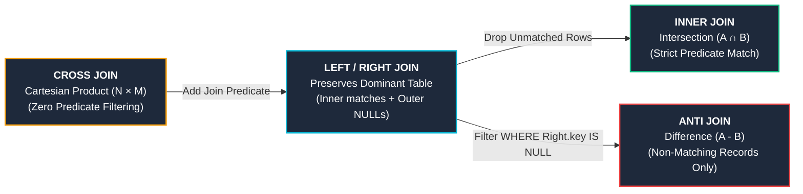
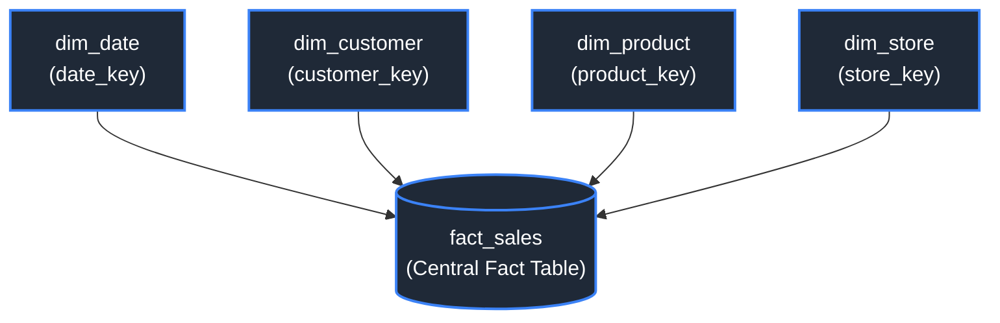
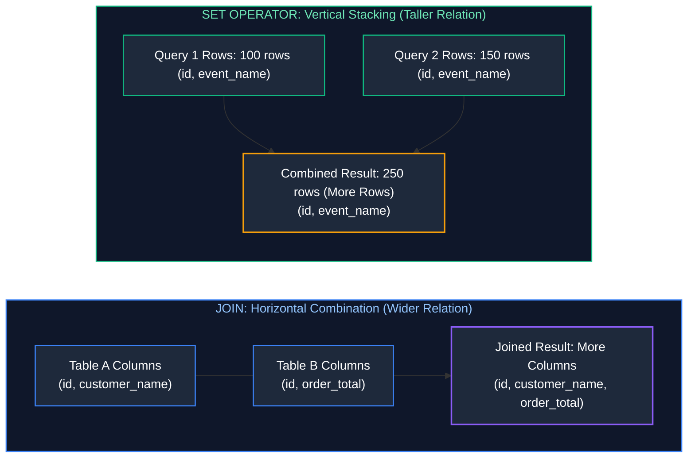
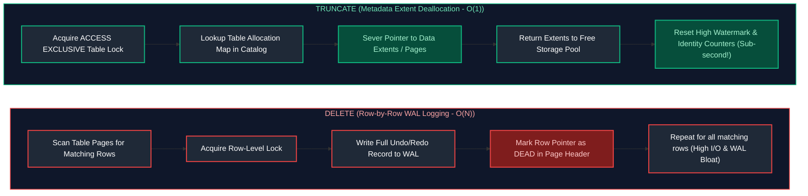

# 01. SQL Fundamentals: Master Engineering & Learning Guide

A comprehensive, production-grade guide to SQL fundamentals, relational query architecture, filtering, aggregations, data types, joins, set operations, foundational DML operations, and core database objects. Designed from first principles to take a newcomer to production-level fluency and provide seasoned engineers with deep architectural internals.

---

## Architectural Overview: Relational Query Execution & Processing Architecture

SQL (Structured Query Language) is not simply a syntax for querying data; it is a mathematical implementation of **Relational Algebra** and **Tuple Relational Calculus**, executed over physical storage engines.



---

## Table of Contents
1. [SQL Query Architecture & Logical Processing Order](#1-sql-query-architecture--logical-processing-order)
   - [1.1 Declarative vs Imperative: The Restaurant Patron & Master Chef Analogy](#11-declarative-vs-imperative-the-restaurant-patron--master-chef-analogy)
   - [1.2 The 9-Stage Logical Execution Pipeline](#12-the-9-stage-logical-execution-pipeline)
   - [1.3 Tracing a Query Step-by-Step with Sample Data](#13-tracing-a-query-step-by-step-with-sample-data)
   - [1.4 Logical Order vs Physical Execution Plan (Engine Optimization Secrets)](#14-logical-order-vs-physical-execution-plan-engine-optimization-secrets)
2. [Data Types, Casting & Defensive Conversions](#2-data-types-casting--defensive-conversions)
   - [2.1 Relational Data Type Taxonomy](#21-relational-data-type-taxonomy)
   - [2.2 Exact Numerics vs Approximate Floating Point (The Financial Audit Hazard)](#22-exact-numerics-vs-approximate-floating-point-the-financial-audit-hazard)
   - [2.3 Character Types: CHAR vs VARCHAR vs TEXT](#23-character-types-char-vs-varchar-vs-text)
   - [2.4 Temporal Types & Timezone Arithmetic](#24-temporal-types--timezone-arithmetic)
   - [2.5 Type Casting: Explicit, Implicit & Defensive (CAST vs TRY_CAST / SAFE_CAST)](#25-type-casting-explicit-implicit--defensive-cast-vs-trycast--safecast)
   - [2.6 SARGability Hazards in Type Conversions](#26-sargability-hazards-in-type-conversions)
3. [Three-Valued Logic & NULL Handling](#3-three-valued-logic--null-handling)
   - [3.1 The Philosophy of NULL: Missing vs Unknown vs Not Applicable](#31-the-philosophy-of-null-missing-vs-unknown-vs-not-applicable)
   - [3.2 Three-Valued Logic (3VL) Truth Semantics (AND, OR, NOT)](#32-three-valued-logic-3vl-truth-semantics-and-or-not)
   - [3.3 The Lethal `NOT IN (subquery containing NULL)` Production Trap](#33-the-lethal-not-in-subquery-containing-null-production-trap)
   - [3.4 Defensive NULL Handling: COALESCE, NULLIF, and NVL](#34-defensive-null-handling-coalesce-nullif-and-nvl)
   - [3.5 Safe Null-Aware Equality (`IS NOT DISTINCT FROM`)](#35-safe-null-aware-equality-is-not-distinct-from)
4. [Filtering, Pattern Matching & Conditional Expressions](#4-filtering-pattern-matching--conditional-expressions)
   - [4.1 Predicate Operators & Boundary Traps (`BETWEEN` with Timestamps)](#41-predicate-operators--boundary-traps-between-with-timestamps)
   - [4.2 Pattern Matching: LIKE, ILIKE, Wildcards, and Escaping](#42-pattern-matching-like-ilike-wildcards-and-escaping)
   - [4.3 SARGable vs Non-SARGable WHERE Predicates](#43-sargable-vs-non-sargable-where-predicates)
   - [4.4 CASE WHEN: Searched CASE vs Simple CASE](#44-case-when-searched-case-vs-simple-case)
   - [4.5 Conditional Aggregations (Pivoting Data Horizontally)](#45-conditional-aggregations-pivoting-data-horizontally)
   - [4.6 Row-Level Scalar Comparisons: GREATEST & LEAST vs Vertical Aggregates](#46-row-level-scalar-comparisons-greatest--least-vs-vertical-aggregates)
5. [Scalar Functions: String & Temporal Manipulation](#5-scalar-functions-string--temporal-manipulation)
   - [5.1 Essential String Functions & Regex Extractions](#51-essential-string-functions--regex-extractions)
   - [5.2 Production Date, Time & Interval Manipulation](#52-production-date-time--interval-manipulation)
6. [Aggregations & Grouping](#6-aggregations--grouping)
   - [6.1 How GROUP BY Works Internally: Hash Aggregation vs Sort/Stream Aggregation](#61-how-group-by-works-internally-hash-aggregation-vs-sortstream-aggregation)
   - [6.2 The Nuances of COUNT: COUNT(*), COUNT(1), COUNT(col), COUNT(DISTINCT col)](#62-the-nuances-of-count-count-count1-countcol-countdistinct-col)
   - [6.3 Standard & Statistical Aggregates (SUM, AVG, MIN, MAX, STDDEV, VARIANCE)](#63-standard--statistical-aggregates-sum-avg-min-max-stddev-variance)
   - [6.4 Set & Array Aggregations (STRING_AGG, ARRAY_AGG)](#64-set--array-aggregations-stringagg-arrayagg)
   - [6.5 Advanced Multi-Dimensional Grouping: GROUPING SETS, ROLLUP & CUBE](#65-advanced-multi-dimensional-grouping-grouping-sets-rollup--cube)
7. [Relational Joins & Multi-Table Querying](#7-relational-joins--multi-table-querying)
   - [7.1 Relational Join Foundations: Cartesian Products & Theta Joins](#71-relational-join-foundations-cartesian-products--theta-joins)
   - [7.2 INNER JOIN: Mathematical Intersection & Step-by-Step Walkthrough](#72-inner-join-mathematical-intersection--step-by-step-walkthrough)
   - [7.3 LEFT (OUTER) JOIN: Master Record Preservation & Step-by-Step Walkthrough](#73-left-outer-join-master-record-preservation--step-by-step-walkthrough)
   - [7.4 The Right-Table WHERE Filter Disaster (Accidental Inner Join)](#74-the-right-table-where-filter-disaster-accidental-inner-join)
   - [7.5 RIGHT (OUTER) JOIN & Why Production Standards Avoid It](#75-right-outer-join--why-production-standards-avoid-it)
   - [7.6 FULL OUTER JOIN: Bidirectional Reconciliation](#76-full-outer-join-bidirectional-reconciliation)
   - [7.7 CROSS JOIN: Cartesian Products, Calendar Spines, and Explosion Risks](#77-cross-join-cartesian-products-calendar-spines-and-explosion-risks)
   - [7.8 SELF JOIN: Hierarchies and Graphs](#78-self-join-hierarchies-and-graphs)
   - [7.9 Equi-Joins vs Non-Equi Joins (Range & Band Joins)](#79-equi-joins-vs-non-equi-joins-range--band-joins)
   - [7.10 Multi-Table Joins & Star Schema Dimensional Querying](#710-multi-table-joins--star-schema-dimensional-querying)
8. [Set Operators](#8-set-operators)
   - [8.1 Joins vs Set Operators: Horizontal vs Vertical Combination](#81-joins-vs-set-operators-horizontal-vs-vertical-combination)
   - [8.2 UNION vs UNION ALL: Sorting, Hashing, and Memory Spilling](#82-union-vs-union-all-sorting-hashing-and-memory-spilling)
   - [8.3 INTERSECT: Set Intersection Mechanics](#83-intersect-set-intersection-mechanics)
   - [8.4 EXCEPT / MINUS: Set Difference & Churn Detection](#84-except--minus-set-difference--churn-detection)
   - [8.5 Set Operators & The Surprising Treatment of NULLs](#85-set-operators--the-surprising-treatment-of-nulls)
9. [Subqueries & Derived Tables](#9-subqueries--derived-tables)
   - [9.1 Scalar Subqueries: Definition, Single-Value Guarantees, and Hazards](#91-scalar-subqueries-definition-single-value-guarantees-and-hazards)
   - [9.2 Multi-Row Subqueries: IN, ANY, ALL, and EXISTS](#92-multi-row-subqueries-in-any-all-and-exists)
   - [9.3 Correlated Subqueries: Nested Loops vs Optimizer Decorrelation](#93-correlated-subqueries-nested-loops-vs-optimizer-decorrelation)
   - [9.4 Derived Tables vs Common Table Expressions (CTEs)](#94-derived-tables-vs-common-table-expressions-ctes)
10. [Foundational Data Modification (DML) & Database Objects](#10-foundational-data-modification-dml--database-objects)
    - [10.1 INSERT Mechanics: Direct Literals, Multi-Row, CTAS, and Idempotency](#101-insert-mechanics-direct-literals-multi-row-ctas-and-idempotency)
    - [10.2 UPDATE Operations: Filtered Updates & Multi-Table Joins](#102-update-operations-filtered-updates--multi-table-joins)
    - [10.3 DELETE vs TRUNCATE vs DROP: Physical Disk, WAL, MVCC Bloat, and Locks](#103-delete-vs-truncate-vs-drop-physical-disk-wal-mvcc-bloat-and-locks)
    - [10.4 Standard Views vs Materialized Views](#104-standard-views-vs-materialized-views)
    - [10.5 Session Temporary Tables vs Table Variables vs CTEs](#105-session-temporary-tables-vs-table-variables-vs-ctes)
11. [Summary & Production Engineering Takeaways](#11-summary--production-engineering-takeaways)
12. [References & Further Reading](#12-references--further-reading)

---

# 1. SQL Query Architecture & Logical Processing Order

### 1.1 Declarative vs Imperative: The Restaurant Patron & Master Chef Analogy

To write high-performance SQL queries and debug strange bugs, one must first recognize that SQL is a **declarative language**, fundamentally different from imperative programming languages like Python, C++, or Java.

#### The Intuitive Mental Model
- **Imperative Programming (Python/Java):** You act like a cook following a recipe step-by-step:
  > *"Open the refrigerator, take out 3 eggs, heat a skillet to 350°F, melt 10g of butter, crack the eggs into the skillet, stir continuously for 3 minutes, remove from heat."*
  You explicitly control *every step* of execution, state mutations, and resource allocation.
- **Declarative Programming (SQL):** You act like a diner at a fine restaurant ordering from the menu:
  > *"I would like a medium-rare ribeye steak with roasted asparagus and a glass of Pinot Noir."*
  You state **WHAT** you want. You do not tell the kitchen which pan to use, what order to chop the vegetables, or what temperature the oven should be. The **Master Chef (the Database Query Engine & Cost-Based Optimizer)** evaluates the kitchen's inventory, available stove burners (CPU cores), and preparation time to determine the most efficient physical workflow to prepare your meal.



Because SQL is declarative, the order in which you write the query in your text editor (**Lexical / Syntactic Order**) is completely different from the order in which the database conceptually evaluates it (**Logical Execution Order**).

---

### 1.2 The 9-Stage Logical Execution Pipeline

When an engineer writes a query, syntax dictates starting with `SELECT`. However, the relational engine must first establish where the data lives before it can filter, aggregate, or format it.

Here is the exact logical execution order:

| Logical Step | Clause | Engine Responsibility | Why It Occurs Here |
| :---: | :--- | :--- | :--- |
| **1** | `FROM` & `JOIN` | Identify base tables, load virtual relations, evaluate Cartesian products and `ON` join predicates. | The engine cannot filter or project data without first identifying the target universe of rows. |
| **2** | `WHERE` | Evaluate boolean predicates against individual tuples; prune non-qualifying rows. | Pruning rows before grouping eliminates memory waste during hash aggregation. |
| **3** | `GROUP BY` | Partition the remaining rows into buckets based on distinct grouping keys. | Prepares individual rows to be folded into summary statistics. |
| **4** | `HAVING` | Evaluate boolean conditions against the aggregate metrics of each bucket. | Filters group-level statistics; cannot run before groups are computed. |
| **5** | `SELECT` | Project desired columns, calculate scalar expressions, apply column aliases, and run window functions. | Evaluates expressions only on rows that survived all prior filtering stages. |
| **6** | `DISTINCT` | Deduplicate identical rows across all projected columns using hash sets or sorting. | Operates only on the final set of projected output columns. |
| **7** | Set Operators | Combine results of separate queries (`UNION [ALL]`, `INTERSECT`, `EXCEPT`). | Works on complete result sets of individual SELECT blocks. |
| **8** | `ORDER BY` | Sort the materialized rows by specified columns or expressions. | Sorting is computationally expensive ($O(N \log N)$); deferred until the smallest row volume remains. |
| **9** | `LIMIT` / `OFFSET` | Discard rows outside the requested pagination boundary. | Final gatekeeper before serializing packets over the network to the client. |



#### Why This Order Matters: The Three Classic Gotchas
1. **The WHERE Alias Trap:** Why does `SELECT price * quantity AS total_amount FROM sales WHERE total_amount > 100` fail with `column "total_amount" does not exist`?
   - *Reason:* `WHERE` is evaluated at **Step 2**. The alias `total_amount` is created during projection at **Step 5**. At Step 2, the engine has no idea `total_amount` exists!
2. **The HAVING vs. WHERE Confusion:** Why can't you put `WHERE AVG(salary) > 80000`?
   - *Reason:* `WHERE` executes before rows are grouped. The aggregate `AVG(salary)` does not yet exist! You must filter aggregate calculations in `HAVING` (Step 4).
3. **The ORDER BY Alias Freedom:** Why *can* you write `SELECT first_name AS fname FROM employees ORDER BY fname`?
   - *Reason:* `ORDER BY` runs at **Step 8**, *after* `SELECT` has assigned aliases at Step 5.

---

### 1.3 Tracing a Query Step-by-Step with Sample Data

Let us trace an end-to-end query using a concrete dataset to observe how data transforms through each logical phase.

#### Input Dataset: `raw_orders`
| order_id | customer_id | department | amount | status |
| :---: | :---: | :--- | :---: | :--- |
| 101 | C1 | Electronics | 400.00 | COMPLETED |
| 102 | C2 | Home | 50.00 | COMPLETED |
| 103 | C1 | Electronics | 800.00 | COMPLETED |
| 104 | C3 | Books | 30.00 | CANCELLED |
| 105 | C2 | Home | 120.00 | COMPLETED |
| 106 | C4 | Electronics | 1500.00 | COMPLETED |
| 107 | C1 | Electronics | 50.00 | REFUNDED |

#### The Query
```sql
SELECT 
    department,
    COUNT(order_id)         AS order_count,
    SUM(amount)             AS total_revenue,
    ROUND(AVG(amount), 2)   AS avg_ticket_size
FROM raw_orders
WHERE status = 'COMPLETED'
GROUP BY department
HAVING SUM(amount) > 200.00
ORDER BY total_revenue DESC
LIMIT 1;
```

#### Execution Trace

##### Step 1: `FROM raw_orders`
The engine loads the 7 rows from the physical table into memory.

##### Step 2: `WHERE status = 'COMPLETED'`
Each row is tested against `status = 'COMPLETED'`.
- Rows 104 (CANCELLED) and 107 (REFUNDED) are discarded.
- Surviving rows (5 total): 101, 102, 103, 105, 106.

##### Step 3: `GROUP BY department`
The surviving 5 rows are partitioned into hash buckets keyed by `department`:
- **Bucket "Electronics":**
  - Row 101 ($400.00)
  - Row 103 ($800.00)
  - Row 106 ($1500.00)
- **Bucket "Home":**
  - Row 102 ($50.00)
  - Row 105 ($120.00)

##### Step 4: `HAVING SUM(amount) > 200.00`
Aggregate metrics are computed per bucket:
- **Electronics:** $\text{SUM} = 400 + 800 + 1500 = \$2700.00$. Condition ($2700 > 200$) is **TRUE**. Retained.
- **Home:** $\text{SUM} = 50 + 120 = \$170.00$. Condition ($170 > 200$) is **FALSE**. Discarded!

##### Step 5: `SELECT department, COUNT(...), SUM(...), ROUND(AVG(...))`
The engine computes final projections for the surviving bucket(s):
- `department`: "Electronics"
- `order_count`: 3
- `total_revenue`: 2700.00
- `avg_ticket_size`: $2700.00 / 3 = 900.00$

##### Step 6: `ORDER BY total_revenue DESC`
The materialized groups are sorted in descending order of `total_revenue`.

##### Step 7: `LIMIT 1`
The engine takes the first row of the sorted output.

#### Final Output
| department | order_count | total_revenue | avg_ticket_size |
| :--- | :---: | :---: | :---: |
| Electronics | 3 | 2700.00 | 900.00 |

---

### 1.4 Logical Order vs Physical Execution Plan (Engine Optimization Secrets)

> [!IMPORTANT]
> **Logical order describes semantics, NOT physical execution!**
> The database engine is free to reorder physical steps as long as the mathematical result is guaranteed to be identical.

Modern Cost-Based Optimizers (CBOs) perform physical transformations that deviate from logical order:
1. **Predicate Pushdown:** Even though `JOIN` comes logically before `WHERE`, the CBO pushes `WHERE` filters *down* into the table scan operator. This ensures that unneeded rows are filtered out at the disk or storage layer before being transferred across the network or joined in memory.
2. **Projection Pruning:** The engine scans only the columns referenced in the query, discarding unused columns at the storage reader (especially in columnar formats like Parquet or Snowflake Micro-partitions).
3. **Join Reordering:** If you join Table A to Table B to Table C, the optimizer uses data statistics (histograms, cardinality estimates) to reorder joins so that the smallest intermediate relations are materialized first.

---

# 2. Data Types, Casting & Defensive Conversions

### 2.1 Relational Data Type Taxonomy

Choosing the correct data type is critical. An improper type choice causes silent numeric precision loss, bloated storage footprints, memory thrashing during joins, and CPU cache misses.

| Category | Canonical SQL Types | Typical Storage | Memory Layout & Semantics | Best Practice Engineering Use Case |
| :--- | :--- | :--- | :--- | :--- |
| **Exact Integers** | `SMALLINT`<br/>`INT` / `INTEGER`<br/>`BIGINT` | 2 Bytes<br/>4 Bytes<br/>8 Bytes | Two's complement binary integer representation. Range: $\pm 3.2\times 10^4$, $\pm 2.1\times 10^9$, $\pm 9.2\times 10^{18}$. | Primary keys, foreign keys, physical counters, dimensional surrogate keys. |
| **Fixed-Point Decimals** | `DECIMAL(p, s)`<br/>`NUMERIC(p, s)` | Variable (approx. 4–16 Bytes) | Stored as base-10 packed decimals. Precision $p$ = total digits; Scale $s$ = fractional digits. | Financial ledgers, currency transactions, tax calculations, audit balances. |
| **Approximate Floating Point** | `REAL` / `FLOAT4`<br/>`DOUBLE PRECISION` / `FLOAT8` | 4 Bytes<br/>8 Bytes | IEEE 754 binary floating-point representation. Mantissa and exponent format. | Scientific telemetry, GPS coordinates, machine learning feature vectors. |
| **Fixed Characters** | `CHAR(n)` | $n$ Bytes (padded) | Fixed length. Always blank-pads short strings with trailing spaces up to length $n$. | Fixed-length domain codes (e.g., ISO 2-letter country codes `'US'`, currency codes `'USD'`). |
| **Variable Characters** | `VARCHAR(n)`<br/>`TEXT` / `STRING` | 1–4 Bytes header + actual byte length | Dynamically sized. Stores variable-length UTF-8 strings without padding. | Names, descriptions, URLs, arbitrary text blobs. |
| **Temporal Dates & Times** | `DATE`<br/>`TIME`<br/>`TIMESTAMP`<br/>`TIMESTAMPTZ` | 4 Bytes<br/>8 Bytes<br/>8 Bytes<br/>8 Bytes | `DATE`: Days since Unix epoch (1970-01-01).<br/>`TIMESTAMP`: Microseconds since Unix epoch.<br/>`TIMESTAMPTZ`: UTC storage with client-timezone display. | Event logging, time-series data, transaction timestamps, audit trails. |
| **Boolean** | `BOOLEAN` | 1 Byte | Tri-state logic: `TRUE`, `FALSE`, or `NULL`. | Status flags, active/deleted markers, binary decision variables. |
| **Semi-Structured** | `JSON`<br/>`JSONB` | Variable (text vs binary) | `JSON`: Raw text string.<br/>`JSONB`: Deconstructed binary decomposition enabling GIN indexing and fast path traversal. | Ingesting raw webhook payloads, unvalidated IoT events, flexible metadata schemas. |

---

### 2.2 Exact Numerics vs Approximate Floating Point (The Financial Audit Hazard)

One of the most dangerous rookie mistakes in data engineering is using `FLOAT` or `DOUBLE` for monetary or accounting calculations.

#### The Binary Representation Problem
Computers represent numbers in base-2 (binary). Just as $\frac{1}{3}$ cannot be written cleanly in base-10 decimal ($0.33333\dots$), numbers like $0.1$ or $0.2$ cannot be represented cleanly in base-2 binary floating point.

```
Base-10 Representation:     0.1 = 1 / 10
Base-2 Binary Float:        0.0001100110011001100110011... (infinite repeating fractional)
```

In IEEE 754 `DOUBLE PRECISION`:
$$\text{In binary float math: } 0.1 + 0.2 = 0.300000000000000044408920985...$$

#### Code Example: The Silent Financial Drift
```sql
-- Create a demonstration sandbox table
CREATE TEMPORARY TABLE currency_experiment (
    float_balance  DOUBLE PRECISION,
    exact_balance  NUMERIC(12, 2)
);

INSERT INTO currency_experiment VALUES (0.0, 0.00);

-- Simulate adding $0.10 cents ten times
-- Floating point arithmetic accumulates rounding noise:
SELECT 
    CAST(0.1 AS DOUBLE PRECISION) * 10 AS float_result,
    0.1::DOUBLE PRECISION + 0.2::DOUBLE PRECISION AS float_sum,
    CAST(0.1 AS NUMERIC(10,2)) * 10 AS exact_result;

-- float_sum yields:    0.30000000000000004
-- exact_result yields: 1.00
```

> [!CAUTION]
> **Production Rule:** Never use `FLOAT` or `DOUBLE` for financial data, billing pipelines, cryptocurrency balances, or regulatory reports. Always use `DECIMAL(precision, scale)` or `NUMERIC(precision, scale)`.
> For example, `DECIMAL(18, 4)` stores up to 18 total digits, with 4 digits after the decimal point, guaranteeing exact arithmetic.

---

### 2.3 Character Types: CHAR vs VARCHAR vs TEXT

Understanding the storage and comparison differences between string types prevents subtle bugs:

1. **`CHAR(n)`:**
   - Fixed length. If you insert `'NYC'` into a `CHAR(10)` column, the database appends 7 trailing spaces: `'NYC       '`.
   - In comparisons, some databases (ANSI standard) ignore trailing spaces, while others or string functions (like `LENGTH()`) count them:
     ```sql
     SELECT LENGTH('NYC'::CHAR(10)); -- Returns 10 in PostgreSQL!
     ```
   - *Use Case:* Only use `CHAR` when every single entry is strictly the same length (e.g., `CHAR(2)` for US states `'CA'`, `'NY'`; `CHAR(32)` for MD5 hashes).
2. **`VARCHAR(n)`:**
   - Variable length with a maximum character limit $n$. Stores only the inserted characters plus a 1- or 4-byte length prefix.
   - *Use Case:* When you want database-level validation to prevent excessively long strings (e.g., `VARCHAR(100)` for an email address).
3. **`TEXT` / `STRING`:**
   - Variable length with no artificial limit (up to 1GB in PostgreSQL).
   - In modern analytical engines (Snowflake, BigQuery, Databricks), `VARCHAR` and `STRING` have virtually identical performance because storage is columnar and compressed with dictionary encoding.

---

### 2.4 Temporal Types & Timezone Arithmetic

Handling dates, timestamps, and timezones is a frequent source of pipeline bugs.

#### The Three Core Temporal Concepts
1. **`DATE`:** Stores a calendar date (`2026-10-16`). No concept of time, hours, or timezones.
2. **`TIMESTAMP` (without timezone):** Stores a wall-clock date and time (`2026-10-16 14:30:00`). It represents whatever time was showing on the clock on the wall, but does not specify *where* on Earth that wall was!
3. **`TIMESTAMPTZ` (with timezone):** Stores a precise, universal point in time (an absolute epoch instant).
   - Internally, PostgreSQL, Snowflake, and BigQuery convert `TIMESTAMPTZ` values to **UTC** before storing them on disk.
   - When queried, the engine converts the UTC timestamp to the client session's local timezone.

```sql
-- Demonstration of timezone conversion
-- Scenario: Ingest a raw UTC timestamp and convert it to New York local time for reporting
SELECT 
    event_id,
    utc_timestamp,
    -- Convert UTC instant to US Eastern time (handles daylight saving automatically)
    utc_timestamp AT TIME ZONE 'UTC' AT TIME ZONE 'America/New_York' AS eastern_timestamp,
    
    -- Extract the business hour in New York
    EXTRACT(HOUR FROM utc_timestamp AT TIME ZONE 'America/New_York') AS local_business_hour
FROM telemetry.api_logs;
```

---

### 2.5 Type Casting: Explicit, Implicit & Defensive (CAST vs TRY_CAST / SAFE_CAST)

Converting data between types occurs in three ways:

1. **Explicit ANSI Casting:**
   ```sql
   SELECT CAST('2026-01-15' AS DATE);
   ```
2. **PostgreSQL / DuckDB Shorthand (`::`):**
   ```sql
   SELECT '2026-01-15'::DATE, 45::BIGINT;
   ```
3. **Defensive Casting (`TRY_CAST` / `SAFE_CAST`):**
   In real-world data engineering, raw files (CSV, JSON) frequently contain dirty data (e.g., an age column containing `'twenty-five'`, `'N/A'`, or `''`).
   - If you use `CAST('twenty-five' AS INT)`, the query crashes with a fatal error: `invalid input syntax for integer`. A 10-hour batch pipeline halts because of a single dirty row!
   - `TRY_CAST` (Snowflake, DuckDB, Trino) or `SAFE_CAST` (BigQuery) returns `NULL` instead of throwing an error:

```sql
-- Defensive ingestion pipeline pattern
SELECT 
    raw_user_id,
    -- Normal CAST: crashes if raw_score is 'N/A'
    -- Defensive CAST: yields NULL for invalid strings, allowing pipeline to complete
    TRY_CAST(raw_score AS NUMERIC(10, 2)) AS clean_score,
    
    -- Combine with COALESCE to provide a safe default value
    COALESCE(TRY_CAST(raw_retry_count AS INT), 0) AS safe_retry_count
FROM staging.unvalidated_web_events;
```

---

### 2.6 SARGability Hazards in Type Conversions

> [!WARNING]
> **SARGable** stands for **S**earch **Arg**ument **Able**. A query predicate is SARGable if the database engine can use an existing B-Tree index to perform a direct index seek rather than scanning the entire table.

Wrapping an indexed column inside a type conversion function blinds the index!

```sql
-- NON-SARGABLE (Terrible Performance):
-- The engine must call CAST() on every single row in the 100M-row table!
SELECT order_id, total_amount
FROM sales.orders
WHERE CAST(created_at AS DATE) = '2026-10-15';

-- SARGABLE (Lightning Fast):
-- The column created_at is naked (unwrapped). The engine does a direct B-Tree index seek:
SELECT order_id, total_amount
FROM sales.orders
WHERE created_at >= '2026-10-15 00:00:00' 
  AND created_at <  '2026-10-16 00:00:00';
```

---

# 3. Three-Valued Logic & NULL Handling

### 3.1 The Philosophy of NULL: Missing vs Unknown vs Not Applicable

In relational database theory (invented by E.F. Codd), `NULL` is **not a value**. It does not represent zero, an empty string `""`, or a blank space.

`NULL` represents the **absence of a value** or an **unknown state**.
- *Zero ($0$):* You have 0 dollars in your bank account (a known quantity).
- *Empty String (`""`):* You have a middle name, and it is empty (a known string of length 0).
- *NULL:* We asked for your middle name, but you did not answer. We do not know if you have one or what it is!

Because `NULL` means "I don't know," standard mathematical and equality comparisons fail:
- Does "Unknown" equal "Unknown"? **We don't know!**
  Therefore, in SQL:
  ```sql
  NULL = NULL       --> Evaluates to UNKNOWN (NOT True!)
  NULL != NULL      --> Evaluates to UNKNOWN (NOT False!)
  10 > NULL         --> Evaluates to UNKNOWN
  ```

To test whether a value is missing, you must use the special relational operators `IS NULL` or `IS NOT NULL`.

---

### 3.2 Three-Valued Logic (3VL) Truth Semantics (AND, OR, NOT)

Because SQL conditions can evaluate to `TRUE`, `FALSE`, or `UNKNOWN`, the boolean logic system is called **Three-Valued Logic (3VL)**.

#### Truth Tables

##### AND Logic
| Expression | Result | Intuitive Explanation |
| :--- | :---: | :--- |
| `TRUE AND UNKNOWN` | `UNKNOWN` | If the unknown part turns out to be FALSE, the whole thing is FALSE; if TRUE, it is TRUE. We don't know yet! |
| `FALSE AND UNKNOWN` | `FALSE` | In AND logic, a single FALSE guarantees the entire condition is FALSE, regardless of the unknown! |
| `UNKNOWN AND UNKNOWN` | `UNKNOWN` | Completely unknown. |

##### OR Logic
| Expression | Result | Intuitive Explanation |
| :--- | :---: | :--- |
| `TRUE OR UNKNOWN` | `TRUE` | In OR logic, a single TRUE guarantees the whole condition is TRUE, regardless of what the unknown value is! |
| `FALSE OR UNKNOWN` | `UNKNOWN` | If the unknown value is TRUE, the result is TRUE; if FALSE, it is FALSE. We don't know! |
| `UNKNOWN OR UNKNOWN` | `UNKNOWN` | Completely unknown. |

##### NOT Logic
| Expression | Result |
| :--- | :---: |
| `NOT TRUE` | `FALSE` |
| `NOT FALSE` | `TRUE` |
| `NOT UNKNOWN` | `UNKNOWN` |

> [!IMPORTANT]
> **The WHERE Filter Rule:**
> In a SQL `WHERE` clause, a row is returned **ONLY if the predicate evaluates strictly to `TRUE`**.
> If the predicate evaluates to `FALSE` or `UNKNOWN`, the row is **silently discarded**.

```sql
-- Sample employee data:
-- Alice:   salary = 100,000, commission = 20,000
-- Bob:     salary = 80,000,  commission = 0
-- Charlie: salary = 90,000,  commission = NULL

-- Query:
SELECT name FROM employees WHERE commission > 10000;
-- Alice:   20000   > 10000 -> TRUE     -> Retained
-- Bob:     0       > 10000 -> FALSE    -> Discarded
-- Charlie: NULL    > 10000 -> UNKNOWN  -> Discarded!

-- Now, look at the inverse query:
SELECT name FROM employees WHERE commission <= 10000;
-- Alice:   20000   <= 10000 -> FALSE   -> Discarded
-- Bob:     0       <= 10000 -> TRUE    -> Retained
-- Charlie: NULL    <= 10000 -> UNKNOWN -> Discarded!

-- Notice that Charlie was returned by NEITHER query!
-- If you add the results of both queries, Charlie has disappeared entirely from your business reports!
```

---

### 3.3 The Lethal `NOT IN (subquery containing NULL)` Production Trap

This is one of the most infamous interview questions and real-world production incident triggers in data engineering.

#### The Scenario
Suppose you want to find all customers who have **never placed an order**.
- Table `customers`: IDs `[1, 2, 3]`
- Table `orders`: Placed by customers `[1, 2, NULL]` (one order has a NULL customer_id due to an anonymous guest checkout).

You write this seemingly innocent query:
```sql
SELECT customer_id, customer_name
FROM customers
WHERE customer_id NOT IN (SELECT customer_id FROM orders);
```

#### What You Expect
Customer `3` should be returned because customer `3` has never placed an order.

#### What Actually Happens
**The query returns ZERO rows! The entire result set is completely empty!**

#### The Mathematical Explanation
Under the hood, SQL expands the `NOT IN` predicate into a chain of equality checks connected by `AND`:

$$\text{customer\_id NOT IN (1, 2, NULL)} \iff \text{NOT (customer\_id = 1 OR customer\_id = 2 OR customer\_id = NULL)}$$

Now evaluate this condition for Customer `3`:
1. `customer_id = 1` $\to$ `3 = 1` $\to$ `FALSE`
2. `customer_id = 2` $\to$ `3 = 2` $\to$ `FALSE`
3. `customer_id = NULL` $\to$ `3 = NULL` $\to$ `UNKNOWN`

Substitute these into the OR expression:
$$\text{FALSE OR FALSE OR UNKNOWN} \implies \text{UNKNOWN}$$

Now apply the outer `NOT`:
$$\text{NOT (UNKNOWN)} \implies \text{UNKNOWN}$$

Because the final predicate evaluates to `UNKNOWN`, the `WHERE` clause discards the row! The same happens for every customer in the table. **The entire query silently drops all data.**

```mermaid
flowchart LR
    Q["Query Predicate:<br/>customer_id NOT IN (1, 2, NULL)"]
    Exp["Logical Expansion:<br/>NOT (id = 1 OR id = 2 OR id = NULL)"]
    Eval["Evaluate for id = 3:<br/>NOT (FALSE OR FALSE OR UNKNOWN)"]
    Collapse["OR Reduction:<br/>NOT (UNKNOWN)"]
    Result["Final Result:<br/>UNKNOWN"]
    Action["WHERE Clause Action:<br/>Discard Row! Result set is EMPTY!"]

    Q --> Exp --> Eval --> Collapse --> Result --> Action

    style Q fill:#1f2937,stroke:#3b82f6,stroke-width:2px,color:#fff
    style Exp fill:#1f2937,stroke:#3b82f6,stroke-width:2px,color:#fff
    style Eval fill:#1f2937,stroke:#f59e0b,stroke-width:2px,color:#fff
    style Collapse fill:#1f2937,stroke:#f59e0b,stroke-width:2px,color:#fff
    style Result fill:#7f1d1d,stroke:#ef4444,stroke-width:2px,color:#fecaca
    style Action fill:#7f1d1d,stroke:#ef4444,stroke-width:2px,color:#fecaca
```



#### Production-Safe Remedies

##### Solution 1: Use `NOT EXISTS` (Recommended Best Practice)
`NOT EXISTS` evaluates correlation. If a NULL exists in the inner subquery, `NOT EXISTS` handles it without collapsing:
```sql
SELECT c.customer_id, c.customer_name
FROM customers AS c
WHERE NOT EXISTS (
    SELECT 1 
    FROM orders AS o 
    WHERE o.customer_id = c.customer_id
);
```

##### Solution 2: Explicitly Filter NULLs in the Subquery
```sql
SELECT customer_id, customer_name
FROM customers
WHERE customer_id NOT IN (
    SELECT customer_id 
    FROM orders 
    WHERE customer_id IS NOT NULL
);
```

##### Solution 3: Left Anti-Join
```sql
SELECT c.customer_id, c.customer_name
FROM customers AS c
LEFT JOIN orders AS o ON c.customer_id = o.customer_id
WHERE o.customer_id IS NULL;
```

---

### 3.4 Defensive NULL Handling: COALESCE, NULLIF, and NVL

SQL provides scalar functions to manage NULLs cleanly:

#### 1. `COALESCE(val1, val2, ..., valN)`
Evaluates arguments from left to right and returns the **first non-NULL value**. If all values are NULL, it returns NULL.
```sql
-- Fallback ladder for contact information
SELECT 
    customer_id,
    COALESCE(cell_phone, home_phone, work_phone, 'NO_PHONE_PROVIDED') AS primary_contact
FROM crm.customers;
```

#### 2. `NULLIF(val1, val2)`
Compares two arguments. If `val1 = val2`, it returns `NULL`; otherwise, it returns `val1`.
- **Primary Use Case:** Preventing division-by-zero crashes.
```sql
-- Safe division pattern:
-- If total_orders is 0, NULLIF turns 0 into NULL.
-- Any number divided by NULL safely evaluates to NULL, preventing query termination!
SELECT 
    merchant_id,
    total_revenue / NULLIF(total_orders, 0) AS average_order_value
FROM billing.daily_metrics;
```

#### 3. Combining `NULLIF` and `COALESCE` to Clean Dirty Strings
In CSV data pipelines, missing strings often arrive as empty strings `""` rather than `NULL`.
```sql
-- Normalize empty strings into NULL, then provide a fallback literal:
SELECT 
    user_id,
    COALESCE(NULLIF(TRIM(referral_code), ''), 'DIRECT_TRAFFIC') AS attribution_source
FROM analytics.signups;
```

---

### 3.5 Safe Null-Aware Equality (`IS NOT DISTINCT FROM`)

In SQL-99 and modern databases (PostgreSQL, Snowflake, DuckDB), the standard comparison operator `=` returns `UNKNOWN` when comparing NULLs.
If you want a comparison where `NULL = NULL` evaluates to `TRUE`, use `IS NOT DISTINCT FROM`:

```sql
-- In standard SQL:
NULL = NULL                --> UNKNOWN
NULL != NULL               --> UNKNOWN

-- In null-safe SQL:
NULL IS NOT DISTINCT FROM NULL     --> TRUE
10   IS NOT DISTINCT FROM NULL     --> FALSE
10   IS NOT DISTINCT FROM 10       --> TRUE
```

In MySQL, this is written using the spaceship operator `<=>`:
```sql
SELECT * FROM products WHERE old_price <=> new_price;
```

---

# 4. Filtering, Pattern Matching & Conditional Expressions

### 4.1 Predicate Operators & Boundary Traps (`BETWEEN` with Timestamps)

#### Relational Operators
- Standard comparisons: `=`, `!=` (or `<>`), `<`, `<=`, `>`, `>=`.
- Set membership: `IN (val1, val2, ...)` or `NOT IN (...)`.
- Range checking: `BETWEEN low AND high` (equivalent to `col >= low AND col <= high`).

#### The Timestamp `BETWEEN` Trap
Consider querying all transactions that occurred in January 2026:
```sql
-- DANGEROUS CODE:
SELECT * FROM transactions 
WHERE transaction_time BETWEEN '2026-01-01' AND '2026-01-31';
```
Why is this broken?
When you write the string `'2026-01-31'`, the database implicitly casts it to a timestamp at midnight: `'2026-01-31 00:00:00.000000'`.
Any transaction that occurred on January 31 at 10:30 AM (`2026-01-31 10:30:00`) is **silently missed**!

#### The Half-Open Interval Solution (Industry Best Practice)
Always use `>= start` and `< end`:
```sql
-- PRODUCTION STANDARD:
SELECT * FROM transactions 
WHERE transaction_time >= '2026-01-01' 
  AND transaction_time <  '2026-02-01';
```
This cleanly captures every microsecond of January up to the stroke of midnight on February 1st.

---

### 4.2 Pattern Matching: LIKE, ILIKE, Wildcards, and Escaping

SQL provides pattern matching against strings:
- `%`: Matches zero or more characters.
- `_`: Matches exactly one character.
- `LIKE`: Case-sensitive pattern matching.
- `ILIKE`: Case-insensitive pattern matching (PostgreSQL, Snowflake, DuckDB).

```sql
SELECT order_id, sku, customer_notes
FROM warehouse.shipments
WHERE sku LIKE 'ELEC-%'                  -- Starts with 'ELEC-'
  AND sku LIKE '____-____'               -- Exactly 4 characters, dash, 4 characters
  AND customer_notes ILIKE '%urgent%'    -- Contains 'urgent', 'URGENT', 'Urgent' anywhere
  AND discount_code LIKE '%\%%' ESCAPE '\'; -- Matches a literal percent sign '%' using escape
```

---

### 4.3 SARGable vs Non-SARGable WHERE Predicates

Writing performant SQL requires writing **SARGable** predicates that allow the engine to use indexes.

| Non-SARGable Pattern (Slow Full Table Scan) | SARGable Rewrite (Fast Index Seek) | Explanation |
| :--- | :--- | :--- |
| `WHERE UPPER(email) = 'USER@CORP.COM'` | `WHERE email = 'user@corp.com'` (if stored lower) or functional index | Wrapping the column in `UPPER()` forces the engine to evaluate the function for every row. |
| `WHERE amount + 10 > 100` | `WHERE amount > 90` | Move arithmetic to the constant side of the comparison. |
| `WHERE SUBSTRING(phone, 1, 3) = '415'` | `WHERE phone LIKE '415%'` | Range pattern matches B-Tree prefix. |
| `WHERE DATE_TRUNC('month', created_at) = '2026-01-01'` | `WHERE created_at >= '2026-01-01' AND created_at < '2026-02-01'` | Explicit range boundary preserves index seeks. |

---

### 4.4 CASE WHEN: Searched CASE vs Simple CASE

`CASE WHEN` is SQL’s conditional branching structure (`if-then-else`). It is an expression that returns a scalar value.

#### 1. Searched CASE (Most Flexible)
Evaluates arbitrary boolean conditions sequentially from top to bottom. It terminates at the first `TRUE` branch:
```sql
SELECT 
    account_id,
    balance,
    CASE 
        WHEN balance >= 1000000.00 THEN 'Platinum Tier'
        WHEN balance >= 250000.00  THEN 'Gold Tier'
        WHEN balance >= 50000.00   THEN 'Silver Tier'
        WHEN balance >= 0.00       THEN 'Standard Tier'
        ELSE 'Overdrawn / Negative'
    END AS account_tier
FROM banking.customer_accounts;
```

#### 2. Simple CASE
Compares a single expression against discrete target values:
```sql
SELECT 
    order_id,
    status_code,
    CASE status_code
        WHEN 'P' THEN 'Pending'
        WHEN 'S' THEN 'Shipped'
        WHEN 'D' THEN 'Delivered'
        WHEN 'C' THEN 'Cancelled'
        ELSE 'Unknown Code'
    END AS status_description
FROM logistics.orders;
```

> [!NOTE]
> If no `WHEN` condition is met and no `ELSE` clause is provided, SQL returns `NULL` by default. Always include an explicit `ELSE` clause in production queries to prevent accidental NULL propagation.

---

### 4.5 Conditional Aggregations (Pivoting Data Horizontally)

A key engineering pattern is combining `SUM()` or `COUNT()` with `CASE WHEN` to pivot row-level records into analytical summary columns in a single table scan:

```sql
-- Pivoting financial transactions by type and quarter
SELECT 
    merchant_id,
    COUNT(transaction_id)                                                       AS total_transactions,
    SUM(amount)                                                                 AS gross_volume,
    
    -- Conditional Aggregations:
    SUM(CASE WHEN transaction_type = 'PURCHASE' THEN amount ELSE 0.00 END)      AS purchase_volume,
    SUM(CASE WHEN transaction_type = 'REFUND'   THEN amount ELSE 0.00 END)      AS refund_volume,
    SUM(CASE WHEN transaction_type = 'CHARGEBACK' THEN amount ELSE 0.00 END)    AS chargeback_volume,
    
    -- Count only weekend transactions:
    COUNT(CASE WHEN EXTRACT(DOW FROM created_at) IN (0, 6) THEN 1 END)          AS weekend_transaction_count
FROM payments.ledger_entries
GROUP BY merchant_id;
```

---

### 4.6 Row-Level Scalar Comparisons: GREATEST & LEAST vs Vertical Aggregates

Do not confuse column-level aggregates with row-level scalar comparisons:
- **`MAX(col)` and `MIN(col)`:** Aggregate values **vertically across multiple rows** within a column.
- **`GREATEST(col1, col2, ...)` and `LEAST(...)`:** Compare values **horizontally across multiple columns within the same row**.



> [!CAUTION]
> **NULL Behavior in GREATEST / LEAST:**
> In standard SQL and PostgreSQL, if **any** argument to `GREATEST()` or `LEAST()` is `NULL`, the entire function returns `NULL`! Always wrap arguments in `COALESCE`:
> `GREATEST(COALESCE(col1, 0), COALESCE(col2, 0))`

---

# 5. Scalar Functions: String & Temporal Manipulation

### 5.1 Essential String Functions & Regex Extractions

Data pipelines spend significant CPU cycles standardizing and cleaning raw text:

| Function | Signature / Syntax | Description & Example |
| :--- | :--- | :--- |
| `CONCAT(s1, s2, ...)` | `CONCAT('Data', ' ', 'Eng')` | Combines multiple strings into one (`'Data Eng'`). In PostgreSQL/Snowflake, ignores NULLs. |
| `CONCAT_WS(sep, s1, ...)` | `CONCAT_WS('-', '2026', '10', '16')` | Concatenates "With Separator" (`'2026-10-16'`). Skips NULL arguments cleanly. |
| `SUBSTRING(s, pos, len)` | `SUBSTRING('Apache Spark', 8, 5)` | Extracts substring. Note: SQL uses **1-based indexing** (`'Spark'`). |
| `TRIM([BOTH/LEADING/TRAILING] s)` | `TRIM('  test  ')` | Removes leading and trailing whitespace (`'test'`). |
| `UPPER(s)` / `LOWER(s)` | `LOWER('SnowFlake')` | Normalizes casing (`'snowflake'`). Essential for case-insensitive joins. |
| `REPLACE(s, from, to)` | `REPLACE('v1_raw_data', 'v1', 'v2')` | Replaces occurrences of a target substring (`'v2_raw_data'`). |
| `POSITION(sub IN s)` | `POSITION('@' IN 'user@corp.com')` | Returns 1-based character position of substring (returns `5`). |
| `LENGTH(s)` / `CHAR_LENGTH` | `LENGTH('SQL')` | Returns number of characters (returns `3`). |
| `SPLIT_PART(s, sep, idx)` | `SPLIT_PART('us-east-1a', '-', 2)` | Splits string by delimiter and returns the $n$-th token (`'east'`). |

#### Production Code Example: Parsing Unstructured Web Traffic
```sql
SELECT 
    raw_log_id,
    -- Extract domain from URL string
    LOWER(
        SPLIT_PART(
            SPLIT_PART(referrer_url, '//', 2), 
            '/', 
            1
        )
    ) AS clean_referrer_domain,
    
    -- Clean and standardize phone format: '+1 (555) 123-4567' -> '5551234567'
    REGEXP_REPLACE(raw_phone_number, '[^0-9]', '', 'g') AS normalized_phone_digits,
    
    -- Pad integer ID with leading zeros: 42 -> '000042'
    LPAD(CAST(customer_id AS VARCHAR), 6, '0') AS padded_customer_id
FROM raw_logs.inbound_telemetry;
```

---

### 5.2 Production Date, Time & Interval Manipulation

Temporal transformations allow data engineers to calculate latencies, construct cohort boundaries, and partition continuous data into time buckets.

```sql
SELECT 
    event_id,
    event_timestamp,
    
    -- 1. DATE_TRUNC: Buckets a continuous timestamp to a specified granularity
    DATE_TRUNC('month', event_timestamp)                       AS cohort_month,       -- e.g. '2026-10-01 00:00:00'
    DATE_TRUNC('day', event_timestamp)                         AS event_date_bucket,  -- e.g. '2026-10-16 00:00:00'
    DATE_TRUNC('hour', event_timestamp)                        AS event_hour_bucket,  -- e.g. '2026-10-16 14:00:00'
    
    -- 2. EXTRACT / DATE_PART: Pulls out a specific numerical component
    EXTRACT(YEAR FROM event_timestamp)                         AS event_year,         -- 2026
    EXTRACT(DOW  FROM event_timestamp)                         AS day_of_week_index,  -- 0 = Sunday, 6 = Saturday
    EXTRACT(EPOCH FROM event_timestamp)                        AS unix_epoch_seconds, -- Microseconds since 1970
    
    -- 3. Interval Arithmetic: Add or subtract explicit physical time intervals
    event_timestamp + INTERVAL '30 days'                       AS trial_expiration_time,
    event_timestamp - INTERVAL '15 minutes'                    AS lookback_window_start,
    
    -- 4. Date Differences (PostgreSQL subtraction vs Snowflake/BigQuery DATEDIFF)
    -- Computes elapsed latency in minutes between event creation and ingestion
    DATE_PART('day', ingestion_timestamp - event_timestamp) * 1440 +
    DATE_PART('hour', ingestion_timestamp - event_timestamp) * 60 +
    DATE_PART('minute', ingestion_timestamp - event_timestamp) AS ingestion_lag_minutes
FROM streaming.iot_events
WHERE event_timestamp >= CURRENT_DATE - INTERVAL '7 days';
```

---

# 6. Aggregations & Grouping

### 6.1 How GROUP BY Works Internally: Hash Aggregation vs Sort/Stream Aggregation

When the database engine processes a `GROUP BY` clause, it typically chooses between two physical execution strategies:



1. **Hash Aggregation:**
   - The engine builds an in-memory hash table where the keys are the grouping attributes (e.g., `department_id`) and the values are the running aggregate accumulators (e.g., `count = 5`, `sum = 45000`).
   - *Advantage:* Fast $O(N)$ scanning; does not require the input to be sorted.
   - *Risk:* If the grouping keys have massive cardinality (e.g., grouping by `user_id` or `session_uuid` with 100M distinct keys), the hash table exceeds `work_mem` and **spills to disk**, degrading performance.
2. **Sort / Stream Aggregation:**
   - If the input is already sorted (e.g., via an existing B-Tree index on the grouping columns), the engine reads rows sequentially. As long as the key is the same, it increments the accumulator. The moment the key changes, it emits the aggregated row and resets the accumulator.
   - *Advantage:* Extremely low memory overhead ($O(1)$ memory).

---

### 6.2 The Nuances of COUNT: COUNT(*), COUNT(1), COUNT(col), COUNT(DISTINCT col)

One of the most common points of confusion in SQL is how `COUNT` treats `NULL` values:

| Syntax | What It Actually Counts | Treats NULL as... | Performance Characteristics |
| :--- | :--- | :--- | :--- |
| **`COUNT(*)`** | Counts every **row / tuple** in the relation. | **Included** (counts the row even if all columns are NULL). | Fastest. The optimizer selects the smallest index or metadata row count. |
| **`COUNT(1)`** | Evaluates expression `1` for each row, then counts non-null expressions. | **Included** (the literal `1` is never NULL). | Identical to `COUNT(*)`. Modern optimizers parse it as `COUNT(*)`. |
| **`COUNT(col)`** | Counts only rows where `col` is **NOT NULL**. | **Excluded** (skips rows where `col` is NULL). | Slower. Requires reading the column data and checking for NULL bits. |
| **`COUNT(DISTINCT col)`**| Counts the number of **unique, non-NULL** values in `col`. | **Excluded** (skips NULLs entirely). | Very expensive. Requires building a distributed hash set or sorting the data. |

#### Concrete Example
Suppose we have a table `employees`:
| id | name | commission |
| :---: | :--- | :---: |
| 1 | Alice | 500 |
| 2 | Bob | 500 |
| 3 | Charlie | NULL |

```sql
SELECT 
    COUNT(*)                AS count_star,          -- Returns 3 (all 3 rows exist)
    COUNT(1)                AS count_one,           -- Returns 3 (identical to COUNT(*))
    COUNT(commission)       AS count_commission,    -- Returns 2 (Charlie's NULL is skipped!)
    COUNT(DISTINCT commission) AS count_dist_comm   -- Returns 1 (Only distinct non-null value is 500)
FROM employees;
```

---

### 6.3 Standard & Statistical Aggregates (SUM, AVG, MIN, MAX, STDDEV, VARIANCE)

All mathematical aggregates (except `COUNT(*)`) **silently ignore NULLs**.

$$\text{AVG}(X) = \frac{\sum_{\text{non-null}} X}{\text{COUNT}_{\text{non-null}}(X)}$$

```sql
SELECT 
    department_id,
    COUNT(*)                                      AS total_headcount,
    COUNT(salary)                                 AS salaried_headcount,
    SUM(salary)                                   AS total_payroll,
    ROUND(AVG(salary), 2)                         AS mean_salary,
    MIN(salary)                                   AS min_salary,
    MAX(salary)                                   AS max_salary,
    
    -- Statistical Dispersion:
    ROUND(STDDEV_SAMP(salary), 2)                 AS sample_std_dev,
    ROUND(VAR_SAMP(salary), 2)                    AS sample_variance
FROM corporate.employees
GROUP BY department_id;
```

> [!WARNING]
> **The Empty Table Aggregation Trap:**
> - If a table is completely empty, `COUNT(*)` returns `0`.
> - However, `SUM(col)`, `AVG(col)`, `MIN(col)`, and `MAX(col)` return **`NULL`**!
> If your application expects a number, always write: `COALESCE(SUM(amount), 0.00)`.

---

### 6.4 Set & Array Aggregations (STRING_AGG, ARRAY_AGG)

Analytical SQL allows folding multiple scalar rows into arrays or delimited strings:

```sql
SELECT 
    customer_id,
    COUNT(order_id)                                            AS total_orders,
    
    -- Concatenate product names into a readable single string
    -- Syntax varies: STRING_AGG (Postgres/BigQuery), LISTAGG (Snowflake/Oracle), GROUP_CONCAT (MySQL)
    STRING_AGG(product_name, ', ' ORDER BY order_date DESC)    AS order_history_list,
    
    -- Collect IDs into a typed JSON / native array for downstream microservice consumption
    ARRAY_AGG(order_id ORDER BY order_date DESC)               AS order_id_array
FROM sales.customer_orders
GROUP BY customer_id;
```

---

### 6.5 Advanced Multi-Dimensional Grouping: GROUPING SETS, ROLLUP & CUBE

In business intelligence reporting, analysts frequently require subtotals and grand totals across multiple dimensional hierarchies. Rather than running multiple separate queries connected by `UNION ALL` (which scans the table multiple times), SQL provides advanced grouping clauses that compute all dimensions in a **single table pass**.

#### 1. `GROUPING SETS`
Explicitly specifies the exact combinations of dimensions to compute:
```sql
SELECT 
    region,
    product_category,
    SUM(revenue) AS total_revenue
FROM sales.reporting_mart
GROUP BY GROUPING SETS (
    (region, product_category),  -- Level 1: Subtotals by region and category
    (region),                    -- Level 2: Subtotals by region across all categories
    ()                           -- Level 3: Grand total across all regions and categories
);
```

#### 2. `ROLLUP(a, b, c)`
Computes hierarchical, progressive subtotals from right to left (useful for dates: Year $\to$ Quarter $\to$ Month):
`ROLLUP(year, quarter, month)` produces:
- `(year, quarter, month)`
- `(year, quarter)`
- `(year)`
- `()` (Grand Total)

#### 3. `CUBE(a, b)`
Computes all possible mathematical permutations of the grouping columns ($2^N$ combinations):
`CUBE(region, category)` produces:
- `(region, category)`
- `(region)`
- `(category)`
- `()`

```sql
-- Differentiating between native NULLs and Subtotal NULLs using the GROUPING() function
SELECT 
    CASE WHEN GROUPING(region) = 1 THEN '== All Regions (Grand Total) ==' ELSE region END AS report_region,
    CASE WHEN GROUPING(category) = 1 THEN '== All Categories ==' ELSE category END AS report_category,
    SUM(sales_amount) AS total_sales
FROM sales.orders
GROUP BY CUBE (region, category);
```

---

# 7. Relational Joins & Multi-Table Querying

### 7.1 Relational Join Foundations: Cartesian Products & Theta Joins

The relational join is the core operation of relational database management systems. Formally defined in relational algebra by Edgar F. Codd:
- **Cartesian Product ($R \times S$):** Pairs every tuple in relation $R$ with every tuple in relation $S$. If $R$ has $N$ rows and $S$ has $M$ rows, the Cartesian product produces $N \times M$ rows.
- **Theta Join ($R \bowtie_\theta S$):** A Cartesian product followed by a selection condition $\theta$:
  $$R \bowtie_\theta S = \sigma_\theta (R \times S)$$
- **Equi-Join:** A theta join where the condition $\theta$ consists solely of equality operators (`R.id = S.id`).

#### The Visual Join Spectrum



To explain every join type with complete clarity, we will use two sample tables:

#### Table `employees` (Left Table)
| emp_id | emp_name | dept_id |
| :---: | :--- | :---: |
| 1 | Alice | 10 |
| 2 | Bob | 20 |
| 3 | Charlie | 30 |
| 4 | David | NULL |

#### Table `departments` (Right Table)
| dept_id | dept_name |
| :---: | :--- |
| 10 | Engineering |
| 20 | Marketing |
| 40 | Finance |

Notice the intentional discrepancies:
- Charlie belongs to `dept_id = 30`, which does **not** exist in `departments`.
- David has `dept_id = NULL`.
- `departments` has `dept_id = 40` (Finance), which has **no employees**.

---

### 7.2 INNER JOIN: Mathematical Intersection & Step-by-Step Walkthrough

The `INNER JOIN` returns rows **only when the join predicate evaluates to `TRUE` in both tables**.

#### Code Example
```sql
SELECT 
    e.emp_id,
    e.emp_name,
    e.dept_id,
    d.dept_name
FROM employees AS e
INNER JOIN departments AS d 
    ON e.dept_id = d.dept_id;
```

#### Step-by-Step Resolution
1. **Alice (`dept_id = 10`):** Matches `departments` row 10 (Engineering). **Retained!**
2. **Bob (`dept_id = 20`):** Matches `departments` row 20 (Marketing). **Retained!**
3. **Charlie (`dept_id = 30`):** No match in `departments`. **Discarded!**
4. **David (`dept_id = NULL`):** `NULL = d.dept_id` evaluates to `UNKNOWN`. **Discarded!**
5. **Finance (`dept_id = 40`):** No employees in department 40. **Discarded!**

#### Result Set
| emp_id | emp_name | dept_id | dept_name |
| :---: | :--- | :---: | :--- |
| 1 | Alice | 10 | Engineering |
| 2 | Bob | 20 | Marketing |

---

### 7.3 LEFT (OUTER) JOIN: Master Record Preservation & Step-by-Step Walkthrough

The `LEFT JOIN` guarantees that **every single row from the left table is preserved**.
- If a match is found in the right table, columns are populated.
- If **no match** is found, right-table columns are populated with **`NULL`**.

#### Code Example
```sql
SELECT 
    e.emp_id,
    e.emp_name,
    e.dept_id,
    d.dept_name
FROM employees AS e
LEFT JOIN departments AS d 
    ON e.dept_id = d.dept_id;
```

#### Step-by-Step Resolution
1. **Alice (10):** Matches 10. $\to$ `(1, 'Alice', 10, 'Engineering')`
2. **Bob (20):** Matches 20. $\to$ `(2, 'Bob', 20, 'Marketing')`
3. **Charlie (30):** No match. Preserved! $\to$ `(3, 'Charlie', 30, NULL)`
4. **David (NULL):** No match. Preserved! $\to$ `(4, 'David', NULL, NULL)`

#### Result Set
| emp_id | emp_name | dept_id | dept_name |
| :---: | :--- | :---: | :--- |
| 1 | Alice | 10 | Engineering |
| 2 | Bob | 20 | Marketing |
| 3 | Charlie | 30 | **NULL** |
| 4 | David | NULL | **NULL** |

---

### 7.4 The Right-Table WHERE Filter Disaster (Accidental Inner Join)

> [!CAUTION]
> **The Most Common Bug in Analytical SQL:**
> Putting a filter on the right table inside the `WHERE` clause silently converts a `LEFT JOIN` into an `INNER JOIN`!

#### The Buggy Query
Suppose you want all employees, including their department name if they belong to 'Engineering':
```sql
-- BROKEN QUERY (Accidental INNER JOIN):
SELECT e.emp_name, d.dept_name
FROM employees AS e
LEFT JOIN departments AS d 
    ON e.dept_id = d.dept_id
WHERE d.dept_name = 'Engineering';
```

#### Why It Fails
1. The `LEFT JOIN` executes first and produces Charlie and David with `d.dept_name = NULL`.
2. Next, the `WHERE` clause evaluates `d.dept_name = 'Engineering'`.
3. For Charlie and David, `NULL = 'Engineering'` evaluates to **`UNKNOWN`**!
4. The `WHERE` clause discards all rows that evaluate to `UNKNOWN`.
5. Charlie and David are eliminated. **Your LEFT JOIN has just behaved exactly like an INNER JOIN!**

#### The Fix: Move the Filter into the `ON` Clause
```sql
-- CORRECT QUERY:
SELECT e.emp_name, d.dept_name
FROM employees AS e
LEFT JOIN departments AS d 
    ON e.dept_id = d.dept_id 
   AND d.dept_name = 'Engineering';
```
In an outer join:
- Predicates in the **`ON` clause** determine *which rows match during the join*. Unmatched left rows are still preserved!
- Predicates in the **`WHERE` clause** determine *which rows survive after the join has completed*.

---

### 7.5 RIGHT (OUTER) JOIN & Why Production Standards Avoid It

The `RIGHT JOIN` preserves all rows from the **right table**, padding unmatched left-table columns with `NULL`.

```sql
SELECT 
    e.emp_name,
    d.dept_id,
    d.dept_name
FROM employees AS e
RIGHT JOIN departments AS d 
    ON e.dept_id = d.dept_id;
```

#### Result Set
| emp_name | dept_id | dept_name |
| :--- | :---: | :--- |
| Alice | 10 | Engineering |
| Bob | 20 | Marketing |
| **NULL** | 40 | Finance |

#### Why Production Standards Disallow `RIGHT JOIN`
In professional data modeling and style guides (such as the dbt Labs SQL Style Guide), **`RIGHT JOIN` is discouraged or banned**:
1. **Reading Flow:** Humans read code top-to-bottom and left-to-right. Switching mental models from "Left is master" to "Right is master" makes multi-table queries difficult to maintain.
2. **Standardization:** Any `RIGHT JOIN` can be mechanically converted into an identical `LEFT JOIN` by simply swapping table positions:
   ```sql
   -- Standardized Left Join Equivalent:
   SELECT e.emp_name, d.dept_id, d.dept_name
   FROM departments AS d
   LEFT JOIN employees AS e ON d.dept_id = e.dept_id;
   ```

---

### 7.6 FULL OUTER JOIN: Bidirectional Reconciliation

The `FULL OUTER JOIN` preserves **all rows from both tables**. If rows match, they are joined; if an unmatched row exists on either side, the opposing columns are padded with `NULL`.

#### Primary Data Engineering Use Case: Ledger Reconciliation
Financial pipelines use `FULL OUTER JOIN` to reconcile transactions between two independent data sources (e.g., Internal Orders vs Stripe Bank Statements):

```sql
SELECT 
    COALESCE(i.order_id, s.charge_id)   AS reconciled_id,
    i.amount                             AS internal_recorded_amount,
    s.amount                             AS stripe_cleared_amount,
    CASE 
        WHEN s.charge_id IS NULL THEN 'Missing in Stripe (Possible Fraud / Uncaptured)'
        WHEN i.order_id  IS NULL THEN 'Missing in Internal DB (Orphan Charge)'
        WHEN i.amount != s.amount THEN 'Currency / Amount Discrepancy'
        ELSE 'Balanced & Reconciled'
    END AS audit_status
FROM internal.orders AS i
FULL OUTER JOIN stripe.charges AS s 
    ON i.order_id = s.metadata_order_id;
```

---

### 7.7 CROSS JOIN: Cartesian Products, Calendar Spines, and Explosion Risks

A `CROSS JOIN` pairs every row from the left table with every row from the right table ($N \times M$).

```sql
SELECT 
    e.emp_name,
    d.dept_name
FROM employees AS e
CROSS JOIN departments AS d;
-- 4 employees x 3 departments = 12 total rows
```

> [!CAUTION]
> **Cartesian Explosion Risk:**
> If you accidentally omit an `ON` clause in legacy comma-join syntax (`FROM tableA, tableB`), or write `ON 1=1`, a table of 1,000,000 rows joined to a table of 1,000,000 rows generates **$1,000,000,000,000$ (1 Trillion) rows**, bringing down the data warehouse cluster with an Out-of-Memory (OOM) crash!

#### Legitimate Engineering Use Case: Building a Calendar Date Spine
In analytics engineering, you often need to report metrics for every store for every day of the year, even when a store had zero sales. A `CROSS JOIN` creates the master scaffold:

```sql
-- Step 1: Generate all stores CROSS JOINED with all calendar dates
WITH calendar AS (
    SELECT generate_series('2026-01-01'::DATE, '2026-01-31'::DATE, INTERVAL '1 day')::DATE AS calendar_date
),
scaffold AS (
    SELECT s.store_id, c.calendar_date
    FROM enterprise.stores AS s
    CROSS JOIN calendar AS c
)
-- Step 2: Left join actual sales onto the scaffold to fill missing days with 0
SELECT 
    sc.store_id,
    sc.calendar_date,
    COALESCE(SUM(o.revenue), 0.00) AS daily_revenue
FROM scaffold AS sc
LEFT JOIN sales.orders AS o 
    ON sc.store_id = o.store_id 
   AND sc.calendar_date = o.order_date
GROUP BY sc.store_id, sc.calendar_date;
```

---

### 7.8 SELF JOIN: Hierarchies and Graphs

A `SELF JOIN` joins a table **to itself**. It is used to query hierarchical, recursive, or graph-like relationships stored within a single table (e.g., an employee-to-manager organization chart).

#### Sample Table `staff`
| employee_id | employee_name | manager_id |
| :---: | :--- | :---: |
| 101 | Director Sarah | NULL |
| 102 | Lead Mark | 101 |
| 103 | Engineer Julia | 102 |

```sql
-- Self Join resolving employee and their immediate manager
SELECT 
    emp.employee_name    AS employee,
    mgr.employee_name    AS reports_to_manager
FROM staff AS emp
LEFT JOIN staff AS mgr 
    ON emp.manager_id = mgr.employee_id;
```

#### Result Set
| employee | reports_to_manager |
| :--- | :--- |
| Director Sarah | **NULL** (Top of hierarchy) |
| Lead Mark | Director Sarah |
| Engineer Julia | Lead Mark |

---

### 7.9 Equi-Joins vs Non-Equi Joins (Range & Band Joins)

While most joins use `=` (Equi-Joins), **Non-Equi Joins** use range or comparison operators (`<`, `>`, `<=`, `>=`, `BETWEEN`).

#### Real-World Use Case: Mapping Historical Exchange Rates
In financial analytics, currency conversion rates change daily or hourly. An order must be converted using the exchange rate that was **valid at the exact moment the order was placed**:

```sql
SELECT 
    o.order_id,
    o.order_time,
    o.amount_eur,
    r.eur_to_usd_rate,
    o.amount_eur * r.eur_to_usd_rate AS amount_usd
FROM sales.orders AS o
INNER JOIN finance.fx_rates AS r
    ON o.currency = r.currency
   AND o.order_time >= r.valid_from 
   AND o.order_time <  r.valid_to; -- Non-equi interval join
```

> [!NOTE]
> Non-equi joins cannot use standard Hash Join algorithms because hash tables rely on exact equality hashing. Databases execute non-equi joins using **Nested Loop Joins** or **Range Merge Joins**, which can be slower. Always filter as many rows as possible before performing non-equi joins.

---

### 7.10 Multi-Table Joins & Star Schema Dimensional Querying

In enterprise data warehouses (Kimball Star Schema), a central **Fact Table** contains numeric metrics (revenue, quantity) and connects radially to multiple **Dimension Tables** containing business context (customers, products, dates).



```sql
-- Star Schema multi-table join for dimensional business intelligence
SELECT 
    d.calendar_year,
    d.calendar_quarter,
    p.category_name,
    c.country,
    SUM(f.quantity)       AS total_units_sold,
    SUM(f.gross_revenue)  AS total_revenue
FROM warehouse.fact_sales AS f
INNER JOIN warehouse.dim_date     AS d ON f.date_key     = d.date_key
INNER JOIN warehouse.dim_product  AS p ON f.product_key  = p.product_key
INNER JOIN warehouse.dim_customer AS c ON f.customer_key = c.customer_key
WHERE d.calendar_year = 2026
GROUP BY d.calendar_year, d.calendar_quarter, p.category_name, c.country;
```

---

# 8. Set Operators

### 8.1 Joins vs Set Operators: Horizontal vs Vertical Combination

It is essential to understand the difference in geometry:
- **`JOIN`:** Combines data **horizontally** (attaches new columns from another table side-by-side).
- **`SET OPERATOR`:** Combines data **vertically** (stacks rows from one query on top of another).



#### Syntax Rules for All Set Operators
1. Every participating `SELECT` statement must project the **exact same number of columns**.
2. Corresponding columns in each query must have **compatible data types** in the same ordinal order.
3. The column names of the final result are determined by the aliases defined in the **first** query.
4. `ORDER BY` can appear only **once**, at the very end of the final query statement.

---

### 8.2 UNION vs UNION ALL: Sorting, Hashing, and Memory Spilling

- **`UNION ALL`:** Concatenates result sets directly without checking for duplicates. It simply streams rows from Query 1, then streams rows from Query 2.
  - *Time Complexity:* $O(N)$
  - *Memory Footprint:* Minimal ($O(1)$ streaming).
- **`UNION`:** Concatenates result sets and performs an **expensive deduplication pass** across every single column in the projected row.
  - *Time Complexity:* $O(N \log N)$ (Sort-based) or $O(N)$ with heavy hash memory allocations.
  - *Risk:* Forces the engine to build a massive hash set across all columns, often leading to disk spilling.

```sql
-- PRODUCTION RULE: Always default to UNION ALL unless duplicate elimination is strictly required.

-- Archival Data Stitching Pattern:
SELECT event_id, user_id, event_type, created_at, 'HOT_STORAGE' AS tier 
FROM logs.live_events
WHERE created_at >= CURRENT_DATE - INTERVAL '30 days'

UNION ALL -- Fast streaming concatenation

SELECT event_id, user_id, event_type, created_at, 'COLD_STORAGE' AS tier 
FROM logs.archived_events
WHERE created_at < CURRENT_DATE - INTERVAL '30 days';
```

---

### 8.3 INTERSECT: Set Intersection Mechanics

`INTERSECT` returns only distinct records that exist in **both** participating queries ($A \cap B$).

```sql
-- Real-World Analytics Scenario: Find customer IDs who made a purchase in both 2025 AND 2026
SELECT customer_id FROM sales.orders WHERE order_date >= '2025-01-01' AND order_date < '2026-01-01'
INTERSECT
SELECT customer_id FROM sales.orders WHERE order_date >= '2026-01-01' AND order_date < '2027-01-01';
```

---

### 8.4 EXCEPT / MINUS: Set Difference & Churn Detection

`EXCEPT` (called `MINUS` in Oracle) returns distinct records that exist in the first query **but do not appear in the second query** ($A - B$).

```sql
-- Churn Analysis: Find active subscribers from Q1 who completely ceased subscribing in Q2
SELECT user_id FROM subscriptions.q1_active_users
EXCEPT
SELECT user_id FROM subscriptions.q2_active_users;
```

---

### 8.5 Set Operators & The Surprising Treatment of NULLs

> [!IMPORTANT]
> **Set Operators Treat Two NULLs as Identical Duplicates!**
> This is a major exception to standard SQL Three-Valued Logic:
> - In `WHERE colA = colB`, if both are `NULL`, the result is `UNKNOWN`.
> - In `UNION`, `INTERSECT`, and `EXCEPT`, two `NULL` entries are treated as **identical matching values**.
>
> If Query 1 returns `(NULL)` and Query 2 returns `(NULL)`:
> - `UNION` returns a single `(NULL)` (deduplicated).
> - `INTERSECT` returns `(NULL)` (found in both).
> - `EXCEPT` returns nothing (the NULL in A is matched and subtracted by the NULL in B).

---

# 9. Subqueries & Derived Tables

A subquery is a `SELECT` statement nested inside an enclosing SQL statement.

### 9.1 Scalar Subqueries: Definition, Single-Value Guarantees, and Hazards

A **Scalar Subquery** returns **exactly one row and one column** (a single scalar value). It can be used anywhere an atomic literal expression is valid (in `SELECT`, `WHERE`, or `HAVING`).

```sql
-- Compute individual salaries alongside the company-wide average
SELECT 
    employee_id,
    first_name,
    salary,
    -- Scalar subquery projected as a column
    (SELECT ROUND(AVG(salary), 2) FROM hr.employees) AS company_mean_salary,
    salary - (SELECT ROUND(AVG(salary), 2) FROM hr.employees) AS deviation_from_mean
FROM hr.employees;
```

> [!WARNING]
> **The Runtime Cardinality Crash:**
> If a scalar subquery returns more than 1 row at runtime, the query terminates immediately with a fatal error: `more than one row returned by a subquery used as an expression`.
> Always defend scalar subqueries using aggregate functions (`AVG()`, `MAX()`) or explicit `LIMIT 1`.

---

### 9.2 Multi-Row Subqueries: IN, ANY, ALL, and EXISTS

When a subquery returns multiple rows, it cannot be evaluated with scalar comparison operators (`=`). It requires set evaluation operators:

1. **`IN (subquery)`:** Evaluates whether an expression matches any value in the subquery set.
2. **`ANY` / `SOME (subquery)`:** Returns `TRUE` if the comparison is true for at least one row in the subquery:
   ```sql
   -- Find employees earning more than ANY manager in department 10
   SELECT emp_name, salary 
   FROM employees 
   WHERE salary > ANY (SELECT salary FROM employees WHERE is_manager = TRUE AND dept_id = 10);
   ```
3. **`ALL (subquery)`:** Returns `TRUE` only if the comparison is true for *all* rows in the subquery:
   ```sql
   -- Find employees earning more than ALL managers in department 10
   SELECT emp_name, salary 
   FROM employees 
   WHERE salary > ALL (SELECT salary FROM employees WHERE is_manager = TRUE AND dept_id = 10);
   ```

---

### 9.3 Correlated Subqueries: Nested Loops vs Optimizer Decorrelation

- **Uncorrelated Subquery:** Completely independent of the outer query. The database engine executes it **once**, caches the result, and uses it throughout the outer query.
- **Correlated Subquery:** References columns from the outer query. Conceptually, the subquery must be **re-evaluated for every single row processed by the outer query** ($O(N \times M)$ nested loop).

```sql
-- Correlated subquery: Find employees earning more than the average of THEIR OWN department
SELECT e.emp_id, e.emp_name, e.dept_id, e.salary
FROM employees AS e
WHERE e.salary > (
    -- Subquery references 'e.dept_id' from the outer query!
    SELECT AVG(inner_emp.salary)
    FROM employees AS inner_emp
    WHERE inner_emp.dept_id = e.dept_id
);
```

#### Query Optimizer Decorrelation
Modern query optimizers rewrite correlated subqueries into **Semi-Joins** or **Window Functions** under the hood:
```sql
-- How to manually rewrite the correlated query for optimal performance:
WITH dept_averages AS (
    SELECT dept_id, AVG(salary) AS avg_dept_salary
    FROM employees
    GROUP BY dept_id
)
SELECT e.emp_id, e.emp_name, e.dept_id, e.salary
FROM employees AS e
INNER JOIN dept_averages AS da 
    ON e.dept_id = da.dept_id
WHERE e.salary > da.avg_dept_salary;
```

---

### 9.4 Derived Tables vs Common Table Expressions (CTEs)

A subquery located inside the `FROM` clause is called a **Derived Table** (or inline view). It must always be assigned a table alias:

```sql
-- Derived Table Pattern
SELECT 
    dept_id,
    avg_salary
FROM (
    SELECT dept_id, ROUND(AVG(salary), 2) AS avg_salary
    FROM hr.employees
    GROUP BY dept_id
) AS dept_summary
WHERE avg_salary > 75000.00;
```

#### Why CTEs (Common Table Expressions) Are Superior
Derived tables become deeply nested, making queries difficult to read ("inside-out" code). A CTE (`WITH` clause) flattens the logic top-to-bottom:

```sql
-- Modern CTE Pattern
WITH dept_summary AS (
    SELECT dept_id, ROUND(AVG(salary), 2) AS avg_salary
    FROM hr.employees
    GROUP BY dept_id
)
SELECT dept_id, avg_salary
FROM dept_summary
WHERE avg_salary > 75000.00;
```

---

# 10. Foundational Data Modification (DML) & Database Objects

### 10.1 INSERT Mechanics: Direct Literals, Multi-Row, CTAS, and Idempotency

The `INSERT` statement appends new records to a table.

```sql
-- 1. Multi-Row Literal Insert (Batching reduces transaction commit overhead)
INSERT INTO inventory.warehouses (warehouse_id, warehouse_name, country_code, capacity_sqft)
VALUES 
    (101, 'Seattle Logistics Center',   'USA', 250000),
    (102, 'Frankfurt Hub',              'DEU', 180000),
    (103, 'Tokyo Gateway',              'JPN', 310000);

-- 2. Bulk Programmatic Ingestion via INSERT INTO ... SELECT
INSERT INTO analytics.daily_active_users (user_id, metric_date, total_actions)
SELECT 
    user_id,
    CAST(event_time AS DATE) AS metric_date,
    COUNT(event_id)          AS total_actions
FROM telemetry.raw_events
WHERE event_time >= CURRENT_DATE - INTERVAL '1 day'
  AND event_time <  CURRENT_DATE
GROUP BY user_id, CAST(event_time AS DATE);

-- 3. CREATE TABLE AS SELECT (CTAS)
-- High-speed physical materialization bypassing row-by-row transaction logging
CREATE TABLE analytics.user_lifetime_value AS
SELECT 
    customer_id,
    COUNT(order_id)       AS lifetime_orders,
    SUM(gross_amount)     AS lifetime_spend,
    MIN(order_date)       AS first_purchase_date,
    MAX(order_date)       AS latest_purchase_date
FROM sales.orders
GROUP BY customer_id;
```

#### Idempotent Ingestion Patterns (`ON CONFLICT` / `MERGE`)
In production data pipelines, if a job fails and retries, duplicate inserts must not corrupt the dataset:

```sql
-- PostgreSQL Upsert Pattern
INSERT INTO crm.customer_state (customer_id, last_login_time, status)
VALUES (992, CURRENT_TIMESTAMP, 'ACTIVE')
ON CONFLICT (customer_id) 
DO UPDATE SET 
    last_login_time = EXCLUDED.last_login_time,
    status          = EXCLUDED.status;
```

---

### 10.2 UPDATE Operations: Filtered Updates & Multi-Table Joins

Modifies column values for existing rows satisfying a condition:

```sql
-- 1. Standard Filtered Update
UPDATE sales.orders
SET 
    order_status = 'PROCESSED',
    updated_at   = CURRENT_TIMESTAMP
WHERE order_status = 'PENDING'
  AND order_date < CURRENT_DATE;

-- 2. Multi-Table Update (Updating target table from an enriched staging table)
-- PostgreSQL / Snowflake syntax:
UPDATE crm.customers AS c
SET 
    account_tier   = s.computed_tier,
    risk_score     = s.new_risk_score,
    last_review_at = CURRENT_TIMESTAMP
FROM staging.risk_evaluations AS s
WHERE c.customer_id = s.customer_id;
```

> [!CAUTION]
> If you omit the `WHERE` clause from an `UPDATE` statement, **every single row in the table is overwritten**!
> In production environments, always execute a `SELECT COUNT(*) ... WHERE [condition]` first to verify the number of rows before running an update.

---

### 10.3 DELETE vs TRUNCATE vs DROP: Physical Disk, WAL, MVCC Bloat, and Locks

Data engineers frequently need to clear staging tables. Understanding the deep physical differences between `DELETE`, `TRUNCATE`, and `DROP` is mandatory for data reliability and performance.

| Architectural Dimension | `DELETE` | `TRUNCATE` | `DROP TABLE` |
| :--- | :--- | :--- | :--- |
| **SQL Category** | **DML** (Data Manipulation Language) | **DDL** (Data Definition Language) | **DDL** (Data Definition Language) |
| **Row Filtering** | Granular (`WHERE` clause supported). | None. Removes **all rows unconditionally**. | None. Destroys entire table. |
| **Physical Mechanism** | Scans rows one-by-one; marks tuples as dead; writes undo/redo log for every row ($O(N)$). | Deallocates physical data pages / storage extents directly in metadata ($O(1)$). | Removes data pages and drops table metadata definition from system catalog. |
| **Write-Ahead Log (WAL)**| Massive WAL generation. Multi-gigabyte logs for large tables. | Minimal WAL logging (records only extent deallocation). | Minimal WAL logging. |
| **MVCC Bloat** | Generates dead tuples in MVCC (Postgres); disk space is **not returned to the OS** until `VACUUM`. | Instantly frees physical extents back to the tablespace/OS. | Instantly frees all storage. |
| **Identity / Auto-Increment** | Preserves current sequence / identity counter. | **Resets identity sequence** back to seed value. | Sequence is dropped or orphaned. |
| **Lock Level Acquired** | Row-exclusive locks. Concurrent reads often continue. | **Exclusive Table Lock (`ACCESS EXCLUSIVE`)**. Blocks all reads and writes. | Exclusive Table Lock. |
| **Speed Profile** | Minutes to hours on 100M+ rows. | Sub-second execution even on multi-terabyte tables. | Sub-second execution. |



---

### 10.4 Standard Views vs Materialized Views

- **Standard View:** A saved, named SQL query. It does **not store physical data**.
  - When queried, the query engine expands the view definition into the user's query and optimizes it as a single compound query plan.
  - *Benefits:* Encapsulates business logic, secures column access (masks sensitive fields), always shows up-to-the-second real-time data.
  - *Drawbacks:* Re-executes the underlying join/aggregation every single time it is queried.
- **Materialized View:** Stores the **physical query results on disk**, exactly like a real table.
  - *Benefits:* Complex joins and multi-million-row aggregations execute in milliseconds because the result is already computed and indexed.
  - *Drawbacks:* Data becomes stale over time. Must be periodically refreshed (`REFRESH MATERIALIZED VIEW`), which incurs compute cost.

```sql
-- 1. Standard View: Dynamic abstraction
CREATE OR REPLACE VIEW reporting.vw_clean_active_customers AS
SELECT 
    customer_id,
    company_name,
    LOWER(contact_email) AS clean_email,
    created_at
FROM crm.customers
WHERE is_active = TRUE 
  AND is_deleted = FALSE;

-- 2. Materialized View: Physical pre-computed storage
CREATE MATERIALIZED VIEW reporting.mv_monthly_executive_summary AS
SELECT 
    DATE_TRUNC('month', order_date) AS sales_month,
    category_id,
    COUNT(order_id)                AS total_orders,
    SUM(order_amount)              AS gross_revenue
FROM sales.orders
GROUP BY DATE_TRUNC('month', order_date), category_id;

-- Create an index directly on the materialized view
CREATE INDEX idx_mv_sales_month ON reporting.mv_monthly_executive_summary (sales_month);

-- Refresh the materialized view on an hourly batch schedule
REFRESH MATERIALIZED VIEW CONCURRENTLY reporting.mv_monthly_executive_summary;
```

---

### 10.5 Session Temporary Tables vs Table Variables vs CTEs

When building complex multi-step ETL transformations in SQL, engineers must choose the right scratchpad storage:

| Storage Construct | Scope & Lifetime | Physical Storage | Indexable? | Best Practice Data Engineering Use Case |
| :--- | :--- | :--- | :---: | :--- |
| **CTE (`WITH ... AS`)** | Single SQL Statement | In-memory (inlined or materialized in memory/spill). | No | Code readability, breaking down complex expressions, recursive queries. |
| **Temporary Table (`CREATE TEMP TABLE`)** | Database Session / Connection | `tempdb` or local disk tablespace. | **Yes** (Supports B-Tree & Hash indexes, statistics, clustering). | Staging multi-step intermediate datasets (> 100,000 rows) that are joined multiple times. |
| **Permanent Staging Table** | Global across all sessions until dropped | Primary Database Storage | **Yes** | Enterprise orchestration pipelines (Airflow, dbt) where pipeline steps run in separate worker processes. |

```sql
-- Comprehensive Production Intermediate Staging Pattern:
-- 1. Create a session-scoped temporary table
CREATE TEMPORARY TABLE temp_high_value_customers (
    customer_id   BIGINT PRIMARY KEY,
    total_spend   NUMERIC(14, 2) NOT NULL,
    order_count   INT NOT NULL
) ON COMMIT PRESERVE ROWS;

-- 2. Insert summarized intermediate data
INSERT INTO temp_high_value_customers (customer_id, total_spend, order_count)
SELECT 
    customer_id,
    SUM(order_amount) AS total_spend,
    COUNT(order_id)   AS order_count
FROM sales.orders
WHERE order_date >= '2026-01-01'
GROUP BY customer_id
HAVING SUM(order_amount) >= 10000.00;

-- 3. Build a dedicated index on the temporary table to accelerate downstream joins
CREATE INDEX idx_tmp_cust_spend ON temp_high_value_customers (total_spend DESC);

-- 4. Execute final join against dimension tables with sub-second execution
SELECT 
    thv.customer_id,
    c.customer_name,
    c.account_manager,
    thv.total_spend,
    thv.order_count
FROM temp_high_value_customers AS thv
INNER JOIN crm.customers AS c ON thv.customer_id = c.customer_id
ORDER BY thv.total_spend DESC;
```

---

# 11. Summary & Production Engineering Takeaways

- **Logical Query Execution Order:** SQL queries execute declaratively across 9 distinct phases (`FROM` $\rightarrow$ `ON` $\rightarrow$ `JOIN` $\rightarrow$ `WHERE` $\rightarrow$ `GROUP BY` $\rightarrow$ `HAVING` $\rightarrow$ `SELECT` $\rightarrow$ `DISTINCT` $\rightarrow$ `ORDER BY` $\rightarrow$ `LIMIT/OFFSET`). Because projection occurs late in the lifecycle, column aliases declared in `SELECT` cannot be referenced in `WHERE` or `HAVING` filters, but become valid during final presentation in `ORDER BY`.
- **Exact Numeric Representation for Financial Correctness:** Approximate floating-point types (`FLOAT`/`DOUBLE`) introduce binary precision errors due to IEEE-754 representation (such as $0.1 + 0.2 \neq 0.3$). Financial ledgers, monetary balances, and billing pipelines must strictly enforce exact numeric types (`NUMERIC`/`DECIMAL`).
- **Three-Valued Logic & Defensive NULL Handling:** Any direct comparison against `NULL` evaluates to `UNKNOWN`. Inverted predicates like `NOT IN (subquery)` evaluate to empty recordsets if a single `NULL` is returned by the subquery due to De Morgan's laws ($NOT (x = NULL) \rightarrow UNKNOWN$). Production pipelines should prefer `NOT EXISTS` or `LEFT ANTI JOIN` and normalize empty strings defensively using `COALESCE(NULLIF(TRIM(col), ''), default)`.
- **Outer Join Predicate Discipline:** When executing `LEFT (OUTER) JOIN`, placing filter conditions for the right-hand table in the `WHERE` clause inadvertently converts the operation into an `INNER JOIN` by dropping outer rows where the right attributes are null. Filters intended to preserve outer rows must reside inside the `ON` join clause.
- **DML Physical Mechanics & Storage Lifecycle:** `TRUNCATE` deallocates table extents with minimal logging and resets high-water marks, whereas `DELETE` writes individual transaction log records for each row, generating MVCC dead-tuple bloat that demands periodic database vacuuming. Standard views provide dynamic query virtualization, while materialized views trade storage and refresh overhead for sub-millisecond analytical reads.

---

# 12. References & Further Reading

- [PostgreSQL Documentation: The SQL Language](https://www.postgresql.org/docs/current/sql.html) — Comprehensive syntax, data types, and logical processing reference.
- [ISO/IEC 9075: Information Technology — Database Languages — SQL](https://www.iso.org/standard/63555.html) — The formal ANSI/ISO SQL standard specification.
- [Designing Data-Intensive Applications (Martin Kleppmann)](https://dataintensive.net/) — Storage engines, relational vs document models, and query execution fundamentals.
- [Database Systems: The Complete Book (Hector Garcia-Molina, Jeffrey D. Ullman, Jennifer Widom)](http://infolab.stanford.edu/~ullman/dscb.html) — Foundational relational algebra, query optimization, and concurrency.
- [Use The Index, Luke! A Guide to Database Performance (Markus Winand)](https://use-the-index-luke.com/) — Index mechanics, sargability, and relational performance tuning.
- [Companion Module: Advanced SQL & Analytical Query Optimization](02_advanced_sql.md) — Window functions, recursive CTEs, and distributed execution mechanics.
