# 02. Advanced SQL

A comprehensive, production-grade guide to advanced relational query design, distributed join algorithms, analytical window functions, hierarchical recursive queries, multi-dimensional aggregations, transaction isolation levels, and database programmability tailored for Data Engineering and AI Engineering workflows.

---

## Table of Contents
1. [Advanced Joins & Distributed Execution Mechanics](#1-advanced-joins--distributed-execution-mechanics)
   - [1.1 SEMI JOIN & ANTI JOIN](#11-semi-join--anti-join)
   - [1.2 SELF JOIN & Asymmetric Pairing](#12-self-join--asymmetric-pairing)
   - [1.3 Distributed Join Strategies: Broadcast, Shuffle Hash, Sort-Merge](#13-distributed-join-strategies-broadcast-shuffle-hash-sort-merge)
   - [1.4 Join Order & Cost-Based Optimizer (CBO) Execution Trees](#14-join-order--cost-based-optimizer-cbo-execution-trees)
   - [1.5 Join Cardinality, Skew & Fan-Out Prevention (Pre-Aggregation & Salting)](#15-join-cardinality-skew--fan-out-prevention-pre-aggregation--salting)
   - [1.6 Non-Equi Joins & Temporal / SCD2 Range Matching](#16-non-equi-joins--temporal--scd2-range-matching)
2. [Advanced Subqueries, CTEs & Hierarchical Recursion](#2-advanced-subqueries-ctes--hierarchical-recursion)
   - [2.1 Correlated Subqueries & Query Decorrelation (LATERAL / CROSS APPLY)](#21-correlated-subqueries--query-decorrelation-lateral--cross-apply)
   - [2.2 Common Table Expressions (CTEs) & Materialization Semantics](#22-common-table-expressions-ctes--materialization-semantics)
   - [2.3 Recursive CTEs & Graph / Hierarchy Traversal](#23-recursive-ctes--graph--hierarchy-traversal)
   - [2.4 EXISTS vs. NOT EXISTS vs. IN / NOT IN Deep-Dive](#24-exists-vs-not-exists-vs-in--not-in-deep-dive)
3. [Window Functions & Analytical SQL](#3-window-functions--analytical-sql)
   - [3.1 Window Functions Architecture & Syntax](#31-window-functions-architecture--syntax)
   - [3.2 Window Framing Deep-Dive: ROWS vs. RANGE vs. GROUPS](#32-window-framing-deep-dive-rows-vs-range-vs-groups)
   - [3.3 Ranking Functions: ROW_NUMBER, RANK, DENSE_RANK, NTILE](#33-ranking-functions-row_number-rank-dense_rank-ntile)
   - [3.4 Value Navigation Functions: LEAD, LAG, FIRST_VALUE, LAST_VALUE, NTH_VALUE](#34-value-navigation-functions-lead-lag-first_value-last_value-nth_value)
   - [3.5 Cumulative Patterns: Running Totals & Moving Averages](#35-cumulative-patterns-running-totals--moving-averages)
   - [3.6 Advanced Analytical Patterns: Top-N, Deduplication, Sessionization, Gaps and Islands](#36-advanced-analytical-patterns-top-n-deduplication-sessionization-gaps-and-islands)
   - [3.7 The QUALIFY Clause](#37-the-qualify-clause)
4. [Advanced Grouping, Aggregation & Pivoting](#4-advanced-grouping-aggregation--pivoting)
   - [4.1 Multi-Dimensional Grouping: GROUPING SETS, ROLLUP, CUBE](#41-multi-dimensional-grouping-grouping-sets-rollup-cube)
   - [4.2 PIVOT and UNPIVOT](#42-pivot-and-unpivot)
5. [Advanced Data Modification, Concurrency & Transactions](#5-advanced-data-modification-concurrency--transactions)
   - [5.1 MERGE / UPSERT & Change Data Capture (CDC) Patterns](#51-merge--upsert--change-data-capture-cdc-patterns)
   - [5.2 Transaction Control & ACID Mechanics](#52-transaction-control--acid-mechanics)
   - [5.3 ANSI SQL Isolation Levels & Concurrency Anomalies](#53-ansi-sql-isolation-levels--concurrency-anomalies)
6. [Advanced Database Programmability & Objects](#6-advanced-database-programmability--objects)
   - [6.1 Materialized Views & Query Rewrite Engines](#61-materialized-views--query-rewrite-engines)
   - [6.2 Stored Procedures & Transactional Orchestration](#62-stored-procedures--transactional-orchestration)
   - [6.3 User-Defined Functions (UDFs: Scalar, Table-Valued, Vectorized)](#63-user-defined-functions-udfs-scalar-table-valued-vectorized)
   - [6.4 Temporary Views & Global Virtual Catalogs](#64-temporary-views--global-virtual-catalogs)

---

# 1. Advanced Joins & Distributed Execution Mechanics

Foundational join mechanics (covered in [01. SQL Fundamentals](01_sql_fundamentals.md#7-relational-joins--multi-table-querying)) establish set intersections. In enterprise data engineering, query engines must process petabytes of data across distributed clusters where network shuffles, memory spilling, and join cardinality determine system performance.

---

### 1.1 SEMI JOIN & ANTI JOIN

#### Definition
- **SEMI JOIN:** Returns records from the left table where at least one match exists in the right table. Unlike an `INNER JOIN`, **it never duplicates left-table rows** even if multiple matches exist on the right, and it never projects right-table columns.
- **ANTI JOIN:** Returns records from the left table where **no matching record** exists in the right table.

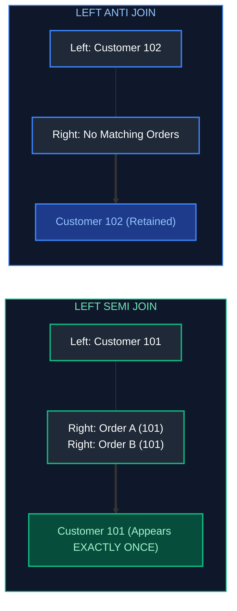

#### Code Example
```sql
-- Production Semi-Join: Find high-value customers who placed orders in 2024
-- Preserves customer uniqueness without triggering row fan-out

-- Databricks / Spark SQL syntax
SELECT 
    c.customer_id,                                           -- Unique customer key
    c.customer_name,                                         -- Customer name
    c.tier                                                   -- Account tier
FROM crm.customers AS c
LEFT SEMI JOIN sales.orders AS o                             -- Preserves left side strictly; discards right columns
    ON c.customer_id = o.customer_id                         -- Join key equality
   AND o.order_date >= '2024-01-01';                         -- Right-side filter condition

-- ANSI SQL equivalent (PostgreSQL, Snowflake, BigQuery) using EXISTS
SELECT 
    c.customer_id,                                           -- Unique customer key
    c.customer_name,                                         -- Customer name
    c.tier                                                   -- Account tier
FROM crm.customers AS c
WHERE EXISTS (                                               -- Short-circuits immediately on first match
    SELECT 1 
    FROM sales.orders AS o 
    WHERE o.customer_id = c.customer_id 
      AND o.order_date >= '2024-01-01'
);

-- Production Anti-Join: Detect orphaned accounts that registered but NEVER placed an order
SELECT 
    c.customer_id,                                           -- Unique customer key
    c.customer_name,                                         -- Customer name
    c.signup_date                                            -- Registration timestamp
FROM crm.customers AS c
WHERE NOT EXISTS (                                           -- Immunized against NULL hazards of NOT IN
    SELECT 1 
    FROM sales.orders AS o 
    WHERE o.customer_id = c.customer_id
);
```

#### Key Points & Common Pitfalls
- **Row Multiplication Prevention:** If a customer placed 10,000 orders, an `INNER JOIN` multiplies that customer row 10,000 times, requiring a subsequent expensive `DISTINCT` pass. A `SEMI JOIN` evaluates existence and stops scanning.
- **Immunity to NULLs:** As shown in [01. SQL Fundamentals](01_sql_fundamentals.md#32-is-null-is-not-null--the-not-in-null-trap), `NOT IN` collapses to zero rows if the subquery contains a single `NULL`. `NOT EXISTS` and `LEFT ANTI JOIN` avoid this pitfall.

#### References
- [Databricks Documentation: SEMI JOIN Syntax](https://docs.databricks.com/en/sql/language-manual/sql-ref-syntax-qry-select-join.html)
- [PostgreSQL Documentation: Subquery Expressions - EXISTS](https://www.postgresql.org/docs/current/functions-subquery.html#FUNCTIONS-SUBQUERY-EXISTS)

---

### 1.2 SELF JOIN & Asymmetric Pairing

#### Definition
A `SELF JOIN` joins a table to itself using separate table aliases. It is used to resolve hierarchical parent-child relationships or compare rows within the same dataset.

#### Code Example
```sql
-- Asymmetric self-join: Detect fraud rings where different users share an IP address within 10 minutes
-- Scenario: Find distinct user pairs sharing identical IP logins without generating mirrored duplicates.

SELECT 
    u1.user_id                                     AS user_a_id,             -- Primary user
    u2.user_id                                     AS user_b_id,             -- Colluding user
    u1.ip_address                                  AS shared_ip,             -- Identified common IP
    u1.login_timestamp                             AS user_a_login_time,     -- Login time user A
    u2.login_timestamp                             AS user_b_login_time,     -- Login time user B
    ABS(EXTRACT(EPOCH FROM (u1.login_timestamp - u2.login_timestamp))) AS seconds_apart -- Time gap in seconds
FROM security.user_logins AS u1
INNER JOIN security.user_logins AS u2
    ON u1.ip_address = u2.ip_address                                         -- Same network IP
   AND u1.user_id < u2.user_id                                               -- Asymmetric condition: eliminates self-pairing (a=a) and mirrored pairs (b,a)
   AND u1.login_timestamp BETWEEN u2.login_timestamp - INTERVAL '10 minutes' -- Temporal proximity check
                              AND u2.login_timestamp + INTERVAL '10 minutes';
```

#### Key Points & Common Pitfalls
- **Avoid `!=` in Self Joins:** Using `u1.user_id != u2.user_id` produces redundant mirror rows `(User1, User2)` and `(User2, User1)`. Using strict inequality `u1.user_id < u2.user_id` ensures each pair appears exactly once.

---

### 1.3 Distributed Join Strategies: Broadcast, Shuffle Hash, Sort-Merge

In distributed engines (Apache Spark, Databricks, Snowflake, BigQuery, AWS Athena), large-scale joins fall into three major execution physical operators:

```mermaid
flowchart TD
    subgraph BroadcastStrategy ["1. Broadcast Hash Join (Map-Side)"]
        BDim[("Small Dimension Table<br/>(< 10MB - 100MB)")] -.->|Broadcast Full Copy to All Nodes| N1["Worker 1 (In-Memory Join)"]
        BDim -.->|Broadcast Full Copy to All Nodes| N2["Worker 2 (In-Memory Join)"]
        F1["Fact Partition 1"] --> N1
        F2["Fact Partition 2"] --> N2
        note1["Zero Fact Shuffling across Network!"]
    end

    subgraph ShuffleHashStrategy ["2. Shuffle Hash Join"]
        SF1["Node A: Data Key H(x)"] -->|Network Hash Shuffle| SHW1["Worker Node 1: Join Hash Partition 1"]
        SF2["Node B: Data Key H(x)"] -->|Network Hash Shuffle| SHW1
        note2["High Network I/O; Requires Large In-Memory Hash Table"]
    end

    subgraph SortMergeStrategy ["3. Sort-Merge Join"]
        SM1["Partition A"] --> Sort1["External Sort Key"] --> Merge["Merge Scan Pointers"]
        SM2["Partition B"] --> Sort2["External Sort Key"] --> Merge
        note3["Memory Resilient; Handles Skew & Massive Tables via Disk Spilling"]
    end

    style BroadcastStrategy fill:#0f172a,stroke:#3b82f6,stroke-width:1.5px,color:#93c5fd
    style ShuffleHashStrategy fill:#0f172a,stroke:#f59e0b,stroke-width:1.5px,color:#fde68a
    style SortMergeStrategy fill:#0f172a,stroke:#10b981,stroke-width:1.5px,color:#6ee7b7

    style BDim fill:#1f2937,stroke:#3b82f6,stroke-width:2px,color:#fff
    style N1 fill:#1f2937,stroke:#3b82f6,stroke-width:2px,color:#fff
    style N2 fill:#1f2937,stroke:#3b82f6,stroke-width:2px,color:#fff
    style F1 fill:#1f2937,stroke:#3b82f6,stroke-width:2px,color:#fff
    style F2 fill:#1f2937,stroke:#3b82f6,stroke-width:2px,color:#fff
    style note1 fill:#1e3a8a,stroke:#3b82f6,stroke-width:2px,color:#93c5fd
    style SF1 fill:#1f2937,stroke:#f59e0b,stroke-width:2px,color:#fff
    style SHW1 fill:#1f2937,stroke:#f59e0b,stroke-width:2px,color:#fff
    style SF2 fill:#1f2937,stroke:#f59e0b,stroke-width:2px,color:#fff
    style note2 fill:#78350f,stroke:#f59e0b,stroke-width:2px,color:#fde68a
    style SM1 fill:#1f2937,stroke:#10b981,stroke-width:2px,color:#fff
    style Sort1 fill:#1f2937,stroke:#10b981,stroke-width:2px,color:#fff
    style Merge fill:#1f2937,stroke:#10b981,stroke-width:2px,color:#fff
    style SM2 fill:#1f2937,stroke:#10b981,stroke-width:2px,color:#fff
    style Sort2 fill:#1f2937,stroke:#10b981,stroke-width:2px,color:#fff
    style note3 fill:#064e3b,stroke:#10b981,stroke-width:2px,color:#a7f3d0
```

#### Comparison of Distributed Join Operators
| Strategy | Pre-conditions | Advantages | Disadvantages / Failure Modes |
| :--- | :--- | :--- | :--- |
| **Broadcast Hash Join (BHJ)** | One table is small enough to fit in driver & executor memory | Zero network shuffle of the large table; lowest latency | Driver `OutOfMemoryError` if broadcasted table exceeds memory |
| **Shuffle Hash Join (SHJ)** | Both tables large; keys distributed uniformly | Fast when hash table fits in memory partition | Fails with OOM if a partition spills or key is heavily skewed |
| **Sort-Merge Join (SMJ)** | Default for massive distributed joins | Robust against memory pressure; can spill gracefully to disk | High CPU & I/O overhead due to sorting both sides |

#### Code Example
```sql
-- Distributed Spark SQL / Databricks Broadcast Join Hint
-- Forces the optimizer to broadcast dim_tax_codes across all executor nodes

SELECT /*+ BROADCAST(t) */
    f.transaction_id,                                        -- Fact column: Transaction key
    f.account_id,                                            -- Fact column: Account identifier
    f.gross_amount,                                          -- Fact column: Raw monetary measure
    t.tax_rate,                                              -- Dimension column: Tax percentage
    f.gross_amount * t.tax_rate AS calculated_tax            -- Calculated metric
FROM data_lake.fact_billion_transactions AS f
INNER JOIN data_lake.dim_tax_codes AS t 
    ON f.tax_jurisdiction_code = t.jurisdiction_code;       -- Equi-join key
```

> [!NOTE]
> For PySpark configurations, memory tuning, and shuffle partition sizing (`spark.sql.shuffle.partitions`), see [08. Apache Spark & PySpark](08_apache_spark_pyspark.md). For physical database engine join algorithms (Hash Join, Merge Join, Nested Loop), see [04. Database Internals & Performance](04_database_internals_and_performance.md#39-join-optimization).

---

### 1.4 Join Order & Cost-Based Optimizer (CBO) Execution Trees

#### Definition
SQL is purely declarative; the syntactic order of tables in `FROM` and `JOIN` clauses is parsed by the engine into an abstract syntax tree and optimized by the **Cost-Based Optimizer (CBO)**. The CBO uses table cardinality statistics, histograms, and selectivity estimates to build an execution tree.

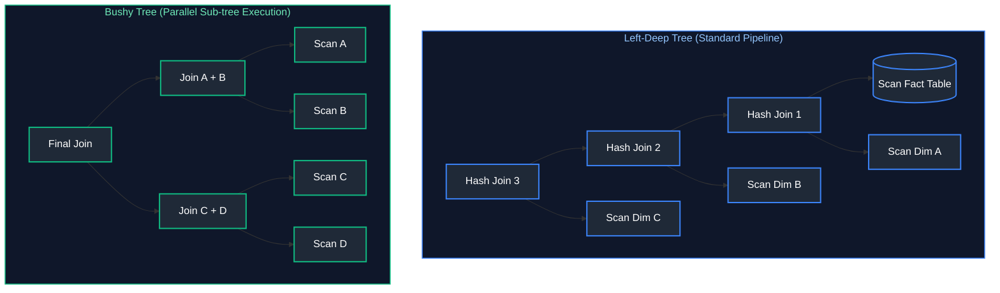

#### Stale Statistics Danger
If statistics (`ANALYZE TABLE`) are stale, the optimizer may believe a table has 500 rows when it actually contains 500,000,000 rows. It will erroneously choose a Broadcast Nested Loop or In-Memory Hash Join, triggering cluster memory exhaustion and job failure.

---

### 1.5 Join Cardinality, Skew & Fan-Out Prevention (Pre-Aggregation & Salting)

#### The Metric Fan-Out Problem
When joining a parent table (e.g., `orders`) to a child table (e.g., `order_items`) where the child has multiple records per order, the parent records replicate once per child row. If a query aggregates amounts from the parent table directly on the joined output, **metrics are multiplied (fanned out)**.

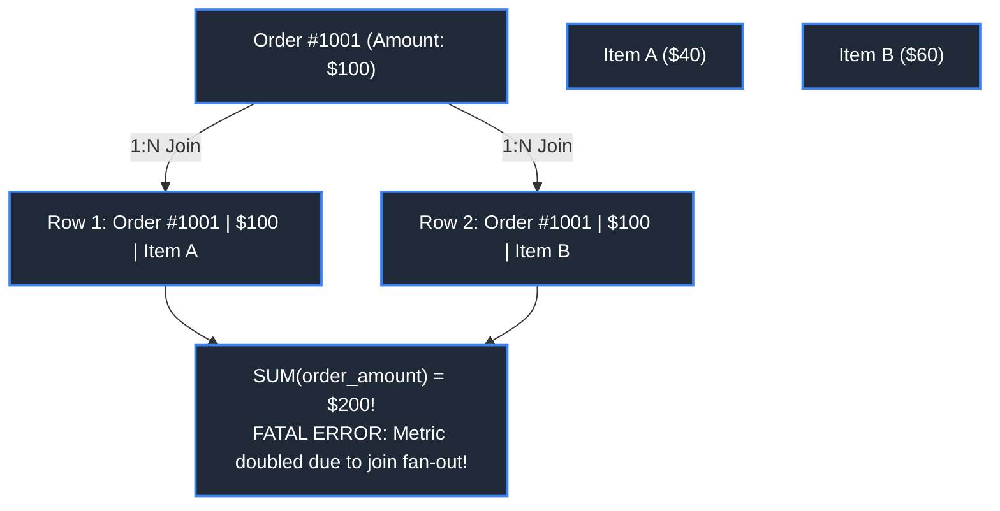

#### Production Solution 1: Pre-Aggregation Pattern
Always pre-aggregate child tables to the grain of the parent key *before* executing the join:

```sql
-- Solution: Pre-aggregate order_items in a CTE to maintain 1:1 join cardinality
WITH aggregated_order_items AS (
    SELECT 
        order_id,                                            -- Grouping grain matches parent table PK
        COUNT(item_id)             AS total_item_count,      -- Metric 1: child row count
        SUM(item_price * quantity) AS total_items_value      -- Metric 2: child calculated revenue
    FROM sales.order_items
    GROUP BY order_id                                        -- Guarantees uniqueness of order_id in CTE output
)
SELECT 
    o.order_id,                                              -- Primary key of parent
    o.order_amount                                 AS recorded_order_total, -- Exact uncorrupted parent metric
    COALESCE(i.total_item_count, 0)                AS total_items_count,    -- Correct aggregated child measure
    COALESCE(i.total_items_value, 0.00)            AS line_items_subtotal   -- Correct aggregated child measure
FROM sales.orders AS o
LEFT JOIN aggregated_order_items AS i 
    ON o.order_id = i.order_id;                              -- Guaranteed 1:1 match -> Zero fan-out!
```

#### Production Solution 2: Salting Technique for Skewed Joins
When a join key has extreme data skew (e.g., 90% of rows have `customer_id = 0` or `'GUEST'`), the worker handling that hash key gets overloaded (straggler task). **Salting** breaks the skewed key across multiple worker buckets:

```sql
-- Step 1: Add a random salt (e.g. 0 to 3) to the skewed fact table
-- Step 2: Replicate the lookup dimension table 4x with matching salts
WITH salted_fact AS (
    SELECT 
        transaction_id,
        customer_id,
        amount,
        -- Add salt between 0 and 3 to distribute key 'GUEST' across 4 partitions
        FLOOR(RAND() * 4) AS salt
    FROM telemetry.clickstream_events
),
replicated_dim AS (
    SELECT 
        c.customer_id,
        c.customer_name,
        s.salt
    FROM crm.customers AS c
    -- Cross join small array [0, 1, 2, 3] to replicate dimension rows 4 times
    CROSS JOIN (SELECT EXPLODE(ARRAY(0, 1, 2, 3)) AS salt) AS s
)
SELECT 
    f.transaction_id,
    f.amount,
    d.customer_name
FROM salted_fact AS f
INNER JOIN replicated_dim AS d 
    ON f.customer_id = d.customer_id 
   AND f.salt = d.salt;                                      -- Joins on composite key, eliminating data skew!
```

---

### 1.6 Non-Equi Joins & Temporal / SCD2 Range Matching

In dimensional data warehouses, dimension attributes change over time (Slowly Changing Dimensions Type 2 - SCD2). Fact records must join to the dimension record that was active **at the exact instant the transaction occurred**.

```sql
-- Point-in-time lookup matching transaction timestamps against SCD2 validity windows
SELECT 
    t.transaction_id,                                        -- Fact primary key
    t.transaction_timestamp,                                 -- Exact event point in time
    t.transaction_amount,                                    -- Measure
    c.customer_key                                 AS dim_surrogate_key,    -- Active SCD2 surrogate key
    c.customer_id                                  AS business_id,          -- Natural / business key
    c.credit_rating                                AS historical_rating,    -- State of customer at transaction time
    c.assigned_broker                              AS historical_broker     -- State of customer at transaction time
FROM warehouse.fact_financial_transactions AS t
INNER JOIN warehouse.dim_customer_scd2 AS c 
    ON t.customer_id = c.customer_id                         -- Equi-join on natural business key
   AND t.transaction_timestamp >= c.effective_start_date     -- Non-equi lower boundary: event at or after effective date
   AND t.transaction_timestamp <  c.effective_end_date;      -- Non-equi upper boundary: event strictly before expiration date
```

> [!NOTE]
> For SCD Type 1 vs. Type 2 dimensional modeling, surrogate key design, and Kimball bus architecture, see [06. Data Architecture & Modeling](06_data_architecture_and_modeling.md).

---

# 2. Advanced Subqueries, CTEs & Hierarchical Recursion

---

### 2.1 Correlated Subqueries & Query Decorrelation (LATERAL / CROSS APPLY)

#### Definition
A correlated subquery references columns from the outer query. While older engines executed correlated subqueries as nested loops ($O(N \times M)$), modern engines decorrelate them into hash joins where possible.

#### LATERAL Joins (CROSS APPLY)
A `LATERAL` join (or `CROSS APPLY` in SQL Server) allows an inline subquery in the `FROM` clause to reference columns provided by previous tables in the same `FROM` clause:

```sql
-- LATERAL Join: Find the top 2 most expensive products purchased by EACH customer
-- Evaluates the subquery dynamically for each customer record

SELECT 
    c.customer_id,                                           -- Outer table: Customer key
    c.customer_name,                                         -- Outer table: Customer name
    top_items.product_name,                                  -- Lateral subquery column
    top_items.unit_price                                     -- Lateral subquery column
FROM crm.customers AS c
CROSS JOIN LATERAL (                                         -- Lateral subquery can read c.customer_id
    SELECT 
        oi.product_name,
        oi.unit_price
    FROM sales.orders AS o
    INNER JOIN sales.order_items AS oi ON o.order_id = oi.order_id
    WHERE o.customer_id = c.customer_id                      -- Correlation link to outer table
    ORDER BY oi.unit_price DESC                              -- Order within customer's purchases
    LIMIT 2                                                  -- Pick top 2 per customer
) AS top_items;
```

---

### 2.2 Common Table Expressions (CTEs) & Materialization Semantics

Common Table Expressions (`WITH` queries) modularize complex pipelines into sequential, readable steps.

#### Inlining vs. Materialization
- **Inlined CTE (Default in modern PostgreSQL/Snowflake):** The query planner merges the CTE definition into the outer query, enabling predicate pushdown.
- **Materialized CTE (`AS MATERIALIZED`):** Forces the engine to compute and store the CTE once in memory/disk cache, preventing redundant scans when the CTE is referenced multiple times.

```sql
-- Multi-reference query using explicit MATERIALIZED CTE
WITH high_velocity_merchants AS MATERIALIZED (               -- Cached once in memory; prevents multiple fact scans
    SELECT 
        merchant_id,
        SUM(amount)      AS q1_volume,
        COUNT(order_id)  AS q1_transactions
    FROM billing.transactions
    WHERE transaction_date >= '2024-01-01' AND transaction_date < '2024-04-01'
    GROUP BY merchant_id
    HAVING SUM(amount) >= 1000000.00                         -- Filter to top merchants
)
-- First reference: Merchants in high-risk categories
SELECT m.merchant_id, 'HIGH_RISK_SECTOR' AS audit_bucket
FROM high_velocity_merchants AS m
INNER JOIN compliance.monitored_sectors AS s ON m.merchant_id = s.merchant_id

UNION ALL

-- Second reference: Merchants with high chargeback rates
SELECT m.merchant_id, 'CHARGEBACK_ANOMALY' AS audit_bucket
FROM high_velocity_merchants AS m
INNER JOIN compliance.chargebacks AS cb ON m.merchant_id = cb.merchant_id
WHERE cb.dispute_count > 50;
```

---

### 2.3 Recursive CTEs & Graph / Hierarchy Traversal

#### Definition
A Recursive CTE references its own result set iteratively. It contains:
1. **Anchor Member:** Initial query generating the root nodes (base cases).
2. **Recursive Member:** Query joining against the CTE itself, executing until zero new rows are generated.
3. **Termination Guard:** A filter limiting traversal depth to prevent infinite loops from circular references.

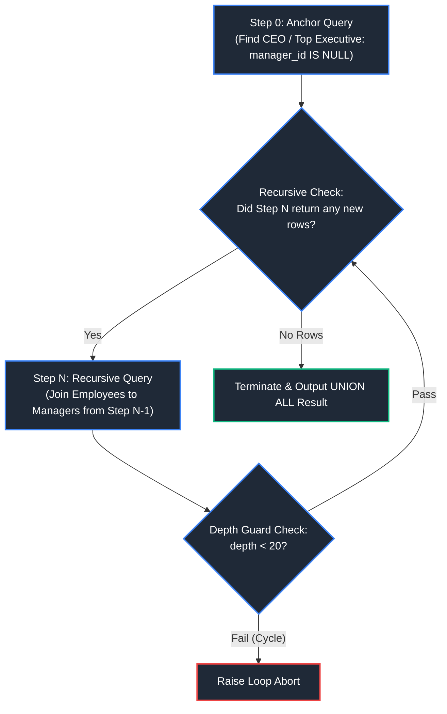

#### Code Example
```sql
-- Comprehensive Recursive CTE: Management hierarchy tree with path construction and cycle detection
WITH RECURSIVE employee_hierarchy AS (
    -- 1. Anchor Member: Identify top-level executives (nodes with no managers)
    SELECT 
        employee_id,                                         -- Employee primary key
        manager_id,                                          -- Parent pointer (NULL for CEO)
        full_name,                                           -- Employee name
        department,                                          -- Business department
        1                               AS hierarchy_level,  -- Base hierarchy depth (Level 1)
        CAST(full_name AS VARCHAR(1000)) AS reporting_path,   -- Audit breadcrumb path
        ARRAY[employee_id]              AS visited_nodes     -- Cycle detection array (PostgreSQL syntax)
    FROM hr.employees
    WHERE manager_id IS NULL                                 -- Identifies root of organization tree
    
    UNION ALL
    
    -- 2. Recursive Member: Iteratively join reporting employees to their managers
    SELECT 
        e.employee_id,                                       -- Current employee key
        e.manager_id,                                        -- Manager key (matches parent employee_id)
        e.full_name,                                         -- Current employee name
        e.department,                                        -- Current employee department
        eh.hierarchy_level + 1          AS hierarchy_level,  -- Increment depth level
        CAST(eh.reporting_path || ' -> ' || e.full_name AS VARCHAR(1000)) AS reporting_path, -- Append to path
        eh.visited_nodes || e.employee_id AS visited_nodes   -- Append ID to history array
    FROM hr.employees AS e
    INNER JOIN employee_hierarchy AS eh 
        ON e.manager_id = eh.employee_id                     -- Join condition: child manager matches parent ID
    WHERE NOT (e.employee_id = ANY(eh.visited_nodes))        -- Cycle prevention: aborts if node was already visited
      AND eh.hierarchy_level < 20                            -- Hard recursion depth limiter
)
SELECT 
    employee_id,
    manager_id,
    full_name,
    department,
    hierarchy_level,
    reporting_path
FROM employee_hierarchy
ORDER BY hierarchy_level ASC, employee_id ASC;
```

---

### 2.4 EXISTS vs. NOT EXISTS vs. IN / NOT IN Deep-Dive

#### Execution Mechanics
- `EXISTS` executes an index semi-join and **short-circuits immediately** upon finding the first matching record. It ignores column projection (`SELECT 1` vs `SELECT *` produces identical plans).
- `IN` constructs an in-memory hash set of all inner subquery records. If the inner result set is large, `IN` consumes substantial memory.
- `NOT IN` fails completely when the subquery returns any `NULL` value. `NOT EXISTS` is safe and recommended in production pipelines.

---

# 3. Window Functions & Analytical SQL

Window functions execute calculations across a set of table rows related to the current row, **without collapsing individual rows into aggregate summaries**.

---

### 3.1 Window Functions Architecture & Syntax

```sql
FUNCTION(...) OVER (
    [PARTITION BY partition_col1, partition_col2]
    [ORDER BY sort_col1 [ASC|DESC]]
    [ROWS|RANGE|GROUPS BETWEEN frame_start AND frame_end]
)
```

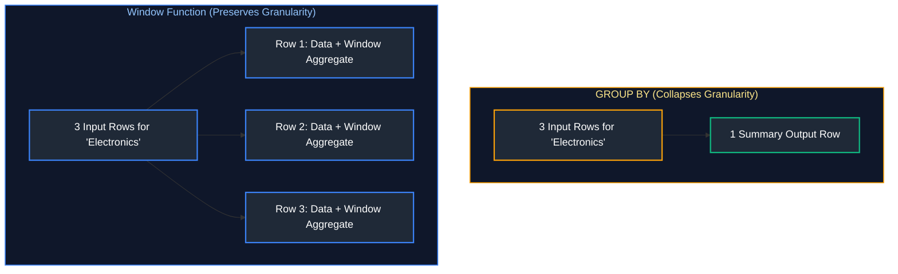

---

### 3.2 Window Framing Deep-Dive: ROWS vs. RANGE vs. GROUPS

The frame specification defines the sliding boundary of rows evaluated relative to the current row.

```
Window Frame Types:
- ROWS:   Operates on physical row counts (ignores value ties).
- RANGE:  Operates on logical value ranges in the ORDER BY column (includes all tied values).
- GROUPS: Operates on groups of tied values.
```

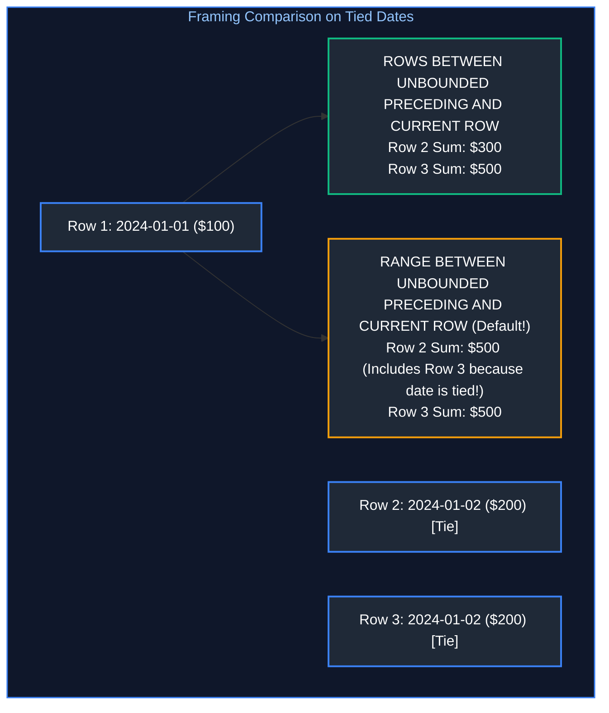

> [!WARNING]
> **The Implicit RANGE Default Trap:**
> Specifying `ORDER BY` without a frame clause activates the ANSI default:
> `RANGE BETWEEN UNBOUNDED PRECEDING AND CURRENT ROW`
> This causes silent calculation bugs when duplicate values exist in the sort key and degrades performance. **Always explicitly write `ROWS BETWEEN ...`**.

---

### 3.3 Ranking Functions: ROW_NUMBER, RANK, DENSE_RANK, NTILE

```sql
-- Ranking functions comparison across identical scores
SELECT 
    student_id,
    department,
    score,
    -- ROW_NUMBER: Unique sequential integer; breaks ties arbitrarily
    ROW_NUMBER() OVER (PARTITION BY department ORDER BY score DESC) AS row_num,
    -- RANK: Assigns identical rank to ties; skips subsequent ranks (1, 2, 2, 4)
    RANK()       OVER (PARTITION BY department ORDER BY score DESC) AS rnk,
    -- DENSE_RANK: Assigns identical rank to ties; DOES NOT skip ranks (1, 2, 2, 3)
    DENSE_RANK() OVER (PARTITION BY department ORDER BY score DESC) AS dense_rnk,
    -- NTILE(4): Distributes rows into 4 equal quartiles (1, 2, 3, 4)
    NTILE(4)     OVER (PARTITION BY department ORDER BY score DESC) AS quartile
FROM academics.exam_results;
```

#### Ranking Functions Comparison Matrix
| Student Score | `ROW_NUMBER()` | `RANK()` | `DENSE_RANK()` | `NTILE(2)` |
| :---: | :---: | :---: | :---: | :---: |
| 100 | 1 | 1 | 1 | 1 |
| 95 | 2 | 2 | 2 | 1 |
| 95 (Tie) | 3 | 2 | 2 | 2 |
| 90 | 4 | 4 (Skipped 3) | 3 (No Skip) | 2 |

---

### 3.4 Value Navigation Functions: LEAD, LAG, FIRST_VALUE, LAST_VALUE, NTH_VALUE

```sql
-- Time-series navigation: Compute period-over-period growth and cohort delta
SELECT 
    ticker_symbol,
    trade_date,
    close_price,
    
    -- LAG: Access previous trading day's price (offset 1, fallback to close_price)
    LAG(close_price, 1, close_price) OVER (
        PARTITION BY ticker_symbol ORDER BY trade_date ASC
    ) AS prior_day_price,
    
    -- Compute day-over-day price change
    close_price - LAG(close_price, 1, close_price) OVER (
        PARTITION BY ticker_symbol ORDER BY trade_date ASC
    ) AS daily_price_delta,
    
    -- LEAD: Access next day's price
    LEAD(close_price, 1) OVER (
        PARTITION BY ticker_symbol ORDER BY trade_date ASC
    ) AS next_day_price,
    
    -- FIRST_VALUE: Initial trading price of the stock in this dataset
    FIRST_VALUE(close_price) OVER (
        PARTITION BY ticker_symbol 
        ORDER BY trade_date ASC
        ROWS BETWEEN UNBOUNDED PRECEDING AND CURRENT ROW
    ) AS year_opening_price,
    
    -- LAST_VALUE: Most recent price (requires explicit unbounded following frame!)
    LAST_VALUE(close_price) OVER (
        PARTITION BY ticker_symbol 
        ORDER BY trade_date ASC
        ROWS BETWEEN CURRENT ROW AND UNBOUNDED FOLLOWING
    ) AS year_closing_price
FROM market.stock_daily;
```

---

### 3.5 Cumulative Patterns: Running Totals & Moving Averages

```sql
-- Chronological cumulative running balance and 7-day moving average
SELECT 
    account_id,
    transaction_date,
    transaction_amount,
    
    -- Running Total: Cumulative sum from start of account history to current row
    SUM(transaction_amount) OVER (
        PARTITION BY account_id 
        ORDER BY transaction_date ASC
        ROWS BETWEEN UNBOUNDED PRECEDING AND CURRENT ROW
    ) AS running_balance,
    
    -- 7-Day Physical Moving Average: Current day + prior 6 records
    ROUND(AVG(transaction_amount) OVER (
        PARTITION BY account_id 
        ORDER BY transaction_date ASC
        ROWS BETWEEN 6 PRECEDING AND CURRENT ROW
    ), 2) AS moving_avg_7_period
FROM banking.account_ledger;
```

---

### 3.6 Advanced Analytical Patterns: Top-N, Deduplication, Sessionization, Gaps and Islands

#### Pattern 1: Deduplication via Window Functions
```sql
-- Gold Layer Deduplication: Retain only the latest state of each record
WITH ranked_events AS (
    SELECT 
        event_id,
        user_id,
        event_payload,
        updated_at,
        -- Assign rank 1 to the most recent record per business key
        ROW_NUMBER() OVER (
            PARTITION BY event_id 
            ORDER BY updated_at DESC, ingestion_timestamp DESC
        ) AS dedup_rank
    FROM bronze.raw_events
)
SELECT event_id, user_id, event_payload, updated_at
FROM ranked_events
WHERE dedup_rank = 1;                                        -- Prunes duplicate older versions
```

#### Pattern 2: The Gaps and Islands Problem
**The Goal:** Identify contiguous islands of consecutive calendar dates where a user performed daily logins, and detect where gaps occurred.

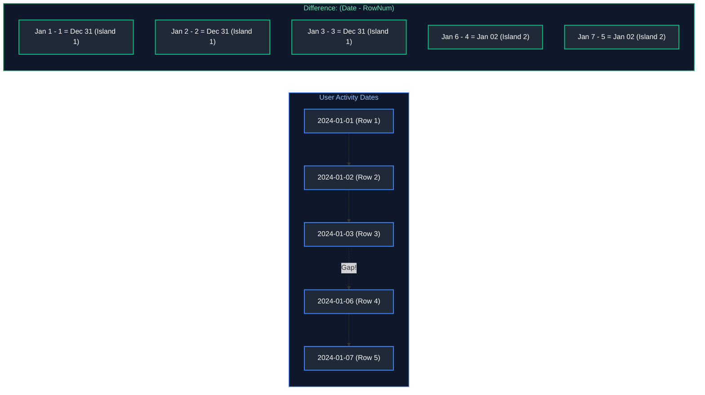

```sql
-- Production Gaps and Islands Implementation: Difference-of-Ranks Technique
WITH distinct_user_logins AS (
    SELECT DISTINCT 
        user_id,
        CAST(login_timestamp AS DATE) AS login_date
    FROM telemetry.user_logins
),
numbered_logins AS (
    SELECT 
        user_id,
        login_date,
        -- Assign sequential row index per user
        ROW_NUMBER() OVER (PARTITION BY user_id ORDER BY login_date ASC) AS seq_num,
        -- Subtract seq_num days from login_date.
        -- For contiguous dates, the difference remains CONSTANT (creating the island identifier).
        login_date - CAST(ROW_NUMBER() OVER (PARTITION BY user_id ORDER BY login_date ASC) || ' days' AS INTERVAL) AS island_group
    FROM distinct_user_logins
)
SELECT 
    user_id,
    MIN(login_date)                                          AS streak_start_date,
    MAX(login_date)                                          AS streak_end_date,
    COUNT(*)                                                 AS consecutive_days_streak
FROM numbered_logins
GROUP BY user_id, island_group
HAVING COUNT(*) >= 3                                         -- Filter for streaks of 3 or more days
ORDER BY user_id, streak_start_date;
```

#### Pattern 3: Sessionization Pattern (Inactivity Gap Threshold)
```sql
-- Group clickstream events into sessions based on a 30-minute inactivity threshold
WITH lagged_events AS (
    SELECT 
        user_id,
        event_timestamp,
        -- Check time since previous user event in seconds
        EXTRACT(EPOCH FROM (event_timestamp - LAG(event_timestamp) OVER (
            PARTITION BY user_id ORDER BY event_timestamp ASC
        ))) AS seconds_since_last_event
    FROM web.clickstream
),
session_starts AS (
    SELECT 
        user_id,
        event_timestamp,
        -- Flag new session if gap > 1800 seconds (30 mins) or if it's the user's first event
        CASE 
            WHEN seconds_since_last_event > 1800 OR seconds_since_last_event IS NULL THEN 1 
            ELSE 0 
        END AS is_new_session
    FROM lagged_events
),
sessionized AS (
    SELECT 
        user_id,
        event_timestamp,
        -- Cumulative sum of session start flags generates a unique session ID
        SUM(is_new_session) OVER (
            PARTITION BY user_id ORDER BY event_timestamp ASC
            ROWS BETWEEN UNBOUNDED PRECEDING AND CURRENT ROW
        ) AS session_id
    FROM session_starts
)
SELECT user_id, session_id, MIN(event_timestamp) AS session_start, MAX(event_timestamp) AS session_end
FROM sessionized
GROUP BY user_id, session_id;
```

---

### 3.7 The QUALIFY Clause

Modern cloud data warehouses (Snowflake, BigQuery, Databricks) support the `QUALIFY` clause. `QUALIFY` filters the results of window functions **directly**, eliminating the boilerplate of wrapping queries in CTEs or subqueries.

```sql
-- Snowflake / BigQuery / Databricks QUALIFY pattern
-- Retrieve only the top-earning employee per department in a single query block

SELECT 
    employee_id,
    department_id,
    first_name,
    salary,
    DENSE_RANK() OVER (PARTITION BY department_id ORDER BY salary DESC) AS salary_rank
FROM hr.employees
QUALIFY salary_rank = 1;                                     -- Directly filters window results!
```

---

# 4. Advanced Grouping, Aggregation & Pivoting

---

### 4.1 Multi-Dimensional Grouping: GROUPING SETS, ROLLUP, CUBE

Standard `GROUP BY` aggregates at a single dimensional grain. Multi-dimensional extensions compute multiple aggregation levels in a single query pass.

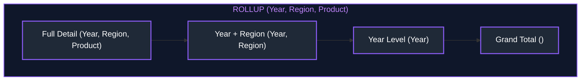

```sql
-- Multi-level aggregation using GROUPING SETS, ROLLUP, and CUBE

-- 1. ROLLUP: Generates hierarchical subtotals and grand totals
SELECT 
    calendar_year,
    region,
    product_category,
    SUM(revenue) AS total_revenue,
    GROUPING(calendar_year)    AS is_year_subtotal,         -- Returns 1 if column is aggregated in this row
    GROUPING(region)           AS is_region_subtotal,
    GROUPING(product_category) AS is_category_subtotal
FROM analytics.fact_sales
GROUP BY ROLLUP (calendar_year, region, product_category);

-- 2. CUBE: Generates all $2^N$ possible permutations of dimensions
SELECT 
    region,
    channel,
    SUM(revenue) AS total_revenue
FROM analytics.fact_sales
GROUP BY CUBE (region, channel);

-- 3. Explicit GROUPING SETS: Selectively computes specific target grains
SELECT 
    region,
    product_category,
    calendar_year,
    SUM(revenue) AS total_revenue
FROM analytics.fact_sales
GROUP BY GROUPING SETS (
    (region, product_category),                             -- Grain A: Region by Category
    (calendar_year),                                        -- Grain B: Annual Total
    ()                                                      -- Grain C: Overall Grand Total
);
```

---

### 4.2 PIVOT and UNPIVOT

- **PIVOT:** Rotates row-level values into distinct columns.
- **UNPIVOT:** Melts column headers into row-level values (normalizing denormalized sheets).

```sql
-- 1. PIVOT: Rotate quarterly row data into columnar summary (Snowflake / Databricks SQL)
SELECT *
FROM (
    SELECT store_id, sale_quarter, revenue 
    FROM sales.quarterly_store_performance
)
PIVOT (
    SUM(revenue) 
    FOR sale_quarter IN ('Q1', 'Q2', 'Q3', 'Q4')             -- Pivot values to columns
) AS p (store_id, q1_revenue, q2_revenue, q3_revenue, q4_revenue);

-- 2. UNPIVOT: Normalize horizontal monthly columns into a narrow relational table
SELECT 
    store_id,
    month_name,
    monthly_sales
FROM sales.store_monthly_matrix
UNPIVOT (
    monthly_sales FOR month_name IN (jan_sales, feb_sales, mar_sales, apr_sales)
);
```

---

# 5. Advanced Data Modification, Concurrency & Transactions

---

### 5.1 MERGE / UPSERT & Change Data Capture (CDC) Patterns

The `MERGE` statement synchronizes a target table with an incoming source stream in a single atomic transaction.

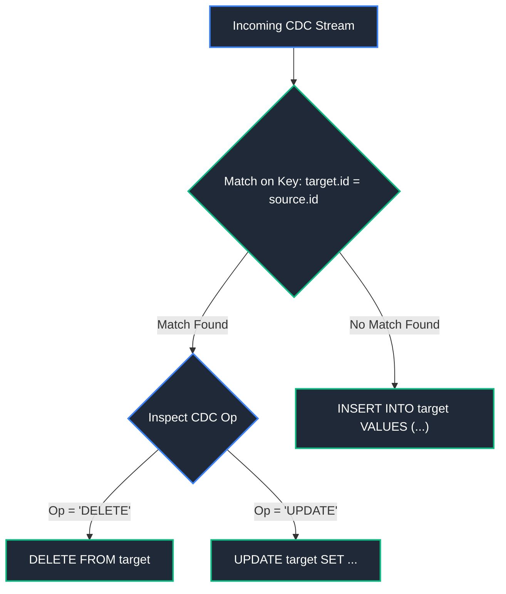

```sql
-- Production MERGE: Synchronize dimension table with upstream CDC stream
-- Handles inserts, updates, soft deletes, and source deletions

MERGE INTO warehouse.dim_customers AS target
USING staging.customer_cdc_stream AS source
    ON target.customer_id = source.customer_id               -- Natural business key match
WHEN MATCHED AND source.cdc_operation = 'D' THEN
    UPDATE SET 
        target.is_active = FALSE,
        target.deleted_at = source.event_timestamp           -- Soft delete handling
WHEN MATCHED AND source.cdc_operation = 'U' THEN
    UPDATE SET 
        target.first_name        = source.first_name,
        target.last_name         = source.last_name,
        target.email             = source.email,
        target.last_updated_at   = source.event_timestamp
WHEN NOT MATCHED AND source.cdc_operation IN ('I', 'U') THEN
    INSERT (customer_id, first_name, last_name, email, is_active, created_at, last_updated_at)
    VALUES (source.customer_id, source.first_name, source.last_name, source.email, TRUE, source.event_timestamp, source.event_timestamp);
```

> [!CAUTION]
> **Non-Unique Source Join Keys Failure:**
> If the source dataset contains duplicate rows for the same `customer_id`, the engine aborts the transaction with an error: `target row was matched by multiple source rows`. Always deduplicate source staging feeds using window functions (`ROW_NUMBER()`) prior to running `MERGE`.

> [!NOTE]
> For applying CDC feeds to Delta Lake tables with Change Data Feed (CDF), see [09. Databricks & Delta Lake](09_databricks_and_delta_lake.md). For end-to-end CDC architectures (Debezium, Kafka), see [10. Data Pipeline Design & Ingestion](10_data_pipeline_design_and_ingestion.md).

---

### 5.2 Transaction Control & ACID Mechanics

A transaction groups multiple operations into an indivisible unit governed by **ACID** properties (Atomicity, Consistency, Isolation, Durability).

```sql
-- Multi-statement banking transfer with Savepoint error recovery
BEGIN TRANSACTION;

-- Step 1: Debit sender balance (with integrity check)
UPDATE banking.accounts
SET balance = balance - 1000.00
WHERE account_id = 'ACC_SENDER' AND balance >= 1000.00;

-- Set intermediate savepoint prior to non-critical auxiliary steps
SAVEPOINT pre_notification_step;

-- Step 2: Credit recipient balance
UPDATE banking.accounts
SET balance = balance + 1000.00
WHERE account_id = 'ACC_RECIPIENT';

-- Step 3: Insert immutable audit ledger record
INSERT INTO banking.transfer_audit (sender_id, recipient_id, amount, status)
VALUES ('ACC_SENDER', 'ACC_RECIPIENT', 1000.00, 'EXECUTED');

-- Finalize and permanently persist all operations to Write-Ahead Log (WAL)
COMMIT;

-- Rollback scenario:
-- In case of failure: ROLLBACK TO SAVEPOINT pre_notification_step; OR ROLLBACK;
```

---

### 5.3 ANSI SQL Isolation Levels & Concurrency Anomalies

Concurrent database transactions are vulnerable to three primary read anomalies and write contention:
1. **Dirty Read:** Transaction reads uncommitted modifications made by another concurrent transaction.
2. **Non-Repeatable Read:** Transaction re-reads the same row and discovers that another transaction committed changes to its values.
3. **Phantom Read:** Transaction re-executes a range query and discovers new rows inserted by another committed transaction.
4. **Write Skew:** Two transactions concurrently read overlapping data, satisfy constraints independently, and write conflicting updates.

#### ANSI Isolation Level Support Matrix
| Isolation Level | Dirty Read | Non-Repeatable Read | Phantom Read | Concurrency Level |
| :--- | :---: | :---: | :---: | :---: |
| **Read Uncommitted** | Possible | Possible | Possible | Maximum |
| **Read Committed** (Default in PostgreSQL) | **Prevented** | Possible | Possible | High |
| **Repeatable Read** (Default in MySQL) | **Prevented** | **Prevented** | Possible (Snapshot prevents in PG) | Medium |
| **Serializable** | **Prevented** | **Prevented** | **Prevented** | Lowest (Pessimistic locking / Aborts) |

```sql
-- Setting explicit isolation level for critical pipeline execution
SET TRANSACTION ISOLATION LEVEL SERIALIZABLE;
BEGIN TRANSACTION;
    -- Serializable read and write operations
    SELECT SUM(balance) FROM banking.vault_reserves;
COMMIT;
```

> [!NOTE]
> For physical lock implementations, Multi-Version Concurrency Control (MVCC), and Write-Ahead Logging (WAL) internals, see [04. Database Internals & Performance](04_database_internals_and_performance.md#4-transactions--concurrency-control).

---

# 6. Advanced Database Programmability & Objects

---

### 6.1 Materialized Views & Query Rewrite Engines

Unlike standard views that execute their query definition dynamically, a **Materialized View** precomputes the query result and persists it to physical disk.

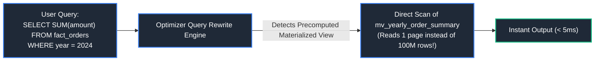

```sql
-- PostgreSQL syntax for materialized views
CREATE MATERIALIZED VIEW reporting.mv_daily_sales_by_store
TABLESPACE fast_ssd_storage
AS
SELECT 
    store_id,
    order_date,
    COUNT(order_id)       AS total_orders,
    SUM(order_amount)     AS gross_revenue
FROM sales.orders
GROUP BY store_id, order_date
WITH DATA;                                                   -- Populate immediately upon creation

-- Create an index directly on the materialized view
CREATE UNIQUE INDEX idx_mv_store_date ON reporting.mv_daily_sales_by_store (store_id, order_date);

-- Fast non-blocking incremental/concurrent refresh
REFRESH MATERIALIZED VIEW CONCURRENTLY reporting.mv_daily_sales_by_store;
```

---

### 6.2 Stored Procedures & Transactional Orchestration

Stored procedures combine SQL with procedural constructs (loops, conditionals, exception handling) and support explicit transaction control (`COMMIT` and `ROLLBACK`).

```sql
-- PL/pgSQL Stored Procedure managing partition archiving and automated maintenance
CREATE OR REPLACE PROCEDURE maintenance.sp_archive_monthly_partitions(
    IN retention_months INT,
    OUT partitions_archived INT
)
LANGUAGE plpgsql
AS $$
DECLARE
    partition_record RECORD;
    cutoff_date DATE;
BEGIN
    partitions_archived := 0;
    cutoff_date := CURRENT_DATE - (retention_months || ' months')::INTERVAL;

    -- Iterate dynamically over old partition tables
    FOR partition_record IN 
        SELECT table_name 
        FROM information_schema.tables 
        WHERE table_schema = 'audit_partitions'
          AND table_name < 'audit_' || TO_CHAR(cutoff_date, 'YYYY_MM')
    LOOP
        -- Dynamic SQL execution
        EXECUTE 'ALTER TABLE audit_partitions.' || quote_ident(partition_record.table_name) || ' SET TABLESPACE cold_archive_storage;';
        partitions_archived := partitions_archived + 1;
        RAISE NOTICE 'Relocated partition % to cold storage.', partition_record.table_name;
    END LOOP;

    -- Commit transaction explicitly within procedure
    COMMIT;
END;
$$;

-- Invocation:
CALL maintenance.sp_archive_monthly_partitions(12, NULL);
```

---

### 6.3 User-Defined Functions (UDFs: Scalar, Table-Valued, Vectorized)

#### Function Volatility Classifications (PostgreSQL / Snowflake)
- `IMMUTABLE`: Given identical arguments, always returns identical results. Can be precomputed and used in index expressions.
- `STABLE`: Result does not change within a single table scan (e.g., depends on `CURRENT_TIMESTAMP`).
- `VOLATILE`: Result changes on every evaluation (e.g., `RANDOM()`, `UUID_GENERATE_V4()`).

```sql
-- 1. High-Performance Deterministic Scalar UDF
CREATE OR REPLACE FUNCTION finance.fn_calculate_compound_growth(
    principal NUMERIC(12, 2),
    annual_rate NUMERIC(5, 4),
    years INT
)
RETURNS NUMERIC(12, 2)
LANGUAGE sql
IMMUTABLE                                                    -- Informs optimizer the function is pure/deterministic
AS $$
    SELECT ROUND(principal * POWER((1.0 + annual_rate), years), 2);
$$;

-- 2. Table-Valued Function (TVF) returning tabular records
CREATE OR REPLACE FUNCTION catalog.fn_get_category_hierarchy(root_cat_id INT)
RETURNS TABLE (category_id INT, category_name VARCHAR(100), depth INT)
LANGUAGE sql
STABLE
AS $$
    WITH RECURSIVE cat_tree AS (
        SELECT category_id, category_name, 1 AS depth
        FROM catalog.categories WHERE category_id = root_cat_id
        UNION ALL
        SELECT c.category_id, c.category_name, ct.depth + 1
        FROM catalog.categories c
        JOIN cat_tree ct ON c.parent_category_id = ct.category_id
    )
    SELECT * FROM cat_tree;
$$;

-- Calling the table-valued function directly in FROM clause
SELECT * FROM catalog.fn_get_category_hierarchy(501);
```

> [!WARNING]
> **Scalar UDF Row-by-Row Bottleneck:**
> Invoking non-inlined scalar UDFs in a `SELECT` across millions of rows prevents vectorized execution and runs row-by-row (RBAR - Row By Agonizing Row). Where possible, write inline SQL expressions or utilize Vectorized Pandas/PySpark UDFs. For Python and PySpark UDFs, see [03. Python for Data Engineering](03_python_for_data_engineering.md) and [08. Apache Spark & PySpark](08_apache_spark_pyspark.md).

---

### 6.4 Temporary Views & Global Virtual Catalogs

Temporary views provide isolated virtual tables within a compute session without persisting schemas to an external metastore.

```sql
-- Apache Spark / Databricks SQL syntax
-- Create session-scoped temporary view from raw bronze storage
CREATE OR REPLACE TEMPORARY VIEW tv_filtered_clicks AS
SELECT 
    user_id,
    page_url,
    event_timestamp
FROM bronze.clickstream_parquet
WHERE event_timestamp >= CURRENT_DATE;

-- Create cluster-scoped Global Temporary View (visible across all sessions on the cluster)
CREATE OR REPLACE GLOBAL TEMPORARY VIEW gtv_reference_lookup AS
SELECT country_code, country_name, currency_symbol
FROM reference.static_countries;

-- Querying global temp view requires the 'global_temp' system database qualifier
SELECT * FROM global_temp.gtv_reference_lookup;
```
