# 02. Advanced SQL

A comprehensive, production-grade guide to advanced relational query design, distributed join algorithms, analytical window functions, hierarchical recursive queries, multi-dimensional aggregations, transaction isolation levels, and database programmability tailored for Data Engineering, Lakehouse architectures, and AI Engineering pipelines.

---

## Architectural Overview: Advanced Query Optimization & Distributed Join Architecture

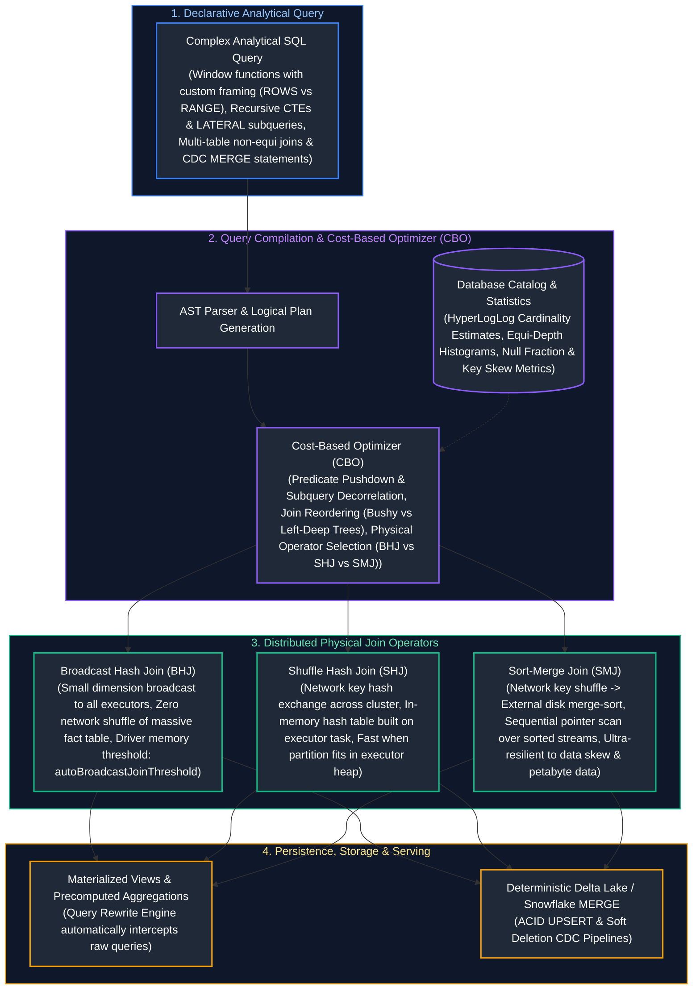

---

## Table of Contents
1. [Advanced Joins & Distributed Execution Mechanics](#1-advanced-joins-distributed-execution-mechanics)
   - [1.1 SEMI JOIN & ANTI JOIN: Mechanics, Null Immunity & Memory Footprint](#11-semi-join-anti-join-mechanics-null-immunity--memory-footprint)
   - [1.2 SELF JOIN & Asymmetric Pairing Patterns](#12-self-join-asymmetric-pairing-patterns)
   - [1.3 Distributed Join Strategies: Broadcast Hash Join (BHJ)](#13-distributed-join-strategies-broadcast-hash-join-bhj)
   - [1.4 Distributed Join Strategies: Shuffle Hash Join (SHJ)](#14-distributed-join-strategies-shuffle-hash-join-shj)
   - [1.5 Distributed Join Strategies: Sort-Merge Join (SMJ)](#15-distributed-join-strategies-sort-merge-join-smj)
   - [1.6 Distributed Join Comparison & Selection Decision Tree](#16-distributed-join-comparison--selection-decision-tree)
   - [1.7 Join Order & Cost-Based Optimizer (CBO) Execution Trees](#17-join-order-cost-based-optimizer-cbo-execution-trees)
   - [1.8 Join Cardinality, Metric Fan-Out & Pre-Aggregation Patterns](#18-join-cardinality-metric-fan-out--pre-aggregation-patterns)
   - [1.9 The Salting Technique for Extreme Data Skew](#19-the-salting-technique-for-extreme-data-skew)
   - [1.10 Non-Equi Joins & Temporal / SCD2 Range Matching](#110-non-equi-joins-temporal-scd2-range-matching)
2. [Advanced Subqueries, CTEs & Hierarchical Recursion](#2-advanced-subqueries-ctes-hierarchical-recursion)
   - [2.1 Correlated Subqueries & Query Decorrelation Mechanics](#21-correlated-subqueries-query-decorrelation-mechanics)
   - [2.2 `LATERAL` Joins & `CROSS APPLY`: The SQL For-Each Loop](#22-lateral-joins--cross-apply-the-sql-for-each-loop)
   - [2.3 Common Table Expressions (CTEs): Inlining vs. Optimization Fences](#23-common-table-expressions-ctes-inlining-vs-optimization-fences)
   - [2.4 Recursive CTEs: Fixed-Point Relational Iteration](#24-recursive-ctes-fixed-point-relational-iteration)
   - [2.5 Hierarchical Tree Traversal with Cycle Detection & Path Building](#25-hierarchical-tree-traversal-with-cycle-detection--path-building)
   - [2.6 Bill of Materials (BOM) Multi-Level Parts Explosion](#26-bill-of-materials-bom-multi-level-parts-explosion)
   - [2.7 `EXISTS` vs. `NOT EXISTS` vs. `IN` / `NOT IN` Deep-Dive](#27-exists-vs-not-exists-vs-in-not-in-deep-dive)
3. [Window Functions & Analytical SQL](#3-window-functions-analytical-sql)
   - [3.1 Window Function Architecture & The 9-Stage SQL Lifecycle](#31-window-function-architecture-the-9-stage-sql-lifecycle)
   - [3.2 Window Framing Deep-Dive: `ROWS` vs. `RANGE` vs. `GROUPS`](#32-window-framing-deep-dive-rows-vs-range-vs-groups)
   - [3.3 The Lethal Implicit `RANGE` Default Trap](#33-the-lethal-implicit-range-default-trap)
   - [3.4 Ranking Functions: `ROW_NUMBER`, `RANK`, `DENSE_RANK`, `NTILE`](#34-ranking-functions-row_number-rank-dense_rank-ntile)
   - [3.5 Value Navigation Functions: `LEAD`, `LAG`, `FIRST_VALUE`, `LAST_VALUE`, `NTH_VALUE`](#35-value-navigation-functions-lead-lag-first_value-last_value-nth_value)
   - [3.6 The `LAST_VALUE()` Unbounded Following Framing Gotcha](#36-the-last_value-unbounded-following-framing-gotcha)
   - [3.7 Cumulative Patterns: Running Totals, Moving Averages & Physical vs. Calendar Windows](#37-cumulative-patterns-running-totals-moving-averages--physical-vs-calendar-windows)
   - [3.8 Advanced Analytical Pattern 1: Deduplication via Window Ranking](#38-advanced-analytical-pattern-1-deduplication-via-window-ranking)
   - [3.9 Advanced Analytical Pattern 2: The Gaps and Islands Problem (Difference-of-Ranks)](#39-advanced-analytical-pattern-2-the-gaps-and-islands-problem-difference-of-ranks)
   - [3.10 Advanced Analytical Pattern 3: Sessionization via Inactivity Thresholds](#310-advanced-analytical-pattern-3-sessionization-via-inactivity-thresholds)
   - [3.11 Advanced Analytical Pattern 4: Top-N per Group with Tie-Breaker Handling](#311-advanced-analytical-pattern-4-top-n-per-group-with-tie-breaker-handling)
   - [3.12 The Modern `QUALIFY` Clause](#312-the-modern-qualify-clause)
4. [Advanced Grouping, Aggregation & Pivoting](#4-advanced-grouping-aggregation-pivoting)
   - [4.1 Multi-Dimensional Grouping: `GROUPING SETS`, `ROLLUP`, `CUBE`](#41-multi-dimensional-grouping-grouping-sets-rollup-cube)
   - [4.2 The `GROUPING()` and `GROUPING_ID()` Bitmask Functions](#42-the-grouping-and-grouping_id-bitmask-functions)
   - [4.3 Cross-Tabulation & Pivoting: `PIVOT` and `UNPIVOT`](#43-cross-tabulation--pivoting-pivot-and-unpivot)
5. [Advanced Data Modification, Concurrency & Transactions](#5-advanced-data-modification-concurrency-transactions)
   - [5.1 `MERGE` / `UPSERT` Mechanics & Change Data Capture (CDC)](#51-merge-upsert-mechanics--change-data-capture-cdc)
   - [5.2 The Fatal `MERGE` Target Row Collision Trap & Remediation](#52-the-fatal-merge-target-row-collision-trap--remediation)
   - [5.3 Transaction Control: Two-Phase Locking (2PL), Savepoints & WAL](#53-transaction-control-two-phase-locking-2pl-savepoints--wal)
   - [5.4 ANSI SQL Isolation Levels & Concurrency Anomalies](#54-ansi-sql-isolation-levels-concurrency-anomalies)
   - [5.5 Multi-Version Concurrency Control (MVCC) Internals](#55-multi-version-concurrency-control-mvcc-internals)
6. [Advanced Database Programmability & Objects](#6-advanced-database-programmability-objects)
   - [6.1 Materialized Views, Query Rewrite Engines & Incremental Refresh](#61-materialized-views-query-rewrite-engines--incremental-refresh)
   - [6.2 Stored Procedures & Transactional Orchestration](#62-stored-procedures--transactional-orchestration)
   - [6.3 User-Defined Functions (UDFs): Scalar, Table-Valued & Vectorized PyArrow](#63-user-defined-functions-udfs-scalar-table-valued--vectorized-pyarrow)
   - [6.4 Temporary Views, Session Scopes & Global Virtual Catalogs](#64-temporary-views-session-scopes--global-virtual-catalogs)
7. [Production Engineering Summary & Key Takeaways](#7-production-engineering-summary--key-takeaways)
8. [References & Further Reading](#8-references--further-reading)

---

# 1. Advanced Joins & Distributed Execution Mechanics

Foundational join mechanics (covered in [01. SQL Fundamentals](01_sql_fundamentals.md#7-relational-joins--multi-table-querying)) establish set intersections. In enterprise data engineering, query engines must process petabytes of data across distributed clusters where network shuffles, memory spilling, and join cardinality determine system performance.

---

### 1.1 SEMI JOIN & ANTI JOIN: Mechanics, Null Immunity & Memory Footprint

#### The Intuitive Mental Model
- **SEMI JOIN is like a Nightclub Bouncer with a VIP Guest List:** The bouncer inspects each patron waiting in the general admission line (the Left Table). He checks whether their name appears anywhere on the VIP guest list (the Right Table). The very microsecond he spots their name on the list, he stamps their hand and lets them through the door. **He does not care if their name appears 5 times on the VIP list**; they are admitted **exactly once**, and no VIP list attributes (like table reservation numbers) are attached to them.
- **ANTI JOIN is like a Bouncer with a Blacklist:** The bouncer checks each patron against a list of banned troublemakers. If the person's name is **not** on the blacklist, they enter. If their name appears on the blacklist, they are turned away immediately.

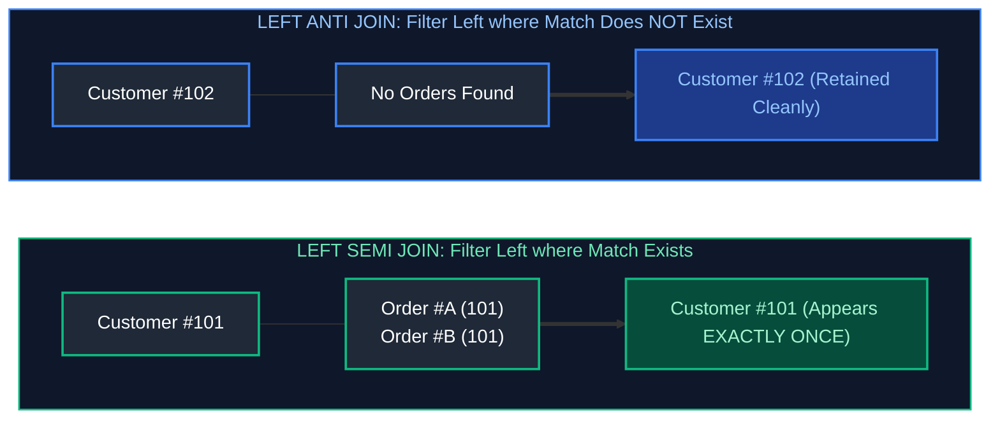

#### Concrete Step-by-Step Dataset Walkthrough

Consider the following customer and order datasets:

**Left Table: `crm.customers`**
| `customer_id` | `customer_name` | `tier` | `signup_date` |
| :--- | :--- | :--- | :--- |
| `101` | Sarah Connor | Enterprise | `2024-01-15` |
| `102` | John Connor | Standard | `2024-02-01` |
| `103` | Kyle Reese | Standard | `2024-02-10` |
| `104` | Miles Dyson | Enterprise | `2024-03-05` |

**Right Table: `sales.orders`**
| `order_id` | `customer_id` | `order_amount` | `order_date` |
| :--- | :--- | :--- | :--- |
| `ORD-901` | `101` | \$450.00 | `2024-04-01` |
| `ORD-902` | `101` | \$1,200.00 | `2024-04-10` |
| `ORD-903` | `101` | \$85.00 | `2024-04-12` |
| `ORD-904` | `104` | \$3,500.00 | `2024-04-15` |
| `ORD-905` | `NULL` | \$15.00 | `2024-04-16` |

##### 1. The `INNER JOIN` Duplication Trap
If a query attempts to find all customers who placed an order using a standard `INNER JOIN`:
```sql
SELECT c.customer_id, c.customer_name, c.tier
FROM crm.customers AS c
INNER JOIN sales.orders AS o ON c.customer_id = o.customer_id;
```
Sarah Connor (`customer_id = 101`) appears **3 separate times** because she placed 3 orders! If downstream engineers feed this result into a machine learning feature pipeline or customer count metric, Sarah is counted 3 times unless an expensive `DISTINCT` operator is added.

##### 2. The `LEFT SEMI JOIN` Execution
A `SEMI JOIN` matches keys, verifies existence, short-circuits, and projects **only the columns of the left table**:
```sql
-- Databricks / Spark SQL / Hive native syntax
SELECT c.customer_id, c.customer_name, c.tier
FROM crm.customers AS c
LEFT SEMI JOIN sales.orders AS o ON c.customer_id = o.customer_id;
```
**Result Table:**
| `customer_id` | `customer_name` | `tier` |
| :--- | :--- | :--- |
| `101` | Sarah Connor | Enterprise |
| `104` | Miles Dyson | Enterprise |
*Guarantees:* Sarah Connor appears exactly once. Zero row multiplication. Zero right-table memory footprint.

##### 3. The `LEFT ANTI JOIN` Execution & The Lethal `NOT IN (NULL)` Trap
To find all customers who registered but **never placed an order**:
```sql
-- DANGEROUS ANTI-PATTERN: If sales.orders contains a single NULL customer_id, this returns ZERO rows!
SELECT * FROM crm.customers
WHERE customer_id NOT IN (SELECT customer_id FROM sales.orders);
```
**Why `NOT IN` fails completely:** In our sample data, row `ORD-905` has `customer_id = NULL`.
The condition evaluates as:
`102 NOT IN (101, 104, NULL)` $\implies$ `102 != 101 AND 102 != 104 AND 102 != NULL`
$\implies$ `TRUE AND TRUE AND UNKNOWN` $\implies$ `UNKNOWN`.
In SQL filtering, `UNKNOWN` evaluates to false! **The query returns 0 rows, silently corrupting your pipeline.**

**The Production Solution: `LEFT ANTI JOIN` or `NOT EXISTS`**
```sql
-- Production Safe Pattern 1: Databricks / Spark SQL LEFT ANTI JOIN
SELECT c.customer_id, c.customer_name, c.tier
FROM crm.customers AS c
LEFT ANTI JOIN sales.orders AS o ON c.customer_id = o.customer_id;

-- Production Safe Pattern 2: ANSI SQL NOT EXISTS (PostgreSQL, Snowflake, BigQuery)
SELECT c.customer_id, c.customer_name, c.tier
FROM crm.customers AS c
WHERE NOT EXISTS (
    SELECT 1 FROM sales.orders AS o WHERE o.customer_id = c.customer_id
);
```
**Result Table:**
| `customer_id` | `customer_name` | `tier` |
| :--- | :--- | :--- |
| `102` | John Connor | Standard |
| `103` | Kyle Reese | Standard |
*Guarantees:* Completely immune to `NULL` values in the right table. High performance index seek.

---

### 1.2 SELF JOIN & Asymmetric Pairing Patterns

A `SELF JOIN` joins a table to itself using distinct aliases. While common for resolving parent-child employee-manager hierarchies, senior data engineers employ **Asymmetric Self Joins** to detect collisions, fraud rings, and cohort overlaps without generating duplicate symmetric pairs.

#### The Symmetric Collision Problem: Avoiding Mirrored Duplicates
Suppose you must identify all pairs of user accounts logging in from the same IP address within 15 minutes of each other.
If you join with an inequality condition `u1.user_id != u2.user_id`, the engine generates two mirrored rows for every pair: `(User1, User2)` and `(User2, User1)`. Furthermore, comparing $N$ rows against $N$ rows requires evaluating $N^2 - N$ combinations!

By enforcing the **strict asymmetric inequality** `u1.user_id < u2.user_id`:
1. Self-pairing `(User1, User1)` is mathematically impossible ($1 < 1$ is False).
2. Mirrored pairs `(User2, User1)` are eliminated because $2 < 1$ is False.
3. The comparison space is reduced by over 50% ($\frac{N(N-1)}{2}$ combinations).

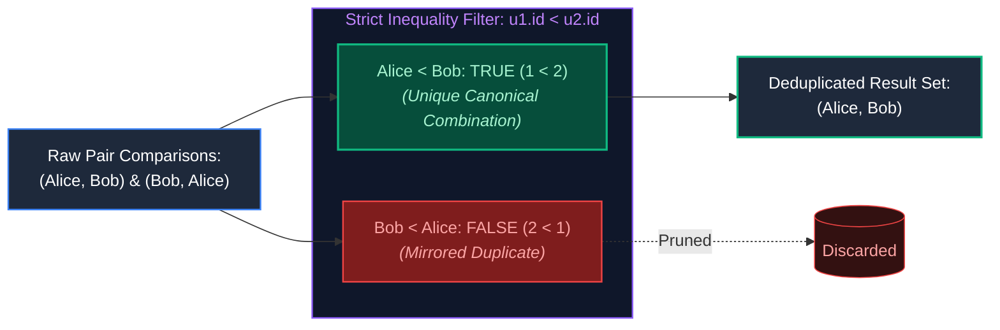

#### Production Fraud Ring Detection Query
```sql
-- Detect multiple distinct user accounts logging in from the same IP within a 15-minute window
SELECT 
    u1.user_id                                                         AS primary_user_id,
    u2.user_id                                                         AS colluding_user_id,
    u1.ip_address                                                      AS shared_ip,
    u1.login_timestamp                                                 AS login_time_user_1,
    u2.login_timestamp                                                 AS login_time_user_2,
    ABS(EXTRACT(EPOCH FROM (u1.login_timestamp - u2.login_timestamp))) AS seconds_between_logins
FROM security.user_logins AS u1
INNER JOIN security.user_logins AS u2
    ON u1.ip_address = u2.ip_address                                   -- Identical IP address
   AND u1.user_id < u2.user_id                                         -- Asymmetric filter: eliminates self-match & mirrors
   AND u1.login_timestamp BETWEEN u2.login_timestamp - INTERVAL '15 minutes'
                              AND u2.login_timestamp + INTERVAL '15 minutes';
```

---

### 1.3 Distributed Join Strategies: Broadcast Hash Join (BHJ)

#### Physical Execution Mechanics
In a distributed compute cluster (Spark, Databricks, Trino), physical worker nodes are separated by network top-of-rack switches. When joining a 10 TB Fact Table against a 15 MB Dimension Table:
1. **Driver Collection:** The driver node pulls the complete 15 MB dimension table from storage into its local memory.
2. **Torrent Broadcast:** The driver uses a peer-to-peer BitTorrent-like protocol to replicate the 15 MB dataset directly into the local memory heap of **every single worker executor node** across the cluster.
3. **Local Hash Table Build:** Each worker task builds an in-memory hash table of the broadcasted dimension table.
4. **Zero-Shuffle Stream Probe:** Each executor reads its assigned partition of the 10 TB fact table from local storage or cloud disk. As fact rows stream through CPU cache, the executor performs instant $O(1)$ memory lookups against the broadcasted hash table.
5. **Network Savings:** **Zero rows of the 10 TB fact table traverse the physical network switches!**

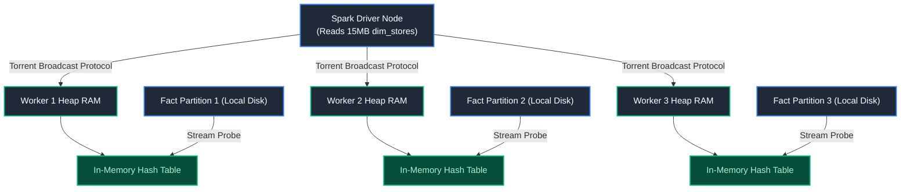

#### Production Thresholds & Failure Traps
- **Default Threshold:** Spark's `spark.sql.autoBroadcastJoinThreshold` defaults to 10 MB (`10485760` bytes). In modern clouds, you can safely tune this threshold to **64 MB or 128 MB**:
  ```python
  spark.conf.set("spark.sql.autoBroadcastJoinThreshold", 67108864) # 64 MB
  ```
- **The Fatal Driver OOM Trap:** If a developer applies a broadcast hint `/*+ BROADCAST(t) */` on a table that turns out to have 10 GB of data due to missing filters, the driver attempts to collect 10 GB into heap RAM, instantly crashing the master node with:
  `java.lang.OutOfMemoryError: Java heap space`.

---

### 1.4 Distributed Join Strategies: Shuffle Hash Join (SHJ)

#### Physical Execution Mechanics
When both tables are too large to broadcast, but one table is significantly smaller than the other and can fit into the memory allocated to a single executor task partition:
1. **Network Hash Redistribution:** Both tables are scanned. For each row, the engine computes `hash(join_key) % num_partitions` (default 200 partitions).
2. Rows from both tables sharing identical hash buckets are transmitted across network switches to the same physical worker node.
3. **Task-Level Hash Table:** For each partition slice, the executor builds an in-memory hash table of the smaller table's partition.
4. **Stream Probe:** The executor streams the larger table's matching partition, performing hash lookups.

#### When to Use vs. Failure Mode
- **Advantage:** Faster than Sort-Merge Join because it does not incur the CPU overhead of sorting both sides.
- **Vulnerability:** If data skew causes one key to have 5 million rows, that single partition's hash table exceeds executor heap memory, crashing the task with an OOM error. Spark therefore disables Shuffle Hash Join by default in favor of Sort-Merge Join (`spark.sql.join.preferSortMergeJoin = true`).

---

### 1.5 Distributed Join Strategies: Sort-Merge Join (SMJ)

#### Physical Execution Mechanics
Sort-Merge Join is the **battle-hardened workhorse** of distributed big data processing. It operates in three sequential phases:

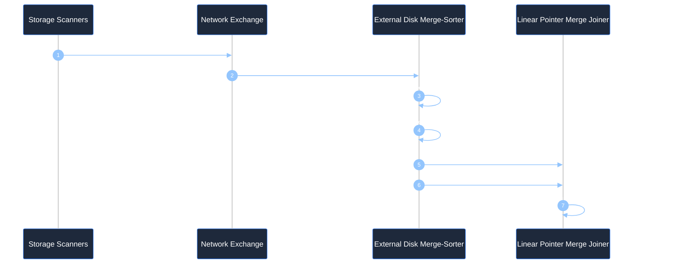

#### Why Sort-Merge Join Never Dies (Disk Spilling Resilience)
In Sort-Merge Join, neither table needs to fit entirely in RAM!
If a partition has 50 GB of data and the executor only has 4 GB of working memory:
1. The executor loads chunks into memory buffers, sorts them via Quicksort, and **spills sorted runs to local NVMe SSD disk**.
2. It performs an external multi-way merge over the sorted runs on disk.
3. Once both sides are sorted, the joiner maintains **two sliding pointers**:
   - If `Key_A < Key_B`: Advance pointer A.
   - If `Key_A > Key_B`: Advance pointer B.
   - If `Key_A == Key_B`: Emit joined row!
4. **Complexity:** Scanning sorted streams is strictly $O(N + M)$ linear time.

---

### 1.6 Distributed Join Comparison & Selection Decision Tree

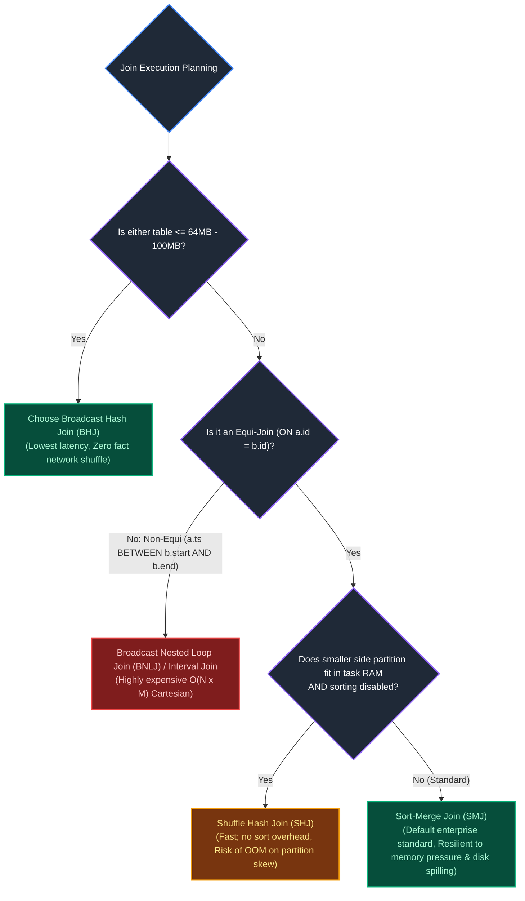

| Distributed Join Operator | Pre-conditions | Network I/O Cost | Memory Overhead | Disk Spilling Capability | Skew Tolerance |
| :--- | :--- | :--- | :--- | :--- | :--- |
| **Broadcast Hash Join (BHJ)** | One table $\le$ broadcast threshold | **Lowest:** Dimension broadcasted once; fact table zero shuffle | Must fit entirely in Driver & Executor JVM memory | None (Fails with OOM if table too large) | Excellent (Zero fact shuffle) |
| **Shuffle Hash Join (SHJ)** | Equi-join; smaller side partition fits in RAM | **High:** $O(N + M)$ network exchange of all records | High: Builds in-memory hash table per partition | Poor (Crashes executor if partition spills) | Very Poor (Skewed key blows out memory) |
| **Sort-Merge Join (SMJ)** | Equi-join; default for large datasets | **High:** $O(N + M)$ network exchange of all records | Low: Streams sorted records sequentially via pointers | **Full Spilling:** Spills sorted runs to NVMe SSD seamlessly | **High:** Skew slows down task but does not crash |

---

### 1.7 Join Order & Cost-Based Optimizer (CBO) Execution Trees

#### How the Cost-Based Optimizer Evaluates Plans
In relational databases, join order is not dictated by query text. Joining 4 tables ($A, B, C, D$) presents **24 possible join orders** ($4!$). Joining 10 tables presents **3,628,800 possible join permutations**!

The **Cost-Based Optimizer (CBO)** estimates execution cost ($C$) using quantitative formulas:

$$C_{\text{total}} = C_{\text{I/O}} \times \text{PagesRead} + C_{\text{CPU}} \times \text{TuplesProcessed} + C_{\text{Network}} \times \text{BytesShuffled}$$

#### Left-Deep vs. Bushy Execution Trees
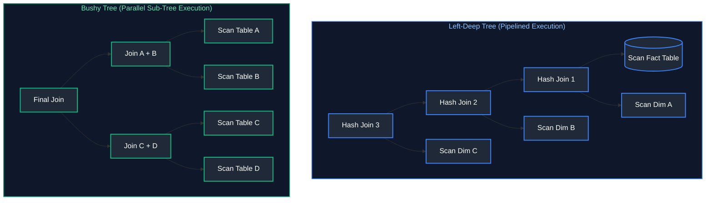

- **Left-Deep Trees:** Pipelined; output of join 1 immediately feeds join 2. Keeps working memory strictly minimal because intermediate tables are consumed immediately without disk materialization.
- **Bushy Trees:** Sub-joins ($A \bowtie B$ and $C \bowtie D$) execute concurrently across separate worker nodes and merge at the root. Essential when joining multiple large fact-to-fact or snowflake dimension models.

#### The Stale Statistics Hazard
If table statistics (`ANALYZE TABLE`) are out of date, the optimizer may believe a table has 500 rows when an upstream pipeline recently loaded 500 million rows. The CBO chooses a Broadcast Hash Join, and the driver immediately crashes with an OOM.
*Remediation:* Enforce automated statistics collection in pipeline schedules:
```sql
ANALYZE TABLE sales.fact_orders COMPUTE STATISTICS FOR ALL COLUMNS;
```

---

### 1.8 Join Cardinality, Metric Fan-Out & Pre-Aggregation Patterns

#### The Mathematical Fan-Out Trap
When joining a parent table (`orders`) to a child table (`order_items`), each parent row replicates for every matching child record:

$$\text{Recorded Amount} = \$100.00 \quad \xrightarrow{1:3 \text{ Join}} \quad 3 \times \$100.00 = \$300.00 \text{ in } \text{SUM}(\text{order\_amount})!$$

#### The Solution: The Pre-Aggregation CTE Pattern
Never join raw parent to raw child before calculating aggregates. Pre-aggregate child records to the parent primary key grain first:

```sql
-- Step 1: Pre-aggregate order line items to order_id grain
WITH aggregated_line_items AS (
    SELECT 
        order_id,
        COUNT(item_id)             AS total_items_count,
        SUM(unit_price * quantity) AS total_items_value
    FROM sales.order_items
    GROUP BY order_id  -- Guarantees uniqueness of order_id in CTE output
)
-- Step 2: 1-to-1 join with zero risk of row duplication or fan-out
SELECT 
    o.order_id,
    o.customer_id,
    o.order_amount                 AS original_clean_order_amount,
    COALESCE(i.total_items_count, 0) AS total_items_count,
    COALESCE(i.total_items_value, 0.00) AS calculated_items_value
FROM sales.orders AS o
LEFT JOIN aggregated_line_items AS i 
    ON o.order_id = i.order_id;
```

---

### 1.9 The Salting Technique for Extreme Data Skew

#### The Problem: Straggler Tasks
In distributed shuffles, rows are partitioned by `hash(key) % num_partitions`. If 90% of rows contain `customer_id = 0` or `'GUEST'`, 90% of all data lands on **one single worker executor**. While 99 workers finish in 5 seconds, worker 100 thrashes disk for 2 hours (or dies with an OOM error).

#### The Salting Algorithm
1. On the skewed fact table, append a random integer salt from $0 \dots (S-1)$ (e.g. $S=4$):
   `salted_key = CONCAT(customer_id, '_', FLOOR(RAND() * 4))`
2. On the dimension lookup table, replicate every record $S$ times, pairing it with every salt value ($0, 1, 2, 3$).
3. Join on the composite salted key: `fact.customer_id = dim.customer_id AND fact.salt = dim.salt`.
4. **Result:** The skewed key is shattered evenly across 4 independent cluster nodes!

```sql
-- Production PySpark / Databricks SQL Salting Pattern
WITH salted_fact AS (
    SELECT 
        transaction_id,
        customer_id,
        amount,
        -- Scatter skewed key 'GUEST' across 4 distinct worker buckets
        FLOOR(RAND() * 4) AS salt
    FROM telemetry.clickstream_events
),
replicated_dim AS (
    SELECT 
        c.customer_id,
        c.customer_name,
        s.salt
    FROM crm.customers AS c
    -- Cross join small array [0, 1, 2, 3] to duplicate dimension 4 times
    CROSS JOIN (SELECT EXPLODE(ARRAY(0, 1, 2, 3)) AS salt) AS s
)
SELECT 
    f.transaction_id,
    f.amount,
    d.customer_name
FROM salted_fact AS f
INNER JOIN replicated_dim AS d 
    ON f.customer_id = d.customer_id 
   AND f.salt = d.salt;  -- Perfectly balanced shuffle partitions!
```

---

### 1.10 Non-Equi Joins & Temporal / SCD2 Range Matching

Non-equi joins join on inequality ranges (`<`, `>`, `BETWEEN`). Because keys are not equal, hash tables cannot be used, forcing engines into costly **Broadcast Nested Loop Joins (BNLJ)** ($O(N \times M)$) unless optimized.

#### Point-in-Time Temporal Matching (SCD Type 2)
In enterprise data warehouses, dimension records have validity windows (`valid_from` to `valid_to`). Fact records must join to the dimension version valid at that exact microsecond:

```sql
SELECT 
    t.transaction_id,
    t.transaction_timestamp,
    t.amount,
    c.customer_surrogate_key,
    c.customer_id,
    c.risk_tier                                 AS historical_risk_tier
FROM warehouse.fact_financial_transactions AS t
INNER JOIN warehouse.dim_customers_scd2 AS c
    ON t.customer_id = c.customer_id            -- Equi-join on natural key
   AND t.transaction_timestamp >= c.valid_from  -- Non-equi lower boundary
   AND t.transaction_timestamp <  c.valid_to;   -- Non-equi upper boundary
```

---

# 2. Advanced Subqueries, CTEs & Hierarchical Recursion

---

### 2.1 Correlated Subqueries & Query Decorrelation Mechanics

A **Correlated Subquery** references columns from the outer enclosing query.
- *Naive Execution:* Evaluates the subquery row-by-row in a nested loop: $O(N \times M)$ scans.
- *Optimizer Decorrelation:* Modern optimizers (PostgreSQL, Snowflake, Spark) rewrite correlated scalar subqueries into `LEFT OUTER JOIN` or `LEFT SEMI JOIN` automatically during plan compilation.

---

### 2.2 `LATERAL` Joins & `CROSS APPLY`: The SQL For-Each Loop

A `LATERAL` join (PostgreSQL, Snowflake) or `CROSS APPLY` (SQL Server) allows an inline subquery in the `FROM` clause to access columns from tables defined earlier in the query.

#### Use Case: Top-K Records Per Group
```sql
-- Retrieve the top 2 highest-value orders for EACH customer
SELECT 
    c.customer_id,
    c.customer_name,
    top_orders.order_id,
    top_orders.order_amount
FROM crm.customers AS c
CROSS JOIN LATERAL (
    SELECT o.order_id, o.order_amount
    FROM sales.orders AS o
    WHERE o.customer_id = c.customer_id  -- Correlated link to outer table
    ORDER BY o.order_amount DESC
    LIMIT 2                              -- Picks top 2 per customer via index seek
) AS top_orders;
```

---

### 2.3 Common Table Expressions (CTEs): Inlining vs. Optimization Fences

- **Inlined CTE (Default in Snowflake, Databricks, PostgreSQL 12+):** The optimizer treats the CTE like a macro, merging its SQL directly into the outer query to enable **Predicate Pushdown** through the CTE boundary.
- **Materialized CTE (`AS MATERIALIZED`):** Acts as an **Optimization Fence**. It forces the engine to compute the CTE once, store the result in a temporary memory/disk buffer, and reuse it across multiple references.

```sql
WITH heavy_aggregation AS MATERIALIZED (
    SELECT 
        department_id,
        AVG(salary) AS avg_dept_salary,
        MAX(salary) AS max_dept_salary
    FROM hr.employees
    GROUP BY department_id
)
SELECT e.employee_id, e.salary, h.avg_dept_salary
FROM hr.employees AS e
INNER JOIN heavy_aggregation AS h ON e.department_id = h.department_id
WHERE e.salary > h.avg_dept_salary;
```

---

### 2.4 Recursive CTEs: Fixed-Point Relational Iteration

A **Recursive CTE** executes fixed-point relational iteration until zero new rows are generated:
1. **Anchor Query:** Base case query executing at Step 0.
2. **Working Table:** Holds rows produced by Step $N-1$.
3. **Recursive Query:** Joins against the working table, producing Step $N$.
4. **Intermediate Queue:** Rows from Step $N$ are appended to the cumulative result (`UNION ALL`) and become the new working table for Step $N+1$.
5. **Termination:** When Step $N$ returns 0 rows, recursion terminates cleanly.

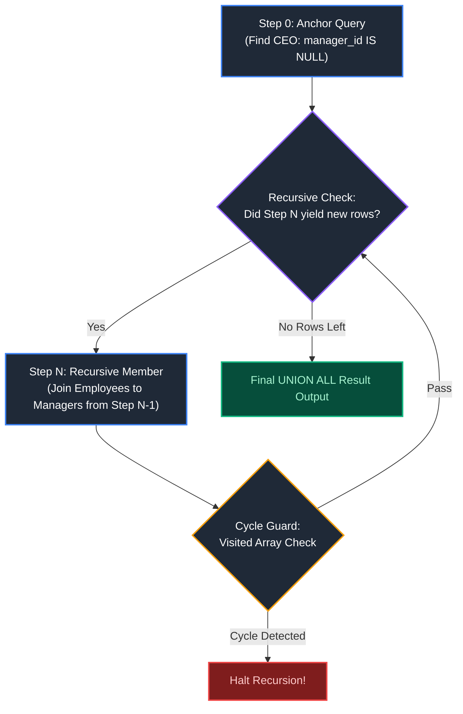

---

### 2.5 Hierarchical Tree Traversal with Cycle Detection & Path Building

```sql
WITH RECURSIVE org_chart AS (
    -- 1. Anchor Member: Top executives (nodes with no managers)
    SELECT 
        employee_id,
        manager_id,
        full_name,
        1 AS depth,
        CAST(full_name AS VARCHAR(1000)) AS reporting_chain,
        ARRAY[employee_id] AS visited_ids
    FROM hr.employees
    WHERE manager_id IS NULL
    
    UNION ALL
    
    -- 2. Recursive Member: Iteratively join child employees
    SELECT 
        e.employee_id,
        e.manager_id,
        e.full_name,
        oc.depth + 1 AS depth,
        CAST(oc.reporting_chain || ' -> ' || e.full_name AS VARCHAR(1000)),
        oc.visited_ids || e.employee_id
    FROM hr.employees AS e
    INNER JOIN org_chart AS oc 
        ON e.manager_id = oc.employee_id
    WHERE NOT (e.employee_id = ANY(oc.visited_ids))  -- Prevents infinite cycle loops!
      AND oc.depth < 20                             -- Safety depth ceiling
)
SELECT employee_id, full_name, depth, reporting_chain
FROM org_chart
ORDER BY depth ASC, employee_id ASC;
```

---

### 2.6 Bill of Materials (BOM) Multi-Level Parts Explosion

In manufacturing and supply chain pipelines, complex assemblies (e.g., an Electric Vehicle) are composed of sub-assemblies (Battery Pack), which contain sub-components (Lithium Cells), which contain raw materials.
A **Bill of Materials (BOM) Explosion** uses a Recursive CTE to calculate the total cumulative quantity and cost of all sub-parts required to manufacture the top-level product:

```sql
WITH RECURSIVE bom_explosion AS (
    -- Anchor: Top-level finished product (e.g., Model 3 EV, Assembly ID = 1000)
    SELECT 
        parent_part_id,
        component_part_id,
        quantity_required,
        1 AS assembly_level,
        quantity_required AS cumulative_quantity
    FROM manufacturing.bill_of_materials
    WHERE parent_part_id = 1000
    
    UNION ALL
    
    -- Recursive step: Explode sub-components down to raw materials
    SELECT 
        child.parent_part_id,
        child.component_part_id,
        child.quantity_required,
        parent.assembly_level + 1,
        parent.cumulative_quantity * child.quantity_required AS cumulative_quantity
    FROM manufacturing.bill_of_materials AS child
    INNER JOIN bom_explosion AS parent 
        ON child.parent_part_id = parent.component_part_id
)
SELECT 
    b.component_part_id,
    p.part_name,
    p.unit_cost,
    SUM(b.cumulative_quantity) AS total_parts_needed,
    SUM(b.cumulative_quantity * p.unit_cost) AS total_cost_contribution
FROM bom_explosion AS b
INNER JOIN manufacturing.parts_catalog AS p 
    ON b.component_part_id = p.part_id
GROUP BY b.component_part_id, p.part_name, p.unit_cost
ORDER BY total_cost_contribution DESC;
```

---

### 2.7 `EXISTS` vs. `NOT EXISTS` vs. `IN` / `NOT IN` Deep-Dive

| Construct | Execution Strategy | Null Handling Behavior | Best Production Fit |
| :--- | :--- | :--- | :--- |
| **`EXISTS`** | Semi-Join index seek; short-circuits on first match. | Completely safe; ignores NULLs. | Subqueries filtering on existence. |
| **`NOT EXISTS`** | Anti-Join index seek; short-circuits on match. | **Completely safe; ignores NULLs.** | **Standard enterprise pattern for exclusions.** |
| **`IN`** | Builds an in-memory hash set of inner records. | Safe for positive matching. | Small static list of values (`IN ('US', 'CA')`). |
| **`NOT IN`** | Compares every element via 3VL logic. | **Lethal trap: Collapses to 0 rows if 1 NULL exists.** | **Never use with subqueries!** |

---

# 3. Window Functions & Analytical SQL

---

### 3.1 Window Function Architecture & The 9-Stage SQL Lifecycle

In the logical query processing model, window functions execute at **Stage 8**, immediately after `SELECT` expressions, which is *after* `WHERE`, `GROUP BY`, and `HAVING` have evaluated:


*Crucial Consequence:* You **cannot** filter on a window function in the `WHERE` clause because the `WHERE` clause evaluates at Stage 4, long before the window function exists! You must use a CTE or the `QUALIFY` clause.

---

### 3.2 Window Framing Deep-Dive: `ROWS` vs. `RANGE` vs. `GROUPS`

The frame clause specifies the sliding window of rows evaluated relative to the current row:

```sql
{ROWS | RANGE | GROUPS} BETWEEN frame_start AND frame_end
```

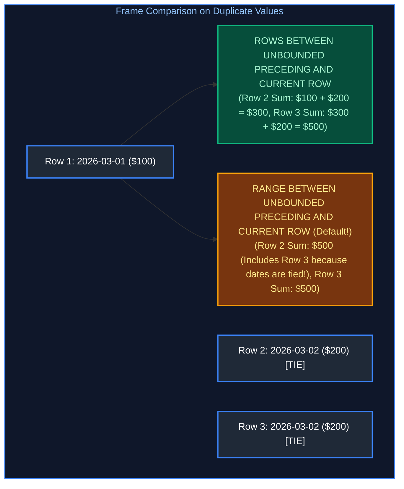

#### Concrete Framing Comparison Table

| Row Number | Date | Amount | `ROWS BETWEEN UNBOUNDED PRECEDING AND CURRENT ROW` | `RANGE BETWEEN UNBOUNDED PRECEDING AND CURRENT ROW` |
| :---: | :---: | :---: | :---: | :---: |
| 1 | `2026-03-01` | \$100.00 | **\$100.00** | **\$100.00** |
| 2 | `2026-03-02` | \$200.00 | **\$300.00** | **\$500.00** (Tied! Includes Row 3) |
| 3 | `2026-03-02` | \$200.00 | **\$500.00** | **\$500.00** (Tied! Includes Row 2) |
| 4 | `2026-03-03` | \$150.00 | **\$650.00** | **\$650.00** |

---

### 3.3 The Lethal Implicit `RANGE` Default Trap

If you write `SUM(amount) OVER (ORDER BY transaction_date)` without specifying a frame, the ANSI standard defaults to:
`RANGE BETWEEN UNBOUNDED PRECEDING AND CURRENT ROW`
If multiple rows have the same `transaction_date`, `RANGE` evaluates all tied rows together, resulting in **duplicate running balances** instead of a continuous chronological balance!
**Golden Production Rule:** Always explicitly write `ROWS BETWEEN UNBOUNDED PRECEDING AND CURRENT ROW`.

---

### 3.4 Ranking Functions: `ROW_NUMBER`, `RANK`, `DENSE_RANK`, `NTILE`

| Student Score | `ROW_NUMBER()` | `RANK()` | `DENSE_RANK()` | `NTILE(2)` |
| :---: | :---: | :---: | :---: | :---: |
| 100 | 1 | 1 | 1 | 1 |
| 95 | 2 | 2 | 2 | 1 |
| 95 (Tie) | 3 | 2 | 2 | 2 |
| 90 | 4 | 4 (Skipped 3) | 3 (No Skip) | 2 |

- **`ROW_NUMBER()`:** Assigns a unique sequential integer (1, 2, 3, 4). Breaks ties arbitrarily unless secondary sort keys are provided.
- **`RANK()`:** Assigns identical rank to ties, but **skips subsequent ranks** (1, 2, 2, 4).
- **`DENSE_RANK()`:** Assigns identical rank to ties, and **does not skip ranks** (1, 2, 2, 3). Essential for finding "top 3 salaries" where ties exist.
- **`NTILE(N)`:** Divides ordered rows into $N$ roughly equal buckets (e.g., quartiles, percentiles).

---

### 3.5 Value Navigation Functions: `LEAD`, `LAG`, `FIRST_VALUE`, `LAST_VALUE`, `NTH_VALUE`

```sql
SELECT 
    ticker,
    trade_date,
    close_price,
    
    -- LAG: Access previous trading day price (default offset 1, default fallback 0.0)
    LAG(close_price, 1, close_price) OVER (
        PARTITION BY ticker ORDER BY trade_date ASC
    ) AS prev_close,
    
    -- LEAD: Access next trading day price
    LEAD(close_price, 1) OVER (
        PARTITION BY ticker ORDER BY trade_date ASC
    ) AS next_close,
    
    -- FIRST_VALUE: Initial trading price of the stock
    FIRST_VALUE(close_price) OVER (
        PARTITION BY ticker ORDER BY trade_date ASC
        ROWS BETWEEN UNBOUNDED PRECEDING AND CURRENT ROW
    ) AS opening_price,
    
    -- LAST_VALUE: Most recent price (Must use UNBOUNDED FOLLOWING!)
    LAST_VALUE(close_price) OVER (
        PARTITION BY ticker ORDER BY trade_date ASC
        ROWS BETWEEN CURRENT ROW AND UNBOUNDED FOLLOWING
    ) AS closing_price
FROM market.stock_daily;
```

---

### 3.6 The `LAST_VALUE()` Unbounded Following Framing Gotcha

Junior engineers frequently write:
```sql
-- INCORRECT: Returns current row value because default frame ends at CURRENT ROW!
LAST_VALUE(close_price) OVER (PARTITION BY ticker ORDER BY trade_date ASC)
```
Because the default frame ends at `CURRENT ROW`, `LAST_VALUE()` only evaluates rows up to the current row, returning the current row's own value!
**Fix:** Explicitly declare `ROWS BETWEEN CURRENT ROW AND UNBOUNDED FOLLOWING`.

---

### 3.7 Cumulative Patterns: Running Totals, Moving Averages & Physical vs. Calendar Windows

- **Physical Window (`ROWS`):** Operates on row count (`ROWS BETWEEN 6 PRECEDING AND CURRENT ROW` = 7 physical rows).
- **Calendar Range Window (`RANGE`):** Operates on time intervals (`RANGE BETWEEN INTERVAL '6 days' PRECEDING AND CURRENT ROW`). Correctly handles missing dates (e.g., weekends/holidays).

---

### 3.8 Advanced Analytical Pattern 1: Deduplication via Window Ranking

```sql
WITH ranked_records AS (
    SELECT 
        order_id,
        customer_id,
        order_amount,
        updated_at,
        ROW_NUMBER() OVER (
            PARTITION BY order_id 
            ORDER BY updated_at DESC, ingestion_timestamp DESC
        ) AS rank_val
    FROM bronze.raw_orders
)
SELECT order_id, customer_id, order_amount, updated_at
FROM ranked_records
WHERE rank_val = 1;
```

---

### 3.9 Advanced Analytical Pattern 2: The Gaps and Islands Problem (Difference-of-Ranks)

**The Mathematical Proof:** If you subtract a monotonically increasing integer sequence (`ROW_NUMBER()`) from a contiguous sequence of dates, **the resulting difference date remains strictly constant across all contiguous dates in that island**:

$$\text{Island Identifier} = \text{Date} - \text{ROW\_NUMBER}() \times \text{INTERVAL '1 day'} = \text{Constant}$$

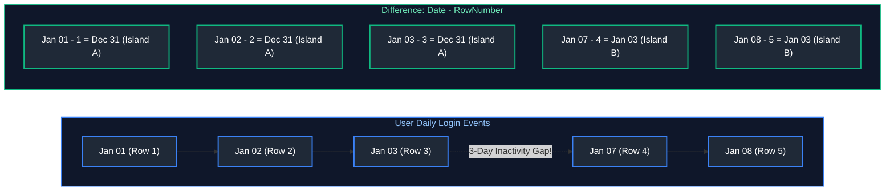

#### Production Gaps and Islands SQL Implementation
```sql
WITH distinct_logins AS (
    SELECT DISTINCT user_id, CAST(login_time AS DATE) AS login_date
    FROM telemetry.user_logins
),
islands AS (
    SELECT 
        user_id,
        login_date,
        login_date - (ROW_NUMBER() OVER (PARTITION BY user_id ORDER BY login_date ASC) * INTERVAL '1 day') AS island_id
    FROM distinct_logins
)
SELECT 
    user_id,
    MIN(login_date) AS streak_start,
    MAX(login_date) AS streak_end,
    COUNT(*)        AS streak_length_days
FROM islands
GROUP BY user_id, island_id
HAVING COUNT(*) >= 3;
```

---

### 3.10 Advanced Analytical Pattern 3: Sessionization via Inactivity Thresholds

Group continuous event clickstreams into discrete user browsing sessions when inactivity exceeds 30 minutes:

```sql
WITH lagged_events AS (
    SELECT 
        user_id,
        event_timestamp,
        EXTRACT(EPOCH FROM (event_timestamp - LAG(event_timestamp) OVER (
            PARTITION BY user_id ORDER BY event_timestamp ASC
        ))) AS seconds_since_last_event
    FROM web.clickstream
),
session_starts AS (
    SELECT 
        user_id,
        event_timestamp,
        CASE 
            WHEN seconds_since_last_event > 1800 OR seconds_since_last_event IS NULL THEN 1 
            ELSE 0 
        END AS is_new_session
    FROM lagged_events
),
sessionized AS (
    SELECT 
        user_id,
        event_timestamp,
        SUM(is_new_session) OVER (
            PARTITION BY user_id ORDER BY event_timestamp ASC
            ROWS BETWEEN UNBOUNDED PRECEDING AND CURRENT ROW
        ) AS session_id
    FROM session_starts
)
SELECT user_id, session_id, MIN(event_timestamp) AS session_start, MAX(event_timestamp) AS session_end
FROM sessionized
GROUP BY user_id, session_id;
```

---

### 3.11 Advanced Analytical Pattern 4: Top-N per Group with Tie-Breaker Handling

```sql
WITH ranked_products AS (
    SELECT 
        category_id,
        product_id,
        product_name,
        revenue,
        DENSE_RANK() OVER (
            PARTITION BY category_id 
            ORDER BY revenue DESC
        ) AS rank_dense
    FROM catalog.product_sales
)
SELECT * FROM ranked_products WHERE rank_dense <= 3;
```

---

### 3.12 The Modern `QUALIFY` Clause

Supported natively by Snowflake, BigQuery, and Databricks SQL, `QUALIFY` filters window function results directly without requiring CTE wrappers:

```sql
-- Retrieve the single highest earner per department directly
SELECT employee_id, department_id, salary
FROM hr.employees
QUALIFY ROW_NUMBER() OVER (PARTITION BY department_id ORDER BY salary DESC) = 1;
```

---

# 4. Advanced Grouping, Aggregation & Pivoting

---

### 4.1 Multi-Dimensional Grouping: `GROUPING SETS`, `ROLLUP`, `CUBE`

- **`ROLLUP(Year, Region, Product)`:** Generates hierarchical rollups ($N + 1$ levels): Full detail $\rightarrow$ `(Year, Region)` $\rightarrow$ `(Year)` $\rightarrow$ Grand Total `()`.
- **`CUBE(Region, Channel)`:** Generates all $2^N$ combinatorial permutations.
- **`GROUPING SETS`:** Explicitly declares exact target sub-aggregations.

```sql
SELECT 
    calendar_year,
    region,
    SUM(revenue) AS total_revenue,
    GROUPING(calendar_year) AS is_year_subtotal,
    GROUPING(region)        AS is_region_subtotal
FROM analytics.fact_sales
GROUP BY ROLLUP (calendar_year, region);
```

---

### 4.2 The `GROUPING()` and `GROUPING_ID()` Bitmask Functions

When generating multi-dimensional summaries, NULL values appear in subtotal rows. How do you distinguish between a row that has a **real NULL in the data** vs. a **NULL created by aggregation**?
- `GROUPING(column)` returns `1` if the column is aggregated in this subtotal row, and `0` if it represents actual data!

---

### 4.3 Cross-Tabulation & Pivoting: `PIVOT` and `UNPIVOT`

```sql
-- 1. PIVOT: Rotate quarterly rows to columns
SELECT *
FROM (SELECT store_id, quarter, revenue FROM sales.quarterly_summary)
PIVOT (
    SUM(revenue) FOR quarter IN ('Q1', 'Q2', 'Q3', 'Q4')
) AS p (store_id, q1_rev, q2_rev, q3_rev, q4_rev);

-- 2. UNPIVOT: Normalize horizontal columns back to relational rows
SELECT store_id, quarter_name, revenue
FROM sales.pivoted_stores
UNPIVOT (
    revenue FOR quarter_name IN (q1_rev, q2_rev, q3_rev, q4_rev)
);
```

---

# 5. Advanced Data Modification, Concurrency & Transactions

---

### 5.1 `MERGE` / `UPSERT` Mechanics & Change Data Capture (CDC)

The ANSI SQL `MERGE` statement synchronizes a target table with incoming CDC records atomically:

```sql
MERGE INTO warehouse.dim_customers AS target
USING staging.customer_cdc_stream AS source
    ON target.customer_id = source.customer_id
WHEN MATCHED AND source.op = 'D' THEN
    UPDATE SET target.is_active = FALSE, target.deleted_at = source.event_ts
WHEN MATCHED AND source.op = 'U' THEN
    UPDATE SET target.name = source.name, target.updated_at = source.event_ts
WHEN NOT MATCHED AND source.op IN ('I', 'U') THEN
    INSERT (customer_id, name, is_active, created_at, updated_at)
    VALUES (source.customer_id, source.name, TRUE, source.event_ts, source.event_ts);
```

---

### 5.2 The Fatal `MERGE` Target Row Collision Trap & Remediation

If the incoming source staging table contains duplicate rows for the same primary key (e.g., two updates for customer `101` in the same batch), the database aborts with an error:
`Target row was matched by multiple source rows`.
**Mandatory Production Fix:** Deduplicate the staging table using `ROW_NUMBER() OVER (PARTITION BY id ORDER BY lsn DESC)` prior to executing `MERGE`.

---

### 5.3 Transaction Control: Two-Phase Locking (2PL), Savepoints & WAL

A transaction is an atomic unit of work:
- **Savepoints:** Allows partial rollback of non-fatal sub-operations without aborting the entire transaction.
- **WAL (Write-Ahead Log):** Changes are flushed to disk sequentially *before* modifying memory pages, guaranteeing Durability ($D$).

---

### 5.4 ANSI SQL Isolation Levels & Concurrency Anomalies

#### The 4 Concurrency Anomalies
1. **Dirty Read:** Transaction A reads data modified by Transaction B *before* Transaction B commits. If B rolls back, A read data that never existed.
2. **Non-Repeatable Read (Fuzzy Read):** Transaction A reads a row. Transaction B updates that row and commits. Transaction A re-reads the row and finds altered values.
3. **Phantom Read:** Transaction A executes a range query (`WHERE amount > 100`). Transaction B inserts a new row matching that range and commits. Transaction A re-runs the range query and discovers a "phantom" new row.
4. **Write Skew:** Two transactions read overlapping data, satisfy business constraints independently, and execute updates that together violate global constraints (e.g., both on-call doctors check out simultaneously, leaving 0 doctors on call).

#### ANSI Isolation Level Support Matrix
| Isolation Level | Dirty Read | Non-Repeatable Read | Phantom Read | Write Skew | Concurrency Performance |
| :--- | :---: | :---: | :---: | :---: | :---: |
| **Read Uncommitted** | Possible | Possible | Possible | Possible | Maximum |
| **Read Committed** (PostgreSQL Default) | **Prevented** | Possible | Possible | Possible | High |
| **Repeatable Read** (MySQL InnoDB Default)| **Prevented** | **Prevented** | Possible (Prevented in PG MVCC) | Possible | Medium |
| **Serializable** | **Prevented** | **Prevented** | **Prevented** | **Prevented** | Lowest (Pessimistic / Aborts) |

#### Step-by-Step Multi-Transaction Concurrency Timeline
| Step | Transaction A (Alice)<br/>`ISOLATION: READ COMMITTED` | Transaction B (Bob)<br/>`ISOLATION: READ COMMITTED` | State & Anomaly Analysis |
| :---: | :--- | :--- | :--- |
| **T1** | `BEGIN;` | `BEGIN;` | Both transactions start concurrently under Read Committed. |
| **T2** | `SELECT balance FROM accounts WHERE id = 1;`<br/>*(Returns `$1,000`)* | — | Alice reads the initial committed state (`$1,000`). |
| **T3** | — | `UPDATE accounts SET balance = 500 WHERE id = 1;` | Bob updates row `id = 1` in his private transaction buffer. |
| **T4** | — | `COMMIT;` | Bob commits. The global committed state is now `$500`. |
| **T5** | `SELECT balance FROM accounts WHERE id = 1;`<br/>*(Returns `$500`)* | — | **NON-REPEATABLE READ ANOMALY:** Alice re-reads the exact same row inside her still-open transaction, but receives `$500` instead of `$1,000`! |
| **T6** | `COMMIT;` | — | Alice transaction completes with internal inconsistency. |

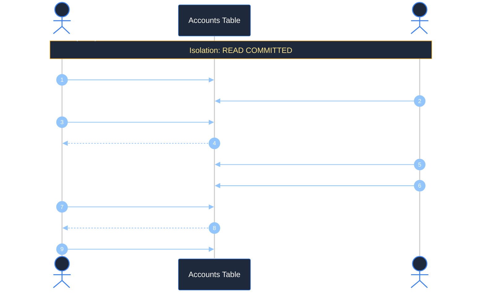

---

### 5.5 Multi-Version Concurrency Control (MVCC) Internals

Modern databases (PostgreSQL, MySQL InnoDB, Snowflake, Databricks) do not block readers with locks. They use **Multi-Version Concurrency Control (MVCC)**:
- In PostgreSQL, every row (tuple) contains two internal transaction header columns: `xmin` (creating transaction ID) and `xmax` (deleting/updating transaction ID).
- When an `UPDATE` executes, the engine does not overwrite the row in place; it appends a brand new row version with a new `xmin` and sets `xmax` on the old row.
- Readers inspect their transaction snapshot ID to see only rows valid at the time their transaction began.
- The `VACUUM` process reclaims physical disk space occupied by dead tuples once all active transactions that could read them have committed.

---

# 6. Advanced Database Programmability & Objects

---

### 6.1 Materialized Views, Query Rewrite Engines & Incremental Refresh

Unlike standard views which re-run queries dynamically, a **Materialized View** precomputes the result set and writes it to disk. Modern database optimizers feature **Query Rewrite Engines**: if a user queries the raw fact table, the optimizer intercepts the query and reads the materialized view automatically!

```sql
-- PostgreSQL Materialized View with Concurrent Refresh
CREATE MATERIALIZED VIEW reporting.mv_daily_store_revenue AS
SELECT store_id, order_date, SUM(amount) AS gross_sales
FROM sales.orders
GROUP BY store_id, order_date;

CREATE UNIQUE INDEX idx_mv_store ON reporting.mv_daily_store_revenue (store_id, order_date);
REFRESH MATERIALIZED VIEW CONCURRENTLY reporting.mv_daily_store_revenue;
```

---

### 6.2 Stored Procedures & Transactional Orchestration

Stored procedures support procedural control flow (loops, exception blocks) and **explicit multi-statement transaction control** (`COMMIT` / `ROLLBACK`).

```sql
-- PL/pgSQL Stored Procedure managing partition archiving and automated maintenance
CREATE OR REPLACE PROCEDURE maintenance.sp_archive_monthly_partitions(
    IN retention_months INT,
    OUT partitions_archived INT
)
LANGUAGE plpgsql
AS $$
DECLARE
    partition_record RECORD;
    cutoff_date DATE;
BEGIN
    partitions_archived := 0;
    cutoff_date := CURRENT_DATE - (retention_months || ' months')::INTERVAL;

    -- Iterate dynamically over old partition tables
    FOR partition_record IN 
        SELECT table_name 
        FROM information_schema.tables 
        WHERE table_schema = 'audit_partitions'
          AND table_name < 'audit_' || TO_CHAR(cutoff_date, 'YYYY_MM')
    LOOP
        -- Dynamic SQL execution
        EXECUTE 'ALTER TABLE audit_partitions.' || quote_ident(partition_record.table_name) || ' SET TABLESPACE cold_archive_storage;';
        partitions_archived := partitions_archived + 1;
        RAISE NOTICE 'Relocated partition % to cold storage.', partition_record.table_name;
    END LOOP;

    -- Commit transaction explicitly within procedure
    COMMIT;
END;
$$;
```

---

### 6.3 User-Defined Functions (UDFs): Scalar, Table-Valued & Vectorized PyArrow

- **Scalar UDF Volatility:**
  - `IMMUTABLE`: Pure function; deterministic; optimizer can inline or precompute.
  - `STABLE`: Result constant within single table scan (e.g., depends on `CURRENT_DATE`).
  - `VOLATILE`: Recomputed on every single row (e.g., `RANDOM()`).

> [!WARNING]
> **Scalar UDF Row-by-Row Bottleneck (RBAR):**
> Calling a scalar UDF across 100 million rows disables SIMD vectorization and executes row-by-row in an interpreter, causing a 50x slowdown. Where possible, write inline SQL expressions or utilize Vectorized PyArrow UDFs.

---

### 6.4 Temporary Views, Session Scopes & Global Virtual Catalogs

Temporary views provide isolated virtual tables within a compute session (Spark / Databricks) without polluting global metastores:
```sql
-- Session-scoped temporary view in Databricks / Spark SQL
CREATE OR REPLACE TEMPORARY VIEW tv_current_session_clicks AS
SELECT user_id, event_type, event_timestamp
FROM bronze.clickstream_raw
WHERE event_timestamp >= CURRENT_DATE;
```

---

# 7. Production Engineering Summary & Key Takeaways

- **Distributed Join Strategies & Skew Mitigation:** Broadcast Hash Joins eliminate network shuffle overhead but must strictly target tables under memory safety limits ($\le 100\text{ MB}$) to prevent executor OOM. For large-table joins where high-cardinality keys suffer extreme skew, apply salting techniques or adaptive query execution (AQE) skew handling, and pre-aggregate child records to parent grains to prevent metric duplication.
- **Subquery Optimization & CTE Execution:** Negative membership checks must use `LEFT ANTI JOIN` or `NOT EXISTS` rather than `NOT IN` to prevent 3VL null-collapse failures. Recursive CTEs require cycle detection and recursion depth boundaries. When CTEs are referenced multiple times within a query, evaluate explicit `MATERIALIZED` hints to avoid redundant subquery re-evaluations.
- **Window Analytic Integrity & Frame Scoping:** Running totals and cumulative aggregates must explicitly declare sliding frames (`ROWS BETWEEN UNBOUNDED PRECEDING AND CURRENT ROW`) to prevent default range frame sorting penalties. Deterministic deduplication pipelines should favor `ROW_NUMBER()` over grouping hacks, leveraging modern `QUALIFY` clauses in engines like Snowflake, BigQuery, and Databricks to eliminate boilerplate subqueries.
- **Transactional Safety & Concurrency Control:** `MERGE` / upsert operations require guaranteed uniqueness on target join keys to prevent non-deterministic updates and cardinal runtime errors. High-throughput mutation pipelines must enforce appropriate isolation levels to prevent phantom reads and serialization anomalies, while materialized views must feature unique indices to support concurrent, non-blocking refreshes.

---

# 8. References & Further Reading

- [PostgreSQL Official Documentation: Advanced SQL Queries](https://www.postgresql.org/docs/current/tutorial-advanced.html)
- [Databricks Documentation: SQL Language Reference](https://docs.databricks.com/en/sql/language-manual/index.html)
- [Snowflake Documentation: Window Functions](https://docs.snowflake.com/en/sql-reference/functions-analytic)
- [Designing Data-Intensive Applications (Martin Kleppmann)](https://dataintensive.net/)
- [Database Internals (Alex Petrov)](https://www.databass.dev/)
