# 04. Database Internals & Performance

A comprehensive, production-grade guide to database storage engines, physical disk layouts, indexing mechanics, cost-based query optimization, physical execution engines, and multi-version concurrency control (MVCC) tailored for Data Engineers and Distributed Systems Architects.

---

## Architectural Overview: Database Storage Engine & Memory Hierarchy Architecture

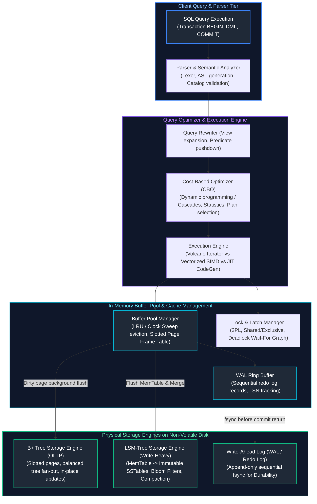

---

## Table of Contents
1. [Physical Storage Engines & Architecture](#1-physical-storage-engines--architecture)
   - [1.1 OLTP vs. OLAP Architecture](#11-oltp-vs-olap-architecture)
   - [1.2 Row-Oriented vs. Column-Oriented Physical Storage](#12-row-oriented-vs-column-oriented-physical-storage)
   - [1.3 Relational vs. NoSQL Database Paradigms](#13-relational-vs-nosql-database-paradigms)
   - [1.4 Database Normalization (1NF, 2NF, 3NF, BCNF)](#14-database-normalization-1nf-2nf-3nf-bcnf)
   - [1.5 Denormalization & Analytical Modeling Trade-offs](#15-denormalization--analytical-modeling-trade-offs)
   - [1.6 Primary Keys, Surrogate Keys, Natural Keys & High-Throughput Key Generation](#16-primary-keys-surrogate-keys-natural-keys--high-throughput-key-generation)
   - [1.7 Foreign Keys & Referential Integrity Constraints](#17-foreign-keys--referential-integrity-constraints)
   - [1.8 Unique Constraints, Check Constraints & Composite Rules](#18-unique-constraints-check-constraints--composite-rules)
   - [1.9 Slotted Page Physical Storage Architecture](#19-slotted-page-physical-storage-architecture)
   - [1.10 Storage Engine Showdown: B+ Trees vs. LSM-Trees](#110-storage-engine-showdown-b-trees-vs-lsm-trees)
   - [1.11 The LSM-Tree Deep-Dive: MemTable, SSTables, Bloom Filters & Compaction](#111-the-lsm-tree-deep-dive-memtable-sstables-bloom-filters--compaction)
   - [1.12 Buffer Pool Management & Page Eviction Algorithms](#112-buffer-pool-management--page-eviction-algorithms)
   - [1.13 Write-Ahead Logging (WAL) & The ARIES Crash Recovery Protocol](#113-write-ahead-logging-wal--the-aries-crash-recovery-protocol)
2. [Indexing Mechanisms & Physical Access Paths](#2-indexing-mechanisms--physical-access-paths)
   - [2.1 Indexing Fundamentals & B+ Tree Mechanics](#21-indexing-fundamentals--b-tree-mechanics)
   - [2.2 B+ Tree Fan-Out Mathematics & Page-Level Sizing](#22-b-tree-fan-out-mathematics--page-level-sizing)
   - [2.3 Specialized Index Topologies: Hash, GiST, GIN, and BRIN](#23-specialized-index-topologies-hash-gist-gin-and-brin)
   - [2.4 Composite Indexes & The Leading-Edge Leftmost Rule](#24-composite-indexes--the-leading-edge-leftmost-rule)
   - [2.5 Covering Indexes & Index-Only Scans (The INCLUDE Clause)](#25-covering-indexes--index-only-scans-the-include-clause)
   - [2.6 Clustered Indexes vs. Heap-Organized Tables with Secondary Indexes](#26-clustered-indexes-vs-heap-organized-tables-with-secondary-indexes)
   - [2.7 Index Selectivity & Cardinality Thresholds](#27-index-selectivity--cardinality-thresholds)
   - [2.8 Physical Access Path Taxonomy: Seq Scan, Index Scan, Index-Only Scan, Bitmap Scan](#28-physical-access-path-taxonomy-seq-scan-index-scan-index-only-scan-bitmap-scan)
   - [2.9 When Indexes Degrade Performance & Production Anti-Patterns](#29-when-indexes-degrade-performance--production-anti-patterns)
3. [Query Performance & Cost-Based Optimization](#3-query-performance--cost-based-optimization)
   - [3.1 The Query Execution Pipeline (Parser, Rewriter, CBO, Executor)](#31-the-query-execution-pipeline-parser-rewriter-cbo-executor)
   - [3.2 Cost-Based Optimization (CBO) Architecture (Dynamic Programming vs. Cascades)](#32-cost-based-optimization-cbo-architecture-dynamic-programming-vs-cascades)
   - [3.3 Database Statistics, Histograms & Cardinality Estimation Errors](#33-database-statistics-histograms--cardinality-estimation-errors)
   - [3.4 Optimization Primitives: Predicate Pushdown, Projection Pushdown & Partition Pruning](#34-optimization-primitives-predicate-pushdown-projection-pushdown--partition-pruning)
   - [3.5 Physical Join Algorithms: Nested Loop, Hash Join, Merge Sort Join](#35-physical-join-algorithms-nested-loop-hash-join-merge-sort-join)
   - [3.6 Execution Engine Models: Volcano Iterator vs. Vectorized SIMD vs. Whole-Stage JIT](#36-execution-engine-models-volcano-iterator-vs-vectorized-simd-vs-whole-stage-jit)
   - [3.7 Forensic EXPLAIN & EXPLAIN ANALYZE Mastery](#37-forensic-explain--explain-analyze-mastery)
4. [Transactions, Concurrency Control & MVCC](#4-transactions-concurrency-control--mvcc)
   - [4.1 ACID Guarantees & Hardware Failure Boundaries](#41-acid-guarantees--hardware-failure-boundaries)
   - [4.2 ANSI SQL Isolation Levels & Concurrency Anomalies Matrix](#42-ansi-sql-isolation-levels--concurrency-anomalies-matrix)
   - [4.3 Multi-Version Concurrency Control (MVCC) Internals (PostgreSQL vs. MySQL InnoDB)](#43-multi-version-concurrency-control-mvcc-internals-postgresql-vs-mysql-innodb)
   - [4.4 Tuple Visibility, Dead Tuples & The AUTOVACUUM Engine](#44-tuple-visibility-dead-tuples--the-autovacuum-engine)
   - [4.5 Deadlocks, Two-Phase Locking (2PL) & Lock vs. Latch Hierarchies](#45-deadlocks-two-phase-locking-2pl--lock-vs-latch-hierarchies)
5. [Production Database Engineering Summary & Diagnostic Reference](#5-production-database-engineering-summary--diagnostic-reference)
6. [References & Further Reading](#6-references--further-reading)

---

# 1. Physical Storage Engines & Architecture

The storage engine is the software subsystem responsible for persisting, indexing, reading, and locking structured data on non-volatile block devices (NVMe SSDs, magnetic hard drives, or distributed object storage).

---

### 1.1 OLTP vs. OLAP Architecture

#### 1. Mental Model & Real-World Analogy
- **OLTP (Online Transaction Processing):** Imagine an express grocery checkout scanner. A customer swipes items one by one: scan, update inventory, deduct bank balance, print receipt. It handles millions of tiny, sub-millisecond atomic transactions simultaneously.
- **OLAP (Online Analytical Processing):** Imagine a retail supply-chain analyst reviewing sales across 2,000 stores over the last 5 years to predict holiday inventory demand. The analyst does not care about one shopper's receipt; they need to scan 500 million rows, calculate aggregates (`SUM`, `AVG`), and group by region.


#### Detailed Architecture Comparison Matrix

| Evaluation Dimension | OLTP (Operational) | OLAP (Analytical) |
| :--- | :--- | :--- |
| **Primary Workload** | High-concurrency, short, atomic transactions. | Batch queries, complex aggregations, reporting. |
| **Data Access Pattern** | Point reads/writes by Primary Key (`WHERE id = ?`). | Scans of millions to billions of rows over few columns. |
| **Query Latency** | **Sub-millisecond to 10 ms.** | **Seconds to minutes.** |
| **Concurrency Target** | $10,000+$ concurrent users/connections. | $10 - 100$ concurrent analytical queries. |
| **Data Modeling** | Highly Normalized (3NF / BCNF). | Denormalized (Star Schema, Snowflake, OBT). |
| **Physical Storage** | Row-oriented slotted disk blocks (8 KB / 16 KB). | Columnar chunks (Parquet, ORC, Capacitor). |
| **Hardware Bottleneck**| Random I/O disk seeks, lock contention, memory latches. | Memory bandwidth, CPU SIMD throughput, network shuffle. |

---

### 1.2 Row-Oriented vs. Column-Oriented Physical Storage

#### 1. Mental Model & Physical Serialization
How data is serialized onto non-volatile storage blocks dictates query efficiency:
- **Row-Oriented:** Data is packed sequentially row by row: `[Row 1: ID, Name, Age, Zip] [Row 2: ID, Name, Age, Zip]`.
- **Column-Oriented:** Data is serialized column by column: `[Col ID: R1, R2...] [Col Name: R1, R2...] [Col Age: R1, R2...]`.


#### 2. Hardware Cache & Memory Bus Impact
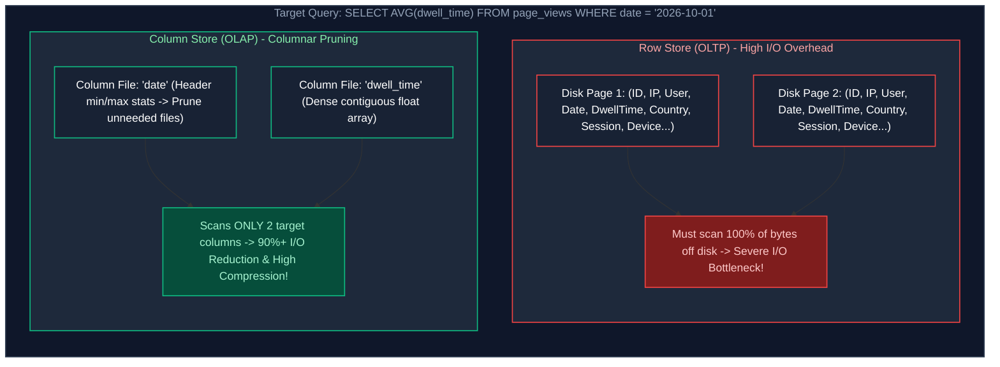

---

### 1.3 Relational vs. NoSQL Database Paradigms

NoSQL systems prioritize horizontal scalability, schema flexibility, and partition tolerance by relaxing ACID guarantees.

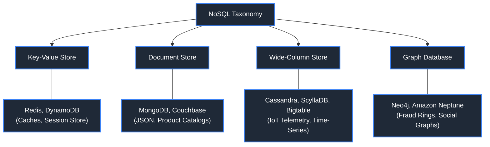

#### Comparison Matrix: Relational vs. NoSQL

| Dimension | Relational (RDBMS) | NoSQL (Distributed) |
| :--- | :--- | :--- |
| **Data Model** | Strict tabular schemas, foreign keys, 3NF. | Key-value, nested JSON documents, wide-column, graph. |
| **Schema Paradigm** | Schema-on-Write (`ALTER TABLE`). | Schema-on-Read / Dynamic Schema. |
| **Scaling Mechanism**| Vertical (Scale-Up), read replicas. | Horizontal (Scale-Out via partitioning / sharding). |
| **Consistency** | Immediate ACID consistency. | BASE (Basically Available, Soft-state, Eventual consistency). |
| **Query Engine** | Standard declarative SQL, cost-based optimizer. | Key-based lookups, proprietary APIs (CQL, MQL, Cypher). |

---

### 1.4 Database Normalization (1NF, 2NF, 3NF, BCNF)

Normalization systematically removes redundancy and eliminates insertion, update, and deletion anomalies.

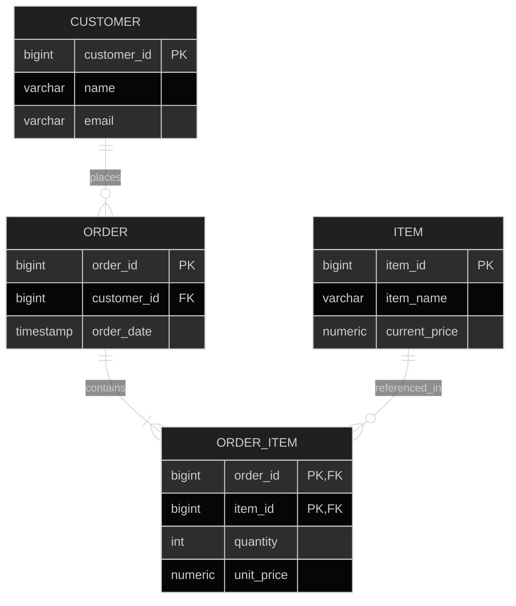

#### Normalization Hierarchy & Mathematical Rules:
1. **First Normal Form (1NF):**
   - Each column contains atomic (indivisible) values.
   - No arrays, lists, or multi-valued attributes in a single cell.
   - A primary key uniquely identifies each row.
2. **Second Normal Form (2NF):**
   - Meets 1NF.
   - Eliminates **Partial Dependencies**: All non-key attributes must depend on the *entire* primary key, not a proper subset of a composite key.
3. **Third Normal Form (3NF):**
   - Meets 2NF.
   - Eliminates **Transitive Dependencies**: Non-key attributes must depend *only* on candidate keys ($X \rightarrow Y \rightarrow Z$ is prohibited).
4. **Boyce-Codd Normal Form (BCNF):**
   - Stricter form of 3NF.
   - For *every* non-trivial functional dependency $X \rightarrow Y$, $X$ must be a **Super Key**.

---

### 1.5 Denormalization & Analytical Modeling Trade-offs

While OLTP requires 3NF to avoid update anomalies, OLAP intentionally denormalizes schemas (Star Schemas, Snowflake Schemas, One Big Table) to eliminate distributed network joins.

| Metric | Normalized (3NF - OLTP) | Denormalized (Star / OBT - OLAP) |
| :--- | :--- | :--- |
| **Write Performance** | **Fastest:** Single-row in-place updates. | **Slow:** Updating one attribute requires rewriting many rows. |
| **Read Performance** | **Slower:** Requires joining 10–20 tables. | **Fastest:** Pre-joined; zero or few joins at query time. |
| **Redundancy** | Zero redundancy. | High redundancy (strings repeated across millions of rows). |
| **Disk Consumption** | Smallest uncompressed footprint. | Mitigated by columnar dictionary compression. |

---

### 1.6 Primary Keys, Surrogate Keys, Natural Keys & High-Throughput Key Generation

A Primary Key enforces entity uniqueness. However, the architectural choice of key generation has severe physical storage implications.

| Key Architecture Strategy | Bit / Byte Size | Generation Mechanics | B+ Tree Page Split Risk | Security & Business Leakage | Optimal Production Scenario |
| :--- | :---: | :--- | :--- | :--- | :--- |
| **Natural Key** | Variable (String / Num) | Derived from domain business attribute (SSN, VIN, Email). | High if natural strings are inserted out-of-order. | **Severe:** Exposes PII directly; mutable if user updates email. | Small reference tables with immutable, standardized codes (e.g., ISO currency codes). |
| **Auto-Increment (`BIGINT`)** | 8 bytes | Central database sequence / `IDENTITY` counter (`1, 2, 3...`). | **Zero:** Monotonically increasing; appends to the rightmost leaf page. | **High:** Sequential IDs leak order volume, customer counts, and rate to competitors. | Monolithic single-node OLTP databases where ID secrecy is irrelevant. |
| **Random UUID v4** | 16 bytes (128 bits) | Cryptographically pseudo-random bits with zero ordering. | **Catastrophic (50% splits):** Inserts hit random pages, forcing continuous B+ Tree splits and buffer pool thrashing. | Zero leakage; globally unique without coordination. | Distributed systems where keys are never used as clustered B+ Tree primary keys. |
| **Time-Ordered UUID v7 / ULID** | 16 bytes (128 bits) | 48-bit Unix epoch millisecond timestamp + 74-bit monotonic random bits. | **Zero:** Monotonically sorted by generation timestamp; appends cleanly to B+ Tree. | High security (random suffix prevents guessing); zero coordination needed. | **Modern Enterprise Standard:** High-throughput microservices, distributed sharding, and event streaming. |

#### Code Example: Time-Ordered UUIDv7 Implementation
```sql
-- Creating an account table using modern identity surrogate keys
CREATE TABLE crm.accounts (
    account_id BIGINT GENERATED ALWAYS AS IDENTITY,
    account_uuid UUID DEFAULT gen_random_uuid(), -- Or uuid_generate_v7()
    company_name VARCHAR(120) NOT NULL,
    created_at TIMESTAMPTZ DEFAULT CURRENT_TIMESTAMP,
    CONSTRAINT pk_accounts PRIMARY KEY (account_id)
);
```

---

### 1.7 Foreign Keys & Referential Integrity Constraints

Foreign keys establish parent-child relationships and enforce referential integrity across relational entities.

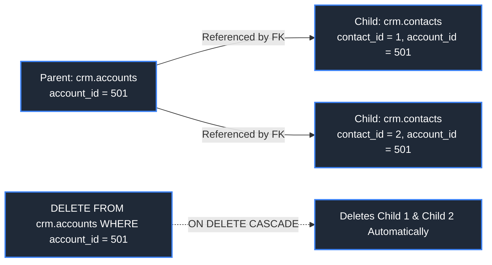

#### Production DDL with Cascade Policies:
```sql
CREATE TABLE crm.contacts (
    contact_id BIGINT PRIMARY KEY,
    account_id BIGINT NOT NULL,
    first_name VARCHAR(50) NOT NULL,
    email VARCHAR(100) NOT NULL,
    CONSTRAINT fk_contacts_account 
        FOREIGN KEY (account_id) 
        REFERENCES crm.accounts (account_id)
        ON DELETE CASCADE
        ON UPDATE RESTRICT
);

-- CRITICAL RULE: Always create an index on Foreign Key columns!
-- Relational engines do NOT automatically index foreign key columns.
CREATE INDEX idx_contacts_account_id ON crm.contacts (account_id);
```

---

### 1.8 Unique Constraints, Check Constraints & Composite Rules

```sql
CREATE TABLE billing.subscriptions (
    subscription_id BIGINT PRIMARY KEY,
    user_id BIGINT NOT NULL,
    plan_code VARCHAR(32) NOT NULL,
    monthly_rate NUMERIC(10, 2) NOT NULL,
    discount_percentage NUMERIC(5, 2) DEFAULT 0.00,
    start_date DATE NOT NULL,
    end_date DATE,
    -- Unique constraint preventing duplicate active subscriptions per user
    CONSTRAINT uq_user_plan UNIQUE (user_id, plan_code),
    -- Domain check constraints enforcing business bounds
    CONSTRAINT chk_positive_rate CHECK (monthly_rate >= 0),
    CONSTRAINT chk_valid_discount CHECK (discount_percentage >= 0 AND discount_percentage <= 100),
    CONSTRAINT chk_valid_date_range CHECK (end_date IS NULL OR end_date >= start_date)
);
```

---

### 1.9 Slotted Page Physical Storage Architecture

In traditional relational engines (PostgreSQL, MySQL InnoDB, SQLite), disk I/O occurs in fixed-size blocks called **Pages** (8 KB in PostgreSQL, 16 KB in InnoDB).

Because tuples vary in length, engines implement the **Slotted Page Architecture**:

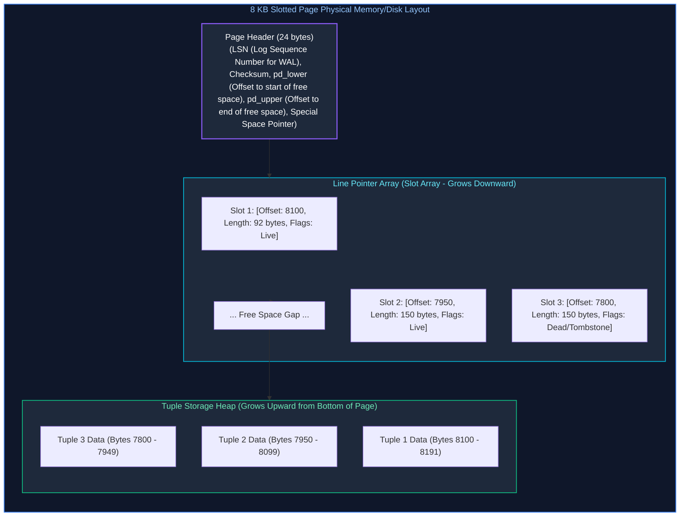

#### Why the Slotted Page Design is Brilliant:
1. **Stable Physical Row Identifier (Tuple ID / ItemPointer):** A row's physical address is designated as a `(PageNumber, SlotNumber)` pair (e.g., in PostgreSQL, `ctid = (42, 3)`).
2. **Defragmentation Without Rewriting Secondary Indexes:** If Tuple 2 expands in size, the engine shifts Tuple 3 downward into the free space gap. The engine only updates `Slot 2's` internal byte offset inside the page header. Outside secondary indexes still point to `(Page 42, Slot 2)`. Secondary indexes do not need to be rewritten!

---

### 1.10 Storage Engine Showdown: B+ Trees vs. LSM-Trees

Every storage engine makes a fundamental trade-off governed by the **RUM Conjecture** (Read, Update, Memory/Space optimization). You cannot optimize for all three simultaneously.


#### Detailed Architecture Comparison Matrix

| Evaluation Dimension | B+ Tree (Read-Heavy / OLTP) | LSM-Tree (Log-Structured Merge / Write-Heavy) |
| :--- | :--- | :--- |
| **Write Mechanism** | **In-Place Updates:** Directly overwrites bytes inside 8KB/16KB slotted pages on disk. | **Append-Only:** Writes to an in-memory buffer (`MemTable`) and an append-only WAL. |
| **Write Amplification (WA)**| **High (10x–50x):** Modifying a 20-byte record forces writing the entire 8KB/16KB page to disk. | **Low to Moderate:** Batched sequential writes during SSTable flushing and background compaction. |
| **Read Latency (Point)** | **Lowest ($O(\log N)$):** Single tree traversal directly down to the target leaf page. | **Higher ($O(K \cdot \log N)$):** Must probe MemTable, plus $K$ levels of SSTables (mitigated by Bloom filters). |
| **Range Query Latency** | **Optimal:** Leaf pages form a contiguous doubly-linked list on disk. | **Moderate:** Requires an external $K$-way merge iterator across multiple SSTables. |
| **Space Amplification (SA)**| **Moderate:** Internal page fragmentation from fill-factor gaps (often 25–40% empty space). | **Variable:** Dead versions and deleted tombstones remain on disk until background compaction runs. |
| **Storage Substrate** | Excels on fast random-access NVMe SSDs with battery-backed DRAM. | Ideal for write-heavy logging, time-series, cloud object storage, and write-constrained flash. |

---

### 1.11 The LSM-Tree Deep-Dive: MemTable, SSTables, Bloom Filters & Compaction

#### 1. The Write Path
1. **Write-Ahead Log (WAL):** When a write (`PUT key, value` or `DELETE key`) arrives, it is appended to an on-disk sequential log file for crash durability.
2. **MemTable:** The write is immediately inserted into an in-memory concurrent sorted data structure (typically a **SkipList** or Red-Black Tree). The client receives an immediate success response ($O(1)$ latency).
3. **Flushing to L0 SSTable:** When the `MemTable` reaches a threshold (e.g., 64 MB), it transitions to an immutable state, and a background thread flushes its sorted contents sequentially to disk as a **Sorted String Table (SSTable)** in Level 0 ($L_0$).

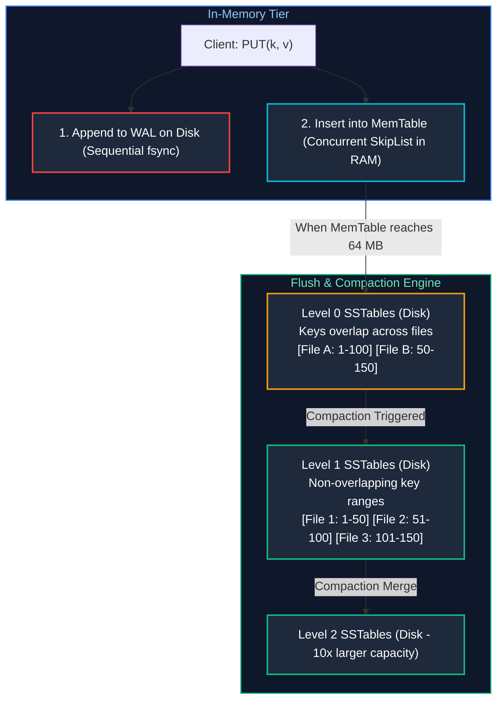

#### 2. Compaction Strategies: Size-Tiered vs. Leveled Compaction

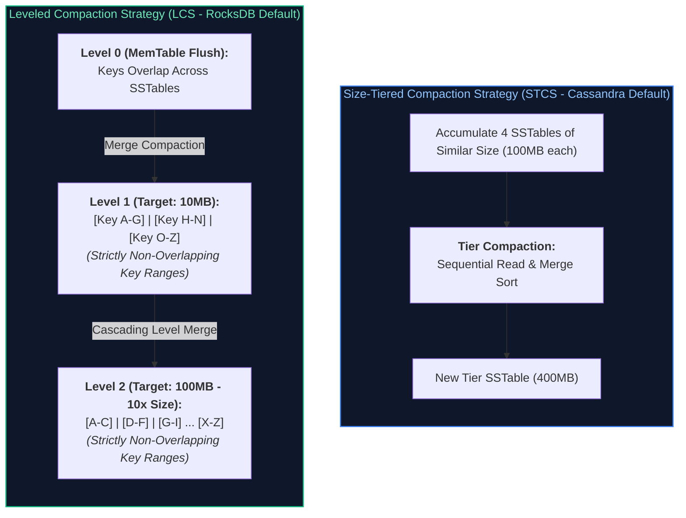

| Evaluation Dimension | Size-Tiered Compaction (STCS) | Leveled Compaction (LCS) |
| :--- | :--- | :--- |
| **Write Amplification** | **Low to Moderate ($O(\log N)$):** SSTables are only merged when $N$ similarly sized files accumulate. | **High ($O(10 	imes 	ext{Levels})$):** Moving a file from $L_i$ to $L_{i+1}$ requires re-reading and rewriting up to 10 overlapping files. |
| **Space Amplification** | **High ($100\%$ overhead):** In the worst case, compacting the largest tier requires $50\%$ free disk headroom to create the merged SSTable before deleting old ones. | **Low ($10\% - 15\%$ overhead):** Only compacts one small file at a time; disk utilization stays close to $90\%$. |
| **Read Amplification (P99 Latency)** | **Variable / High:** A single point read may need to check multiple SSTables across every tier (mitigated by Bloom filters). | **Low & Predictable:** At most **one** SSTable per level needs to be read because key ranges within $L_1, L_2...$ never overlap. |
| **Optimal Production Workload** | Heavy write-dominated workloads (time-series metrics, append-only sensor logs, bulk ingest). | Read-heavy or mixed workloads requiring tight SLAs on point lookups (OLTP, user profiles, key-value caches). |

---

### 1.12 Buffer Pool Management & Page Eviction Algorithms

Database engines never read or write directly to disk files during query execution. All reads and modifications happen inside an in-memory memory region called the **Buffer Pool** (Shared Buffers in PostgreSQL, Buffer Pool in MySQL InnoDB).

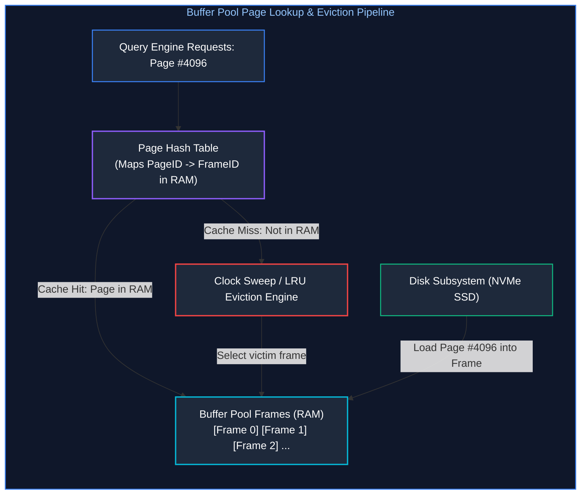

#### Eviction Algorithms: LRU vs. Clock Sweep (Second Chance) vs. LRU-K
- **Pure LRU Flaw (Sequential Scan Flooding):** If an analyst runs `SELECT * FROM massive_table`, a pure LRU (Least Recently Used) cache will evict the entire working set of active OLTP indexes and hot rows, replacing them with pages that will only ever be read once.
- **The Clock Sweep (Second-Chance) Algorithm (PostgreSQL):**
  - Frames are arranged in a circular logical buffer with a moving hand.
  - Each frame holds a `usage_count` (0 to 5).
  - When the clock hand inspects a frame:
    - If `pin_count > 0`: Skip (page is active).
    - If `usage_count > 0`: Decrement `usage_count` by 1 and advance hand.
    - If `usage_count == 0`: If the page is clean, evict immediately! If dirty, queue for asynchronous disk flush.

---

### 1.13 Write-Ahead Logging (WAL) & The ARIES Crash Recovery Protocol

#### 1. Why WAL is Mandatory
Writing random 8 KB pages directly to disk on every transaction `COMMIT` would destroy throughput: magnetic heads would thrash, and SSD flash controllers would suffer heavy write amplification. 

Databases operate under the **Steal/No-Force Policy**:
- **NO-FORCE:** The engine does *not* force dirty data pages to disk before committing. A transaction can commit as soon as its small sequential delta is written to the Write-Ahead Log.
- **STEAL:** The buffer pool manager is permitted to "steal" a dirty page from an uncommitted transaction and flush it to disk if memory is completely full.

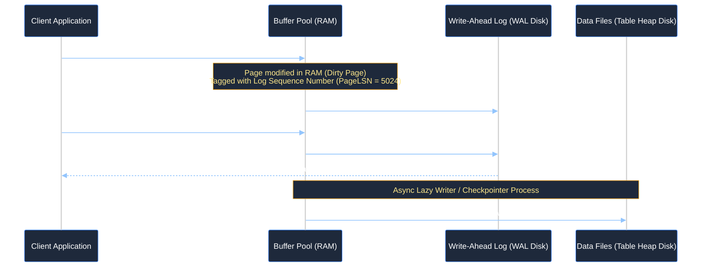

#### 2. The ARIES Recovery Algorithm
When a server crashes (power failure, kernel panic), the data files on disk contain an inconsistent mix of uncommitted stolen pages and missing unforced updates. Upon reboot, the database executes the **ARIES (Algorithms for Recovery and Isolation Exploiting Semantics)** protocol:

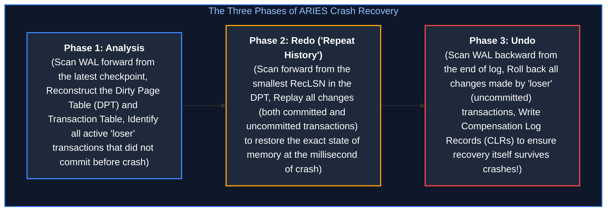

---

# 2. Indexing Mechanisms & Physical Access Paths

Indexes are auxiliary physical data structures engineered to accelerate data retrieval at the cost of additional storage and write latency.

---

### 2.1 Indexing Fundamentals & B+ Tree Mechanics

#### Definition
Without an index, the database engine must execute a **Full Table Scan (Sequential Scan)**, inspecting every page on disk from start to finish ($O(N)$ time complexity). An index provides a sorted lookup directory that allows the engine to locate matching rows in logarithmic $O(\log N)$ or constant $O(1)$ time.

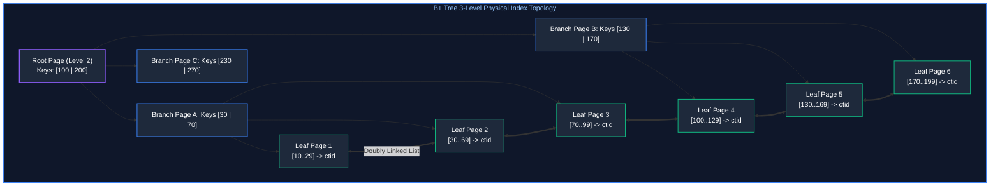

---

### 2.2 B+ Tree Fan-Out Mathematics & Page-Level Sizing

Why can a B+ Tree locate a single record among 100,000,000 rows in just 3 or 4 disk I/O operations?
- Let Page Size = 8 KB ($8,192$ bytes).
- Let Page Header = 24 bytes $\rightarrow$ Usable space $\approx 8,100$ bytes.
- Let Index Key = `BIGINT` (8 bytes) + Child Page Pointer (6 bytes) = 14 bytes per entry.
- **Fan-out ($F$):**
  $$F = \left\lfloor \frac{8,100}{14} \right\rfloor \approx 578 \text{ children per page}$$
- Assuming an average page fill factor of 70% (due to random splits and updates):
  $$\text{Effective Fan-out } (F_{\text{eff}}) = 578 \times 0.70 \approx 404$$

##### Capacity by Tree Height:
- **Height 1 (Root only):** $404$ rows.
- **Height 2 (Root + Leaves):** $404^2 = 163,216$ rows.
- **Height 3 (Root + Branches + Leaves):** $404^3 = \mathbf{65,939,264} \text{ rows!}$
- **Height 4:** $404^4 = \mathbf{26.6 \text{ Billion rows!}}$

Because the Root and Branch pages are constantly referenced, they remain **pinned permanently in the in-memory Buffer Pool RAM**. Thus, finding any row in a table of 65 million rows requires **at most 1 single physical disk read** (to fetch the leaf page)!

---

### 2.3 Specialized Index Topologies: Hash, GiST, GIN, and BRIN

| Index Topology | Underlying Data Structure | Supported Query Operators | Ideal Use Case | Storage Footprint |
| :--- | :--- | :--- | :--- | :--- |
| **B+ Tree** | Balanced Multi-Way Tree | `=`, `<`, `<=`, `>`, `>=`, `BETWEEN`, `ORDER BY` | Default primary keys, timestamps, numeric ranges | Moderate |
| **Hash Index** | Static Hash Table / Bucket Chains | `=` (Equality only) | Exact match lookups on long UUIDs/strings | Compact |
| **GIN** (Generalized Inverted Index) | Inverted Index (Key $\rightarrow$ Array of Postings) | `@>` (Contains), `&&` (Overlap), Full-Text `to_tsvector` | Searching inside JSONB documents, arrays, full-text search | High |
| **GiST** (Generalized Search Tree) | Balanced Tree with custom predicate splitting | `&&` (Bounding box overlap), `<->` (KNN Distance) | PostGIS geospatial polygons, geometric shapes, range types | Moderate to High |
| **BRIN** (Block Range Index) | Min/Max summary per physical block range (128 pages) | `=`, `<`, `<=`, `>`, `>=` on physically sorted columns | Massive append-only time-series tables (billions of rows) | **Microscopic (0.1% of B-Tree)** |

```sql
-- Creating a lightweight BRIN index for append-only audit logs
CREATE INDEX idx_audit_logs_created_at_brin 
ON core.audit_logs 
USING BRIN (created_at) 
WITH (pages_per_range = 128);
```

---

### 2.4 Composite Indexes & The Leading-Edge Leftmost Rule

A composite index is an index constructed over multiple columns: `CREATE INDEX idx_user_loc ON users (country, state, city)`.

| Query `WHERE` Filter | B+ Tree Traversal Capability | Index Access Method | Execution Engine Behavior & Physical I/O |
| :--- | :--- | :--- | :--- |
| `WHERE a = 10 AND b = 20` | **Full Index Seek** | `Index Seek (idx_a_b_c)` | Traverses root-to-leaf using `(10, 20)`; isolates exact matching leaf range with minimal page reads. |
| `WHERE a = 10` | **Full Index Seek (Prefix)** | `Index Seek (idx_a_b_c)` | Traverses tree on leading column `a=10`; scans the contiguous range of matching rows on leaf level. |
| `WHERE a = 10 AND c = 30` | **Partial Index Seek** | `Index Seek + Filter` | Seeks on `a=10`; because `b` is omitted, the engine cannot seek on `c` and must filter `c=30` in memory across all `a=10` rows. |
| `WHERE b = 20 AND c = 30` | **Zero Index Seek** | `Seq Scan (Full Table Scan)` | The leading edge `a` is absent. Just as a physical phonebook sorted by `(LastName, FirstName)` cannot locate "Bob" without a last name, the index is skipped. |

#### Production Ordering Rules:
1. **Equality Columns First:** Place columns filtered with `=` at the beginning of the index.
2. **Range Columns Last:** Place columns filtered with range operators (`<`, `>`, `BETWEEN`) at the end. Once a range operator is encountered, the B+ Tree cannot use subsequent columns for tree traversal.

---

### 2.5 Covering Indexes & Index-Only Scans (The INCLUDE Clause)

When an index satisfies a query entirely on its own without requiring a secondary trip to the base table heap, it is called a **Covering Index**. The query executes an **Index-Only Scan**.

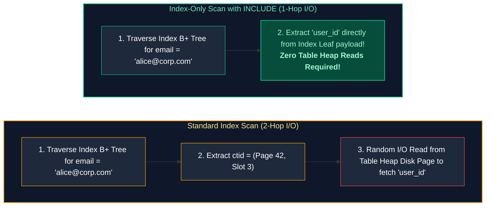

```sql
-- Covering index using the INCLUDE clause
CREATE INDEX idx_users_email_covering 
ON core.users (email) 
INCLUDE (user_id, created_at);

-- Executes 10x faster via an INDEX-ONLY SCAN:
SELECT user_id, created_at 
FROM core.users 
WHERE email = 'alice@example.com';
```

---

### 2.6 Clustered Indexes vs. Heap-Organized Tables with Secondary Indexes

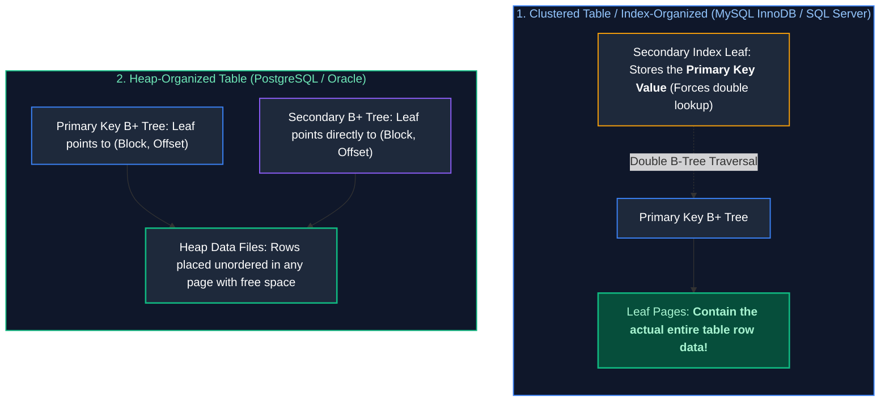

---

### 2.7 Index Selectivity & Cardinality Thresholds

- **Selectivity:** The proportion of rows satisfying a query predicate:
  $$\text{Selectivity} = \frac{\text{Number of Matching Rows}}{\text{Total Rows in Table}}$$
- **Rule of Thumb:** 
  - If Selectivity is **$\le 2\% - 5\%$**: The optimizer chooses an **Index Scan** or **Bitmap Index Scan**.
  - If Selectivity exceeds **$15\% - 20\%$**: The optimizer abandons the index and executes a **Sequential Scan** because reading scattered disk pages via random I/O is far slower than streaming sequential blocks.

---

### 2.8 Physical Access Path Taxonomy: Seq Scan, Index Scan, Index-Only Scan, Bitmap Scan

The query optimizer selects an access path to retrieve physical tuples from the storage subsystem. The optimal path depends strictly on predicate selectivity, page-clustering density, and available index coverage:

| Physical Access Path | Selectivity Threshold | Physical I/O Access Pattern | Table Heap Page Access | Primary Failure Mode & Bottlenecks |
| :--- | :--- | :--- | :--- | :--- |
| **Sequential Scan (`Seq Scan`)** | $> 15\% - 20\%$ of table rows | Sequential read of contiguous disk blocks (OS read-ahead enabled). | Reads every heap page from block `0` to end. | High CPU/Disk bandwidth consumption on large tables ($> 10\text{ GB}$) when an index could have isolated rows. |
| **Index Scan (`Index Scan`)** | $< 2\% - 5\%$ of table rows | Random I/O: 1 random heap read per matching index pointer. | Fetches physical heap page for every tuple to retrieve non-indexed columns and check visibility. | **Random I/O Thrashing:** If selectivity exceeds 10%, random page reads crater SSD throughput compared to a single streaming scan. |
| **Index-Only Scan (`Index-Only Scan`)** | $< 10\% - 15\%$ of table rows | Sequential or range traversal of index leaf pages only. | **Zero Heap Access** (as long as the Visibility Map confirms pages contain no dead tuples). | Degrades into regular Index Scan if table is bloated with dead tuples and Visibility Map bits are cleared (`AUTOVACUUM` lagging). |
| **Bitmap Scan (`Bitmap Index Scan` + `Bitmap Heap Scan`)** | $5\% - 20\%$ (Medium Selectivity) | Hybrid: Random index lookups $\rightarrow$ in-memory bit-array sort $\rightarrow$ sequential physical heap reads. | Reads only matching heap pages, but in strict physical page number order. | **Bitmap Lossiness:** If matching rows exceed `work_mem`, the bitmap degrades from tuple-level accuracy to page-level lossiness, forcing re-checks. |

---

### 2.9 When Indexes Degrade Performance & Production Anti-Patterns

1. **Write Amplification on DML (Inserts/Updates/Deletes):** Every single `INSERT` must physically insert keys into every index on the table. A table with 12 indexes turns 1 disk write into 13 separate disk writes.
2. **Buffer Pool Cache Starvation:** Useless or bloated indexes consume precious RAM frames in the Buffer Pool, evicting critical hot table pages.
3. **The Low-Cardinality Trap:** Creating a B+ Tree index on a boolean column (`is_active`) or gender column where 50% of the table matches is an anti-pattern.
4. **Function Call Invalidation:**
   ```sql
   -- ANTI-PATTERN: The optimizer CANNOT use an index on 'created_at'!
   SELECT * FROM orders WHERE DATE(created_at) = '2026-10-16';

   -- PRODUCTION FIX: Use a sargable range condition
   SELECT * FROM orders 
   WHERE created_at >= '2026-10-16 00:00:00' 
     AND created_at <  '2026-10-17 00:00:00';
   ```

---

# 3. Query Performance & Cost-Based Optimization

The Query Optimizer translates declarative SQL into an optimal physical pipeline of relational algebraic operators.

---

### 3.1 The Query Execution Pipeline (Parser, Rewriter, CBO, Executor)

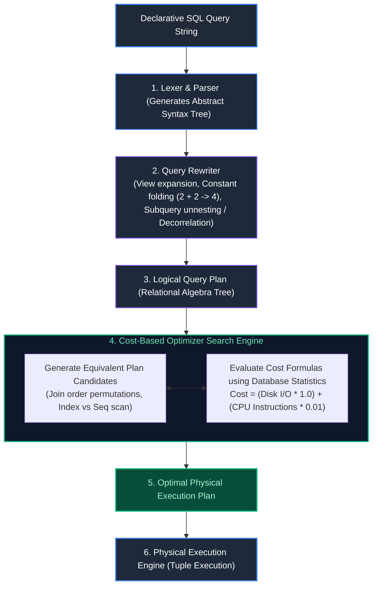

---

### 3.2 Cost-Based Optimization (CBO) Architecture (Dynamic Programming vs. Cascades)

1. **Bottom-Up Dynamic Programming (System R Algorithm):** Used by PostgreSQL for queries with $\le 12$ joins. It builds optimal two-table joins, then three-table joins, pruning unpromising permutations via Bellman's principle of optimality. If joins exceed `geqo_threshold` (12 tables), it switches to a **Genetic Algorithm (GEQO)** to avoid factorial search explosion ($N!$).
2. **Top-Down Rule-Based & Memo Search (Volcano / Cascades):** Used by Snowflake, SQL Server, Trino, and DuckDB. It explores logical equivalences and physical bindings using rule transformations stored in an in-memory memoization graph.

---

### 3.3 Database Statistics, Histograms & Cardinality Estimation Errors

The Cost-Based Optimizer relies entirely on **Statistics** stored in the system catalog (`pg_statistic` / `pg_stats`). If statistics are stale, the optimizer makes catastrophically wrong decisions.

| Catalog Statistic Primitive | PostgreSQL Catalog Attribute | Measurement Description | Query Optimizer Mathematical Usage |
| :--- | :--- | :--- | :--- |
| **Number of Distinct Values (NDV)** | `n_distinct` | Negative value indicates ratio (`-0.5` = 50% distinct); positive value indicates exact unique count. | Determines expected cardinality for `GROUP BY` and join hash-table sizing. |
| **Null Fraction** | `null_frac` | Percentage of column values that are `NULL` ($0.0$ to $1.0$). | Discounts table row count when calculating selectivity for non-null predicates (`IS NOT NULL`). |
| **Most Common Values (MCV)** | `most_common_vals` & `most_common_freqs` | Array of the most frequent values and their exact decimal frequencies (e.g., `[US, CA]`, `[0.60, 0.15]`). | Directly yields ground-truth selectivity for skewed columns without uniform distribution assumptions. |
| **Equi-Depth Histogram** | `histogram_bounds` | Quantile boundaries dividing the non-MCV population into buckets with equal numbers of rows. | Estimates selectivity for range queries (`WHERE age BETWEEN 25 AND 40`) via linear interpolation between bucket bounds. |

#### Why Cardinality Estimation Fails: Cross-Column Correlation
Traditional optimizers assume that predicates on different columns are **statistically independent**:
$$P(A \land B) = P(A) \times P(B)$$

Consider a car inventory table with 1,000,000 rows:
- `P(make = 'Audi') = 0.01` (1% of cars)
- `P(model = 'A4') = 0.005` (0.5% of cars)
- If a query executes: `WHERE make = 'Audi' AND model = 'A4'`:
  $$\text{Estimated Selectivity} = 0.01 \times 0.005 = 0.00005 \implies \mathbf{50 \text{ rows estimated}}$$
- The optimizer expects only 50 rows and chooses a **Nested Loop Join**.
- In reality, *every single Audi A4 is made by Audi*! The actual matching row count is **5,000 rows** (a 100x estimation error). The nested loop join thrashes the database for 30 minutes!

##### Production Resolution: Extended Multi-Column Statistics
```sql
-- Tell the optimizer to compute joint cross-column dependencies
CREATE STATISTICS stats_cars_make_model ON make, model FROM inventory.cars;
ANALYZE inventory.cars;
```

---

### 3.4 Optimization Primitives: Predicate Pushdown, Projection Pushdown & Partition Pruning

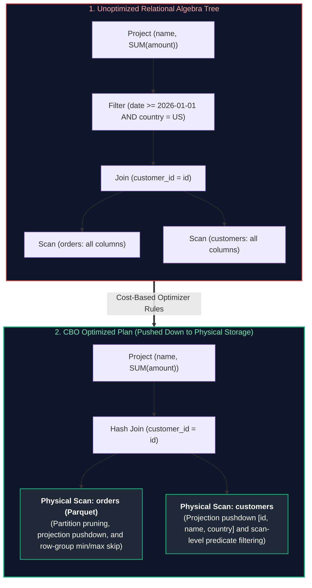

| Optimization Primitive | Target Stage in Pipeline | Physical Engine Mechanism | Hardware / Network Impact |
| :--- | :--- | :--- | :--- |
| **Partition Pruning** | Catalog & Metastore Resolution | Inspects directory naming patterns (`/year=2026/`) or metadata partition manifests. | **100% I/O Elimination:** Completely skips filesystem directory listing and file open syscalls for non-matching partitions. |
| **Projection Pushdown** | Storage Reader & Parser | In columnar formats (Parquet/ORC), passes requested column ordinal list to file decoder. | **Memory Bus Efficiency:** Unrequested columns are never deserialized or transferred into RAM; eliminates gigabytes of memory copy overhead. |
| **Predicate Pushdown** | Storage Scanner / Page Reader | Pushes SQL `WHERE` expressions into parquet page headers / row-group min/max statistics or database index scan. | **Data Elimination at Source:** Evaluates filters before records are decompressed; prevents non-qualifying tuples from saturating execution memory or network shuffles. |

---

### 3.5 Physical Join Algorithms: Nested Loop, Hash Join, Merge Sort Join

Every logical `JOIN` in SQL must be executed by one of three physical join algorithms:

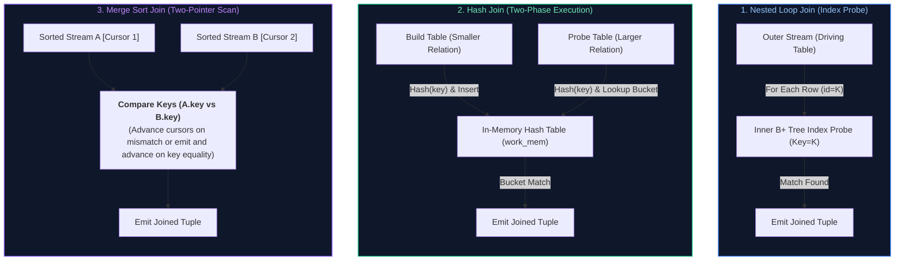

#### Detailed Join Comparison Matrix

| Join Algorithm | Time Complexity | Memory Requirements | Prerequisite | Vulnerability / Failure Mode |
| :--- | :--- | :--- | :--- | :--- |
| **Nested Loop** | $O(N \times M)$ (Without index)<br/>$O(N \log M)$ (With index) | $O(1)$ Minimal RAM | None | Explodes quadratically ($O(N^2)$) if row estimates are wrong. |
| **Hash Join** | $O(N + M)$ | $O(\text{Size of Build Table})$ | Equality operator (`=`) required | **Hash Spill:** If build table exceeds `work_mem`, spills to disk chunks (Grace Hash Join), cratering throughput. |
| **Merge Sort Join**| $O(N \log N + M \log M)$ | $O(1)$ if pre-sorted; spills if sorting in memory | Join keys must be sortable | High sorting cost if neither input is supported by an index. |

---

### 3.6 Execution Engine Models: Volcano Iterator vs. Vectorized SIMD vs. Whole-Stage JIT

The physical execution engine translates the physical plan produced by the Cost-Based Optimizer into executed machine instructions. The choice of execution engine dictates how CPU registers, L1/L2 caches, and instruction branches are utilized.

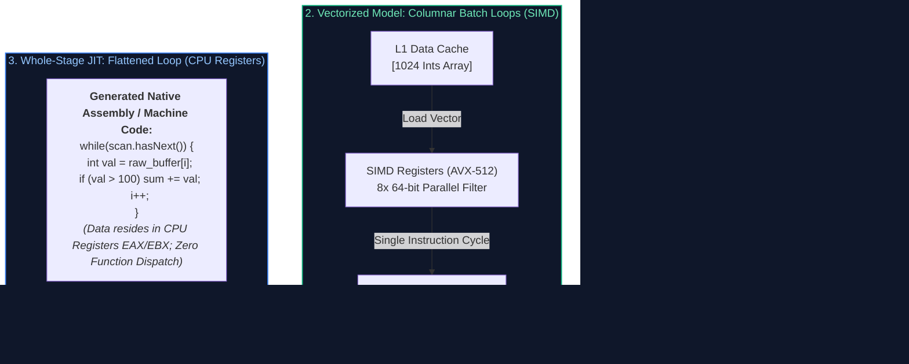

#### Multi-Dimensional Engineering Comparison Matrix

| Dimension / Characteristic | Volcano Iterator Model (Tuple-at-a-Time) | Vectorized Execution (Batch-at-a-Time) | Whole-Stage Code Generation (JIT) |
| :--- | :--- | :--- | :--- |
| **Processing Granularity** | 1 tuple per invocation via `next()` pull call. | Columnar vector batch (e.g., 1,024 – 2,048 tuples). | Pipeline-breaker to pipeline-breaker (entire query stage). |
| **Function Call Overhead** | **Severe:** 1+ virtual dispatch calls per attribute per tuple ($O(N \times \text{Operators})$). | **Amortized:** 1 function call per 1,024 tuples ($1/1024$-th overhead). | **Zero:** Operators collapsed into a single flattened imperative loop. |
| **CPU Cache Locality** | **Poor:** Data and instructions evicted continuously; cache thrashing between L1/L2. | **High:** Tight primitive arrays fit entirely in L1/L2 data cache; prefetching enabled. | **Optimal:** Intermediate states stay resident in CPU hardware registers. |
| **Compiler Optimization** | Prevented by indirect function pointers and virtual dispatches. | **SIMD / AVX-512:** Auto-vectorization of tight loops over primitive arrays. | **Inlining & Loop Unrolling:** LLVM/C++ compiler optimizes dead code and branches. |
| **Materialization Overhead** | Zero intermediate storage required. | Requires allocating small in-memory columnar vector buffers. | Zero intermediate record materialization between operators. |
| **Representative Production Engines** | PostgreSQL, MySQL, SQLite, Apache Spark (< 2.0). | ClickHouse, Snowflake, DuckDB, Apache Arrow / Velox. | Apache Spark SQL (Tungsten), HyPer, SingleStore, PostgreSQL (LLVM JIT). |
| **Optimal Workload Profile** | OLTP with high selectivity ($< 10$ rows retrieved by index). | OLAP columnar aggregations and sequential scans over billions of rows. | Complex analytic queries with heavy arithmetic, filters, and projections. |

---

### 3.7 Forensic EXPLAIN & EXPLAIN ANALYZE Mastery

Executing `EXPLAIN (ANALYZE, BUFFERS, COSTS, VERBOSE)` in PostgreSQL executes the query and returns ground-truth physical execution telemetry.

#### Real-World Production Execution Plan Walkthrough
```text
Hash Join  (cost=1250.00..54200.00 rows=8050 width=120) (actual time=12.450..185.320 rows=8120 loops=1)
  Hash Cond: (f.customer_id = c.customer_id)
  Buffers: shared hit=4210 read=1850 dirtied=12
  ->  Seq Scan on fact_orders f  (cost=0.00..48500.00 rows=500000 width=48) (actual time=0.050..112.400 rows=500000 loops=1)
        Filter: (order_date >= '2026-01-01'::date)
        Rows Removed by Filter: 120000
        Buffers: shared hit=3800 read=1850
  ->  Hash  (cost=1150.00..1150.00 rows=8000 width=72) (actual time=12.200..12.200 rows=8000 loops=1)
        Buckets: 16384  Batches: 1  Memory Usage: 720kB
        Buffers: shared hit=410
        ->  Index Scan using idx_customer_tier on dim_customer c  (cost=0.42..1150.00 rows=8000 width=72) (actual time=0.040..8.500 rows=8000 loops=1)
              Index Cond: (tier = 'PLATINUM'::text)
              Buffers: shared hit=410
Planning Time: 0.850 ms
Execution Time: 187.120 ms
```

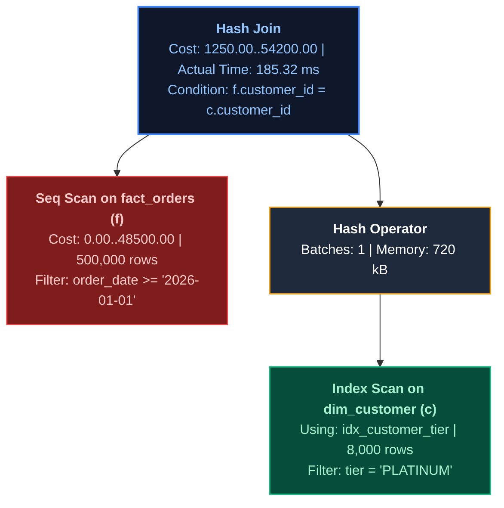

| Execution Plan Node | Est. Rows vs Actual Rows | Cost Range | Actual Time | Physical I/O & Memory |
| :--- | :---: | :---: | :---: | :--- |
| **Hash Join** | 8,050 vs **8,120** | `1250.00..54200.00` | 185.32 ms | Shared Hit: 4,210, Read: 1,850 |
| **Seq Scan (`fact_orders`)** | 500,000 vs **500,000** | `0.00..48500.00` | 112.40 ms | 1,850 physical disk block reads |
| **Hash Operator** | 8,000 vs **8,000** | `1150.00..1150.00` | 12.20 ms | 720 kB RAM (Fits in `work_mem`) |
| **Index Scan (`dim_customer`)** | 8,000 vs **8,000** | `0.42..1150.00` | 8.50 ms | 410 buffer pool hits (0 disk reads) |

#### Forensic Diagnostic Rules:
1. **Cost Numbers (`cost=1250.00..54200.00`):** Expressed in arbitrary disk-page fetch units. The first number is startup cost (time to emit first row); the second is total cost to emit all rows.
2. **Cardinality Estimation Errors (`rows=8050` vs. `actual rows=8120`):** An accurate estimation ($< 20\%$ variance). If estimated rows were 50 and actual was 500,000, statistics are stale (`ANALYZE` required).
3. **Buffer Hit Ratio:**
   $$\text{Cache Hit Ratio} = \frac{\text{shared hit}}{\text{shared hit} + \text{shared read}} = \frac{4210}{4210 + 1850} = \mathbf{69.4\%}$$
   A hit ratio below 95% indicates the Buffer Pool is too small, forcing heavy physical NVMe SSD reads (`read=1850`).
4. **Hash Table Sizing (`Batches: 1 Memory Usage: 720kB`):** Fits entirely in `work_mem`. If `Batches > 1`, the hash table spilled to disk!

---

# 4. Transactions, Concurrency Control & MVCC

Transaction management guarantees that multi-step operations remain consistent and isolated despite concurrent threads and sudden power failures.

---

### 4.1 ACID Guarantees & Hardware Failure Boundaries

ACID guarantees are not theoretical software abstractions; they are concrete engineering mechanisms designed to maintain data integrity across physical hardware failure boundaries (CPU register loss, volatile RAM loss, operating system kernel panics, and storage controller power interruptions).

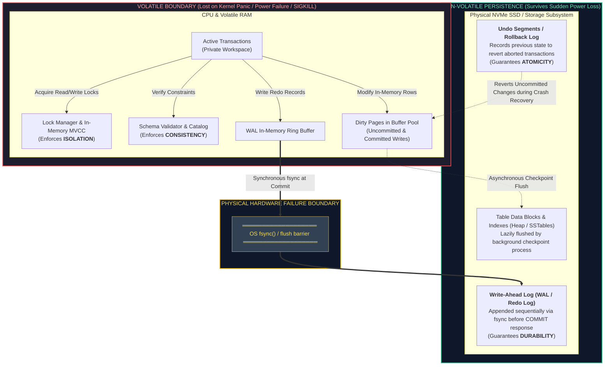

#### Hardware Failure Boundaries & ACID Crash Recovery Matrix

| ACID Property | Enforcing Engine Mechanism | Hardware / Runtime Failure Boundary Protected | Physical Failure Recovery Protocol |
| :--- | :--- | :--- | :--- |
| **Atomicity** | Undo Logs / Rollback Segments / ARIES Compensation Log Records (CLRs) | Application crash, transaction abort, out-of-disk error midway through transaction | **Undo Phase of Crash Recovery:** Database scans active transactions that never committed and applies undo logs to revert partially written pages in the Buffer Pool. |
| **Consistency** | Schema constraints (PK, FK, CHECK), unique indexes, deferred constraint triggers | Software application bug, malformed SQL payload, concurrent foreign key invalidation | **Immediate Abort:** If an invariant is violated, the transaction aborts before commit, rolling back all intermediate mutations without touching durable state. |
| **Isolation** | Lock Manager (Two-Phase Locking - 2PL), MVCC visibility headers (`xmin`/`xmax`), Serializable SSI | Multi-core CPU concurrency, race conditions, interleaved read/write transactions | **Conflict Serializability:** Concurrency anomalies (dirty reads, non-repeatable reads, write skew) are prevented in-memory via latch/lock hierarchies and visibility snapshots. |
| **Durability** | Sequential Write-Ahead Log (WAL / Redo Log) with synchronous OS `fsync()` barrier | Sudden power outage, OS kernel panic, server hardware / motherboard failure | **Redo Phase of Crash Recovery:** Database reads WAL records sequentially from the last persistent checkpoint forward, reapplying all committed mutations to disk blocks. |

---

### 4.2 ANSI SQL Isolation Levels & Concurrency Anomalies Matrix

The ANSI SQL standard defines isolation levels according to the read anomalies they prevent. However, modern research (Berenson et al.) proved that ANSI omitted critical anomalies like **Write Skew**.

| Isolation Level | Dirty Read | Non-Repeatable Read | Phantom Read | Lost Update | Write Skew |
| :--- | :---: | :---: | :---: | :---: | :---: |
| **Read Uncommitted** | Permitted | Permitted | Permitted | Permitted | Permitted |
| **Read Committed** (PostgreSQL Default) | **Prevented** | Permitted | Permitted | Permitted | Permitted |
| **Repeatable Read** (MySQL InnoDB Default)| **Prevented** | **Prevented** | **Prevented** (InnoDB/PG) | **Prevented** | Permitted |
| **Serializable** (Strict 2PL / SSI) | **Prevented** | **Prevented** | **Prevented** | **Prevented** | **Prevented** |

#### The Notorious "Write Skew" Anomaly (Why Repeatable Read Fails)
Consider a hospital on-call rotation rule: *"At least one doctor must be active on call at all times."*
- Doctors Alice and Bob are currently on call.
- Alice and Bob simultaneously request to take time off:
  - **Transaction 1 (Alice):** Checks `SELECT COUNT(*) FROM on_call;` $\implies$ returns 2. Safe to leave! Updates Alice to inactive.
  - **Transaction 2 (Bob):** Checks `SELECT COUNT(*) FROM on_call;` $\implies$ returns 2. Safe to leave! Updates Bob to inactive.
- Both transactions commit under **Repeatable Read** isolation because neither updated a row that the other was modifying!
- **Result:** Zero doctors are left on call! The hospital rule is violated.
- **Resolution:** Requires **Serializable** isolation (which detects overlapping read/write predicate dependencies) or explicit row locking (`SELECT ... FOR UPDATE`).

---

### 4.3 Multi-Version Concurrency Control (MVCC) Internals (PostgreSQL vs. MySQL InnoDB)

MVCC guarantees that **readers never block writers, and writers never block readers**. When a row is updated, the engine does not overwrite the existing bytes; it creates a new version of the row.

#### 1. PostgreSQL MVCC: Tuple Headers in the Heap
In PostgreSQL, all row versions (both live and dead) are stored directly inside the main table data pages. Every tuple header carries explicit transaction metadata:
- `t_xmin`: The Transaction ID ($XID$) that inserted this tuple version.
- `t_xmax`: The Transaction ID that deleted or updated this tuple version (set to 0 if currently active).

```mermaid
flowchart LR
    subgraph PG_MVCC ["PostgreSQL In-Heap Tuple Versioning (ctid Tracking)"]
        direction LR
        V1["Tuple Version 1 (ctid: 1, 1)<br/>xmin: 100 | xmax: 105<br/>[Name: 'Alice' | Balance: $500]"]
        V2["Tuple Version 2 (ctid: 1, 2)<br/>xmin: 105 | xmax: 0 (Active)<br/>[Name: 'Alice' | Balance: $400]"]
        V1 -.->|"Updated by Tx 105 (Points to new ctid)"| V2
    end

    subgraph TxSnapshot ["Transaction Snapshot Visibility (Tx 102)"]
        Tx102["Transaction 102 Snapshot:<br/>Active XIDs: [105]<br/>(Reads Version 1 (xmin 100 < 102 and xmax 105 is active))"]
    end

    Tx102 --> V1

    style PG_MVCC fill:#0f172a,stroke:#3b82f6,stroke-width:1.5px,color:#93c5fd
    style TxSnapshot fill:#0f172a,stroke:#10b981,stroke-width:1.5px,color:#6ee7b7
    style V1 fill:#1e293b,stroke:#ef4444,stroke-width:2px,color:#fff
    style V2 fill:#1e293b,stroke:#10b981,stroke-width:2px,color:#fff
    style Tx102 fill:#1e293b,stroke:#10b981,stroke-width:1.5px,color:#fff
```

#### 2. MySQL InnoDB MVCC: The Undo Log & Rollback Segment
Unlike PostgreSQL, MySQL InnoDB keeps **only the latest active row version** in the clustered index leaf page. 
- When a row is updated, InnoDB writes the old version into an **Undo Log** in the rollback tablespace.
- A pointer in the active row (`roll_ptr`) links back to the older version in the undo log.
- **Advantage:** Updating rows does not cause table bloat in data pages.
- **Disadvantage:** Long-running analytical transactions must traverse long linked lists of undo logs, destroying read performance.

---

### 4.4 Tuple Visibility, Dead Tuples & The AUTOVACUUM Engine

In PostgreSQL, when rows are updated or deleted, the old versions remain as **Dead Tuples** in the table heap. Over time, tables suffer from **Bloat**: 80% of a table's disk footprint may consist of dead tuples, forcing queries to scan gigabytes of wasted space.

```mermaid
stateDiagram-v2
    classDef live fill:#1e293b,stroke:#10b981,stroke-width:2px,color:#ffffff
    classDef updated fill:#1e293b,stroke:#f59e0b,stroke-width:2px,color:#ffffff
    classDef dead fill:#7f1d1d,stroke:#ef4444,stroke-width:2px,color:#fecaca
    classDef frozen fill:#1e293b,stroke:#3b82f6,stroke-width:2px,color:#ffffff

    [*] --> LiveTuple: INSERT (xmin = current_xid, xmax = 0)
    LiveTuple --> UpdatedTuple: UPDATE (Old tuple xmax = current_xid)
    LiveTuple --> DeadTuple: DELETE (xmax = current_xid)
    UpdatedTuple --> DeadTuple: Transaction Commits (Old version dead to new queries)
    
    state DeadTuple {
        [*] --> Retained: Active snapshots still reference tuple
        Retained --> EligibleForVacuum: Oldest active xmin advances past xmax
    }

    EligibleForVacuum --> ReclaimedSpace: AUTOVACUUM runs (Reclaims slot in Page Header)
    LiveTuple --> FrozenTuple: VACUUM FREEZE (Replaces xmin with FrozenXID 2)
    ReclaimedSpace --> [*]

    class LiveTuple live
    class UpdatedTuple updated
    class DeadTuple dead
    class FrozenTuple frozen
```

#### The Transaction ID Wraparound Catastrophe
PostgreSQL transaction IDs ($XID$) are 32-bit unsigned integers, wrapping around every $2^{32} \approx 4.2 \text{ Billion}$ transactions.
- In MVCC comparison: If $XID_{\text{current}} - XID_{\text{tuple}} > 0$, the tuple is in the past.
- If $XID$ wraps past 2 billion without maintenance, **past transactions suddenly appear to be in the future**, and the entire database becomes corrupt and invisible!
- **The Defense:** `VACUUM FREEZE` converts old $XID$s into a special `FrozenTransactionId` (2), marking the tuple permanently visible to all future transactions.

---

### 4.5 Deadlocks, Two-Phase Locking (2PL) & Lock vs. Latch Hierarchies

#### 1. Deadlock Detection & Mitigation
A deadlock occurs when concurrent transactions form a circular dependency waiting for resources locked by each other:

```mermaid
flowchart LR
    Tx1[Transaction 1] -->|Holds lock on| RowA[Account 101]
    Tx1 -->|Waiting for lock on| RowB[Account 202]

    Tx2[Transaction 2] -->|Holds lock on| RowB
    Tx2 -->|Waiting for lock on| RowA

    RowA -.->|Locked by| Tx1
    RowB -.->|Locked by| Tx2

    Deadlock["DEADLOCK CYCLE DETECTED!"]

    style Tx1 fill:#1f2937,stroke:#3b82f6,stroke-width:2px,color:#fff
    style Tx2 fill:#1f2937,stroke:#3b82f6,stroke-width:2px,color:#fff
    style RowA fill:#1e293b,stroke:#3b82f6,stroke-width:1px,color:#fff
    style RowB fill:#1e293b,stroke:#3b82f6,stroke-width:1px,color:#fff
    style Deadlock fill:#7f1d1d,stroke:#ef4444,stroke-width:2px,color:#fca5a5
```

##### Production Mitigation: Deterministic Resource Ordering
Always acquire locks on multiple entities in the **exact same deterministic order** across the entire application codebase:
```sql
-- Safe Transfer: Always sort account IDs ascending before acquiring locks!
BEGIN;
SELECT * FROM banking.accounts 
WHERE account_id IN (101, 202) 
ORDER BY account_id ASC 
FOR UPDATE;

UPDATE banking.accounts SET balance = balance - 100 WHERE account_id = 101;
UPDATE banking.accounts SET balance = balance + 100 WHERE account_id = 202;
COMMIT;
```

#### 2. Deep Systems Distinction: Database Locks vs. Latches

| Dimension | Database Locks (Logical Locks) | Database Latches (Physical Synchronizers) |
| :--- | :--- | :--- |
| **Purpose** | Protects logical user transactions (Rows, Tables). | Protects in-memory data structures (Buffer frames, Hash buckets). |
| **Duration** | Maintained for the entire transaction lifetime (seconds/minutes). | Held for microseconds while mutating memory pointers. |
| **Managed By** | The Lock Manager (stored in shared memory hash table). | Low-level OS primitives (pthreads mutexes, atomic CAS spinlocks). |
| **Visibility** | Exposed via SQL catalogs (`pg_locks`, `sys.dm_tran_locks`). | Invisible to SQL users; diagnosed via profiling (`perf`, wait events). |
| **Deadlock Handling**| Detected via background Wait-For Graph cycles; aborts transaction. | Deadlocks prevented strictly by engine code discipline and latch hierarchies. |

---

# 5. Production Database Engineering Summary & Diagnostic Reference

- **Buffer Cache & Memory Sizing:** For OLTP workloads, maintain a buffer pool cache hit ratio of $\ge 99\%$ (`pg_stat_database`). When sizing working memory (`work_mem`), ensure hash join buckets and external sort operations fit in RAM to avoid multi-batch disk spills (`SortMethod: external merge Disk`), while budgeting overall memory to prevent OS out-of-memory kernel killer invocations.
- **Index Architecture & Sargability Discipline:** Every filter predicate in mission-critical queries must be strictly sargable, avoiding wrapping indexed columns in functions (e.g., `WHERE LOWER(col)` or `WHERE DATE(ts)`). In composite indexes, arrange equality columns at the leading edge followed by range criteria. For high-volume lookup endpoints, deploy covering indexes with `INCLUDE` clauses to achieve pure, heap-free Index-Only Scans.
- **Table Bloat & Autovacuum Tuning:** High-churn tables under Multi-Version Concurrency Control (MVCC) accumulate dead tuples that degrade scan performance and bloat index trees. Reduce `autovacuum_vacuum_scale_factor` to `0.05` or lower on volatile tables, increase vacuum memory workers, and monitor `pg_stat_user_tables.n_dead_tup` to prevent table bloat emergencies.
- **Concurrency Control & Deadlock Elimination:** Mitigate lock contention by acquiring row-level locks in deterministic sorting order across all application endpoints. Distinguish between logical database locks (managed by lock managers to protect transaction semantics) and engine memory latches (lightweight mutexes/spinlocks protecting buffer frames).
- **WAL & Background Checkpoint Governance:** Balance Write-Ahead Logging (WAL) and checkpoint intervals (`checkpoint_timeout` between 15–30 minutes, `max_wal_size` between 16–64 GB) to smooth out dirty-page write spikes onto NVMe SSDs while bounding recovery time objectives (RTO) during crashes.
- **Specialized Index Selection:** For massive append-only analytical or time-series tables where data correlates with physical disk order, deploy Block Range Indexes (BRIN) to achieve orders-of-magnitude smaller index footprints than traditional B+ Trees.

---

# 6. References & Further Reading

- [Database Internals: A Deep Dive into How Distributed Data Systems Work (Alex Petrov)](https://www.databass.dev/) — Comprehensive reference for B+ Trees, LSM Trees, buffer pools, and concurrency control.
- [The Internals of PostgreSQL (Hironobu Suzuki)](https://www.interdb.jp/pg/) — Deep architectural analysis of PostgreSQL process architecture, buffer manager, MVCC, and vacuuming.
- [Architecture of a Database System (Joseph M. Hellerstein, Michael Stonebraker, James Hamilton)](https://dsf.berkeley.edu/papers/fntdb07-architecture.pdf) — Foundations of relational database design and transaction managers.
- [Designing Data-Intensive Applications (Martin Kleppmann)](https://dataintensive.net/) — Storage engines, transaction isolation anomalies, and replication mechanics.
- [PostgreSQL Documentation: Routine Vacuuming & Index Types](https://www.postgresql.org/docs/current/routine-vacuuming.html) — Official operations runbook for database maintenance.
