# 04. Database Internals & Performance

A comprehensive, production-grade guide to database architectures, internal storage layouts, indexing mechanisms, cost-based query optimization, and transaction concurrency control tailored for Data Engineers and AI Systems Architects.

---

## Architectural Overview: Database Storage Engine & Memory Hierarchy Architecture

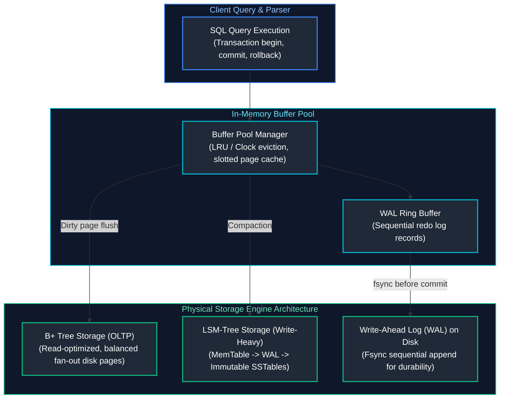

---

## Table of Contents
1. [Database Architecture](#1-database-architecture)
   - [1.1 OLTP vs OLAP](#11-oltp-vs-olap)
   - [1.2 Row-Oriented vs Column-Oriented Databases](#12-row-oriented-vs-column-oriented-databases)
   - [1.3 Relational vs NoSQL Databases](#13-relational-vs-nosql-databases)
   - [1.4 Database Normalization (1NF, 2NF, 3NF, BCNF)](#14-database-normalization)
   - [1.5 Denormalization & Analytical Modeling](#15-denormalization-analytical-modeling)
   - [1.6 Primary Keys](#16-primary-keys)
   - [1.7 Foreign Keys & Referential Integrity](#17-foreign-keys-referential-integrity)
   - [1.8 Unique Constraints](#18-unique-constraints)
   - [1.9 Check Constraints](#19-check-constraints)
   - [1.10 Table Constraints & Composite Constraints](#110-table-constraints-composite-constraints)
2. [Indexing Mechanisms](#2-indexing-mechanisms)
   - [2.1 Indexing Fundamentals](#21-indexing-fundamentals)
   - [2.2 B-Tree Indexes](#22-b-tree-indexes)
   - [2.3 Hash Indexes](#23-hash-indexes)
   - [2.4 Composite Indexes & Leading-Edge Rules](#24-composite-indexes-leading-edge-rules)
   - [2.5 Covering Indexes & Index-Only Scans](#25-covering-indexes-index-only-scans)
   - [2.6 Clustered vs Non-Clustered Indexes](#26-clustered-vs-non-clustered-indexes)
   - [2.7 Index Selectivity & Cardinality](#27-index-selectivity-cardinality)
   - [2.8 When Indexes Hurt Performance](#28-when-indexes-hurt-performance)
3. [Query Performance & Optimization](#3-query-performance-optimization)
   - [3.1 Execution Plans](#31-execution-plans)
   - [3.2 Query Optimization Engine](#32-query-optimization-engine)
   - [3.3 Cost-Based Optimization (CBO)](#33-cost-based-optimization-cbo)
   - [3.4 Database Statistics & Histograms](#34-database-statistics-histograms)
   - [3.5 Cardinality Estimation](#35-cardinality-estimation)
   - [3.6 Predicate Pushdown](#36-predicate-pushdown)
   - [3.7 Projection Pushdown](#37-projection-pushdown)
   - [3.8 Partition Pruning](#38-partition-pruning)
   - [3.9 Join Optimization (Hash, Merge Sort, Nested Loop)](#39-join-optimization)
   - [3.10 Query Profiling & Bottleneck Analysis](#310-query-profiling-bottleneck-analysis)
   - [3.11 Explain Plans & EXPLAIN ANALYZE Deep-Dive](#311-explain-plans-explain-analyze-deep-dive)
4. [Transactions & Concurrency Control](#4-transactions-concurrency-control)
   - [4.1 ACID Properties](#41-acid-properties)
   - [4.2 Transaction Lifecycle & Write-Ahead Logging (WAL)](#42-transaction-lifecycle-write-ahead-logging-wal)
   - [4.3 ANSI SQL Isolation Levels](#43-ansi-sql-isolation-levels)
   - [4.4 Multi-Version Concurrency Control (MVCC)](#44-multi-version-concurrency-control-mvcc)
   - [4.5 Read Anomalies (Dirty, Non-Repeatable, Phantom Reads)](#45-read-anomalies)
   - [4.6 Deadlocks & Concurrency Contention](#46-deadlocks-concurrency-contention)

---

# 1. Database Architecture

Database architecture dictates how data is organized, physically stored on disk or flash storage, retrieved into memory, and processed by compute engines. Understanding architectural paradigms is essential for choosing the right storage engines and tuning data pipelines.

---

### 1.1 OLTP vs OLAP

#### Definition
- **OLTP (Online Transaction Processing):** Systems designed to handle high volumes of fast, atomic, operational transactions (inserts, updates, deletes) involving small numbers of records. Optimized for low latency, high concurrency, and data integrity.
- **OLAP (Online Analytical Processing):** Systems designed to process complex, multi-dimensional queries across massive historical datasets for aggregation, trend analysis, and business intelligence. Optimized for high throughput and scanning massive row volumes.

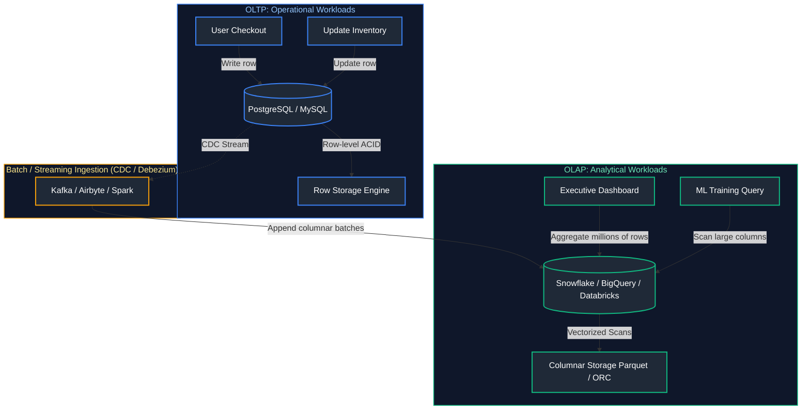

#### Comparison Matrix
| Architectural Dimension | OLTP | OLAP |
| :--- | :--- | :--- |
| **Primary Workload** | High-concurrency reads & writes | Complex aggregations & heavy read scans |
| **Data Schema** | Highly normalized (3NF) to eliminate redundancy | Denormalized (Star / Snowflake Schema) |
| **Access Pattern** | Random I/O by Primary Key (`WHERE id = 105`) | Sequential I/O scanning billions of rows (`SUM(revenue)`) |
| **Storage Format** | Row-oriented (Postgres heap, InnoDB pages) | Columnar (Parquet, ORC, Snowflake Ficus) |
| **Data Latency** | Millisecond real-time updates | Periodic batch / Micro-batch latency |
| **Typical Engines** | PostgreSQL, MySQL, Oracle, Spanner | Snowflake, BigQuery, ClickHouse, Databricks |

#### Code Example
```sql
-- OLTP Typical Query: High-speed point lookup by primary key
SELECT user_id, email, account_status 
FROM operational.users 
WHERE user_id = 99824;

-- OLAP Typical Query: Heavy aggregation scanning millions of records over time
SELECT 
    DATE_TRUNC('month', order_date) AS sales_month,
    product_category,
    COUNT(DISTINCT customer_id) AS monthly_active_buyers,
    SUM(order_total) AS total_gross_revenue,
    APPROX_QUANTILES(order_total, 100)[OFFSET(50)] AS median_order_value
FROM warehouse.fact_orders
WHERE order_date >= '2023-01-01'
GROUP BY sales_month, product_category
ORDER BY sales_month DESC, total_gross_revenue DESC;
```

#### References
- [GeeksforGeeks: Difference between OLTP and OLAP](https://www.geeksforgeeks.org/difference-between-olap-and-oltp/)
- [DataCamp: OLTP vs OLAP Tutorial](https://www.datacamp.com/tutorial/oltp-vs-olap)

---

### 1.2 Row-Oriented vs Column-Oriented Databases

#### Definition
The physical storage orientation determines how data records are packed into storage blocks (pages) on disk.
- **Row-Oriented:** Data is serialized and stored contiguously row by row on disk. `[Row 1: ColA, ColB, ColC] [Row 2: ColA, ColB, ColC]`.
- **Column-Oriented:** Data is serialized and stored contiguously column by column on disk. `[ColA: Row1, Row2, ...] [ColB: Row1, Row2, ...]`.

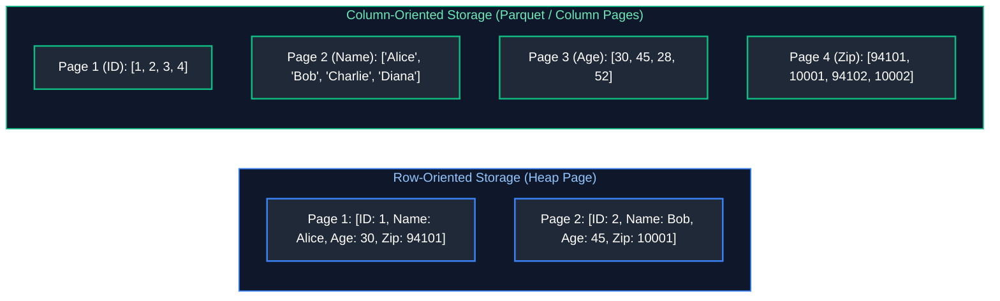

#### Usage / Purpose
- **Row-Oriented:** Ideal when queries inspect or write whole records (e.g., retrieving a complete customer profile or adding a new transaction).
- **Column-Oriented:** Ideal for analytics. If a table has 100 columns and a query executes `SELECT AVG(age) FROM users`, the columnar engine only reads the `Age` pages into memory, reducing disk I/O by 99%. Furthermore, storing homogeneous types sequentially allows high-ratio compression (Run-Length Encoding, Snappy, Zstandard, Dictionary Encoding).

#### Performance Impact

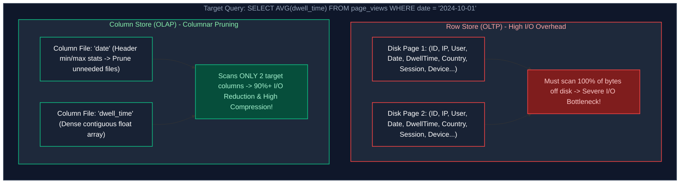

#### References
- [GeeksforGeeks: Columnar Databases vs Row-Oriented Databases](https://www.geeksforgeeks.org/columnar-databases/)
- [DataCamp: Columnar vs Row Storage](https://www.datacamp.com/tutorial/data-storage-formats)

---

### 1.3 Relational vs NoSQL Databases

#### Definition
- **Relational Databases (RDBMS):** Store structured data in rigid, tabular schemas with predefined relationships, enforcing ACID constraints and utilizing SQL as the standard query interface.
- **NoSQL Databases:** Non-relational databases engineered for horizontal scalability, high write velocity, flexible schema-less or semi-structured data models, and eventual consistency.

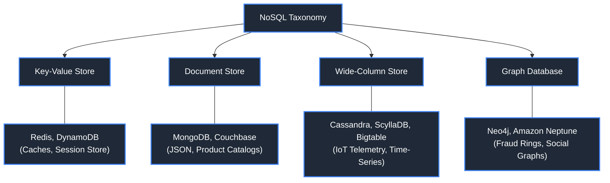

#### Comparison Matrix
| Dimension | Relational (RDBMS) | NoSQL (Distributed) |
| :--- | :--- | :--- |
| **Data Model** | Tables, rows, columns, foreign keys | Key-value, document (JSON), wide-column, graph |
| **Schema** | Rigid, schema-on-write (`ALTER TABLE`) | Flexible, schema-on-read |
| **Scalability** | Vertical (Scale-Up), read replicas | Horizontal (Scale-Out via partitioning / sharding) |
| **Transactions** | Strong ACID guarantees | BASE (Basically Available, Soft-state, Eventual consistency) |
| **Best For** | Banking, ERP, order management | High-velocity IoT streams, chat feeds, dynamic JSON catalogs |

#### References
- [GeeksforGeeks: Difference between SQL and NoSQL](https://www.geeksforgeeks.org/difference-between-sql-and-nosql/)
- [DataCamp: NoSQL Databases Explained](https://www.datacamp.com/tutorial/nosql-databases-explained)

---

### 1.4 Database Normalization

#### Definition
Database normalization is the formal process of structuring a relational database schema to minimize data redundancy and prevent data modification anomalies (insertion, update, and deletion anomalies).

- **1NF (First Normal Form):** Every cell contains atomic (indivisible) values; no repeating groups or arrays.
- **2NF (Second Normal Form):** Satisfies 1NF, and all non-key attributes are fully functionally dependent on the entire primary key (no partial dependencies on composite keys).
- **3NF (Third Normal Form):** Satisfies 2NF, and no non-key attribute is transitively dependent on the primary key (no non-key attribute depends on another non-key attribute).
- **BCNF (Boyce-Codd Normal Form):** A stricter version of 3NF where for every functional dependency $X \rightarrow Y$, $X$ must be a super key.

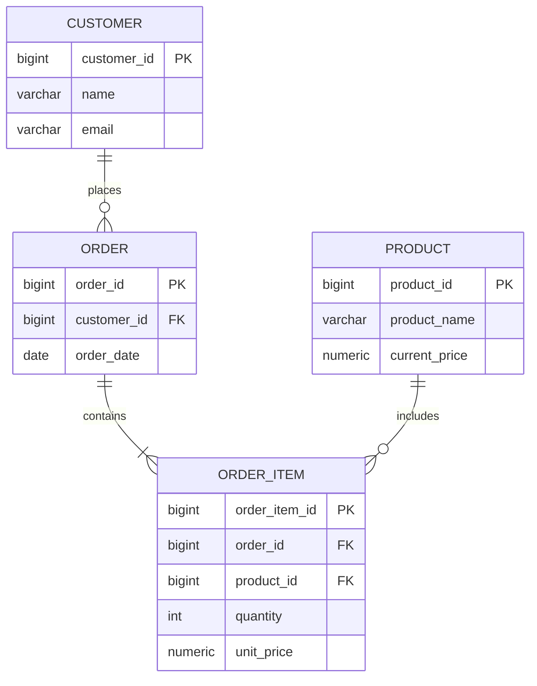

#### Code Example (Normalized Schema)
```sql
-- 3NF Normalized Schema Design
CREATE TABLE operational.customers (
    customer_id BIGINT PRIMARY KEY,
    customer_name VARCHAR(100) NOT NULL,
    email VARCHAR(255) UNIQUE NOT NULL
);

CREATE TABLE operational.orders (
    order_id BIGINT PRIMARY KEY,
    customer_id BIGINT NOT NULL REFERENCES operational.customers(customer_id),
    order_date DATE NOT NULL
);

CREATE TABLE operational.order_items (
    order_item_id BIGINT PRIMARY KEY,
    order_id BIGINT NOT NULL REFERENCES operational.orders(order_id),
    product_id BIGINT NOT NULL,
    quantity INT NOT NULL CHECK (quantity > 0),
    unit_price NUMERIC(10, 2) NOT NULL
);
```

#### Key Points & Common Pitfalls
- **Over-Normalization in OLAP:** While 3NF is critical in OLTP to eliminate write anomalies, querying a 3NF schema in an analytical warehouse requires 15+ table joins, which degrades read query throughput. Analytics favors denormalization.

#### References
- [GeeksforGeeks: Normalization in DBMS (1NF, 2NF, 3NF, BCNF)](https://www.geeksforgeeks.org/normal-forms-in-dbms/)
- [DataCamp: Database Normalization Tutorial](https://www.datacamp.com/tutorial/database-normalization)

---

### 1.5 Denormalization & Analytical Modeling

#### Definition
Denormalization is the deliberate introduction of redundancy into a database schema by combining tables. It trades off write efficiency and storage space to achieve faster read query performance by eliminating expensive runtime joins.

#### Usage in Data Warehousing: The Star Schema
In dimensional modeling (Kimball methodology), tables are separated into:
- **Fact Tables:** Contain numerical measurements, foreign keys, and metrics (e.g., `fact_sales`).
- **Dimension Tables:** Contain descriptive text attributes (e.g., `dim_customer`, `dim_store`).

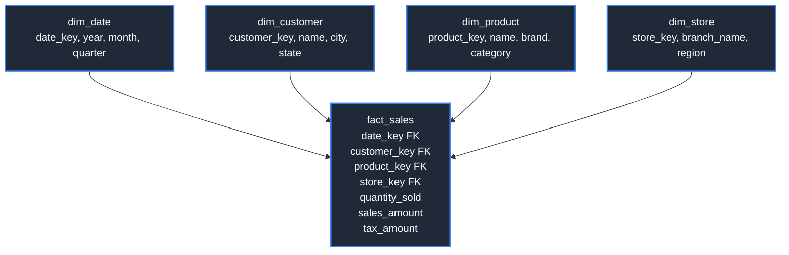

#### Code Example (Denormalized Dimensional Model)
```sql
-- Denormalized Flat Table for Analytical Reporting
CREATE TABLE analytics.wide_order_reporting (
    order_id BIGINT,
    order_date DATE,
    customer_id BIGINT,
    customer_name VARCHAR(100),
    customer_city VARCHAR(50),
    customer_state VARCHAR(50),
    product_id BIGINT,
    product_name VARCHAR(100),
    product_category VARCHAR(50),
    quantity_sold INT,
    total_revenue NUMERIC(12, 2)
);
```

#### Key Points & Common Pitfalls
- **Update Anomalies:** Because attributes like `customer_city` are copied onto millions of rows, updating a customer's address requires rewriting millions of records. Denormalized tables are best suited for immutable append-only logs or analytical marts.

#### References
- [GeeksforGeeks: Denormalization in Databases](https://www.geeksforgeeks.org/denormalization-in-databases/)
- [DataCamp: Dimensional Modeling in Data Warehousing](https://www.datacamp.com/tutorial/dimensional-modeling)

---

### 1.6 Primary Keys

#### Definition
A Primary Key is a constraint that uniquely identifies each row in a database table. It enforces two mandatory rules:
1. **Uniqueness:** No two rows can share the same primary key value.
2. **Non-Nullability:** A primary key column cannot contain `NULL`.

#### Architectural Implementation
Under the hood, relational databases automatically create a unique index (often a Clustered B-Tree Index) on the primary key column to enforce uniqueness and accelerate lookups.

#### Code Example
```sql
CREATE TABLE crm.accounts (
    account_id BIGINT GENERATED ALWAYS AS IDENTITY,
    company_name VARCHAR(120) NOT NULL,
    created_at TIMESTAMPTZ DEFAULT CURRENT_TIMESTAMP,
    CONSTRAINT pk_accounts PRIMARY KEY (account_id)
);
```

#### Key Points & Common Pitfalls
- **Surrogate vs. Natural Keys:** Natural keys (like Email or Social Security Number) can change over time or contain sensitive PII. Best practice recommends using an immutable **Surrogate Key** (an auto-incrementing integer or UUIDv7) as the primary key.
- **UUIDv4 Fragmentation:** Random UUIDv4 keys degrade B-Tree index performance due to constant random page splits. If using UUIDs, prefer time-ordered UUIDv7.

#### References
- [GeeksforGeeks: Primary Key in DBMS](https://www.geeksforgeeks.org/primary-key/)
- [DataCamp: SQL Primary Key Tutorial](https://www.datacamp.com/tutorial/primary-key-sql)

---

### 1.7 Foreign Keys & Referential Integrity

#### Definition
A Foreign Key is a column or group of columns in one table that references the primary key or unique key of another table, establishing a parent-child relationship and enforcing **Referential Integrity**.

#### Foreign Key Actions
- `ON DELETE CASCADE`: Deleting the parent automatically deletes all referencing child rows.
- `ON DELETE RESTRICT` / `NO ACTION`: Prevents deletion of the parent if any child rows exist.
- `ON DELETE SET NULL`: Sets child reference columns to `NULL` when the parent is deleted.

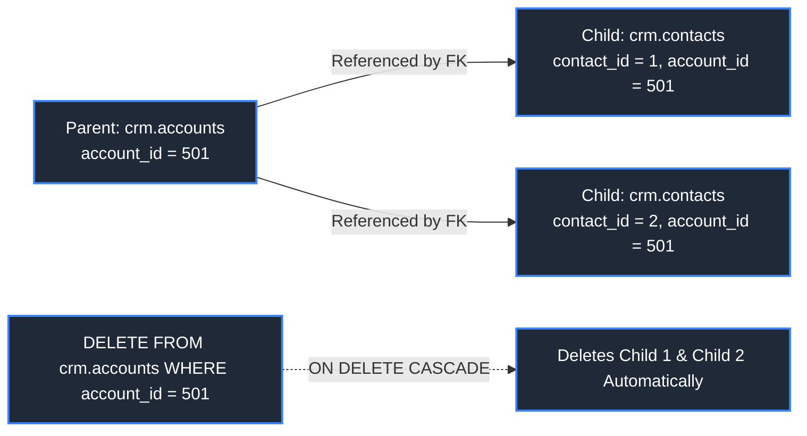

#### Code Example
```sql
CREATE TABLE crm.contacts (
    contact_id BIGINT PRIMARY KEY,
    account_id BIGINT NOT NULL,
    first_name VARCHAR(50) NOT NULL,
    email VARCHAR(100) NOT NULL,
    CONSTRAINT fk_contacts_account 
        FOREIGN KEY (account_id) 
        REFERENCES crm.accounts (account_id)
        ON DELETE CASCADE
        ON UPDATE RESTRICT
);
```

#### Key Points & Common Pitfalls
- **Missing Index on Foreign Keys:** While databases automatically create an index on the primary key, most engines (PostgreSQL, Oracle, SQL Server) do **NOT** automatically index foreign key columns. Omitting an index on foreign key columns causes full table scans during joins and when parent records are updated/deleted.
- **Data Warehousing Enforcements:** Modern cloud data warehouses (Snowflake, BigQuery, Databricks) allow foreign key declarations for documentation and query optimizer hints, but do **NOT** enforce referential integrity at runtime. Data pipelines must validate integrity before ingestion.

#### References
- [GeeksforGeeks: Foreign Key in DBMS](https://www.geeksforgeeks.org/foreign-key/)
- [DataCamp: SQL Foreign Keys](https://www.datacamp.com/tutorial/foreign-key-sql)

---

### 1.8 Unique Constraints

#### Definition
A `UNIQUE` constraint ensures that all values in a column or set of columns are distinct across all rows in the table. Unlike a Primary Key, a table can have multiple `UNIQUE` constraints, and depending on the database engine, `UNIQUE` columns may permit one or more `NULL` values.

#### Code Example
```sql
CREATE TABLE identity.users (
    user_id BIGINT PRIMARY KEY,
    username VARCHAR(50) NOT NULL,
    email VARCHAR(255) NOT NULL,
    tax_identifier VARCHAR(30),
    CONSTRAINT uq_users_username UNIQUE (username),
    CONSTRAINT uq_users_email UNIQUE (email),
    CONSTRAINT uq_users_tax_id UNIQUE (tax_identifier)
);
```

#### References
- [GeeksforGeeks: SQL UNIQUE Constraint](https://www.geeksforgeeks.org/sql-unique-constraint/)
- [DataCamp: SQL Constraints Tutorial](https://www.datacamp.com/tutorial/sql-constraints)

---

### 1.9 Check Constraints

#### Definition
A `CHECK` constraint specifies a boolean condition that every inserted or updated row must evaluate to `TRUE` (or `UNKNOWN` for `NULL`s). If a write evaluates to `FALSE`, the transaction aborts with an integrity violation error.

#### Usage / Purpose
- Enforcing business rules and valid numeric ranges (e.g., discounts between 0% and 100%, birth dates in the past).
- Eliminating bad data directly at the ingestion boundary.

#### Code Example
```sql
CREATE TABLE billing.subscriptions (
    subscription_id BIGINT PRIMARY KEY,
    monthly_rate NUMERIC(10, 2) NOT NULL,
    discount_percentage NUMERIC(5, 2) DEFAULT 0.00,
    start_date DATE NOT NULL,
    end_date DATE,
    -- Check constraints enforcing valid domains
    CONSTRAINT chk_positive_rate CHECK (monthly_rate >= 0),
    CONSTRAINT chk_valid_discount CHECK (discount_percentage >= 0 AND discount_percentage <= 100),
    CONSTRAINT chk_valid_date_range CHECK (end_date IS NULL OR end_date >= start_date)
);
```

#### References
- [GeeksforGeeks: SQL CHECK Constraint](https://www.geeksforgeeks.org/sql-check-constraint/)
- [DataCamp: Data Quality with SQL Constraints](https://www.datacamp.com/tutorial/sql-constraints)

---

### 1.10 Table Constraints & Composite Constraints

#### Definition
A Table Constraint is declared independently of individual column definitions, allowing rules to span multiple columns simultaneously (**Composite Constraints**).

#### Code Example
```sql
CREATE TABLE logistics.warehouse_inventory (
    warehouse_id INT NOT NULL,
    sku_code VARCHAR(32) NOT NULL,
    quantity_available INT NOT NULL DEFAULT 0,
    safety_stock_level INT NOT NULL DEFAULT 10,
    -- Composite Primary Key spanning two columns
    CONSTRAINT pk_warehouse_inventory PRIMARY KEY (warehouse_id, sku_code),
    -- Multi-column check constraint comparing two separate columns
    CONSTRAINT chk_quantity_above_safety CHECK (quantity_available >= 0)
);
```

---

# 2. Indexing Mechanisms

Indexes are auxiliary data structures designed to accelerate data retrieval operations at the cost of additional disk storage and slower write throughput (inserts, updates, deletes).

---

### 2.1 Indexing Fundamentals

#### Definition
Without an index, the database engine must execute a **Full Table Scan (Sequential Scan)**, inspecting every page on disk from start to finish ($O(N)$ time complexity). An index provides a sorted lookup directory that allows the engine to locate matching rows in logarithmic $O(\log N)$ or constant $O(1)$ time.

```mermaid
flowchart TD
    Query["SELECT * FROM users WHERE user_id = 45"]
    
    subgraph Without_Index ["Without Index: Full Table Scan"]
        Scan["Scan Page 1 -> Page 2 -> Page 3 ... -> Page 1,000,000"]
        Scan --> CostHigh["High Disk I/O & Memory Contention: O(N)"]
    end
    
    subgraph With_Index ["With B-Tree Index"]
        Root["Root Page"] --> Branch["Intermediate Branch Page"]
        Branch --> Leaf["Leaf Page (Contains Record Pointer Page 42, Slot 8)"]
        Leaf --> Fetch["Direct Single Page Fetch: O(log N)"]
    end

    style Without_Index fill:#0f172a,stroke:#ef4444,stroke-width:1.5px,color:#fca5a5
    style With_Index fill:#0f172a,stroke:#10b981,stroke-width:1.5px,color:#6ee7b7

    style Query fill:#1f2937,stroke:#ef4444,stroke-width:2px,color:#fff
    style Scan fill:#1f2937,stroke:#ef4444,stroke-width:2px,color:#fff
    style CostHigh fill:#7f1d1d,stroke:#ef4444,stroke-width:2px,color:#fecaca
    style Root fill:#1f2937,stroke:#10b981,stroke-width:2px,color:#fff
    style Branch fill:#1f2937,stroke:#10b981,stroke-width:2px,color:#fff
    style Leaf fill:#1f2937,stroke:#10b981,stroke-width:2px,color:#fff
    style Fetch fill:#064e3b,stroke:#10b981,stroke-width:2px,color:#a7f3d0
```

#### Index Types Comparison Matrix

| Index Type | Physical Storage | Supported Operations | Index Maintenance Overhead | Best Use Case |
| :--- | :--- | :--- | :--- | :--- |
| **B-Tree Index** | Balanced search tree of pages; leaf nodes store keys and heap tuple pointers (TID / RID). | Equality (`=`), Range scans (`<`, `>`, `BETWEEN`), `ORDER BY`, `LIKE 'prefix%'`. | Moderate (page splits occur when pages fill up). | **Universal default** for OLTP primary and foreign keys. |
| **Hash Index** | In-memory / disk hash bucket array. | Equality (`=`) only; no range scans or prefix searches. | Low on point lookups. | Key-value point lookups where range queries are never executed. |
| **Bitmap Index** | Array of bit vectors per distinct column value (1 bit per row). | High-speed bitwise Boolean operations (`AND`, `OR`, `NOT`). | **Very High** on writes; heavy lock contention on updates. | **Low-cardinality** columns in OLAP warehouses (e.g. `gender`, `status`). |

#### References
- [GeeksforGeeks: Indexing in Databases](https://www.geeksforgeeks.org/indexing-in-databases-set-1/)
- [DataCamp: Introduction to SQL Indexing](https://www.datacamp.com/tutorial/sql-indexing)

---

### 2.2 B-Tree Indexes

#### Definition
A **B-Tree (Balanced Tree)** is a self-balancing, multi-way search tree data structure. In relational engines (Postgres, MySQL, Oracle, SQL Server), B-Trees (specifically B+Trees) are the default index type.

#### Internal Structure
1. **Root Node:** Entry point containing pointers to intermediate branch nodes.
2. **Internal Branch Nodes:** Contain search keys and child node pointers that direct traversal.
3. **Leaf Nodes:** Form a doubly linked list containing sorted index keys and pointers (RowIDs or TupleIDs) to the physical table pages.

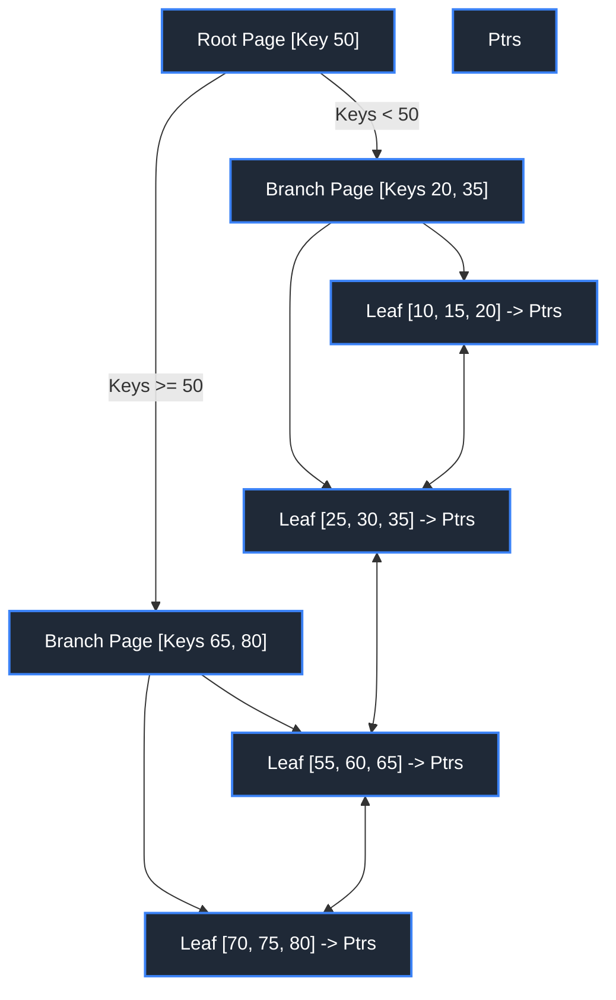

#### Usage / Purpose
- Highly versatile: Supports exact equality lookups (`=`), range lookups (`BETWEEN`, `<`, `>`), prefix pattern matching (`LIKE 'John%'`), and sorted retrieval (`ORDER BY`).

#### Code Example
```sql
-- Explicitly creating a standard B-Tree index on high-frequency filter columns
CREATE INDEX idx_orders_customer_id ON sales.orders (customer_id);

-- Range scan query accelerating using the B-Tree
SELECT order_id, order_date, total_amount
FROM sales.orders
WHERE customer_id BETWEEN 1000 AND 2000;
```

#### References
- [GeeksforGeeks: B-Tree and B+ Tree in DBMS](https://www.geeksforgeeks.org/b-tree-set-1-introduction-2/)
- [DataCamp: Understanding B-Tree Indexes](https://www.datacamp.com/tutorial/sql-indexing)

---

### 2.3 Hash Indexes

#### Definition
A Hash Index maps an indexed column's value through a hashing algorithm to determine a specific bucket address. It provides $O(1)$ constant-time lookup performance for exact equality comparisons.

#### Usage / Purpose
- Point-lookup caches and key-value style querying where range scans are never requested.

#### Code Example
```sql
-- PostgreSQL Syntax for Hash Indexes
CREATE INDEX idx_sessions_token_hash 
ON security.active_sessions 
USING HASH (session_token);

-- Query utilizing the hash index (O(1) lookup)
SELECT user_id, expires_at 
FROM security.active_sessions 
WHERE session_token = 'a8f9c0e2d1b745e';
```

#### Key Points & Common Pitfalls
- **No Range Scan Support:** Hash indexes **cannot** be used for range queries (`WHERE id > 100`) or ordering (`ORDER BY`). A hash algorithm destroys the logical ordering of values.

#### References
- [GeeksforGeeks: Hash Indexing in DBMS](https://www.geeksforgeeks.org/hash-indexing-in-dbms/)
- [PostgreSQL Documentation: Hash Indexes](https://www.postgresql.org/docs/current/indexes-types.html)

---

### 2.4 Composite Indexes & Leading-Edge Rules

#### Definition
A Composite Index (or multi-column index) is an index built across two or more columns on a single table. The keys are sorted hierarchically based on the order in which columns are declared in the `CREATE INDEX` statement: first by Column A, then by Column B, then by Column C.

#### The Leading-Edge (Leftmost Prefix) Rule
A composite index on `(A, B, C)` can only be used by the query optimizer if the query's `WHERE` clause filters on the **leading (leftmost) column(s)**:
- `WHERE A = 1` $\rightarrow$ **Index Used**
- `WHERE A = 1 AND B = 2` $\rightarrow$ **Index Used**
- `WHERE A = 1 AND B = 2 AND C = 3` $\rightarrow$ **Index Used**
- `WHERE B = 2 AND C = 3` $\rightarrow$ **Index CANNOT be used!** (Leading column A is missing)
- `WHERE C = 3` $\rightarrow$ **Index CANNOT be used!**

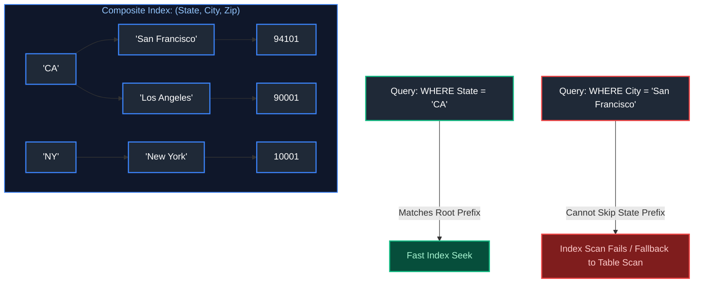

#### Code Example
```sql
-- Creating composite index respecting leading-edge principles
CREATE INDEX idx_orders_status_date 
ON sales.orders (order_status, order_date);

-- Utilizes the composite index fully
SELECT order_id, customer_id, order_amount
FROM sales.orders
WHERE order_status = 'PENDING' 
  AND order_date >= '2024-10-01';
```

#### References
- [GeeksforGeeks: Composite Index in SQL](https://www.geeksforgeeks.org/composite-index-in-sql/)
- [DataCamp: Multi-Column Indexing](https://www.datacamp.com/tutorial/sql-indexing)

---

### 2.5 Covering Indexes & Index-Only Scans

#### Definition
A **Covering Index** is an index that includes **all columns** requested by a query (both the filtering columns in `WHERE` and the projected columns in `SELECT`). 

When an index covers a query, the database engine executes an **Index-Only Scan**. The engine retrieves the required data directly from the index leaf pages in memory and **never touches the physical table heap pages on disk**, eliminating secondary table lookups.

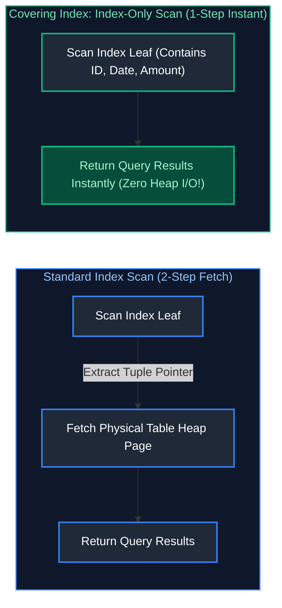

#### Code Example
```sql
-- PostgreSQL / SQL Server Covering Index with INCLUDE clause
-- Indexed key: customer_id (used for B-Tree sorting/filtering)
-- Payload columns: order_date, order_amount (stored at leaf level without key overhead)
CREATE INDEX idx_orders_covering_cust
ON sales.orders (customer_id)
INCLUDE (order_date, order_amount);

-- Query achieves 100% Index-Only Scan
SELECT order_date, order_amount
FROM sales.orders
WHERE customer_id = 54092;
```

#### References
- [GeeksforGeeks: Covering Index in SQL](https://www.geeksforgeeks.org/covering-index-in-sql/)
- [DataCamp: Optimizing with Covering Indexes](https://www.datacamp.com/tutorial/sql-indexing)

---

### 2.6 Clustered vs Non-Clustered Indexes

#### Definition
- **Clustered Index:** Dictates the **physical storage order** of actual table rows on disk. A table can possess **only one** clustered index because physical records can only be ordered on disk in one sequence. The leaf nodes of a clustered index *are the data pages themselves*.
- **Non-Clustered Index:** A separate, secondary auxiliary B-Tree structure whose leaf nodes contain sorted search keys and physical row locators (pointers) pointing back to the clustered index key or heap storage page. A table can have multiple non-clustered indexes.

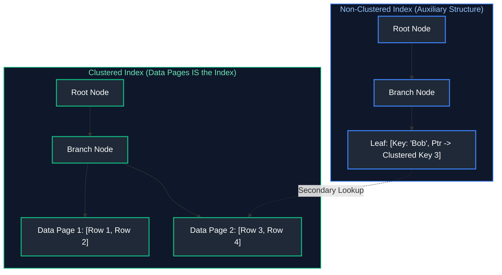

#### Comparison Matrix
| Architectural Aspect | Clustered Index | Non-Clustered Index |
| :--- | :--- | :--- |
| **Physical Storage** | Reorders physical rows on disk | Separate structure; table data untouched |
| **Count Per Table** | Exactly 1 per table | Multiple (typically 5-10 max) |
| **Leaf Content** | The complete physical table row | Key value + physical row locator / pointer |
| **Range Queries** | Exceptional speed (contiguous disk I/O) | Slower (requires row-by-row bookmark lookups) |

#### References
- [GeeksforGeeks: Difference between Clustered and Non-Clustered Index](https://www.geeksforgeeks.org/difference-between-clustered-and-non-clustered-index/)
- [DataCamp: Clustered vs Non-Clustered Indexes](https://www.datacamp.com/tutorial/clustered-vs-non-clustered-index)

---

### 2.7 Index Selectivity & Cardinality

#### Definition
- **Cardinality:** The number of unique values in a specific column.
- **Selectivity:** The ratio of unique values to the total number of rows:
$$	ext{Selectivity} = \frac{	ext{Distinct Values (Cardinality)}}{	ext{Total Rows}}$$

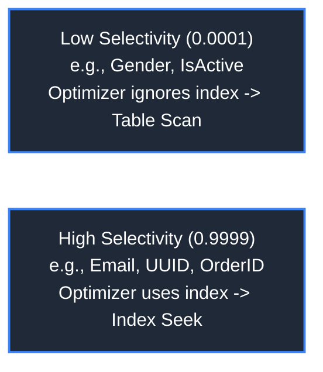

#### Usage / Purpose
The Cost-Based Optimizer (CBO) uses selectivity to decide between an **Index Seek** and a **Full Table Scan**.
- If selectivity is high (close to 1.0, e.g., `user_id`), an index lookup touches only 1 row.
- If selectivity is low (e.g., `gender` with 2 values across 10,000,000 rows), an index lookup would require jumping between index pages and heap pages 5,000,000 times (random I/O), which is much slower than streaming the entire table sequentially. The optimizer will reject the index.

#### References
- [GeeksforGeeks: Cardinality in DBMS](https://www.geeksforgeeks.org/cardinality-in-dbms/)
- [DataCamp: Index Selectivity and Performance](https://www.datacamp.com/tutorial/sql-indexing)

---

### 2.8 When Indexes Hurt Performance

#### Definition
Indexes are not free; they introduce architectural trade-offs:
1. **Write Amplification (DML Degradation):** Every `INSERT`, `UPDATE`, or `DELETE` statement must physically update not only the table heap but also every single index defined on that table. If a table has 10 indexes, an `INSERT` triggers 11 physical disk writes.
2. **Storage Bloat:** Indexes consume substantial disk space and memory cache (buffer pool). Large indexes can exceed available RAM, displacing active data pages.
3. **Index Maintenance Overhead:** In high-volume batch pipelines (bulk loading billions of rows), maintaining indexes during writes destroys throughput.

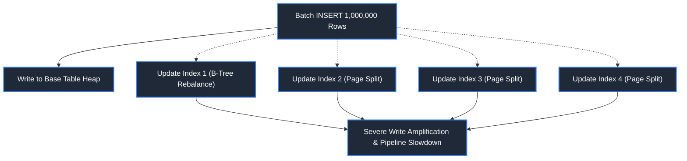

#### Best Practice for Bulk ETL Ingestion
```sql
-- Optimal pattern for massive bulk ingestion in data engineering
-- 1. Drop or disable indexes prior to bulk load
DROP INDEX idx_fact_sales_date;
DROP INDEX idx_fact_sales_customer;

-- 2. Execute high-speed direct-path bulk load
COPY warehouse.fact_sales FROM 's3://data-lake/sales_batch_2024.parquet';

-- 3. Rebuild indexes in a single optimized sequential pass
CREATE INDEX idx_fact_sales_date ON warehouse.fact_sales (sales_date);
CREATE INDEX idx_fact_sales_customer ON warehouse.fact_sales (customer_id);
```

#### References
- [GeeksforGeeks: Advantages and Disadvantages of Indexing](https://www.geeksforgeeks.org/advantages-and-disadvantages-of-indexing-in-databases/)
- [DataCamp: When Not to Index](https://www.datacamp.com/tutorial/sql-indexing)

---

# 3. Query Performance & Optimization

Query optimization is the engine's process of translating high-level declarative SQL statements into an optimal physical execution pipeline. In distributed environments and modern cloud databases, understanding execution internals is the cornerstone of query tuning.

---

### 3.1 Execution Plans

#### Definition
An Execution Plan is the detailed roadmap generated by the database engine describing the exact sequence of physical operations, algorithms, and access paths it will use to fulfill a SQL query.
- **Logical Plan:** Represents the relational algebra transformations (filter, project, join) independent of hardware or physical storage algorithms.
- **Physical Plan:** Concrete execution blueprint specifying physical operators (e.g., Sequential Scan vs. Index Scan, Hash Join vs. Merge Join).

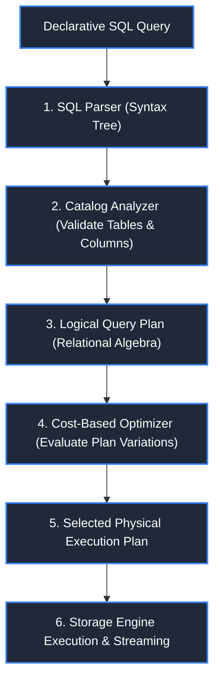

#### Code Example
```sql
-- Generate and inspect an execution plan in PostgreSQL
EXPLAIN 
SELECT o.order_id, c.customer_name, o.order_total
FROM sales.orders o
JOIN crm.customers c ON o.customer_id = c.customer_id
WHERE o.order_date >= '2024-01-01' AND o.order_total > 500;
```

#### References
- [GeeksforGeeks: SQL Query Execution Plan](https://www.geeksforgeeks.org/sql-query-execution-plan/)
- [DataCamp: Understanding SQL Execution Plans](https://www.datacamp.com/tutorial/query-plans)

---

### 3.2 Query Optimization Engine

#### Definition
The Query Optimization Engine inspects the logical abstract syntax tree of a query and applies rule-based transformations (e.g., constant folding, dead-code elimination, subquery flattening) and cost evaluations to generate the most efficient execution tree.

#### Key Stages of Optimization
1. **Parsing & Semantic Analysis:** Verifies grammar, permissions, and resolves identifiers against the database catalog.
2. **Logical Rewriting:** Simplifies expressions (e.g., converting `WHERE 1 = 1 AND amount > 10` to `WHERE amount > 10`).
3. **Physical Path Generation:** Enumerates combinations of join orders, join algorithms, and access methods.
4. **Plan Selection:** Selects the execution plan with the lowest estimated computational cost.

#### References
- [GeeksforGeeks: Query Processing in DBMS](https://www.geeksforgeeks.org/query-processing-in-dbms/)
- [DataCamp: How Database Engines Work](https://www.datacamp.com/tutorial/database-engines)

---

### 3.3 Cost-Based Optimization (CBO)

#### Definition
A Cost-Based Optimizer (CBO) assigns a mathematical cost score to every possible physical execution plan and picks the plan with the lowest overall cost.
$$	ext{Cost} = (W_{	ext{io}} 	imes 	ext{Disk Pages Read}) + (W_{	ext{cpu}} 	imes 	ext{Tuples Processed}) + (W_{	ext{net}} 	imes 	ext{Network Bytes Shuffled})$$

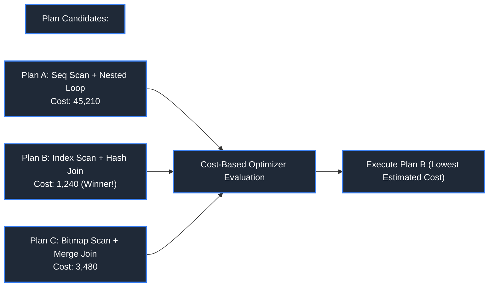

#### Usage / Purpose
- Deciding whether an index scan is cheaper than a full table scan.
- Selecting optimal join order across 5+ tables.
- Picking broadcast join vs shuffle join in distributed engines (Spark Catalyst, Snowflake).

#### References
- [GeeksforGeeks: Cost-Based Query Optimization](https://www.geeksforgeeks.org/cost-based-query-optimization/)
- [DataCamp: Query Optimization Strategies](https://www.datacamp.com/tutorial/query-optimization)

---

### 3.4 Database Statistics & Histograms

#### Definition
Statistics are metadata stored in system catalog tables that describe the volume, distribution, and characteristics of data within tables and columns. 

**Histograms** divide the range of values in a column into buckets to capture data skew and frequency distributions (e.g., Equal-Width vs. Equal-Height / Equal-Depth Histograms).

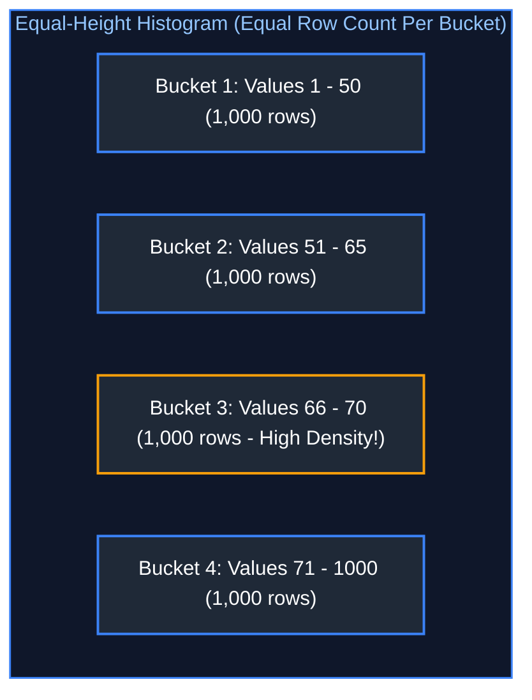

#### Code Example
```sql
-- Refresh database statistics in PostgreSQL
ANALYZE sales.orders;

-- Compute statistics with detailed histograms in Databricks / Spark SQL
ANALYZE TABLE delta_lake.fact_orders COMPUTE STATISTICS FOR ALL COLUMNS;
```

#### Key Points & Common Pitfalls
- **Stale Statistics Disaster:** When bulk ETL jobs load millions of rows without triggering an `ANALYZE`, the database catalog still reports empty or tiny tables. The optimizer defaults to catastrophic nested-loop joins, causing pipelines to hang indefinitely.

#### References
- [GeeksforGeeks: Database Statistics](https://www.geeksforgeeks.org/database-statistics/)
- [PostgreSQL Documentation: Statistics Used by the Planner](https://www.postgresql.org/docs/current/planner-stats.html)

---

### 3.5 Cardinality Estimation

#### Definition
Cardinality estimation is the mathematical calculation performed by the optimizer to predict the number of rows that will satisfy each operator (filters, joins, aggregations) in a query plan.

#### Impact on Plan Selection
If cardinality is estimated at 5 rows, the engine selects an in-memory nested loop join. If actual runtime cardinality is 50,000,000 rows, that nested loop join will take hours to complete. Correct estimation relies directly on updated histograms and statistics.

#### References
- [GeeksforGeeks: Cardinality in Query Optimization](https://www.geeksforgeeks.org/cardinality-in-dbms/)
- [DataCamp: Understanding Cardinality](https://www.datacamp.com/tutorial/sql-indexing)

---

### 3.6 Predicate Pushdown

#### Definition
Predicate Pushdown is an optimization technique where filtering conditions (`WHERE` clauses) are "pushed down" to the lowest possible layer of the execution engine — ideally into the storage engine or parquet reader — before data is decompressed, deserialized, or transferred over the network.

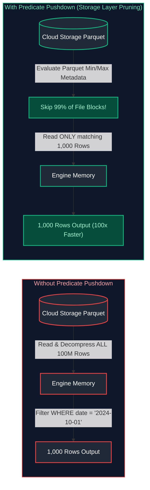

#### Code Example
```sql
-- Predicate pushdown pushes the filter directly into the parquet footer reader
SELECT customer_id, order_total
FROM lakehouse.fact_orders
WHERE order_date = '2024-10-01';
```

#### References
- [GeeksforGeeks: Predicate Pushdown Optimization](https://www.geeksforgeeks.org/predicate-pushdown-in-spark-sql/)
- [DataCamp: Optimizing Big Data Queries](https://www.datacamp.com/tutorial/query-optimization)

---

### 3.7 Projection Pushdown

#### Definition
Projection Pushdown (Column Pruning) ensures that only the columns explicitly requested in the `SELECT` clause are read from disk storage. In columnar file formats (Parquet, ORC), this bypasses the I/O for all unreferenced columns entirely.

#### Visual Representation
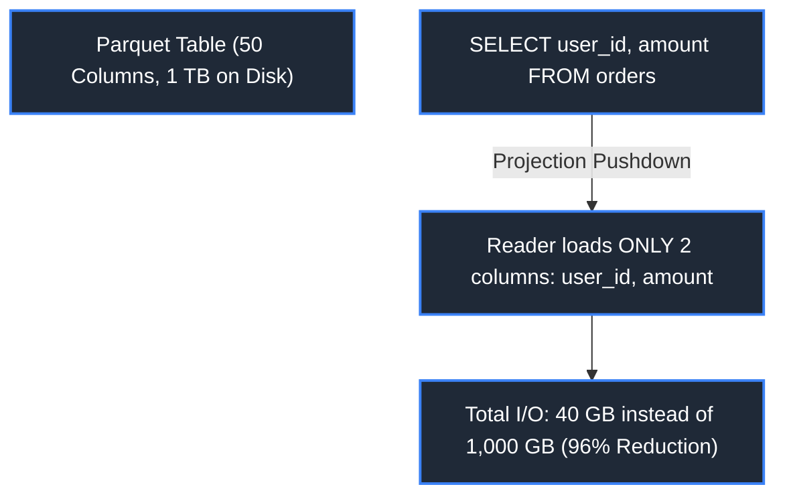

#### Key Points & Common Pitfalls
- **Avoid SELECT \* in Pipelines:** Using `SELECT *` disables projection pushdown, forcing the storage engine to read 100% of all columns from disk, consuming network bandwidth and memory buffers.

#### References
- [GeeksforGeeks: Column Pruning in Query Engines](https://www.geeksforgeeks.org/columnar-databases/)
- [DataCamp: SQL Performance Best Practices](https://www.datacamp.com/tutorial/sql-best-practices)

---

### 3.8 Partition Pruning

#### Definition
Partition Pruning is a mechanism wherein the query engine analyzes query filter predicates against physical partition boundaries and skips scanning entire directories, files, or partitions that cannot contain matching records.

```mermaid
flowchart TD
    Query["Query: WHERE year = 2024 AND month = 10"]
    Root["Table Root: /lakehouse/orders/"]
    
    Part1["/year=2023/ (Pruned & Skipped)"]
    Part2["/year=2024/month=09/ (Pruned & Skipped)"]
    Part3["/year=2024/month=10/ (Scanned)"]

    Query -.-> Root
    Root --> Part1
    Root --> Part2
    Root --> Part3

    style Query fill:#1f2937,stroke:#3b82f6,stroke-width:2px,color:#fff
    style Root fill:#1f2937,stroke:#3b82f6,stroke-width:2px,color:#fff
    style Part1 fill:#1f2937,stroke:#3b82f6,stroke-width:2px,color:#fff
    style Part2 fill:#1f2937,stroke:#3b82f6,stroke-width:2px,color:#fff
    style Part3 fill:#1f2937,stroke:#3b82f6,stroke-width:2px,color:#fff
```

#### Code Example
```sql
-- Static Partition Pruning: Literal values evaluated at compile time
SELECT COUNT(*) 
FROM data_lake.device_telemetry
WHERE event_year = 2024 AND event_month = 10;

-- Dynamic Partition Pruning (DPP): Prunes partitions at runtime based on dimension join
SELECT f.event_id, d.event_name
FROM data_lake.fact_events f
JOIN data_lake.dim_active_campaigns d ON f.campaign_id = d.campaign_id
WHERE d.is_urgent = TRUE;
```

#### References
- [GeeksforGeeks: Partitioning in DBMS](https://www.geeksforgeeks.org/database-partitioning/)
- [Databricks Documentation: Partition Pruning](https://docs.databricks.com/en/optimizations/partition-pruning.html)

---

### 3.9 Join Optimization

#### Definition
Database engines use three primary physical join algorithms:

| Join Algorithm | Mechanism | Best Used When |
| :--- | :--- | :--- |
| **Nested Loop Join** | For each row in outer table, scan inner table (often with an index). | One table is tiny and inner table has a fast index lookup. |
| **Hash Join** | Builds an in-memory hash table of smaller table; streams larger table through hash table. | Joining large tables on equi-join conditions (`=`). Fast, no sorting needed. |
| **Merge Sort Join** | Both tables are sorted on the join key, then merged in a single coordinated sequential pass. | Very large tables, or data is already pre-sorted on disk (e.g. clustered tables). |

```mermaid
flowchart TD
    subgraph HashJoin ["Hash Join Architecture"]
        SmallTable[Small Table] -->|Build Phase| HashTable[(In-Memory Hash Table)]
        LargeTable[Large Table] -->|Probe Phase| HashTable
        HashTable --> Output[Matched Stream Output]
    end

    style HashJoin fill:#0f172a,stroke:#3b82f6,stroke-width:1.5px,color:#93c5fd

    style SmallTable fill:#1f2937,stroke:#3b82f6,stroke-width:2px,color:#fff
    style HashTable fill:#1f2937,stroke:#8b5cf6,stroke-width:2px,color:#fff
    style LargeTable fill:#1f2937,stroke:#3b82f6,stroke-width:2px,color:#fff
    style Output fill:#064e3b,stroke:#10b981,stroke-width:2px,color:#a7f3d0
```

#### References
- [GeeksforGeeks: Join Algorithms in DBMS](https://www.geeksforgeeks.org/sql-join-algorithms/)
- [DataCamp: Understanding Join Algorithms](https://www.datacamp.com/tutorial/sql-joins)
- For relational join fundamentals and SQL syntax, see [01. SQL Fundamentals](01_sql_fundamentals.md#7-relational-joins--multi-table-querying). For distributed cluster join execution strategies (Broadcast, Shuffle Hash, Sort-Merge) and fan-out prevention, see [02. Advanced SQL](02_advanced_sql.md#1-advanced-joins--distributed-execution-mechanics).

---

### 3.10 Query Profiling & Bottleneck Analysis

#### Definition
Query Profiling is the diagnostic practice of measuring actual execution metrics at runtime (CPU time, I/O wait, memory allocation, cache buffer hits/misses, data spill to disk) to isolate performance bottlenecks.

#### Key Metrics
- **Buffer Cache Hit Ratio:** Proportion of page requests served from RAM vs. read from physical disk.
- **Disk Spill:** Indicates working memory (`work_mem` or executor memory) was insufficient for sorting or hashing, forcing the engine to spill temporary data to disk.
- **Data Skew:** Occurs in distributed systems when one partition/worker processes 90% of the data while others sit idle.

#### References
- [GeeksforGeeks: Performance Tuning in Databases](https://www.geeksforgeeks.org/database-performance-tuning/)
- [DataCamp: SQL Query Optimization](https://www.datacamp.com/tutorial/query-optimization)

---

### 3.11 Explain Plans & EXPLAIN ANALYZE Deep-Dive

#### Definition
- `EXPLAIN`: Shows the estimated execution plan calculated by the optimizer without running the query.
- `EXPLAIN ANALYZE`: Actually executes the query and prints both the **estimated costs** and the **actual runtime execution metrics** (actual time, actual rows, memory used).

#### Code Example & Output Breakdown
```sql
EXPLAIN ANALYZE
SELECT 
    c.customer_id, 
    COUNT(o.order_id) AS total_orders
FROM sales.orders o
JOIN crm.customers c ON o.customer_id = c.customer_id
WHERE o.order_date >= '2024-01-01'
GROUP BY c.customer_id;
```

```
Sample PostgreSQL EXPLAIN ANALYZE Plan:
HashAggregate (cost=1420.50..1435.50 rows=1500 width=16) (actual time=12.450..14.120 rows=1450 loops=1)
  Group Key: c.customer_id
  -> Hash Join (cost=450.00..1380.00 rows=8100 width=16) (actual time=3.100..9.850 rows=8050 loops=1)
        Hash Cond: (o.customer_id = c.customer_id)
        -> Seq Scan on orders o (cost=0.00..890.00 rows=8100 width=8) (actual time=0.050..4.200 rows=8050 loops=1)
              Filter: (order_date >= '2024-01-01'::date)
        -> Hash (cost=350.00..350.00 rows=8000 width=8) (actual time=2.900..2.900 rows=8000 loops=1)
              Buckets: 16384  Batches: 1  Memory Usage: 440kB
              -> Seq Scan on customers c (cost=0.00..350.00 rows=8000 width=8) (actual time=0.020..1.500 rows=8000 loops=1)
Planning Time: 0.280 ms
Execution Time: 14.850 ms
```

#### How to Read the Output
1. **Read Bottom-Up & Inside-Out:** Child nodes execute first; their outputs stream into parent operators.
2. **Estimated vs. Actual Rows:** If `rows=8100` (estimated) closely matches `actual rows=8050`, statistics are accurate. A 100x mismatch indicates stale statistics.
3. **Execution Bottleneck:** Identify the node where `actual time` jumps significantly.

#### References
- [GeeksforGeeks: EXPLAIN and EXPLAIN ANALYZE in PostgreSQL](https://www.geeksforgeeks.org/postgresql-explain-statement/)
- [PostgreSQL Documentation: Using EXPLAIN](https://www.postgresql.org/docs/current/using-explain.html)

---

# 4. Transactions & Concurrency Control

Transaction management ensures that database operations remain reliable and consistent despite concurrent transactions, network partitions, and server crashes.

---

### 4.1 ACID Properties

#### Definition
ACID represents the four essential guarantees of transaction processing:
- **Atomicity:** "All or nothing". If any statement inside a transaction fails, the entire transaction is rolled back.
- **Consistency:** Transactions only transition the database from one valid state to another, strictly obeying constraints and triggers.
- **Isolation:** Multiple transactions executing concurrently do not interfere with each other.
- **Durability:** Once committed, changes are permanently recorded in non-volatile storage, surviving crashes.

```mermaid
flowchart TD
    subgraph ACID ["ACID Guarantees"]
        A["Atomicity<br/>All-or-Nothing (Undo Log / Rollback)"]
        C["Consistency<br/>Rules & Constraints Enforced"]
        I["Isolation<br/>Transactions don't clash (MVCC / Locks)"]
        D["Durability<br/>Committed data survives crashes (WAL)"]
    end

    style ACID fill:#0f172a,stroke:#8b5cf6,stroke-width:1.5px,color:#c084fc

    style A fill:#1f2937,stroke:#8b5cf6,stroke-width:2px,color:#fff
    style C fill:#1f2937,stroke:#8b5cf6,stroke-width:2px,color:#fff
    style I fill:#1f2937,stroke:#8b5cf6,stroke-width:2px,color:#fff
    style D fill:#1f2937,stroke:#8b5cf6,stroke-width:2px,color:#fff
```

#### References
- [GeeksforGeeks: ACID Properties in DBMS](https://www.geeksforgeeks.org/acid-properties-in-dbms/)
- [DataCamp: ACID Transactions Tutorial](https://www.datacamp.com/tutorial/transactions-in-sql)

---

### 4.2 Transaction Lifecycle & Write-Ahead Logging (WAL)

#### Definition
To achieve high write performance while guaranteeing Durability, modern databases use **Write-Ahead Logging (WAL)**. 

Before changes are written to the actual data pages in memory or on disk, an append-only log record describing the delta is flushed to non-volatile disk sequentially. If the system crashes mid-transaction, the engine replays the WAL log (**Redo**) to recover committed data and rolls back uncommitted changes (**Undo**).

```mermaid
sequenceDiagram
    participant App as Client Application
    participant Memory as Shared Buffer Cache
    participant WAL as Write-Ahead Log (WAL Disk)
    participant Disk as Base Table Data Files (Disk)

    App->>Memory: 1. Modify Row (Dirty Page in RAM)
    Memory->>WAL: 2. Flush Delta to WAL Sequentially (Fast Sync)
    WAL-->>App: 3. Return COMMIT OK to Client
    Note over Memory,Disk: Async Checkpoint Process (Lazy Writer)
    Memory->>Disk: 4. Flushes Dirty Data Pages to Base Files
```

#### References
- [GeeksforGeeks: Write Ahead Logging (WAL)](https://www.geeksforgeeks.org/write-ahead-logging-wal/)
- [PostgreSQL Documentation: Reliability and the Write-Ahead Log](https://www.postgresql.org/docs/current/wal-intro.html)

---

### 4.3 ANSI SQL Isolation Levels

#### Definition
Isolation levels determine the strictness with which concurrent transactions are isolated from one another. Stricter isolation prevents data anomalies but decreases concurrency.

| Isolation Level | Dirty Read | Non-Repeatable Read | Phantom Read | Serialization Anomaly |
| :--- | :--- | :--- | :--- | :--- |
| **Read Uncommitted** | Permitted | Permitted | Permitted | Permitted |
| **Read Committed** (Default in Postgres) | Prevented | Permitted | Permitted | Permitted |
| **Repeatable Read** (Default in MySQL) | Prevented | Prevented | Permitted (ANSI) / Prevented (Postgres) | Permitted |
| **Serializable** | Prevented | Prevented | Prevented | Prevented |

#### Code Example
```sql
-- Set transaction isolation level
SET TRANSACTION ISOLATION LEVEL REPEATABLE READ;

BEGIN;
SELECT balance FROM accounts WHERE account_id = 101;
-- Even if another transaction updates account 101 and commits,
-- repeating the SELECT within this transaction will return the exact same balance.
COMMIT;
```

#### References
- [GeeksforGeeks: Transaction Isolation Levels in DBMS](https://www.geeksforgeeks.org/transaction-isolation-levels-dbms/)
- [DataCamp: Understanding SQL Isolation Levels](https://www.datacamp.com/tutorial/transactions-in-sql)
- For SQL transaction control syntax, SAVEPOINTs, and concurrency anomalies (Dirty Reads, Phantom Reads, Write Skew), see [02. Advanced SQL](02_advanced_sql.md#53-ansi-sql-isolation-levels--concurrency-anomalies).

---

### 4.4 Multi-Version Concurrency Control (MVCC)

#### Definition
MVCC is the concurrency mechanism used by modern databases (PostgreSQL, Oracle, MySQL InnoDB, Snowflake) to allow **readers not to block writers, and writers not to block readers**.

Instead of locking rows during reads and writes, the engine maintains multiple physical versions of each row. Each transaction sees a consistent snapshot of the database taken at the start of the transaction or statement.

```mermaid
flowchart TD
    subgraph TupleVersioning ["Tuple Versioning in PostgreSQL"]
        V1["Row Version 1: [Name: 'Alice', xmin: 100, xmax: 105 (Deleted)]"]
        V2["Row Version 2: [Name: 'Alice B.', xmin: 105, xmax: 0 (Current)]"]
    end
    
    Tx102["Transaction ID: 102"] -->|Reads Snapshot| V1
    Tx106["Transaction ID: 106"] -->|Reads Snapshot| V2

    style TupleVersioning fill:#0f172a,stroke:#3b82f6,stroke-width:1.5px,color:#93c5fd

    style V1 fill:#1f2937,stroke:#ef4444,stroke-width:2px,color:#fff
    style V2 fill:#1f2937,stroke:#10b981,stroke-width:2px,color:#fff
    style Tx102 fill:#1f2937,stroke:#3b82f6,stroke-width:2px,color:#fff
    style Tx106 fill:#1f2937,stroke:#3b82f6,stroke-width:2px,color:#fff
```

#### Key Concepts in MVCC
- `xmin`: The transaction ID that inserted this version.
- `xmax`: The transaction ID that updated/deleted this version (0 if current).
- **VACUUM / Garbage Collection:** When older transactions finish, expired row versions (dead tuples) must be physically removed by a background `VACUUM` process to reclaim storage space.

#### References
- [GeeksforGeeks: MVCC in DBMS](https://www.geeksforgeeks.org/multi-version-concurrency-control-mvcc/)
- [PostgreSQL Documentation: Concurrency Control](https://www.postgresql.org/docs/current/mvcc.html)

---

### 4.5 Read Anomalies

#### Definition
Concurrence conflicts produce three classic read anomalies:

1. **Dirty Read:** Transaction A modifies a row but hasn't committed. Transaction B reads the uncommitted row. Transaction A aborts/rolls back. Transaction B acted on data that never officially existed.
2. **Non-Repeatable Read (Fuzzy Read):** Transaction A reads a row. Transaction B updates or deletes that row and commits. Transaction A re-reads the row and observes different values.
3. **Phantom Read:** Transaction A queries rows matching a range condition (`WHERE amount > 1000`, finds 5 rows). Transaction B inserts a new row matching that condition (`amount = 1200`) and commits. Transaction A re-runs the range query and finds 6 rows ("phantom" row appeared).

```mermaid
sequenceDiagram
    participant TxA as Transaction A
    participant DB as Database
    participant TxB as Transaction B

    Note over TxA,TxB: Scenario: Dirty Read Anomaly (Read Uncommitted)
    TxA->>DB: UPDATE account SET balance = 500 WHERE id = 1
    TxB->>DB: SELECT balance FROM account WHERE id = 1 (Reads 500)
    TxA->>DB: ROLLBACK (Balance reverts to 1000!)
    Note over TxB: TxB acted on dirty uncommitted data!
```

#### References
- [GeeksforGeeks: Read Phenomena in DBMS](https://www.geeksforgeeks.org/types-of-read-phenomena-in-dbms/)
- [DataCamp: SQL Concurrency Anomalies](https://www.datacamp.com/tutorial/transactions-in-sql)

---

### 4.6 Deadlocks & Concurrency Contention

#### Definition
A Deadlock occurs when two or more concurrent transactions hold locks on separate resources and each waits for the other to release its lock, forming a circular wait cycle where neither can proceed.

```mermaid
flowchart LR
    Tx1[Transaction 1] -->|Holds Lock on| RowA[Row A: Account 101]
    Tx1 -->|Waiting for Lock on| RowB[Row B: Account 202]

    Tx2[Transaction 2] -->|Holds Lock on| RowB
    Tx2 -->|Waiting for Lock on| RowA

    RowA -.->|Locked by| Tx1
    RowB -.->|Locked by| Tx2
    
    Deadlock["DEADLOCK: Circular Wait Dependency!"]

    style Tx1 fill:#1f2937,stroke:#3b82f6,stroke-width:2px,color:#fff
    style RowA fill:#1f2937,stroke:#3b82f6,stroke-width:2px,color:#fff
    style RowB fill:#1f2937,stroke:#3b82f6,stroke-width:2px,color:#fff
    style Tx2 fill:#1f2937,stroke:#3b82f6,stroke-width:2px,color:#fff
    style Deadlock fill:#1f2937,stroke:#ef4444,stroke-width:2px,color:#fff
```

#### Resolution & Prevention
- **Deadlock Detection:** The database background engine runs a deadlock detection thread that inspects the **Wait-For Graph**. When a cycle is detected, the engine aborts and rolls back one transaction (the "victim") with a deadlock error (`ERROR: deadlock detected`).
- **Prevention Best Practice:** Always acquire locks in the **exact same deterministic order** across all application transactions (e.g., sort account IDs ascending before acquiring row locks).

#### Code Example
```sql
-- Deadlock Prevention Pattern: Order lock keys deterministically
-- If transferring between accounts 50 and 20, always lock lower ID first:
BEGIN;
SELECT * FROM banking.accounts WHERE account_id = 20 FOR UPDATE;
SELECT * FROM banking.accounts WHERE account_id = 50 FOR UPDATE;
-- Execute balance updates safely
COMMIT;
```

#### References
- [GeeksforGeeks: Deadlock in DBMS](https://www.geeksforgeeks.org/deadlock-in-dbms-2/)
- [DataCamp: Handling Deadlocks in SQL](https://www.datacamp.com/tutorial/transactions-in-sql)

---
