# 05. Distributed Systems & APIs

A comprehensive, production-grade guide to distributed computing theory (MapReduce, CAP & PACELC theorems, Raft & Paxos consensus, Consistent Hashing with Virtual Nodes, Quorum models), distributed reliability patterns, and enterprise API architectures (REST vs. GraphQL vs. gRPC, OAuth 2.0 Client Credentials, mTLS, Token Bucket / Leaky Bucket rate limiting, Webhook cryptographic verification, and Reverse ETL).

---

## Architectural Overview: Distributed Network & Integration Architecture

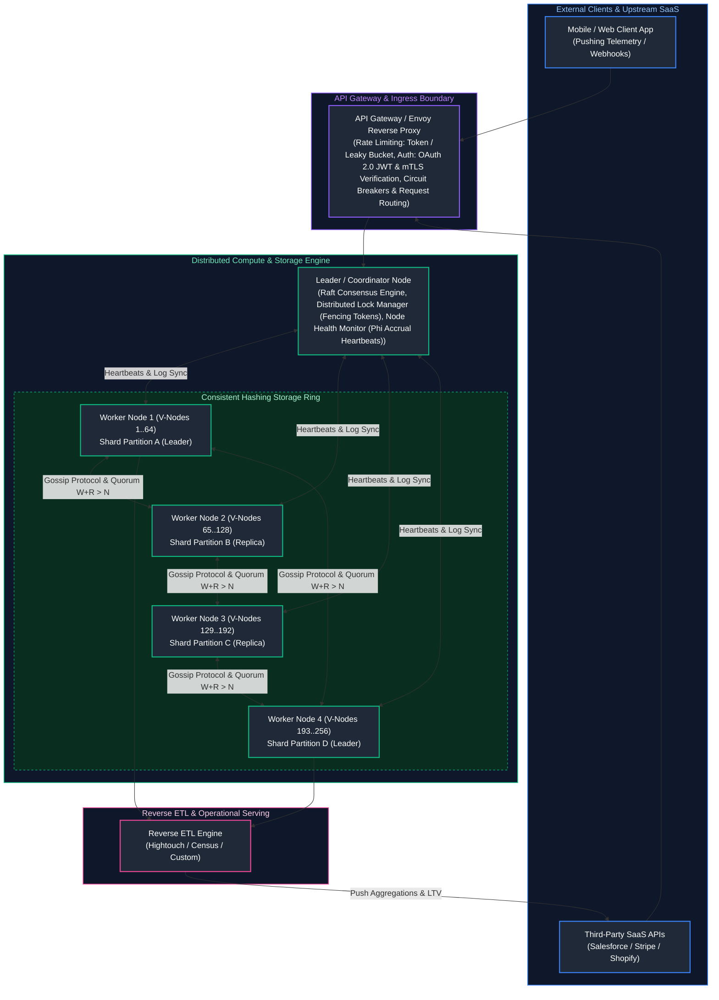

---

## Table of Contents
1. [Distributed Computing Principles](#1-distributed-computing-principles)
   - [1.1 MapReduce Paradigm: Foundations & Mechanics](#11-mapreduce-paradigm-foundations--mechanics)
   - [1.2 CAP Theorem: Formal Proof & Reality](#12-cap-theorem-formal-proof--reality)
   - [1.3 PACELC Theorem: Trade-Offs in Normal Operations](#13-pacelc-theorem-trade-offs-in-normal-operations)
   - [1.4 Consensus Algorithms: Raft & Paxos Internals](#14-consensus-algorithms-raft--paxos-internals)
   - [1.5 Distributed Locks & Fencing Tokens](#15-distributed-locks--fencing-tokens)
   - [1.6 Leader Election & Split-Brain Mitigation](#16-leader-election--split-brain-mitigation)
   - [1.7 Heartbeats, Failure Detection & Gossip Protocols](#17-heartbeats-failure-detection--gossip-protocols)
2. [Distributed Data Architecture](#2-distributed-data-architecture)
   - [2.1 Horizontal vs. Vertical Scaling: Hardware Limits & Amdahl's Law](#21-horizontal-vs-vertical-scaling-hardware-limits--amdahls-law)
   - [2.2 Sharding vs. Partitioning: Topologies & Key Selection](#22-sharding-vs-partitioning-topologies--key-selection)
   - [2.3 Consistent Hashing & Virtual Nodes (V-Nodes)](#23-consistent-hashing--virtual-nodes-v-nodes)
   - [2.4 Database Replication Topologies: Single-Leader, Multi-Leader & Leaderless](#24-database-replication-topologies-single-leader-multi-leader--leaderless)
   - [2.5 Replication Lag & Consistency Guarantees](#25-replication-lag--consistency-guarantees)
   - [2.6 Quorum Mathematics: Overlaps & Tunable Consistency ($W + R > N$)](#26-quorum-mathematics-overlaps--tunable-consistency-w--r--n)
   - [2.7 Consistency Spectrum: Linearizability to Eventual Consistency](#27-consistency-spectrum-linearizability-to-eventual-consistency)
3. [API Protocols & Communication Architectures](#3-api-protocols-communication-architectures)
   - [3.1 REST vs. GraphQL vs. gRPC: Wire Protocols & Benchmarks](#31-rest-vs-graphql-vs-grpc-wire-protocols--benchmarks)
   - [3.2 HTTP Methods, Idempotency & Resilient Status Code Handling](#32-http-methods-idempotency--resilient-status-code-handling)
4. [API Authentication & Security](#4-api-authentication-security)
   - [4.1 API Keys & Bearer Tokens (Cryptographic JWT Anatomy)](#41-api-keys--bearer-tokens-cryptographic-jwt-anatomy)
   - [4.2 OAuth 2.0 Client Credentials Grant for M2M Pipelines](#42-oauth-20-client-credentials-grant-for-m2m-pipelines)
   - [4.3 Mutual TLS (mTLS) for Zero Trust Pipeline Ingress](#43-mutual-tls-mtls-for-zero-trust-pipeline-ingress)
5. [Rate Limiting, Throttling & Pipeline Resilience](#5-rate-limiting-throttling-pipeline-resilience)
   - [5.1 Rate Limiting Algorithms: Token Bucket vs. Leaky Bucket vs. Sliding Window](#51-rate-limiting-algorithms-token-bucket-vs-leaky-bucket-vs-sliding-window)
   - [5.2 Exponential Backoff with Full Jitter: Mathematical Proof](#52-exponential-backoff-with-full-jitter-mathematical-proof)
   - [5.3 Circuit Breaker Design Pattern for Upstream Fault Isolation](#53-circuit-breaker-design-pattern-for-upstream-fault-isolation)
6. [Modern Integration Paradigms](#6-modern-integration-paradigms)
   - [6.1 Webhooks vs. Long Polling vs. Server-Sent Events (SSE)](#61-webhooks-vs-long-polling-vs-server-sent-events-sse)
   - [6.2 Cryptographic Webhook Signature Verification & Idempotency Keys](#62-cryptographic-webhook-signature-verification--idempotency-keys)
   - [6.3 Reverse ETL: Architecture, Diff Computation & Sync Mechanics](#63-reverse-etl-architecture-diff-computation--sync-mechanics)
   - [6.4 Managed Data Integration Platforms: Fivetran vs. Airbyte vs. Custom](#64-managed-data-integration-platforms-fivetran-vs-airbyte-vs-custom)
7. [Production Distributed Systems Summary & Architectural Principles](#7-production-distributed-systems-summary--architectural-principles)
8. [References & Further Reading](#8-references--further-reading)

---

# 1. Distributed Computing Principles

---

### 1.1 MapReduce Paradigm: Foundations & Mechanics

#### Intuitive Mental Model: The Industrial Word Census
Imagine a national library containing 100,000 thick books. If a single librarian attempts to count the occurrences of every word in every book sequentially, it would take 30 years.

Instead, the library adopts **MapReduce**:
1. **Split:** The 100,000 books are divided into 1,000 piles of 100 books each.
2. **Map:** 1,000 volunteer assistants (Mappers) each take one pile. Working independently in parallel, each assistant reads their books and writes down index cards: `("apple", 1)`, `("banana", 1)`, `("apple", 1)`.
3. **Combiner (Map-Side Pre-Aggregation):** Before leaving their desk, each assistant groups their own cards: `("apple", 2)`, `("banana", 1)`. This minimizes the physical cards carried across the room.
4. **Shuffle & Sort:** The cards are collected and sorted across the room so that **all** cards for words starting with $A-M$ go to Table 1, and all cards for words starting with $N-Z$ go to Table 2.
5. **Reduce:** Two head librarians (Reducers) sit at Table 1 and Table 2. The Table 1 librarian sums all the incoming tallies for `"apple"` and outputs the definitive grand total: `("apple", 418,920)`.

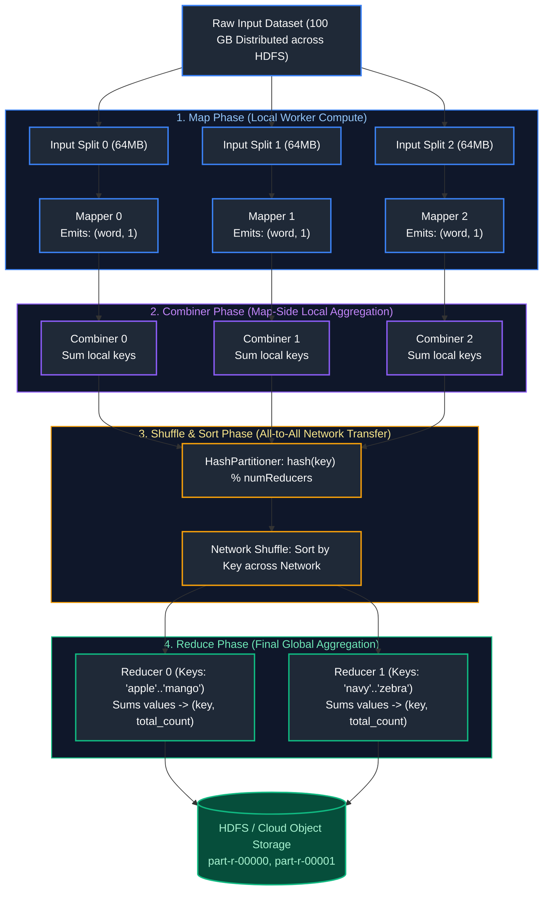

#### Detailed Step-by-Step Execution Trace

| Stage | Input Data Representation | Processing Logic | Output Data Representation |
| :--- | :--- | :--- | :--- |
| **1. Split** | 100 GB text file on HDFS | Broken into 64 MB / 128 MB logical byte chunks along newline boundaries | 3 distinct splits sent to 3 worker nodes |
| **2. Map** | Line: `"data engineering and distributed data"` | Tokenize line by whitespace and emit `(word, 1)` pairs | `[("data", 1), ("engineering", 1), ("and", 1), ("distributed", 1), ("data", 1)]` |
| **3. Combiner** | `[("data", 1), ("data", 1)]` | Local worker in-memory hash aggregation before network I/O | `[("data", 2), ("engineering", 1), ...]` |
| **4. Partition & Shuffle**| Key-value pairs across all mappers | `partition_idx = hash(key) % num_reducers`. Data sorted and sent over network switches | Reducer 0 receives all `"data"` and `"and"` keys; Reducer 1 receives `"engineering"` |
| **5. Reduce** | Key: `"data"`, List of Values: `[2, 3, 1, 4]` | Sum all integer counts in the iterator: `sum(values)` | Final record: `("data", 10)` written to HDFS `part-r-00000` |

#### Why Apache Spark Superseded Hadoop MapReduce
In Hadoop MapReduce, every stage boundary requires writing intermediate results to physical hard drives (HDFS disk I/O) and serializing to disk for fault tolerance. An iterative algorithm (e.g., PageRank or Machine Learning Gradient Descent requiring 30 iterations) performs 30 full read-write disk cycles.

Apache Spark introduced **Resilient Distributed Datasets (RDDs)** and in-memory Directed Acyclic Graphs (DAGs). Spark keeps intermediate transformation states in distributed RAM across worker nodes, eliminating disk serialization overhead and executing iterative computations **10x to 100x faster**.

#### Full Python MapReduce Engine Simulation
```python
import collections
from typing import List, Tuple, Dict, Generator

# 1. Map Function: Pure transformation from input record to key-value pairs
def mapper(line: str) -> List[Tuple[str, int]]:
    tokens = line.lower().strip().split()
    return [(word.strip(".,!?:;"), 1) for word in tokens if word]

# 2. Combiner Function: Local aggregation per mapper worker
def combiner(intermediate_kvs: List[Tuple[str, int]]) -> List[Tuple[str, int]]:
    local_counts: Dict[str, int] = collections.defaultdict(int)
    for word, count in intermediate_kvs:
        local_counts[word] += count
    return list(local_counts.items())

# 3. Partitioning & Shuffle Function: Hash modulo routing across network
def partition_and_shuffle(
    combined_outputs: List[List[Tuple[str, int]]], 
    num_reducers: int
) -> Dict[int, Dict[str, List[int]]]:
    # Reducer ID -> {Key -> List of Counts}
    reducer_bins: Dict[int, Dict[str, List[int]]] = {
        i: collections.defaultdict(list) for i in range(num_reducers)
    }
    for worker_output in combined_outputs:
        for word, count in worker_output:
            # Deterministic hash routing
            reducer_id = hash(word) % num_reducers
            reducer_bins[reducer_id][word].append(count)
    return reducer_bins

# 4. Reduce Function: Global aggregation per key
def reducer(word: str, counts: List[int]) -> Tuple[str, int]:
    return (word, sum(counts))

# End-to-End Execution Trace
document_splits = [
    "Distributed systems enable horizontal scaling across clusters.",
    "Horizontal scaling provides fault tolerance in distributed computing.",
    "Fault tolerance and distributed consensus ensure high availability."
]

# Run Map & Combiner phases in parallel across splits
mapper_results = [mapper(split) for split in document_splits]
combined_results = [combiner(kvs) for kvs in mapper_results]

# Run Network Shuffle to 2 Reducers
num_reducers = 2
shuffled_bins = partition_and_shuffle(combined_results, num_reducers)

# Run Reduce phase
final_word_counts: Dict[str, int] = {}
for r_id in range(num_reducers):
    for word, counts in shuffled_bins[r_id].items():
        k, v = reducer(word, counts)
        final_word_counts[k] = v

print("MapReduce Top Word Counts:", sorted(final_word_counts.items(), key=lambda x: x[1], reverse=True)[:5])
```

---

### 1.2 CAP Theorem: Formal Proof & Reality

#### Formal Mathematical Definition
Formulated by Eric Brewer in 2000 and mathematically proven by Seth Gilbert and Nancy Lynch in 2002, the **CAP Theorem** states that in any asynchronous network subject to communication delays and partitions, a distributed read-write data store can guarantee at most **two out of the three properties**:

1. **Consistency (C - Linearizability):** Every read operation receives the most recent write or an error. Formally, all operations appear to execute atomically at a single point in time on a single global copy of the state.
2. **Availability (A):** Every non-failing node must return a non-error response for every received request (no guarantees that it contains the freshest write).
3. **Partition Tolerance (P):** The system continues to function despite arbitrary network packet drops, delayed messages, or complete network bisisections between servers.

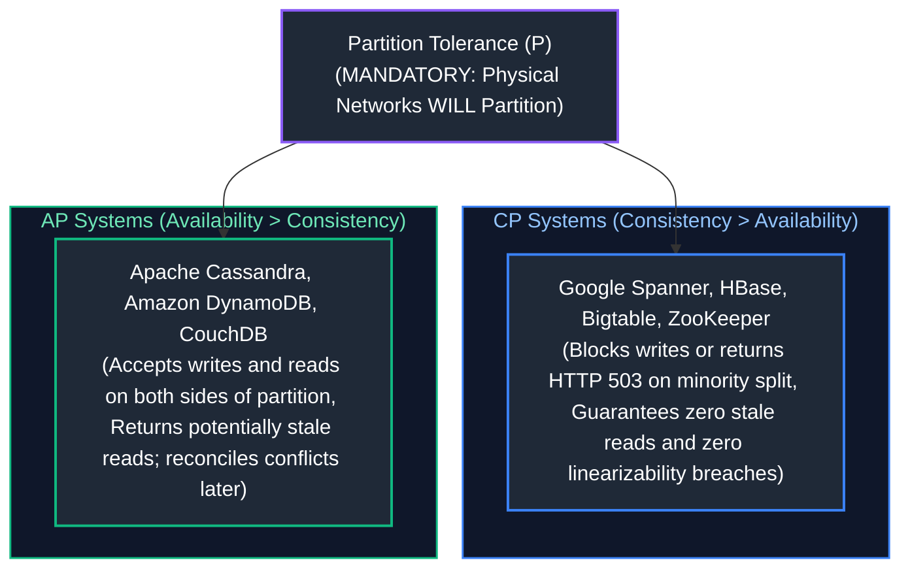

#### Why "CA Systems" Do Not Exist in Reality
Junior engineers frequently ask: *"Can I build a CA database by choosing Consistency and Availability?"*
**The answer is mathematically NO.** 

In the physical world, servers are connected via optical fibers, routers, switches, and cloud virtualization layers. A backhoe cutting an underground fiber cable, a misconfigured router BGP table, or a top-of-rack switch reboot causes a **Network Partition ($P$)**.

When a network partition occurs between Datacenter 1 and Datacenter 2:
- If a client writes to Datacenter 1:
  - If you allow the write and return `200 OK`, a client reading from Datacenter 2 will read stale data $\rightarrow$ **You sacrificed Consistency ($C$) to stay Available ($A$) $\implies$ AP System**.
  - If you refuse the write or block until the partition heals $\rightarrow$ **You sacrificed Availability ($A$) to preserve Consistency ($C$) $\implies$ CP System**.
- You cannot choose to "not have a partition." Therefore, distributed systems are strictly a choice between **CP** and **AP** during partition events.

#### Comprehensive CAP Comparison Matrix

| System Archetype | Trade-off Chosen | Behavior During Network Split | Best Enterprise Use Cases | Canonical Database Examples |
| :--- | :--- | :--- | :--- | :--- |
| **CP (Consistency)** | Discards Availability for Linearizability | Minority partition halts or rejects writes; clients receive timeouts/errors until partition heals. | Core banking ledgers, inventory reservation systems, identity auth. | Google Cloud Spanner, CockroachDB, Apache HBase, ZooKeeper, etcd |
| **AP (Availability)** | Discards Linearizability for Uptime | All nodes accept writes locally; read operations return stale data without error. | Social media feeds, e-commerce shopping carts, telemetry metrics. | Apache Cassandra, Amazon DynamoDB, Apache CouchDB, Riak |

---

### 1.3 PACELC Theorem: Trade-Offs in Normal Operations

#### First-Principles Breakdown: Extending CAP Beyond Partitions
The CAP Theorem is incomplete because network partitions are rare (occurring $<0.01\%$ of operating hours in modern datacenters). What trade-offs govern the system during the $99.99\%$ of the time when the network is operating normally?

In 2012, Professor Daniel Abadi formulated the **PACELC Theorem**:

$$\text{If } \mathbf{P} \text{ (Partition)} \implies \text{Choose } (\mathbf{A} \lor \mathbf{C}), \quad \mathbf{ELSE} \implies \text{Choose } (\mathbf{L} \lor \mathbf{C})$$

- **If there is a Partition ($P$):** How does the system trade off **Availability ($A$)** versus **Consistency ($C$)**?
- **Else ($E$ - Normal Operation):** How does the system trade off **Latency ($L$)** versus **Consistency ($C$)**?

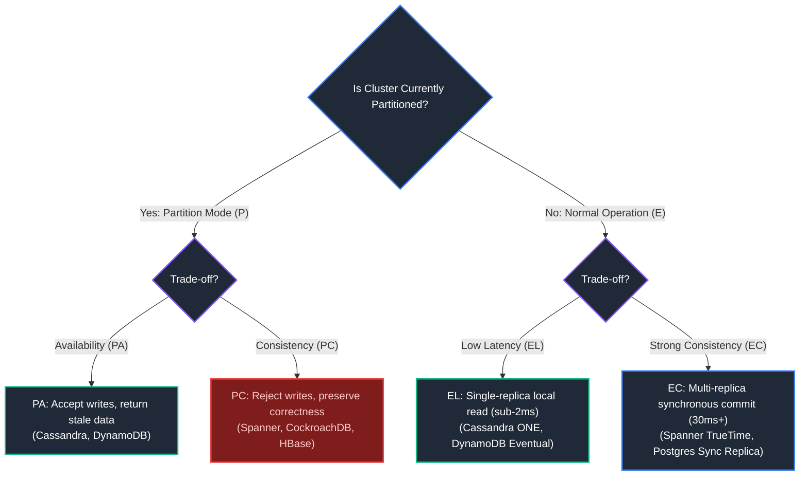

#### The $2 \times 2$ PACELC Classification Matrix

| Classification | Meaning Under Partition ($P$) | Meaning in Normal Operation ($E$) | Latency Profile | Primary Database Implementations |
| :--- | :--- | :--- | :--- | :--- |
| **PC / EC** | Choose Consistency ($PC$) | Choose Consistency ($EC$) | High ($30\text{ms} - 100\text{ms}$): Requires synchronous multi-node quorum consensus on every write. | **Google Spanner, CockroachDB, Apache HBase, PostgreSQL Sync Replica** |
| **PC / EL** | Choose Consistency ($PC$) | Choose Latency ($EL$) | Medium ($5\text{ms} - 15\text{ms}$): Reads served from master cache without quorum check. | **MongoDB (with primary reads), Redis Sentinel** |
| **PA / EL** | Choose Availability ($PA$) | Choose Latency ($EL$) | Ultra-Low ($1\text{ms} - 5\text{ms}$): Asynchronous background replication; writes return instantly. | **Apache Cassandra, Amazon DynamoDB (Default), Couchbase** |
| **PA / EC** | Choose Availability ($PA$) | Choose Consistency ($EC$) | Theoretical anomaly: Rarely chosen because maintaining EC normally makes PA difficult. | Specialized academic research databases |

---

### 1.4 Consensus Algorithms: Raft & Paxos Internals

In distributed computing, **Consensus** is the foundational problem of getting multiple independent servers to agree on a sequence of values or state machine actions, even when servers crash or messages are delayed or reordered.

#### Paxos vs. Raft: Why Raft Won the Enterprise
- **Paxos (Leslie Lamport, 1998):** Historically the premier consensus protocol. Mathematically proven and elegant, but notoriously abstract and difficult to implement in real software. Multi-Paxos requires complex edge-case handling for leader election and log compaction.
- **Raft (Ongaro & Ousterhout, Stanford, 2014):** Explicitly designed to be understandable. It decomposes consensus into three discrete sub-problems: **Leader Election**, **Log Replication**, and **Safety**. Raft powers **Kubernetes (etcd)**, **Kafka 3.x+ (KRaft)**, and **HashiCorp Consul**.

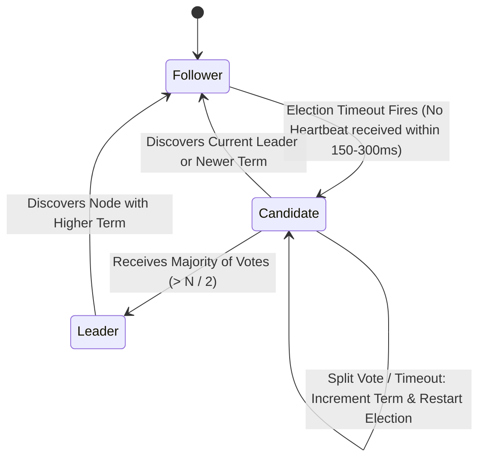

#### Raft Execution Protocol: Step-by-Step
1. **Node Roles:** Every node is always in one of three states:
   - **Follower:** Completely passive; responds only to incoming RPCs from Leaders and Candidates.
   - **Candidate:** Transitions when election timer expires; requests votes from peers to become Leader.
   - **Leader:** Handles all client requests, dictates log replication order, and sends periodic keepalive heartbeats.
2. **Randomized Election Timeouts:** To prevent **Split Votes** (where two candidates solicit votes simultaneously and tie with 50% each), election timeouts are randomized per node (e.g., between 150ms and 300ms). The node with the shortest timer transitions to Candidate first and claims the leader role.
3. **Log Replication Sequence:**
   - Client sends write command: `SET x = 10`.
   - Leader appends entry to its local log.
   - Leader broadcasts `AppendEntries` RPC to all Follower nodes.
   - Once a **Majority Quorum** ($\lfloor N/2 \rfloor + 1$) of followers acknowledge writing the entry to their local disk logs, the Leader **commits** the entry.
   - Leader executes the entry in its state machine and returns `200 OK` to the client.
   - Followers commit the entry upon receiving the Leader's next heartbeat.

---

### 1.5 Distributed Locks & Fencing Tokens

#### Why Distributed Locking is Hard: The Stop-the-World GC Trap
A distributed lock guarantees that only one worker across an entire cluster executes a critical section (e.g., executing a non-reentrant financial settlement batch).
However, naive lease-based locks (e.g., standard Redis `SET lock:name value EX 30 NX`) suffer from the **Martin Kleppmann Pause Hazard**:

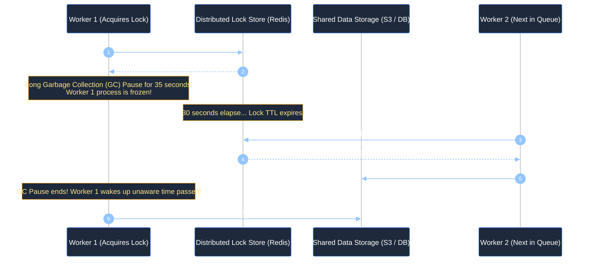

#### The Architectural Solution: Fencing Tokens
To prevent stale zombie workers from corrupting storage after a long GC pause or network partition, the lock service must issue a monotonically increasing **Fencing Token** (e.g., `Token 43`). Storage targets validate that incoming write tokens are strictly greater than the highest token previously committed:

```python
class FencingTokenStorageEngine:
    """
    Storage layer enforcing optimistic concurrency via monotonically increasing Fencing Tokens.
    Rejects zombie writes from partitioned or GC-paused workers.
    """
    def __init__(self):
        self.highest_token_seen: int = 0
        self.data_store: dict = {}

    def commit_write(self, key: str, value: str, fencing_token: int) -> bool:
        # Atomic check: Fencing token must be strictly greater than any token previously seen
        if fencing_token <= self.highest_token_seen:
            print(f"[REJECTED] Stale fencing token {fencing_token} <= highest seen {self.highest_token_seen}! Aborting zombie write.")
            return False
            
        # Update high-watermark token and commit state
        self.highest_token_seen = fencing_token
        self.data_store[key] = value
        print(f"[COMMITTED] Key '{key}' updated with valid fencing token {fencing_token}")
        return True

# Simulation
storage = FencingTokenStorageEngine()
# Worker 2 commits with token 42
storage.commit_write("balance", "200.00", fencing_token=42)
# Worker 1 wakes up from 40s GC pause and tries to commit with stale token 41
storage.commit_write("balance", "150.00", fencing_token=41)  # REJECTED!
```

---

### 1.6 Leader Election & Split-Brain Mitigation

#### The Split-Brain Problem
When a network partition bisects a 5-node cluster into two isolated sub-networks (e.g., 2 nodes on West coast, 3 nodes on East coast), if both sub-clusters believe the other side is dead, both will elect their own Leader. Clients connected to West write conflicting records to those connected to East, creating **irreparable split-brain data corruption**.

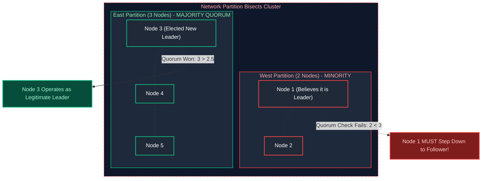

#### Quorum Arithmetic: Why Odd Node Counts are Mandatory
In distributed consensus clusters, the minimum number of nodes required to form a majority quorum ($Q$) is defined mathematically as:

$$Q = \left\lfloor \frac{N}{2} \right\rfloor + 1$$

- In a **3-node cluster**: $Q = \lfloor 3/2 \rfloor + 1 = 2$. It survives **1 failed node**.
- In a **4-node cluster**: $Q = \lfloor 4/2 \rfloor + 1 = 3$. It survives **1 failed node**.
- In a **5-node cluster**: $Q = \lfloor 5/2 \rfloor + 1 = 3$. It survives **2 failed nodes**.

*Notice:* A 4-node cluster provides **no extra fault tolerance** over a 3-node cluster (both survive only 1 failure), but requires 3 nodes for quorum instead of 2. Therefore, production consensus clusters (ZooKeeper, etcd, KRaft) **strictly operate with odd numbers of nodes (3, 5, or 7)**.

---

### 1.7 Heartbeats, Failure Detection & Gossip Protocols

#### 1. Phi Accrual Failure Detector (Apache Cassandra)
Traditional binary timeout detectors (`if elapsed > 5s: mark DEAD`) fail in fluctuating cloud environments where network congestion causes temporary latency spikes.
The **Phi Accrual Failure Detector** models heartbeat arrival intervals using a normal/Gaussian distribution and outputs a continuous scale of suspicion ($\Phi$):

$$\Phi = -\log_{10}(P_{\text{later}}(t - t_{\text{last}}))$$

If $\Phi \ge 8$, the probability of a false alarm is $10^{-8}$. Cassandra dynamically adjusts failover thresholds based on network traffic history rather than arbitrary static seconds.

#### 2. The Gossip Protocol (Epidemic State Dissemination)
In clusters of 10,000 nodes, having every node heartbeat to a central master creates an $O(N)$ networking bottleneck.
Cassandra and DynamoDB use **Gossip Protocols**:
- Every second, each node picks $k$ random peer nodes (usually $k=3$) and exchanges state summaries.
- Like a virus or rumor spreading through a population, state updates converge across the entire $N$-node cluster in $O(\log N)$ network rounds with zero centralized coordinator.

---

# 2. Distributed Data Architecture

---

### 2.1 Horizontal vs. Vertical Scaling: Hardware Limits & Amdahl's Law

| Dimension | Vertical Scaling (Scale-Up) | Horizontal Scaling (Scale-Out) |
| :--- | :--- | :--- |
| **Architectural Concept** | Upgrade single server to 128 Cores, 4TB RAM, 100Gbps NIC | Cluster 500 commodity nodes (16 Cores, 64GB RAM each) |
| **Physical Ceiling** | **Hardware Wall:** Maximum RAM sockets and PCI-e lanes per motherboard | **Virtually Infinite:** Scale to 10,000+ nodes (Google, Meta, AWS) |
| **Network & Shuffling Overhead** | **Zero:** Inter-thread communication occurs via local L3 CPU cache and RAM | High: Requires network shuffles, TCP socket pools, serialization |
| **Cost Scaling Curve** | Exponential (Specialized multi-socket supercomputers cost \$500k+) | Linear (Pay for commodity VMs by the hour) |
| **Fault Tolerance Model** | Single point of failure: Motherboard/Power supply failure halts everything | Resilient: Worker crashes trigger automated task reassignment |

#### Amdahl's Law
Amdahl's law proves that the theoretical speedup of a distributed task is limited by the serial (non-parallelizable) fraction of the program ($S$):

$$\text{Speedup}(N) = \frac{1}{S + \frac{1 - S}{N}}$$

If 5% of your data pipeline is strictly serial (e.g., initial metadata catalog lock or final single-thread file manifest commit), **adding 10,000 servers can never speed up the job by more than 20x**, regardless of cluster budget!

---

### 2.2 Sharding vs. Partitioning: Topologies & Key Selection

- **Partitioning:** Slicing a large table into distinct physical files residing **on the same single database server** (e.g., PostgreSQL table partitioning by month). Improves local disk I/O through partition pruning.
- **Sharding:** Distributing distinct slices of data across **completely separate physical database servers located on distinct network IP addresses** (e.g., MongoDB, Citus, Spanner).

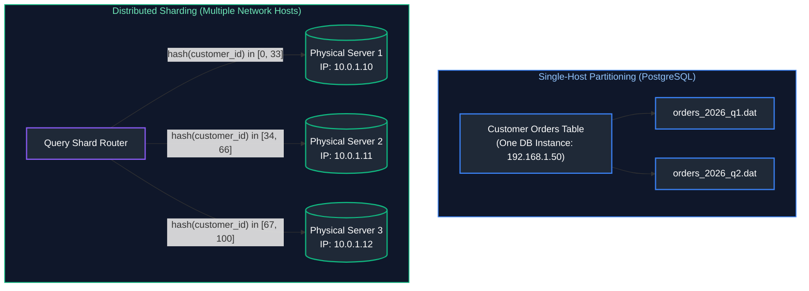

#### The Hotspotting / Shard Skew Trap
If you shard a database table by a monotonically increasing sequential key (e.g., `created_at` timestamp or auto-incrementing `id`), **100% of all current write traffic slams into the single shard holding the latest range**, while all remaining 99 shards sit idle!
- **Mitigation:** Use Compound Sharding Keys (e.g., `(tenant_id, created_at)`) or Cryptographic Hash Sharding (`MD5(customer_id)`) to scatter write traffic uniformly across all cluster nodes.

---

### 2.3 Consistent Hashing & Virtual Nodes (V-Nodes)

#### The Problem with Modulo Hashing
In basic modular hashing (`node_id = hash(key) % N`), if you have 9 nodes ($N=9$) and add 1 node to handle traffic ($N=10$), **almost 100% of all keys rehash to completely different servers**. This triggers a catastrophic network re-shuffling storm that exhausts database IOPS.

#### Mechanics of the Consistent Hash Ring
Consistent Hashing maps both **Data Keys** and **Physical Nodes** onto an abstract circular integer ring ($0$ to $2^{32} - 1$):
1. Compute hash of each server's IP address: `pos = hash(IP)`.
2. Compute hash of incoming data key: `pos = hash(key)`.
3. To assign a key to a server, move **clockwise** around the ring until you encounter the first server.
4. When a new node joins, **only $K / N$ keys are reassigned** (where $K$ is total keys, $N$ is total servers).

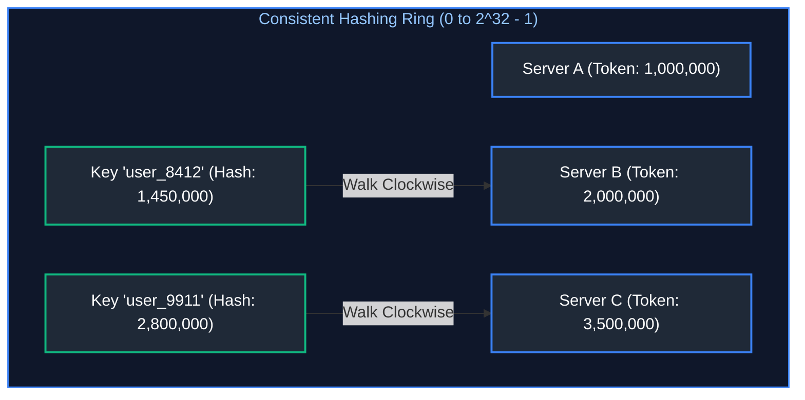

#### Why Virtual Nodes (V-Nodes) are Essential
In a simple ring with only 3 physical servers, nodes are rarely spaced uniformly. One server may end up responsible for 70% of the ring's arc, creating a massive hot-spot.
- **Solution (V-Nodes):** Each physical machine is mapped to **100 to 256 virtual points** on the ring (e.g., `ServerA#1`, `ServerA#2`, ...). This shreds data keys into tiny chunks and distributes keys uniformly across machines with less than 3% variance.

#### Production Python Consistent Hashing Ring with V-Nodes
```python
import hashlib
import bisect
from typing import Dict, List, Optional

class ConsistentHashRing:
    """
    Thread-safe Consistent Hash Ring implementation with Virtual Nodes (V-Nodes),
    ensuring uniform key distribution and minimal reassignment churn on cluster resize.
    """
    def __init__(self, replicas_per_node: int = 100):
        self.replicas_per_node = replicas_per_node
        self.ring: Dict[int, str] = {}         # Ring Token (Integer) -> Physical Node Hostname
        self.sorted_keys: List[int] = []       # Sorted array of tokens for binary search

    def _hash(self, key_str: str) -> int:
        """Computes deterministic 32-bit integer token from MD5 digest."""
        digest = hashlib.md5(key_str.encode("utf-8")).hexdigest()
        return int(digest[:8], 16)  # Extract first 8 hex chars (32-bit uint)

    def add_node(self, node: str) -> None:
        """Adds a physical server, placing replicas_per_node V-node tokens on the ring."""
        for i in range(self.replicas_per_node):
            vnode_key = f"{node}#vnode_{i}"
            token = self._hash(vnode_key)
            self.ring[token] = node
            bisect.insort(self.sorted_keys, token)
        print(f"[CLUSTER] Node {node} registered ({self.replicas_per_node} V-nodes created).")

    def remove_node(self, node: str) -> None:
        """Removes a physical server and evicts its V-nodes from the ring."""
        for i in range(self.replicas_per_node):
            vnode_key = f"{node}#vnode_{i}"
            token = self._hash(vnode_key)
            if token in self.ring:
                del self.ring[token]
                idx = bisect.bisect_left(self.sorted_keys, token)
                del self.sorted_keys[idx]
        print(f"[CLUSTER] Node {node} evicted from ring.")

    def get_node(self, key: str) -> Optional[str]:
        """Routes a data key to the nearest physical node moving clockwise around the ring."""
        if not self.ring:
            return None
        token = self._hash(key)
        # Binary search for the first V-node token >= key token
        idx = bisect.bisect_right(self.sorted_keys, token)
        # Wrap around to 0 if key exceeds highest token on ring
        if idx == len(self.sorted_keys):
            idx = 0
        return self.ring[self.sorted_keys[idx]]

# Verification
ring = ConsistentHashRing(replicas_per_node=150)
ring.add_node("node-1.db.internal")
ring.add_node("node-2.db.internal")
ring.add_node("node-3.db.internal")

keys = [f"customer_{i}" for i in range(1000)]
assignments = collections.Counter(ring.get_node(k) for k in keys)
print("Distribution across nodes (Uniformity Check):", dict(assignments))
```

---

### 2.4 Database Replication Topologies: Single-Leader, Multi-Leader & Leaderless

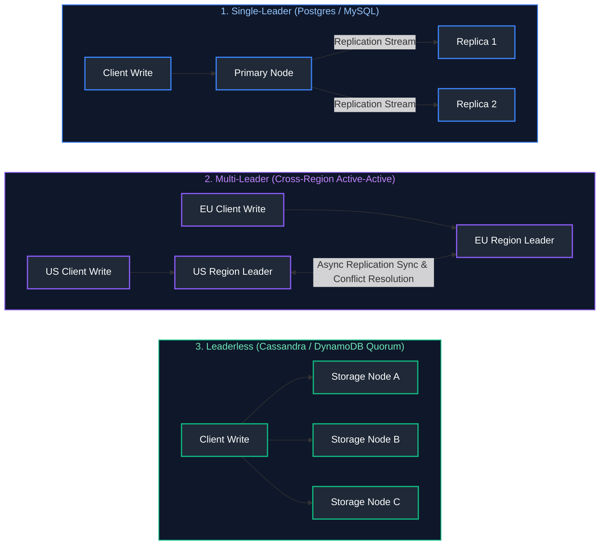

#### Detailed Architecture Comparison

| Trait | Single-Leader | Multi-Leader (Active-Active) | Leaderless (Dynamo-Style) |
| :--- | :--- | :--- | :--- |
| **Write Routing** | All writes must land on the 1 designated Leader node | Writes routed to nearest geographical regional Leader | Writes broadcast to any coordinator or multiple nodes |
| **Write Scalability** | **Bottlenecked:** Limited to the write throughput of 1 physical master | High: Parallel writes accepted across all regions | **Virtually Infinite:** Scales linearly as nodes are added |
| **Conflict Resolution** | None needed: Master defines single global serialized order | **Complex:** Requires Last-Write-Wins (LWW) or CRDTs | Resolved at read time via Quorum overlaps & Read Repair |
| **Failover Hazard** | Requires Leader Election (e.g. Patroni/MHA) taking 10-30s | Highly resilient: Local region survives remote outage | Zero failover latency: Survives node crashes seamlessly |

---

### 2.5 Replication Lag & Consistency Guarantees

When reading from asynchronous read-replicas, network delay induces **Replication Lag**. This manifests in three canonical user-facing bugs:

1. **Violation of Read-After-Write (Read-Your-Own-Writes) Consistency:**
   - *Symptom:* A user edits their profile name from `"Alice"` to `"Alicia"` and clicks save. The page refreshes, routes the read query to a lagging replica, and displays `"Alice"`. The user panics, thinking their update was lost.
   - *Fix:* Route reads for the user's *own* profile to the Leader for 60 seconds following any write, or track client Log Sequence Numbers (LSN) in session cookies.
2. **Violation of Monotonic Reads (Time Travel Illusion):**
   - *Symptom:* A user refreshes their feed and sees a comment posted 2 minutes ago. They refresh again; this second request hits a replica lagging 5 minutes behind, and the comment magically vanishes!
   - *Fix:* Ensure a given user's read requests are deterministically hashed to the same replica instance.
3. **Violation of Consistent Prefix Reads (Causal Inversion):**
   - *Symptom:* In a group chat, Bob asks: *"Do you know the answer?"* and Alice replies: *"Yes, it is 42."* An external observer sees Alice's answer appear *before* Bob's question because the two messages replicated over different partition paths.
   - *Fix:* Causally related records must share the same sharding partition key.

---

### 2.6 Quorum Mathematics: Overlaps & Tunable Consistency ($W + R > N$)

In leaderless distributed databases (Cassandra, DynamoDB, ScyllaDB), strong consistency is governed by the **Quorum Overlap Inequality**:

$$W + R > N$$

- $N$ = Replication factor (Total replica copies stored).
- $W$ = Write Quorum (Number of replicas that must acknowledge a write before returning success).
- $R$ = Read Quorum (Number of replicas that must respond to a read request).

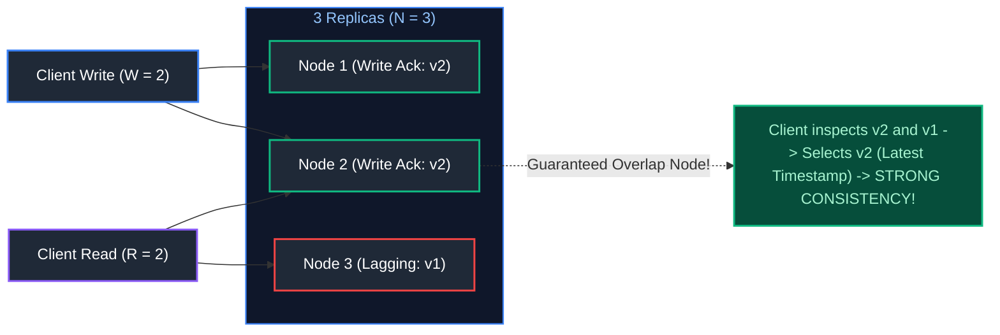

#### Why the Overlap Guarantees Correctness: The Pigeonhole Principle
If $N=3, W=2, R=2$:
$$W + R = 4 > 3$$
By Dirichlet's Pigeonhole Principle, the set of nodes written to and the set of nodes read from **must intersect on at least one physical server**. That intersecting server returns the newest version token (timestamp). The client discards the older version and achieves **Strong Consistency**.

#### Tunable Consistency Configuration Profiles

| Desired SLA Profile | $W$ Setting | $R$ Setting | Latency Profile | Consistency Level |
| :--- | :--- | :--- | :--- | :--- |
| **Fastest Writes (IoT Ingestion)** | `W = 1` | `R = ALL (3)` | Write: Sub-1ms | Read: Slow, Strong Consistency |
| **Fastest Reads (Cache Serving)** | `W = ALL (3)` | `R = 1` | Read: Sub-1ms | Write: Slow, Strong Consistency |
| **Balanced Enterprise Standard** | `W = QUORUM (2)` | `R = QUORUM (2)` | Balanced | **Strong Consistency ($W + R > N$)** |
| **Maximum Availability (AP)** | `W = 1` | `R = 1` | Ultra-fast ($<2\text{ms}$) | **Eventual Consistency ($W + R \le N$)** |

---

### 2.7 Consistency Spectrum: Linearizability to Eventual Consistency

Distributed systems do not operate in a binary "strong vs. eventual" world. They exist along a formal hierarchy of consistency models:

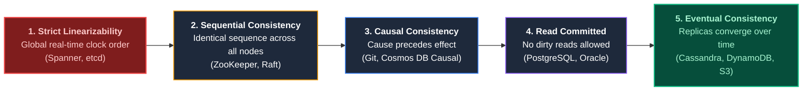

| Consistency Model | Network Overhead | Write Latency | Stale Reads Possible? | Typical Systems |
| :--- | :---: | :---: | :---: | :--- |
| **Linearizability** | Highest (2PC / TrueTime) | High (Multi-round consensus) | **Never** | Google Cloud Spanner, etcd |
| **Sequential** | High (Log replication) | Moderate | No | Apache ZooKeeper, KRaft Controller |
| **Causal** | Moderate (Vector clocks) | Low | No for causal chains | AWS DynamoDB, Azure Cosmos DB |
| **Read Committed** | Low (Row locks / MVCC) | Very Low | Yes across transactions | PostgreSQL, MySQL InnoDB |
| **Eventual** | Lowest (Async anti-entropy) | Lowest (Local writes) | Yes during network lag | Apache Cassandra, Amazon S3, ADLS Gen2 |

1. **Linearizability (Strong Consistency):** Global real-time clock ordering. Once a write completes anywhere, all subsequent reads across the planet see that write or a newer one.
2. **Sequential Consistency:** Operations do not need to match wall-clock time, but all nodes observe writes in the exact same sequence.
3. **Causal Consistency:** Causally dependent operations (cause $\rightarrow$ effect) are ordered identically everywhere; concurrent operations may be seen in differing orders.
4. **Eventual Consistency:** In the absence of new updates, all replicas eventually converge to the identical value. (Sub-second convergence via Read Repair and Anti-Entropy Merkle tree syncs).

---

# 3. API Protocols & Communication Architectures

---

### 3.1 REST vs. GraphQL vs. gRPC: Wire Protocols & Benchmarks

Modern data pipelines integrate with external SaaS endpoints and internal microservices across three primary API protocols:

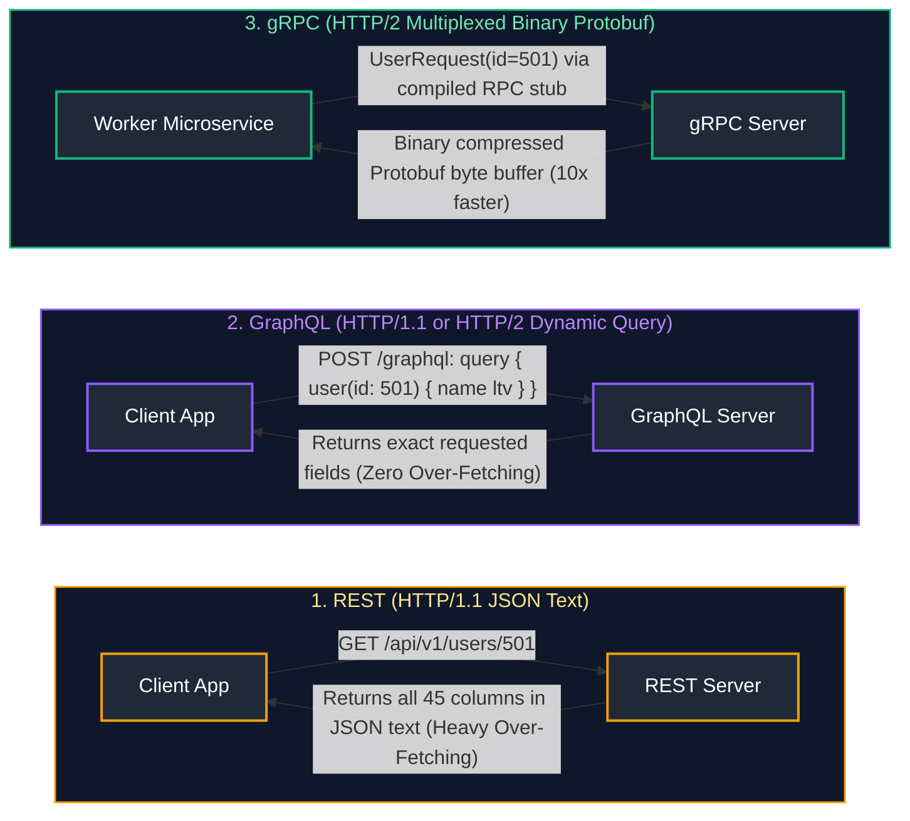

#### Detailed Architecture Comparison Matrix

| Technical Trait | REST (Representational State Transfer) | GraphQL | gRPC (Google Remote Procedure Call) |
| :--- | :--- | :--- | :--- |
| **Transport Layer** | HTTP/1.1 (or HTTP/2) | HTTP/1.1 (or HTTP/2) | **HTTP/2 (Mandatory Multiplexing)** |
| **Payload Serialization** | JSON (Plaintext human-readable string) | JSON (Plaintext string) | **Protocol Buffers (Compact Binary Format)** |
| **Typing & Contract** | OpenAPI / Swagger (Optional external spec) | Strict GraphQL Schema Definition (`schema.graphql`) | **Strict `.proto` Interface Definition Language (IDL)** |
| **Network Efficiency** | Moderate: High header overhead, JSON serialization cost | High: Client requests exact fields needed | **Extreme: 70-80% smaller payloads, 10x lower CPU SerDe** |
| **Streaming Capabilities** | Server-Sent Events (SSE) / Polling | Subscriptions (WebSocket based) | **Bi-directional streaming native on single TCP socket** |
| **Best Pipeline Fit** | Public third-party SaaS integration (Stripe, HubSpot) | Dynamic front-end analytics dashboards | **High-throughput internal inter-microservice streaming** |

#### Protocol Buffers Schema Definition (`analytics.proto`)
```protobuf
syntax = "proto3";

package enterprise.analytics;

// Strongly-typed telemetry event definition
message TelemetryEvent {
  string event_uuid = 1;
  int64 user_id = 2;
  double transaction_amount = 3;
  int64 epoch_timestamp_ms = 4;
  enum DeviceType {
    UNKNOWN = 0;
    MOBILE = 1;
    DESKTOP = 2;
    IOT_SENSOR = 3;
  }
  DeviceType device = 5;
}

// Ingestion service definition
service IngestionService {
  rpc StreamTelemetry(stream TelemetryEvent) returns (IngestionResponse);
}

message IngestionResponse {
  bool success = 1;
  int64 records_committed = 2;
}
```

---

### 3.2 HTTP Methods, Idempotency & Resilient Status Code Handling

#### Method Semantics & Pipeline Idempotency
- `GET`: Safe & Idempotent. Must never mutate server state.
- `POST`: **Non-Idempotent**. Re-sending a `POST /api/orders` retries payment processing, risking duplicate credit card charges.
- `PUT`: **Idempotent**. Completely replaces the target resource at the URL. Re-running 5 times leaves identical state.
- `PATCH`: Partially mutates attributes. May or may not be idempotent depending on server implementation.
- `DELETE`: **Idempotent**. Removes the resource. Re-deleting returns `404 Not Found` or `204 No Content` without further state changes.

#### Production Pipeline HTTP Status Code Action Matrix

| Status Code | Meaning | Pipeline Retry Strategy | Action Taken by Worker |
| :--- | :--- | :--- | :--- |
| **`200 OK` / `201 Created`** | Request Succeeded | Do Not Retry | Parse response body, commit watermark to checkpoint table. |
| **`400 Bad Request`** | Schema Violation / Invalid JSON | **Fatal (Do Not Retry)** | Route payload to Dead Letter Queue (DLQ) quarantine; notify team. |
| **`401 Unauthorized`** | Expired Access Token | **Retry Once** | Invalidate cached OAuth2 token, fetch fresh JWT, and replay request. |
| **`403 Forbidden`** | Insufficient IAM Scope | **Fatal (Do Not Retry)** | Fail pipeline immediately; alert security administrator. |
| **`404 Not Found`** | Resource Missing | Do Not Retry | Treat as soft delete or log warning depending on contract. |
| **`429 Too Many Requests`** | Rate Limit Exceeded | **Retryable** | Extract `Retry-After` header; execute Exponential Backoff with Jitter. |
| **`500 Internal Error`** | Upstream Crash | **Retryable** | Wait with exponential backoff; retry up to 5 times. |
| **`502 Bad Gateway` / `503 Unavailable`** | Proxy or Node Restarting | **Retryable** | Immediate transient network retry with jitter. |

---

# 4. API Authentication & Security

---

### 4.1 API Keys & Bearer Tokens (Cryptographic JWT Anatomy)

A **JSON Web Token (JWT)** is a compact, URL-safe cryptographic token structured into three distinct dot-separated segments:

$$\text{JWT} = \text{Base64Url}(\text{Header}) \; . \; \text{Base64Url}(\text{Payload}) \; . \; \text{Cryptographic Signature}$$

```json
    // "header": 
    {
        "alg": "HS256",
        "typ": "JWT"
    }
    // "payload": 
    {
        "sub": "user_12345",
        "iat": 1700000000,
        "exp": 1700003600,
        "roles": ["admin", "data_ingest"]
    }
    // "signature": "a-string-secret-at-least-256-bits-long"

// Gets Encoded as: 
// eyJhbGciOiJIUzI1NiIsInR5cCI6IkpXVCJ9.        -> 1. HEADER (Algorithm & Type)
// eyJzdWIiOiJ1c2VyXzEyMzQ1IiwiaWF0IjoxNzAw...  -> 2. PAYLOAD (Claims & Subject)
// DWkrkUkOXitp6TASupJi-vV7l7C84yUiPWAZ4_cDO0k  -> 3. SIGNATURE (Cryptographic Proof)
```

| Segment | Encoded Sample | Decoded JSON Payload / Cryptographic Role |
| :--- | :--- | :--- |
| **1. Header** | `eyJhbGciOiJSUzI1NiIsInR5cCI6IkpXVCJ9` | `{"alg": "RS256", "typ": "JWT"}` — Declares RSA-SHA256 signature algorithm. |
| **2. Payload** | `eyJzdWIiOiJwaXBlbGluZSIsImV4cCI6MTgwMDAwMDAwMH0` | `{"sub": "pipeline", "scope": ["read:orders"], "exp": 1800000000}` — Claims & permissions. |
| **3. Signature** | `M3x_9kLz1Op...` | $S = \text{Sign}_{\text{PrivateKey}}(\text{Header} + "." + \text{Payload})$ — Guarantees non-repudiation. |

#### JWT Internal Fields & Verification Logic
- **Header:** Contains the signing algorithm (`"alg": "RS256"`) and token type (`"typ": "JWT"`).
- **Payload (Registered Claims):**
  - `sub` (Subject): The client service identity (e.g., `pipeline-worker-prod`).
  - `iss` (Issuer): The identity provider issuing the token (e.g., `https://auth.company.corp`).
  - `exp` (Expiration): Epoch timestamp when the token becomes invalid.
  - `scope`: Granted privileges (e.g., `["read:customers", "write:lakehouse"]`).
- **Signature:** Computed by hashing the header and payload with the identity provider’s **Private RSA Key**. The data pipeline verifies the signature locally using the provider's **Public RSA Key** ($O(1)$ verification without making network calls).

---

### 4.2 OAuth 2.0 Client Credentials Grant for M2M Pipelines

Automated data pipelines operate as headless background jobs without human interactive logins. They authenticate using the **OAuth 2.0 Client Credentials Grant**:

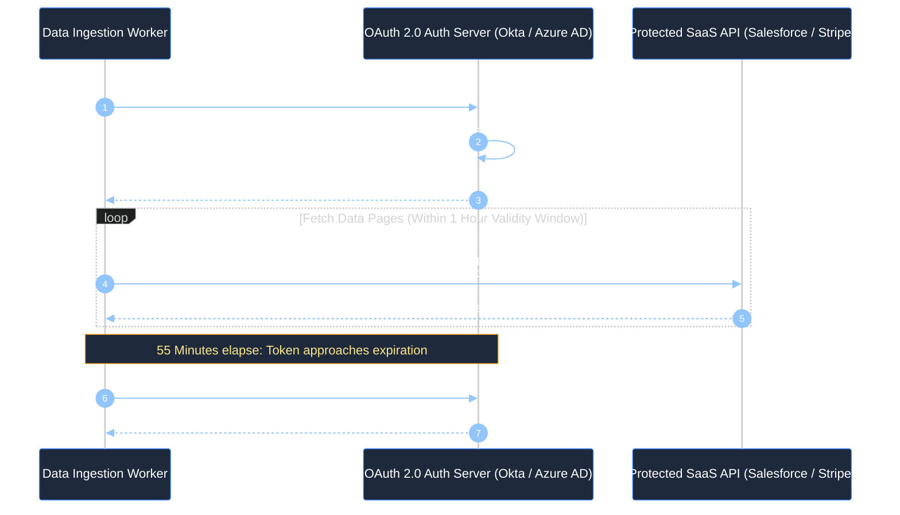

#### Production Python OAuth2 Token Manager with Auto-Refresh
```python
import time
import requests
from typing import Dict

class OAuth2TokenManager:
    """
    Thread-safe OAuth 2.0 Client Credentials token manager.
    Caches bearer JWT in memory and automatically refreshes 5 minutes prior to expiry.
    """
    def __init__(self, token_url: str, client_id: str, client_secret: str, scope: str = ""):
        self.token_url = token_url
        self.client_id = client_id
        self.client_secret = client_secret
        self.scope = scope
        self._cached_token: str = ""
        self._expiry_timestamp: float = 0.0

    def get_valid_token(self) -> str:
        # Check if cached token is still valid (with 300-second safety buffer)
        if self._cached_token and time.time() < (self._expiry_timestamp - 300):
            return self._cached_token

        # Fetch fresh token via client_credentials grant
        payload = {
            "grant_type": "client_credentials",
            "client_id": self.client_id,
            "client_secret": self.client_secret,
        }
        if self.scope:
            payload["scope"] = self.scope

        response = requests.post(self.token_url, data=payload, timeout=15.0)
        response.raise_for_status()
        token_data = response.json()

        self._cached_token = token_data["access_token"]
        expires_in = token_data.get("expires_in", 3600)
        self._expiry_timestamp = time.time() + float(expires_in)
        print(f"[AUTH] Successfully refreshed OAuth2 token. Valid for {expires_in}s.")
        return self._cached_token
```

---

### 4.3 Mutual TLS (mTLS) for Zero Trust Pipeline Ingress

In standard TLS, only the server proves its identity via a certificate; the client remains anonymous until it sends an HTTP header.
In **Mutual TLS (mTLS)**, both client and server present X.509 certificates during the initial TCP handshake:

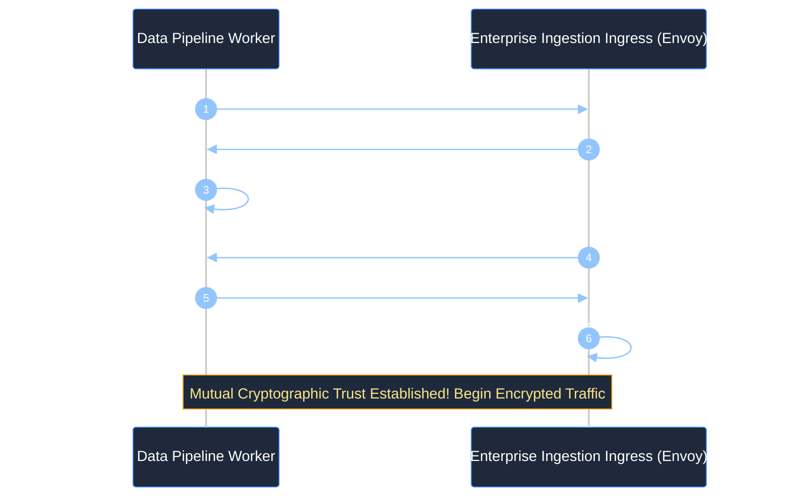
*Enterprise Impact:* Even if an attacker steals an API token, they cannot connect without the physical private cryptographic key certificate installed on the worker node.

---

# 5. Rate Limiting, Throttling & Pipeline Resilience

---

### 5.1 Rate Limiting Algorithms: Token Bucket vs. Leaky Bucket vs. Sliding Window

External APIs protect their infrastructure against denial-of-service through four primary rate limiting algorithms:

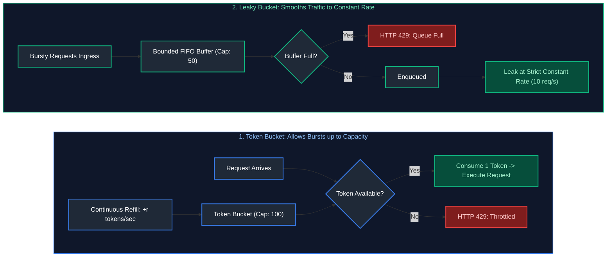

#### Algorithmic Comparison Matrix

| Algorithm | Burst Handling | Memory Complexity | Best Use Case | Primary Production Fit |
| :--- | :--- | :--- | :--- | :--- |
| **Token Bucket** | **Allows Bursts:** If tokens accumulated, processes burst up to capacity instantly. | $O(1)$ memory: Stores token count and last timestamp. | Ingress API gateways (Amazon API Gateway, Envoy, Stripe). | Public developer APIs |
| **Leaky Bucket** | **Eliminates Bursts:** Dispatches outbound calls at a smooth, constant rate. | $O(B)$ memory: Stores enqueued requests in FIFO buffer. | Outbound SaaS API clients; protecting legacy databases. | Outbound batch extractors |
| **Fixed Window** | Suffers from $2x$ traffic spikes across window boundaries. | $O(1)$ memory: Integer counter per minute/hour. | Simple, non-critical rate limiting. | Basic web tiers |
| **Sliding Window Log** | Perfectly smooth; zero boundary spikes. | **$O(N)$ memory:** Stores timestamp of every request in Redis. | High-security, financial anti-fraud rate limiting. | Security-critical endpoints |

---

### 5.2 Exponential Backoff with Full Jitter: Mathematical Proof

When an upstream service returns `HTTP 429 Too Many Requests`, naive backoff ($T = \text{base} \times 2^{\text{attempt}}$) causes **The Thundering Herd Problem**: hundreds of distributed worker threads sleep for the exact same duration ($2\text{s}, 4\text{s}, 8\text{s}$) and slam the API in synchronized lockstep.

In 2015, Marc Brooker (AWS Principal Engineer) proved mathematically that **Full Jitter** achieves the lowest queue latency and highest client throughput:

$$T_{\text{sleep}} = \text{random}(0, \; \min(T_{\text{max}}, \; T_{\text{base}} \times 2^{\text{attempt}}))$$

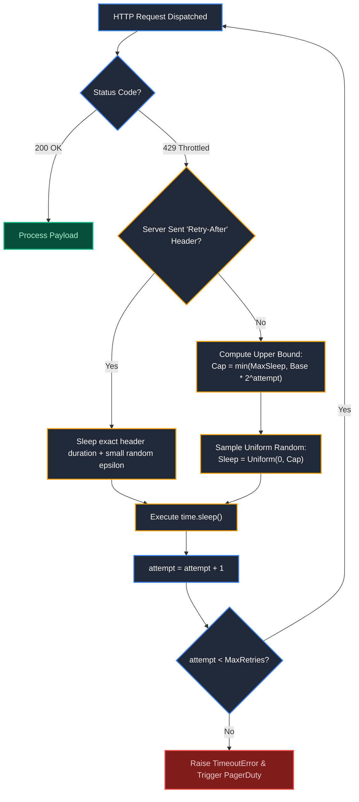

---

### 5.3 Circuit Breaker Design Pattern for Upstream Fault Isolation

If an upstream database or REST API crashes completely, continuing to send 10,000 requests per second consumes worker threads, leaks TCP connections, and prevents the upstream service from recovering.
A **Circuit Breaker** acts as an automatic electrical fuse:

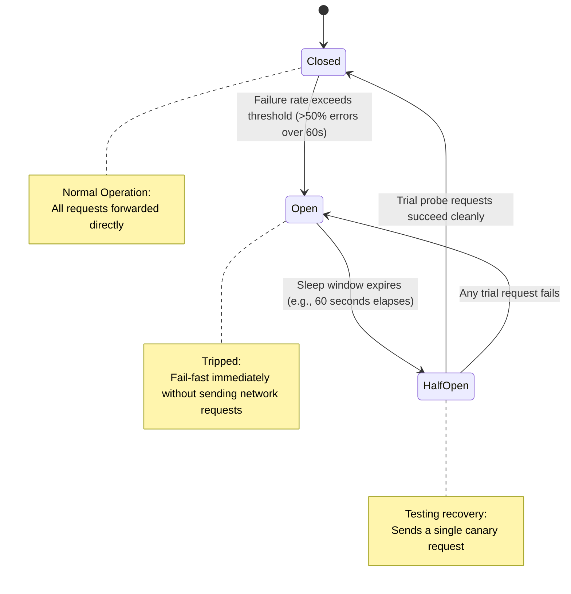

#### Production Python Circuit Breaker Implementation
```python
import time
from typing import Callable, Any

class CircuitBreakerOpenException(Exception):
    pass

class CircuitBreaker:
    """
    State machine protecting external services by failing fast when error rates spike.
    States: CLOSED (Normal), OPEN (Failing Fast), HALF_OPEN (Canary Testing).
    """
    def __init__(self, failure_threshold: int = 5, recovery_timeout_sec: float = 30.0):
        self.failure_threshold = failure_threshold
        self.recovery_timeout_sec = recovery_timeout_sec
        self.state: str = "CLOSED"
        self.failure_count: int = 0
        self.last_state_change: float = time.time()

    def call(self, func: Callable, *args, **kwargs) -> Any:
        now = time.time()
        
        # 1. State: OPEN -> Check if recovery timeout has elapsed
        if self.state == "OPEN":
            if now - self.last_state_change > self.recovery_timeout_sec:
                print("[CIRCUIT BREAKER] Recovery timeout elapsed. Transitioning to HALF-OPEN (Testing canary).")
                self.state = "HALF_OPEN"
                self.last_state_change = now
            else:
                # Fail fast immediately without making network calls
                raise CircuitBreakerOpenException("Circuit is OPEN. Upstream service is offline. Fast failing request.")

        # 2. Execute target function
        try:
            result = func(*args, **kwargs)
            # If function succeeds in HALF-OPEN state, reset breaker cleanly
            if self.state == "HALF_OPEN":
                print("[CIRCUIT BREAKER] Canary succeeded! Resetting breaker to CLOSED.")
                self.state = "CLOSED"
                self.failure_count = 0
                self.last_state_change = now
            return result
        except Exception as e:
            self.failure_count += 1
            print(f"[CIRCUIT BREAKER] Request failed ({self.failure_count}/{self.failure_threshold}): {str(e)}")
            if self.failure_count >= self.failure_threshold or self.state == "HALF_OPEN":
                print("[CIRCUIT BREAKER] Failure threshold reached! Tripping breaker to OPEN.")
                self.state = "OPEN"
                self.last_state_change = now
            raise e
```

---

# 6. Modern Integration Paradigms

---

### 6.1 Webhooks vs. Long Polling vs. Server-Sent Events (SSE)

| Dimension | Webhooks (Server Push) | Long Polling (Client Pull) | Server-Sent Events (SSE) | WebSockets (Bi-Directional) |
| :--- | :--- | :--- | :--- | :--- |
| **Direction** | Producer $\rightarrow$ Consumer | Consumer $\rightarrow$ Producer | Producer $\rightarrow$ Consumer | Full Duplex ($\leftrightarrow$) |
| **Transport** | Standard HTTP POST | HTTP GET (Held open) | HTTP GET (Streaming chunked) | TCP WebSocket Frame |
| **Idle Resource Cost** | **Zero:** TCP socket opens only when event occurs | **High:** TCP connection held open continuously | Low: Single persistent HTTP socket per client | Moderate: State stored in socket connection pool |
| **Firewall Ingress** | Consumer must expose a public HTTPS URL | Runs behind corporate NAT firewalls easily | Runs behind corporate NAT firewalls easily | May be blocked by enterprise proxy firewalls |
| **Best Pipeline Fit** | SaaS Event ingestion (Stripe, GitHub) | Polling legacy APIs without webhook support | Real-time browser log/metric feeds | Real-time financial trading tickers |

---

### 6.2 Cryptographic Webhook Signature Verification & Idempotency Keys

#### 1. Constant-Time HMAC-SHA256 Verification
Because webhooks arrive over the public internet, malicious actors can send spoofed payloads to your webhook receiver. Production endpoints must verify the HMAC-SHA256 signature using `hmac.compare_digest` to prevent **timing attacks**:

```python
import hmac
import hashlib

def verify_stripe_webhook_signature(payload_bytes: bytes, header_sig: str, secret: str) -> bool:
    """
    Validates cryptographic authenticity of webhook payloads using constant-time comparison.
    """
    expected_hmac = hmac.new(
        key=secret.encode("utf-8"),
        msg=payload_bytes,
        digestmod=hashlib.sha256
    ).hexdigest()
    
    # Constant-time comparison protects against side-channel byte timing attacks
    return hmac.compare_digest(expected_hmac, header_sig)
```

#### 2. Deduplication via Idempotency Keys
Because webhook providers guarantee **at-least-once delivery**, network drops will cause providers to resend identical webhooks. Ingestion gateways must store the `X-Event-ID` or `Idempotency-Key` in an in-memory cache (Redis) with a 24-hour TTL, rejecting duplicate event IDs with an instant `200 OK` without re-processing.

---

### 6.3 Reverse ETL: Architecture, Diff Computation & Sync Mechanics

Reverse ETL operationalizes the data warehouse by reading modeled dimensions and predictive scores (e.g., Customer LTV, Churn Risk Score, Propensity to Buy) and syncing them to operational CRM systems (Salesforce, Zendesk, HubSpot).

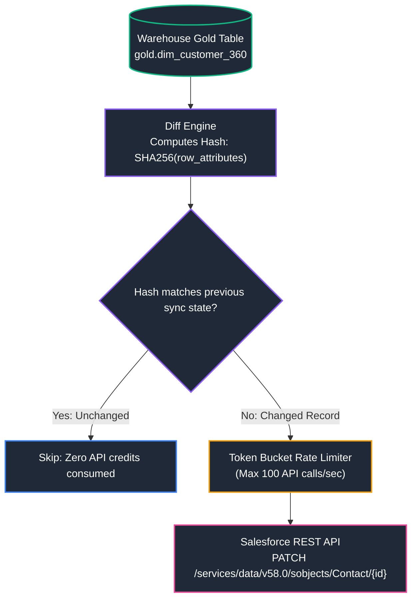

#### Diff Calculation via Row Hashing
To prevent exhausting SaaS API rate limits, Reverse ETL engines compute an SHA-256 hash of all synced attributes:
```sql
SELECT 
    customer_id,
    ltv_amount,
    churn_risk_score,
    SHA256(CONCAT(COALESCE(CAST(ltv_amount AS STRING), ''), '|', COALESCE(churn_risk_score, ''))) AS row_hash
FROM gold.dim_customer_360;
```
The sync engine compares `row_hash` against the hash stored during the previous sync. If the hash is identical, the record is skipped, reducing API calls by **95%+**.

---

### 6.4 Managed Data Integration Platforms: Fivetran vs. Airbyte vs. Custom

| Evaluation Dimension | Fivetran | Airbyte | Custom Python Extractors |
| :--- | :--- | :--- | :--- |
| **Deployment Model** | 100% Proprietary SaaS | **Open-Source (Self-Hosted on K8s) + Cloud SaaS** | Custom containers in Docker / Airflow |
| **Connector Library** | 300+ Pre-built, battle-tested SaaS connectors | 350+ Open-source community & official connectors | Built in-house from scratch |
| **Extensibility** | Limited; must use external cloud functions | **High: Airbyte CDK (Connector Development Kit)** | Complete freedom: write custom logic |
| **Cost Model** | Monthly Active Rows (MAR) — Can become expensive at scale | Free (Self-Hosted Infra) or Credit-Based Cloud | Infrastructure VM & engineering time |
| **Maintenance Burden** | Zero maintenance: Fivetran engineers fix API breaks | Moderate: Self-managed Kubernetes cluster upgrades | High: In-house team must update code on API changes |

---

# 7. Production Distributed Systems Summary & Architectural Principles

- **Consensus & Quorum Arithmetic:** Distributed storage engines requiring strong consistency must satisfy the strict quorum inequality $W + R > N$. Consensus clusters (Raft, KRaft, etcd, ZooKeeper) must operate with strictly odd node counts (3, 5, or 7) to tolerate $(N-1)/2$ failures without split-brain partitioning, while distributed locks must issue monotonically increasing fencing tokens to neutralize garbage collection pauses.
- **Partitioning & Consistent Hashing:** To avoid hotspotting and uneven data distribution, avoid raw sequential timestamps or low-cardinality values as partition keys. Consistent hashing topologies should provision $\ge 100$ virtual nodes (V-nodes) per physical machine to guarantee balanced ring redistribution upon node join or leave events.
- **Client Resilience & Throttling:** Outbound API extractors must implement exponential backoff with full jitter to avoid the "thundering herd" anti-pattern, honor upstream `Retry-After` HTTP headers, and decouple batch calls using token bucket rate limiters. Wrap downstream network endpoints with circuit breakers to prevent thread pool starvation during remote outages.
- **Security & Idempotent Ingestion:** Webhook ingress points must authenticate payloads using constant-time cryptographic HMAC-SHA256 signature verification to prevent timing attacks. Inter-service data channels should enforce Mutual TLS (mTLS) with internal CA verification, and mutation endpoints must leverage deterministic idempotency keys to safely discard duplicate network retries under at-least-once transport.
- **Reverse ETL Efficiency & Sync Optimization:** Reverse ETL systems pushing analytical insights back into transactional SaaS applications must calculate cryptographic diff hashes (SHA-256) at row granularity to transmit only net-new mutations, conserving scarce vendor API quotas and execution credits.

---

# 8. References & Further Reading

- [Designing Data-Intensive Applications (Martin Kleppmann)](https://dataintensive.net/)
- [In Search of an Understandable Consensus Algorithm (Raft Paper - Ongaro & Ousterhout)](https://raft.github.io/raft.pdf)
- [MapReduce: Simplified Data Processing on Large Clusters (Dean & Ghemawat)](https://research.google/pubs/pub62/)
- [Brewer's Conjecture and the Feasibility of Consistent, Available, Partition-Tolerant Web Services (Gilbert & Lynch)](https://users.ece.cmu.edu/~adrian/731-sp04/readings/GL-cap.pdf)
- [Consistency Tradeoffs in Modern Distributed Database System Design (Daniel Abadi)](http://dbmsmusings.blogspot.com/2010/04/problems-with-cap-and-yahoos-little.html)
- [Exponential Backoff And Jitter (AWS Architecture Blog - Marc Brooker)](https://aws.amazon.com/blogs/architecture/exponential-backoff-and-jitter/)
- [Patterns of Distributed Systems (Martin Fowler)](https://martinfowler.com/articles/patterns-of-distributed-systems/)
- [The Google Spanner Architecture Paper](https://research.google/pubs/pub39966/)
