# 06. Data Architecture & Modeling

A comprehensive, production-grade guide to enterprise data architectures (Data Lakehouse, Lambda, Kappa, Medallion, Data Mesh, Data Fabric), dimensional modeling (Star/Snowflake schemas, Fact/Dimension taxonomies, SCD Types 0–6, Data Vault 2.0, One Big Table), and foundational data governance tailored for Data Engineers and Cloud Architects.

---

## Architectural Overview: Enterprise Data Architecture & Medallion Lakehouse Modeling

```mermaid
flowchart LR
    subgraph IngestionRaw ["Bronze Layer (Raw Ingestion)"]
        Raw["Raw Event Stream & CDC Data<br/>(Immutable, append-only, original format preserved)"]
    end
    subgraph EnrichedConformed ["Silver Layer (Cleansed & Enriched)"]
        Cleanse["Deduplicated & Schema-Validated Data<br/>(Quarantine invalid records, standardized formats)"]
        DataVault["Data Vault 2.0 / Core Integration<br/>(Hubs, Links, Satellites for auditability)"]
    end
    subgraph AnalyticalServing ["Gold Layer (Curated Dimensional Models)"]
        KimballStar["Kimball Star Schema<br/>(Conformed Dimensions, Fact Tables, SCD 1/2)"]
        SemanticLayer["Centralized Semantic Layer<br/>(Metric consistency, role-based business metrics)"]
    end

    Raw --> Cleanse --> DataVault
    DataVault --> KimballStar --> SemanticLayer

    style IngestionRaw fill:#0f172a,stroke:#3b82f6,stroke-width:1.5px,color:#93c5fd
    style EnrichedConformed fill:#0f172a,stroke:#10b981,stroke-width:1.5px,color:#6ee7b7
    style AnalyticalServing fill:#0f172a,stroke:#f59e0b,stroke-width:1.5px,color:#fde68a
    style Raw fill:#1f2937,stroke:#3b82f6,stroke-width:2px,color:#fff
    style Cleanse fill:#1f2937,stroke:#10b981,stroke-width:2px,color:#fff
    style DataVault fill:#1f2937,stroke:#10b981,stroke-width:2px,color:#fff
    style KimballStar fill:#1f2937,stroke:#f59e0b,stroke-width:2px,color:#fff
    style SemanticLayer fill:#1f2937,stroke:#f59e0b,stroke-width:2px,color:#fff
```

---

## Table of Contents
1. [Enterprise Data Architecture Patterns](#1-enterprise-data-architecture-patterns)
   - [1.1 Data Lake](#11-data-lake)
   - [1.2 Data Warehouse (EDW)](#12-data-warehouse-edw)
   - [1.3 Data Lakehouse](#13-data-lakehouse)
   - [1.4 Lambda Architecture](#14-lambda-architecture)
   - [1.5 Kappa Architecture](#15-kappa-architecture)
   - [1.6 Medallion Architecture (Bronze / Silver / Gold)](#16-medallion-architecture-bronze--silver--gold)
   - [1.7 Data Mesh](#17-data-mesh)
   - [1.8 Data Fabric](#18-data-fabric)
   - [1.9 Modern Data Stack (MDS) vs. Unified Platforms](#19-modern-data-stack-mds-vs-unified-platforms)
   - [1.10 Architecture Showdown: Inmon vs. Kimball vs. Data Vault 2.0](#110-architecture-showdown-inmon-vs-kimball-vs-data-vault-20)
2. [Data Modeling Paradigms](#2-data-modeling-paradigms)
   - [2.1 Conceptual, Logical, and Physical Models](#21-conceptual-logical-and-physical-models)
   - [2.2 OLTP Data Modeling & Normalization (1NF to BCNF)](#22-oltp-data-modeling--normalization-1nf-to-bcnf)
   - [2.3 OLAP Dimensional Modeling Fundamentals (Kimball 4-Step Process)](#23-olap-dimensional-modeling-fundamentals-kimball-4-step-process)
   - [2.4 Star Schema](#24-star-schema)
   - [2.5 Snowflake Schema](#25-snowflake-schema)
   - [2.6 Fact Tables Taxonomy](#26-fact-tables-taxonomy)
     - [2.6.1 Transaction Fact Tables](#261-transaction-fact-tables)
     - [2.6.2 Periodic Snapshot Fact Tables](#262-periodic-snapshot-fact-tables)
     - [2.6.3 Accumulating Snapshot Fact Tables](#263-accumulating-snapshot-fact-tables)
     - [2.6.4 Factless Fact Tables (Event Tracking & Promotion Coverage)](#264-factless-fact-tables-event-tracking--promotion-coverage)
   - [2.7 Dimension Tables Taxonomy](#27-dimension-tables-taxonomy)
     - [2.7.1 Conformed Dimensions & Enterprise Bus Matrix](#271-conformed-dimensions--enterprise-bus-matrix)
     - [2.7.2 Role-Playing Dimensions](#272-role-playing-dimensions)
     - [2.7.3 Junk Dimensions](#273-junk-dimensions)
     - [2.7.4 Degenerate Dimensions](#274-degenerate-dimensions)
     - [2.7.5 Outrigger Dimensions](#275-outrigger-dimensions)
     - [2.7.6 Shrunken Dimensions](#276-shrunken-dimensions)
   - [2.8 Slowly Changing Dimensions (SCD Types 0–6)](#28-slowly-changing-dimensions-scd-types-06)
     - [2.8.1 SCD Type 0 (Fixed / Retain Original)](#281-scd-type-0-fixed--retain-original)
     - [2.8.2 SCD Type 1 (Overwrite In-Place)](#282-scd-type-1-overwrite-in-place)
     - [2.8.3 SCD Type 2 (Historical Versioning with Effective Dates)](#283-scd-type-2-historical-versioning-with-effective-dates)
     - [2.8.4 SCD Type 3 (Previous & Current Columns)](#284-scd-type-3-previous--current-columns)
     - [2.8.5 SCD Type 4 (Mini-Dimensions for Rapidly Changing Attributes)](#285-scd-type-4-mini-dimensions-for-rapidly-changing-attributes)
     - [2.8.6 SCD Type 6 (Hybrid: Type 1 + 2 + 3)](#286-scd-type-6-hybrid-type-1--2--3)
     - [2.8.7 SCD Implementation: Production SQL MERGE & PySpark Patterns](#287-scd-implementation-production-sql-merge--pyspark-patterns)
   - [2.9 Data Vault 2.0 (Hubs, Links, Satellites)](#29-data-vault-20-hubs-links-satellites)
   - [2.10 One Big Table (OBT) & Wide Columnar Tables](#210-one-big-table-obt--wide-columnar-tables)
   - [2.11 The Semantic Layer & Metric Standardization](#211-the-semantic-layer--metric-standardization)
   - [2.12 Temporal Data Modeling: Bitemporal Architectures (Valid Time vs. Transaction Time)](#212-temporal-data-modeling-bitemporal-architectures-valid-time-vs-transaction-time)
   - [2.13 Handling Inferred Dimension Members & Late-Arriving Fact Records](#213-handling-inferred-dimension-members--late-arriving-fact-records)
   - [2.14 Dimension Refresh Strategies & Reference Data Updates](#214-dimension-refresh-strategies--reference-data-updates)
   - [2.15 Referential Integrity & Orphan Record Prevention in Distributed Systems](#215-referential-integrity--orphan-record-prevention-in-distributed-systems)
   - [2.16 High-Throughput Log & Time-Series Data Modeling](#216-high-throughput-log--time-series-data-modeling)
3. [Data Governance & Metadata Management](#3-data-governance--metadata-management)
   - [3.1 Data Lineage (Column-Level Tracking & OpenLineage)](#31-data-lineage-column-level-tracking--openlineage)
   - [3.2 Data Catalog & Metadata Management](#32-data-catalog--metadata-management)
   - [3.3 Data Quality Frameworks & Observability (The 6 Dimensions)](#33-data-quality-frameworks--observability-the-6-dimensions)
   - [3.4 Data Classification, PII Protection & Tokenization](#34-data-classification-pii-protection--tokenization)
   - [3.5 Master Data Management (MDM) & Golden Record Synthesis](#35-master-data-management-mdm--golden-record-synthesis)
   - [3.6 Schema Evolution & Versioning Across Multi-Team Warehouses](#36-schema-evolution--versioning-across-multi-team-warehouses)
   - [3.7 Physical Storage Optimization: Partitioning vs. Bucketing vs. Liquid Clustering](#37-physical-storage-optimization-partitioning-vs-bucketing-vs-liquid-clustering)
   - [3.8 Lakehouse Security: Fine-Grained Access Control, RLS & Column Masking](#38-lakehouse-security-fine-grained-access-control-rls--column-masking)
   - [3.9 Practical Case Study: Multi-Dimensional Enterprise Sales Periodic Snapshot Mart](#39-practical-case-study-multi-dimensional-enterprise-sales-periodic-snapshot-mart)
   - [3.10 High-Concurrency Relational System Design: Movie Ticket Booking Engine](#310-high-concurrency-relational-system-design-movie-ticket-booking-engine)
4. [Summary Comparison & Engineering Reference Matrix](#4-summary-comparison--engineering-reference-matrix)
   - [4.1 Enterprise Data Architecture & Modeling Paradigms Matrix](#41-enterprise-data-architecture--modeling-paradigms-matrix)
   - [4.2 Production Engineering Takeaways & Invariants](#42-production-engineering-takeaways--invariants)
5. [References & Further Reading](#5-references--further-reading)

---

# 1. Enterprise Data Architecture Patterns

Data architecture patterns define the structural blueprints governing how raw data flows from heterogeneous source operational applications to analytical consumers, machine learning pipelines, and executive dashboards.

---

### 1.1 Data Lake

#### 1. Mental Model & Real-World Analogy
Think of a **Data Lake** as an automated industrial bulk cargo seaport. When container ships arrive, they unload whatever cargo they carry—raw grain, lumber, manufactured parts, liquids—directly into massive warehouses without inspecting every grain or unpacking boxes. The inspection, sorting, and grading only occur when a buyer arrives and specifies exactly what they need. 

In technical terms, a Data Lake decouples **storage** from **compute** and embraces **Schema-on-Read**: raw bytes are captured immutably in low-cost cloud object storage, and schemas are applied dynamically by query engines when the data is read.

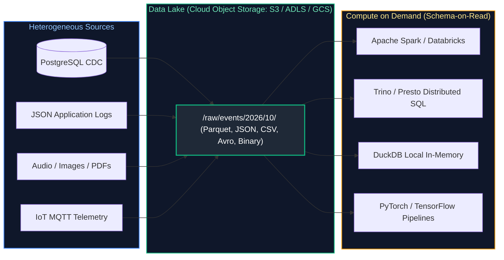

#### 2. Deep Systems Internals & Trade-offs
1. **Physical Storage:** Uses distributed cloud blob stores (Amazon S3, Azure Data Lake Storage Gen2, Google Cloud Storage) costing approximately \$0.02/GB/month. Objects are organized by hierarchical URI prefix keys: `s3://company-lake/raw/orders/year=2026/month=10/day=16/part-00000.parquet`.
2. **Metadata & Listing Costs:** Traditional data lakes rely on object store directory listing (`LIST` operations). When millions of tiny files accumulate, `LIST` queries introduce high network latency and API throttling costs ($O(N)$ HTTP calls).
3. **The "Data Swamp" Failure Mode:** Without active governance, automated schema registration, and lifecycle pruning policies, data lakes degrade into unusable "data swamps" filled with duplicate, orphaned, uncataloged, and unverified data dumps.
4. **Lack of ACID Guarantees:** Pure data lakes lack write atomicity. If a write job crashes midway through dumping 500 files, the lake is left with partial, uncommitted files that pollute concurrent queries.

---

### 1.2 Data Warehouse (EDW)

#### 1. Mental Model & Real-World Analogy
A **Data Warehouse** is like a meticulously organized pharmacy or jewelry showroom. Every single item brought into the building must be unpacked, verified against strict purity and dosage standards, labeled with standardized barcodes, and placed onto dedicated, climate-controlled shelves. Customers cannot bring in uninspected bulk sacks; they can only browse items that conform to the showroom's strict schema.

In technical terms, an Enterprise Data Warehouse (EDW) uses **Schema-on-Write**: data must be cleaned, transformed, typed, and structured before it can be loaded.

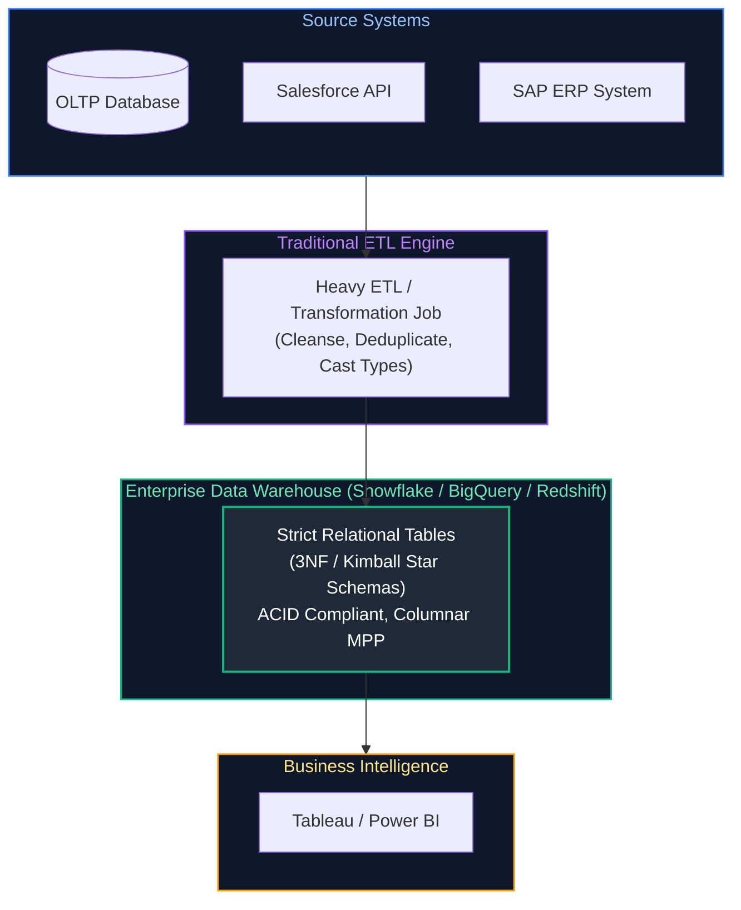

#### 2. Deep Systems Internals & Trade-offs
1. **MPP Architecture (Massively Parallel Processing):** EDWs divide relational data across multiple compute nodes. In a **Shared-Nothing** design (e.g., Teradata, early Redshift), each node owns its local disk and memory; data must be physically shuffled across network fabrics to perform joins. In a **Separation of Storage and Compute** design (Snowflake, BigQuery, Google Spanner), compute nodes are stateless micro-clusters pulling micro-partitions dynamically from a shared object tier.
2. **Advantages:** Sub-second SQL query performance on structured data, mature ACID transaction isolation, native role-based access control (RBAC), and automatic query optimization.
3. **Disadvantages:** High cost (\$20–\$40/TB/month storage, plus compute credits), vendor lock-in, poor support for unstructured data (images, audio, video), and inability to efficiently run machine learning frameworks directly on native storage without exporting data.

---

### 1.3 Data Lakehouse

#### 1. Mental Model & Real-World Analogy
A **Data Lakehouse** is the technological fusion of the Data Lake's low-cost, open-format cargo hold with the Data Warehouse's strict security, transactional integrity, and high-speed query indexing. 

Imagine a seaport cargo warehouse where every single shipping container is tagged with an immutable cryptographic RFID chip. A central digital ledger records every transaction: which containers arrived, which were swapped out, which were deleted, and which are currently visible to ships docking right now. If a worker drops a container midway through loading, the ledger ignores it as uncommitted. The port operates on open-standard shipping containers, but provides the safety and precision of a Swiss bank vault.

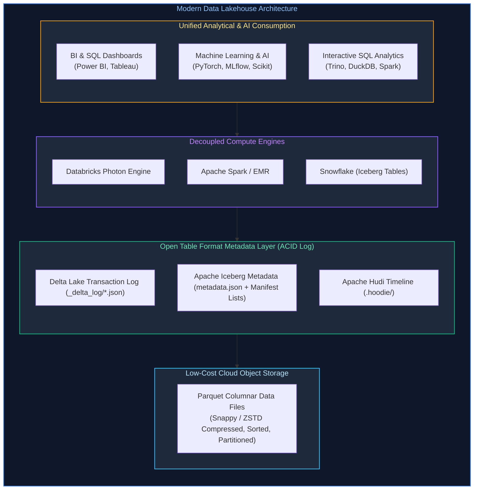

#### 2. Deep Systems Internals: Open Table Formats
The core innovation enabling Lakehouses is the **Open Table Format** (Delta Lake, Apache Iceberg, Apache Hudi). These formats wrap raw Parquet files with an atomic metadata transaction log.

| Architectural Dimension | Traditional Data Lake | Data Warehouse | Data Lakehouse |
| :--- | :--- | :--- | :--- |
| **Storage Substrate** | S3 / ADLS / GCS | Proprietary Blob / Disk | S3 / ADLS / GCS (Open Formats) |
| **Data Format** | CSV, JSON, Parquet, Avro | Proprietary Columnar Blocks | Apache Parquet / ORC |
| **ACID Guarantees** | None (Eventual consistency) | Full ACID (Serializable / Read Committed) | Full ACID via Transaction Logs |
| **Schema Evolution** | Schema-on-Read (Brittle) | Schema-on-Write (Rigid) | Schema Enforcement & Schema Evolution |
| **Time Travel / Rollback** | None (Requires manual backups) | Engine-Specific (e.g., Snowflake 90 days) | Native via Transaction Log snapshots |
| **Compute Engine Lock-in** | Low (Open files) | High (Proprietary engine required) | None (Spark, Trino, Flink, DuckDB, Presto) |
| **Cost Profile** | Lowest storage cost | Highest overall cost | Low storage cost + elastic compute |

##### How Delta Lake Transaction Logging Works Under the Hood
1. Every write operation (Append, Merge, Delete) commits a new sequential JSON file into the `_delta_log/` directory: `000000.json`, `000001.json`, etc.
2. The JSON log records **actions**: `add` (paths to new Parquet files with min/max columnar statistics) and `remove` (paths to tombstoned Parquet files).
3. Every 10 commits, the engine compiles a binary checkpoint file in **Apache Parquet format**: `000010.checkpoint.parquet`. This prevents readers from having to parse thousands of JSON log files to determine the current table state.
4. Readers execute an atomic read: they parse the latest checkpoint plus subsequent JSON commits, construct an in-memory snapshot of active Parquet files, and completely bypass filesystem `LIST` operations.

---

### 1.4 Lambda Architecture

#### 1. Mental Model & Real-World Analogy
Think of a major news organization covering a live election night.
- The **Speed Layer** is the live newsroom ticker: reporters frantically tweet updates, rough vote totals, and exit poll guesses in seconds. It is fast, but prone to small errors, typos, and revisions.
- The **Batch Layer** is the forensic investigative team that works overnight: they wait for official certified county ledgers, audit every precinct vote, reconcile mail-in ballots, and publish the immutable, 100% accurate historical record at 6:00 AM.
- The **Serving Layer** is the morning newspaper website: it displays the certified historical counts up to midnight, and overlays the live ticker for votes cast in the last 15 minutes.

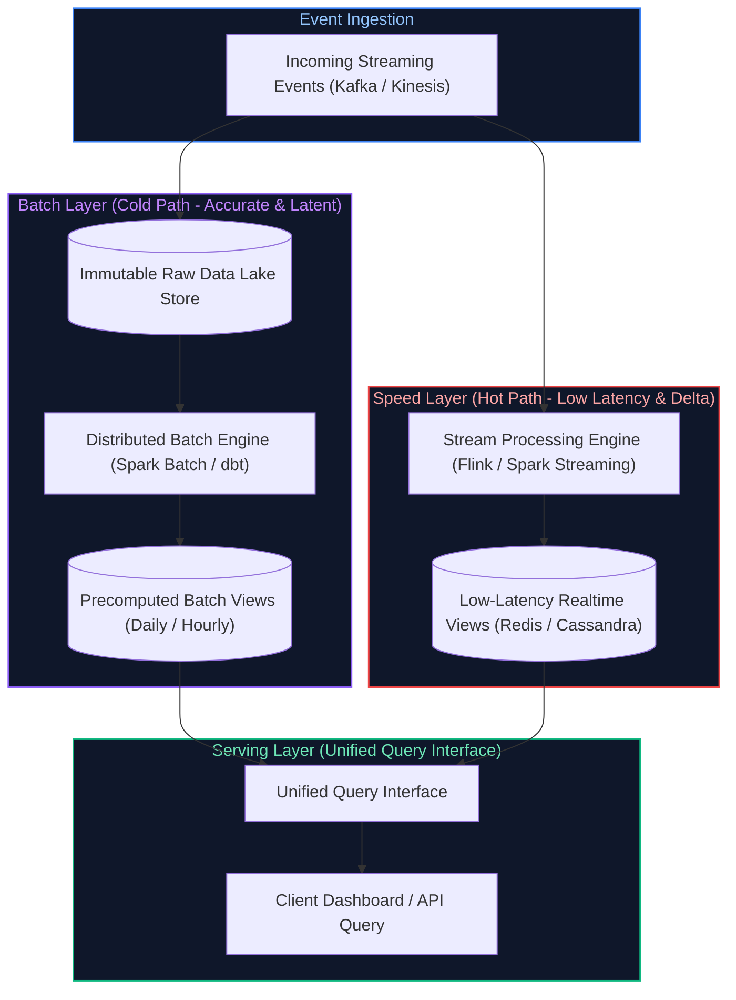

#### 2. The Dual-Codebase Dilemma
The Lambda Architecture solved early big data latency limits (pre-2015), but introduced severe production maintenance challenges:
- **Dual Codebase Tax:** The business logic (e.g., computing monthly churn or fraud scores) had to be written twice: once in Java/Scala for Apache Storm/Flink (streaming) and once in Python/SQL/Scala for MapReduce/Spark (batch).
- **Eventual Consistency Discrepancies:** Because stream processing engines used approximate windows (e.g., processing time vs. event time) while batch engines used full relational grouping, values fluctuated when the batch view overrode the speed view.
- **Operational Complexity:** Managing two distinct compute clusters, two monitoring suites, and two data stores doubled infrastructure overhead.

---

### 1.5 Kappa Architecture

#### 1. Mental Model & Real-World Analogy
Instead of running two separate newsrooms (one for live tweeting and one for morning papers), imagine running **one unified high-speed digital newsroom**. Every single event is permanently recorded in an append-only digital ledger. If an algorithm for calculating state projections changes, the newsroom does not build a separate batch system; they simply replay the entire recorded event stream from the beginning using the new algorithm, streaming the results into a new serving index.

In technical terms, the **Kappa Architecture** eliminates the batch layer entirely. Everything is modeled as a stream over an immutable, replayable distributed append-only log (such as Apache Kafka, Apache Pulsar, or Redpanda).

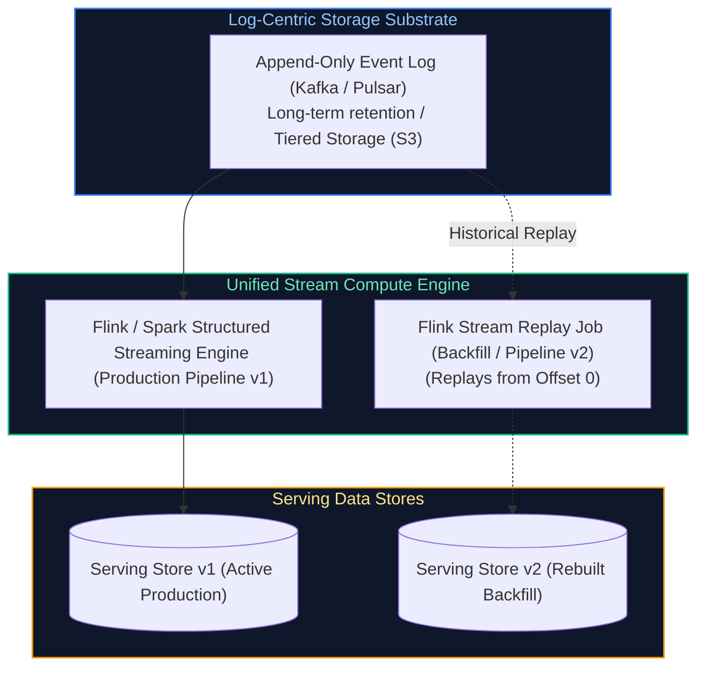

#### 2. How Historical Backfills Work in Kappa
When business logic changes or a bug is discovered in Kappa:
1. Deploy a new instance of the streaming job (`Pipeline v2`) consuming from offset 0 of the event topic.
2. Route the output of `Pipeline v2` into a new serving table (`serving_view_v2`).
3. Allow `Pipeline v2` to catch up to real-time events at high throughput.
4. Once caught up, atomically flip an API gateway router or database view pointer to direct queries to `serving_view_v2`.
5. Terminate `Pipeline v1` and drop `serving_view_v1`.

---

### 1.6 Medallion Architecture (Bronze / Silver / Gold)

The Medallion Architecture is the industry-standard logical design pattern for data refinement inside modern Lakehouses (popularized by Databricks, Snowflake, and Microsoft Fabric).


#### Detailed Breakdown of Layers

| Property | Bronze Layer (Raw) | Silver Layer (Enriched / Conformed) | Gold Layer (Curated / Analytical) |
| :--- | :--- | :--- | :--- |
| **Data Cleanliness** | 100% Raw, dirty, unvalidated | Cleansed, normalized, deduplicated | Curated, aggregated, business-ready |
| **Schema Validation** | Permissive (captures unknown JSON fields) | Strict schema enforcement | Strict dimensional schema |
| **Write Pattern** | Append-only (never update or delete) | Upsert / Merge / Deduplicate | Overwrite, Append, or Micro-batch Merge |
| **Storage Format** | Parquet / Delta / JSON | Delta Lake / Apache Iceberg | Delta Lake / Apache Iceberg |
| **Target Audience** | Data Engineers, System Audits | Data Engineers, Data Scientists | Business Analysts, BI, Executives |
| **Data Modeling** | Source mirror (tabular or semi-structured) | 3NF or Data Vault 2.0 or Conformed Entities | Kimball Star Schema / Aggregated Marts / OBT |

---

### 1.7 Data Mesh

#### 1. Mental Model & Real-World Analogy
Traditional enterprise data architectures operate like a **monolithic Soviet-style central planning office**: a single, centralized team of 10 data engineers is responsible for ingesting, transforming, and serving data for 50 different departments (Sales, Supply Chain, HR, Marketing, Finance). When Sales alters an operational database column, the central pipeline breaks, and tickets sit in the central queue for 3 months.

**Data Mesh** (conceived by Zhamak Dehghani) treats data the way **microservices** revolutionized software engineering: decentralized, domain-driven ownership. The Supply Chain team owns their data products end-to-end, the Marketing team owns theirs, and both teams publish standardized, discoverable, governable data products using a shared self-serve platform.

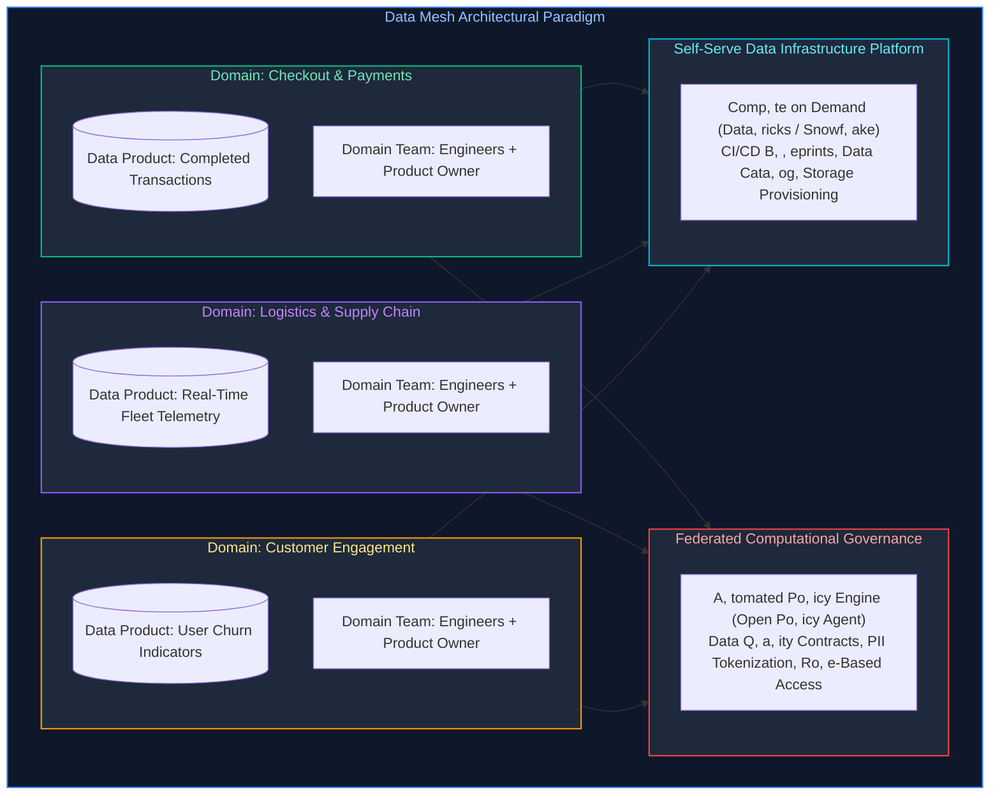

#### 2. The Four Foundational Pillars of Data Mesh
1. **Domain-Oriented Decentralized Data Ownership:** The people closest to the data (the software engineers building the operational service) own the analytical data model, documentation, and operational pipeline.
2. **Data as a Product:** Analytical datasets are not accidental side effects of applications; they are products with dedicated Product Managers, Service Level Agreements (SLAs), Service Level Objectives (SLOs), and automated testing suites.
3. **Self-Serve Data Infrastructure as a Platform:** A centralized data platform team does *not* write ETL jobs; instead, they build automated, declarative tooling (Terraform modules, Kubernetes clusters, catalog integrations) enabling domain teams to spin up compliant pipelines in minutes.
4. **Federated Computational Governance:** Governance policies (GDPR compliance, access control, metric definitions) are decided collaboratively across domain leaders, but enforced automatically through code and CI/CD pipelines (e.g., automated Great Expectations checks on every pull request).

---

### 1.8 Data Fabric

#### 1. Mental Model & Real-World Analogy
While Data Mesh is an **organizational and architectural philosophy** emphasizing human domain teams, **Data Fabric** is a **technological and automated platform pattern**. 

Think of a Data Fabric as an enterprise **smart navigation system (like Google Maps for enterprise data)**. It continuously monitors metadata traffic across on-premises databases, multi-cloud warehouses, legacy mainframes, and streaming topics using active machine learning graphs. When an analyst asks for "quarterly churn by region," the fabric discovers the assets, dynamically stitches the semantic joins across systems, and orchestrates the optimal caching or query pushdown path without requiring manual migration.

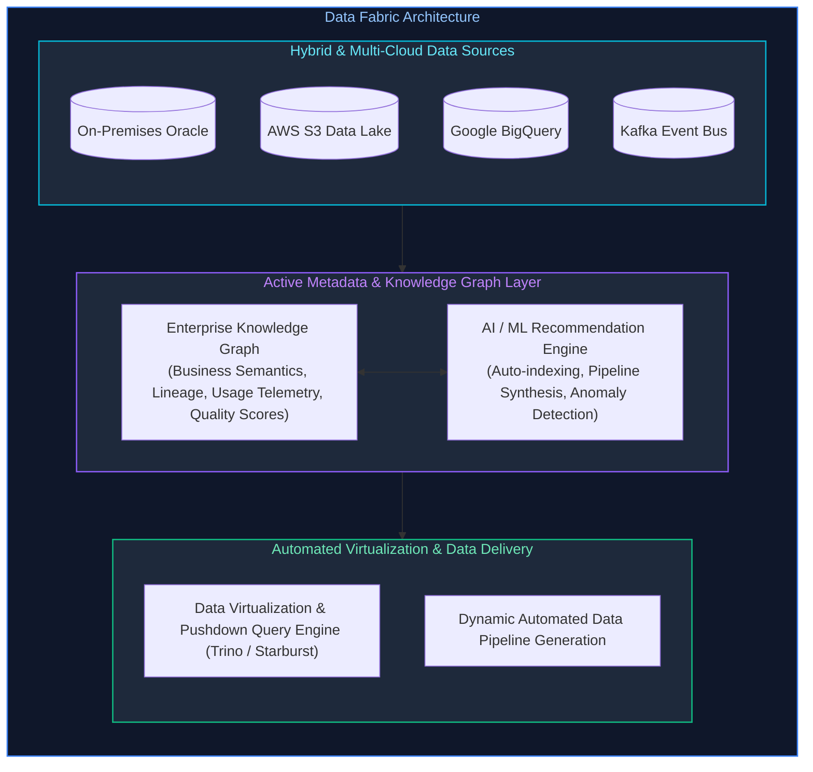

---

### 1.9 Modern Data Stack (MDS) vs. Unified Platforms

The enterprise ecosystem has experienced a philosophical battle between best-of-breed modular tools and vertically integrated platforms.

| Evaluation Dimension | Modern Data Stack (Modular / Best-of-Breed) | Unified Lakehouse Platform (Databricks, Fabric, Snowflake) |
| :--- | :--- | :--- |
| **Ingestion** | Fivetran, Airbyte, Meltano | Databricks Auto Loader, Delta Live Tables, Snowpipe Streaming |
| **Storage / Table Format** | Open S3/GCS with Apache Iceberg / Delta Lake | Native Delta Lake / Managed Iceberg |
| **Transformation** | dbt (Core / Cloud), SQLMesh | Databricks Lakehouse SQL / dbt inside platform / Fabric Data Factory |
| **Orchestration** | Apache Airflow, Dagster, Prefect | Databricks Workflows, Fabric Pipelines |
| **Observability & Quality** | Monte Carlo, Soda, Great Expectations | Databricks Lakehouse Monitoring, Snowflake Data Quality |
| **Integration Overhead** | High: Must configure IAM, API keys, networking across 6 vendors | Low: Single security boundary, single billing pane, unified governance |
| **Vendor Lock-in Risk** | Low: Any single component can be swapped out | Moderate to High: Proprietary feature lock-in (Photon, Snowpark) |

---

### 1.10 Architecture Showdown: Inmon vs. Kimball vs. Data Vault 2.0

Enterprise data modeling for analytics is dominated by three competing foundational methodologies.

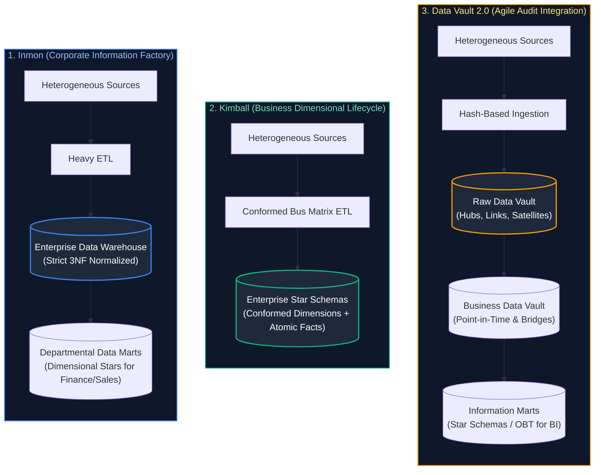

#### Architectural Comparison Matrix

| Evaluation Dimension | Bill Inmon (CIF - 3NF) | Ralph Kimball (Dimensional) | Dan Linstedt (Data Vault 2.0) |
| :--- | :--- | :--- | :--- |
| **Philosophy** | Top-down: Single enterprise-wide version of truth in 3NF. | Bottom-up: Business process-centric Star schemas serving end users. | Hybrid: Highly audit-centric, agile, parallel distributed integration. |
| **Storage Modeling** | Third Normal Form (3NF) relational tables. | Star Schemas & Snowflake Schemas (Facts & Dimensions). | Hubs (Keys), Links (Relations), Satellites (Context & History). |
| **Primary Advantage** | Redundancy eliminated; perfect relational integrity; single corporate truth. | Extreme user friendliness; optimized for high-speed analytical joins. | Maximum agility; insert-only loading; completely auditable; supports multi-source merging. |
| **Primary Drawback** | Massive upfront planning; brittle to changes; queries require 15+ joins. | Denormalization introduces update anomalies; historical tracking requires SCD. | Querying Raw Vault directly is complex; requires Information Mart layer for BI. |
| **Keys Used** | Relational Primary/Foreign Keys. | Integer Surrogate Keys (`dim_date_sk`). | Cryptographic Hash Keys (MD5/SHA-256) of business keys. |
| **Ingestion Concurrency**| Low (Strict sequential referential integrity checks). | Moderate (Dimensions must be loaded before dependent Facts). | **Unmatched / Near Infinite** (Hubs, Links, and Sats load in parallel without foreign key locks). |

---

# 2. Data Modeling Paradigms

Data modeling is the process of translating complex business activities and real-world rules into logical database schemas and optimized physical storage formats.

---

### 2.1 Conceptual, Logical, and Physical Models

Data modeling progresses through three distinct levels of abstraction:

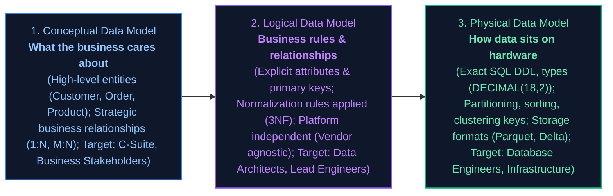

---

### 2.2 OLTP Data Modeling & Normalization (1NF to BCNF)

#### 1. Mental Model & First Principles
Online Transaction Processing (OLTP) systems (e.g., PostgreSQL, MySQL, Oracle) power operational applications where hundreds of thousands of users read and write small records concurrently. The primary design objective is **eliminating redundancy to prevent write anomalies** (insert, update, and delete anomalies).

#### 2. The Normal Forms Walkthrough
Consider an unnormalized e-commerce order spreadsheet:

##### Raw Unnormalized Table (`Orders_Raw`)
| OrderID | CustomerName | CustomerAddress | ItemList | TotalAmount |
| :--- | :--- | :--- | :--- | :--- |
| 1001 | Alice Smith | 100 Main St, Austin, TX | [Laptop ($1200), Mouse ($30)] | \$1230.00 |

##### First Normal Form (1NF)
- **Rules:**
  1. Each column must contain atomic (indivisible) values (no arrays, lists, or nested JSON structures).
  2. Each record must have a unique identifier (Primary Key).
- **Result:** We explode the item list into individual atomic rows.

| OrderID | CustomerID | CustomerName | CustomerAddress | ItemID | ItemName | ItemPrice | Quantity |
| :--- | :--- | :--- | :--- | :--- | :--- | :--- | :--- |
| 1001 | C01 | Alice Smith | 100 Main St, Austin, TX | I-90 | Laptop | \$1200.00 | 1 |
| 1001 | C01 | Alice Smith | 100 Main St, Austin, TX | I-12 | Mouse | \$30.00 | 1 |

*Primary Key:* Composite key `(OrderID, ItemID)`.

##### Second Normal Form (2NF)
- **Rules:**
  1. Must be in 1NF.
  2. Must eliminate **Partial Functional Dependencies**: All non-key attributes must be fully functionally dependent on the *entire* primary key, not a subset.
- **Violation in 1NF:** `CustomerName` and `CustomerAddress` depend only on `OrderID` (or `CustomerID`), *not* on `ItemID`. `ItemName` and `ItemPrice` depend only on `ItemID`.
- **Result:** Split into separate relational tables:

```sql
-- Customers Table
CREATE TABLE customers (
    customer_id VARCHAR(10) PRIMARY KEY,
    customer_name VARCHAR(100) NOT NULL,
    customer_address VARCHAR(255) NOT NULL
);

-- Orders Table
CREATE TABLE orders (
    order_id INT PRIMARY KEY,
    customer_id VARCHAR(10) REFERENCES customers(customer_id),
    order_date DATE NOT NULL
);

-- Items Table
CREATE TABLE items (
    item_id VARCHAR(10) PRIMARY KEY,
    item_name VARCHAR(100) NOT NULL,
    unit_price DECIMAL(10, 2) NOT NULL
);

-- Order Items (Associative Entity resolving M:N)
CREATE TABLE order_items (
    order_id INT REFERENCES orders(order_id),
    item_id VARCHAR(10) REFERENCES items(item_id),
    quantity INT NOT NULL,
    PRIMARY KEY (order_id, item_id)
);
```

##### Third Normal Form (3NF)
- **Rules:**
  1. Must be in 2NF.
  2. Must eliminate **Transitive Dependencies**: Non-key attributes must not depend on other non-key attributes ($X \rightarrow Y \rightarrow Z$).
- **Example Violation:** If `customers` table contains `(customer_id, zip_code, city, state)`. Here, `city` and `state` are functionally determined by `zip_code`, which is not a candidate key.
- **Resolution:** Extract `zip_codes (zip_code PK, city, state)` into its own reference table.

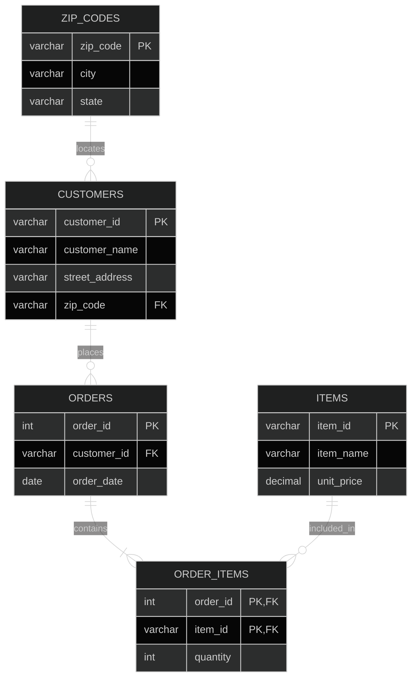

---

### 2.3 OLAP Dimensional Modeling Fundamentals (Kimball 4-Step Process)

While OLTP normalizes data to make writes atomic and fast, **Online Analytical Processing (OLAP)** requires high-speed aggregations (`SUM`, `AVG`, `COUNT`) across millions of records. Normalization is hostile to OLAP because joining 20 normalized tables across distributed cluster nodes causes massive network data shuffling.

Ralph Kimball established the definitive **4-Step Dimensional Design Process**:

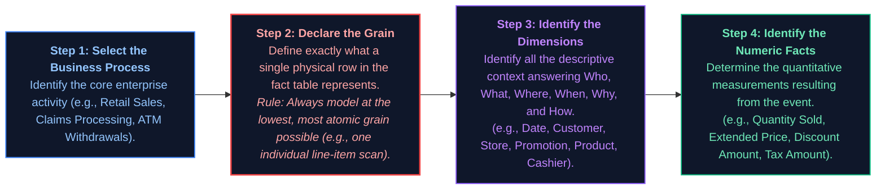

---

### 2.4 Star Schema

#### 1. Mental Model & Architecture
In a **Star Schema**, a centralized, numeric **Fact Table** sits in the center, directly surrounded by denormalized **Dimension Tables**. The diagram resembles a starburst. Every dimension joins directly to the central fact table via a single foreign key; dimensions never link to other dimensions.

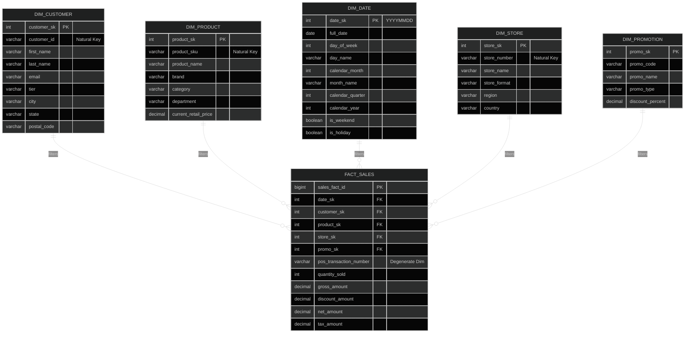

#### 2. Why Star Schemas Outperform 3NF in Distributed Analytical Engines
1. **Predictable Query Execution Plans:** The database optimizer easily recognizes the star topology. It filters the dimensions first, pushes predicates down to storage, extracts the qualifying surrogate keys, and performs high-speed **Broadcast Hash Joins** against the fact table.
2. **Columnar Pruning & Compression:** Because dimension tables are completely denormalized (e.g., `brand`, `category`, and `department` are stored directly on `dim_product`), analytical engines do not need to perform multi-hop relational joins to roll up metrics. The repeated strings compress heavily using dictionary encoding in Parquet.
3. **User Intuitiveness:** Business analysts and BI tools (Tableau, Power BI) can navigate the schema with zero confusion.

---

### 2.5 Snowflake Schema

#### 1. Mental Model & Architecture
A **Snowflake Schema** is a variation of the Star Schema where **dimension tables are partially or fully normalized**. Higher-level descriptive hierarchies (such as Product $\rightarrow$ Subcategory $\rightarrow$ Category, or Store $\rightarrow$ City $\rightarrow$ State $\rightarrow$ Country) are extracted into distinct relational lookup tables. The resulting diagram branches out like a delicate snowflake crystal.

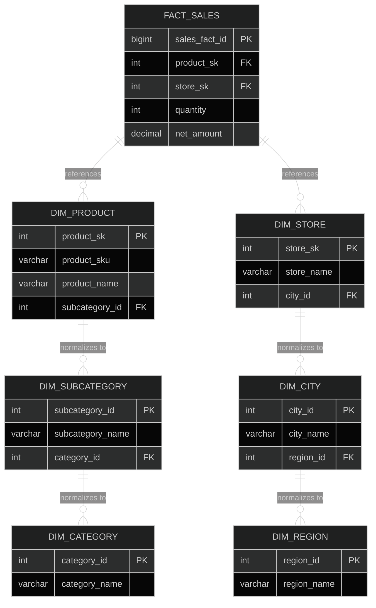

#### 2. Star vs. Snowflake: Exhaustive Architectural Trade-off

| Architectural Dimension | Star Schema | Snowflake Schema |
| :--- | :--- | :--- |
| **Normalization** | Fully denormalized dimensions (redundant strings allowed). | Partially or fully normalized dimensions (3NF-like hierarchies). |
| **Query Performance** | **Fastest.** Fewer joins; enables broadcast hash joins in distributed engines. | **Slower.** Requires multi-table join chains to traverse hierarchies. |
| **Storage Consumption** | Slightly higher storage footprint on uncompressed disk. | **Lowest storage footprint.** Eliminates repeated strings in dimensions. |
| **Storage Impact in Modern Lakehouses** | **Negligible difference.** Columnar formats (Parquet) compress repeated strings via dictionary encoding to near-zero bytes. | **No practical storage advantage** in modern cloud object stores. |
| **ETL Maintenance** | Simpler loading pipelines (one table per business entity). | Complex ETL pipelines (must maintain foreign key load order across hierarchies). |
| **BI Usability** | Intuitive for end users and self-serve drag-and-drop BI tools. | Confusing for end users; requires deep understanding of data model hops. |
| **Staff Recommendation** | **Default choice for 95% of analytical marts.** | Only justified when dimensions are massive (>100M rows) and undergo frequent updates. |

---

### 2.6 Fact Tables Taxonomy

Kimball dimensional modeling identifies four distinct types of fact tables, each tailored to a specific temporal behavior and measurement pattern.

| Fact Table Type | Temporal Grain | Row Insertion & Mutation Pattern | Metric Additivity | Canonical Enterprise Scenario |
| :--- | :--- | :--- | :--- | :--- |
| **Transaction Fact** | Single discrete point in time (1 row per transaction). | Append-only; strictly immutable once committed. | **Fully Additive:** Numerical metrics sum naturally across all dimensions. | Point-of-Sale cash register scans, ATM withdrawals, web clickstream pageviews. |
| **Periodic Snapshot Fact** | Uniform recurring calendar intervals (daily, monthly). | Batch append (1 row per entity per period regardless of activity). | **Semi-Additive:** Balance metrics cannot be summed across time (requires average/closing balance). | Daily ending bank account balances, midnight warehouse inventory levels. |
| **Accumulating Snapshot Fact** | Entire lifespan of a multi-stage workflow. | **In-place updates:** Row created at workflow start, updated as milestones occur. | **Non-Additive & Additive:** Milestone lag intervals sum across orders; status flags are non-additive. | E-commerce order fulfillment (Order Placed $\rightarrow$ Picked $\rightarrow$ Packed $\rightarrow$ Shipped $\rightarrow$ Delivered). |
| **Factless Fact Table** | Intersection of entities or occurrence of event with no metrics. | Append-only event tracking or multidimensional coverage matrix. | **Zero Numerical Measures:** Analyzed purely via `COUNT(*)`. | University student course enrollments, employee building badge access scans. |

#### 2.6.1 Transaction Fact Tables
- **Definition:** Represents a point-in-time business event at the lowest atomic grain.
- **Behavior:** Strictly **append-only**. Rows are never updated; once an event occurs, it is immutable.
- **Additivity:** Measurements are **Fully Additive** across all dimensions (you can sum sales amounts across dates, stores, products, or customers).

##### Production DDL & Schema Example
```sql
CREATE TABLE core.fact_retail_transactions (
    transaction_fact_id BIGINT GENERATED ALWAYS AS IDENTITY,
    date_sk INT NOT NULL,              -- FK to dim_date (YYYYMMDD)
    time_sk INT NOT NULL,              -- FK to dim_time (HHMMSS)
    customer_sk INT NOT NULL,          -- FK to dim_customer
    product_sk INT NOT NULL,           -- FK to dim_product
    store_sk INT NOT NULL,             -- FK to dim_store
    cashier_sk INT NOT NULL,           -- FK to dim_employee
    pos_invoice_number VARCHAR(64) NOT NULL, -- Degenerate Dimension
    quantity_sold INT NOT NULL,
    unit_price DECIMAL(18, 4) NOT NULL,
    discount_amount DECIMAL(18, 4) NOT NULL,
    net_paid_amount DECIMAL(18, 4) NOT NULL,
    tax_amount DECIMAL(18, 4) NOT NULL,
    cost_amount DECIMAL(18, 4) NOT NULL,
    margin_amount DECIMAL(18, 4) GENERATED ALWAYS AS (net_paid_amount - cost_amount) STORED
);
```

#### 2.6.2 Periodic Snapshot Fact Tables
- **Definition:** Captures the status, level, or balance of a business process at uniform, predictable intervals (hourly, daily, weekly, monthly).
- **Additivity:** Measurements are **Semi-Additive**. You can sum warehouse inventory levels across stores or product categories, but you **cannot sum inventory levels across time** (adding Monday's inventory to Tuesday's inventory produces meaningless garbage). To aggregate across time, you must use `AVG()`, `MIN()`, or `MAX()`.

##### Concrete Dataset Walkthrough: Warehouse Inventory Snapshot
| snapshot_date_sk | warehouse_sk | product_sk | on_hand_qty | reserved_qty | available_qty | unit_holding_cost | total_valuation |
| :--- | :--- | :--- | :--- | :--- | :--- | :--- | :--- |
| 20261014 | W01 | P-100 | 500 | 50 | 450 | \$12.00 | \$6,000.00 |
| 20261015 | W01 | P-100 | 480 | 30 | 450 | \$12.00 | \$5,760.00 |
| 20261016 | W01 | P-100 | 650 | 100 | 550 | \$12.00 | \$7,800.00 |

```sql
-- Correct analytical query: Average inventory over the 3-day window
SELECT 
    product_sk,
    warehouse_sk,
    AVG(on_hand_qty) AS avg_daily_inventory,
    MAX(on_hand_qty) AS peak_inventory,
    MIN(on_hand_qty) AS safety_stock_floor
FROM core.fact_inventory_daily_snapshot
WHERE snapshot_date_sk BETWEEN 20261014 AND 20261016
GROUP BY product_sk, warehouse_sk;
```

#### 2.6.3 Accumulating Snapshot Fact Tables
- **Definition:** Models a predictable multi-stage workflow or lifecycle with well-defined start and end milestones.
- **Behavior:** Unlike append-only transaction facts, a row in an accumulating snapshot is **updated in place** as the entity transitions through stages.
- **Structure:** Features multiple date foreign keys representing each milestone, alongside duration metrics measuring pipeline lag.

##### Lifecycle State Machine & Concrete Pipeline Stages
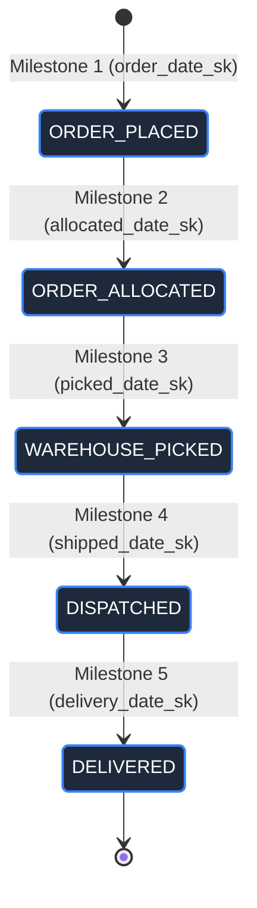

##### Concrete Schema & Incremental State Table
```sql
CREATE TABLE core.fact_order_fulfillment_accumulating (
    order_fulfillment_sk BIGINT PRIMARY KEY,
    order_id VARCHAR(64) NOT NULL,     -- Degenerate Dimension
    customer_sk INT NOT NULL,
    warehouse_sk INT NOT NULL,
    carrier_sk INT,                    -- NULL until shipped
    
    -- Milestone Date Foreign Keys (Default to -1 / Sentinel until event occurs)
    order_placed_date_sk INT NOT NULL,
    order_allocated_date_sk INT DEFAULT -1,
    order_picked_date_sk INT DEFAULT -1,
    order_shipped_date_sk INT DEFAULT -1,
    order_delivered_date_sk INT DEFAULT -1,
    order_returned_date_sk INT DEFAULT -1,

    -- Lag Duration Metrics (Computed dynamically or stored upon milestone completion)
    hours_to_allocate INT,
    hours_to_pick INT,
    hours_in_transit INT,
    total_fulfillment_days DECIMAL(10, 2),
    order_status VARCHAR(32) NOT NULL  -- 'PLACED', 'ALLOCATED', 'PICKED', 'SHIPPED', 'DELIVERED'
);
```

#### 2.6.4 Factless Fact Tables (Event Tracking & Promotion Coverage)
A factless fact table contains **no numeric measurements or monetary metrics**. It consists entirely of foreign keys representing the occurrence of an event or recording a business condition.

##### Two Primary Types:
1. **Event Tracking Factless Fact:** Records that an event took place between entities.
   - *Example:* Student class attendance. The table contains `(student_sk, course_sk, instructor_sk, room_sk, date_sk)`. There are no dollars or weights; the mere presence of the row proves the student attended class.
2. **Coverage / Condition Factless Fact:** Records which products or entities were eligible for a condition, allowing analytical engines to compute **what didn't happen**.
   - *Example:* Retail Promotion Coverage. Records which products were on active promotion in which stores on which days. When left-joined against `fact_sales`, it reveals which promoted items generated zero sales.

---

### 2.7 Dimension Tables Taxonomy

Dimension tables provide the descriptive textual context ("who, what, where, when, why") that users employ to slice, dice, filter, and group fact metrics.

| Dimension Table Variant | Architectural Purpose & Scope | Storage & Modeling Pattern | Foreign Key Relationship | Canonical Enterprise Example |
| :--- | :--- | :--- | :--- | :--- |
| **Conformed Dimension** | Shared across disparate business processes to enable cross-process analysis. | Standardized, enterprise-wide schema published in Bus Matrix. | Referenced by multiple independent fact tables (`sales`, `billing`, `support`). | `dim_date`, `dim_customer`, `dim_geography`. |
| **Role-Playing Dimension** | Single physical dimension table queried through multiple semantic contexts. | Single underlying table; aliased via SQL views or joins. | Fact table contains multiple distinct foreign keys to the same dimension. | `dim_date` acting as `order_date_key`, `shipping_date_key`, and `payment_date_key`. |
| **Junk Dimension** | Consolidates miscellaneous low-cardinality flags, indicators, and statuses. | Single dimensional table of all valid Cartesian combinations of flags. | Replaces 10+ foreign key columns in fact table with a single `junk_sk`. | Combining `is_gift`, `is_expedited`, `payment_method`, and `tax_exempt_status`. |
| **Degenerate Dimension** | Operational reference identifiers stored directly in the fact table without a dimension. | Column lives directly in fact table; zero dimension join required. | Fact table attribute with no corresponding dimension table. | `invoice_number`, `order_tracking_number`, `bill_of_lading`. |
| **Outrigger Dimension** | Secondary dimension joined to another dimension (partial snowflake). | Dimension references another dimension instead of fact table. | Foreign key lives inside the dimension table, not the fact table. | `dim_customer` joining `dim_county_demographics` (permissible only for slow reference data). |
| **Shrunken Dimension** | Roll-up subset of a base dimension to match aggregate fact grain. | Exact subset of columns/rows conformed with base dimension. | Foreign key in periodic summary fact tables. | `dim_sales_territory` shrunken from atomic `dim_store`. |

#### 2.7.1 Conformed Dimensions & Enterprise Bus Matrix
A **Conformed Dimension** is an identically structured, standardized dimension that means the exact same thing across multiple enterprise business processes. 
- *Example:* `dim_customer` and `dim_date` are referenced by `fact_online_sales`, `fact_retail_sales`, `fact_support_tickets`, and `fact_subscription_billing`.
- **Kimball Enterprise Bus Matrix:** A strategic grid mapping business processes (rows) to conformed dimensions (columns). It enables **Drill-Across Analysis**: querying two disparate fact tables in a single query by grouping on shared conformed dimension attributes.

##### Enterprise Bus Matrix Blueprint
| Business Process (Fact Table) | Date | Customer | Product | Store | Warehouse | Employee | Promotion | Carrier |
| :--- | :---: | :---: | :---: | :---: | :---: | :---: | :---: | :---: |
| **Retail Point-of-Sale** | **X** | **X** | **X** | **X** | | **X** | **X** | |
| **E-Commerce Checkout** | **X** | **X** | **X** | | **X** | | **X** | **X** |
| **Warehouse Inventory Snapshot**| **X** | | **X** | | **X** | | | |
| **Customer Support Tickets** | **X** | **X** | **X** | | | **X** | | |
| **Carrier Shipments** | **X** | **X** | | | **X** | | | **X** |

#### 2.7.2 Role-Playing Dimensions
A single physical dimension table that appears multiple times in the same fact table under different logical roles.
- *Example:* In `core.fact_orders`, the table requires `order_date_key`, `requested_ship_date_key`, and `actual_delivery_date_key`.
- **Implementation:** Do *not* duplicate the physical table on disk three times. Maintain one physical `dim_date` table, and join it multiple times using explicit SQL table aliases:

```sql
SELECT 
    f.order_id,
    d_order.full_date AS order_date,
    d_ship.full_date AS ship_date,
    d_deliver.full_date AS delivery_date,
    (d_deliver.full_date - d_ship.full_date) AS transit_days
FROM core.fact_orders f
JOIN core.dim_date d_order 
    ON f.order_date_key = d_order.date_sk
JOIN core.dim_date d_ship 
    ON f.ship_date_key = d_ship.date_sk
JOIN core.dim_date d_deliver 
    ON f.delivery_date_key = d_deliver.date_sk;
```

#### 2.7.3 Junk Dimensions
When designing schemas, source systems often provide dozens of low-cardinality boolean flags, indicators, and status codes (e.g., `is_gift_wrapped`, `payment_method`, `is_first_order`, `tax_exempt_flag`, `channel_type`).
- **Anti-Pattern:** Adding 15 foreign key columns to the fact table pointing to 15 tiny separate dimension tables. This clutters the fact table and creates query join bloat.
- **Solution (Junk Dimension):** Consolidate all permutations of these low-cardinality flags into a single lookup table (`dim_order_attributes_junk`).
- If you have 3 flags with 2 states and 1 payment method with 4 states, the junk dimension contains only $2 \times 2 \times 2 \times 4 = 32$ rows total. The fact table requires only **one single foreign key**.

#### 2.7.4 Degenerate Dimensions
A dimension key that is stored **directly inside the fact table** without joining to a physical dimension table because it has no additional descriptive attributes.
- *Examples:* Order Number, Invoice Number, BOL (Bill of Lading) Number, Transaction Reference ID.
- *Purpose:* It serves as an audit trace back to the operational OLTP system and allows analysts to group line items together to analyze basket size.

#### 2.7.5 Outrigger Dimensions
A secondary dimension table that joins to another dimension table rather than directly to the fact table.
- *When Permissible:* When a dimension contains a set of attributes that change at a completely different frequency, or to avoid storing massive high-cardinality data inside an already huge dimension table.
- *Caution:* Overusing outriggers turns a Star Schema into a Snowflake Schema, increasing join overhead.

#### 2.7.6 Shrunken Dimensions

A **Shrunken Dimension** is a logically or physically restricted subset of a base dimension that contains only attributes relevant at a higher level of summarization:
- **Use Case:** Used when a fact table is stored at an aggregate or periodic grain (e.g., Monthly Sales Snapshot) rather than atomic transaction grain. Instead of linking to the detailed 50-column `dim_customer` table, it references `dim_customer_demographics` or a rolled-up `dim_sales_territory`.
- **Invariants:** Every attribute in the shrunken dimension must remain strictly 100% conformed and semantically consistent with the base atomic dimension.

---

### 2.8 Slowly Changing Dimensions (SCD Types 0–6)

Attributes within dimension tables are not static: customers move to new cities, employees change departments, and products change price tiers. Slowly Changing Dimension (SCD) strategies govern how historical mutations are captured.

| SCD Strategy | Core Mechanism | Storage Mutation Pattern | Historical Auditability | Fact Table Foreign Key Impact | Optimal Production Use Case |
| :--- | :--- | :--- | :---: | :--- | :--- |
| **Type 0 (Retain Original)** | Immutable Baseline | Never mutate; incoming updates dropped. | Static baseline | Fact records always reference original immutable key. | Original patient date of birth, initial contract creation date. |
| **Type 1 (Overwrite)** | In-Place Column Update | `UPDATE dim SET col = val WHERE id = ?` | **Zero** (History erased) | Retroactively alters historical revenue attribution! | Correcting spelling errors, fixing phone numbers/zip codes. |
| **Type 2 (Row Versioning)** | Add New Temporal Row | Set old row `end_date`, insert new row with new `surrogate_key`. | **Full Infinite Audit** | Fact records link to specific point-in-time temporal surrogate key. | **Enterprise Default:** Customer address relocations, tier upgrades, sales rep realignment. |
| **Type 3 (Previous Column)** | Dedicated Prior Column | In-place update moving current value to `prev_val` column. | Single prior state ($N=1$) | Minor; avoids adding rows but loses deep history. | Comparing sales performance before and after sales territory redistricting. |
| **Type 4 (Mini-Dimension)** | Split High-Velocity Data | Extract rapidly changing attributes into a separate dimension table. | High (Decoupled history) | Fact table stores dual foreign keys (Base Dimension + Mini-Dimension). | Customer credit score brackets, age bands, rapidly fluctuating user tier telemetry. |
| **Type 6 (Hybrid 1 + 2 + 3)** | Versioned Row + Overwrite | Type 2 row versioning combined with Type 1 current value column update. | Full history + direct current-state slicing | Allows queries to filter by historical state or current state without subqueries. | Enterprise multi-tier analytics where current status must reflect across all historical transactions. |

#### 2.8.1 SCD Type 0 (Fixed / Retain Original)
- **Mechanism:** The dimension attribute is written once and never updated under any circumstance.
- **Use Cases:** Original Customer Registration Date, Patient Date of Birth, Original Currency of Contract.

#### 2.8.2 SCD Type 1 (Overwrite In-Place)
- **Mechanism:** Overwrites the existing column value directly in place. No historical record is preserved.
- **Use Cases:** Correcting spelling mistakes, fixing phone numbers, updating email addresses.
- **Critical Risk:** Destroys historical reporting. If customer C01 lived in Chicago in 2024 and generated \$1M in sales, but moved to New York in 2026, an SCD Type 1 overwrite will cause past 2024 sales reports to falsely credit New York.

#### 2.8.3 SCD Type 2 (Historical Versioning with Effective Dates)
- **Mechanism:** The gold standard for historical auditing. Whenever a monitored attribute changes, the current active row is marked inactive (`effective_end_date = CURRENT_TIMESTAMP`, `is_current = FALSE`), and a brand-new row is inserted with a new surrogate key, `effective_start_date = CURRENT_TIMESTAMP`, `effective_end_date = '9999-12-31'`, and `is_current = TRUE`.

##### Step-by-Step Dataset Walkthrough: Customer Relocation
Customer `C-101` (Alice Smith) moves from Chicago to Seattle on May 15, 2026.

###### State 1: Prior to May 15, 2026
| customer_sk | customer_id | name | city | effective_start_date | effective_end_date | is_current |
| :--- | :--- | :--- | :--- | :--- | :--- | :--- |
| **5001** | C-101 | Alice Smith | Chicago | 2024-01-01 00:00:00 | 9999-12-31 23:59:59 | **TRUE** |

###### State 2: After May 15, 2026 CDC Ingestion
| customer_sk | customer_id | name | city | effective_start_date | effective_end_date | is_current |
| :--- | :--- | :--- | :--- | :--- | :--- | :--- |
| **5001** | C-101 | Alice Smith | Chicago | 2024-01-01 00:00:00 | 2026-05-15 14:30:00 | **FALSE** |
| **8902** | C-101 | Alice Smith | Seattle | 2026-05-15 14:30:00 | 9999-12-31 23:59:59 | **TRUE** |

```sql
-- Point-in-Time Historical Query: Orders join against the exact historical dimension version
SELECT 
    f.order_id,
    f.order_amount,
    f.order_timestamp,
    c.city AS historical_city_at_purchase
FROM core.fact_orders f
JOIN core.dim_customer_scd2 c 
    ON f.customer_id = c.customer_id
   AND f.order_timestamp >= c.effective_start_date
   AND f.order_timestamp < c.effective_end_date;
```

#### 2.8.4 SCD Type 3 (Previous & Current Columns)
- **Mechanism:** Stores the old value and the new value side-by-side in distinct columns on the exact same row (`current_city`, `previous_city`, `city_change_date`).
- **Limitation:** Can only preserve a single past state. If the customer moves a second time, the original historical state is irrevocably lost.

#### 2.8.5 SCD Type 4 (Mini-Dimensions for Rapidly Changing Attributes)
- **Problem:** If a dimension has 10 million customers, and attributes like `credit_score`, `income_band`, and `churn_risk_score` change every month, applying SCD Type 2 would cause the customer dimension table to explode to hundreds of millions of rows, degrading query performance.
- **Solution:** Extract the volatile attributes into a separate **Mini-Dimension** table (`dim_customer_profile`). The base `dim_customer` contains stable attributes (Name, DOB, SSN), while the fact table captures **two surrogate keys**: one for `customer_sk` and one for `profile_sk`.

#### 2.8.6 SCD Type 6 (Hybrid: Type 1 + 2 + 3)
- **Mechanism:** Combines Types 1, 2, and 3 ($1 + 2 + 3 = 6$).
- **Structure:** Contains:
  1. Historical row versioning with surrogate keys and date ranges (Type 2).
  2. A `current_city` column that is updated in-place via Type 1 across **all historical rows** belonging to that customer.
  3. A `historical_city` column that preserves the city valid during that specific row's date window.
- **Benefit:** Allows the analyst to slice metrics by historical truth *or* slice all historical orders by the customer's *current* status without writing complex joins.

#### 2.8.7 SCD Implementation: Production SQL MERGE & PySpark Patterns

##### Atomic SCD Type 2 MERGE in Modern SQL / Lakehouse Engines
Implementing SCD Type 2 requires a two-step atomic transaction:
1. Identify updated natural keys, and expire active records (`effective_end_date = NOW()`, `is_current = FALSE`).
2. Insert new records with the latest attributes and `is_current = TRUE`.

```sql
-- Production Stage-to-Dimension SCD Type 2 Merge Pipeline
MERGE INTO core.dim_customer AS target
USING (
    -- Subquery combining incoming updates and expired keys
    SELECT 
        source.customer_id AS merge_key,
        source.*
    FROM staging.stg_customer_updates AS source
    
    UNION ALL
    
    -- Force null join to trigger INSERT for new versions of existing keys
    SELECT 
        NULL AS merge_key,
        source.*
    FROM staging.stg_customer_updates AS source
    JOIN core.dim_customer AS target
      ON source.customer_id = target.customer_id
     AND target.is_current = TRUE
     AND (source.city <> target.city OR source.tier <> target.tier)
) AS staged_changes
ON target.customer_id = staged_changes.merge_key
-- 1. Expire existing current row if attributes have mutated
WHEN MATCHED 
  AND target.is_current = TRUE 
  AND (target.city <> staged_changes.city OR target.tier <> staged_changes.tier) 
THEN UPDATE SET 
    target.effective_end_date = CURRENT_TIMESTAMP(),
    target.is_current = FALSE

-- 2. Insert new record version (for both brand-new keys and mutated keys)
WHEN NOT MATCHED THEN INSERT (
    customer_id,
    first_name,
    last_name,
    city,
    tier,
    effective_start_date,
    effective_end_date,
    is_current
) VALUES (
    staged_changes.customer_id,
    staged_changes.first_name,
    staged_changes.last_name,
    staged_changes.city,
    staged_changes.tier,
    CURRENT_TIMESTAMP(),
    TIMESTAMP('9999-12-31 23:59:59'),
    TRUE
);
```

---

### 2.9 Data Vault 2.0 (Hubs, Links, Satellites)

#### 1. Mental Model & Architectural Philosophy
Data Vault 2.0 is an enterprise modeling methodology engineered specifically to overcome the rigidity of 3NF and the update constraints of Kimball Star Schemas in massive, multi-source distributed environments.

It completely separates:
1. **Business Keys (Hubs):** The core enterprise concepts that rarely change.
2. **Relationships / Transactions (Links):** The associations between hubs.
3. **Descriptive Context & History (Satellites):** The time-stamped descriptive attributes.

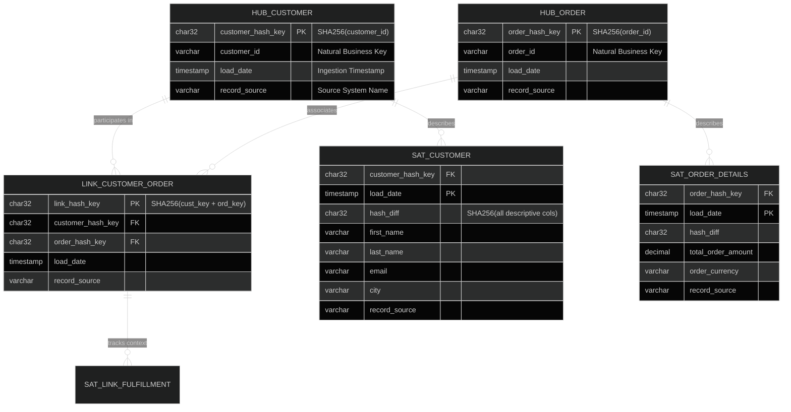

#### 2. The Three Structural Primitives
1. **Hubs:** Store unique business keys. 
   - *Columns:* `hash_key` (PK), `business_key`, `load_date`, `record_source`.
   - *Rule:* Insert-only. Never updated.
2. **Links:** Capture M:N associations, interactions, and transactions between two or more Hubs.
   - *Columns:* `link_hash_key` (PK), foreign hash keys pointing to parent Hubs, `load_date`, `record_source`.
   - *Advantage:* Adding a new business relationship requires zero changes to existing Hub or Link schemas.
3. **Satellites:** Store all descriptive context and full historical changes over time for a Hub or Link.
   - *Columns:* Parent `hash_key`, `load_date` (composite PK), `hash_diff`, descriptive attributes, `record_source`.
   - *Hash Diff:* A deterministic cryptographic hash computed across all descriptive attributes (e.g., `SHA256(concat(first_name, city, email))`). Ingestion engines compare the incoming `hash_diff` against the latest stored `hash_diff`; if identical, the write is skipped, achieving sub-second change detection without column-by-column comparisons.

#### 3. Why Data Vault 2.0 Uses Hash Keys Instead of Auto-Increment Sequences
In traditional dimensional modeling, an ETL engine must query a centralized database sequence or table (`MAX(surrogate_key) + 1`) to assign keys. This creates a severe **distributed bottleneck**: multiple Spark tasks or Airflow pipelines cannot load data concurrently without locking the sequence generator.

Data Vault 2.0 replaces integer sequences with **deterministic cryptographic hashes (MD5 or SHA-256)** computed directly from the natural key:
$$\text{customer\_hash\_key} = \text{SHA256}(\text{UPPER}(\text{TRIM}(\text{customer\_id})))$$
- Distributed worker nodes in 5 different geographic regions can generate the exact same surrogate key in memory simultaneously with **zero network communication and zero locking**.

---

### 2.10 One Big Table (OBT) & Wide Columnar Tables

#### 1. Mental Model & Architecture
**One Big Table (OBT)** is a modeling pattern where all normalized facts and descriptive dimensions are pre-joined into a single, massive, wide table containing 100 to 500+ columns.

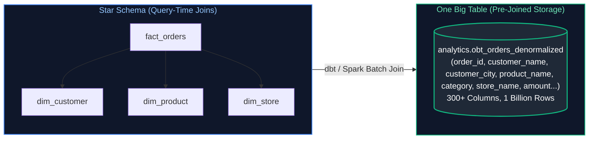

#### 2. Why OBT Dominates Cloud Warehouses (BigQuery, ClickHouse, Snowflake)
1. **Elimination of Distributed Shuffle Joins:** Joining 1 billion fact rows with 50 million customer rows requires distributed engines to shuffle gigabytes of data across the network fabric. OBT eliminates all query-time joins: every row is self-contained.
2. **Columnar Projection Pruning:** In Parquet, ORC, BigQuery Capacitor, or ClickHouse, queries only pay I/O for the specific columns requested:
   ```sql
   -- Only reads 2 columns from disk; the other 298 columns are skipped entirely!
   SELECT customer_city, SUM(net_amount) 
   FROM analytics.obt_orders_denormalized 
   GROUP BY customer_city;
   ```
3. **Heavy Compression:** Repeated string columns (e.g., `customer_state = 'California'` repeated on 50 million rows) compress down to single-byte dictionary indexes in columnar storage, mitigating the storage penalty of denormalization.

#### 3. When NOT to Use OBT
- **Update Anomalies:** If a customer updates their address, updating an OBT requires rewriting millions of historical rows across massive Parquet files.
- **Multiple Business Processes:** OBT breaks down when attempting to model multiple business processes with different grains (e.g., mixing Daily Inventory Snapshots with Order Line Transactions).

---

### 2.11 The Semantic Layer & Metric Standardization

#### 1. Problem: Metric Sprawl & Fragmented Business Logic
In uncoordinated enterprise data architectures, different business units write raw SQL queries directly against warehouse tables. This creates **Metric Sprawl**:
- **Finance** defines *Revenue* as: `SUM(order_amount) - SUM(refunds) - SUM(chargebacks)` (excluding pending transactions).
- **Sales** defines *Revenue* as: `SUM(gross_contract_value)` before discounts.
- **Marketing** defines *Active User* as: anyone who clicked an email in 30 days, while **Product** defines it as: anyone who logged into the web portal.

When board meetings take place, the CFO and VP of Sales present conflicting numbers for the exact same quarter.

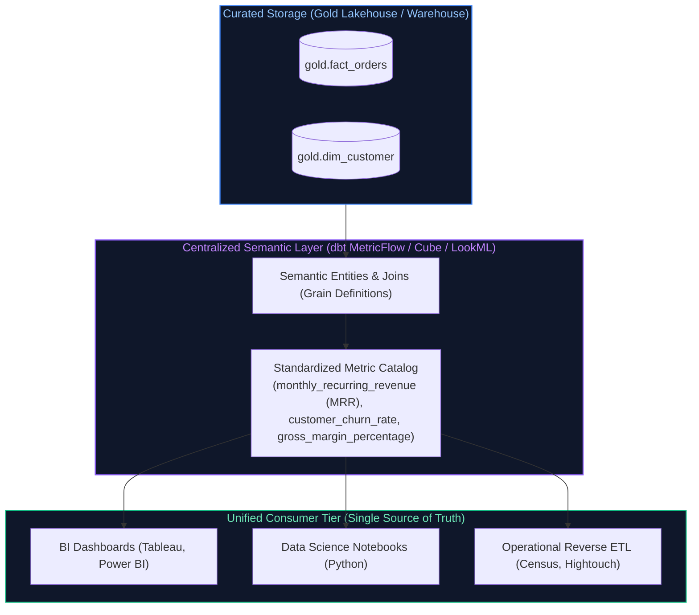

#### 2. Declarative Metric Definition (dbt Semantic Layer / MetricFlow Example)
```yaml
# models/semantic/orders_semantic.yml
semantic_models:
  - name: orders_semantic
    model: ref('fact_orders')
    entities:
      - name: order_id
        type: primary
      - name: customer_id
        type: foreign
    dimensions:
      - name: order_date
        type: time
        type_params:
          time_granularity: day
      - name: order_status
        type: categorical
    measures:
      - name: order_total
        agg: sum
        expr: net_amount
      - name: distinct_buyers
        agg: count_distinct
        expr: customer_id

metrics:
  - name: average_order_value
    description: "Calculates the average dollar value per order completed"
    type: derived
    type_params:
      expr: order_total / distinct_orders
      metrics:
        - name: order_total
        - name: distinct_orders
```

---

### 2.12 Temporal Data Modeling: Bitemporal Architectures (Valid Time vs. Transaction Time)

In banking, insurance, and regulatory compliance (e.g., BCBS 239, Basel III, SOX), standard SCD Type 2 tracking is insufficient because transactions can be posted retroactively with backdated effective dates. **Bitemporal Data Modeling** tracks two distinct, independent timelines:
1. **Valid Time (Business Time):** The time period during which the fact was true in the real world (`valid_from`, `valid_to`).
2. **Transaction Time (System Time):** The time period during which the record was physically stored in the database engine (`system_from`, `system_to`).

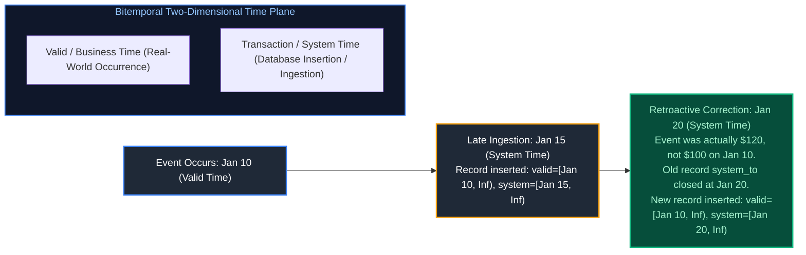

#### Production DDL Implementation
```sql
CREATE TABLE core.fact_financial_ledger_bitemporal (
    ledger_entry_id BIGINT,
    account_id BIGINT,
    transaction_amount NUMERIC(18, 4),
    -- Business Timeline (Valid Time)
    valid_from TIMESTAMP WITH TIME ZONE NOT NULL,
    valid_to TIMESTAMP WITH TIME ZONE NOT NULL,
    -- Audit / Engine Timeline (Transaction Time)
    system_from TIMESTAMP WITH TIME ZONE DEFAULT CURRENT_TIMESTAMP NOT NULL,
    system_to TIMESTAMP WITH TIME ZONE DEFAULT '9999-12-31 23:59:59' NOT NULL,
    is_current_system_record BOOLEAN DEFAULT TRUE,
    CONSTRAINT pk_bitemporal PRIMARY KEY (ledger_entry_id, valid_from, system_from)
);
```

---

### 2.13 Handling Inferred Dimension Members & Late-Arriving Fact Records

#### 1. The Production Dilemma
A streaming transaction fact arrives at 14:00 with `customer_id = 99182`, but due to upstream microservice network lag, the customer registration record has not yet arrived in the Customer dimension pipeline.
- If you **reject or drop** the fact record, your revenue metrics are inaccurate.
- If you insert the fact with `customer_sk = NULL`, standard analytical queries using `INNER JOIN` will silently drop the transaction.

#### 2. The Solution: The Inferred Member Pattern
1. When an unrecognized natural key is encountered during fact ingestion, dynamically generate an **Inferred Dimension Member** stub in `dim_customer` with:
   - `customer_id = 99182`
   - `customer_name = 'Pending Registration / Inferred'`
   - `is_inferred = TRUE`
   - `first_observed_timestamp = CURRENT_TIMESTAMP`
2. Insert the fact record immediately, pointing its foreign key to this inferred member's new surrogate key.
3. When the true customer registration record finally arrives hours later, execute an upsert (`MERGE`) that populates the true descriptive attributes, flips `is_inferred = FALSE`, and leaves the surrogate key intact without needing to reprocess the fact table.

---

### 2.14 Dimension Refresh Strategies & Reference Data Updates

Reference datasets (currency exchange rates, tax codes, postal codes, product categories) require consistent refresh strategies to prevent downstream pipeline bottlenecks.

| Strategy | Implementation Pattern | Best For | Trade-Offs |
| :--- | :--- | :--- | :--- |
| **Full Snapshot Rebuild** | `CREATE OR REPLACE TABLE dim_reference AS SELECT ...` | Small static reference tables (< 50 MB, e.g., ISO currency codes, US states) | Simplest implementation; re-scans entire dataset on every execution. |
| **Incremental CDC Merge** | `MERGE INTO dim_reference USING cdc_stream ON key ...` | Medium-to-large dimensions with frequent delta updates | Minimal I/O; requires transactional lakehouse engine (Delta / Iceberg). |
| **Broadcast Lookup Cache** | In-memory distributed hash table or Spark `broadcast(dim_df)` | Real-time streaming joins requiring sub-second enrichment | Zero shuffle latency; memory-constrained (cannot exceed executor driver memory). |
| **Audited SCD Type 2** | Historical row versioning with `valid_from`, `valid_to`, `is_current` | Regulatory compliance and financial auditing (e.g., tax rate changes) | Preserves historical snapshot truth; increases dimension row count. |

---

### 2.15 Referential Integrity & Orphan Record Prevention in Distributed Systems

#### 1. Problem: Orphan Records in Data Lakes
Unlike traditional relational RDBMS engines (PostgreSQL, Oracle), distributed analytical systems and cloud lakehouses (Delta Lake, Apache Iceberg, BigQuery) **do not physically enforce foreign key constraints at storage write time**. 
When upstream CDC connectors, asynchronous micro-services, or network pipelines deliver fact events before the corresponding dimension entities have landed, **orphan records** are inserted into fact tables. Queries that execute `INNER JOIN` silently drop these transactions, while `LEFT JOIN` results produce corrupt `NULL` attributes.

#### 2. Architectural Solution: Quarantine Sinks & Sentinel Fallbacks

```mermaid
flowchart TD
    subgraph IngestionStream ["Incoming Transaction Batch"]
        RawOrders["Raw Orders Batch<br/>(order_id, customer_id, amount)"]
    end

    subgraph IntegrityValidation ["Referential Integrity Validation"]
        DimCheck{"Customer ID Exists in dim_customers?"}
        RawOrders --> DimCheck
    end

    subgraph StorageSinks ["Target Lakehouse Sinks"]
        ValidSink[("gold.fact_orders<br/>(Conformed Fact Table)")]
        QuarantineSink[("quarantine.orphan_orders<br/>(Dead-Letter Investigation Table)")]
    end

    DimCheck -->|"Valid FK Match"| ValidSink
    DimCheck -->|"Orphan Record (Missing FK)"| QuarantineSink

    style IngestionStream fill:#0f172a,stroke:#3b82f6,stroke-width:1.5px,color:#93c5fd
    style IntegrityValidation fill:#0f172a,stroke:#8b5cf6,stroke-width:1.5px,color:#c084fc
    style StorageSinks fill:#0f172a,stroke:#10b981,stroke-width:1.5px,color:#6ee7b7
    style RawOrders fill:#1f2937,stroke:#3b82f6,stroke-width:2px,color:#fff
    style DimCheck fill:#1f2937,stroke:#8b5cf6,stroke-width:2px,color:#fff
    style ValidSink fill:#1f2937,stroke:#10b981,stroke-width:2px,color:#fff
    style QuarantineSink fill:#1f2937,stroke:#ef4444,stroke-width:2px,color:#fff
```

##### Production Defensive Strategies:
1. **The Sentinel / Unknown Key Fallback (`-1`):** In dimensional ETL, if a fact record arrives with an unmapped foreign key, replace the foreign key surrogate with `-1` (pointing to an explicit `dim_customer` row: `"Unknown / Not Yet Arrived"`) rather than `NULL`. This preserves relational inner joins and maintains complete monetary sum aggregates.
2. **Automated Data Quarantine & Dead-Letter Sinks:** Quarantine orphan records using SQL `LEFT ANTI JOIN` checks into an isolated inspection table, alerting data reliability teams while permitting valid transactions to proceed without pipeline failure.

---

### 2.16 High-Throughput Log & Time-Series Data Modeling

#### 1. The Challenge: Write Throughput vs. Query Efficiency
High-throughput telemetry (server metrics, clickstreams, sensor logs) generates millions of writes per second. Modeling for logs requires balancing **write throughput** against **query scanning efficiency**:
- **Write Optimization:** Append-only ingestion, unindexed flat tables, columnar Parquet/Delta storage with broad date/hour partitioning to eliminate lock contention.
- **Read Optimization:** Liquid Clustering / Z-ordering on `(tenant_id, device_id)` and min/max dictionary pruning.

```mermaid
flowchart LR
    Ingest["Raw Stream: 1M events/sec"] --> Buffer["Kafka Commit Log"]
    Buffer --> Append["Delta Bronze: Append-Only Parquet<br/>date=2026-10-15/hour=14/<br/>(High Write Throughput)"]
    Append --> Compaction["Nightly OPTIMIZE + Liquid Clustering<br/>(Clustered by tenant_id, event_type)"]
    Compaction --> FastRead["Analytical Queries:<br/>Partition Pruning + Column Skipping"]

    style Ingest fill:#1f2937,stroke:#3b82f6,stroke-width:2px,color:#fff
    style Append fill:#0f172a,stroke:#3b82f6,stroke-width:1.5px,color:#93c5fd
    style Compaction fill:#1f2937,stroke:#f59e0b,stroke-width:2px,color:#fff
    style FastRead fill:#064e3b,stroke:#10b981,stroke-width:2px,color:#a7f3d0
```

---

# 3. Data Governance & Metadata Management

Data Governance provides the automated frameworks, operational policies, and metadata tooling required to guarantee enterprise data assets are secure, compliant, cataloged, high-quality, and trustworthy.

---

### 3.1 Data Lineage (Column-Level Tracking & OpenLineage)

#### 1. Mental Model & Real-World Analogy
Data Lineage is the **forensic supply chain map** of your enterprise data. If a customer gets sick from eating peanut butter, food safety inspectors do not guess which factory made it; they trace the barcode back to the specific batch, the peanut grower's field, the roasting date, and the transport truck.

In data platforms, lineage maps data flow from source operational databases through every ETL script, temporary table, and view to downstream dashboards and ML models.

```mermaid
flowchart TD
    subgraph Stage1 ["Stage 1: Raw Ingestion & Bronze Storage"]
        direction LR
        SourceDB[("Operational PostgreSQL<br/>(Transactional Source)")] -->|"Airbyte CDC / Extract"| S3Raw[("S3 Bronze Bucket<br/>(Immutable Raw Parquet)")]
    end

    subgraph Stage2 ["Stage 2: Cleansing & Curated Silver Lakehouse"]
        direction LR
        DeltaSilver[("Delta Silver Table<br/>(Cleaned, Deduplicated & Typed)")]
    end

    subgraph Stage3 ["Stage 3: Gold Aggregation & Downstream Consumption"]
        direction LR
        GoldMart[("Snowflake Gold Mart<br/>(Aggregated Dimensional Model)")] --> Tableau["Executive KPI Dashboard<br/>(BI Reporting Layer)"]
        GoldMart --> MLModel["Customer Churn Classifier<br/>(Production ML Feature Store)"]
    end

    S3Raw -->|"Spark Distributed Cleanse"| DeltaSilver
    DeltaSilver -->|"dbt Incremental Aggregate"| GoldMart

    style Stage1 fill:#0f172a,stroke:#3b82f6,stroke-width:1.5px,color:#93c5fd
    style Stage2 fill:#0f172a,stroke:#10b981,stroke-width:1.5px,color:#6ee7b7
    style Stage3 fill:#0f172a,stroke:#8b5cf6,stroke-width:1.5px,color:#c084fc
    style SourceDB fill:#1f2937,stroke:#3b82f6,stroke-width:2px,color:#fff
    style S3Raw fill:#1f2937,stroke:#3b82f6,stroke-width:2px,color:#fff
    style DeltaSilver fill:#064e3b,stroke:#10b981,stroke-width:2px,color:#a7f3d0
    style GoldMart fill:#064e3b,stroke:#10b981,stroke-width:2px,color:#a7f3d0
    style Tableau fill:#1f2937,stroke:#8b5cf6,stroke-width:2px,color:#fff
    style MLModel fill:#1f2937,stroke:#8b5cf6,stroke-width:2px,color:#fff
```

#### 2. Key Operational Capabilities:
- **Root-Cause Analysis:** When the CEO's dashboard shows a 40% revenue drop at 8:00 AM, automated lineage traces the metric back to a failed dbt model run at 3:00 AM that missed an upstream CDC file.
- **Impact Analysis:** Before a software engineer runs `ALTER TABLE users DROP COLUMN phone_number`, lineage analysis highlights the 14 downstream data pipelines and 3 marketing email tools that will instantly crash.
- **OpenLineage Standard:** An open-source JSON specification capturing operational lineage events (`START`, `RUNNING`, `COMPLETE`, `FAIL`) directly from Spark, Airflow, dbt, and Flink into platforms like Marquez or Atlan.

---

### 3.2 Data Catalog & Metadata Management

A **Data Catalog** is an organized inventory of an enterprise's data assets. It uses automated metadata extraction to help engineers, analysts, and governance officers discover, understand, and evaluate datasets.

#### Key Capabilities
- **Automated Metadata Crawlers:** Indexing schemas, column descriptions, row counts, partition layouts, and change history.
- **Business Glossaries & Tagging:** Tagging columns with standardized definitions and compliance tags (e.g., `PII`, `CONFIDENTIAL`, `RESTRICTED_FINANCIAL`).
- **Data Discovery & Search:** Google-like search indexing enabling analysts to locate the authoritative "Golden Customer Table" among 10,000 legacy tables.
- **Industry Platforms:** Databricks Unity Catalog, Google Cloud Dataplex, AWS Glue Catalog, Apache Atlas, OpenMetadata.

---

### 3.3 Data Quality Frameworks & Observability (The 6 Dimensions)

Data Quality tools automate the assertion, validation, and monitoring of data reliability across ingestion and transformation pipelines.

| Data Quality Dimension | Formal Quality Definition | Automated Production Test Assertion | Failure Remediation & Pipeline Circuit-Breaker |
| :--- | :--- | :--- | :--- |
| **1. Completeness** | Absence of missing values in required schema attributes. | `dbt test: not_null(order_id)` or Great Expectations `expect_column_values_to_not_be_null` | Divert records to Dead-Letter Queue (DLQ) if required fields are missing; alert engineering. |
| **2. Uniqueness** | Zero unintended duplicate records across logical entity primary keys. | `COUNT(*) == COUNT(DISTINCT customer_id)` | Automatic deduplication via window ranking (`ROW_NUMBER() OVER (...)`) or pipeline hard failure. |
| **3. Validity** | Values conform strictly to domain definitions, ranges, and formats. | Regex evaluation (email syntax, ISO 3166-1 country codes, positive currency values). | Quarantine invalid records to quarantine table; proceed with valid records. |
| **4. Accuracy** | Recorded attributes reflect objective ground-truth real-world facts. | Financial ledger reconciliation: `SUM(order_subtotals) == Header.total_amount` | Block financial data mart publish until auditing reconciliation job completes without variance. |
| **5. Freshness** | Data arrives and transforms within the agreed business SLA window. | `MAX(ingestion_timestamp) >= CURRENT_TIMESTAMP() - INTERVAL 1 HOUR` | Trigger PagerDuty SRE incident; switch downstream BI dashboards to cached fallback partition. |
| **6. Consistency** | Metrics reconcile across independent operational systems and marts. | Cross-database balance check: Salesforce CRM pipeline volume == Stripe billed subscription MRR | Automated reconciliation DAG surfaces anomaly to Slack governance channel. |

#### Production Automated Assertions (Great Expectations / dbt Test Syntax)
```sql
-- Production Validation Query for Order Ingestion
WITH quality_audit AS (
    SELECT 
        COUNT(*) AS total_records,
        -- Completeness
        COUNT(CASE WHEN order_id IS NULL THEN 1 END) AS null_order_ids,
        COUNT(CASE WHEN customer_id IS NULL THEN 1 END) AS null_customer_ids,
        -- Validity
        COUNT(CASE WHEN net_amount < 0 THEN 1 END) AS negative_amounts,
        -- Freshness (SLA: Must be within last 3 hours)
        MAX(CURRENT_TIMESTAMP() - ingestion_timestamp) AS max_ingestion_lag
    FROM staging.stg_orders
)
SELECT * FROM quality_audit
WHERE null_order_ids > 0 
   OR null_customer_ids > 0 
   OR negative_amounts > 0;
-- If any rows return, trigger pipeline circuit-breaker!
```

---

### 3.4 Data Classification, PII Protection & Tokenization

#### 1. Data Classification Tiers
Enterprises categorize data assets according to compliance risk (GDPR, CCPA, HIPAA, PCI-DSS):
- **Public:** Marketing whitepapers, public product catalogs.
- **Internal:** Operational server logs, internal team wiki docs.
- **Confidential:** Departmental budgets, strategic corporate roadmap.
- **Restricted / PII:** Personally Identifiable Information (SSN, credit card numbers, medical records, home addresses, phone numbers).

#### 2. PII Obfuscation & Cryptographic Tokenization
```mermaid
flowchart LR
    RawPII["Raw Input:<br/>SSN = 123-45-6789<br/>Email = alice@corp.com"] --> Engine["Cryptographic Tokenization & Masking Engine"]
    Engine -->|Dynamic Masking for Analysts| Masked["Masked View:<br/>SSN = ***-**-6789<br/>Email = a****@corp.com"]
    Engine -->|Deterministic Salted Hash for Joins| Token["Tokenized Join Key:<br/>SHA256(email + secret_salt)"]

    style RawPII fill:#1f2937,stroke:#ef4444,stroke-width:2px,color:#fff
    style Engine fill:#1f2937,stroke:#3b82f6,stroke-width:2px,color:#fff
    style Masked fill:#1f2937,stroke:#10b981,stroke-width:2px,color:#fff
    style Token fill:#1f2937,stroke:#8b5cf6,stroke-width:2px,color:#fff
```

- **Salted Deterministic Tokenization:** To allow analytical engines to join datasets on customer email without exposing cleartext PII, compute:
  $$\text{token} = \text{HMAC\_SHA256}(\text{LOWER}(\text{email}), \text{enterprise\_secret\_key})$$
  This guarantees that identical emails produce identical joinable hashes, while attackers cannot use rainbow tables to reverse-engineer cleartext addresses.

---

### 3.5 Master Data Management (MDM) & Golden Record Synthesis

#### 1. The Multi-System Customer Fragmentation Problem
In an enterprise, the same customer exists across 4 disparate systems:
- **Salesforce CRM:** `"Alice Smith"`, `alice.smith@gmail.com`, `"100 Main St, Austin TX"`
- **Shopify Store:** `"A. Smith"`, `alice.smith@gmail.com`, `"100 Main Street, Apt 4B, Austin TX"`
- **Zendesk Support:** `"Alice S."`, `asmith_work@corp.com`, Phone: `+1-512-555-0199`
- **Billing ERP:** `"Alice Smith-Johnson"`, `alice.smith@gmail.com`, Phone: `+1-512-555-0199`

#### 2. The Match-and-Merge Pipeline
Master Data Management (MDM) automates the deduplication, entity resolution, and synthesis of a single, authoritative **Golden Record**.

```mermaid
flowchart TD
    Src1["CRM Record"] --> Matcher["1. Deterministic & Fuzzy Matching Engine<br/>(Exact email match, Levenshtein / Jaro-Winkler address string distance, Phone number E.164 normalization)"]
    Src2["Shopify Record"] --> Matcher
    Src3["Zendesk Record"] --> Matcher
    Src4["Billing Record"] --> Matcher

    Matcher --> Survivorship["2. Survivorship Rules Engine<br/>(Name: Take most frequent or verified government ID, Address: Take most recent shipping transaction, Email: Trust CRM over Support tickets)"]

    Survivorship --> Golden["3. Synthesized Golden Customer Entity<br/>[Master_ID: G-9021, Name: 'Alice Smith', Email: 'alice.smith@gmail.com']"]

    Golden --> Publish["Publish to Enterprise Lakehouse Gold Layer & Downstream Apps"]

    style Src1 fill:#1f2937,stroke:#3b82f6,stroke-width:1.5px,color:#fff
    style Src2 fill:#1f2937,stroke:#3b82f6,stroke-width:1.5px,color:#fff
    style Src3 fill:#1f2937,stroke:#3b82f6,stroke-width:1.5px,color:#fff
    style Src4 fill:#1f2937,stroke:#3b82f6,stroke-width:1.5px,color:#fff
    style Matcher fill:#1e293b,stroke:#8b5cf6,stroke-width:2px,color:#fff
    style Survivorship fill:#1e293b,stroke:#f59e0b,stroke-width:2px,color:#fff
    style Golden fill:#064e3b,stroke:#10b981,stroke-width:2px,color:#a7f3d0
    style Publish fill:#0f172a,stroke:#10b981,stroke-width:1.5px,color:#6ee7b7
```

---

### 3.6 Schema Evolution & Versioning Across Multi-Team Warehouses

When hundreds of upstream microservices and downstream BI teams share an analytical warehouse, unexpected producer schema mutations (e.g., column renames, type contractions) break mission-critical reports.

```mermaid
flowchart LR
    Producer["Producer Service"] --> SR["1. Central Schema Registry (Avro / Protobuf)<br/>Enforces Backward / Forward Compatibility Rules"]
    SR --> Ingest["2. Ingestion Engine (Auto Loader / Spark)<br/>Captures unexpected columns into _rescued_data"]
    Ingest --> Warehouse["3. Warehouse Versioned Views Layer<br/>(v1_orders (Stable contract for legacy BI), v2_orders (Includes new columns & transformed types))"]
    Warehouse --> Consumers["Downstream Analytics Teams (Zero Breaking Downtime)"]

    style SR fill:#1f2937,stroke:#3b82f6,stroke-width:2px,color:#fff
    style Ingest fill:#1f2937,stroke:#f59e0b,stroke-width:2px,color:#fff
    style Warehouse fill:#064e3b,stroke:#10b981,stroke-width:2px,color:#a7f3d0
```

#### Production Architectural Rules:
1. **Never Make In-Place Destructive DDL Changes:** Never execute `ALTER TABLE ... DROP COLUMN` or narrow a data type (`BIGINT` to `INT`) on base tables.
2. **Schema Registry Compatibility Modes:** Enforce **Backward Compatibility** on event buses (new consumers can read old data) and **Forward Compatibility** (old consumers can read new data).
3. **The `_rescued_data` Pattern:** Configure lakehouse ingestion engines (e.g., Databricks Auto Loader) to catch unmapped or malformed incoming columns into an overflow JSON column (`_rescued_data`). The ingestion pipeline never crashes, and engineers can audit new attributes safely.

---

### 3.7 Physical Storage Optimization: Partitioning vs. Bucketing vs. Liquid Clustering

Distributed lakehouse engines must minimize the amount of data scanned from disk during analytical queries.

| Dimension | Partitioning | Bucketing (Hive / Spark Clustering) | Liquid Clustering (Delta Lake) |
| :--- | :--- | :--- | :--- |
| **Physical Layout** | Generates discrete physical directory folders (`/date=2026-10-15/`). | Generates fixed number of hash-bucketed files inside each partition. | Reorganizes data dynamically along multi-dimensional space-filling curves (Hilbert/Z-Order). |
| **Cardinality Target** | **Low to Medium Cardinality** ($< 10,000$ values, e.g., Year, Month, Region). | **High Cardinality** (e.g., `user_id`, `account_id` into 64 buckets). | **Any Cardinality** (Low, High, or mixed multi-column queries). |
| **Optimization Mechanism**| **Directory Pruning:** Bypasses scanning entire storage directories. | **Bucket-to-Bucket Joins:** Eliminates network shuffle during joins. | **Fine-Grained Parquet Skipping:** File-level min/max dictionary pruning. |
| **Failure Mode** | **Small File Syndrome:** Too many partitions generate millions of tiny sub-1MB files. | **Data Skew:** Poor hash distribution causes executor stragglers. | Requires periodic `OPTIMIZE` maintenance executions. |

---

### 3.8 Lakehouse Security: Fine-Grained Access Control, RLS & Column Masking

Modern governance separates physical storage credentials from analytical user access. Users never query S3 or ADLS buckets directly; they query an authorization engine (such as Databricks Unity Catalog, Snowflake Governance, or Apache Ranger).

```mermaid
flowchart LR
    User["BI Analyst (Region: EMEA)"] --> Query["SELECT customer_name, ssn, revenue FROM gold.customers"]
    Query --> Gov["Unity Catalog / Policy Engine<br/>Inspects user group & context"]
    Gov --> RLS["Row-Level Security (RLS)<br/>Applies filter: WHERE customer_region = 'EMEA'"]
    Gov --> CLS["Column-Level Masking (CLS)<br/>Masks SSN: '***-**-' || RIGHT(ssn, 4)"]
    RLS & CLS --> Storage[("Physical Parquet Storage<br/>(Encrypted at Rest via KMS)")]
    Storage --> Result["Sanitized Output: EMEA rows only, SSN redacted"]

    style User fill:#0f172a,stroke:#3b82f6,stroke-width:1.5px,color:#93c5fd
    style Gov fill:#1e293b,stroke:#f59e0b,stroke-width:2px,color:#fff
    style RLS fill:#1e293b,stroke:#10b981,stroke-width:2px,color:#fff
    style CLS fill:#1e293b,stroke:#8b5cf6,stroke-width:2px,color:#fff
    style Storage fill:#0f172a,stroke:#64748b,stroke-width:1px,color:#cbd5e1
    style Result fill:#064e3b,stroke:#10b981,stroke-width:2px,color:#a7f3d0
```

#### Production SQL Implementation: Dynamic Masking & Row Filters
```sql
-- 1. Define Column Masking Function
CREATE OR REPLACE FUNCTION mask_ssn(ssn STRING)
RETURNS STRING
RETURN CASE 
    WHEN is_account_group_member('compliance_officers') THEN ssn
    ELSE CONCAT('***-**-', RIGHT(ssn, 4))
END;

-- 2. Bind Masking Function to Column
ALTER TABLE core.dim_customer 
ALTER COLUMN ssn SET MASK mask_ssn;

-- 3. Define Row-Level Filter Function
CREATE OR REPLACE FUNCTION filter_customer_region(region STRING)
RETURNS BOOLEAN
RETURN is_account_group_member('global_execs') 
    OR region = current_user_region();

-- 4. Bind Row Filter to Table
ALTER TABLE core.dim_customer 
SET ROW FILTER filter_customer_region ON (region);
```

---

### 3.9 Practical Case Study: Multi-Dimensional Enterprise Sales Periodic Snapshot Mart

#### 1. Scenario & Architectural Requirements
A global consumer brand processes 50 million daily order lines across 1,000 stores, 10,000 products, and 50 vendors. Executive leadership requires rapid analytical slicing across Yearly, Quarterly, and Monthly sales trends by Vendor, Location, and Product Category. Querying raw atomic transaction tables takes 45 seconds and consumes thousands of warehouse compute credits.

#### 2. The Solution: Periodic Monthly Snapshot Fact Table with Multi-Dimensional Aggregations

```mermaid
%%{init: {'theme': 'dark', 'themeVariables': { 'attributeBackgroundColorOdd': '#1e293b', 'attributeBackgroundColorEven': '#0f172a', 'entityBackgroundColor': '#1e293b', 'entityBorderColor': '#3b82f6', 'entityTextColor': '#ffffff' }}}%%
erDiagram
    DIM_DATE ||--o{ FACT_MONTHLY_SALES_AGG : "aggregates over"
    DIM_PRODUCT ||--o{ FACT_MONTHLY_SALES_AGG : "groups by"
    DIM_VENDOR ||--o{ FACT_MONTHLY_SALES_AGG : "supplies"
    DIM_LOCATION ||--o{ FACT_MONTHLY_SALES_AGG : "fulfilled in"

    FACT_MONTHLY_SALES_AGG {
        int month_key PK "YYYYMM"
        int product_sk PK, FK
        int vendor_sk PK, FK
        int location_sk PK, FK
        bigint total_units_sold
        decimal gross_sales_amount
        decimal net_discount_amount
        decimal vendor_cost_amount
        decimal net_margin_amount
    }
```

#### 3. Production DDL & Aggregation Pipeline
```sql
-- Periodic Monthly Sales Snapshot Fact Table
CREATE TABLE gold.fact_monthly_sales_snapshot (
    month_key INT NOT NULL,              -- YYYYMM format (e.g., 202610)
    product_sk INT NOT NULL,
    vendor_sk INT NOT NULL,
    location_sk INT NOT NULL,
    total_units_sold BIGINT NOT NULL,
    total_gross_revenue DECIMAL(18, 2) NOT NULL,
    total_vendor_cost DECIMAL(18, 2) NOT NULL,
    net_margin_amount DECIMAL(18, 2) NOT NULL,
    CONSTRAINT pk_monthly_sales PRIMARY KEY (month_key, product_sk, vendor_sk, location_sk)
);

-- Analytical aggregation across multiple dimensional levels using GROUPING SETS
SELECT 
    d.year,
    d.month_name,
    v.vendor_name,
    l.country,
    l.state,
    SUM(s.total_gross_revenue) AS total_revenue,
    SUM(s.net_margin_amount) AS total_margin
FROM gold.fact_monthly_sales_snapshot s
JOIN gold.dim_date d ON s.month_key = d.month_key
JOIN gold.dim_vendor v ON s.vendor_sk = v.vendor_sk
JOIN gold.dim_location l ON s.location_sk = l.location_sk
GROUP BY GROUPING SETS (
    (d.year, v.vendor_name),                        -- Yearly vendor rollup
    (d.year, d.month_name, v.vendor_name, l.country), -- Monthly vendor country breakdown
    (d.year, l.country, l.state)                    -- Yearly geographic regional rollup
);
```

---

### 3.10 High-Concurrency Relational System Design: Movie Ticket Booking Engine

#### 1. The Concurrency Problem & Race Conditions
In high-demand ticketing platforms (e.g., BookMyShow, Fandango, Ticketmaster), when blockbuster tickets open, 10,000 fans attempt to reserve the exact same seat within a 200-millisecond window.
- **Constraints:** Zero double-booking, atomic transitions, automatic timeout lock release if user abandons checkout within 10 minutes.

```mermaid
stateDiagram-v2
    classDef available fill:#1e293b,stroke:#10b981,stroke-width:2px,color:#ffffff
    classDef locked fill:#1e293b,stroke:#f59e0b,stroke-width:2px,color:#ffffff
    classDef booked fill:#1e293b,stroke:#ef4444,stroke-width:2px,color:#ffffff

    [*] --> AVAILABLE
    AVAILABLE --> LOCKED : 1. User selects seat (Acquires 10-min Redis TTL + DB Row Lock)
    LOCKED --> BOOKED : 2. Payment Confirmed (Atomic DB Commit)
    LOCKED --> AVAILABLE : 3. Payment Fails or 10-min TTL Expires
    BOOKED --> [*]

    class AVAILABLE available
    class LOCKED locked
    class BOOKED booked
```

#### 2. Relational Schema Architecture
```mermaid
%%{init: {'theme': 'dark', 'themeVariables': { 'attributeBackgroundColorOdd': '#1e293b', 'attributeBackgroundColorEven': '#0f172a', 'entityBackgroundColor': '#1e293b', 'entityBorderColor': '#3b82f6', 'entityTextColor': '#ffffff' }}}%%
erDiagram
    THEATER ||--o{ AUDITORIUM : contains
    AUDITORIUM ||--o{ SEAT : has
    MOVIE ||--o{ SHOWTIME : schedules
    AUDITORIUM ||--o{ SHOWTIME : hosts
    SHOWTIME ||--o{ SHOW_SEAT : allocates
    BOOKING ||--o{ SHOW_SEAT : reserves
    USER ||--o{ BOOKING : places

    SHOW_SEAT {
        bigint show_seat_id PK
        bigint showtime_id FK
        bigint seat_id FK
        varchar seat_status "AVAILABLE, LOCKED, BOOKED"
        timestamp lock_expiration_timestamp
        bigint booking_id FK
        int version "Optimistic Locking Version"
    }
```

#### 3. Atomic Seat Reservation via Optimistic Concurrency Control
```sql
-- Safe atomic lock acquisition preventing race conditions
UPDATE show_seats
SET 
    seat_status = 'LOCKED',
    lock_expiration_timestamp = NOW() + INTERVAL '10 MINUTES',
    booking_id = :pending_booking_id,
    version = version + 1
WHERE show_seat_id = :selected_seat_id
  AND (
      seat_status = 'AVAILABLE' 
      OR (seat_status = 'LOCKED' AND lock_expiration_timestamp < NOW())
  )
  AND version = :current_read_version;

-- Verification: If rows affected == 0, the transaction aborts:
-- The seat was already captured by a competing concurrent user!
```

---

# 4. Summary Comparison & Engineering Reference Matrix

### 4.1 Enterprise Data Architecture & Modeling Paradigms Matrix

| Modeling Paradigm | Normalization Level | Primary Philosophy | Storage & Query Engine Optimization | Join Complexity & Query Latency | Auditability & Lineage Tracking | Recommended Enterprise Production Fit |
| :--- | :--- | :--- | :--- | :--- | :--- | :--- |
| **Kimball Dimensional (Star / Snowflake)** | Denormalized / Conformed Dimensions (2NF/3NF in Snowflake) | Business-process-centric; optimized for analytical consumers & BI slicing | High (Single-level foreign key joins; compressed columnar scans) | **Low to Moderate**: Star schemas avoid deep join hierarchies; high scan throughput | **Moderate**: Grain is strictly preserved; SCD 2 tracks historical changes | Enterprise BI reporting, analytical dashboards, ad-hoc OLAP cubes, executive KPIs. |
| **Inmon Corporate Information Factory (CIF)** | Highly Normalized (3NF) Enterprise Data Warehouse | Subject-oriented, centralized single version of truth | Moderate (High relational integrity; requires ETL marts for BI) | **High**: Deep multi-table joins require dedicated departmental data marts | **High**: Complete normalized enterprise entity relationship tracking | Centralized corporate data repositories serving multiple disparate downstream marts. |
| **Data Vault 2.0 (Hubs, Links, Satellites)** | Normalized raw ingest with hashed surrogate keys | Agile, raw source auditing with insert-only append history | High (Deterministic hash keys enable massively parallel batch/stream loads) | **High**: Requires Point-in-Time (PIT) and Bridge tables for presentation | **Extreme**: Insert-only architecture guarantees 100% forensic auditability | High-velocity streaming ingestion, highly regulated banking/healthcare environments, multi-source merging. |
| **One Big Table (OBT) / Wide Columnar** | Completely Denormalized (0NF) | Eliminates all runtime joins by pre-joining facts and dimensions | Extreme (Leverages Parquet/ORC dictionary encoding and column compression) | **Ultra-Low**: Zero runtime table joins; fast columnar aggregations | **Low**: High storage redundancy; attribute updates require massive rewriting | Real-time analytics (ClickHouse, BigQuery, Snowflake), customer 360 event analysis, interactive web apps. |
| **Medallion Lakehouse (Bronze / Silver / Gold)** | Multi-tier: Raw $\rightarrow$ Conformed $\rightarrow$ Curated Dimensional | Layered refinement over open table formats (Delta, Iceberg, Hudi) | Extreme (ACID transactions, liquid clustering, data skipping, Parquet IO) | **Tier-dependent**: Silver cleanses; Gold delivers sub-second star schemas | **Extreme**: Delta transaction log provides complete ACID time-travel lineage | Modern cloud data platforms unifying streaming events, batch processing, and machine learning. |

---

### 4.2 Production Engineering Takeaways & Invariants

- **Atomic Fact Table Grain:** The foundational contract of dimensional modeling is an explicit declaration of fact table grain at the lowest atomic transaction level. Premature pre-aggregation destroys analytical drill-down capability and complicates late-arriving data reconciliations.
- **Surrogate Keys & Sentinel Values:** Operational natural keys must be decoupled from analytical storage using surrogate integer or deterministic cryptographic hash keys (`SHA-256`). Unmapped or pending dimension joins should resolve to sentinel values (such as `-1` for "Unknown/Unassigned") rather than `NULL` to preserve referential inner joins across multi-table queries.
- **SCD Versioning & Historical Tracking:** Slowly Changing Dimensions must explicitly categorize attributes into SCD Type 1 (overwrite), Type 2 (historical versioning with `effective_start_date`, `effective_end_date`, and `is_current` flags), or Type 4 (mini-dimensions). Indexed temporal date bands are mandatory for deterministic point-in-time joins.
- **Lakehouse Partitioning & Liquid Clustering:** Analytical lakehouse storage files must target optimal sizes between 100 MB and 1 GB. Prohibit high-cardinality physical directory partitioning (e.g., partitioning by `user_id` or timestamp seconds) to avoid Small File Syndrome and metadata explosion; instead, leverage multi-dimensional Liquid Clustering or Z-Ordering on primary query predicates.
- **Governance, Semantic Standardization & Lineage:** Enterprise metric definitions (e.g., ARR, Active Customers, Churn) must reside in a centralized semantic layer (such as MetricFlow or Cube) rather than being fragmented across downstream BI dashboards. Models must be cataloged with column-level automated lineage and sensitive attributes protected via dynamic row-level security and column masking.

---

# 5. References & Further Reading

- [The Data Warehouse Toolkit: The Definitive Guide to Dimensional Modeling (Ralph Kimball, Margy Ross)](https://www.kimballgroup.com/data-warehouse-toolkit/) — The seminal authority on star schema, snowflake schema, and slowly changing dimensions.
- [Building the Data Warehouse (W. H. Inmon)](https://www.wiley.com/en-us/Building+the+Data+Warehouse%2C+4th+Edition-p-9780764599446) — The foundational text on enterprise normalized data warehouse architecture.
- [Building a Scalable Data Warehouse with Data Vault 2.0 (Dan Linstedt, Michael Olschimke)](https://www.sciencedirect.com/book/9780128025109/building-a-scalable-data-warehouse-with-data-vault-20) — The authoritative guide to Hubs, Links, Satellites, and hash key architectures.
- [Designing Data-Intensive Applications (Martin Kleppmann)](https://dataintensive.net/) — Data models, query languages, storage engine architectures, and distributed transactions.
- [Delta Lake: High-Performance ACID Table Storage over Cloud Object Stores (Armbrust et al., VLDB 2020)](https://www.vldb.org/pvldb/vol13/p3411-armbrust.pdf) — Architectural principles behind transactional lakehouses.
- [Databricks Documentation: Liquid Clustering & Data Modeling Guidance](https://docs.databricks.com/en/delta/clustering.html) — Modern multi-dimensional clustering in production lakehouses.
