# 06. Data Architecture & Modeling

A comprehensive, production-grade guide to enterprise data architectures (Data Lakehouse, Lambda, Kappa, Medallion, Data Mesh), dimensional modeling (Star/Snowflake schemas, Fact/Dimension topologies, SCD Types 0-6, Data Vault 2.0, One Big Table), and foundational data governance tailored for Data Engineers and Cloud Architects.

---

## Architectural Overview: Enterprise Data Architecture & Medallion Lakehouse Modeling

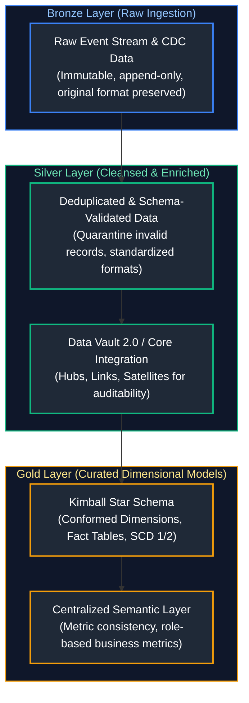

---

## Table of Contents
1. [Data Architecture Patterns](#1-data-architecture-patterns)
   - [1.1 Data Lake](#11-data-lake)
   - [1.2 Data Warehouse](#12-data-warehouse)
   - [1.3 Data Lakehouse](#13-data-lakehouse)
   - [1.4 Lambda Architecture](#14-lambda-architecture)
   - [1.5 Kappa Architecture](#15-kappa-architecture)
   - [1.6 Medallion Architecture (Bronze / Silver / Gold)](#16-medallion-architecture-bronze-silver-gold)
   - [1.7 Data Mesh](#17-data-mesh)
   - [1.8 Data Fabric](#18-data-fabric)
   - [1.9 Modern Data Stack (MDS)](#19-modern-data-stack-mds)
2. [Data Modeling Paradigms](#2-data-modeling-paradigms)
   - [2.1 Conceptual, Logical, and Physical Models](#21-conceptual-logical-and-physical-models)
   - [2.2 OLTP Data Modeling (3NF)](#22-oltp-data-modeling-3nf)
   - [2.3 OLAP Dimensional Modeling](#23-olap-dimensional-modeling)
   - [2.4 Star Schema](#24-star-schema)
   - [2.5 Snowflake Schema](#25-snowflake-schema)
   - [2.6 Fact Tables Taxonomy](#26-fact-tables-taxonomy)
     - [2.6.1 Transaction Fact Tables](#261-transaction-fact-tables)
     - [2.6.2 Periodic Snapshot Fact Tables](#262-periodic-snapshot-fact-tables)
     - [2.6.3 Accumulating Snapshot Fact Tables](#263-accumulating-snapshot-fact-tables)
     - [2.6.4 Factless Fact Tables](#264-factless-fact-tables)
   - [2.7 Dimension Tables Taxonomy](#27-dimension-tables-taxonomy)
     - [2.7.1 Conformed Dimensions](#271-conformed-dimensions)
     - [2.7.2 Role-Playing Dimensions](#272-role-playing-dimensions)
     - [2.7.3 Junk Dimensions](#273-junk-dimensions)
     - [2.7.4 Degenerate Dimensions](#274-degenerate-dimensions)
     - [2.7.5 Outrigger Dimensions](#275-outrigger-dimensions)
   - [2.8 Slowly Changing Dimensions (SCD Types 0-6)](#28-slowly-changing-dimensions-scd-types-0-6)
     - [2.8.1 SCD Type 0 (Fixed / Retain Original)](#281-scd-type-0-fixed-retain-original)
     - [2.8.2 SCD Type 1 (Overwrite)](#282-scd-type-1-overwrite)
     - [2.8.3 SCD Type 2 (Historical Versioning with Effective Dates)](#283-scd-type-2-historical-versioning-with-effective-dates)
     - [2.8.4 SCD Type 3 (Previous / Current Attribute Columns)](#284-scd-type-3-previous-current-attribute-columns)
     - [2.8.5 SCD Type 4 (Historical Min/Max Mini-Dimensions)](#285-scd-type-4-historical-mini-dimensions)
     - [2.8.6 SCD Type 6 (Hybrid 1 + 2 + 3)](#286-scd-type-6-hybrid-1-2-3)
   - [2.9 Data Vault 2.0 (Hubs, Links, Satellites)](#29-data-vault-20-hubs-links-satellites)
   - [2.10 One Big Table (OBT)](#210-one-big-table-obt)
   - [2.11 The Semantic Layer & Metric Standardization](#211-the-semantic-layer-metric-standardization)
   - [2.12 Dimension Refresh Strategies & Reference Data Updates](#212-dimension-refresh-strategies-reference-data-updates)
   - [2.13 Referential Integrity & Orphan Record Prevention](#213-referential-integrity-orphan-record-prevention)
3. [Data Governance & Metadata Management](#3-data-governance-metadata-management)
   - [3.1 Data Lineage](#31-data-lineage)
   - [3.2 Data Catalog](#32-data-catalog)
   - [3.3 Data Quality Frameworks](#33-data-quality-frameworks)
   - [3.4 Data Classification & PII Protection](#34-data-classification-pii-protection)
   - [3.5 Master Data Management (MDM)](#35-master-data-management-mdm)

---

# 1. Data Architecture Patterns

Data architecture patterns define how data flows through an enterprise from disparate source systems to analytical consumers, machine learning applications, and operational endpoints.

---

### 1.1 Data Lake

#### Definition
A Data Lake is a centralized storage repository that holds vast amounts of raw data in its native, unedited format (structured, semi-structured, and unstructured) until it is needed. It operates on a **Schema-on-Read** paradigm using low-cost cloud object storage (Amazon S3, Azure ADLS Gen2, Google Cloud Storage).

```mermaid
flowchart LR
    subgraph IngestionSources ["Heterogeneous Sources"]
        DB[(RDBMS CDC)]
        Logs[JSON Server Logs]
        Media[Audio / Images / PDFs]
        IoT[IoT Sensor Feeds]
    end

    subgraph ObjectStorage ["Data Lake (Cloud Object Storage: S3 / ADLS)"]
        Raw["/raw/events/2024/10/ (Parquet, CSV, JSON, Binary)"]
    end

    subgraph ComputeConsumers ["Compute on Demand (Schema-on-Read)"]
        Spark[Apache Spark / Databricks]
        Athena[Presto / Trino / Athena]
        ML[PyTorch / TensorFlow]
    end

    IngestionSources -->|Ingest Raw As-Is| Raw
    Raw --> ComputeConsumers

    style IngestionSources fill:#0f172a,stroke:#3b82f6,stroke-width:1.5px,color:#93c5fd
    style ObjectStorage fill:#0f172a,stroke:#06b6d4,stroke-width:1.5px,color:#67e8f9
    style ComputeConsumers fill:#0f172a,stroke:#10b981,stroke-width:1.5px,color:#6ee7b7

    style DB fill:#1f2937,stroke:#3b82f6,stroke-width:2px,color:#fff
    style Logs fill:#1f2937,stroke:#3b82f6,stroke-width:2px,color:#fff
    style Media fill:#1f2937,stroke:#3b82f6,stroke-width:2px,color:#fff
    style IoT fill:#1f2937,stroke:#3b82f6,stroke-width:2px,color:#fff
    style Raw fill:#1f2937,stroke:#06b6d4,stroke-width:2px,color:#fff
    style Spark fill:#1f2937,stroke:#10b981,stroke-width:2px,color:#fff
    style Athena fill:#1f2937,stroke:#10b981,stroke-width:2px,color:#fff
    style ML fill:#1f2937,stroke:#10b981,stroke-width:2px,color:#fff
```

#### Usage / Purpose
- Storing unlimited volumes of raw event telemetry, clickstream logs, and audio/video data at negligible storage costs ($0.02/GB/month).
- Serving as the raw landing zone for machine learning feature extraction and batch pipelines.

#### Key Points & Common Pitfalls
- **The "Data Swamp" Hazard:** Without strong metadata catalogs, data validation, and lifecycle policies, a data lake degrades into an unsearchable, stagnant "data swamp" filled with corrupted files and abandoned schemas.

#### References
- [GeeksforGeeks: What is a Data Lake?](https://www.geeksforgeeks.org/what-is-data-lake/)
- [DataCamp: Data Lake vs Data Warehouse](https://www.datacamp.com/tutorial/data-lake-vs-data-warehouse)

---

### 1.2 Data Warehouse

#### Definition
A Data Warehouse (EDW) is an enterprise analytical database optimized for reading, aggregating, and joining clean, highly structured relational datasets. It enforces **Schema-on-Write**, strict ACID transactional integrity, and relational governance.

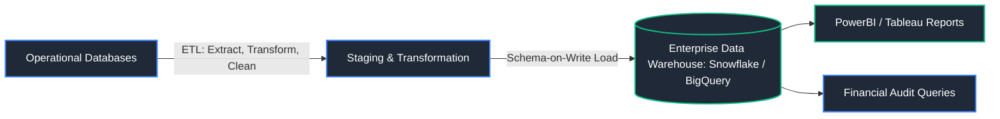

#### Comparison: Data Lake vs. Data Warehouse
| Architectural Metric | Data Lake | Data Warehouse |
| :--- | :--- | :--- |
| **Data Types** | Structured, semi-structured, raw media | Structured, curated tabular data |
| **Schema Paradigm** | Schema-on-Read | Schema-on-Write |
| **Cost** | Extremely low (Object storage pricing) | Higher (Compute + proprietary storage) |
| **Performance** | Slower query latency; requires compute spin-up | Sub-second SQL aggregations via MPP caches |
| **Primary Users** | Data Engineers, ML Engineers, Data Scientists | BI Analysts, Business Users, Financial Auditors |

#### References
- [GeeksforGeeks: Data Warehouse Concepts](https://www.geeksforgeeks.org/data-warehouse-architecture/)
- [DataCamp: What is a Data Warehouse?](https://www.datacamp.com/tutorial/what-is-a-data-warehouse)

---

### 1.3 Data Lakehouse

#### Definition
A Data Lakehouse is a modern data management architecture that merges the best attributes of data lakes and data warehouses. It implements **data warehousing functionality (ACID transactions, schema enforcement, time-travel, indexing)** directly on top of **low-cost cloud object storage** using open table formats (**Delta Lake, Apache Iceberg, Apache Hudi**).

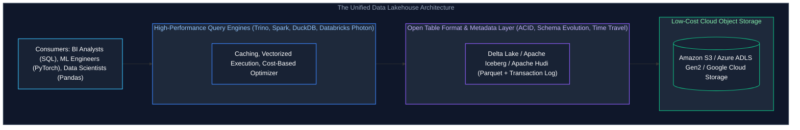

#### Code Example (Delta Lakehouse Table Definition)
```sql
-- Creating an ACID Delta Lakehouse Table on cloud object storage
CREATE TABLE lakehouse.sales_orders (
    order_id BIGINT,
    customer_id BIGINT,
    order_amount NUMERIC(10, 2),
    order_timestamp TIMESTAMP,
    order_date DATE
)
USING DELTA
PARTITIONED BY (order_date)
LOCATION 's3://company-lakehouse/curated/sales_orders/'
TBLPROPERTIES (
    'delta.enableChangeDataFeed' = 'true',
    'delta.autoOptimize.optimizeWrite' = 'true'
);
```

#### References
- [GeeksforGeeks: What is a Data Lakehouse?](https://www.geeksforgeeks.org/what-is-data-lakehouse/)
- [Databricks: What is a Data Lakehouse?](https://www.databricks.com/glossary/data-lakehouse)

---

### 1.4 Lambda Architecture

#### Definition
Lambda Architecture is a data-processing architecture designed to handle massive quantities of data by providing both low-latency real-time stream views and comprehensive, accurate historical batch views. It divides data processing into three distinct layers:
1. **Batch Layer:** An append-only immutable master dataset processed periodically via distributed batch jobs (Hadoop/Spark) for comprehensive accuracy.
2. **Speed Layer:** A real-time stream processing engine (Storm/Flink/Spark Streaming) that processes recent delta data with low latency, compensating for batch delay.
3. **Serving Layer:** Indexes and merges outputs from both the batch and speed layers to respond to analytical queries.

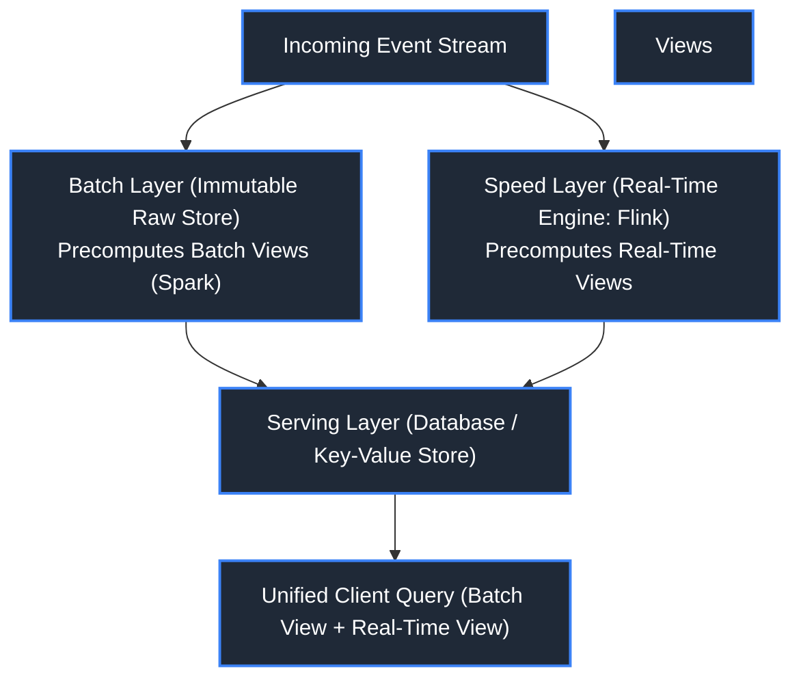

#### Key Points & Common Pitfalls
- **Code Duplication Flaw:** The primary downfall of Lambda Architecture is maintaining duplicate business logic across two completely different codebases (e.g., Python/Spark for batch, Java/Flink for streaming), resulting in synchronization bugs and difficult schema updates.

#### References
- [GeeksforGeeks: Lambda Architecture](https://www.geeksforgeeks.org/lambda-architecture/)
- [DataCamp: Real-Time Big Data Architectures](https://www.datacamp.com/tutorial/big-data-architectures)

---

### 1.5 Kappa Architecture

#### Definition
Kappa Architecture simplifies the data pipeline by **eliminating the batch layer entirely**. In Kappa, **all data is treated as an immutable append-only event stream**. A single stream-processing engine (Apache Flink, Spark Structured Streaming) processes real-time data and handles historical reprocessing by simply rewinding the offset of the streaming log (Apache Kafka, Apache Pulsar).

```mermaid
flowchart LR
    EventStream["Incoming Events"] --> LogStorage[("Kafka / Distributed Immutable Event Log")]
    LogStorage -->|Stream Processing Pipeline (Single Codebase)| Processor["Stream Processor (Flink / Spark Streaming)"]
    Processor --> ServingView[("Serving Data Store / Lakehouse (Elasticsearch / ClickHouse / Delta)")]
    ServingView --> Analytics[Real-Time & Historical Dashboards]

    subgraph Reprocessing ["Historical Reprocessing: No Code Duplication!"]
        LogStorage -.->|Rewind Stream Offset to 0| NewProcessor["New Pipeline Code (v2.0)"]
        NewProcessor -.->|Replay History| ServingView
    end

    style Reprocessing fill:#0f172a,stroke:#10b981,stroke-width:1.5px,color:#6ee7b7

    style EventStream fill:#1f2937,stroke:#3b82f6,stroke-width:2px,color:#fff
    style LogStorage fill:#1f2937,stroke:#f59e0b,stroke-width:2px,color:#fff
    style Processor fill:#1f2937,stroke:#3b82f6,stroke-width:2px,color:#fff
    style ServingView fill:#1f2937,stroke:#8b5cf6,stroke-width:2px,color:#fff
    style Analytics fill:#1f2937,stroke:#10b981,stroke-width:2px,color:#fff
    style NewProcessor fill:#064e3b,stroke:#10b981,stroke-width:2px,color:#a7f3d0
```

#### Comparison: Lambda vs. Kappa
| Feature | Lambda Architecture | Kappa Architecture |
| :--- | :--- | :--- |
| **Pipeline Layers** | Dual (Batch Layer + Speed Layer) | Single (Streaming Log + Stream Processor) |
| **Codebase Maintenance** | High (Two distinct codebases) | Low (Single unified streaming codebase) |
| **Historical Reprocessing** | Re-run batch job | Replay stream log from offset 0 |
| **Data Synchronization** | Complex merging at query time | Continual updates directly to serving view |

#### References
- [GeeksforGeeks: Kappa Architecture](https://www.geeksforgeeks.org/kappa-architecture/)
- [DataCamp: Stream Processing Architectures](https://www.datacamp.com/tutorial/stream-processing)

---

### 1.6 Medallion Architecture (Bronze / Silver / Gold)

#### Definition
The Medallion Architecture (championed by Databricks and the Lakehouse movement) is a multi-tier data curation pattern that systematically increases data quality, structure, and analytical readiness as data flows through the system.

```mermaid
flowchart LR
    subgraph BronzeTier ["Bronze Layer (Raw Ingestion)"]
        B["Raw Append-Only Logs<br/>Native Formats (JSON/CSV)<br/>Full Historical Audit Trail"]
    end

    subgraph SilverTier ["Silver Layer (Cleansed & Conformed)"]
        S["De-duplicated & Filtered<br/>Schema Enforced & Validated<br/>Enriched Entities (3NF / SCD2)"]
    end

    subgraph GoldTier ["Gold Layer (Curated Business Marts)"]
        G["Aggregated Star Schemas<br/>Precomputed KPIs & Metrics<br/>Optimized for BI & AI Models"]
    end

    RawFiles[(Raw Sources)] --> BronzeTier
    BronzeTier -->|Spark Cleanse & Dedupe| SilverTier
    SilverTier -->|Business Aggregation & Joins| GoldTier
    GoldTier --> Dashboards[BI Reports & ML Features]

    style BronzeTier fill:#0f172a,stroke:#f59e0b,stroke-width:1.5px,color:#fde68a
    style SilverTier fill:#0f172a,stroke:#06b6d4,stroke-width:1.5px,color:#67e8f9
    style GoldTier fill:#0f172a,stroke:#10b981,stroke-width:1.5px,color:#6ee7b7

    style RawFiles fill:#1f2937,stroke:#f59e0b,stroke-width:2px,color:#fff
    style B fill:#1f2937,stroke:#f59e0b,stroke-width:2px,color:#fff
    style S fill:#1f2937,stroke:#06b6d4,stroke-width:2px,color:#fff
    style G fill:#1f2937,stroke:#10b981,stroke-width:2px,color:#fff
    style Dashboards fill:#1f2937,stroke:#10b981,stroke-width:2px,color:#fff
```

#### Medallion Tiers Breakdown
1. **Bronze (Raw / Ingestion):** The landing zone. Preserves raw source data in its original format with append-only guarantees. No business transformations are applied; includes ingestion timestamps and source file paths for auditing.
2. **Silver (Refined / Cleansed):** Data is cleaned, validated, de-duplicated, and enriched. Conforms schemas, parses JSON strings into typed columns, and handles SCD tracking.
3. **Gold (Aggregated / Business):** Project-specific reporting marts structured as dimensional Star Schemas or denormalized tables optimized for executive dashboards, KPI calculation, and ML training pipelines.

#### Medallion Layer Responsibilities & Service-Level Objectives (SLOs) Matrix

| Architectural Dimension | Bronze Layer (Raw Landing) | Silver Layer (Cleansed & Conformed) | Gold Layer (Curated Business Products) |
| :--- | :--- | :--- | :--- |
| **Primary Goal** | Raw append-only historical audit trail | Enterprise single source of truth for business entities | Consumption-ready analytics, BI marts & ML feature sets |
| **Data Quality & Hygiene** | Unfiltered raw payloads, malformed records tracked in quarantine | Deduplicated, schema-validated, type-casted, enriched | Aggregated, validated against strict business KPIs |
| **Schema Policy** | Schema-on-read, append-only, permissive schema evolution | Strict schema enforcement, SCD Type 1 & 2 historical tracking | Fixed star schema / dimensional models, data contracts enforced |
| **Latency SLO** | Sub-minute streaming to hourly micro-batches | 5–15 minute streaming / hourly micro-batches | Hourly to daily scheduled aggregation runs |
| **Target Consumers** | Internal ingestion pipelines, platform recovery jobs | Data engineers, analytics engineers, exploratory data scientists | BI analysts, executive dashboards (Looker/Tableau), ML pipelines |
| **Retention Policy** | Permanent / long-term archival for disaster recovery | Governed retention aligned with regulatory compliance (e.g. 7 years) | Tailored to analytical reporting horizons (e.g. 1–3 years) |

#### References
- [Databricks Documentation: What is the Medallion Architecture?](https://www.databricks.com/glossary/medallion-architecture)
- [GeeksforGeeks: Medallion Architecture in Data Engineering](https://www.geeksforgeeks.org/medallion-architecture/)

---

### 1.7 Data Mesh

#### Definition
Data Mesh is an architectural and organizational paradigm that shifts analytical data management away from centralized data engineering teams and monolithic data platforms toward a **decentralized, domain-oriented** structure.

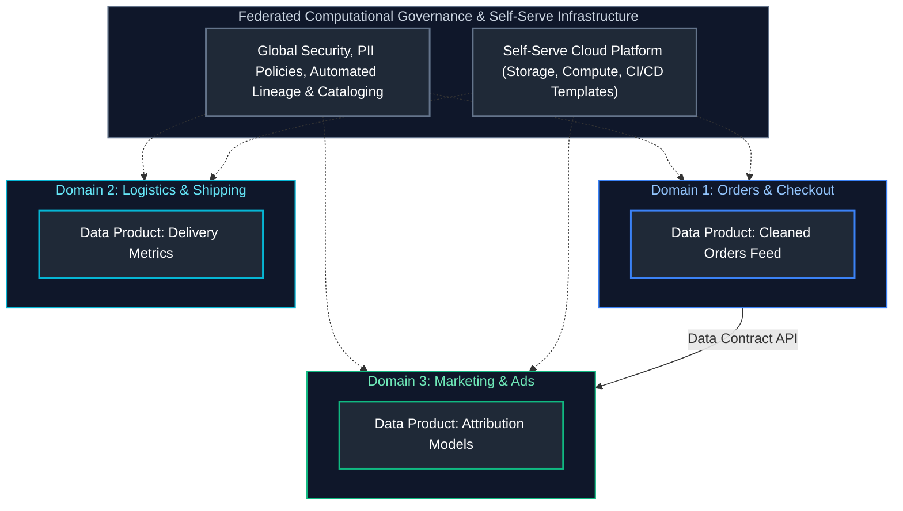

#### The Four Core Principles of Data Mesh
1. **Domain-Oriented Ownership:** Functional domains (e.g., Checkout, Logistics, Marketing) own and manage their own analytical data pipelines end-to-end.
2. **Data as a Product:** Data is treated as a first-class product with clear SLAs, documentation, schema contracts, and dedicated data product owners.
3. **Self-Serve Data Platform:** A centralized platform team provides self-serve infrastructure tools (storage provisioning, access management, CI/CD templates) so domain teams can build without friction.
4. **Federated Computational Governance:** Global standards (privacy, encryption, compliance, identity) are defined centrally and enforced automatically through automated code checks and platform policies.

#### References
- [GeeksforGeeks: Introduction to Data Mesh](https://www.geeksforgeeks.org/what-is-data-mesh/)
- [Martin Fowler: Data Mesh Principles](https://martinfowler.com/articles/data-mesh-principles.html)

---

### 1.8 Data Fabric

#### Definition
Data Fabric is an architectural approach that leverages **active metadata, automated machine learning, and knowledge graphs** to dynamically connect, integrate, and govern disparate data assets across multi-cloud, on-premises, and edge environments without requiring all data to be physically relocated into a single storage repository.

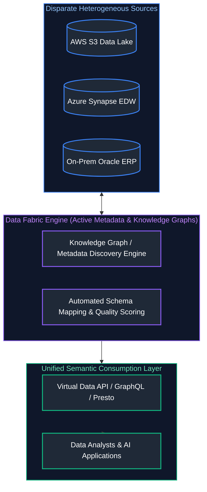

#### Data Mesh vs. Data Fabric
- **Data Mesh:** A socio-technical, organizational paradigm focusing on *people, domain decentralization, and team boundaries*.
- **Data Fabric:** A technological and architectural framework focusing on *active metadata automation, knowledge graphs, and dynamic virtualization*.

#### References
- [Gartner: What is Data Fabric?](https://www.gartner.com/en/information-technology/glossary/data-fabric)
- [GeeksforGeeks: Data Fabric Architecture](https://www.geeksforgeeks.org/what-is-data-fabric/)

---

### 1.9 Modern Data Stack (MDS)

#### Definition
The Modern Data Stack (MDS) is a modular, cloud-native suite of specialized software components integrated together via APIs to deliver an automated **ELT (Extract, Load, Transform)** lifecycle.

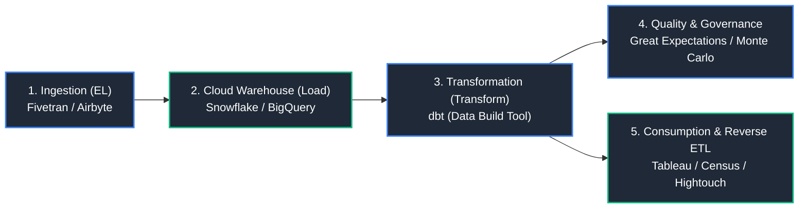

#### Core Components of MDS
1. **Automated Ingestion (EL):** Pre-built SaaS connectors extracting data into cloud storage (Fivetran, Airbyte).
2. **Cloud Analytical Storage:** Scalable MPP engines (Snowflake, BigQuery, Databricks).
3. **In-Warehouse Transformation:** SQL-first version-controlled modeling (dbt).
4. **Data Observability:** Automated pipeline freshness and anomaly detection (Monte Carlo, Elementary).
5. **Reverse ETL:** Pushing curated data back into operational CRMs (Salesforce, Marketo via Census/Hightouch).

#### References
- [DataCamp: What is the Modern Data Stack?](https://www.datacamp.com/tutorial/modern-data-stack)
- [GeeksforGeeks: ETL vs ELT in Data Engineering](https://www.geeksforgeeks.org/difference-between-etl-and-elt/)

---

# 2. Data Modeling Paradigms

Data modeling translates business processes into logical relationships and physical database schemas. Choosing the correct modeling technique directly impacts storage costs, query performance, and pipeline complexity.

---

### 2.1 Conceptual, Logical, and Physical Models

#### Definition
Data modeling progresses through three distinct levels of abstraction:
1. **Conceptual Data Model:** High-level business view defining major business entities (e.g., Customer, Product, Order) and business relationships. Ignores database constraints, types, and primary keys.
2. **Logical Data Model:** Technology-agnostic structural view detailing all entity attributes, normalization rules, primary/foreign key relationships, and data domains.
3. **Physical Data Model:** Concrete database-specific implementation detailing exact data types (`BIGINT`, `VARCHAR(100)`), partitioning strategies, clustering keys, index definitions, and storage formats.

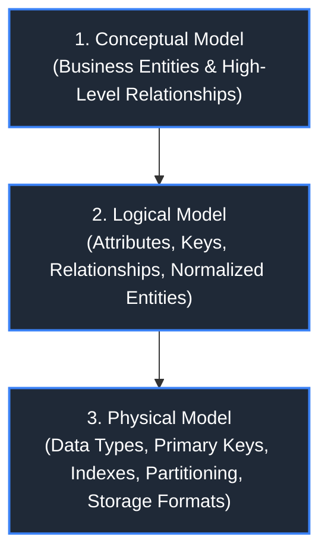

#### References
- [GeeksforGeeks: Conceptual, Logical and Physical Data Model](https://www.geeksforgeeks.org/conceptual-logical-and-physical-data-model/)
- [DataCamp: Data Modeling Concepts](https://www.datacamp.com/tutorial/data-modeling)

---

### 2.2 OLTP Data Modeling (3NF)

#### Definition
OLTP modeling emphasizes high write integrity, minimal data redundancy, and rapid atomic updates. It uses strict normalization (typically **3rd Normal Form - 3NF**) to ensure every attribute depends directly on the key, the whole key, and nothing but the key.

#### Characteristics
- Entities are split into granular tables (e.g., separating Addresses, Customers, and Orders).
- Prevents update anomalies: Changing a customer's address requires updating exactly one row in the `Addresses` table.

#### References
- [GeeksforGeeks: Database Normalization (3NF)](https://www.geeksforgeeks.org/normal-forms-in-dbms/)
- [DataCamp: Relational Database Design](https://www.datacamp.com/tutorial/relational-database-design)

---

### 2.3 OLAP Dimensional Modeling

#### Definition
Developed by Ralph Kimball, Dimensional Modeling optimizes data structures for rapid analytical querying, intuitive human readability, and aggregation efficiency. The universe is divided into:
- **Measurements (Facts):** Quantitative numbers representing business events (sales revenue, units shipped).
- **Context (Dimensions):** The "who, what, where, when, and why" describing the business event (customer name, store location, promo type).

#### References
- [GeeksforGeeks: Dimensional Modeling](https://www.geeksforgeeks.org/dimensional-data-model-in-data-warehouse/)
- [DataCamp: Dimensional Modeling Tutorial](https://www.datacamp.com/tutorial/dimensional-modeling)

---

### 2.4 Star Schema

#### Definition
A Star Schema is a dimensional design where a central **Fact Table** is surrounded by and directly connected to one or more denormalized **Dimension Tables**. The topology resembles a star.

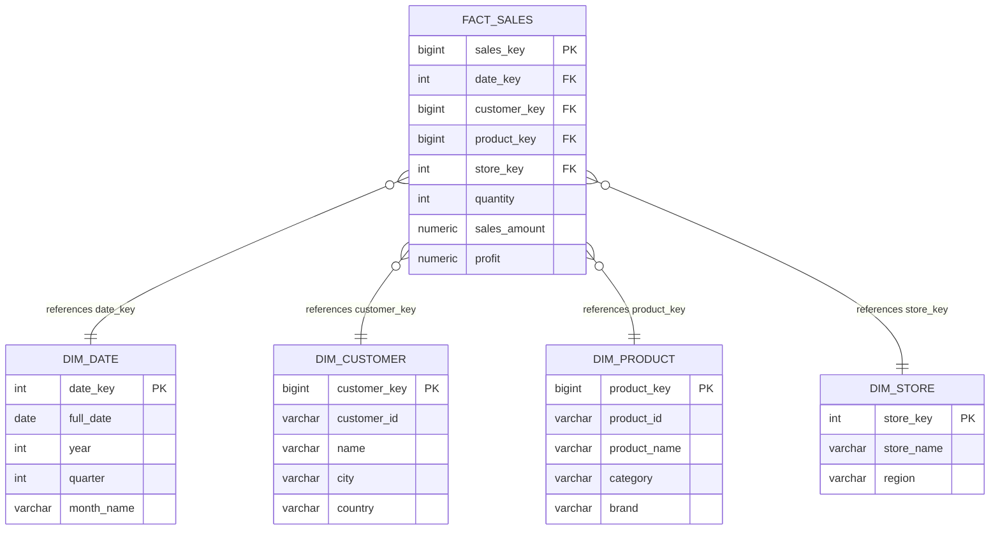

#### Advantages
- Simple queries: Requires only 1 level of joins (Fact joined to Dimensions).
- Fast performance: Ideal for analytical query optimizers to utilize star-join optimizations and bitmap indexes.

#### References
- [GeeksforGeeks: Star Schema in Data Warehouse](https://www.geeksforgeeks.org/star-schema-in-data-warehouse-modeling/)
- [DataCamp: Understanding Star Schemas](https://www.datacamp.com/tutorial/dimensional-modeling)

---

### 2.5 Snowflake Schema

#### Definition
A Snowflake Schema is a variation of the Star Schema where **dimension tables are normalized** into multiple related sub-tables. The diagram branches out like a snowflake.

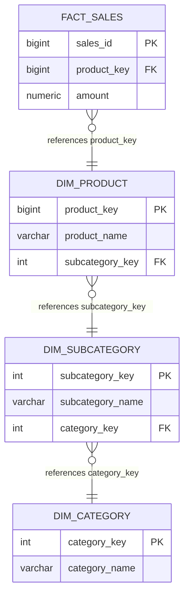

#### Star vs. Snowflake Comparison
| Feature | Star Schema | Snowflake Schema |
| :--- | :--- | :--- |
| **Dimension Structure** | Denormalized (Single flat table per dimension) | Normalized into multiple hierarchy tables |
| **Storage Consumption** | Higher (Redundant text attributes) | Lower (Eliminates repeated strings) |
| **Query Complexity** | Simple (Direct joins from fact to dimensions) | Complex (Requires joining multiple sub-dimensions) |
| **Query Performance** | Faster (Fewer joins) | Slower (Multiple multi-table joins) |

#### References
- [GeeksforGeeks: Snowflake Schema in Data Warehouse](https://www.geeksforgeeks.org/snowflake-schema-in-data-warehouse-model/)
- [DataCamp: Star Schema vs Snowflake Schema](https://www.datacamp.com/tutorial/star-schema-vs-snowflake-schema)
- For SQL implementation of Star Schema queries and multi-table joins, see [01. SQL Fundamentals](01_sql_fundamentals.md#78-multiple-table-joins--star-schema-patterns). For distributed join execution strategies across large fact tables, see [02. Advanced SQL](02_advanced_sql.md#13-distributed-join-strategies-broadcast-shuffle-hash-sort-merge).

---

### 2.6 Fact Tables Taxonomy

Fact tables record the numerical metrics resulting from a business process. Kimball defines four primary types of fact tables:

#### 2.6.1 Transaction Fact Tables
- **Definition:** Represents a point-in-time business event at the lowest atomic grain (e.g., a single cash register scan or credit card swipe).
- **Behavior:** Strictly append-only. Each row represents a single discrete event.

#### 2.6.2 Periodic Snapshot Fact Tables
- **Definition:** Records the status or balance of a business process at uniform, predictable intervals (daily, weekly, monthly).
- **Example:** Daily bank account closing balances or warehouse inventory levels at midnight.

#### 2.6.3 Accumulating Snapshot Fact Tables
- **Definition:** Models a predictable lifecycle or workflow process that has a clear beginning and end with milestone stages.
- **Behavior:** The row is **updated in place** as the entity moves through milestones (e.g., Order Placed $\rightarrow$ Order Picked $\rightarrow$ Order Shipped $\rightarrow$ Order Delivered). Contains multiple date foreign keys corresponding to each milestone.

#### 2.6.4 Factless Fact Tables
- **Definition:** A fact table that contains **no numeric metrics or measurements**; it consists entirely of foreign keys representing the occurrence of an event or an association.
- **Example:** Student attendance tracking (Student Key + Date Key + Class Key) or promotion coverage (identifies which products were on promotion in which stores on which days).

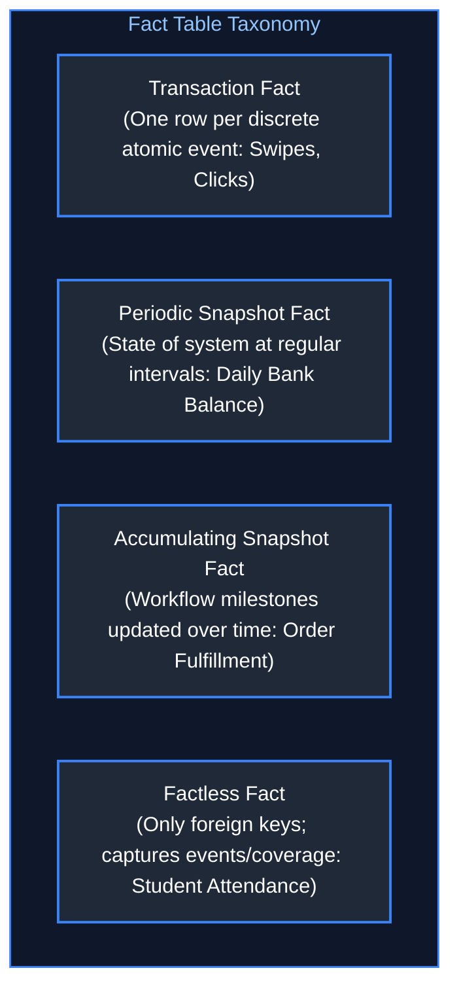

#### References
- [GeeksforGeeks: Types of Fact Tables](https://www.geeksforgeeks.org/types-of-fact-tables-in-data-warehouse/)
- [DataCamp: Fact Tables Explained](https://www.datacamp.com/tutorial/dimensional-modeling)

---

### 2.7 Dimension Tables Taxonomy

Dimension tables provide the descriptive textual context for fact measurements.

#### 2.7.1 Conformed Dimensions
- **Definition:** A standardized, consistent dimension that is shared across multiple fact tables in an enterprise data warehouse.
- **Example:** `dim_date` or `dim_customer` referenced by both `fact_sales` and `fact_support_tickets`. Enables cross-process drill-through analysis.

#### 2.7.2 Role-Playing Dimensions
- **Definition:** A single physical dimension table that is referenced multiple times in the same fact table under different logical roles.
- **Example:** `fact_orders` contains `order_date_key`, `shipping_date_key`, and `delivery_date_key`, all joining to the same physical `dim_date` table using different SQL aliases.

#### 2.7.3 Junk Dimensions
- **Definition:** A single consolidated dimension table that combines miscellaneous low-cardinality flags, boolean indicators, and status codes (e.g., `is_gift_wrapped`, `payment_method`, `delivery_status`) to prevent cluttering the fact table with dozens of separate foreign key columns.

#### 2.7.4 Degenerate Dimensions
- **Definition:** A dimension attribute that is stored **directly inside the fact table** without joining to an external dimension table because it has no additional descriptive attributes.
- **Example:** Invoice Number, Purchase Order Number, or Transaction Tracking Code.

#### 2.7.5 Outrigger Dimensions
- **Definition:** A secondary dimension table referenced by another dimension table (rather than directly by the fact table) to avoid bloating the primary dimension table with high-cardinality or specialized attributes.

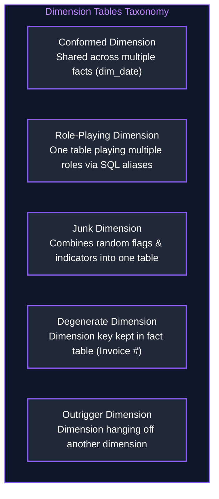

#### References
- [GeeksforGeeks: Types of Dimension Tables](https://www.geeksforgeeks.org/types-of-dimension-tables-in-data-warehouse/)
- [DataCamp: Working with Dimensions](https://www.datacamp.com/tutorial/dimensional-modeling)

---

### 2.8 Slowly Changing Dimensions (SCD Types 0-6)

Attributes in dimension tables change over time (e.g., a customer moves to a new city). Slowly Changing Dimension (SCD) strategies govern how historical changes are handled.

#### 2.8.1 SCD Type 0 (Fixed / Retain Original)
- **Mechanism:** The attribute is never updated. Original value is preserved forever.
- **Use Case:** Date of Birth, Original Registration Country.

#### 2.8.2 SCD Type 1 (Overwrite)
- **Mechanism:** Overwrite the old value with the new value. No historical record is preserved.
- **Use Case:** Correcting typos (fixing spelling of customer name).
- **Drawback:** Destroys historical reporting (past orders will falsely show the new address).

#### 2.8.3 SCD Type 2 (Historical Versioning with Effective Dates)
- **Mechanism:** Add a new physical row with a new surrogate key whenever an attribute changes. Includes `effective_start_date`, `effective_end_date`, and `is_current` flag.
- **Use Case:** Customer moving cities, employee territory realignment. Full historical auditability.

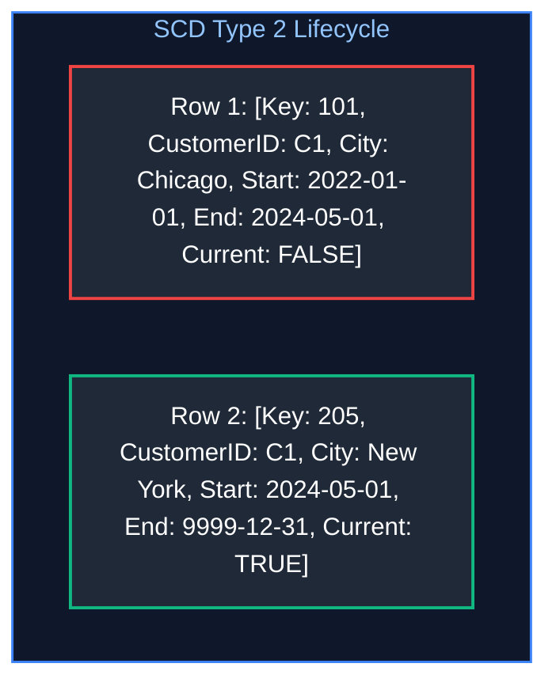

```sql
-- Querying SCD Type 2 Dimension for Point-in-Time Historical Accuracy
SELECT 
    f.order_id,
    f.order_amount,
    c.city AS historical_customer_city
FROM core.fact_orders f
JOIN core.dim_customer_scd2 c 
    ON f.customer_id = c.customer_id
   AND f.order_date >= c.effective_start_date
   AND f.order_date < c.effective_end_date;
```

#### 2.8.4 SCD Type 3 (Previous / Current Attribute Columns)
- **Mechanism:** Keep the old value and new value in separate columns on the exact same row (`current_city`, `previous_city`).
- **Use Case:** Tracking only the most recent change without creating extra rows.

#### 2.8.5 SCD Type 4 (Historical Mini-Dimensions)
- **Mechanism:** Rapidly changing attributes are split into a separate "mini-dimension" table with its own surrogate key, keeping the base customer dimension compact.

#### 2.8.6 SCD Type 6 (Hybrid 1 + 2 + 3)
- **Mechanism:** Combines Types 1, 2, and 3 ($1 + 2 + 3 = 6$). A new row is added for historical tracking (Type 2), while an overwrite column (Type 1) reflects the current value across all historical rows, and a previous column (Type 3) tracks recent changes.

#### SCD Summary Matrix
| SCD Type | Mechanism | Preserves History? | Table Size Impact |
| :--- | :--- | :--- | :--- |
| **Type 0** | Fixed / Never change | No (Only original) | None |
| **Type 1** | Overwrite in place | No history kept | None |
| **Type 2** | Add new row per change | Complete history preserved | Grows with changes |
| **Type 3** | Add `previous_val` column | Tracks last change only | Adds columns |
| **Type 4** | Mini-dimension table | Complete history in sub-table | Isolated growth |
| **Type 6** | Hybrid (1 + 2 + 3) | Full history + Current view | Highest row/col count |

#### References
- [GeeksforGeeks: Slowly Changing Dimensions (SCD)](https://www.geeksforgeeks.org/slowly-changing-dimensions-scd-in-data-warehouse/)
- [DataCamp: Implementing SCD in Data Warehouses](https://www.datacamp.com/tutorial/slowly-changing-dimensions)
- For point-in-time temporal range matching and non-equi join mechanics in SQL, see [02. Advanced SQL](02_advanced_sql.md#16-non-equi-joins--temporal--scd2-range-matching). For incremental CDC synchronization via MERGE / UPSERT, see [02. Advanced SQL](02_advanced_sql.md#51-merge--upsert--change-data-capture-cdc-patterns).

---

### 2.9 Data Vault 2.0 (Hubs, Links, Satellites)

#### Definition
Data Vault 2.0 is an agile, audit-centric modeling methodology engineered specifically for enterprise data integration at massive scale. It isolates business keys, relationships, and descriptive context into three distinct structural components using deterministic cryptographic hash keys (MD5 or SHA-256).

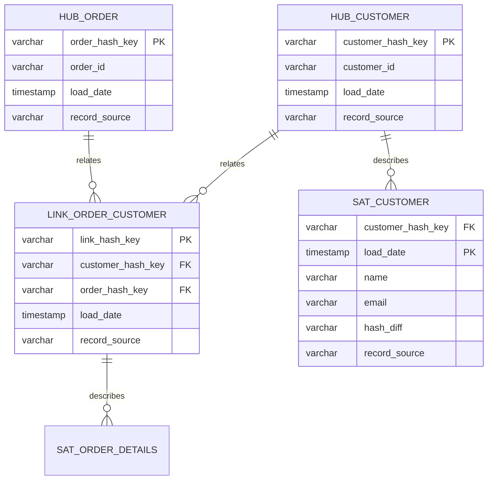

#### Core Components
1. **Hubs:** Store unique business keys (e.g., `customer_id`, `vehicle_vin`). Contains hash key, business key, load date, and record source. Never updated.
2. **Links:** Capture many-to-many associations and relationships between hubs (e.g., `customer_places_order`).
3. **Satellites:** Store time-stamped descriptive attributes and history for Hubs or Links. Supports full historical auditing without altering Hub or Link structures.

#### References
- [Data Vault Alliance: What is Data Vault 2.0?](https://datavaultalliance.com/)
- [GeeksforGeeks: Data Vault Modeling](https://www.geeksforgeeks.org/data-vault-modeling/)

---

### 2.10 One Big Table (OBT)

#### Definition
One Big Table (OBT) is a denormalization pattern where all facts and descriptive dimensions are pre-joined into a single, massive, wide table (often containing 100+ to 500+ columns). 

#### Usage in Modern Cloud Warehouses
With modern columnar storage formats (Parquet, BigQuery Capacitor, Snowflake Micro-partitions), querying an OBT eliminates all join overhead while column pruning ensures you only pay I/O for the specific columns requested.

#### Comparison: Star Schema vs. OBT
| Metric | Star Schema | One Big Table (OBT) |
| :--- | :--- | :--- |
| **Join Overhead** | Multiple joins at query runtime | Zero joins (Data is pre-joined) |
| **Storage Consumption** | Lower (Normalized text dimensions) | Higher (Redundant strings repeated on billions of rows) |
| **BI User Usability** | Requires understanding join keys | Extremely simple (Drag-and-drop single table) |
| **ELT Complexity** | Manage separate Fact and Dimension pipelines | Heavy compute during denormalization build step |

#### References
- [DataCamp: Star Schema vs One Big Table](https://www.datacamp.com/tutorial/star-schema-vs-obt)

---

### 2.11 The Semantic Layer & Metric Standardization

#### Problem: Inconsistent Metrics & Metric Sprawl
In fragmented enterprise architectures, multiple downstream business units (Sales, Finance, Marketing, Product) compute the same core business metrics directly inside separate BI dashboards, SQL scripts, and machine learning notebooks. This leads to **Metric Sprawl**:
- Finance defines *Revenue* as net payments settled excluding refunds and chargebacks.
- Sales defines *Revenue* as raw booked contracts before product returns.
- Marketing defines *Active Customers* based on 30-day website clicks, while Operations defines them based on completed shipments.

When executives view board dashboards, metrics do not reconcile, eroding trust in the underlying data platform.

#### Solution: Metric Standardization via the Semantic Layer
A **Semantic Layer** (e.g., dbt Semantic Layer / MetricFlow, Cube, Looker LookML) acts as a centralized middleware layer positioned directly between the data warehouse/lakehouse Gold models and consumption tools. 

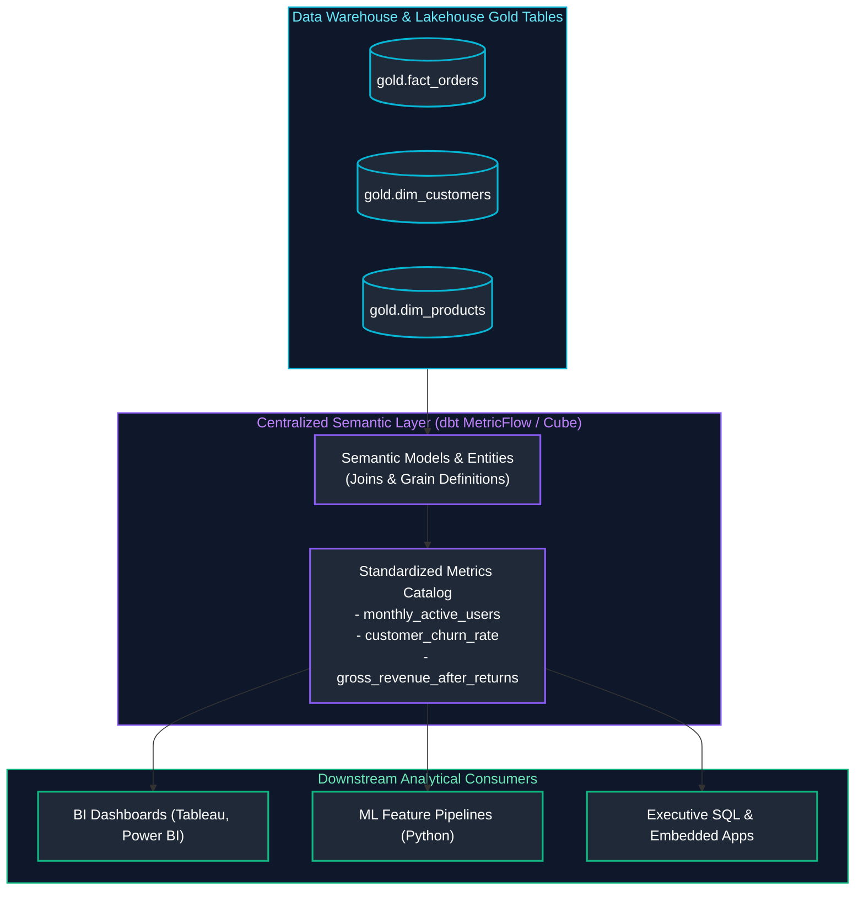

#### Core Components of a Semantic Definition
1. **Entities:** Join keys representing core real-world concepts (e.g., `customer_id`, `order_id`).
2. **Dimensions:** Categorical or temporal attributes used for slicing and filtering (e.g., `order_date`, `customer_region`).
3. **Measures:** Aggregation expressions computed over raw column data (e.g., `SUM(order_amount)`, `COUNT(DISTINCT customer_id)`).
4. **Metrics:** User-facing business formulas referencing measures and dimensions, supporting complex ratios, cumulative windows, and period-over-period calculations.

---

### 2.12 Dimension Refresh Strategies & Reference Data Updates

#### Problem: Reference Data Updates & Dimension Drift
Reference datasets (currency conversion exchange rates, postal/tax jurisdictions, product hierarchy taxonomies, country codes) evolve over time. Fact processing pipelines must integrate these dimension updates without stalling high-throughput batch or streaming ingestion pipelines.

#### Solution: Dimension Refresh Strategies
| Strategy | Implementation Pattern | Best For | Trade-Offs |
| :--- | :--- | :--- | :--- |
| **Full Snapshot Rebuild** | `CREATE OR REPLACE TABLE dim_reference AS SELECT ...` | Small static reference tables (< 50 MB, e.g., ISO currency codes, US states) | Simplist implementation; re-scans entire dataset on every execution. |
| **Incremental CDC Merge** | `MERGE INTO dim_reference USING cdc_stream ON key ...` | Medium-to-large dimensions with frequent delta updates | Minimal I/O; requires transactional lakehouse engine (Delta / Iceberg). |
| **Broadcast Lookup Cache** | In-memory distributed hash table or Spark `broadcast(dim_df)` | Real-time streaming joins requiring sub-second enrichment | Zero shuffle latency; memory-constrained (cannot exceed executor driver memory). |
| **Audited SCD Type 2** | Historical row versioning with `valid_from`, `valid_to`, `is_current` | Regulatory compliance and financial auditing (e.g., tax rate changes) | Preserves historical snapshot truth; increases dimension row count. |

---

### 2.13 Referential Integrity & Orphan Record Prevention

#### Problem: Orphan Records in Distributed Data Lakes
Unlike traditional relational RDBMS engines (PostgreSQL, Oracle), distributed analytical systems and cloud lakehouses (Delta Lake, Apache Iceberg, BigQuery) **do not physically enforce foreign key constraints at storage write time**. 
When upstream CDC connectors, asynchronous micro-services, or network pipelines deliver fact events before the corresponding dimension entities have landed (or when invalid customer keys are generated), **orphan records** are inserted into fact tables. Queries that execute `INNER JOIN` silently drop these transactions, while `LEFT JOIN` results produce corrupt `NULL` attributes.

#### Solution: Referential Integrity Architecture & Quarantine Sinks

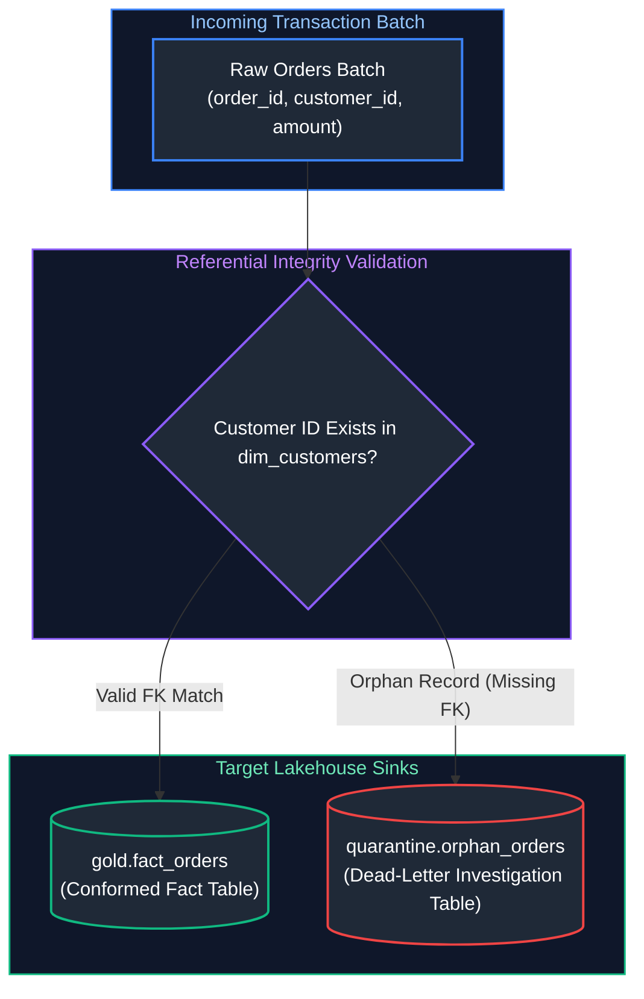

#### Production Patterns for Orphan Prevention:
1. **The Sentinel / Unknown Key Fallback (`-1`):** In dimensional ETL, if a fact record arrives with an unmapped foreign key, replace the foreign key surrogate with `-1` (pointing to an explicit `dim_customer` row: `"Unknown / Not Yet Arrived"`) rather than `NULL`. This preserves relational inner joins and maintains complete monetary sum aggregates.
2. **Late-Arriving Dimension Stub Insertion:** Insert a placeholder stub row in the dimension table with `customer_id`, `is_placeholder = TRUE`, and default names. When the full dimension CDC update eventually lands, perform an upsert (`MERGE`) to populate the true customer attributes without re-writing historical fact tables.
3. **Automated Data Quarantine & Dead-Letter Sinks:** Quarantine orphan records using SQL `LEFT ANTI JOIN` checks into an isolated inspection table, alerting data reliability teams while permitting valid transactions to proceed without pipeline failure.

#### References
- [Kimball Group: Handling Late-Arriving Data and Unknown Dimensions](https://www.kimballgroup.com/data-warehouse-business-intelligence-resources/kimball-techniques/dimensional-modeling-techniques/)

---

# 3. Data Governance & Metadata Management

Data Governance provides the policies, frameworks, and tools to ensure that data assets are secure, compliant, cataloged, high-quality, and trustworthy.

---

### 3.1 Data Lineage

#### Definition
Data Lineage is the end-to-end lifecycle map that traces the origin, transformation path, and destination of data from source operational databases through ETL stages to downstream BI dashboards and ML feature stores.

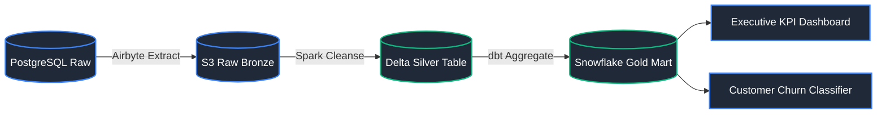

#### Importance in Data Engineering
- **Root-Cause Analysis:** If a dashboard KPI drops 30%, lineage reveals which upstream job or source column change caused the anomaly.
- **Impact Analysis:** Before modifying a database column, engineers can see which 50 downstream dashboards or pipelines will break.

#### References
- [GeeksforGeeks: Data Lineage in DBMS](https://www.geeksforgeeks.org/data-lineage/)
- [DataCamp: What is Data Lineage?](https://www.datacamp.com/tutorial/what-is-data-lineage)

---

### 3.2 Data Catalog

#### Definition
A Data Catalog is an organized inventory of an enterprise's data assets. It uses metadata extraction to help data engineers, analysts, and governance officers discover, understand, and evaluate datasets.

#### Key Capabilities
- Automated metadata crawlers (indexing schemas, column descriptions, row counts).
- Business glossaries and tagging (e.g., tagging columns as `PII` or `FINANCIAL`).
- Popular Tools: Unity Catalog (Databricks), Google Cloud Data Catalog / Dataplex, AWS Glue Catalog, Apache Atlas, OpenMetadata.

#### References
- [GeeksforGeeks: Data Catalog Architecture](https://www.geeksforgeeks.org/data-catalog/)
- [DataCamp: Guide to Data Catalogs](https://www.datacamp.com/tutorial/data-catalogs)

---

### 3.3 Data Quality Frameworks

#### Definition
Data Quality tools automate the assertion, validation, and monitoring of data reliability across ingestion and transformation pipelines.

#### Core Dimensions of Data Quality
1. **Completeness:** Are required values missing (`NULL` check)?
2. **Uniqueness:** Are there unintended duplicate primary keys?
3. **Validity:** Do values adhere to defined domains/formats (valid email regex, positive numbers)?
4. **Accuracy:** Does the recorded metric reflect real-world truth?
5. **Timeliness / Freshness:** Is data updating within agreed SLAs?
6. **Consistency:** Do cross-table balances reconcile accurately?

```sql
-- Great Expectations / Soda SQL-style assertions
SELECT 
    COUNT(*) AS total_records,
    COUNT(CASE WHEN user_id IS NULL THEN 1 END) AS null_user_ids,
    COUNT(CASE WHEN order_amount < 0 THEN 1 END) AS negative_amounts,
    MAX(CURRENT_TIMESTAMP - ingestion_timestamp) AS max_latency
FROM silver.validated_orders;
```

#### References
- [GeeksforGeeks: Data Quality Management](https://www.geeksforgeeks.org/data-quality-management/)
- [DataCamp: Data Quality Best Practices](https://www.datacamp.com/tutorial/data-quality)

---

### 3.4 Data Classification & PII Protection

#### Definition
Data Classification categorizes datasets according to their sensitivity level and regulatory compliance exposure (GDPR, CCPA, HIPAA, PCI-DSS):
- **Public:** Marketing materials, public catalogs.
- **Internal:** Operational server logs, internal documentation.
- **Confidential:** Financial ledgers, sales targets.
- **Restricted / PII:** Personally Identifiable Information (SSN, credit card numbers, medical records, home addresses).

#### PII Anonymization Techniques
- **Dynamic Data Masking:** Obfuscating values at query time (`j***@corp.com`).
- **Tokenization / Hashing:** Replacing sensitive keys with deterministic salt-hashed tokens (`SHA256(email + salt)`).

```mermaid
flowchart LR
    RawPII["Raw Ingestion: SSN = 123-45-6789"] --> MaskingEngine["Masking / Tokenization Engine"]
    MaskingEngine -->|Masked View for Analysts| AnalystView["***-**-6789"]
    MaskingEngine -->|Hashed Key for Joins| HashKey["0a8f9c1b2e4d..."]

    style RawPII fill:#1f2937,stroke:#3b82f6,stroke-width:2px,color:#fff
    style MaskingEngine fill:#1f2937,stroke:#3b82f6,stroke-width:2px,color:#fff
    style AnalystView fill:#1f2937,stroke:#3b82f6,stroke-width:2px,color:#fff
    style HashKey fill:#1f2937,stroke:#3b82f6,stroke-width:2px,color:#fff
```

#### References
- [GeeksforGeeks: Data Masking Techniques](https://www.geeksforgeeks.org/data-masking/)
- [DataCamp: Data Privacy and Governance](https://www.datacamp.com/tutorial/data-governance)

---

### 3.5 Master Data Management (MDM)

#### Definition
Master Data Management (MDM) is an enterprise discipline that binds together data across multiple operational systems to create a single, authoritative, trusted "Golden Record" for critical business entities (Customer, Product, Vendor).

#### MDM Match and Merge Pipeline
```mermaid
flowchart TD
    Src1["CRM: [User 1, user1@gmail.com, NYC]"] --> Matcher["1. Deduplication & Match Engine (Fuzzy Matching)"]
    Src2["ERP: [User 2, user2@gmail.com, New York]"] --> Matcher
    Src3["Billing: [User 3, user3@corp.com, NYC]"] --> Matcher
    
    Matcher --> Rules["2. Survivorship & Golden Record Rules"]
    Rules --> GoldenRecord["Golden Customer Entity:<br/>[ID: 1001, Name: 'User 1', PrimaryEmail: 'user1@gmail.com', City: 'New York']"]
    GoldenRecord --> Sync["Publish to Data Warehouse & Downstream Operational Apps"]

    style Src1 fill:#1f2937,stroke:#3b82f6,stroke-width:2px,color:#fff
    style Matcher fill:#1f2937,stroke:#3b82f6,stroke-width:2px,color:#fff
    style Src2 fill:#1f2937,stroke:#3b82f6,stroke-width:2px,color:#fff
    style Src3 fill:#1f2937,stroke:#3b82f6,stroke-width:2px,color:#fff
    style Rules fill:#1f2937,stroke:#3b82f6,stroke-width:2px,color:#fff
    style GoldenRecord fill:#1f2937,stroke:#3b82f6,stroke-width:2px,color:#fff
    style Sync fill:#1f2937,stroke:#10b981,stroke-width:2px,color:#fff
```

#### References
- [GeeksforGeeks: Master Data Management (MDM)](https://www.geeksforgeeks.org/master-data-management/)
- [DataCamp: What is MDM?](https://www.datacamp.com/tutorial/master-data-management)

---
