# 07. File Formats & Storage

A comprehensive, production-grade guide to big data file serialization formats (Parquet, ORC, Avro, JSON, CSV), compression codecs, distributed storage architectures (Object vs Block vs File), lake storage optimization (partitioning, clustering, compaction), and cloud object stores (ADLS Gen2) tailored for Data Engineers and Platform Architects.

---

## Table of Contents
1. [Big Data File Formats](#1-big-data-file-formats)
   - [1.1 CSV (Comma-Separated Values)](#11-csv-comma-separated-values)
   - [1.2 JSON (JavaScript Object Notation)](#12-json-javascript-object-notation)
   - [1.3 Apache Parquet](#13-apache-parquet)
   - [1.4 Apache ORC (Optimized Row Columnar)](#14-apache-orc-optimized-row-columnar)
   - [1.5 Apache Avro](#15-apache-avro)
   - [1.6 Row-Oriented vs Columnar File Formats Deep-Dive](#16-row-oriented-vs-columnar-file-formats-deep-dive)
   - [1.7 Compression Codecs (Snappy, GZIP, Zstandard, BZIP2)](#17-compression-codecs)
2. [Storage Concepts & Lake Optimization](#2-storage-concepts--lake-optimization)
   - [2.1 Object Storage vs Block Storage vs File Storage](#21-object-storage-vs-block-storage-vs-file-storage)
   - [2.2 Cloud Storage Tiers (Hot, Cool, Cold, Archive)](#22-cloud-storage-tiers)
   - [2.3 Storage Lifecycle Management Policies](#23-storage-lifecycle-management-policies)
   - [2.4 Immutability & Write-Once-Read-Many (WORM)](#24-immutability--write-once-read-many-worm)
   - [2.5 Partitioning Strategies & Hive Directory Layout](#25-partitioning-strategies--hive-directory-layout)
   - [2.6 Bucketing & Clustering](#26-bucketing--clustering)
   - [2.7 The Small File Problem](#27-the-small-file-problem)
   - [2.8 File Compaction & Bin-Packing Techniques](#28-file-compaction--bin-packing-techniques)
3. [Azure Storage & ADLS Gen2 Architecture](#3-azure-storage--adls-gen2-architecture)
   - [3.1 ADLS Gen2 (Azure Data Lake Storage Gen2)](#31-adls-gen2-azure-data-lake-storage-gen2)
   - [3.2 Hierarchical Namespace (HNS) vs Flat Blob Storage](#32-hierarchical-namespace-hns-vs-flat-blob-storage)
   - [3.3 Azure Blob Storage](#33-azure-blob-storage)
   - [3.4 Azure Access Tiers](#34-azure-access-tiers)
   - [3.5 Shared Access Signatures (SAS Tokens)](#35-shared-access-signatures-sas-tokens)
   - [3.6 Azure Managed Identity](#36-azure-managed-identity)
   - [3.7 Private Endpoints & Virtual Network Isolation](#37-private-endpoints--virtual-network-isolation)

---

# 1. Big Data File Formats

In data engineering, file serialization formats determine how tabular and semi-structured datasets are physically encoded into byte streams on disk. Selecting the proper file format is the single most impactful factor in storage cost, compression efficiency, and query throughput.

---

### 1.1 CSV (Comma-Separated Values)

#### Definition
CSV is a plain-text, row-oriented file format where records are separated by newlines and individual column values are delimited by commas (or tabs/pipes).

#### Usage / Purpose
- Ubiquitous interchange format between business users, legacy systems, and spreadsheets (Excel).
- Ad-hoc data export and human-readable inspection.

#### Code Example (PySpark Ingestion with Defensive Schema)
```python
from pyspark.sql.types import StructType, StructField, IntegerType, StringType, DoubleType

# Define explicit, strictly-typed schema to prevent Spark from scanning the entire file for type inference
csv_schema = StructType([
    # Primary key identifier: non-nullable 32-bit integer
    StructField("order_id", IntegerType(), nullable=False),
    # Customer name: UTF-8 string, nullable in case of guest checkouts
    StructField("customer_name", StringType(), nullable=True),
    # Monetary order total: 64-bit double precision float
    StructField("order_total", DoubleType(), nullable=True)
])

# Read CSV into distributed DataFrame using defensive parsing options
df_csv = spark.read \
    .option("header", "true") \            # Treat the first row as column header names
    .option("mode", "DROPMALFORMED") \     # Silently discard corrupted rows with delimiter or type violations
    .option("sep", ",") \                 # Specify comma delimiter explicitly
    .schema(csv_schema) \                  # Enforce pre-compiled schema (avoids two-pass I/O overhead)
    .csv("s3://landing-bucket/raw_orders.csv") # Lazy evaluation: loads metadata without eager execution
```

#### Key Points & Common Pitfalls
- **No Embedded Schema:** CSV files store everything as text strings; data types (dates, integers, floats) must be inferred at runtime. Schema inference requires reading the entire file from start to finish before processing begins.
- **Delimiter Collisions:** Text fields containing unescaped commas (e.g., addresses `"123 Elm St, Apt 4"`) corrupt column boundaries unless properly quoted.
- **Non-Splittable Compression:** Compressing a CSV with GZIP creates a non-splittable monolithic file, forcing a single Spark worker node to decompress the entire file sequentially.

#### References
- [GeeksforGeeks: Working with CSV Files in Python](https://www.geeksforgeeks.org/working-csv-files-python/)
- [DataCamp: Importing Data with CSV](https://www.datacamp.com/tutorial/reading-csv-files-in-python)

---

### 1.2 JSON (JavaScript Object Notation)

#### Definition
JSON is a text-based, semi-structured data interchange format composed of key-value pairs and nested arrays. In big data ecosystems, JSON is formatted as **Newline Delimited JSON (NDJSON / JSON Lines)**, where each line represents a distinct self-contained JSON document.

#### Usage / Purpose
- Standard payload format for REST APIs, webhooks, and IoT telemetry streams.
- Schema evolution scenarios where documents frequently introduce new, optional keys.

#### Code Example
```python
# Reading Newline-Delimited JSON (NDJSON) in PySpark with nested struct querying
# Reads multi-record file where each line is a valid independent JSON object
df_json = spark.read.json("s3://landing-bucket/telemetry_events.json")

# Extract and project nested JSON payload attributes using path dot-notation
df_flattened = df_json.select(
    # Top-level event identifier
    "event_id",
    # Event occurrence timestamp
    "timestamp",
    # Nested field: extract 'os_version' string from inside 'device' struct within 'payload'
    "payload.device.os_version",
    # Nested field: extract 'battery_level' integer from inside 'payload' struct
    "payload.battery_level"
)
```

#### Key Points & Common Pitfalls
- **Massive Storage Bloat:** JSON redundantly repeats column key names (`"customer_id": 101`) for every single row, consuming 5x to 10x more disk space and I/O bandwidth than binary columnar formats.

#### References
- [GeeksforGeeks: JSON Data Types](https://www.geeksforgeeks.org/json-data-types/)
- [DataCamp: Working with JSON in Python](https://www.datacamp.com/tutorial/json-data-python)

---

### 1.3 Apache Parquet

#### Definition
Apache Parquet is an open-source, binary, **column-oriented** data storage format engineered from the ground up for complex bulk query performance in distributed big data engines (Spark, Snowflake, Presto, DuckDB).

#### Parquet Internal File Architecture
A Parquet file is divided into one or more **Row Groups** (typically 128MB to 512MB in size). Within each Row Group, data is partitioned into **Column Chunks** containing individual **Pages**. Crucially, the **File Metadata (Footer)** is written at the very end of the file, containing the schema and statistical Min/Max values for every column chunk.

```mermaid
flowchart TD
    subgraph ParquetFile ["Parquet File Physical Structure"]
        H["File Header: PAR1 (Magic Bytes)"]
        
        subgraph RG1 ["Row Group 1 (e.g., 256MB)"]
            CC1["Column Chunk A (User_ID Pages)"]
            CC2["Column Chunk B (Timestamp Pages)"]
            CC3["Column Chunk C (Amount Pages)"]
        end

        subgraph RG2 ["Row Group 2"]
            CC4["Column Chunk A"]
            CC5["Column Chunk B"]
            CC6["Column Chunk C"]
        end

        subgraph Footer ["File Metadata Footer (Read First via HTTP Range Request)"]
            Meta["Schema Definition<br/>Row Group Pointers<br/>Column Statistics (Min, Max, Null Count)"]
            FLength["Footer Length (4 Bytes)"]
            MagicEnd["Magic End Bytes: PAR1"]
        end

        H --> RG1 --> RG2 --> Footer
    end

    style ParquetFile fill:#0f172a,stroke:#334155,stroke-width:1.5px,color:#94a3b8
    style RG1 fill:#1e293b,stroke:#3b82f6,stroke-width:1.5px,color:#93c5fd
    style RG2 fill:#1e293b,stroke:#3b82f6,stroke-width:1.5px,color:#93c5fd
    style Footer fill:#1e293b,stroke:#f59e0b,stroke-width:1.5px,color:#fde68a

    style H fill:#182234,stroke:#94a3b8,stroke-width:1.5px,color:#fff
    style CC1 fill:#182234,stroke:#3b82f6,stroke-width:1.5px,color:#fff
    style CC2 fill:#182234,stroke:#3b82f6,stroke-width:1.5px,color:#fff
    style CC3 fill:#182234,stroke:#3b82f6,stroke-width:1.5px,color:#fff
    style CC4 fill:#182234,stroke:#3b82f6,stroke-width:1.5px,color:#fff
    style CC5 fill:#182234,stroke:#3b82f6,stroke-width:1.5px,color:#fff
    style CC6 fill:#182234,stroke:#3b82f6,stroke-width:1.5px,color:#fff
    style Meta fill:#182234,stroke:#f59e0b,stroke-width:1.5px,color:#fff
    style FLength fill:#182234,stroke:#f59e0b,stroke-width:1.5px,color:#fff
    style MagicEnd fill:#182234,stroke:#94a3b8,stroke-width:1.5px,color:#fff
```

#### Code Example (Writing Parquet with Statistics & Snappy in PySpark)
```python
# Writing columnar Parquet files with balanced CPU/IO Snappy compression
df_orders.write \
    .format("parquet") \                                # Output format: Apache Parquet columnar storage
    .option("compression", "snappy") \                  # Fast decompression codec (splittable, low CPU overhead)
    .mode("overwrite") \                                # Idempotent overwrite of target directory
    .save("s3://lakehouse-gold/curated_orders/")         # Atomic write via cloud storage commit protocol
```

#### Advantages
- **Column Pruning:** Engines only read byte offsets corresponding to requested columns.
- **Statistical Pruning (Data Skipping):** Engines inspect the footer's `min/max` metadata. If a query filters `WHERE amount > 1000` and Row Group 1's max amount is `500`, the engine skips reading Row Group 1 entirely.
- **High-Ratio Encoding:** Employs Dictionary Encoding, Run-Length Encoding (RLE), and Bit-Packing.

#### References
- [Apache Parquet Official Documentation](https://parquet.apache.org/)
- [GeeksforGeeks: Apache Parquet](https://www.geeksforgeeks.org/what-is-apache-parquet/)
- [DataCamp: Guide to Parquet Format](https://www.datacamp.com/tutorial/what-is-parquet)

---

### 1.4 Apache ORC (Optimized Row Columnar)

#### Definition
Apache ORC is a high-performance columnar storage format originally designed for the Apache Hadoop ecosystem and Apache Hive. Like Parquet, it is columnar, but organizes data into **Stripes** (typically 250MB) and embeds index streams containing light row-level indexes every 10,000 rows.

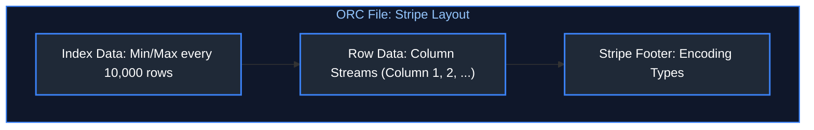

#### Parquet vs. ORC
| Characteristic | Apache Parquet | Apache ORC |
| :--- | :--- | :--- |
| **Primary Ecosystem** | Apache Spark, Presto, Snowflake, Databricks | Apache Hive, Trino |
| **Structural Chunk** | Row Groups | Stripes |
| **Nested Data Handling** | Dremel record shredding (Exceptional) | Supports structs/maps (Moderate) |
| **ACID Support** | Relies on Delta Lake / Iceberg metadata | Built-in Hive ACID transactions |

#### References
- [Apache ORC Official Documentation](https://orc.apache.org/)
- [GeeksforGeeks: Apache ORC File Format](https://www.geeksforgeeks.org/apache-orc-file-format/)

---

### 1.5 Apache Avro

#### Definition
Apache Avro is a compact, fast, binary **row-oriented** data serialization format. It stores an exact JSON schema definition directly in the header of every file. It is the undisputed industry standard serialization format for event streaming platforms (Apache Kafka).

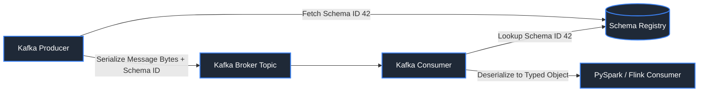

#### Usage / Purpose
- **Event Streaming:** In Kafka pipelines, row-oriented serialization allows individual records to be serialized and transmitted over the wire with zero wasted padding.
- **Schema Evolution:** Fully supports schema evolution (adding optional fields with defaults, backward and forward compatibility).

#### References
- [Apache Avro Documentation](https://avro.apache.org/)
- [GeeksforGeeks: Apache Avro](https://www.geeksforgeeks.org/apache-avro/)
- [DataCamp: Working with Avro and Kafka](https://www.datacamp.com/tutorial/apache-kafka-tutorial)

---

### 1.6 Row-Oriented vs Columnar File Formats Deep-Dive

#### Core Architectural Distinction
- **Row-Oriented (CSV, JSON, Avro):** Contiguous bytes on disk represent entire rows. Inserting or fetching a single complete record is fast ($O(1)$ write).
- **Column-Oriented (Parquet, ORC):** Contiguous bytes on disk represent all values of a single column across thousands of rows. Reading 2 columns out of 50 requires skipping the byte streams of the other 48 columns.

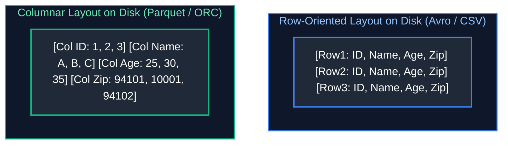

#### When to Choose Which
| Use Case | Recommended Format | Rationale |
| :--- | :--- | :--- |
| **Real-time Event Streaming (Kafka)** | **Avro** | Row-oriented write speed; schema registry validation |
| **Analytical Data Warehousing / BI** | **Parquet / ORC** | Column pruning, min/max data skipping, high compression |
| **Ad-Hoc Data Exchange with Clients** | **CSV** | Universally supported by non-technical software |
| **Web API Logging** | **JSON (NDJSON)** | Native compatibility with browser applications |

#### References
- [GeeksforGeeks: Row vs Column Oriented Storage](https://www.geeksforgeeks.org/columnar-databases/)
- [DataCamp: Big Data File Formats Compared](https://www.datacamp.com/tutorial/data-storage-formats)

---

### 1.7 Compression Codecs

#### Definition
Compression codecs reduce the physical byte footprint of files on storage, directly decreasing cloud storage costs and speeding up network transfer times during distributed scans.

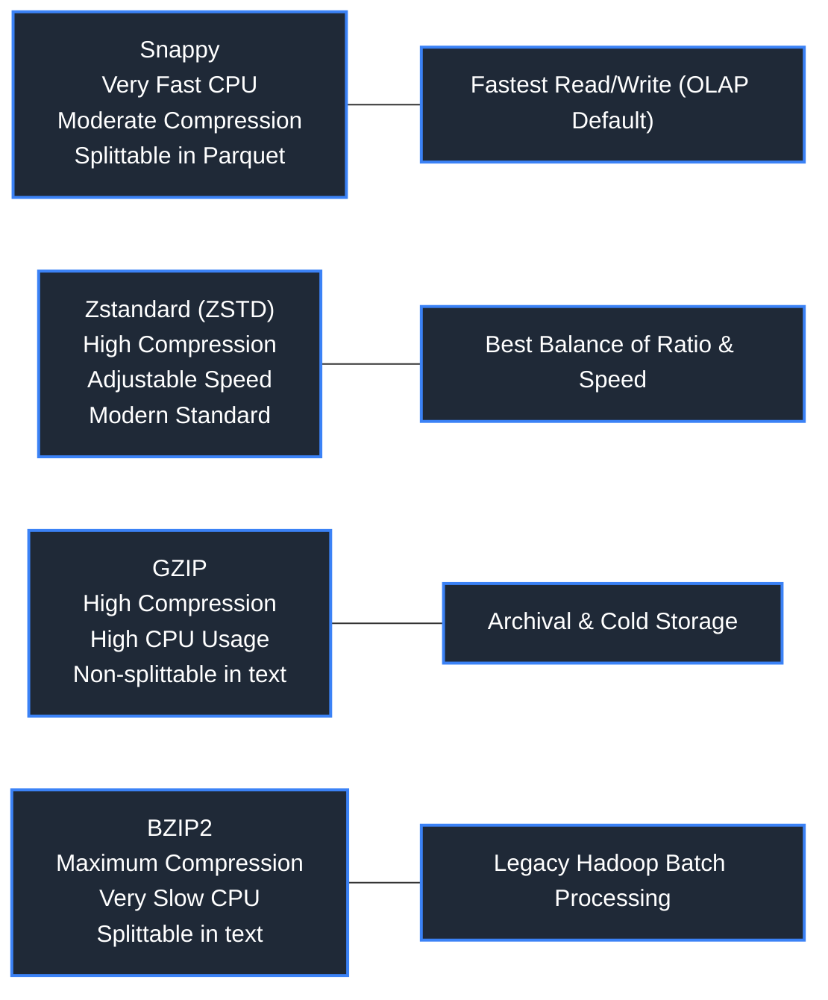

#### Codec Evaluation Matrix
| Codec | Compression Ratio | CPU Overhead (Speed) | Splittable (Raw Text)? | Default Use Case |
| :--- | :--- | :--- | :--- | :--- |
| **Snappy** | Moderate (~2.5x) | Extremely Fast | No (Yes inside Parquet) | Default for Spark & Parquet queries |
| **Zstandard (ZSTD)** | High (~4x) | Fast (Tunable levels 1-22) | No (Yes inside Parquet) | Modern gold standard across BigQuery / Delta |
| **GZIP** | High (~4x) | Medium / High CPU | **NO** (Forces single-core scan) | Web downloads, cold S3 archives |
| **BZIP2** | Very High (~5x) | Very Slow | **YES** | Massive text log archival requiring splittability |

#### References
- [GeeksforGeeks: Data Compression Techniques](https://www.geeksforgeeks.org/data-compression-techniques/)
- [DataCamp: Compression in Big Data Pipelines](https://www.datacamp.com/tutorial/data-storage-formats)

---

# 2. Storage Concepts & Lake Optimization

Cloud storage provides virtually infinite scalability at commodity pricing. However, unlocking high performance requires rigorous partitioning, clustering, and file compaction strategies.

---

### 2.1 Object Storage vs Block Storage vs File Storage

#### Definition
- **Block Storage (AWS EBS, Azure Managed Disks):** Raw storage volumes organized into fixed-sized blocks (e.g., 4KB) with no metadata. Fastest I/O; mounted directly by an operating system as a virtual hard disk. Ideal for transactional database files (Postgres heap).
- **File Storage (AWS EFS, Azure Files, NFS):** Hierarchical file-system structure with directories, subdirectories, and POSIX permissions. Accessible concurrently across multiple virtual machines.
- **Object Storage (AWS S3, Azure Blob/ADLS, GCS):** Flat storage namespace where files (objects) are stored alongside rich metadata and addressed via unique URIs over HTTP/HTTPS REST APIs. Virtually unlimited capacity, but files are immutable (cannot edit in place).

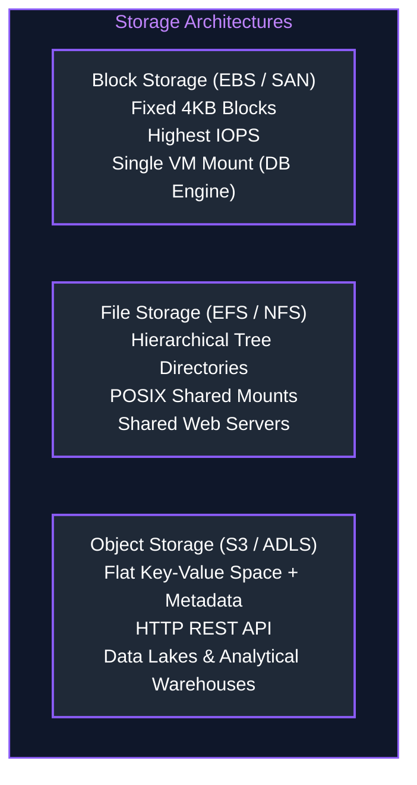

#### References
- [GeeksforGeeks: Difference between Block, Object, and File Storage](https://www.geeksforgeeks.org/difference-between-block-storage-and-file-storage/)
- [AWS Documentation: Types of Cloud Storage](https://aws.amazon.com/what-is/cloud-storage/)

---

### 2.2 Cloud Storage Tiers

#### Definition
Cloud storage providers offer tiered pricing models based on data access frequency, allowing organizations to balance instant availability with storage cost reduction.

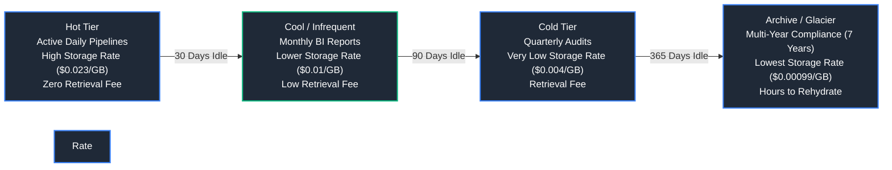

#### References
- [Azure Documentation: Access Tiers for Blob Data](https://learn.microsoft.com/en-us/azure/storage/blobs/access-tiers-overview)
- [DataCamp: Cloud Storage Best Practices](https://www.datacamp.com/tutorial/cloud-storage)

---

### 2.3 Storage Lifecycle Management Policies

#### Definition
Storage lifecycle policies are automated rule-based workflows defined at the cloud bucket level that transition files between access tiers or permanently delete them after specified retention windows.

#### Code Example (JSON Lifecycle Rule for AWS S3)
```json
{
  "Rules": [
    {
      "ID": "MoveOldRawLogsToCold",
      "Status": "Enabled",
      "Filter": { "Prefix": "raw_logs/" },
      "Transitions": [
        { "Days": 30, "StorageClass": "STANDARD_IA" },
        { "Days": 90, "StorageClass": "GLACIER" }
      ],
      "Expiration": { "Days": 2555 }
    }
  ]
}
```

---

### 2.4 Immutability & Write-Once-Read-Many (WORM)

#### Definition
Cloud object storage is inherently **immutable**. You cannot append 10 bytes to the middle of an existing 100MB file on Amazon S3 or Azure Blob storage; any change requires overwriting the entire object.

**WORM (Write Once, Read Many):** Compliance locking (e.g., AWS S3 Object Lock, Azure Immutable Blob Storage) that cryptographically prevents files from being overwritten or deleted for a mandatory legal retention period (e.g., SEC Rule 17a-4 for financial records).

---

### 2.5 Partitioning Strategies & Hive Directory Layout

#### Definition
Partitioning divides massive tables into separate physical subdirectories on object storage based on the distinct values of one or more low-cardinality columns (typically temporal dates or geographic regions).

#### Hive-Style Directory Layout

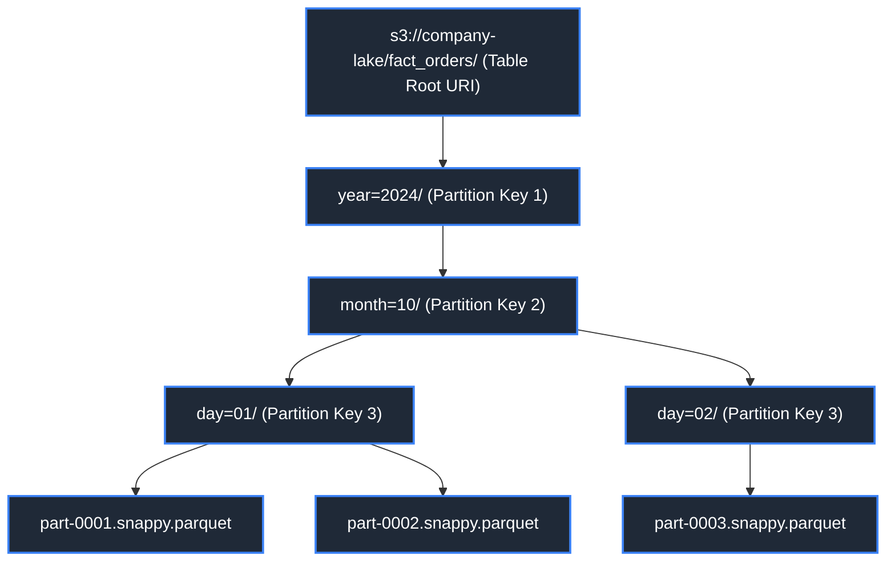

#### Code Example (Partitioned Write in PySpark)
```python
# Writing partitioned Parquet dataset to create physical subdirectories (Hive-style partitioning)
df_events.write \
    .format("parquet") \                                # Persist as columnar Parquet files
    .partitionBy("event_year", "event_month") \        # Generate directory hierarchy: /event_year=YYYY/event_month=MM/
    .mode("append") \                                  # Append new micro-batch or batch partition files
    .save("s3://company-lake/fact_events/")             # Destination cloud object store URI
```

#### Key Points & Common Pitfalls
- **Over-Partitioning Hazard:** Never partition on high-cardinality keys (such as `user_id`, `order_id`, or fine-grained timestamps). Partitioning a table with 1,000,000 users creates 1,000,000 distinct directories containing tiny 2KB files, which destroys query performance.

#### References
- [GeeksforGeeks: Hive Partitioning](https://www.geeksforgeeks.org/partitioning-in-hive/)
- [Databricks Documentation: Partitioning Best Practices](https://docs.databricks.com/en/tables/partitions.html)

---

### 2.6 Bucketing & Clustering

#### Definition
- **Bucketing:** Hash-partitioning data within a directory into a fixed number of predetermined files (buckets) based on the hash value of a high-cardinality join column (e.g., `user_id`).
- **Clustering (Z-Ordering / Liquid Clustering):** Multidimensional sorting that colocates related information along multiple column curves to maximize data skipping during queries.

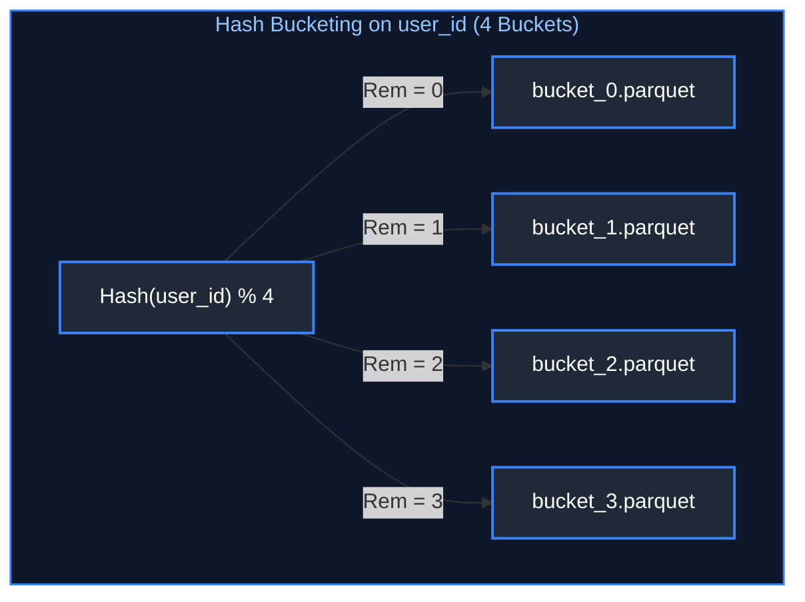

#### Usage / Purpose
When two large tables are bucketed on the same join key with the same number of buckets, engines like Spark perform a **Bucket-Map-Join**, completely eliminating network data shuffling.

#### References
- [GeeksforGeeks: Bucketing in Hive](https://www.geeksforgeeks.org/bucketing-in-hive/)
- [Databricks Documentation: Liquid Clustering](https://docs.databricks.com/en/delta/clustering.html)

---

### 2.7 The Small File Problem

#### Definition
The "Small File Problem" occurs when streaming ingestion pipelines or distributed jobs write millions of tiny files (kilobytes in size) into a data lake instead of optimal analytical file sizes (128MB to 1GB).

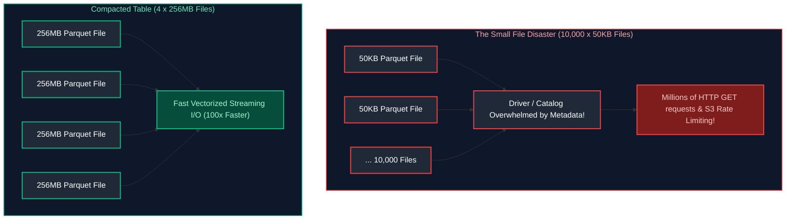

#### Negative Impacts
1. **Metadata Overhead:** Distributed drivers spend 90% of query time requesting file listings from cloud storage REST APIs.
2. **Loss of Compression:** Compression codecs and dictionary encodings cannot achieve meaningful ratios on 50KB files.
3. **HTTP 503 Throttling:** Cloud object stores throttle clients exceeding API request limits per prefix (e.g., 3,500 PUT/POST requests/sec in S3).

#### References
- [Databricks: Overcoming the Small File Problem](https://www.databricks.com/blog/2022/02/07/how-to-solve-the-small-file-problem-in-apache-spark.html)
- [GeeksforGeeks: Small File Problem in Hadoop](https://www.geeksforgeeks.org/hadoop-small-files-problem/)

---

### 2.8 File Compaction & Bin-Packing Techniques

#### Definition
File Compaction is the periodic maintenance process of reading hundreds of small files and rewriting them into a smaller number of consolidated, optimally sized files (typically 256MB to 1GB) without altering table data.

```sql
-- Delta Lake / Databricks bin-packing compaction and multidimensional multidimensional clustering
-- Coalesces small Parquet files into ~1GB uniform files and clusters data along Space-Filling Curves
OPTIMIZE delta_lake.fact_orders 
ZORDER BY (customer_id, order_date); -- Maximizes min/max data skipping for queries filtering on customer & date
```

```python
# PySpark Compaction Pattern using coalesce (Single-stage partition reduction)
# Step 1: Read raw partitioned directory fragmented into 5,000 tiny ~50KB files
df_tiny = spark.read.parquet("s3://lake/events_raw/")

# Step 2: Coalesce merges existing partitions locally on executors without triggering an all-to-all network shuffle
# Reduces 5,000 fragmented input tasks down to exactly 10 output file streams
df_compacted = df_tiny.coalesce(10)

# Step 3: Write out consolidated files (~10 uniform ~256MB Parquet files with fresh footer statistics)
df_compacted.write \
    .mode("overwrite") \                               # Replace target directory atomically
    .parquet("s3://lake/events_compacted/")             # Persist to compacted destination path
```

#### References
- [Databricks Documentation: OPTIMIZE Command](https://docs.databricks.com/en/sql/language-manual/delta-optimize.html)
- [Apache Iceberg Documentation: Compaction](https://iceberg.apache.org/docs/latest/maintenance/#compact-data-files)

---

# 3. Azure Storage & ADLS Gen2 Architecture

Azure Data Lake Storage Gen2 (ADLS Gen2) is Microsoft's core cloud-scale data repository for enterprise big data analytics and AI pipelines, combining the low cost of Blob Storage with enterprise file-system semantics.

---

### 3.1 ADLS Gen2 (Azure Data Lake Storage Gen2)

#### Definition
ADLS Gen2 is built directly on Azure Blob Storage foundation. It infuses Blob Storage with **Hierarchical Namespace (HNS)** capabilities, multi-protocol access (ABFS driver for Hadoop/Spark and HTTP REST API for web apps), and fine-grained POSIX-compliant Access Control Lists (ACLs).

```mermaid
flowchart TD
    subgraph ADLSGen2Core ["Azure Data Lake Storage Gen2 Architecture"]
        Apps["Analytical Engines: Azure Synapse, Databricks, HDInsight, PowerBI"]
        
        subgraph DriverLayer ["Data Access Protocol Layer"]
            ABFS["ABFS Driver (Azure Blob File System - abfss://)"]
            REST["Blob REST APIs (HTTP / HTTPS)"]
        end

        subgraph CoreFeatures ["ADLS Gen2 Core Capabilities"]
            HNS["Hierarchical Namespace (True Directory Trees & POSIX ACLs)"]
            Sec["Azure Active Directory (Microsoft Entra ID) + RBAC"]
            Tiers["Tiered Storage (Hot, Cool, Cold, Archive)"]
        end

        Apps --> DriverLayer
        DriverLayer --> CoreFeatures
    end

    style ADLSGen2Core fill:#0f172a,stroke:#334155,stroke-width:1.5px,color:#94a3b8
    style DriverLayer fill:#1e293b,stroke:#3b82f6,stroke-width:1.5px,color:#93c5fd
    style CoreFeatures fill:#1e293b,stroke:#10b981,stroke-width:1.5px,color:#86efac

    style Apps fill:#182234,stroke:#06b6d4,stroke-width:1.5px,color:#fff
    style ABFS fill:#182234,stroke:#3b82f6,stroke-width:1.5px,color:#fff
    style REST fill:#182234,stroke:#3b82f6,stroke-width:1.5px,color:#fff
    style HNS fill:#182234,stroke:#10b981,stroke-width:1.5px,color:#fff
    style Sec fill:#182234,stroke:#10b981,stroke-width:1.5px,color:#fff
    style Tiers fill:#182234,stroke:#10b981,stroke-width:1.5px,color:#fff
```

#### URI Scheme in Spark
Data in ADLS Gen2 is accessed using the optimized Azure Blob File System driver URI:
`abfss://<container-name>@<storage-account-name>.dfs.core.windows.net/<path>`

#### References
- [Microsoft Learn: Introduction to Azure Data Lake Storage Gen2](https://learn.microsoft.com/en-us/azure/storage/blobs/data-lake-storage-introduction)
- [GeeksforGeeks: Azure Data Lake Storage](https://www.geeksforgeeks.org/azure-data-lake-storage/)

---

### 3.2 Hierarchical Namespace (HNS) vs Flat Blob Storage

#### Definition
- **Flat Blob Storage:** Has no concept of real directories. Folders are merely virtual strings embedded in the blob name (e.g., blob named `"orders/2024/batch1.parquet"`). Renaming or moving a directory requires downloading, copying, and deleting every single file in the hierarchy ($O(N)$ operations).
- **Hierarchical Namespace (HNS):** Implements a true tree-structured file system directly within object storage. Directories are real metadata objects. Renaming a directory is an instant, atomic metadata pointer change ($O(1)$ time complexity).

```mermaid
flowchart TD
    subgraph FlatBlobRename ["Flat Blob: Rename Directory /stage/ to /prod/ (10,000 files)"]
        F1["Copy file 1..."] --> F2["Copy file 2..."] --> FN["Copy file 10,000..."]
        FN --> Del["Delete old 10,000 files!"]
        Del --> Slow["O(N) Complexity: Takes 45 Minutes & High Network I/O!"]
    end

    subgraph HNSRename ["ADLS Gen2 HNS: Atomic Directory Rename"]
        Pointer["Change Pointer /stage/ -> /prod/"] --> Instant["O(1) Complexity: Completed in 20 Milliseconds!"]
    end

    style FlatBlobRename fill:#0f172a,stroke:#ef4444,stroke-width:1.5px,color:#fca5a5
    style HNSRename fill:#0f172a,stroke:#10b981,stroke-width:1.5px,color:#6ee7b7

    style F1 fill:#1f2937,stroke:#ef4444,stroke-width:2px,color:#fff
    style F2 fill:#1f2937,stroke:#ef4444,stroke-width:2px,color:#fff
    style FN fill:#1f2937,stroke:#ef4444,stroke-width:2px,color:#fff
    style Del fill:#1f2937,stroke:#ef4444,stroke-width:2px,color:#fff
    style Slow fill:#7f1d1d,stroke:#ef4444,stroke-width:2px,color:#fecaca
    style Pointer fill:#1f2937,stroke:#10b981,stroke-width:2px,color:#fff
    style Instant fill:#064e3b,stroke:#10b981,stroke-width:2px,color:#a7f3d0
```

#### Why HNS is Vital for Big Data (Spark / Hadoop)
Distributed write jobs write data into temporary `_temporary` staging folders and perform a directory rename to commit transactions. On flat blob storage, job completion hangs for hours during directory renames. With HNS enabled, atomic directory renames complete instantly.

#### References
- [Microsoft Learn: Hierarchical Namespace in ADLS Gen2](https://learn.microsoft.com/en-us/azure/storage/blobs/data-lake-storage-namespace)
- [DataCamp: Azure Storage Explained](https://www.datacamp.com/tutorial/azure-storage)

---

### 3.3 Azure Blob Storage

#### Definition
Azure Blob Storage is Microsoft's object storage solution for storing massive amounts of unstructured data. It provides three specialized blob types:
1. **Block Blobs:** Composed of blocks (up to 4,000 blocks per blob, up to 190.7 TB total). Ideal for streaming large analytical files (Parquet, CSV, videos, backups).
2. **Append Blobs:** Optimized for append-only operations where new blocks are committed directly to the end of the blob. Ideal for real-time virtual machine and application logging.
3. **Page Blobs:** Collection of 512-byte pages optimized for random read and write operations. Serves as the underlying storage for Azure Virtual Machine VHD disks.

#### References
- [Microsoft Learn: Understanding Block, Append, and Page Blobs](https://learn.microsoft.com/en-us/azure/storage/blobs/storage-blobs-introduction)
- [GeeksforGeeks: Azure Blob Storage](https://www.geeksforgeeks.org/azure-blob-storage/)

---

### 3.4 Azure Access Tiers

#### Definition
ADLS Gen2 inherits Azure Blob access tiers to minimize long-term storage spend:
- **Hot Tier:** Highest storage cost, lowest access/transaction cost. For active pipelines.
- **Cool Tier:** Lower storage cost, higher transaction cost. For data accessed at least once every 30 days.
- **Cold Tier:** 60-day minimum retention. For infrequently accessed datasets.
- **Archive Tier:** Offline tier with the lowest storage rate ($0.00099/GB/month). Data must be rehydrated (taking up to 15 hours) before it can be read.

#### References
- [Microsoft Learn: Blob Storage Access Tiers](https://learn.microsoft.com/en-us/azure/storage/blobs/access-tiers-overview)
- [DataCamp: Managing Cloud Storage Costs](https://www.datacamp.com/tutorial/cloud-storage)

---

### 3.5 Shared Access Signatures (SAS Tokens)

#### Definition
A Shared Access Signature (SAS) is a secure signed URI that grants restricted, delegated access to Azure Storage resources without exposing your master account storage keys.

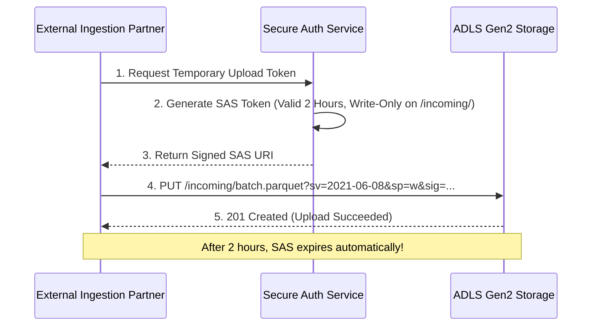

#### Types of SAS
- **Service SAS:** Grants access to a specific resource (blob, directory, container).
- **Account SAS:** Grants access to one or more storage account services (Blobs, Queues, Tables).
- **User Delegation SAS:** Secured with Microsoft Entra ID (Azure AD) credentials rather than storage account keys (Best Security Practice).

#### Code Example (Generating a User Delegation SAS in Python)
```python
from datetime import datetime, timedelta
from azure.identity import DefaultAzureCredential
from azure.storage.blob import BlobServiceClient, generate_blob_sas, BlobSasPermissions

# Authenticate securely using Azure Entra ID credentials (no hardcoded master storage account keys!)
credential = DefaultAzureCredential()

# Establish client connection to Azure Data Lake Storage Gen2 account
blob_service_client = BlobServiceClient(
    account_url="https://datalakeprod.blob.core.windows.net", 
    credential=credential
)

# Request User Delegation Key from Microsoft Entra ID (valid for 1 hour window)
# This cryptographically ties the SAS token to the user identity and Entra ID RBAC role
user_delegation_key = blob_service_client.get_user_delegation_key(
    key_start_time=datetime.utcnow(),
    key_expiry_time=datetime.utcnow() + timedelta(hours=1)
)

# Mint a finely-scoped, time-limited Shared Access Signature (SAS) token
sas_token = generate_blob_sas(
    account_name="datalakeprod",
    container_name="raw-zone",
    blob_name="daily_feed.parquet",
    user_delegation_key=user_delegation_key,     # Signed with Entra ID user delegation key
    permission=BlobSasPermissions(read=True),     # Principle of least privilege: READ ONLY permission
    expiry=datetime.utcnow() + timedelta(hours=1) # Automatic hard revocation after 60 minutes
)

# Construct fully-qualified authenticated URI for client consumption
print(f"SAS URL: https://datalakeprod.blob.core.windows.net/raw-zone/daily_feed.parquet?{sas_token}")
```

#### References
- [Microsoft Learn: Delegate access with Shared Access Signatures](https://learn.microsoft.com/en-us/azure/storage/common/storage-sas-overview)
- [GeeksforGeeks: Shared Access Signatures in Azure](https://www.geeksforgeeks.org/azure-shared-access-signature-sas/)

---

### 3.6 Azure Managed Identity

#### Definition
Azure Managed Identity provides Microsoft Entra ID (Azure AD) identities for Azure cloud services (Azure Databricks, Azure Data Factory, Synapse, VMs). It completely eliminates the need for developers to manage or store credentials, passwords, or API keys in configuration files or code.

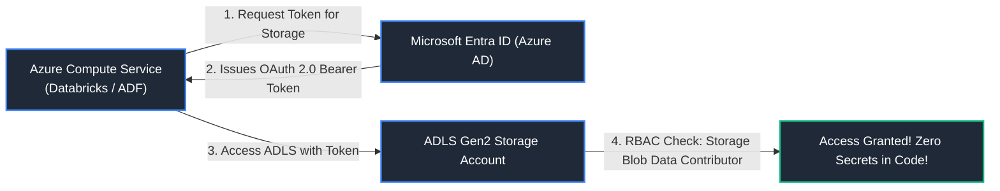

#### Types of Managed Identities
- **System-Assigned:** Tied directly to the lifecycle of a specific Azure resource instance. If the service is deleted, Azure automatically cleans up the identity.
- **User-Assigned:** Created as an independent Azure resource that can be shared across multiple compute nodes or services.

#### References
- [Microsoft Learn: What are Managed Identities for Azure Resources?](https://learn.microsoft.com/en-us/azure/active-directory/managed-identities-azure-resources/overview)
- [GeeksforGeeks: Managed Identity in Azure](https://www.geeksforgeeks.org/managed-identity-in-azure/)

---

### 3.7 Private Endpoints & Virtual Network Isolation

#### Definition
A Private Endpoint is a network interface that assigns a private IP address from your Virtual Network (VNet) directly to the Azure Storage service. 

#### Security Value
It routes all data lake traffic privately through the Microsoft Azure backbone network, completely disabling access over the public internet and preventing DNS spoofing and data exfiltration.

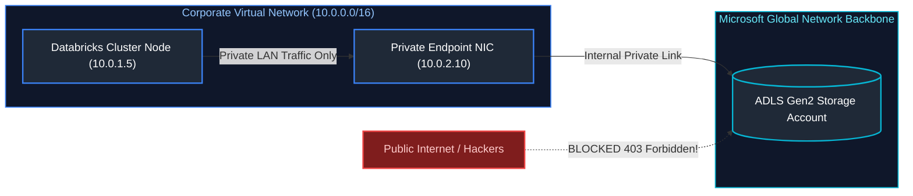

#### References
- [Microsoft Learn: Use Private Endpoints for Azure Storage](https://learn.microsoft.com/en-us/azure/storage/common/storage-private-endpoints)
- [GeeksforGeeks: Azure Virtual Network (VNet)](https://www.geeksforgeeks.org/azure-virtual-network/)

---
