# 10. Data Pipeline Design & Ingestion

A comprehensive, production-grade guide to enterprise data pipeline design (ETL vs. ELT vs. Reverse ETL, batch vs. streaming, idempotency, backfilling, error recovery), data quality frameworks, and modern ingestion architectures (Auto Loader, Log-Based CDC, Partitioned JDBC, and REST API ingestion).

---

## Architectural Overview: End-to-End Enterprise Ingestion & Processing

```mermaid
flowchart LR
    subgraph DataSources ["Data Sources"]
        S1[("OLTP Database<br/>Postgres / MySQL / Oracle")]
        S2["Cloud Storage<br/>S3 / ADLS / GCS (JSON/Parquet/CSV)"]
        S3["Third-Party SaaS<br/>REST APIs / Webhooks"]
        S4["IoT & Event Streams<br/>Telemetry / Clickstreams"]
    end

    subgraph IngestionLayer ["Ingestion Layer"]
        Debezium["Log-Based CDC<br/>(Debezium / Kafka Connect)"]
        AutoLoader["Cloud File Ingestion<br/>(Auto Loader / Snowpipe)"]
        APIPull["Resilient API Ingestion<br/>(Backoff + Cursor Pagination)"]
        EventGateway["Event Streaming Gateway<br/>(Kafka / Event Hubs)"]
        
        S1 --> Debezium
        S2 --> AutoLoader
        S3 --> APIPull
        S4 --> EventGateway
    end

    subgraph BufferLayer ["Streaming & Buffer Layer"]
        KafkaTopic[("Kafka / Event Hubs<br/>Raw Ingestion Topic")]
        Debezium --> KafkaTopic
        EventGateway --> KafkaTopic
    end

    subgraph ProcessingLayer ["Processing, Quality & Lakehouse"]
        SparkStream["Spark Structured Streaming / Flink"]
        KafkaTopic --> SparkStream
        AutoLoader --> SparkStream
        APIPull --> SparkStream
        
        QualityCheck{"Data Contract &<br/>Quality Gate"}
        SparkStream --> QualityCheck
        
        QualityCheck -- Clean Records --> Bronze[("Bronze Delta / Iceberg<br/>(Raw Append Log)")]
        QualityCheck -- Corrupt / Poison Records --> DLQ[("Dead Letter Queue (DLQ)<br/>/ Quarantine Table")]
        
        Bronze --> SilverTransform["Silver Cleaning &<br/>Deduplication Engine"]
        SilverTransform --> Silver[("Silver Delta / Iceberg<br/>(Enriched / Conform)")]
        Silver --> GoldTransform["Gold Aggregations &<br/>Dimensional Modeling"]
        GoldTransform --> Gold[("Gold Presentation Layer<br/>(Star Schema / Marts)")]
    end

    subgraph OperationalLayer ["Reverse ETL & Serving"]
        RevETL["Reverse ETL Sync<br/>(Census / Hightouch / Custom)"]
        Gold --> RevETL
        RevETL --> CRM["SaaS Tools<br/>(Salesforce / HubSpot / Zendesk)"]
        Gold --> BI["BI Dashboards<br/>(Tableau / Power BI)"]
    end

    style DataSources fill:#0f172a,stroke:#3b82f6,stroke-width:1.5px,color:#93c5fd
    style IngestionLayer fill:#0f172a,stroke:#8b5cf6,stroke-width:1.5px,color:#c084fc
    style BufferLayer fill:#0f172a,stroke:#f59e0b,stroke-width:1.5px,color:#fde68a
    style ProcessingLayer fill:#0f172a,stroke:#10b981,stroke-width:1.5px,color:#6ee7b7
    style OperationalLayer fill:#0f172a,stroke:#ec4899,stroke-width:1.5px,color:#fbcfe8

    style S1 fill:#1f2937,stroke:#3b82f6,stroke-width:2px,color:#fff
    style S2 fill:#1f2937,stroke:#3b82f6,stroke-width:2px,color:#fff
    style S3 fill:#1f2937,stroke:#3b82f6,stroke-width:2px,color:#fff
    style S4 fill:#1f2937,stroke:#3b82f6,stroke-width:2px,color:#fff
    style Debezium fill:#1f2937,stroke:#8b5cf6,stroke-width:2px,color:#fff
    style AutoLoader fill:#1f2937,stroke:#8b5cf6,stroke-width:2px,color:#fff
    style APIPull fill:#1f2937,stroke:#8b5cf6,stroke-width:2px,color:#fff
    style EventGateway fill:#1f2937,stroke:#8b5cf6,stroke-width:2px,color:#fff
    style KafkaTopic fill:#1f2937,stroke:#f59e0b,stroke-width:2px,color:#fff
    style SparkStream fill:#1f2937,stroke:#10b981,stroke-width:2px,color:#fff
    style QualityCheck fill:#1f2937,stroke:#10b981,stroke-width:2px,color:#fff
    style Bronze fill:#1f2937,stroke:#10b981,stroke-width:2px,color:#fff
    style SilverTransform fill:#1f2937,stroke:#10b981,stroke-width:2px,color:#fff
    style Silver fill:#1f2937,stroke:#10b981,stroke-width:2px,color:#fff
    style GoldTransform fill:#1f2937,stroke:#10b981,stroke-width:2px,color:#fff
    style Gold fill:#1f2937,stroke:#10b981,stroke-width:2px,color:#fff
    style DLQ fill:#7f1d1d,stroke:#ef4444,stroke-width:2px,color:#fecaca
    style RevETL fill:#1f2937,stroke:#ec4899,stroke-width:2px,color:#fff
    style CRM fill:#1f2937,stroke:#ec4899,stroke-width:2px,color:#fff
    style BI fill:#1f2937,stroke:#ec4899,stroke-width:2px,color:#fff
```

---

## Table of Contents
1. [ETL vs. ELT & Processing Paradigms](#1-etl-vs-elt--processing-paradigms)
   - [1.1 ETL vs. ELT Architecture & Processing Paradigms](#11-etl-vs-elt-architecture--processing-paradigms)
   - [1.2 Reverse ETL: Operationalizing Data](#12-reverse-etl-operationalizing-data)
   - [1.3 Batch vs. Streaming Processing Paradigms](#13-batch-vs-streaming-processing-paradigms)
   - [1.4 Push vs. Pull Ingestion Architecture](#14-push-vs-pull-ingestion-architecture)
   - [1.5 Micro-Batching Mechanics & Execution Internals](#15-micro-batching-mechanics--execution-internals)
2. [Resilient Pipeline Design Patterns](#2-resilient-pipeline-design-patterns)
   - [2.1 Pipeline Idempotency: The Gold Standard](#21-pipeline-idempotency-the-gold-standard)
   - [2.2 Fault Tolerance, Failover & Self-Healing](#22-fault-tolerance-failover--self-healing)
   - [2.3 Checkpointing & Streaming State Stores](#23-checkpointing--streaming-state-stores)
   - [2.4 Backpressure Management & Dynamic Rate Limiting](#24-backpressure-management--dynamic-rate-limiting)
   - [2.5 Replayability & Event Re-Sourcing](#25-replayability--event-re-sourcing)
   - [2.6 Deduplication Patterns (At-Least-Once to Exactly-Once)](#26-deduplication-patterns-at-least-once-to-exactly-once)
   - [2.7 Late-Arriving & Out-of-Order Data Handling](#27-late-arriving--out-of-order-data-handling)
   - [2.8 Watermarking Mechanics & State Eviction](#28-watermarking-mechanics--state-eviction)
   - [2.9 Dead Letter Queues (DLQ) & Quarantine Routing](#29-dead-letter-queues-dlq--quarantine-routing)
   - [2.10 Bad Records Handling & Engine Permissive Modes](#210-bad-records-handling--engine-permissive-modes)
   - [2.11 Schema Validation & Defensive Ingestion](#211-schema-validation--defensive-ingestion)
   - [2.12 Pipeline Observability: Metrics, Logs & Traces](#212-pipeline-observability-metrics-logs--traces)
   - [2.13 SLA Management, SLOs & Alert Thresholds](#213-sla-management-slos--alert-thresholds)
   - [2.14 Historical Backfilling Strategies](#214-historical-backfilling-strategies)
   - [2.15 Metadata-Driven Pipelines & Control Table Framework](#215-metadata-driven-pipelines--control-table-framework)
3. [Data Quality, Contracts & Governance](#3-data-quality-contracts--governance)
   - [3.1 Data Contracts: Shift-Left Governance](#31-data-contracts-shift-left-governance)
   - [3.2 Great Expectations (GX) Framework](#32-great-expectations-gx-framework)
   - [3.3 Soda Core & Declarative Data Checks](#33-soda-core--declarative-data-checks)
   - [3.4 Apache Spark Deequ (PyDeequ) for Big Data Quality](#34-apache-spark-deequ-pydeequ-for-big-data-quality)
   - [3.5 dbt Test Assertions (Generic & Custom)](#35-dbt-test-assertions-generic--custom)
   - [3.6 Automated Schema Drift Detection](#36-automated-schema-drift-detection)
   - [3.7 Statistical Anomaly Detection in Ingestion Volumes](#37-statistical-anomaly-detection-in-ingestion-volumes)
4. [File-Based Cloud Ingestion Architectures](#4-file-based-cloud-ingestion-architectures)
   - [4.1 Batch File Ingestion vs. Incremental File Processing](#41-batch-file-ingestion-vs-incremental-file-processing)
   - [4.2 Databricks Auto Loader (`cloudFiles`) Internals](#42-databricks-auto-loader-cloudfiles-internals)
   - [4.3 SQL `COPY INTO` (Databricks & Snowflake)](#43-sql-copy-into-databricks--snowflake)
   - [4.4 Snowflake Snowpipe Serverless Ingestion](#44-snowflake-snowpipe-serverless-ingestion)
   - [4.5 Google Cloud BigQuery Load Jobs](#45-google-cloud-bigquery-load-jobs)
   - [4.6 Directory Listing ($O(N)$) vs. Notification-Based Ingestion ($O(1)$)](#46-directory-listing-on-vs-notification-based-ingestion-o1)
   - [4.7 Checkpoint State Tracking for File Streams](#47-checkpoint-state-tracking-for-file-streams)
   - [4.8 Automated Schema Inference & Evolution Policies](#48-automated-schema-inference--evolution-policies)
5. [Change Data Capture (CDC) Patterns](#5-change-data-capture-cdc-patterns)
   - [5.1 Log-Based CDC (Debezium & Kafka Connect)](#51-log-based-cdc-debezium--kafka-connect)
   - [5.2 Query-Based CDC (High-Watermarks & `updated_at`)](#52-query-based-cdc-high-watermarks--updated_at)
   - [5.3 Trigger-Based CDC (Shadow Audit Tables)](#53-trigger-based-cdc-shadow-audit-tables)
6. [Relational Database Ingestion (RDBMS to Lakehouse)](#6-relational-database-ingestion-rdbms-to-lakehouse)
   - [6.1 JDBC & ODBC Extraction Fundamentals](#61-jdbc--odbc-extraction-fundamentals)
   - [6.2 High-Throughput Partitioned JDBC Reads in PySpark](#62-high-throughput-partitioned-jdbc-reads-in-pyspark)
7. [API Ingestion Patterns](#7-api-ingestion-patterns)
   - [7.1 API Pagination Strategies (Offset vs. Page vs. Keyset Cursor)](#71-api-pagination-strategies-offset-vs-page-vs-keyset-cursor)
   - [7.2 Rate Limiting: Exponential Backoff with Full Jitter](#72-rate-limiting-exponential-backoff-with-full-jitter)
   - [7.3 Production API Authentication (OAuth 2.0 Client Credentials)](#73-production-api-authentication-oauth-20-client-credentials)
8. [Streaming Message Ingestion](#8-streaming-message-ingestion)
   - [8.1 Apache Kafka to Lakehouse Streaming Ingestion](#81-apache-kafka-to-lakehouse-streaming-ingestion)
   - [8.2 Azure Event Hubs to Lakehouse Ingestion](#82-azure-event-hubs-to-lakehouse-ingestion)
9. [Production Data Engineering Problem-Solution Master Playbook](#9-production-data-engineering-problem-solution-master-playbook)
10. [Production Pipeline Engineering Summary & Operational Governance](#10-production-pipeline-engineering-summary--operational-governance)
11. [References & Further Reading](#11-references--further-reading)

---

# 1. ETL vs. ELT & Processing Paradigms

---

### 1.1 ETL vs. ELT Architecture & Processing Paradigms

#### Intuitive Mental Model
- **Traditional ETL is like a Centralized Catering Kitchen:** Raw ingredients (dirty vegetables, unbutchered meats) are trucked from farms (source databases) to a specialized prep kitchen (an expensive, standalone ETL server like Informatica or a dedicated Spark cluster). In that kitchen, cooks wash, chop, peel, and cook the food. Finally, only finished, plated meals are delivered to the banquet hall (the target data warehouse). If an executive at the banquet hall asks, *"Can I see the vegetable peels or cook the carrots differently?"*, you cannot help them—the peels were discarded at the kitchen.
- **Modern ELT is like a Cook-at-Your-Table Korean BBQ / Hot Pot:** Raw ingredients are brought directly from the market to your table (raw storage / Bronze data lake). The table is equipped with its own powerful, high-heat induction burner (modern elastic cloud compute like Snowflake, BigQuery, or Databricks). Diners cook and season the food right on the table whenever and however they want. If someone wants raw greens later, they are still right there on the table.

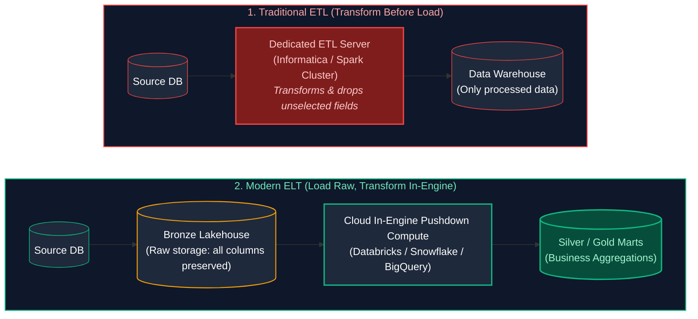

#### End-to-End Concrete Data Walkthrough

To understand the difference mathematically and structurally, observe how a single customer record flows through ETL vs. ELT:

**1. Source Payload (OLTP PostgreSQL `users` table):**
```json
{
  "user_id": 9182,
  "full_name": "Dr. Sarah Connor",
  "email": "sconnor@resistance.mil",
  "raw_address": "8404 Skynet Way, Suite 400, Los Angeles, CA 90210",
  "ssn": "987-65-4321",
  "created_at": "2026-03-15 08:30:00+00"
}
```

**2. Traditional ETL Execution:**
1. **Extract:** An external ETL worker reads the record into memory.
2. **Transform:** 
   - Mask SSN: `ssn` $\to$ `***-**-4321`.
   - Parse name: `first_name = 'Sarah'`, `last_name = 'Connor'`.
   - Discard `raw_address` because the original 2015 warehouse schema only wanted city/state.
3. **Load:** Writes clean record to the warehouse:
   ```sql
   INSERT INTO dw.dim_users (user_id, first_name, last_name, email, city, state)
   VALUES (9182, 'Sarah', 'Connor', 'sconnor@resistance.mil', 'Los Angeles', 'CA');
   ```
   *Consequence:* If business requirements change 6 months later to extract `suite_number` or postal zip from `raw_address`, it is **impossible**. The raw address was permanently thrown away before loading.

**3. Modern ELT Execution:**
1. **Extract & Load:** Ingestion pipeline writes the exact JSON payload to Bronze Delta Lake unmodified:
   ```sql
   -- Bronze Table: bronze_users
   -- Stored with ingestion metadata
   | _ingest_ts | _source_file | raw_payload |
   | 2026-03-15 08:31:02 | s3://.../part0.json | {"user_id":9182, "full_name":"Dr. Sarah Connor", "ssn":"987-65-4321", ...} |
   ```
2. **Transform (In-Lakehouse SQL Pushdown via dbt/Dataform):**
   ```sql
   -- Silver Transformation
   CREATE OR REPLACE TABLE silver.dim_users AS
   SELECT 
       CAST(JSON_VALUE(raw_payload, '$.user_id') AS INT64) AS user_id,
       SPLIT(JSON_VALUE(raw_payload, '$.full_name'), ' ')[OFFSET(1)] AS first_name,
       SPLIT(JSON_VALUE(raw_payload, '$.full_name'), ' ')[OFFSET(2)] AS last_name,
       SHA256(JSON_VALUE(raw_payload, '$.ssn')) AS ssn_masked_hash,
       REGEXP_EXTRACT(JSON_VALUE(raw_payload, '$.raw_address'), r'(\d{5})') AS postal_code,
       _ingest_ts
   FROM bronze.bronze_users;
   ```
   *Consequence:* The raw payload is permanently archived in Bronze. If a new column is required later, you simply alter the SQL query and reprocess from Bronze.

#### Comprehensive Paradigm Comparison Matrix

| Architectural Trait | Traditional ETL | Modern ELT |
| :--- | :--- | :--- |
| **Compute Location** | Standalone middleware server (Informatica, Talend, Airflow worker) | Distributed SQL engine within target warehouse/lakehouse (Snowflake, BigQuery, Databricks) |
| **Raw Data Retention** | **Lost forever:** Unmapped fields are filtered out during transformation | **100% Preserved:** Landed in Bronze object storage (S3/ADLS/GCS) |
| **Transformation Language** | Proprietary GUI workflows, Java, C++, custom Python scripts | Standard declarative SQL, dbt, Dataform, or PySpark DataFrame API |
| **Pipeline Scalability** | **Hardware bottleneck:** Limited by memory and CPU of the intermediate ETL server | **Virtually Infinite:** Scales elastically with cloud warehouse MPP clustering |
| **Time-to-Value for New Fields** | Weeks: Upstream ETL pipeline code must be modified, tested, and redeployed | Hours: Analysts write a new `SELECT` expression on landed Bronze data |
| **Regulatory & Security Fit** | **Superior for strict PII:** Sensitive fields (SSN, credit card) can be anonymized before leaving secure network | Requires Lakehouse-level security (RBAC, column-masking, envelope encryption) |
| **Cost Profile** | High licensing fees for specialized ETL software + separate compute infra | Consolidates compute and storage costs inside the cloud data platform |

---

### 1.2 Reverse ETL: Operationalizing Data

#### Definition & Business Motivation
While traditional ETL/ELT flows data from operational applications (CRMs, ERPs, transactional databases) into an analytical data warehouse, **Reverse ETL** reverses the vector: it synchronizes modeled dimensions, aggregated metrics, and machine learning inferences from the warehouse *back into operational SaaS tools* (Salesforce, HubSpot, Zendesk, Marketo, Stripe).

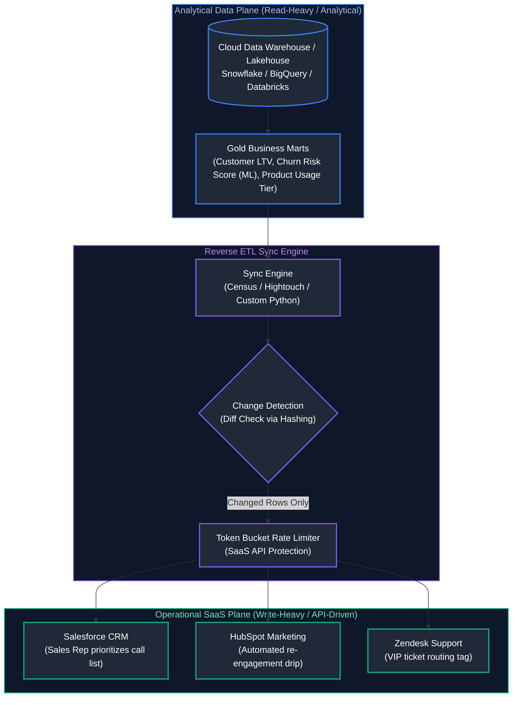

#### Technical Challenges in Reverse ETL
1. **API Rate Limiting:** Operational SaaS systems enforce strict API quotas (e.g., Salesforce limits organizations to 100,000 API calls per 24 hours). Syncing a 10-million-row warehouse table naively via `PUT /api/v1/customers` will exhaust API credits in minutes.
2. **State & Diff Tracking:** Reverse ETL engines must maintain state tables or compute MD5/SHA256 row hashes to identify *only records whose attributes changed* since the last sync.
3. **Idempotency & Partial Failure:** If a network blip occurs during an API sync batch of 1,000 records, the engine must safely retry without triggering duplicate webhooks or corrupting customer history.

---

### 1.3 Batch vs. Streaming Processing Paradigms

Data processing architectures fall into two primary spectrums depending on the nature of the data boundary: **Bounded Data (Batch)** and **Unbounded Data (Streaming)**.

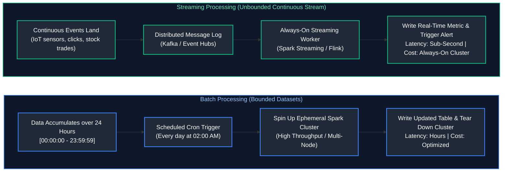

#### Detailed Trade-Off Matrix: The Latency-Completeness-Cost Triangle

| Dimension | Batch Processing | Streaming Processing |
| :--- | :--- | :--- |
| **Dataset Boundary** | **Bounded:** Definite start and end point (e.g., partition `date = '2026-03-15'`). | **Unbounded:** Infinite stream of incoming records with no inherent end. |
| **Processing Latency** | Minutes to hours or days (scheduled intervals). | Milliseconds (Flink, continuous Spark) to seconds (micro-batching). |
| **Data Completeness Guarantee** | High: Easy to wait until all daily files have arrived before triggering. | Complex: Late-arriving events require watermarking and state management. |
| **Infrastructure Cost** | **Economical:** Compute is spun up on-demand and terminated upon job completion. | **Higher:** Requires persistent message brokers (Kafka) and 24/7 worker compute. |
| **Compute Engine Standards** | Spark Batch, Trino, Snowflake, BigQuery, dbt, AWS Glue. | Apache Flink, Spark Structured Streaming, Kafka Streams, Materialize. |
| **Canonical Enterprise Use Cases** | End-of-month financial reconciliation, ML model retraining, executive weekly reports. | Fraud detection during credit card checkout, live logistics delivery tracking, system alerting. |

---

### 1.4 Push vs. Pull Ingestion Architecture

Ingestion mechanisms are governed by how data transitions across organizational boundaries:

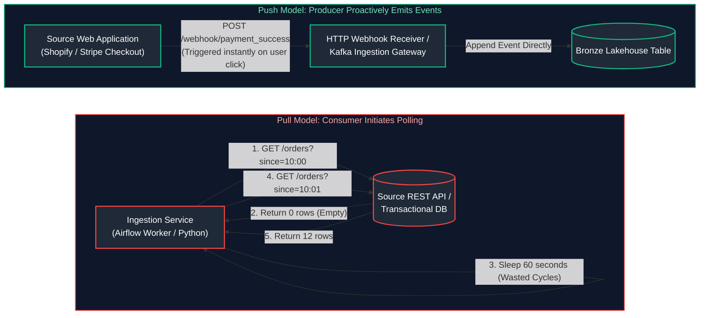

#### Push Security: Production HMAC-SHA256 Webhook Verification
When operating push-based webhooks (e.g., Stripe, Shopify, GitHub), bad actors may send spoofed HTTP requests to your ingestion endpoints. Production webhook endpoints **must** cryptographically verify the payload signature before processing:

```python
import hmac
import hashlib
import time
from typing import Dict, Any

def verify_webhook_signature(
    raw_payload_bytes: bytes,
    received_signature_header: str,
    webhook_secret: str,
    max_drift_seconds: int = 300
) -> bool:
    """
    Validates HMAC SHA-256 webhook signatures to prevent payload tampering and replay attacks.
    
    Header Format (e.g., Stripe): 't=1710492000,v1=5257a869e7ecebeda32affa62cd...'
    """
    try:
        # 1. Parse timestamp and signature components from header
        parts = dict(item.split("=") for item in received_signature_header.split(","))
        timestamp_str = parts.get("t")
        expected_sig = parts.get("v1")
        
        if not timestamp_str or not expected_sig:
            return False
            
        # 2. Guard against Replay Attacks: Ensure payload was signed recently
        current_time = int(time.time())
        event_time = int(timestamp_str)
        if abs(current_time - event_time) > max_drift_seconds:
            print(f"[REJECTED] Timestamp drift exceeded: {abs(current_time - event_time)}s")
            return False
            
        # 3. Compute expected cryptographic HMAC hash over (timestamp + '.' + payload)
        signed_payload = f"{timestamp_str}.".encode("utf-8") + raw_payload_bytes
        computed_sig = hmac.new(
            key=webhook_secret.encode("utf-8"),
            msg=signed_payload,
            digestmod=hashlib.sha256
        ).hexdigest()
        
        # 4. Perform constant-time comparison to protect against timing attacks
        return hmac.compare_digest(computed_sig, expected_sig)
    except Exception as e:
        print(f"[ERROR] Signature verification crashed: {str(e)}")
        return False
```

---

### 1.5 Micro-Batching Mechanics & Execution Internals

Micro-batching (exemplified by Apache Spark Structured Streaming) is not a compromise; it is an architectural decision that trades tens of milliseconds of latency for the full power of vectorized batch query engines (Catalyst Optimizer, Whole-Stage Code Generation).

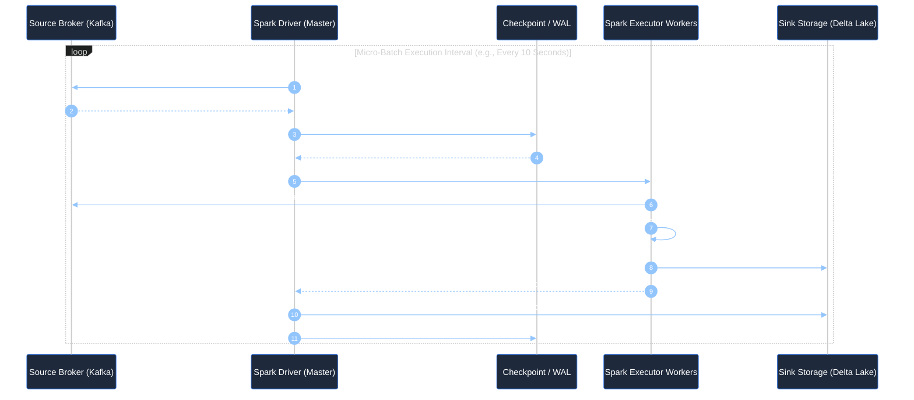

#### Spark Structured Streaming Trigger Modes Comparison

```python
# 1. Fixed Processing Time (Default micro-batch interval)
query1 = df.writeStream.trigger(processingTime="10 seconds").start()

# 2. Once Trigger (Processes all pending data in a single batch, then halts cluster)
# Legacy mode: Only processes 1 batch regardless of size
query2 = df.writeStream.trigger(once=True).start()

# 3. AvailableNow Trigger (Modern Best Practice for Batch-Triggered Streaming)
# Splits huge accumulated backlogs into multiple right-sized micro-batches, then stops
query3 = df.writeStream.trigger(availableNow=True).start()

# 4. Continuous Processing Mode (Experimental low-latency ~1ms; no micro-batching)
# Uses continuous long-running tasks; limited SQL operator support
query4 = df.writeStream.trigger(continuous="1 second").start()
```

---

# 2. Resilient Pipeline Design Patterns

---

### 2.1 Pipeline Idempotency: The Gold Standard

#### Mathematical Principle & First-Principles Definition
In mathematics and computer science, an operation $f$ is **idempotent** if applying it multiple times produces the identical result as applying it once:

$$\forall x, \quad f(f(x)) = f(x)$$

In data engineering, a pipeline is **idempotent** if re-running the pipeline over the same source data, whether intentionally (backfill) or unintentionally (Airflow task retry after an executor crash), leaves the target database in the **exact same deterministic state** without creating duplicate rows, double-counting metrics, or losing existing data.

#### The 3 Canonical Idempotent Implementation Patterns

```mermaid
flowchart TD
    subgraph Pattern1 ["Pattern 1: Delete-Before-Insert (Partition Overwrite)"]
        P1Input["Batch Input: Date = '2026-03-15'"] --> P1Action["ATOMIC OVERWRITE PARTITION<br/>(Drops and replaces 2026-03-15 partition)"]
        P1Action --> P1Result["Target table has exact records of latest run"]
    end

    subgraph Pattern2 ["Pattern 2: Deterministic Upsert (MERGE INTO)"]
        P2Input["Batch Input: Orders Updates"] --> P2Merge["MERGE ON target.order_id = source.order_id"]
        P2Merge --> P2Action1["MATCHED: UPDATE SET ..."]
        P2Merge --> P2Action2["NOT MATCHED: INSERT (...)"]
        P2Action1 & P2Action2 --> P2Result["Zero duplicate primary keys"]
    end

    subgraph Pattern3 ["Pattern 3: Atomic Staging Table Swap"]
        P3Input["Batch Input: Full Load"] --> P3Staging["Write full dataset to staging_table_temp"]
        P3Staging --> P3Swap["ALTER TABLE prod_table SWAP WITH staging_table_temp"]
        P3Swap --> P3Result["Zero downtime, atomic replacement"]
    end

    style Pattern1 fill:#0f172a,stroke:#3b82f6,stroke-width:1.5px,color:#93c5fd
    style Pattern2 fill:#0f172a,stroke:#10b981,stroke-width:1.5px,color:#6ee7b7
    style Pattern3 fill:#0f172a,stroke:#f59e0b,stroke-width:1.5px,color:#fde68a
    style P1Input fill:#1f2937,stroke:#3b82f6,stroke-width:2px,color:#fff
    style P1Action fill:#1f2937,stroke:#3b82f6,stroke-width:2px,color:#fff
    style P1Result fill:#1f2937,stroke:#3b82f6,stroke-width:2px,color:#fff
    style P2Input fill:#1f2937,stroke:#10b981,stroke-width:2px,color:#fff
    style P2Merge fill:#1f2937,stroke:#10b981,stroke-width:2px,color:#fff
    style P2Action1 fill:#1f2937,stroke:#10b981,stroke-width:2px,color:#fff
    style P2Action2 fill:#1f2937,stroke:#10b981,stroke-width:2px,color:#fff
    style P2Result fill:#1f2937,stroke:#10b981,stroke-width:2px,color:#fff
    style P3Input fill:#1f2937,stroke:#f59e0b,stroke-width:2px,color:#fff
    style P3Staging fill:#1f2937,stroke:#f59e0b,stroke-width:2px,color:#fff
    style P3Swap fill:#1f2937,stroke:#f59e0b,stroke-width:2px,color:#fff
    style P3Result fill:#1f2937,stroke:#f59e0b,stroke-width:2px,color:#fff
```

#### Production Code: Idempotent Partition Overwrite in PySpark

```python
from pyspark.sql import SparkSession
from pyspark.sql.functions import col, lit

def write_idempotent_partition(
    spark: SparkSession,
    source_df,
    target_table_name: str,
    partition_date: str
):
    """
    Idempotently writes daily partition data using dynamic partition overwrite.
    Guarantees that re-running this function 100 times produces identical results.
    """
    # 1. Enforce that input data contains ONLY records for the target partition
    filtered_df = source_df.filter(col("event_date") == lit(partition_date))
    
    # 2. Configure Spark session for dynamic partition overwrite mode
    # In dynamic mode, Spark only overwrites partitions present in the DataFrame being written
    spark.conf.set("spark.sql.sources.partitionOverwriteMode", "dynamic")
    
    # 3. Atomic overwrite write into target Delta or Parquet table
    filtered_df.write \
        .format("delta") \
        .mode("overwrite") \
        .partitionBy("event_date") \
        .saveAsTable(target_table_name)
    
    print(f"Successfully and idempotently committed partition: event_date={partition_date}")
```

---

### 2.2 Fault Tolerance, Failover & Self-Healing

Distributed systems fail continuously: cloud providers preempt spot VMs, network switches experience transient latency spikes, and external databases hit connection limits. Resilient pipelines incorporate self-healing mechanisms at every layer:

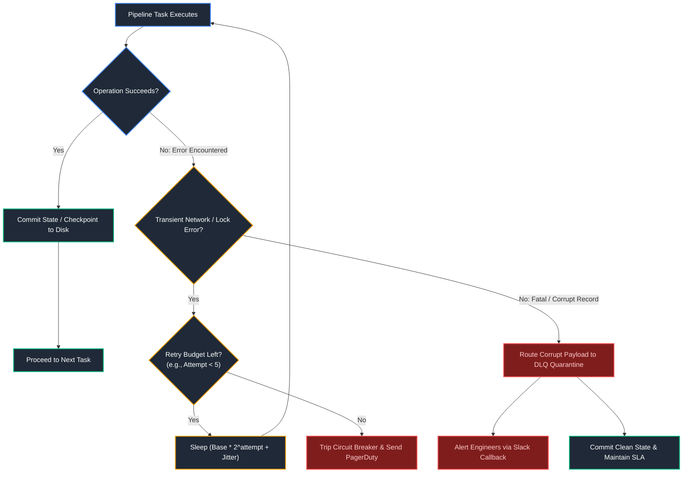

#### Key Reliability Metrics
- **RTO (Recovery Time Objective):** The maximum tolerable duration of time a data pipeline can remain offline after a crash before business damage occurs.
- **RPO (Recovery Point Objective):** The maximum acceptable age of data that can be lost when unexpected hardware failure strikes (e.g., RPO = 0 means zero data loss via synchronous write-ahead logs).

---

### 2.3 Checkpointing & Streaming State Stores

#### Directory Internals in Spark Structured Streaming
When you supply `.option("checkpointLocation", "s3://lakehouse/checkpoints/orders/")`, the engine creates a structured metadata tree on object storage:

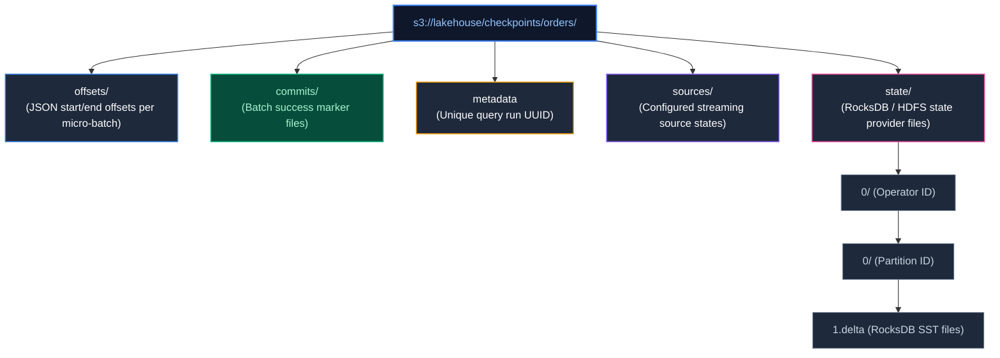

| Checkpoint Directory / File | File Type | Production Role & Fault Tolerance Guarantee |
| :--- | :--- | :--- |
| `offsets/{batch_id}` | JSON | Records the exact starting and ending Kafka offsets or file offsets for micro-batch `{batch_id}`. |
| `commits/{batch_id}` | Empty File / JSON | Marks that batch `{batch_id}` completed execution and all sinks finalized writes. |
| `metadata` | JSON | Contains a deterministic run ID ensuring that conflicting queries do not write to the same checkpoint directory. |
| `sources/` | Directory | Persists metadata about streaming sources (e.g., Kafka cluster IDs, Auto Loader discovery logs). |
| `state/{op_id}/{part_id}/` | Binary SST / Delta | RocksDB or HDFS state checkpoint files maintaining aggregation buffers and stream-join match buffers. |

#### State Store Providers: HDFS In-Memory vs. RocksDB
When performing stateful streaming operations (e.g., stream-stream joins or `dropDuplicates()`), the engine maintains state in memory:
1. **Default HDFS Backed In-Memory State Store:** Stores all state as JVM objects inside executor heap memory. If state exceeds several gigabytes, Java Garbage Collection (GC) pauses freeze the cluster, leading to executor timeouts and OOM crashes.
2. **RocksDB State Store Provider:** Backed by an embedded, off-heap C++ key-value store (RocksDB) written directly to local SSDs and lazily checkpointed to cloud storage. Can effortlessly scale to tens of millions of keys per node with zero JVM GC pressure.

```python
# Enabling RocksDB State Store Provider in PySpark
spark.conf.set(
    "spark.sql.streaming.stateStore.providerClass",
    "org.apache.spark.sql.execution.streaming.state.RocksDBStateStoreProvider"
)
```

---

### 2.4 Backpressure Management & Dynamic Rate Limiting

#### The Problem: Consumer Flooding
If a pipeline is down for 6 hours of maintenance, the upstream Kafka broker may accumulate 50 million pending messages. When the streaming worker starts up, it attempts to load all 50 million messages into memory simultaneously, instantly causing `java.lang.OutOfMemoryError: Java heap space`.

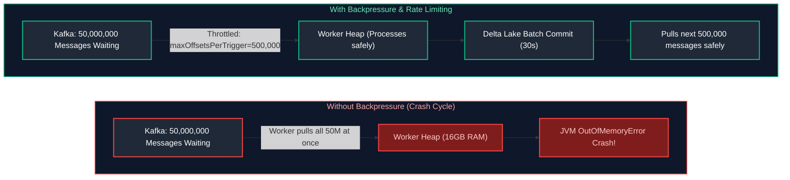

#### Production PySpark Ingestion with Defensive Throttling
```python
df_safe_stream = spark.readStream \
    .format("kafka") \
    .option("kafka.bootstrap.servers", "broker1:9092,broker2:9092") \
    .option("subscribe", "telemetry-events") \
    .option("startingOffsets", "latest") \
    .option("maxOffsetsPerTrigger", 250000) \  # Upper bound: Never pull more than 250k messages per batch
    .option("failOnDataLoss", "false") \       # Prevent crashing if old Kafka logs expired past retention
    .load()
```

---

### 2.5 Replayability & Event Re-Sourcing

Replayability is the operational superpower of event log architectures (Kafka, Redpanda, AWS Kinesis). If a transformation bug is deployed to production on Tuesday and discovered on Friday, traditional database architectures face a catastrophe. In an event-sourced pipeline, you simply reset the consumer group offset and reprocess:


#### Resetting Offsets via Kafka CLI
```bash
# Shift consumer group back to a specific historical ISO-8601 timestamp
kafka-consumer-groups.sh \
    --bootstrap-server kafka.prod:9092 \
    --group lakehouse-silver-ingestion \
    --reset-offsets \
    --to-datetime 2026-03-10T00:00:00.000 \
    --topic telemetry-events \
    --execute
```

---

### 2.6 Deduplication Patterns (At-Least-Once to Exactly-Once)

Because distributed networks retry failed TCP packets and message brokers guarantee **At-Least-Once** delivery, duplicate messages are inevitable. Deduplication transforms at-least-once into **effectively-once** downstream state.

#### 1. Batch Deduplication via Window Ranking
In batch pipelines, deduplication retains the latest record for each natural key using `ROW_NUMBER()`:

```sql
WITH ranked_records AS (
    SELECT 
        order_id,
        customer_id,
        order_amount,
        order_status,
        updated_at,
        ROW_NUMBER() OVER (
            PARTITION BY order_id 
            ORDER BY updated_at DESC, ingestion_ts DESC
        ) AS rank_val
    FROM bronze.raw_orders
)
SELECT 
    order_id,
    customer_id,
    order_amount,
    order_status,
    updated_at
FROM ranked_records
WHERE rank_val = 1;
```

#### 2. Streaming Deduplication with Watermark Boundaries
In continuous streaming, state cannot grow unbounded forever. Spark requires a watermark to evict deduplication keys from memory:

```python
# Deduplicate streaming events using natural key + watermark
df_deduped_stream = df_stream \
    .withWatermark("event_timestamp", "2 hours") \
    .dropDuplicates(["transaction_id", "event_timestamp"])
```

---

### 2.7 Late-Arriving & Out-of-Order Data Handling

To process data accurately, data engineers must distinguish between three distinct timestamps:

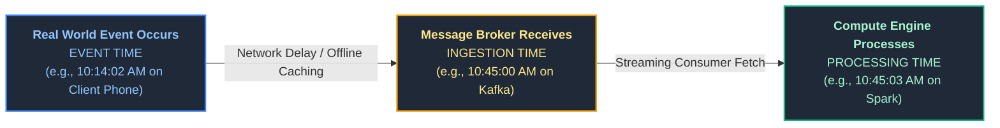

1. **Event Time:** The exact instant the action occurred on the edge client device (e.g., when a user swiped their credit card).
2. **Ingestion Time:** The instant the event reached the central messaging broker (Kafka, Kinesis).
3. **Processing Time:** The clock timestamp of the compute cluster executing the transformation query.

If a smartphone loses cellular reception in a subway tunnel for 40 minutes, it caches transactions locally. When it reconnects, records arrive with a 40-minute gap between Event Time and Processing Time. Calculating hourly sales using *Processing Time* attributes those subway transactions to the wrong business hour!

---

### 2.8 Watermarking Mechanics & State Eviction

A **Watermark** is a moving temporal horizon defined as:

$$\text{Watermark Threshold} = \max(\text{Event Time Observed}) - \text{Allowed Latency Delay}$$

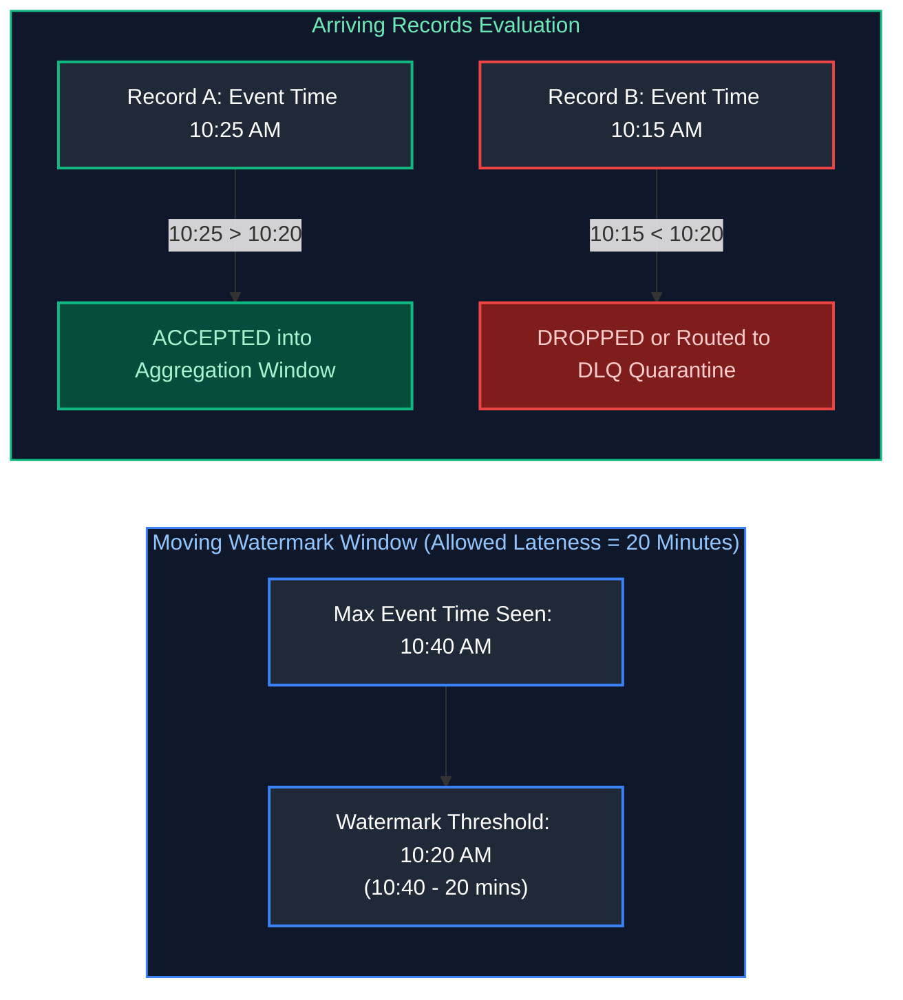

When the watermark passes 10:20 AM, the streaming engine finalizes the aggregation window for `10:00 - 10:10 AM`, emits the final count to downstream storage, and **purges that window's intermediate state from RAM/RocksDB**, keeping memory consumption strictly flat.

---

### 2.9 Dead Letter Queues (DLQ) & Quarantine Routing

Crashing an entire data pipeline because 1 row out of 10 million contains corrupt JSON is unacceptable in enterprise data engineering. A **Dead Letter Queue (DLQ)** isolates corrupt or schema-violating records into a quarantine table while allowing healthy records to proceed.

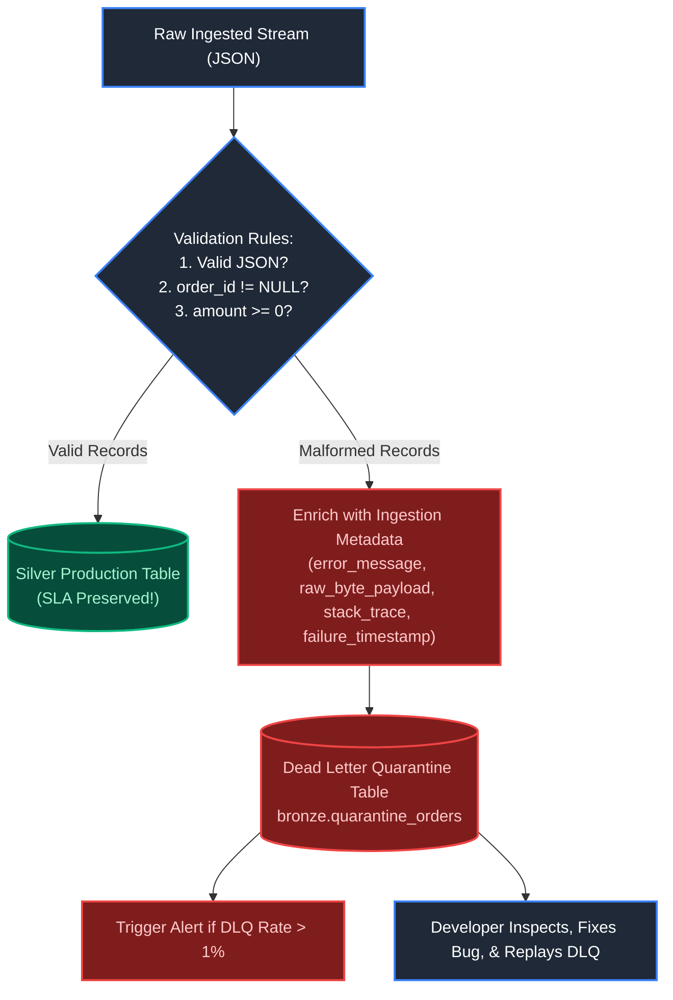

#### Quarantine Schema Structure
| Column Name | Data Type | Purpose |
| :--- | :--- | :--- |
| `quarantine_id` | `STRING (UUID)` | Unique surrogate identifier for the quarantine incident |
| `raw_payload` | `STRING` | Complete unparsed raw record bytes/string |
| `source_system` | `STRING` | Originating application or message topic |
| `error_code` | `STRING` | Standardized category (e.g., `SCHEMA_MISMATCH`, `NULL_PK`, `INVALID_JSON`) |
| `error_details` | `STRING` | Full Python/Java exception message or stack trace |
| `ingested_at` | `TIMESTAMP (UTC)` | Timestamp when the bad record hit the pipeline |
| `is_resolved` | `BOOLEAN` | Toggled to TRUE after replay job re-ingests repaired payload |

---

### 2.10 Bad Records Handling & Engine Permissive Modes

Apache Spark offers native file reading modes to control how corrupt rows are treated:

```python
from pyspark.sql.types import StructType, StructField, StringType, DoubleType, IntegerType

# Define explicit target schema including internal corruption capture column
orders_schema = StructType([
    StructField("order_id", IntegerType(), True),
    StructField("amount", DoubleType(), True),
    StructField("status", StringType(), True),
    StructField("_corrupt_record", StringType(), True)  # Captures unparseable strings
])

# 1. PERMISSIVE Mode (Default): Populates valid fields, puts corrupt text into _corrupt_record
df_permissive = spark.read \
    .format("json") \
    .option("mode", "PERMISSIVE") \
    .option("columnNameOfCorruptRecord", "_corrupt_record") \
    .schema(orders_schema) \
    .load("s3://landing/dirty_data/")

# 2. Split into clean and quarantine DataFrames
df_clean = df_permissive.filter(col("_corrupt_record").isNull()).drop("_corrupt_record")
df_quarantine = df_permissive.filter(col("_corrupt_record").isNotNull())

# 3. Write out clean to Silver, quarantine to DLQ
df_clean.write.format("delta").mode("append").saveAsTable("silver.clean_orders")
df_quarantine.write.format("delta").mode("append").saveAsTable("bronze.dlq_orders")
```

---

### 2.11 Schema Validation & Defensive Ingestion

Defensive ingestion guarantees that upstream software engineers cannot silently change a column from an integer to an array or drop a required foreign key without the ingestion gate catching it.

```python
from pydantic import BaseModel, Field, field_validator
from datetime import datetime
from typing import Optional

class UserIngestionContract(BaseModel):
    """Defensive schema contract enforced on every raw incoming payload."""
    user_id: int = Field(gt=0, description="Positive integer identifier")
    email: str = Field(pattern=r"^[\w\.-]+@[\w\.-]+\.\w+$")
    signup_timestamp: datetime
    country_code: str = Field(min_length=2, max_length=2)
    referral_code: Optional[str] = None

    @field_validator("country_code")
    @classmethod
    def validate_uppercase_country(cls, v: str) -> str:
        if not v.isupper():
            raise ValueError(f"Country code must be ISO uppercase: {v}")
        return v

def ingest_defensive_record(raw_record_dict: dict) -> dict:
    """Validates raw dictionaries against contract, raising typed exceptions on violation."""
    validated = UserIngestionContract.model_validate(raw_record_dict)
    return validated.model_dump()
```

---

### 2.12 Pipeline Observability: Metrics, Logs & Traces

Modern data engineering observability rests on **The 5 Pillars of Data Reliability**:
1. **Freshness:** When was the table last updated? (Monitors SLA breaches).
2. **Volume:** Did today's batch contain 200,000 rows as expected, or only 500 rows? (Identifies silent upstream extraction failures).
3. **Schema:** Did upstream engineers drop, rename, or alter a field's type?
4. **Data Quality / Distribution:** Did the null rate in `zip_code` jump from 0.1% to 85%?
5. **Lineage:** Which 14 downstream dashboards will break if this table fails?

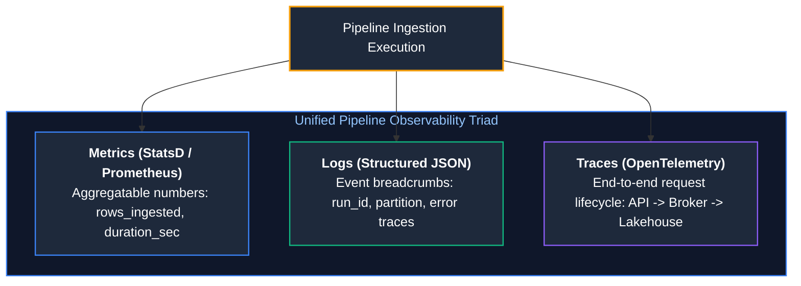

| Signal Type | Ingestion Example | Tooling Sink | Detection Purpose |
| :--- | :--- | :--- | :--- |
| **Metrics** | `rows_ingested: 104500`, `duration_seconds: 42.1` | Prometheus, Datadog | Real-time threshold alerting & SLA burn rate. |
| **Logs** | `{"level":"INFO","run_id":"uuid-92","partition":"2026-03-15"}` | Elasticsearch, CloudWatch | Root-cause diagnosis & error stack tracing. |
| **Traces** | `trace_id: 4bf92f3577b34da6a3ce929d0e0e4736` | OpenTelemetry, Jaeger | Distributed latency bottleneck identification across hops. |

---

### 2.13 SLA Management, SLOs & Alert Thresholds

- **SLI (Service Level Indicator):** A quantifiable metric of pipeline performance (e.g., *Elapsed time from midnight UTC until the Gold financial table commit is finalized*).
- **SLO (Service Level Objective):** The internal target agreed upon by the data team (e.g., *Gold financial table commit finalized before 06:00 AM UTC in 99.5% of calendar days*).
- **SLA (Service Level Agreement):** The contractual commitment to external business stakeholders with financial or business penalties if breached (e.g., *If financial data is not delivered by 08:00 AM UTC, data team pays a regulatory audit fine*).

#### Three-Tiered Alerting Strategy
1. **P1 (Critical / Page On-Call):** Pipeline halted, financial reporting SLA violated, production customer-facing model data missing.
2. **P2 (High / Slack Notification):** Volume anomaly detected (e.g., 40% drop in rows), non-fatal schema drift routed to rescue column, DLQ quarantine exceeding 2% threshold.
3. **P3 (Informational / Ticket Created):** Cluster spot node reclaimed, job took 10% longer than average, non-urgent deprecation warning logged.

---

### 2.14 Historical Backfilling Strategies

Backfilling is the process of re-executing a pipeline over historical time intervals.

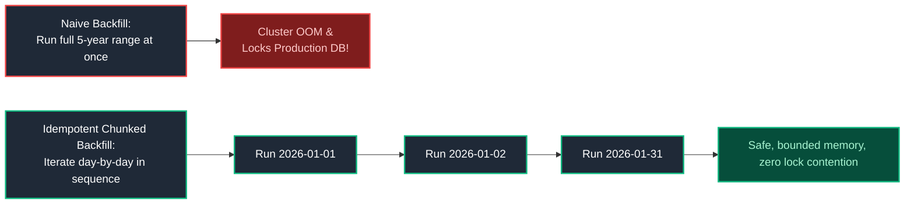

#### Production Bash Backfill Script with Bounded Concurrency
```bash
#!/usr/bin/env bash
set -euo pipefail

START_DATE="2026-01-01"
END_DATE="2026-01-31"

CURRENT_DATE="$START_DATE"
echo "Starting sequential, idempotent backfill from $START_DATE to $END_DATE..."

while [ "$CURRENT_DATE" != "$(date -I -d "$END_DATE + 1 day")" ]; do
    echo "Processing partition: date=$CURRENT_DATE"
    python /opt/pipelines/daily_orders_ingestion.py \
        --execution-date "$CURRENT_DATE" \
        --mode "overwrite-partition" \
        --retries 3
    
    # Increment by 1 day
    CURRENT_DATE=$(date -I -d "$CURRENT_DATE + 1 day")
done

echo "Backfill execution completed successfully."
```

---

### 2.15 Metadata-Driven Pipelines & Control Table Framework

Hardcoding 500 individual ingestion scripts for 500 database tables is an unmaintainable anti-pattern. A **Metadata-Driven Pipeline Framework** uses an external catalog (Postgres table or JSON/YAML specification) to parameterize a single, highly optimized ingestion engine.

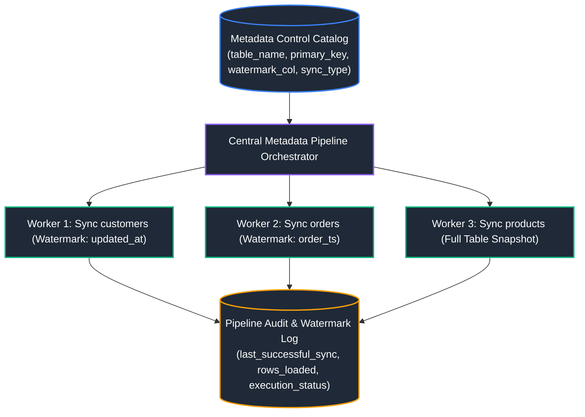

#### Complete Production Python Implementation

```python
import json
import logging
from dataclasses import dataclass
from typing import List, Optional

logging.basicConfig(level=logging.INFO, format="%(asctime)s [%(levelname)s] %(message)s")

@dataclass
class IngestionMetadataConfig:
    source_schema: str
    source_table: str
    target_lakehouse_table: str
    primary_key: str
    watermark_column: Optional[str] = None
    partition_column: Optional[str] = None
    sync_mode: str = "INCREMENTAL"  # 'INCREMENTAL' or 'FULL_SNAPSHOT'
    is_active: bool = True

class MetadataDrivenPipelineExecutor:
    """
    Dynamically executes dozens of database ingestion jobs 
    driven strictly by metadata configuration schemas.
    """
    def __init__(self, config_file_path: str):
        with open(config_file_path, "r") as f:
            raw_configs = json.load(f)
            self.configs: List[IngestionMetadataConfig] = [
                IngestionMetadataConfig(**item) for item in raw_configs if item.get("is_active", True)
            ]

    def fetch_last_watermark(self, target_table: str) -> str:
        # In production: SELECT MAX(high_watermark) FROM pipeline_control.watermarks WHERE target_table = :target_table
        logging.info(f"Retrieving high-watermark checkpoint for {target_table}")
        return "2026-03-14 00:00:00"

    def record_sync_success(self, target_table: str, new_watermark: str, rows_synced: int):
        # In production: INSERT INTO pipeline_control.audit_log VALUES (...)
        logging.info(f"[SUCCESS] {target_table}: Committed {rows_synced} rows. New Watermark: {new_watermark}")

    def execute(self):
        logging.info(f"Loaded {len(self.configs)} active ingestion configs from catalog.")
        for cfg in self.configs:
            logging.info(f"Starting processing: {cfg.source_schema}.{cfg.source_table} -> {cfg.target_lakehouse_table}")
            
            if cfg.sync_mode == "INCREMENTAL":
                last_watermark = self.fetch_last_watermark(cfg.target_lakehouse_table)
                sql_extract = f"""
                    SELECT * FROM {cfg.source_schema}.{cfg.source_table}
                    WHERE {cfg.watermark_column} > '{last_watermark}'
                    ORDER BY {cfg.watermark_column} ASC
                """
                logging.info(f"Generated SQL: {sql_extract.strip()}")
                # Execute extract -> load to Bronze -> merge to Silver
                self.record_sync_success(cfg.target_lakehouse_table, "2026-03-15 00:00:00", 12450)
            else:
                sql_extract = f"SELECT * FROM {cfg.source_schema}.{cfg.source_table}"
                logging.info(f"Generated Full Snapshot SQL: {sql_extract.strip()}")
                self.record_sync_success(cfg.target_lakehouse_table, "FULL_SYNC_COMPLETE", 500000)
```

---

# 3. Data Quality, Contracts & Governance

---

### 3.1 Data Contracts: Shift-Left Governance

A **Data Contract** is a formal, version-controlled specification written in YAML/JSON that establishes an explicit agreement between software engineering teams producing data and data engineering teams consuming it.

```yaml
# Open Data Contract Standard (ODCS) Specification v2.0
dataContractSpecification: 2.0.0
id: orders-checkout-service-contract
info:
  title: Checkout Microservice Orders Contract
  version: 1.4.0
  owner: team-checkout@enterprise.corp
models:
  orders:
    description: Operational transaction records created at user checkout
    fields:
      order_id:
        type: string
        format: uuid
        required: true
        unique: true
      customer_id:
        type: integer
        required: true
      amount_usd:
        type: number
        minimum: 0.01
        maximum: 100000.00
      order_status:
        type: string
        enum: [PENDING, AUTHORIZED, SHIPPED, DELIVERED, CANCELLED]
      order_timestamp:
        type: string
        format: date-time
        required: true
servicelevels:
  freshness:
    maxDelaySeconds: 300  # Data must arrive within 5 minutes of checkout
  availability: 99.9%
```

#### Enforcement in CI/CD
When an upstream software engineer submits a Pull Request altering the Postgres database schema, a CI/CD GitHub Action validates the change against the Data Contract. If the PR attempts to drop `customer_id` or change `amount_usd` from float to string, the CI pipeline **blocks the PR merge**, stopping breaking changes before they reach production.

---

### 3.2 Great Expectations (GX) Framework

Great Expectations (GX) is an industry-standard Python library that validates, profiles, and documents datasets through expressive assertions called **Expectations**.

```python
import great_expectations as gx

# 1. Initialize GX execution context
context = gx.get_context()

# 2. Connect to data source (Pandas, Spark, or SQL Data Source)
validator = context.sources.pandas_default.read_csv("s3://lakehouse/landing/orders_2026_03_15.csv")

# 3. Declare declarative data quality expectations
validator.expect_column_to_exist(column="order_id")
validator.expect_column_values_to_not_be_null(column="order_id")
validator.expect_column_values_to_be_unique(column="order_id")

validator.expect_column_values_to_be_between(
    column="amount_usd", min_value=0.01, max_value=50000.00
)

validator.expect_column_values_to_be_in_set(
    column="order_status",
    value_set=["PENDING", "AUTHORIZED", "SHIPPED", "DELIVERED", "CANCELLED"]
)

# 4. Execute validation suite and assert success
results = validator.validate()

if not results.success:
    failed_expectations = [res for res in results.results if not res.success]
    print(f"[ALERT] Data quality check failed! {len(failed_expectations)} assertions failed.")
    raise ValueError("Data quality validation failed. Halting pipeline execution.")
else:
    print("[SUCCESS] All Great Expectations assertions passed cleanly.")
```

---

### 3.3 Soda Core & Declarative Data Checks

Soda Core provides a lightweight, human-readable YAML syntax that compiles directly into SQL queries executed inside your data warehouse:

```yaml
# checks_orders.yml
checks for fact_orders:
  # Volume integrity
  - row_count > 0
  - row_count same as fact_orders_yesterday +/- 20%
  
  # Completeness & Uniqueness
  - missing_count(order_id) = 0
  - duplicate_count(order_id) = 0
  - missing_percent(customer_id) < 1%
  
  # Business Logic & Range
  - min(amount_usd) >= 0.01
  - invalid_count(order_status) = 0:
      valid values: ['PENDING', 'AUTHORIZED', 'SHIPPED', 'DELIVERED', 'CANCELLED']
  
  # Freshness SLA
  - freshness(order_timestamp) < 2h
```

---

### 3.4 Apache Spark Deequ (PyDeequ) for Big Data Quality

When validating multi-terabyte or petabyte datasets, single-node tools (Pandas/GX) fail due to driver memory limitations. **Deequ** (developed by AWS and ported to Python as `pydeequ`) compiles quality assertions directly into distributed Spark SQL aggregations, processing billions of rows across worker nodes.

```python
from pydeequ.checks import Check, CheckLevel
from pydeequ.verification import VerificationSuite, VerificationResult

# Build distributed validation suite
check = Check(spark, CheckLevel.Error, "Bronze Orders Quality Review")

check_suite = check \
    .isComplete("order_id") \
    .isUnique("order_id") \
    .isNonNegative("amount_usd") \
    .isContainedIn("order_status", ["PENDING", "SHIPPED", "DELIVERED", "CANCELLED"]) \
    .hasCompleteness("customer_id", lambda x: x >= 0.99)

result = VerificationSuite(spark) \
    .onData(df_spark_orders) \
    .addCheck(check_suite) \
    .run()

# Convert results to PySpark DataFrame for downstream logging
result_df = VerificationResult.checkResults_to_data_frame(spark, result)
result_df.show(truncate=False)

if result.status != "Success":
    raise RuntimeError("PyDeequ distributed validation suite failed!")
```

---

### 3.5 dbt Test Assertions (Generic & Custom)

In the dbt framework, tests are defined declaratively in `schema.yml`:

```yaml
version: 2

models:
  - name: fact_orders
    description: "Curated Gold orders fact table"
    columns:
      - name: order_id
        tests:
          - unique
          - not_null
      - name: customer_id
        tests:
          - not_null
          - relationships:
              to: ref('dim_customers')
              field: customer_id
      - name: order_status
        tests:
          - accepted_values:
              values: ['PENDING', 'SHIPPED', 'DELIVERED', 'CANCELLED']
              quote: true
```

#### Storing Failures for Audit Inspections
Running `dbt test --store-failures` writes violating rows into a dedicated database schema (`target_schema.dbt_test__audit`), allowing engineers to run `SELECT * FROM audit_table` to inspect bad records immediately.

---

### 3.6 Automated Schema Drift Detection

Schema drift occurs when an upstream service alters payloads without warning. Resilient pipelines compare incoming schemas against the historical catalog:

```python
from pyspark.sql.types import StructType

def detect_schema_drift(source_schema: StructType, target_schema: StructType):
    """
    Compares incoming batch schema against target warehouse schema.
    Returns lists of added, removed, or type-altered fields.
    """
    source_fields = {f.name: f.dataType for f in source_schema.fields}
    target_fields = {f.name: f.dataType for f in target_schema.fields}
    
    new_columns = set(source_fields.keys()) - set(target_fields.keys())
    missing_columns = set(target_fields.keys()) - set(source_fields.keys())
    
    type_mismatches = []
    for col_name in set(source_fields.keys()).intersection(set(target_fields.keys())):
        if source_fields[col_name] != target_fields[col_name]:
            type_mismatches.append({
                "column": col_name,
                "source_type": str(source_fields[col_name]),
                "target_type": str(target_fields[col_name])
            })
            
    return {
        "new_columns": list(new_columns),
        "missing_columns": list(missing_columns),
        "type_mismatches": type_mismatches,
        "has_drift": bool(new_columns or missing_columns or type_mismatches)
    }
```

---

### 3.7 Statistical Anomaly Detection in Ingestion Volumes

Static thresholds (e.g., `row_count > 10,000`) fail when business traffic exhibits strong seasonality (e.g., Saturday traffic is naturally 3x lower than Tuesday traffic). Production observability systems compute **Rolling Z-Scores** to detect volume anomalies:

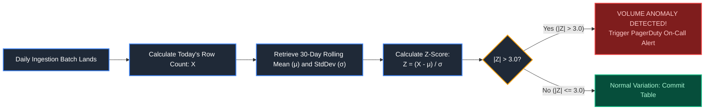

#### Production Python Volume Anomaly Detector
```python
import numpy as np

def evaluate_volume_zscore(
    today_volume: int,
    historical_30_day_volumes: list,
    z_threshold: float = 3.0
) -> dict:
    """
    Evaluates whether today's ingested row volume is a statistical anomaly.
    A Z-score > 3.0 indicates less than a 0.3% probability of being natural variation.
    """
    arr = np.array(historical_30_day_volumes)
    mean = np.mean(arr)
    std = np.std(arr)
    
    if std == 0.0:
        z_score = 0.0
    else:
        z_score = (today_volume - mean) / std
        
    is_anomaly = abs(z_score) > z_threshold
    
    return {
        "today_volume": today_volume,
        "rolling_mean": float(mean),
        "rolling_std": float(std),
        "z_score": float(z_score),
        "is_anomaly": is_anomaly,
        "severity": "CRITICAL" if abs(z_score) > 4.5 else ("HIGH" if is_anomaly else "NORMAL")
    }
```

---

# 4. File-Based Cloud Ingestion Architectures

---

### 4.1 Batch File Ingestion vs. Incremental File Processing

When ingesting files from cloud object storage (AWS S3, Azure ADLS Gen2, Google Cloud Storage):
- **Batch File Crawling:** The pipeline sends HTTP `LIST` requests across the entire bucket on every execution. As the bucket accumulates hundreds of thousands of files over several months, directory listing times explode from seconds to hours before any data can be ingested.
- **Incremental Processing:** The pipeline reads only newly arrived files, relying on cloud event notifications or transactional log tracking.

---

### 4.2 Databricks Auto Loader (`cloudFiles`) Internals

Databricks **Auto Loader** provides an optimized, fault-tolerant source called `cloudFiles` for reading files incrementally from cloud object storage into Delta Lake.

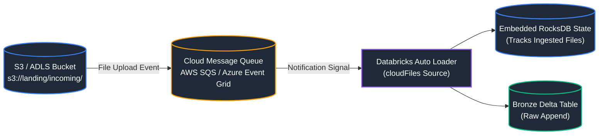

#### Auto Loader Execution Modes
1. **Directory Listing Mode (`cloudFiles.useNotifications = false`):** Recursively crawls directory prefixes and stores file modification timestamps in an internal RocksDB state store. Highly optimized for buckets with $<1,000,000$ files.
2. **File Notification Mode (`cloudFiles.useNotifications = true`):** Automatically provisions an AWS SNS/SQS or Azure Event Grid service. As new files land, storage events trigger messages in the queue. Auto Loader polls the queue directly, achieving $O(1)$ discovery overhead even across billions of historical files.

#### Production PySpark Auto Loader Ingestion Pipeline
```python
df_autoloader = spark.readStream \
    .format("cloudFiles") \
    .option("cloudFiles.format", "json") \
    .option("cloudFiles.schemaLocation", "s3://lakehouse/metadata/schema_orders/") \
    .option("cloudFiles.schemaEvolutionMode", "addNewColumns") \
    .option("cloudFiles.useNotifications", "true") \
    .load("s3://landing-bucket/raw_orders/")

query = df_autoloader.writeStream \
    .format("delta") \
    .outputMode("append") \
    .option("checkpointLocation", "s3://lakehouse/checkpoints/orders_autoloader/") \
    .toTable("bronze.raw_orders")
```

---

### 4.3 SQL `COPY INTO` (Databricks & Snowflake)

`COPY INTO` provides an idempotent, SQL-native mechanism to load cloud storage files into managed tables. Both Snowflake and Databricks maintain internal metadata catalogs recording loaded file names; re-executing `COPY INTO` on the same directory skips previously loaded files automatically.

```sql
-- Snowflake / Databricks SQL COPY INTO Syntax
COPY INTO bronze.raw_shipments
FROM 's3://logistics-landing/shipments/'
FILEFORMAT = PARQUET
PATTERN = '.*[.]parquet'
COPY_OPTIONS (
    'mergeSchema' = 'true',
    'force' = 'false'  -- Skips previously ingested files
);
```

---

### 4.4 Snowflake Snowpipe Serverless Ingestion

Snowpipe is Snowflake’s serverless, automated event-driven ingestion engine. It loads micro-batches of data within seconds of files appearing in cloud storage without requiring a continuously running virtual warehouse.

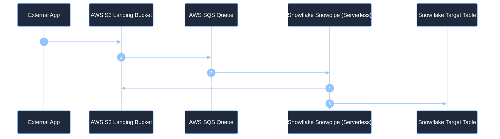

#### Snowpipe DDL Specification
```sql
-- Create external stage pointing to AWS S3
CREATE OR REPLACE STAGE my_s3_stage
  URL = 's3://mycompany-landing/telemetry/'
  STORAGE_INTEGRATION = my_aws_storage_int;

-- Define automated serverless pipe listening to S3 notifications
CREATE OR REPLACE PIPE telemetry_db.raw.pipe_telemetry
  AUTO_INGEST = TRUE
  AWS_SNS_TOPIC = 'arn:aws:sns:us-east-1:123456789012:s3-object-created-topic'
AS
  COPY INTO telemetry_db.raw.bronze_telemetry
  FROM @my_s3_stage
  FILE_FORMAT = (TYPE = 'JSON');
```

---

### 4.5 Google Cloud BigQuery Load Jobs

Google BigQuery offers dedicated asynchronous **Load Jobs** to import files from Google Cloud Storage (GCS) or local disks. **Crucial Architectural Advantage:** BigQuery Load Jobs do **not** consume BigQuery query slots or incur compute fees—the ingestion compute is completely free; users pay only for downstream table storage.

```bash
# Ingesting compressed Parquet files from GCS into BigQuery via bq CLI
bq load \
    --source_format=PARQUET \
    --autodetect \
    --time_partitioning_field=event_timestamp \
    --clustering_fields=customer_id,region \
    analytics.fact_pageviews \
    gs://my-company-lake/web_logs/*.parquet
```

---

### 4.6 Directory Listing ($O(N)$) vs. Notification-Based Ingestion ($O(1)$)

| Characteristic | Directory Listing Mode | File Notification Mode |
| :--- | :--- | :--- |
| **Complexity of Discovery** | **$O(N)$:** Engine must paginate through all $N$ files in bucket | **$O(1)$:** Reads exact new file paths directly from queue messages |
| **Cloud Storage Latency** | Minutes to hours when bucket has $>1,000,000$ files | Milliseconds (sub-second event notification delivery) |
| **Cloud API Costs** | High: Thousands of HTTP `LIST` requests incurred on every run | Extremely low: Event notifications cost pennies per million events |
| **Infrastructure Setup** | Zero infrastructure needed; just point to S3/ADLS URL | Requires IAM permissions for SNS/SQS or Azure Event Grid |
| **Recommended Threshold** | Small buckets ($<100,000$ files) or batch daily uploads | Enterprise production lakehouses with high-frequency uploads |

---

### 4.7 Checkpoint State Tracking for File Streams

When streaming from file sources, state checkpoints store a monotonically increasing transaction log recording the exact file paths and modification timestamps processed. If a worker node crashes mid-stream, the restart reads the checkpoint, verifies the partial write was not committed to the table, discards any orphan files, and resumes from the exact file boundary, achieving **end-to-end exactly-once guarantees**.

---

### 4.8 Automated Schema Inference & Evolution Policies

#### Auto Loader Schema Evolution Policies Matrix

| Mode | Engine Behavior when New Columns Arrive | Production Fit |
| :--- | :--- | :--- |
| **`addNewColumns`** (Default) | Automatically modifies the target Delta table schema (`ALTER TABLE ADD COLUMN`) and streams cleanly. | Bronze landing tables where raw fidelity and agility are prioritized. |
| **`rescue`** | Retains original schema. Unexpected columns or data type mismatches are JSON-encoded and placed into `_rescued_data`. | Silver tables requiring strict stability without failing on extra fields. |
| **`failOnNewColumns`** | Halts the stream immediately with an exception upon encountering undeclared columns. | Regulated financial or healthcare data where unknown attributes violate compliance. |
| **`none`** | Silently ignores unknown columns; writes only declared fields. | Stable legacy ingestion where auxiliary source fields must be dropped. |

---

# 5. Change Data Capture (CDC) Patterns

---

### 5.1 Log-Based CDC (Debezium & Kafka Connect)

#### Architectural Internals: Tailing the Transaction Log
Every ACID relational database writes state modifications to an append-only sequential disk log (**Write-Ahead Log (WAL)** in PostgreSQL, **Binary Log (Binlog)** in MySQL, **Redo Log** in Oracle) *before* committing modifications to data pages in memory or data files on disk.

Log-based CDC engines (such as Debezium running inside Kafka Connect) act as a logical replication client. They tail this transaction log asynchronously with near-zero overhead on the operational database's CPU and memory:

```mermaid
%%{init: {'theme': 'dark', 'themeVariables': { 'actorBkg': '#1e293b', 'actorBorder': '#3b82f6', 'actorTextColor': '#ffffff', 'signalColor': '#93c5fd', 'signalTextColor': '#ffffff', 'noteBkgColor': '#1e293b', 'noteBorderColor': '#f59e0b', 'noteTextColor': '#fde68a', 'activationBkgColor': '#3b82f6', 'sequenceNumberColor': '#ffffff' }}}%%
sequenceDiagram
    autonumber
    participant App as OLTP Application
    participant DB as PostgreSQL Core Engine
    participant WAL as Write-Ahead Log (WAL)
    participant Debezium as Debezium (Kafka Connect)
    participant Kafka as Kafka Topic (db.orders)
    participant Lakehouse as Delta Lake / Iceberg (Bronze)

    App->>DB: UPDATE orders SET status = 'SHIPPED' WHERE id = 501;
    DB->>WAL: Append Commit Record to Disk (LSN: 0/16B2D40)
    DB-->>App: Transaction Committed Successfully
    
    Debezium->>WAL: Read new WAL segment via Logical Replication Slot
    Debezium->>Kafka: Publish Change Event Envelope (Before & After Image)
    Kafka->>Lakehouse: Streaming Ingestion appends CDC event to Bronze table
```

#### The Debezium CDC Event Envelope Structure
A log-based CDC event contains complete before-and-after state images, metadata about the transaction, and the operation type:

```json
{
  "before": {
    "order_id": 501,
    "customer_id": 9920,
    "status": "PENDING",
    "updated_at": 1710489600000
  },
  "after": {
    "order_id": 501,
    "customer_id": 9920,
    "status": "SHIPPED",
    "updated_at": 1710493200000
  },
  "source": {
    "version": "2.5.0.Final",
    "connector": "postgres",
    "name": "production_oltp",
    "ts_ms": 1710493200150,
    "db": "sales",
    "schema": "public",
    "table": "orders",
    "txId": 98124,
    "lsn": 23812800
  },
  "op": "u",
  "ts_ms": 1710493200210
}
```
*Operation Codes (`op`):*
- `'c'`: Create / Insert
- `'u'`: Update
- `'d'`: Delete (Crucial: Captures hard deletes!)
- `'r'`: Read (Initial snapshot snapshot read)

#### Applying CDC to the Lakehouse: Merge and Change Data Feed (CDF)
In the Silver layer, the raw CDC events are applied to update dimension or fact tables using a deterministic SQL `MERGE`:

```sql
MERGE INTO silver.dim_orders AS target
USING (
    -- Rank CDC records by LSN to take the most recent state change per order
    SELECT order_id, customer_id, status, updated_at, op
    FROM (
        SELECT 
            CAST(JSON_VALUE(value, '$.after.order_id') AS INT) AS order_id,
            CAST(JSON_VALUE(value, '$.after.customer_id') AS INT) AS customer_id,
            JSON_VALUE(value, '$.after.status') AS status,
            TIMESTAMP_MILLIS(CAST(JSON_VALUE(value, '$.source.ts_ms') AS INT64)) AS updated_at,
            JSON_VALUE(value, '$.op') AS op,
            ROW_NUMBER() OVER (
                PARTITION BY JSON_VALUE(value, '$.after.order_id') 
                ORDER BY CAST(JSON_VALUE(value, '$.source.lsn') AS INT64) DESC
            ) AS rank_val
        FROM bronze.cdc_orders_raw
    )
    WHERE rank_val = 1
) AS source
ON target.order_id = source.order_id
WHEN MATCHED AND source.op = 'd' THEN
    DELETE
WHEN MATCHED AND source.op = 'u' THEN
    UPDATE SET 
        target.customer_id = source.customer_id,
        target.status = source.status,
        target.updated_at = source.updated_at
WHEN NOT MATCHED AND source.op IN ('c', 'r') THEN
    INSERT (order_id, customer_id, status, updated_at)
    VALUES (source.order_id, source.customer_id, source.status, source.updated_at);
```

---

### 5.2 Query-Based CDC (High-Watermarks & `updated_at`)

Query-based CDC queries the source database periodically using a high-watermark timestamp:
```sql
SELECT * FROM production.orders
WHERE updated_at > '2026-03-15 12:00:00'
ORDER BY updated_at ASC;
```

#### Why Query-Based CDC is Flawed for High-Integrity Systems
1. **Silent Missed Deletes:** If an application executes `DELETE FROM orders WHERE id = 501`, the row is physically deleted from the table. There is no `updated_at` column left to query; the lakehouse **never discovers the deletion**, leaving ghost records permanently in analytical marts.
2. **Clock Skew & Race Conditions:** If transaction A begins at 12:00:00 with `updated_at = 12:00:00` but does not commit until 12:00:10, a pipeline querying at 12:00:05 with watermark `12:00:00` will miss transaction A completely during that run. Subsequent runs with watermark `12:00:05` will skip it forever!
3. **Severe Production Load:** Firing full index scans every 60 seconds against a production OLTP database consumes buffer pool cache and CPU, risking production service latency spikes.

---

### 5.3 Trigger-Based CDC (Shadow Audit Tables)

Trigger-based CDC creates database triggers (`AFTER INSERT OR UPDATE OR DELETE`) on application tables that write copies of changed rows into an audit shadow table (`orders_audit_log`).
- **Critical Flaw:** Massive write amplification. Every single application write triggers a second synchronous disk write to the audit table inside the same transaction boundary. Under heavy OLTP traffic, trigger CDC creates severe lock contention, table bloat, and degrades application response times by 30% to 100%.

---

# 6. Relational Database Ingestion (RDBMS to Lakehouse)

---

### 6.1 JDBC & ODBC Extraction Fundamentals

Java Database Connectivity (JDBC) establishes TCP socket connections between distributed compute nodes and relational databases.
- **The Single-Thread Trap:** Running a naive `spark.read.format("jdbc").load()` opens a **single socket connection from a single Spark worker node**. The entire multi-gigabyte table is fetched row-by-row over a single thread while the remaining 99 worker nodes in the Spark cluster sit completely idle!
- **Network Buffering (`fetchsize`):** By default, Postgres and Oracle JDBC drivers may attempt to buffer the entire query result set in memory, or fetch 10 rows per network round-trip. Configuring `.option("fetchsize", "10000")` tunes the driver to stream 10,000 rows per network buffer, optimizing memory and throughput.

---

### 6.2 High-Throughput Partitioned JDBC Reads in PySpark

To extract hundreds of millions of rows in minutes, Spark can parallelize database reads by partitioning queries across worker tasks using an indexed numeric column:

```mermaid
flowchart TD
    Driver["Spark Driver:<br/>Calculates 4 Non-Overlapping ID Ranges"]
    
    Driver --> T1["Executor Task 1:<br/>WHERE id >= 1 AND id < 250,000"]
    Driver --> T2["Executor Task 2:<br/>WHERE id >= 250,000 AND id < 500,000"]
    Driver --> T3["Executor Task 3:<br/>WHERE id >= 500,000 AND id < 750,000"]
    Driver --> T4["Executor Task 4:<br/>WHERE id >= 750,000 AND id <= 1,000,000"]

    T1 & T2 & T3 & T4 <-->|Concurrent JDBC Sockets| Postgres[(PostgreSQL Core Database)]

    style Driver fill:#1f2937,stroke:#3b82f6,stroke-width:2px,color:#fff
    style T1 fill:#1f2937,stroke:#8b5cf6,stroke-width:2px,color:#fff
    style T2 fill:#1f2937,stroke:#8b5cf6,stroke-width:2px,color:#fff
    style T3 fill:#1f2937,stroke:#8b5cf6,stroke-width:2px,color:#fff
    style T4 fill:#1f2937,stroke:#8b5cf6,stroke-width:2px,color:#fff
    style Postgres fill:#1f2937,stroke:#3b82f6,stroke-width:2px,color:#fff
```

#### Production Parallel JDBC Extraction Code
```python
from pyspark.sql import SparkSession

def parallel_jdbc_extract(spark: SparkSession) -> DataFrame:
    """
    Extracts a large relational table using parallel concurrent JDBC connections.
    Spawns 16 executor tasks reading non-overlapping ID slices simultaneously.
    """
    # 1. Query bounds dynamically from database to avoid hardcoding min/max
    bounds_df = spark.read.format("jdbc") \
        .option("url", "jdbc:postgresql://postgres.prod.corp:5432/app_db") \
        .option("dbtable", "(SELECT MIN(transaction_id) as min_id, MAX(transaction_id) as max_id FROM sales.transactions) as bounds") \
        .option("user", "lakehouse_extractor") \
        .option("password", "SecretToken123") \
        .load()
        
    bounds = bounds_df.collect()[0]
    min_id = bounds["min_id"]
    max_id = bounds["max_id"]
    
    # 2. Parallel partitioned extraction
    df_transactions = spark.read.format("jdbc") \
        .option("url", "jdbc:postgresql://postgres.prod.corp:5432/app_db") \
        .option("dbtable", "sales.transactions") \
        .option("user", "lakehouse_extractor") \
        .option("password", "SecretToken123") \
        .option("partitionColumn", "transaction_id") \
        .option("lowerBound", str(min_id)) \
        .option("upperBound", str(max_id)) \
        .option("numPartitions", "16") \
        .option("fetchsize", "10000") \
        .load()
        
    return df_transactions
```

---

# 7. API Ingestion Patterns

---

### 7.1 API Pagination Strategies (Offset vs. Page vs. Keyset Cursor)

When ingesting data from REST APIs (Salesforce, Stripe, GitHub, Shopify), data arrives in paginated responses:

| Pagination Architecture | API Request Query Pattern | Database Engine Execution Mechanism | Concurrency Hazard / Insertion Drift | Production Suitability |
| :--- | :--- | :--- | :--- | :--- |
| **Offset-Based Pagination** | `GET /orders?limit=100&offset=50000` | `SELECT * FROM orders OFFSET 50000 LIMIT 100`<br/>(Engine physically scans 50,100 index rows, then discards first 50,000!) | **Severe Record Drift:** If new rows are inserted during ingestion, existing records shift across page boundaries, causing duplicate reads or skipped records. | Flawed for large datasets ($> 10,000$ rows); permissible only for small static admin dashboards. |
| **Page-Based Pagination** | `GET /orders?page=500&size=100` | Syntactic sugar for offset (`offset = (page - 1) * size`). Identical $O(N)$ engine degradation. | Identical drift hazards as offset pagination. | Deprecated in high-scale enterprise ETL. |
| **Keyset / Cursor Pagination** | `GET /orders?limit=100&cursor=eyJpZCI6OTkxMn0=` | `SELECT * FROM orders WHERE id > 9912 ORDER BY id ASC LIMIT 100`<br/>(Direct $O(\log N)$ B+ Tree index seek to cursor boundary). | **Immune to Drift:** New inserts prior to or after the current cursor key never shift records across pages. | **Enterprise Production Standard:** Resumable, linear $O(1)$ per-page retrieval across billions of records. |

#### Production Python Keyset Cursor Extraction Loop
```python
import requests
from typing import Generator, Dict, Any

def fetch_all_records_cursor(base_url: str, auth_token: str) -> Generator[Dict[str, Any], None, None]:
    """
    Traverses cursor-paginated API endpoints safely until exhaustion.
    Yields records as a generator to maintain constant O(1) memory consumption.
    """
    headers = {"Authorization": f"Bearer {auth_token}", "Accept": "application/json"}
    cursor = None
    
    while True:
        params = {"limit": 100}
        if cursor:
            params["cursor"] = cursor
            
        response = requests.get(base_url, headers=headers, params=params, timeout=30.0)
        response.raise_for_status()
        payload = response.json()
        
        records = payload.get("data", [])
        if not records:
            break
            
        for record in records:
            yield record
            
        # Extract next cursor opaque token from pagination envelope
        cursor = payload.get("pagination", {}).get("next_cursor")
        if not cursor:
            # End of paginated dataset reached
            break
```

---

### 7.2 Rate Limiting: Exponential Backoff with Full Jitter

When calling external APIs, encountering HTTP `429 Too Many Requests` is inevitable. Simple static sleeps (`time.sleep(10)`) or simple backoff causes the **Thundering Herd Problem**: dozens of distributed workers wake up at the exact same microsecond, slamming the API and getting throttled again.

**Exponential Backoff with Full Jitter** introduces uniform randomness to break client synchronization:

$$\text{Sleep Duration} = \text{random}(0, \; \min(\text{MaxSleep}, \; \text{BaseSleep} \times 2^{\text{attempt}}))$$

```python
import time
import random
import requests
from typing import Dict, Any

def fetch_api_with_jitter_backoff(
    url: str,
    headers: Dict[str, str],
    max_retries: int = 5,
    base_sleep: float = 1.0,
    max_sleep: float = 60.0
) -> Dict[str, Any]:
    """
    Executes resilient HTTP requests honoring server Retry-After headers
    and implementing Exponential Backoff with Full Jitter.
    """
    attempt = 0
    while attempt < max_retries:
        try:
            response = requests.get(url, headers=headers, timeout=20.0)
            
            if response.status_code == 200:
                return response.json()
                
            elif response.status_code == 429 or 500 <= response.status_code <= 504:
                # Check for explicit Retry-After server header
                retry_after_header = response.headers.get("Retry-After")
                if retry_after_header:
                    sleep_duration = float(retry_after_header)
                else:
                    # Calculate Full Jitter sleep duration
                    calculated_backoff = min(max_sleep, base_sleep * (2 ** attempt))
                    sleep_duration = random.uniform(0, calculated_backoff)
                    
                print(f"[THROTTLED/ERROR {response.status_code}] Sleeping {sleep_duration:.2f}s before retry {attempt + 1}/{max_retries}")
                time.sleep(sleep_duration)
                attempt += 1
            else:
                # Fatal 4xx client errors (401 Unauthorized, 403 Forbidden, 404 Not Found)
                response.raise_for_status()
                
        except (requests.ConnectionError, requests.Timeout) as net_err:
            calculated_backoff = min(max_sleep, base_sleep * (2 ** attempt))
            sleep_duration = random.uniform(0, calculated_backoff)
            print(f"[NETWORK ERROR] {str(net_err)}. Sleeping {sleep_duration:.2f}s before retry {attempt + 1}")
            time.sleep(sleep_duration)
            attempt += 1
            
    raise TimeoutError(f"Exhausted all {max_retries} retries for endpoint: {url}")
```

---

### 7.3 Production API Authentication (OAuth 2.0 Client Credentials)

Enterprise SaaS APIs utilize the **OAuth 2.0 Client Credentials Grant** for machine-to-machine pipeline authentication.

```mermaid
%%{init: {'theme': 'dark', 'themeVariables': { 'actorBkg': '#1e293b', 'actorBorder': '#3b82f6', 'actorTextColor': '#ffffff', 'signalColor': '#93c5fd', 'signalTextColor': '#ffffff', 'noteBkgColor': '#1e293b', 'noteBorderColor': '#f59e0b', 'noteTextColor': '#fde68a', 'activationBkgColor': '#3b82f6', 'sequenceNumberColor': '#ffffff' }}}%%
sequenceDiagram
    autonumber
    participant Pipeline as Ingestion Worker
    participant Auth as Identity Provider (Okta / Azure AD)
    participant API as SaaS API (Salesforce / Stripe)

    Pipeline->>Auth: POST /oauth/token (client_id, client_secret, grant_type=client_credentials)
    Auth-->>Pipeline: Return Access Token JWT (expires_in = 3600 seconds)
    
    loop Synchronize Data Records (Within 1 Hour Window)
        Pipeline->>API: GET /data/v1/customers (Header: Authorization: Bearer <token>)
        API-->>Pipeline: Return Customer Data Payloads
    end
    
    Note over Pipeline,Auth: Token expires in 55 minutes -> Pipeline proactively refreshes token
    Pipeline->>Auth: POST /oauth/token (Refresh Token Exchange)
    Auth-->>Pipeline: Return New Access Token JWT
```

---

# 8. Streaming Message Ingestion

---

### 8.1 Apache Kafka to Lakehouse Streaming Ingestion

Streaming data directly from Kafka brokers into Delta Lake or Apache Iceberg guarantees low-latency availability for real-time dashboards and ML feature stores:

```python
from pyspark.sql import SparkSession
from pyspark.sql.functions import col, from_json
from pyspark.sql.types import StructType, StructField, StringType, DoubleType, LongType

# 1. Connect to Kafka stream
df_kafka_raw = spark.readStream \
    .format("kafka") \
    .option("kafka.bootstrap.servers", "broker1:9092,broker2:9092") \
    .option("subscribe", "telemetry.clickstream") \
    .option("startingOffsets", "latest") \
    .option("maxOffsetsPerTrigger", 500000) \
    .option("failOnDataLoss", "false") \
    .load()

# 2. Deserialize Kafka binary byte arrays to string
# Kafka key, value, and headers arrive as binary arrays (VARBINARY)
df_deserialized = df_kafka_raw.selectExpr(
    "CAST(key AS STRING) as partition_key",
    "CAST(value AS STRING) as json_payload",
    "timestamp as kafka_broker_timestamp",
    "partition as kafka_partition",
    "offset as kafka_offset"
)

# 3. Parse JSON schema defensively
payload_schema = StructType([
    StructField("event_id", StringType(), False),
    StructField("user_id", LongType(), True),
    StructField("page_url", StringType(), True),
    StructField("duration_ms", DoubleType(), True)
])

df_parsed = df_deserialized.withColumn("data", from_json(col("json_payload"), payload_schema)) \
    .select("partition_key", "kafka_broker_timestamp", "kafka_partition", "kafka_offset", "data.*")

# 4. Write stream to Bronze Delta Table with ACID transactional checkpointing
query = df_parsed.writeStream \
    .format("delta") \
    .outputMode("append") \
    .option("checkpointLocation", "s3://lakehouse/checkpoints/clickstream_bronze/") \
    .toTable("bronze.raw_clickstream")
```

---

### 8.2 Azure Event Hubs to Lakehouse Ingestion

Azure Event Hubs provides an enterprise event streaming engine supporting native Kafka protocol ingestion.
- **Event Hubs Capture:** An automated feature that continuously dumps incoming event streams directly to Azure Data Lake Storage (ADLS Gen2) as compacted Avro files without writing any code.
- **Direct Streaming Integration:** Streamed directly into Azure Databricks using the Event Hubs Spark connector with Microsoft Entra ID (service principal) security.

---

# 9. Production Data Engineering Problem-Solution Master Playbook

In enterprise data engineering, production incidents cluster into 50 canonical failure modes spanning data quality, streaming backlogs, distributed compute bottlenecks, cluster latency, and regulatory compliance.

```mermaid
flowchart TD
    subgraph IngestionResiliency ["Ingestion & Network Resiliency"]
        APIInlet["External APIs / Kafka"] -->|"Backoff & Rate Limiting"| BufferQueue["Kafka / Event Hubs"]
        BufferQueue -->|"Watermarking & Deserialization"| BronzeLake[("Bronze Raw Lakehouse")]
        BronzeLake -.->|"Corrupt / Bad Records"| DLQ[("Dead Letter Queue / Quarantine")]
    end

    subgraph ProcessingOptimization ["Processing & Compute Optimization"]
        BronzeLake -->|"Incremental CDF / Auto Loader"| SparkEngine["Spark / Databricks Compute"]
        SparkEngine -->|"Salting / Bucketing / Broadcast"| SilverLake[("Silver Clean Lakehouse")]
        SparkEngine -.->|"Pre-Warmed VMs (<30s)"| InstancePools["Databricks Instance Pools"]
    end

    subgraph GovernanceServing ["Governance, Serving & Reliability"]
        SilverLake -->|"Idempotent MERGE / SCD2"| GoldLake[("Gold Marts")]
        GoldLake -->|"Metric Standardization"| SemanticLayer["Semantic Layer (MetricFlow / Cube)"]
        GoldLake -->|"Deep Clone Replication"| DRRegion[("Cross-Region DR Replica")]
    end

    style IngestionResiliency fill:#0f172a,stroke:#3b82f6,stroke-width:1.5px,color:#93c5fd
    style ProcessingOptimization fill:#0f172a,stroke:#8b5cf6,stroke-width:1.5px,color:#c084fc
    style GovernanceServing fill:#0f172a,stroke:#10b981,stroke-width:1.5px,color:#6ee7b7
    style APIInlet fill:#1f2937,stroke:#3b82f6,stroke-width:2px,color:#fff
    style BufferQueue fill:#1f2937,stroke:#f59e0b,stroke-width:2px,color:#fff
    style BronzeLake fill:#1f2937,stroke:#06b6d4,stroke-width:2px,color:#fff
    style DLQ fill:#1f2937,stroke:#ef4444,stroke-width:2px,color:#fff
    style SparkEngine fill:#1f2937,stroke:#8b5cf6,stroke-width:2px,color:#fff
    style SilverLake fill:#1f2937,stroke:#06b6d4,stroke-width:2px,color:#fff
    style InstancePools fill:#1f2937,stroke:#8b5cf6,stroke-width:2px,color:#fff
    style GoldLake fill:#1f2937,stroke:#10b981,stroke-width:2px,color:#fff
    style SemanticLayer fill:#1f2937,stroke:#10b981,stroke-width:2px,color:#fff
    style DRRegion fill:#1f2937,stroke:#10b981,stroke-width:2px,color:#fff
```

### The 50 Canonical Production Problems & Solutions Matrix

| # | Problem | Canonical Solution | Architectural Root Cause | Engineering Implementation & Curriculum Reference |
| :- | :--- | :--- | :--- | :--- |
| **1** | **Duplicate Records** | Deduplication | Network retries, non-idempotent pipeline re-runs, at-least-once streaming delivery. | Window deduplication `ROW_NUMBER() OVER (...)`, Delta `MERGE`, or streaming stateful deduplication. See [01. SQL](01_sql_fundamentals.md#3-three-valued-logic--null-handling), [02. SQL](02_advanced_sql.md#34-ranking-functions-rownumber-rank-denserank-ntile), [10. Pipelines](10_data_pipeline_design_and_ingestion.md#26-deduplication-patterns-at-least-once-to-exactly-once). |
| **2** | **Late Arriving Data** | Watermarking | Mobile devices offline caching, intermittent network partitions. | Event-time watermarking with bounded allowed lateness window. See [10. Pipelines](10_data_pipeline_design_and_ingestion.md#28-watermarking-mechanics--state-eviction), [11. Streaming](11_streaming_and_kafka_event_streaming.md#64-event-time-processing--watermarking-deep-dive). |
| **3** | **CDC Processing** | Change Data Feed (CDF) | Costly full-table scans to identify changed rows. | Log-based CDC (Debezium) and Delta Lake Change Data Feed (`table_changes`). See [09. Databricks](09_databricks_and_delta_lake.md#101-change-data-feed-cdf), [10. Pipelines](10_data_pipeline_design_and_ingestion.md#51-log-based-cdc-debezium--kafka-connect). |
| **4** | **Data Skew** | Salting | Severe cardinality imbalance on join/aggregation keys. | Salting join keys with random prefixes and AQE skew join handling. See [02. SQL](02_advanced_sql.md#17-join-order--cost-based-optimizer-cbo-execution-trees), [08. Spark](08_apache_spark_pyspark.md#51-key-salting-for-extreme-data-skew). |
| **5** | **Small Files** | OPTIMIZE / Compaction | High-frequency streaming micro-batch commits creating thousands of tiny files. | Bin-packing compaction via Delta `OPTIMIZE table ZORDER BY (...)` and Auto-compaction. See [07. File Formats](07_file_formats_and_storage.md#47-the-small-file-problem-root-causes--engine-impact), [09. Databricks](09_databricks_and_delta_lake.md#91-optimize--file-bin-packing). |
| **6** | **Schema Changes** | Schema Evolution | Upstream microservices altering or adding payload fields. | Delta Lake `mergeSchema` and Confluent Schema Registry backward/forward compatibility. See [09. Databricks](09_databricks_and_delta_lake.md#86-schema-evolution-mergeschema), [10. Pipelines](10_data_pipeline_design_and_ingestion.md#48-automated-schema-inference--evolution-policies). |
| **7** | **Pipeline Failures** | Dead Letter Queue (DLQ) | Poison pill records and schema validation aborts crashing streaming engines. | Isolating malformed records into a dedicated DLQ/quarantine topic or table. See [10. Pipelines](10_data_pipeline_design_and_ingestion.md#29-dead-letter-queues-dlq--quarantine-routing), [11. Streaming](11_streaming_and_kafka_event_streaming.md#1-event-time-vs-processing-time). |
| **8** | **Data Quality Issues** | Data Validation Framework | Undetected null poisoning, corrupted distributions, broken business assumptions. | Automated assertion frameworks (Great Expectations, Soda Core, PyDeequ, dbt tests). See [09. Databricks](09_databricks_and_delta_lake.md#37-dlt-expectations--data-quality-enforcement), [10. Pipelines](10_data_pipeline_design_and_ingestion.md#32-great-expectations-gx-framework), [12. Orchestration](12_orchestration_airflow_and_dbt.md#26-dbt-testing--assertions). |
| **9** | **Missing Data / Nulls** | Imputation / Default Values | Dropped sensor readings, optional form inputs, missing transaction attributes. | Statistical imputation (mean/median via Spark ML `Imputer`), window forward-fill, and domain default fallbacks. See [01. SQL](01_sql_fundamentals.md#3-three-valued-logic--null-handling), [03. Python](03_python_for_data_engineering.md#26-robust-exception-handling--custom-domain-hierarchy), [08. Spark](08_apache_spark_pyspark.md#38-handling-nulls--missing-data-in-pyspark-imputation--default-values). |
| **10** | **Inconsistent Data Formats** | Standardization | Multi-source ingestion with diverging date formats, telephone regexes, and casing. | Medallion Silver canonical schema mapping and standardized string/date casting. See [06. Architecture](06_data_architecture_and_modeling.md#16-medallion-architecture-bronze--silver--gold), [08. Spark](08_apache_spark_pyspark.md#32-pyspark-sql-functions--transformations). |
| **11** | **Large Data Volume** | Partitioning | Monolithic tables forcing petabyte-scale full filesystem scans. | Physical Hive directory partitioning by high-cardinality temporal attributes. See [04. Database Internals](04_database_internals_and_performance.md#34-optimization-primitives-predicate-pushdown-projection-pushdown--partition-pruning), [07. File Formats](07_file_formats_and_storage.md#44-partitioning-strategies-hive-style-directory-layouts--pruning-mechanics). |
| **12** | **Slow Queries** | Partition Pruning & Indexing | Unindexed query filters and unclustered data layouts. | Dynamic Partition Pruning (DPP), B-Tree / Clustered indexing, and Delta Liquid Clustering. See [02. SQL](02_advanced_sql.md#17-join-order--cost-based-optimizer-cbo-execution-trees), [04. Database Internals](04_database_internals_and_performance.md#2-indexing-mechanisms--physical-access-paths), [09. Databricks](09_databricks_and_delta_lake.md#93-liquid-clustering). |
| **13** | **High Latency** | Caching | Repeatedly re-scanning raw storage disks for identical query results. | Distributed Redis caching, Spark `.cache()`, and Databricks Disk Cache. See [05. Distributed Systems](05_distributed_systems_and_apis.md#2-distributed-data-architecture), [08. Spark](08_apache_spark_pyspark.md#53-caching--persistence-strategies). |
| **14** | **Frequent Reprocessing** | Incremental Processing | Rebuilding entire analytical warehouse tables on every scheduled execution. | Watermark high-watermark tracking and dbt incremental merge models. See [10. Pipelines](10_data_pipeline_design_and_ingestion.md#41-batch-file-ingestion-vs-incremental-file-processing), [12. Orchestration](12_orchestration_airflow_and_dbt.md#23-materialization-strategies). |
| **15** | **Unnecessary Full Loads** | Incremental Loads | Transferring identical historical records from source OLTP systems repeatedly. | CDC log-based extraction and watermark column delta copy pipelines. See [10. Pipelines](10_data_pipeline_design_and_ingestion.md#5-change-data-capture-cdc-patterns), [13. Azure](13_azure_data_engineering_and_devops.md#23-azure-data-factory-adf-overview). |
| **16** | **Manual Interventions** | Automation | Human-operated backfills, manual run triggering, and error recovery scripts. | Orchestrated DAGs in Apache Airflow and automated CI/CD DataOps delivery. See [12. Orchestration](12_orchestration_airflow_and_dbt.md#11-dags-tasks-and-operators), [13. Azure](13_azure_data_engineering_and_devops.md#6-dataops-cicd--version-control). |
| **17** | **Monitoring Gaps** | Logging & Alerting | Silent pipeline failures discovered only after executive dashboard complaints. | Automated SLA tracking, Airflow alerting callbacks, and Prometheus metrics. See [10. Pipelines](10_data_pipeline_design_and_ingestion.md#212-pipeline-observability-metrics-logs--traces), [12. Orchestration](12_orchestration_airflow_and_dbt.md#112-slas-callbacks--enterprise-alerting), [14. Governance](14_data_governance_security_and_observability.md#5-the-5-pillars-of-data-observability). |
| **18** | **Backfill Challenges** | Batch Backfill Strategy | Re-running historical date ranges overwhelming cluster resources and locking tables. | Idempotent date chunking, Airflow CLI backfilling with `catchup=False`. See [10. Pipelines](10_data_pipeline_design_and_ingestion.md#214-historical-backfilling-strategies), [12. Orchestration](12_orchestration_airflow_and_dbt.md#19-backfilling-scheduling-timetables-and-data-intervals). |
| **19** | **Data Loss** | Checkpointing | Ephemeral executor crashes losing in-memory stream processing state. | Write-Ahead Logging (WAL) and persistent cloud checkpoint directories. See [08. Spark](08_apache_spark_pyspark.md#54-spark-storage-levels), [10. Pipelines](10_data_pipeline_design_and_ingestion.md#23-checkpointing--streaming-state-stores), [11. Streaming](11_streaming_and_kafka_event_streaming.md#63-checkpointing--write-ahead-logs-for-fault-recovery). |
| **20** | **Out-of-Order Events** | Event Time Processing | Network latency and multi-threaded consumer processing reordering timestamps. | Event-time windowing using record generation timestamps rather than ingestion arrival times. See [10. Pipelines](10_data_pipeline_design_and_ingestion.md#27-late-arriving--out-of-order-data-handling), [11. Streaming](11_streaming_and_kafka_event_streaming.md#64-event-time-processing--watermarking-deep-dive). |
| **21** | **Streaming Backlog** | Trigger Optimization | Unscheduled downtime accumulating millions of messages in Kafka. | `Trigger.AvailableNow` + `maxOffsetsPerTrigger` to safely drain backlogs in bounded chunks. See [11. Streaming](11_streaming_and_kafka_event_streaming.md#21-topics-partitions-and-monotonic-offsets). |
| **22** | **Memory Pressure (OOM)** | Right-sizing & Caching | Unbounded `.collect()`, undersized executor working heaps, memory leaks. | Driver/executor memory right-sizing, off-heap configuration, and proactive unpersisting. See [08. Spark](08_apache_spark_pyspark.md#63-diagnosing-out-of-memory-oom-errors). |
| **23** | **Shuffle Bottlenecks** | Reduce Shuffles / AQE | Unnecessary wide transformations repartitioning gigabytes across network switches. | AQE partition coalescing (`spark.sql.adaptive.coalescePartitions.enabled`) and map-side aggregations. See [08. Spark](08_apache_spark_pyspark.md#19-shuffling-mechanics--network-spill), [08. Spark](08_apache_spark_pyspark.md#22-adaptive-query-execution-aqe). |
| **24** | **Slow Joins** | Broadcast Join | Network shuffling both sides of a join when one side is small. | Broadcast Hash Join (`broadcast(df)`), replicating the small table to all worker memory. See [02. SQL](02_advanced_sql.md#17-join-order--cost-based-optimizer-cbo-execution-trees), [08. Spark](08_apache_spark_pyspark.md#41-broadcast-hash-join-bhj). |
| **25** | **Large Joins** | Bucketing / Partitioning | Two massive multi-gigabyte tables forcing exhaustive network shuffle exchanges. | Pre-bucketing both tables on the join key (`bucketBy().sortBy()`) to eliminate shuffle exchange. See [07. File Formats](07_file_formats_and_storage.md#46-bucketing-vs-z-ordering-vs-liquid-clustering), [08. Spark](08_apache_spark_pyspark.md#46-bucketing-for-large-joins-eliminating-shuffle-exchange). |
| **26** | **High Cost** | Cluster Optimization | Using expensive interactive all-purpose compute for scheduled production jobs. | Job clusters (3x cheaper than all-purpose), spot/preemptible worker nodes, single-node clusters. See [09. Databricks](09_databricks_and_delta_lake.md#21-all-purpose-compute-vs-job-compute), [09. Databricks](09_databricks_and_delta_lake.md#26-spot-instances--cost-optimization). |
| **27** | **Underutilized Clusters** | Auto Scaling & Auto Termination | Idle compute nodes running continuously during pipeline inactivity. | Dynamic worker autoscaling and aggressive auto-termination timeouts (15–20 minutes). See [09. Databricks](09_databricks_and_delta_lake.md#25-autoscaling--optimized-autoscaling). |
| **28** | **Cluster Startup Delays** | Warm Pools / Cluster Pools | Cloud provider VM acquisition taking 5–8 minutes on every cluster launch. | Databricks Instance Pools maintaining pre-warmed VMs with preloaded runtimes (<30s launch). See [09. Databricks](09_databricks_and_delta_lake.md#211-instance-pools--warm-pools). |
| **29** | **Security Issues** | RBAC & Unity Catalog | Shared root credentials, unsegmented object store buckets. | Role-Based Access Control (RBAC), Unity Catalog 3-level namespace, and Zero Trust security. See [09. Databricks](09_databricks_and_delta_lake.md#5-security--unity-catalog-governance), [14. Governance](14_data_governance_security_and_observability.md#1-access-control-paradigms). |
| **30** | **Access Control Problems** | Fine-Grained Permissions | All-or-nothing access exposing sensitive columns (SSN, emails) and rows to unauthorized analysts. | Row-Level Security (RLS) filters and Column-Level Security (CLS) dynamic data masking. See [09. Databricks](09_databricks_and_delta_lake.md#54-row-level-security-row-filters), [14. Governance](14_data_governance_security_and_observability.md#4-fine-grained-security--secure-collaboration). |
| **31** | **Secrets Management** | Secret Scopes / Key Vault | Hardcoded passwords and API tokens checked into Git repositories or notebooks. | Databricks Secret Scopes backed by Azure Key Vault or AWS Secrets Manager with log redaction. See [09. Databricks](09_databricks_and_delta_lake.md#57-secrets-management-secret-scopes--key-vault), [13. Azure](13_azure_data_engineering_and_devops.md#11-enterprise-architecture-blueprint--security-fundamentals). |
| **32** | **Data Lineage Gaps** | Data Lineage Tools | Unknown upstream dependencies when altering schema or modifying business metrics. | Automated runtime lineage tracking via Unity Catalog, OpenLineage, and Microsoft Purview. See [06. Architecture](06_data_architecture_and_modeling.md#31-data-lineage-column-level-tracking--openlineage), [14. Governance](14_data_governance_security_and_observability.md#8-observability-tooling--operational-rca). |
| **33** | **Poor Documentation** | Centralized Documentation | Tribal knowledge and undocumented column semantics causing analytical errors. | Centralized enterprise data dictionaries, dbt documentation generator, and automated catalog comments. See [06. Architecture](06_data_architecture_and_modeling.md#32-data-catalog--metadata-management), [12. Orchestration](12_orchestration_airflow_and_dbt.md#27-documentation--interactive-lineage-graphs). |
| **34** | **Inconsistent Metrics** | Metric Standardization | Business logic divergence across Tableau, Power BI, Python, and SQL reports. | Centralized Semantic Layer (dbt Semantic Layer / MetricFlow, Cube) standardizing metrics as code. See [06. Architecture](06_data_architecture_and_modeling.md#211-the-semantic-layer--metric-standardization), [12. Orchestration](12_orchestration_airflow_and_dbt.md#210-exposures--the-dbt-semantic-layer-metric-standardization). |
| **35** | **Data Drift** | Data Drift Detection | Shifts in upstream user behavior or external economic conditions degrading downstream models. | Continuous drift monitoring using Evidently AI, Population Stability Index (PSI), and KS tests. See [10. Pipelines](10_data_pipeline_design_and_ingestion.md#36-automated-schema-drift-detection), [14. Governance](14_data_governance_security_and_observability.md#5-the-5-pillars-of-data-observability). |
| **36** | **Dimension Changes (SCD)** | SCD Type 2 | Overwriting historical customer or entity attributes destroying historical reporting truth. | SCD Type 2 dimension versioning with `valid_from`, `valid_to`, and `is_current` flags. See [02. SQL](02_advanced_sql.md#51-merge--upsert-mechanics--change-data-capture-cdc), [06. Architecture](06_data_architecture_and_modeling.md#28-slowly-changing-dimensions-scd-types-06). |
| **37** | **Reference Data Updates** | Dimension Refresh Strategy | Reference tables (tax codes, postal regions) updating without triggering fact rebuilds. | Dimension refresh strategies: full snapshot reload, incremental CDC merge, or broadcast lookup cache. See [06. Architecture](06_data_architecture_and_modeling.md#214-dimension-refresh-strategies--reference-data-updates). |
| **38** | **External API Failures** | Retry Logic / Backoff | Transient network blips, HTTP 502/503 errors, and socket drops. | Exponential backoff with full jitter and Circuit Breaker design patterns. See [05. Distributed Systems](05_distributed_systems_and_apis.md#5-rate-limiting-throttling--pipeline-resilience), [10. Pipelines](10_data_pipeline_design_and_ingestion.md#72-rate-limiting-exponential-backoff-with-full-jitter). |
| **39** | **Rate Limiting** | Throttling / Queueing | Upstream APIs throttling requests with HTTP 429 Too Many Requests. | Token Bucket / Leaky Bucket rate limiting and message queue buffer throttling. See [05. Distributed Systems](05_distributed_systems_and_apis.md#5-rate-limiting-throttling--pipeline-resilience), [10. Pipelines](10_data_pipeline_design_and_ingestion.md#72-rate-limiting-exponential-backoff-with-full-jitter). |
| **40** | **File Corruption** | File Validation & Checksums | Truncated file uploads and disk corruptions causing batch read failures. | Pre-flight cryptographic checksum validation (SHA-256, MD5) and Spark `PERMISSIVE` `_corrupt_record` mode. See [03. Python](03_python_for_data_engineering.md#37-cryptographic-checksums--file-integrity-auditing-hashlib), [08. Spark](08_apache_spark_pyspark.md#311-file-corruption--malformed-record-handling). |
| **41** | **Inconsistent Timestamps** | Time Standardization (UTC) | Upstream systems outputting mixed epoch encodings and naive strings. | Mandatory conversion to canonical timezone-aware UTC timestamps at Bronze ingestion. See [03. Python](03_python_for_data_engineering.md#36-timezones-timestamps--daylight-saving-traps-zoneinfo), [08. Spark](08_apache_spark_pyspark.md#310-inconsistent-timestamps--time-zone-normalization-in-pyspark). |
| **42** | **Time Zone Issues** | Time Zone Normalization | Daylight Saving Time (DST) 1-hour gaps and overlaps corrupting hourly aggregations. | Timezone normalization using `zoneinfo` (`fold` attribute) and Spark `to_utc_timestamp()`. See [03. Python](03_python_for_data_engineering.md#36-timezones-timestamps--daylight-saving-traps-zoneinfo), [08. Spark](08_apache_spark_pyspark.md#310-inconsistent-timestamps--time-zone-normalization-in-pyspark). |
| **43** | **Orphan Records** | Referential Integrity Checks | Lakehouses lacking physical foreign keys, fact records arriving before dimension entities. | Sentinel `-1` unknown member fallback keys, late-arriving stub insertion, and dbt `relationships` tests. See [06. Architecture](06_data_architecture_and_modeling.md#215-referential-integrity--orphan-record-prevention-in-distributed-systems), [12. Orchestration](12_orchestration_airflow_and_dbt.md#26-dbt-testing--assertions). |
| **44** | **Data Duplication Across Systems** | Idempotent Processing | Microservices emitting duplicate messages across distributed subscribers. | Idempotency keys, deterministic natural hash keys (SHA-256), and atomic upserts. See [05. Distributed Systems](05_distributed_systems_and_apis.md#1-distributed-computing-principles), [10. Pipelines](10_data_pipeline_design_and_ingestion.md#21-pipeline-idempotency-the-gold-standard). |
| **45** | **Slow ETL Jobs** | Optimize Code & Resources | Row-by-row Python UDF SerDe, uncoalesced partitions, unnecessary shuffles. | Replacing Python UDFs with Vectorized PyArrow `@pandas_udf`, enabling AQE, tuning memory. See [08. Spark](08_apache_spark_pyspark.md#66-end-to-end-spark-etl-optimization-playbook). |
| **46** | **High I/O Costs** | Data Compression | Uncompressed data consuming excessive cloud bandwidth and storage dollars. | Columnar compression (Snappy for high-throughput ELT, Zstandard / ZSTD for cold storage). See [07. File Formats](07_file_formats_and_storage.md#3-compression-codecs--splittability). |
| **47** | **Data Retention Issues** | Lifecycle Policies | Storing old snapshots indefinitely, exceeding compliance bounds and budgets. | Cloud storage lifecycle transitions (Hot -> Cool -> Archive) and Delta `VACUUM` retention governance. See [07. File Formats](07_file_formats_and_storage.md#43-storage-lifecycle-management-policies--worm-compliance), [09. Databricks](09_databricks_and_delta_lake.md#103-vacuum--retention-period-governance). |
| **48** | **Compliance & Governance** | Data Governance Framework | Regulatory liabilities under GDPR, CCPA, and HIPAA privacy mandates. | "Right to be Forgotten" cryptographic erasure, automated tagging, and audit trail logs. See [14. Governance](14_data_governance_security_and_observability.md#3-regulatory-compliance--lakehouse-privacy-engineering). |
| **49** | **Disaster Recovery** | Backup & Restore Strategy | Regional cloud datacenter outages, ransomware, or accidental table drop. | Multi-region storage geo-redundancy (GRS/RA-GRS) and incremental Delta `DEEP CLONE` replication. See [09. Databricks](09_databricks_and_delta_lake.md#102-shallow-clone-vs-deep-clone-disaster-recovery--replication), [09. Databricks](09_databricks_and_delta_lake.md#88-restore-table-disaster-recovery), [13. Azure](13_azure_data_engineering_and_devops.md#22-adls-gen2-hierarchical-namespace-hns-internals--posix-acls). |
| **50** | **End-to-End Visibility** | End-to-End Monitoring | Fragmented pipeline stages operating as black boxes without unified health telemetry. | 5 Pillars of Data Observability (Freshness, Volume, Schema, Distribution, Lineage) with centralized alerting. See [10. Pipelines](10_data_pipeline_design_and_ingestion.md#212-pipeline-observability-metrics-logs--traces), [14. Governance](14_data_governance_security_and_observability.md#5-the-5-pillars-of-data-observability). |

---

# 10. Production Pipeline Engineering Summary & Operational Governance

- **Idempotency as the Gold Standard:** Every production ingestion job must be strictly idempotent: executing a pipeline multiple times over identical source data must produce identical target state without duplicate records or metric amplification. Implement deterministic atomic `MERGE` conditions or dynamic partition overwrites, avoiding non-deterministic generation of random surrogate keys (`UUID()`) or dynamic runtime timestamps during transformation.
- **Fault Tolerance & Dead-Letter Isolation:** Decouple pipeline failure from pipeline crashes. Route malformed, schema-violating, or corrupted records immediately into a quarantined Dead Letter Queue (DLQ) or dead-letter table containing raw byte payloads, failure timestamps, and stack traces. Protect stateful streaming jobs using persistent cloud storage checkpoints backed by RocksDB off-heap state stores.
- **Contract Enforcement & Anomaly Protection:** Schemas must be governed by formal, version-controlled Data Contracts (ODCS YAML or Pydantic) at upstream boundaries. Integrate automated data quality validations (Great Expectations, Soda, or PyDeequ) to assert null thresholds, unique constraints, and range validity before promoting records to Silver/Gold layers. Deploy rolling statistical Z-score checks to detect sudden volume drops or ingestion spikes dynamically.
- **Zero-Trust Security & Credential Isolation:** Hardcoded secrets, API tokens, and connection strings are strictly prohibited in application repositories. All credentials must be dynamically resolved at runtime from enterprise secret stores (Azure Key Vault, AWS Secrets Manager). Enforce least-privilege IAM roles and pseudonymize or cryptographically mask sensitive PII fields upon Bronze landing.
- **Unified Observability & Proactive Alerting:** Continuously track the core pillars of pipeline health—Freshness, Volume, Schema mutations, and Error rates—emitting real-time metrics to Prometheus, CloudWatch, or Datadog. Define tiered alerting policies distinguishing critical Sev-1 pipeline halts (routing to PagerDuty on-call engineers) from informational warnings (routed to team chat channels), and publish automated lineage metadata to central catalogs (Unity Catalog, OpenLineage).

---

# 11. References & Further Reading

- [Designing Data-Intensive Applications (Martin Kleppmann)](https://dataintensive.net/)
- [Debezium Official Architecture Guide](https://debezium.io/documentation/reference/stable/architecture.html)
- [Databricks Documentation: What is Auto Loader?](https://docs.databricks.com/en/ingestion/auto-loader/index.html)
- [Snowflake Documentation: Introduction to Snowpipe](https://docs.snowflake.com/en/user-guide/data-load-snowpipe-intro)
- [Google Cloud Documentation: Loading Data into BigQuery](https://cloud.google.com/bigquery/docs/loading-data)
- [Apache Spark Structured Streaming Programming Guide](https://spark.apache.org/docs/latest/structured-streaming-programming-guide.html)
- [Great Expectations Official Documentation](https://docs.greatexpectations.io/)
- [Soda Core Declarative Data Quality Guide](https://docs.soda.io/)
- [Open Data Contract Standard (ODCS) Specification](https://datacontract.com/)
- [Patterns of Distributed Systems (Martin Fowler)](https://martinfowler.com/articles/patterns-of-distributed-systems/)
