# 10. Data Pipeline Design & Ingestion

A unified, comprehensive, production-grade guide to enterprise data pipeline design (ETL vs. ELT, batch vs. streaming, idempotency, backfilling, error recovery), data quality dimensions, and modern ingestion architectures (Auto Loader, Log-Based CDC, Partitioned JDBC, and API ingestion).

---

## Architectural Overview: End-to-End Pipeline & Ingestion Architecture

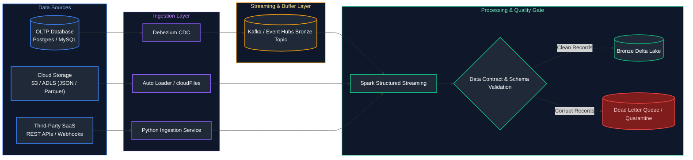

---


## Table of Contents
1. [ETL vs. ELT & Processing Paradigms](#1-etl-vs-elt-processing-paradigms)
   - [1.1 ETL vs ELT Architecture & Processing Paradigms](#11-etl-vs-elt-architecture-processing-paradigms)
   - [1.2 Batch vs Streaming Processing](#12-batch-vs-streaming-processing)
   - [1.3 Push vs Pull Architecture](#13-push-vs-pull-architecture)
   - [1.4 Micro-Batching Mechanics](#14-micro-batching-mechanics)
2. [Resilient Pipeline Design Patterns](#2-resilient-pipeline-design-patterns)
   - [2.1 Idempotency](#21-idempotency)
   - [2.2 Fault Tolerance & Recovery](#22-fault-tolerance-recovery)
   - [2.3 Checkpointing & State Stores](#23-checkpointing-state-stores)
   - [2.4 Backpressure Management](#24-backpressure-management)
   - [2.5 Replayability & Event Re-Sourcing](#25-replayability-event-re-sourcing)
   - [2.6 Deduplication Patterns](#26-deduplication-patterns)
   - [2.7 Late-Arriving & Out-of-Order Data](#27-late-arriving-out-of-order-data)
   - [2.8 Watermarking](#28-watermarking)
   - [2.9 Dead Letter Queues (DLQ) & Quarantine Routing](#29-dead-letter-queues-dlq-quarantine-routing)
   - [2.10 Bad Records Handling & Permissive Modes](#210-bad-records-handling-permissive-modes)
   - [2.11 Schema Validation & Defensive Ingestion](#211-schema-validation-defensive-ingestion)
   - [2.12 Pipeline Monitoring & Observability](#212-pipeline-monitoring-observability)
   - [2.13 SLA Management & Alerting Thresholds](#213-sla-management-alerting-thresholds)
   - [2.14 Backfilling Historical Data](#214-backfilling-historical-data)
   - [2.15 Metadata-Driven Pipelines & Control Table Framework](#215-metadata-driven-pipelines-control-table-framework)
3. [Data Quality & Contracts](#3-data-quality-contracts)
   - [3.1 Data Contracts](#31-data-contracts)
   - [3.2 Great Expectations Framework](#32-great-expectations-framework)
   - [3.3 Soda Core & Soda Cloud](#33-soda-core-soda-cloud)
   - [3.4 Apache Spark Deequ](#34-apache-spark-deequ)
   - [3.5 dbt Tests](#35-dbt-tests)
   - [3.6 Schema Drift Detection](#36-schema-drift-detection)
   - [3.7 Anomaly Detection in Data Pipelines](#37-anomaly-detection-in-data-pipelines)
4. [File-Based Cloud Ingestion](#4-file-based-cloud-ingestion)
   - [4.1 Batch File Ingestion vs Incremental Processing](#41-batch-file-ingestion-vs-incremental-processing)
   - [4.2 Databricks Auto Loader (`cloudFiles`)](#42-databricks-auto-loader-cloudfiles)
   - [4.3 SQL `COPY INTO` (Databricks & Snowflake)](#43-sql-copy-into-databricks-snowflake)
   - [4.4 Snowflake Snowpipe](#44-snowflake-snowpipe)
   - [4.5 BigQuery Load Jobs](#45-bigquery-load-jobs)
   - [4.6 Directory Listing vs Notification-Based Ingestion](#46-directory-listing-vs-notification-based-ingestion)
   - [4.7 Checkpoint Management & State Tracking](#47-checkpoint-management-state-tracking)
   - [4.8 Schema Inference & Automated Evolution](#48-schema-inference-automated-evolution)
5. [Change Data Capture (CDC) Patterns](#5-change-data-capture-cdc-patterns)
   - [5.1 Log-Based CDC (Debezium & Kafka Connect)](#51-log-based-cdc-debezium-kafka-connect)
   - [5.2 Query-Based CDC (Watermarks & updated_at)](#52-query-based-cdc-watermarks-updatedat)
   - [5.3 Trigger-Based CDC](#53-trigger-based-cdc)
6. [Relational Database Ingestion (RDBMS to Lake)](#6-relational-database-ingestion-rdbms-to-lake)
   - [6.1 JDBC & ODBC Extraction Fundamentals](#61-jdbc-odbc-extraction-fundamentals)
   - [6.2 Partitioned Database Reads (Parallel JDBC via Spark)](#62-partitioned-database-reads-parallel-jdbc-via-spark)
7. [API Ingestion Patterns](#7-api-ingestion-patterns)
   - [7.1 API Pagination Strategies](#71-api-pagination-strategies)
   - [7.2 Rate Limiting Handling (Exponential Backoff & Jitter)](#72-rate-limiting-handling-exponential-backoff-jitter)
   - [7.3 API Authentication](#73-api-authentication)
8. [Streaming Message Ingestion](#8-streaming-message-ingestion)
   - [8.1 Kafka to Lakehouse Ingestion](#81-kafka-to-lakehouse-ingestion)
   - [8.2 Azure Event Hubs to Lakehouse Ingestion](#82-azure-event-hubs-to-lakehouse-ingestion)
9. [Production Data Engineering Problem-Solution Master Playbook](#9-production-data-engineering-problem-solution-master-playbook)
10. [References & Further Reading](#10-references-further-reading)

---

# 1. ETL vs. ELT & Processing Paradigms

---

### 1.1 ETL vs ELT Architecture & Processing Paradigms

#### Definition
- **ETL (Extract, Transform, Load):** Raw data is extracted from sources, transformed in an external compute engine (e.g., Python worker, Informatica, Spark), and loaded in clean final form into target storage.
- **ELT (Extract, Load, Transform):** Raw data is extracted and loaded directly into the destination storage/lakehouse unmodified (Bronze layer), with transformations executed using pushdown SQL compute within the warehouse (Silver/Gold layers).
- **Reverse ETL:** Synchronizes curated analytical models and aggregated metrics from the cloud data warehouse *back* into operational business applications (Salesforce, HubSpot, Zendesk, Stripe) to empower frontline operational workflows.

#### Comprehensive Paradigm Comparison Matrix

| Architectural Trait | Traditional ETL | Modern ELT | Reverse ETL |
| :--- | :--- | :--- | :--- |
| **Transformation Location** | External compute engine before loading | Inside destination target engine (BigQuery, Snowflake, Databricks) | Pushdown compute inside DWH; syncs to operational SaaS APIs |
| **Raw Data Preservation** | **Lost:** Discards unmodeled columns before storage | **Preserved 100%:** Lands raw records in Bronze storage for historical reprocessing | Operates on pre-modeled, aggregated Gold presentation tables |
| **Compute Scalability** | Bottlenecked by intermediate transformation server capacity | Leverages elastic, serverless cloud data warehouse engines | Leverages DWH query engine and respects target SaaS API rate limits |
| **Time to Value** | Slower; requires engineering effort for every new column | Faster; analysts write SQL directly against landed raw tables | Rapid operationalization of analytical insights for business teams |
| **Best Analytical Fit** | Strict data masking before cloud entry, legacy on-prem systems | **Standard modern pattern** for cloud data lakes and lakehouses | Operational analytics, CRM lead scoring, customer churn alerts |

#### Processing Modes Comparison (Batch vs. Incremental vs. CDC)

| Processing Mode | How Changes are Detected | Captures Hard Deletes? | Source System Impact | Latency Profile |
| :--- | :--- | :--- | :--- | :--- |
| **Full Batch Reload** | Ingests entire table snapshot every run | Yes (replaces entire table) | **High:** Full table scans strain production database I/O | Daily or weekly |
| **Incremental Watermark** | Queries `WHERE updated_at > last_watermark` | **No:** Cannot detect hard deletes without audit tables | **Medium:** Index scans on timestamp columns | Hourly to 15-minute batches |
| **Change Data Capture (CDC)** | Tails database write-ahead transaction logs (WAL/Binlog) | **Yes:** Emits explicit `DELETE` change events | **Near Zero:** Asynchronous reading of log files on disk | Sub-second to real-time streaming |

### 1.2 Batch vs Streaming Processing

#### Definition
- **Batch Processing:** Processes finite, bounded blocks of historical data collected over an interval (hourly, daily). High throughput, high latency.
- **Streaming Processing:** Processes unbounded streams of continuous events in near-real-time (millisecond to second latency) as events occur.

```mermaid
flowchart TD
    subgraph BatchParadigm ["Batch Processing (Bounded)"]
        BIn[24 Hours of Data] --> BProc[Batch Spark Job at 2 AM] --> BOut[Updated Daily Dashboard]
    end

    subgraph StreamParadigm ["Streaming Processing (Unbounded)"]
        SIn[Real-Time Click Stream] --> SProc[Flink / Structured Streaming] --> SOut[Live Fraud Alert in 100ms]
    end

    style BatchParadigm fill:#0f172a,stroke:#3b82f6,stroke-width:1.5px,color:#93c5fd
    style StreamParadigm fill:#0f172a,stroke:#10b981,stroke-width:1.5px,color:#6ee7b7

    style BIn fill:#1f2937,stroke:#3b82f6,stroke-width:2px,color:#fff
    style BProc fill:#1f2937,stroke:#3b82f6,stroke-width:2px,color:#fff
    style BOut fill:#1f2937,stroke:#3b82f6,stroke-width:2px,color:#fff
    style SIn fill:#1f2937,stroke:#10b981,stroke-width:2px,color:#fff
    style SProc fill:#1f2937,stroke:#10b981,stroke-width:2px,color:#fff
    style SOut fill:#1f2937,stroke:#10b981,stroke-width:2px,color:#fff
```

#### References
- [GeeksforGeeks: Batch vs Stream Processing](https://www.geeksforgeeks.org/batch-processing-vs-real-time-processing/)
- [DataCamp: Stream Processing Fundamentals](https://www.datacamp.com/tutorial/stream-processing)

---

### 1.3 Push vs Pull Architecture

#### Definition
- **Pull Architecture (Polling):** The ingestion pipeline periodically queries the source system API or database to check for updates (e.g., polling an API every 15 minutes).
- **Push Architecture (Event-Driven / Webhooks):** The source system proactively emits events to an ingestion endpoint the moment an action occurs (e.g., Stripe Webhook pushing payment events to Kafka).

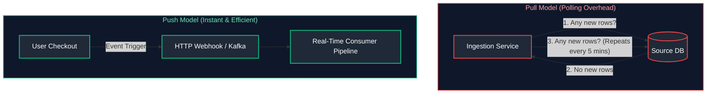

---

### 1.4 Micro-Batching Mechanics

#### Definition
Micro-batching bridges the gap between pure event-at-a-time streaming and large batch jobs. A streaming engine (e.g., Spark Structured Streaming) accumulates incoming events over a tiny time window (e.g., 5 seconds or 1 minute) and processes the batch using standard optimized batch algorithms.

---

# 2. Resilient Pipeline Design Patterns

---

### 2.1 Idempotency

#### Definition
A pipeline is **Idempotent** if running it multiple times with the exact same input data produces the **exact same final output and state**, with zero duplicate rows or corrupted calculations.

$$
orall x, \quad f(f(x)) = f(x)$$

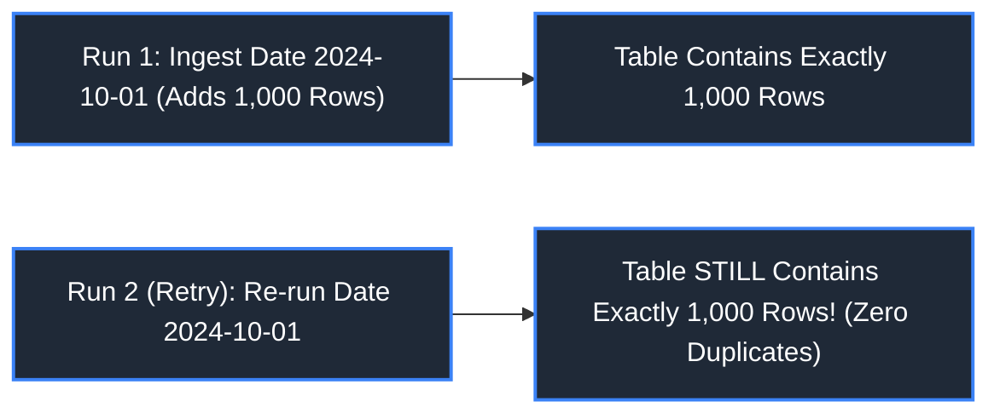

#### Idempotent Implementation Patterns
1. **Delete-Before-Insert (Partition Overwrite):**
```sql
-- Atomically replace target partition
INSERT OVERWRITE TABLE warehouse.fact_daily_metrics 
PARTITION (metric_date = '2024-10-01')
SELECT ... FROM staging.metrics WHERE date = '2024-10-01';
```
2. **Deterministic MERGE / UPSERT:**
```sql
MERGE INTO target USING source ON target.id = source.id
WHEN MATCHED THEN UPDATE ...
WHEN NOT MATCHED THEN INSERT ...;
```

#### References
- [GeeksforGeeks: Idempotence in Distributed Systems](https://www.geeksforgeeks.org/idempotence-in-distributed-systems/)
- [DataCamp: Building Resilient Data Pipelines](https://www.datacamp.com/tutorial/data-pipelines)

---

### 2.2 Fault Tolerance & Recovery

#### Definition
Fault tolerance guarantees that when pipeline components fail (worker node crash, network partition, spot instance preemption), the system detects the failure, isolates the state, and recovers gracefully without data loss or human intervention.

---

### 2.3 Checkpointing & State Stores

#### Definition
In continuous streaming pipelines (Spark Structured Streaming, Flink), a Checkpoint directory records the exact **stream offsets (Kafka partition offsets)** and intermediate aggregation state in persistent cloud storage. If the cluster crashes, the job reads the checkpoint on restart and resumes processing from the exact offset it left off.

```python
# Checkpoint configuration in PySpark Structured Streaming
query = df_stream.writeStream \
    .format("delta") \
    .outputMode("append") \
    .option("checkpointLocation", "s3://lakehouse/checkpoints/orders_stream/") \
    .start("/lakehouse/orders/")
```

---

### 2.4 Backpressure Management

#### Definition
Backpressure occurs when an upstream message broker (Kafka) delivers events faster than downstream processing workers can ingest them. Resilient pipelines automatically signal the source broker to throttle transmission rates dynamically, preventing memory exhaustion and OOM crashes.

---

### 2.5 Replayability & Event Re-Sourcing

#### Definition
Replayability is the architectural ability to reset stream consumer offsets back to a historical timestamp (e.g., 7 days ago) to reprocess events following a bug fix or pipeline schema update.

---

### 2.6 Deduplication Patterns

#### Moving from At-Least-Once to Exactly-Once
Distributed pipelines typically operate on **At-Least-Once delivery** (network retries can send duplicate messages). To achieve **Effectively-Once (Exactly-Once)** downstream semantics, pipelines use deterministic deduplication:

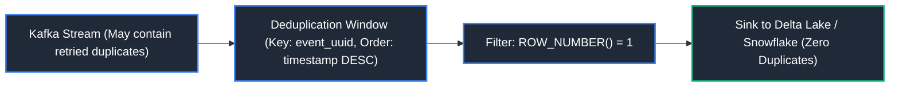

---

### 2.7 Late-Arriving & Out-of-Order Data

#### Definition
In mobile apps and IoT systems, client devices lose network connectivity and upload cached events hours or days later. Pipelines must distinguish between:
- **Event Time:** When the action physically occurred on the device.
- **Processing Time:** When the cloud pipeline received the record.

---

### 2.8 Watermarking

#### Definition
A Watermark is a streaming threshold that tells the engine how long to wait for late-arriving data before finalizing time-windowed aggregations and purging old state from memory.
$$	ext{Watermark Threshold} = \max(	ext{Event Time Seen}) - 	ext{Allowed Latency Delay}$$

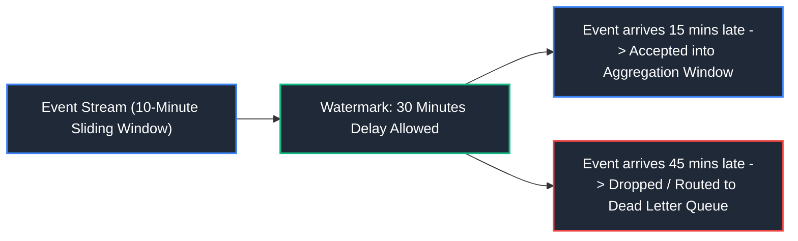

#### Code Example
```python
# PySpark Structured Streaming with Watermark
df_windowed = df_stream \
    .withWatermark("event_timestamp", "30 minutes") \
    .groupBy(window("event_timestamp", "10 minutes"), "device_id") \
    .count()
```

#### References
- [Apache Spark Documentation: Watermarking](https://spark.apache.org/docs/latest/structured-streaming-programming-guide.html#handling-late-data-and-watermarking)
- [GeeksforGeeks: Watermarking in Stream Processing](https://www.geeksforgeeks.org/stream-processing-in-big-data/)

---

### 2.9 Dead Letter Queues (DLQ) & Quarantine Routing

#### Definition
A Dead Letter Queue (DLQ) is a dedicated secondary storage queue or table where malformed, corrupt, or unparseable records are routed instead of crashing the primary production pipeline.

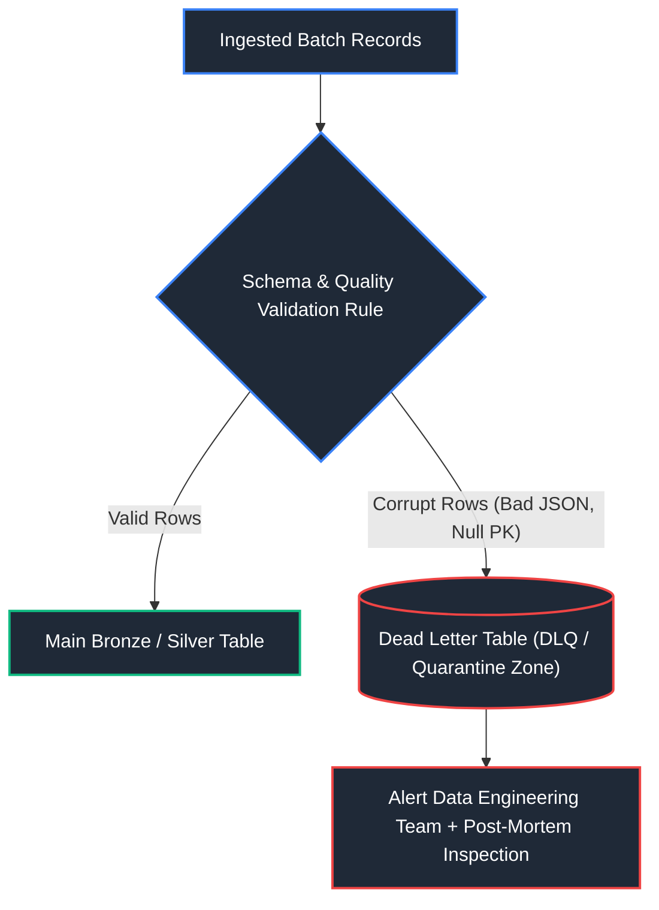

---

### 2.10 Bad Records Handling & Permissive Modes

#### PySpark Read Modes
- `PERMISSIVE` (Default): Sets corrupt fields to `NULL` and puts the raw malformed string into a dedicated column named `_corrupt_record`.
- `DROPMALFORMED`: Silently drops any row containing corrupt characters.
- `FAILFAST`: Immediately crashes the job upon encountering the first corrupt row.

```python
# Permissive mode with corrupt record tracking
df = spark.read \
    .option("mode", "PERMISSIVE") \
    .option("columnNameOfCorruptRecord", "_corrupt_record") \
    .schema(custom_schema) \
    .json("s3://landing/dirty_data/")
```

---

### 2.11 Schema Validation & Defensive Ingestion

#### Definition
Defensive ingestion enforces strict type and field presence assertions before committing rows into analytical tables, preventing corrupt downstream BI dashboards.

---

### 2.12 Pipeline Monitoring & Observability

#### Key Observability Pillars
1. **Freshness:** Has data landed within the last 15 minutes?
2. **Volume:** Did today's batch contain 100,000 rows as expected, or only 500 rows (indicating upstream API failure)?
3. **Schema:** Did upstream engineers silently drop or rename a column?

---

### 2.13 SLA Management & Alerting Thresholds

#### Definition
Service Level Agreements (SLAs) define the contractual deadline by which data must be cleaned, validated, and published to downstream consumers (e.g., Gold financial marts must be ready by 6:00 AM EST).

---

### 2.14 Backfilling Historical Data

#### Definition
Backfilling is the process of executing a pipeline over historical time intervals to repopulate data following a schema migration, bug fix, or new metric implementation.

#### Code Example (Airflow / Script Backfill Loop)
```bash
# Automated backfill loop running daily partition batches
for date in $(seq -d 2024-01-01 2024-01-31); do
    python run_pipeline.py --execution_date $date
done
```

---

### 2.15 Metadata-Driven Pipelines & Control Table Framework

#### Definition
A **metadata-driven pipeline** separates pipeline execution logic from table-specific configurations. Rather than writing individual hardcoded ingestion pipelines for 500 tables, a centralized execution framework reads table definitions, primary keys, watermark columns, and sync schedules from a control catalog (JSON/YAML or database table) and dynamically parameterizes the ingestion engine.

#### Python Metadata-Driven Execution Framework
```python
import json
from dataclasses import dataclass
from typing import List

@dataclass
class TablePipelineConfig:
    """Strongly-typed metadata specification for an automated ingestion pipeline."""
    source_table: str      # Upstream relational table name
    target_table: str      # Downstream lakehouse destination table
    primary_key: str       # Entity identifier used for deduplication
    watermark_column: str  # Monotonic timestamp column for high-watermark tracking
    is_active: bool        # Toggles execution status without modifying code

class MetadataPipelineExecutor:
    """
    Metadata-driven orchestrator dynamically executing dozens of ingestion pipelines
    from externalized JSON/YAML catalog specifications.
    """
    def __init__(self, config_json_path: str):
        # Load external pipeline metadata configuration file
        with open(config_json_path, 'r') as f:
            # Parse active table configurations into typed objects
            self.configs: List[TablePipelineConfig] = [
                TablePipelineConfig(**item) for item in json.load(f) if item.get('is_active', True)
            ]

    def get_last_watermark(self, target_table: str) -> str:
        # Query control database state table for timestamp of last successful sync
        # In production: SELECT MAX(high_watermark) FROM pipeline_control.watermark_state WHERE table_name = target_table
        return "2026-10-01 00:00:00"

    def execute_all(self):
        # Iterate over each registered active table definition
        for cfg in self.configs:
            # Retrieve checkpoint boundary to prevent full-table re-reads
            watermark = self.get_last_watermark(cfg.target_table)
            print(f"Executing incremental sync for {cfg.source_table} -> {cfg.target_table}")
            # Construct parameterized incremental extraction query
            query = f"""
                SELECT * FROM {cfg.source_table} 
                WHERE {cfg.watermark_column} > '{watermark}'
                ORDER BY {cfg.watermark_column} ASC
            """
            # Dispatch extraction task to worker pool (Spark / JDBC / Airbyte)
            print(f"Dispatched Extraction Query: {query.strip()}")
```

# 3. Data Quality & Contracts

---

### 3.1 Data Contracts

#### Definition
A Data Contract is a formal, version-controlled agreement between upstream software engineers producing data (e.g., Checkout Service API) and downstream data engineering consumers. It specifies schema structures, SLA guarantees, update frequencies, and semantic meanings, preventing breaking changes at source boundaries.

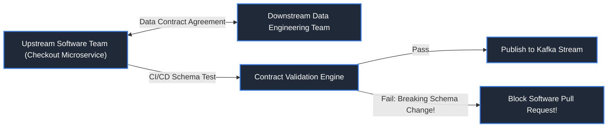

#### References
- [Data Contracts Specification](https://datacontract.com/)

---

### 3.2 Great Expectations Framework

#### Definition
Great Expectations (GX) is the leading open-source Python framework for validating, documenting, and profiling data quality through test assertions called **Expectations**.

```python
import great_expectations as gx

context = gx.get_context()
validator = context.sources.pandas_default.read_csv("orders.csv")

# Declare quality expectations
validator.expect_column_values_to_not_be_null(column="order_id")
validator.expect_column_values_to_be_between(column="order_amount", min_value=0.01, max_value=50000.0)
validator.expect_column_values_to_be_in_set(column="status", value_set=["PENDING", "COMPLETED", "REFUNDED"])

# Execute validation
checkpoint_result = validator.validate()
assert checkpoint_result["success"] == True
```

#### References
- [Great Expectations Documentation](https://docs.greatexpectations.io/)
- [DataCamp: Data Quality with Great Expectations](https://www.datacamp.com/tutorial/great-expectations-tutorial)

---

### 3.3 Soda Core & Soda Cloud

#### Definition
Soda Core is a lightweight, SQL-friendly data quality framework that defines automated quality assertions using human-readable YAML configurations.

```yaml
# checks.yml
checks for fact_orders:
  - row_count > 0
  - missing_count(customer_id) = 0
  - min(order_amount) >= 0.00
  - freshness(order_timestamp) < 2h
```

#### References
- [Soda Core Documentation](https://docs.soda.io/)

---

### 3.4 Apache Spark Deequ

#### Definition
Deequ is an open-source library built directly on Apache Spark (developed by Amazon) that enables unit testing of large-scale distributed datasets with automated metric profiling and anomaly verification.

---

### 3.5 dbt Tests

#### Definition
dbt provides built-in declarative tests defined in `schema.yml`:
- `unique`
- `not_null`
- `accepted_values`
- `relationships` (Foreign Key referential integrity)

```yaml
# dbt schema test definition enforcing declarative data quality constraints
version: 2
models:
  - name: fact_orders                              # Target dimensional fact model
    columns:
      - name: order_id                             # Surrogate/Natural primary key
        tests:
          - unique                                 # Asserts zero duplicated order IDs exist
          - not_null                               # Asserts zero NULL values exist in primary key
      - name: order_status                         # Categorical state column
        tests:
          - accepted_values:                       # Asserts all rows conform to discrete allowed enumeration
              values: ['placed', 'shipped', 'completed', 'return_pending']
```

#### References
- [dbt Documentation: Testing](https://docs.getdbt.com/docs/build/data-tests)
- [DataCamp: Testing in dbt](https://www.datacamp.com/tutorial/dbt-tutorial)

---

### 3.6 Schema Drift Detection

#### Definition
Schema drift occurs when source systems add, drop, or alter column types without warning. Resilient pipelines use automated schema drift detection to log warnings or route altered payloads to staging tables.

---

### 3.7 Anomaly Detection in Data Pipelines

#### Definition
Machine learning algorithms monitor time-series data pipeline metrics (row volumes, average values, null rates) to detect statistical deviations ($>3\sigma$ from rolling mean) before corrupted data reaches executive dashboards.

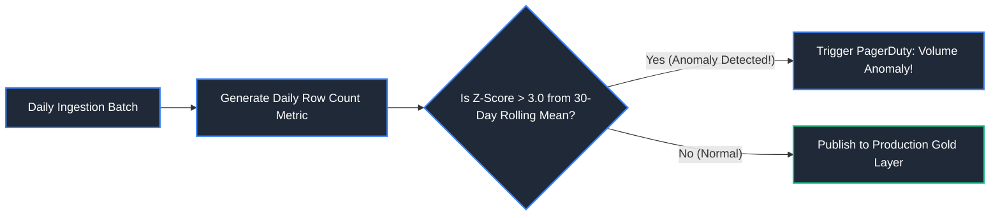

#### References
- [GeeksforGeeks: Anomaly Detection Techniques](https://www.geeksforgeeks.org/machine-learning-for-anomaly-detection/)
- [DataCamp: Anomaly Detection in Data Pipelines](https://www.datacamp.com/tutorial/anomaly-detection-python)

---

---

---
# 4. File-Based Cloud Ingestion

---

### 4.1 Batch File Ingestion vs Incremental Processing

#### Definition
- **Batch File Ingestion:** Periodically crawls a storage prefix, reading all files found. Incurs high latency and redundant re-reads as historical file counts grow into millions.
- **Incremental Processing:** Tracks which files have already been ingested (via metadata state or cloud event queues) and processes **only newly arrived files**, cutting compute costs by 90%+.

---

### 4.2 Databricks Auto Loader (`cloudFiles`)

#### Definition
Auto Loader incrementally and efficiently processes billions of new data files as they arrive in cloud object storage (S3, ADLS Gen2, GCS) without state management headaches. It automatically scales to ingest millions of files per hour using an embedded **RocksDB** key-value state store.

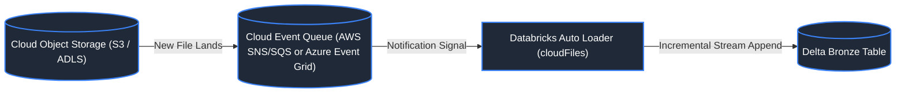

#### Code Example (PySpark Auto Loader)
```python
# Streaming Auto Loader ingestion with automated schema evolution
df_autoloader = spark.readStream.format("cloudFiles") \
    .option("cloudFiles.format", "json") \
    .option("cloudFiles.schemaLocation", "s3://lakehouse/metadata/schema_orders/") \
    .option("cloudFiles.schemaEvolutionMode", "addNewColumns") \
    .load("s3://landing-bucket/incoming_orders/")

df_autoloader.writeStream \
    .format("delta") \
    .outputMode("append") \
    .option("checkpointLocation", "s3://lakehouse/checkpoints/orders_autoloader/") \
    .toTable("bronze.raw_orders")
```

#### References
- [Databricks Documentation: What is Auto Loader?](https://docs.databricks.com/en/ingestion/auto-loader/index.html)
- [DataCamp: Ingestion with Databricks Auto Loader](https://www.datacamp.com/tutorial/databricks)

---

### 4.3 SQL `COPY INTO` (Databricks & Snowflake)

#### Definition
`COPY INTO` is an idempotent SQL statement that loads data from cloud files into a table. It tracks file metadata history internally, guaranteeing that files previously loaded are skipped during subsequent runs.

```sql
-- Databricks / Snowflake COPY INTO syntax
COPY INTO bronze.raw_shipments
FROM 's3://logistics-landing/shipments/'
FILEFORMAT = PARQUET
COPY_OPTIONS ('mergeSchema' = 'true');
```

#### References
- [Databricks Documentation: COPY INTO](https://docs.databricks.com/en/sql/language-manual/delta-copy-into.html)
- [Snowflake Documentation: COPY INTO Table](https://docs.snowflake.com/en/sql-reference/sql/copy-into-table)

---

### 4.4 Snowflake Snowpipe

#### Definition
Snowpipe is Snowflake's serverless, automated data ingestion service. It listens to storage event notifications (AWS SQS, Azure Event Grid, GCP Pub/Sub) and automatically loads data micro-batches into target tables within seconds of landing in cloud storage without requiring a running virtual warehouse.

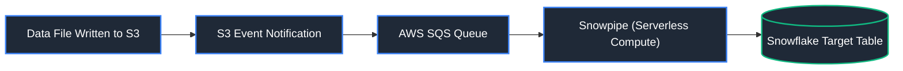

#### References
- [Snowflake Documentation: Introduction to Snowpipe](https://docs.snowflake.com/en/user-guide/data-load-snowpipe-intro)
- [GeeksforGeeks: Snowpipe in Snowflake](https://www.geeksforgeeks.org/snowpipe-in-snowflake/)

---

### 4.5 BigQuery Load Jobs

#### Definition
Google BigQuery provides dedicated asynchronous **Load Jobs** to ingest data from Cloud Storage (GCS) or local files into BigQuery tables. **BigQuery Load Jobs are completely free of compute charges** (users pay only for storage).

```bash
# Loading Parquet files from GCS into BigQuery via bq CLI
bq load \
    --source_format=PARQUET \
    --autodetect \
    analytics.fact_pageviews \
    gs://my-bucket/web_logs/*.parquet
```

#### References
- [Google Cloud Documentation: Loading Data into BigQuery](https://cloud.google.com/bigquery/docs/loading-data)

---

### 4.6 Directory Listing vs Notification-Based Ingestion

#### Comparison
- **Directory Listing Mode:** The ingestion engine sends HTTP `LIST` requests to cloud storage across all prefixes. As a bucket grows from 10,000 to 10,000,000 files, listing takes 30+ minutes before any file can be read.
- **Notification-Based Mode:** Cloud storage publishes an event to a message queue (AWS SQS, Azure Event Grid) whenever a file is created (`s3:ObjectCreated:*`). The ingestion engine consumes the queue directly ($O(1)$ discovery), scaling seamlessly to billions of files.

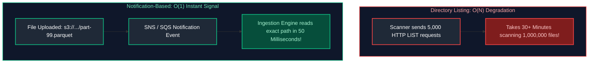

---

### 4.7 Checkpoint Management & State Tracking

#### Definition
Checkpoints record the exact high-water mark of ingested files, byte offsets, and timestamps to ensure that restarting an ingestion job does not re-read processed files or drop in-flight streams.

---

### 4.8 Schema Inference & Automated Evolution

#### Definition
Modern ingestion frameworks inspect incoming files to infer schemas automatically. If an incoming file introduces a new attribute (e.g., `device_ip`), **Schema Evolution** automatically updates the table catalog (`ALTER TABLE ADD COLUMN`) without human intervention or pipeline failure.

---

#### Auto Loader Schema Evolution Policies

| Mode | Behavior when New Columns Arrive | Best Use Case |
| :--- | :--- | :--- |
| **`addNewColumns`** (Default) | Automatically appends new columns to target schema and stream continues uninterrupted. | Production Bronze landing zones with schema flexibility. |
| **`rescue`** | Does not alter schema; routes unexpected columns and data types into `_rescued_data` JSON column. | Strict schema enforcement where unexpected fields cannot break downstream models. |
| **`failOnNewColumns`** | Immediately throws an exception and halts the stream when unknown columns appear. | Regulated financial or compliance tables with zero drift tolerance. |
| **`none`** | Ignores newly arrived columns; writes only columns declared in the initial schema. | Fixed schemas with intentional discarding of ancillary source fields. |

# 5. Change Data Capture (CDC) Patterns

Change Data Capture (CDC) observes, identifies, and extracts state changes (inserts, updates, deletes) in transactional databases and delivers them in real time to the analytical data lakehouse.

---

### 5.1 Log-Based CDC (Debezium & Kafka Connect)
> [!NOTE]
> For detailed stream processing and offset management of CDC events, refer to [11. Streaming & Kafka Event Streaming](11_streaming_and_kafka_event_streaming.md). For applying CDC events via Lakehouse Change Data Feed, see [09. Databricks & Delta Lake](09_databricks_and_delta_lake.md#101-change-data-feed-cdf).


#### Definition
Log-Based CDC reads the database's internal transaction log directly (**PostgreSQL WAL, MySQL Binlog, Oracle Redo Log, SQL Server CDC**). It captures every row modification with zero impact on transactional application query performance.

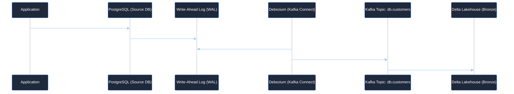

#### Why Log-Based CDC is the Enterprise Gold Standard
1. **Captures Deletes:** Deletes appear directly in the transaction log (impossible in query-based CDC).
2. **Zero App Overhead:** Does not execute `SELECT` queries against application tables.
3. **Sub-Second Latency:** Changes are streamed immediately upon transaction commit.

#### References
- [Debezium Official Architecture Guide](https://debezium.io/documentation/reference/stable/architecture.html)
- [GeeksforGeeks: Change Data Capture (CDC)](https://www.geeksforgeeks.org/change-data-capture-cdc/)

---

### 5.2 Query-Based CDC (Watermarks & `updated_at`)

#### Definition
Query-Based CDC executes periodic SQL queries against source tables using an update timestamp watermark column (`WHERE updated_at > :last_watermark`).

```sql
-- Incremental High-Watermark Extraction Query
-- Queries only records modified or inserted strictly after previous pipeline batch watermark
SELECT * 
FROM operational.orders 
WHERE last_modified_timestamp > '2024-10-02 23:59:59'  -- Boundary evaluated from pipeline state store
ORDER BY last_modified_timestamp ASC;                 -- Ascending order ensures consistent chunking
```

#### Critical Flaws
1. **Cannot Detect Deletes:** If a row is deleted (`DELETE FROM orders WHERE id = 5`), there is no updated timestamp; the delete is silently missed.
2. **Database Load:** Executing heavy polling queries every 5 minutes strains operational database CPU and memory.

---

### 5.3 Trigger-Based CDC

#### Definition
Database triggers (`AFTER INSERT/UPDATE/DELETE`) execute custom PL/SQL logic on every transaction, writing delta copies to an auxiliary audit shadow table. 
- **Drawback:** Massive write amplification. Every single application write triggers double disk writes, degrading OLTP transaction throughput.

---

# 6. Relational Database Ingestion (RDBMS to Lake)

---

### 6.1 JDBC & ODBC Extraction Fundamentals

#### Definition
Java Database Connectivity (JDBC) is the standard API for connecting distributed compute engines (Spark) to relational databases (Postgres, Oracle, SQL Server, MySQL).

---

### 6.2 Partitioned Database Reads (Parallel JDBC via Spark)

#### Definition
By default, `spark.read.jdbc()` uses **a single thread on a single worker node** to query the database (`SELECT * FROM table`), creating a massive bottleneck. 

To achieve multi-gigabyte/second throughput, Spark supports **Partitioned JDBC Reads**: it splits the database query across multiple worker tasks in parallel by partitioning on an indexed integer column.

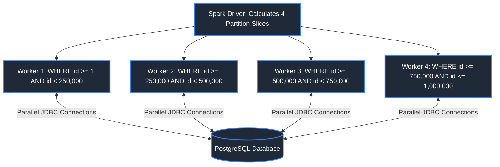

#### Code Example (PySpark Parallel JDBC Read)
```python
# Parallelized JDBC Read in PySpark: splits massive source table across multiple concurrent connection streams
df_parallel_jdbc = spark.read.format("jdbc") \
    .option("url", "jdbc:postgresql://db.corp.internal:5432/production") \ # Database host connection string
    .option("dbtable", "sales.transactions") \                              # Source relational table
    .option("user", "lakehouse_reader") \                                   # Authenticated service user
    .option("password", "SecureSecret123") \                               # Secret credential from Key Vault
    .option("partitionColumn", "transaction_id") \                         # Numerical indexed column used to slice ranges
    .option("lowerBound", "1") \                                            # Floor of transaction_id range
    .option("upperBound", "10000000") \                                     # Ceiling of transaction_id range
    .option("numPartitions", "16") \                                        # Spawns 16 concurrent JDBC query threads on executors
    .load()                                                                 # Lazy DataFrame representation
```

#### References
- [Apache Spark Documentation: JDBC to Other Databases](https://spark.apache.org/docs/latest/sql-data-sources-jdbc.html)
- [GeeksforGeeks: Connecting PySpark to PostgreSQL](https://www.geeksforgeeks.org/connecting-pyspark-with-postgresql/)

---

# 7. API Ingestion Patterns

---

### 7.1 API Pagination Strategies

#### 1. Offset-Based Pagination
- Query: `GET /api/v1/users?limit=100&offset=500`
- **Flaw:** High database cost on deep pages (`OFFSET 1000000`); misses or duplicates records if new rows are inserted during extraction.

#### 2. Page-Based Pagination
- Query: `GET /api/v1/orders?page=5&per_page=100`

#### 3. Keyset / Cursor-Based Pagination (Best Practice)
- Query: `GET /api/v1/events?cursor=eyJpZCI6OTkyNDB9&limit=100`
- The cursor is an opaque base64 string encoding the primary key and timestamp of the last record seen. Highly performant ($O(1)$ index seek) and immune to record drift.

---

### 7.2 Rate Limiting Handling (Exponential Backoff & Jitter)

#### Definition
Web APIs protect their infrastructure using rate limits (e.g., max 100 requests per minute). Exceeding limits returns HTTP `429 Too Many Requests`.

Resilient ingestion scripts implement **Exponential Backoff with Full Jitter** to back off exponentially when throttled:
$$	ext{Sleep Time} = 	ext{rand}(0, \; \min(	ext{MaxSleep}, \; 	ext{BaseSleep} 	imes 2^{	ext{retry}}))$$

```python
import time
import random
import requests
from typing import Dict, Any

def fetch_api_with_backoff(url: str, max_retries: int = 5) -> Dict[str, Any]:
    """
    Performs resilient HTTP GET extraction honoring server 'Retry-After' rate-limit headers
    and adding uniform random jitter to eliminate request collision stampedes.
    """
    retries = 0
    while retries < max_retries:
        # Dispatch HTTP GET request
        response = requests.get(url, timeout=30.0)
        # HTTP 200 OK: return parsed response payload
        if response.status_code == 200:
            return response.json()
        # HTTP 429 Too Many Requests: Rate limit exceeded
        elif response.status_code == 429:
            # Respect upstream Retry-After response header, falling back to exponential backoff (2^n)
            retry_after = int(response.headers.get("Retry-After", 2 ** retries))
            # Full Jitter: randomize delay by 100ms-1000ms to avoid thundering herd on restart
            sleep_duration = retry_after + random.uniform(0.1, 1.0)
            print(f"[THROTTLED] HTTP 429 encountered. Backing off for {sleep_duration:.2f}s (Attempt {retries+1}/{max_retries})")
            time.sleep(sleep_duration)
            retries += 1
        else:
            # Raise exception immediately for non-recoverable client/server errors (e.g. 403, 404, 500)
            response.raise_for_status()
    # Retry budget exhausted
    raise TimeoutError(f"Maximum retry limit ({max_retries}) reached for API endpoint: {url}")
```

---

### 7.3 API Authentication

#### OAuth 2.0 Client Credentials Flow
Enterprise data pipelines authenticate against SaaS APIs (Salesforce, Stripe, ServiceNow) using OAuth 2.0:
1. Pipeline sends `client_id` and `client_secret` to Token Auth Endpoint.
2. Auth server returns an ephemeral JWT Bearer Access Token (valid for 1 hour).
3. Pipeline attaches `Authorization: Bearer <token>` to data requests and refreshes the token automatically upon expiration.

---

# 8. Streaming Message Ingestion

---

### 8.1 Kafka to Lakehouse Ingestion

#### Definition
Streaming messages directly from Apache Kafka topics into Delta Lake or Iceberg tables, ensuring continuous low-latency data availability.

```python
# Structured Streaming Kafka Consumer reading event stream continuously
df_kafka_stream = spark.readStream \
    .format("kafka") \                                                 # Spark Kafka connector format
    .option("kafka.bootstrap.servers", "kafka-broker:9092") \           # Comma-separated Kafka broker endpoints
    .option("subscribe", "telemetry-events") \                          # Topic subscription
    .option("startingOffsets", "latest") \                              # Start reading from latest topic offset
    .option("failOnDataLoss", "false") \                                # Prevent pipeline crash on retention compaction
    .load()

# Deserialize binary byte arrays into UTF-8 strings for schema parsing
df_parsed = df_kafka_stream.selectExpr(
    "CAST(key AS STRING) AS partition_key",                              # Cast Kafka message key to string
    "CAST(value AS STRING) AS json_payload",                             # Cast binary JSON payload to string
    "timestamp AS event_kafka_timestamp"                                 # Preserve broker message arrival timestamp
)
```

---

### 8.2 Azure Event Hubs to Lakehouse Ingestion

#### Definition
Azure Event Hubs provides an enterprise event ingestion service capable of ingesting millions of events per second with native Kafka protocol compatibility.
- **Event Hubs Capture:** Automatically dumps raw event streams directly to ADLS Gen2 as Avro files.
- **Direct Stream Processing:** Streamed into Azure Databricks using the Event Hubs Spark connector.

#### References
- [Microsoft Learn: Azure Event Hubs Overview](https://learn.microsoft.com/en-us/azure/event-hubs/event-hubs-about)
- [DataCamp: Real-time Ingestion with Kafka](https://www.datacamp.com/tutorial/apache-kafka-tutorial)

---

---

# 9. Production Data Engineering Problem-Solution Master Playbook

In mission-critical enterprise environments, data engineers encounter recurring production failure modes spanning data quality, streaming backlogs, distributed compute bottlenecks, cluster latency, and regulatory compliance. The following master playbook maps the **50 canonical data engineering production problems** to their architectural root causes, engineering solutions, and detailed chapter implementations across this curriculum.

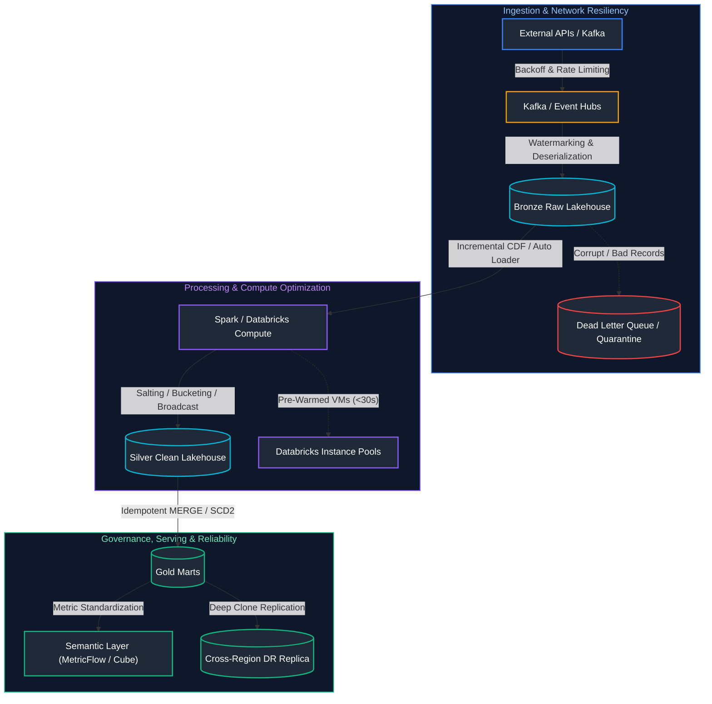

---

### The 50 Canonical Production Problems & Solutions Matrix

| # | Problem | Canonical Solution | Architectural Root Cause | Engineering Implementation & Curriculum Reference |
| :- | :--- | :--- | :--- | :--- |
| **1** | **Duplicate Records** | Deduplication | Network retries, non-idempotent pipeline re-runs, at-least-once streaming delivery. | Window deduplication `ROW_NUMBER() OVER (...)`, Delta `MERGE`, or streaming stateful deduplication. See [01. SQL](01_sql_fundamentals.md#3-aggregate-functions-null-handling--filtering-semantics), [02. SQL](02_advanced_sql.md#1-ranking-functions-row_number-rank-dense_rank), [10. Pipelines](10_data_pipeline_design_and_ingestion.md#26-deduplication-patterns). |
| **2** | **Late Arriving Data** | Watermarking | Mobile devices offline caching, intermittent network partitions. | Event-time watermarking with bounded allowed lateness window. See [10. Pipelines](10_data_pipeline_design_and_ingestion.md#28-watermarking), [11. Streaming](11_streaming_and_kafka_event_streaming.md#56-watermarking--state-expiration). |
| **3** | **CDC Processing** | Change Data Feed (CDF) | Costly full-table scans to identify changed rows. | Log-based CDC (Debezium) and Delta Lake Change Data Feed (`table_changes`). See [09. Databricks](09_databricks_and_delta_lake.md#101-change-data-feed-cdf), [10. Pipelines](10_data_pipeline_design_and_ingestion.md#51-log-based-cdc-debezium--kafka-connect). |
| **4** | **Data Skew** | Salting | Severe cardinality imbalance on join/aggregation keys. | Salting join keys with random prefixes and AQE skew join handling. See [02. SQL](02_advanced_sql.md#61-query-optimization-techniques--execution-plan-analysis), [08. Spark](08_apache_spark_pyspark.md#51-key-salting-for-extreme-data-skew). |
| **5** | **Small Files** | OPTIMIZE / Compaction | High-frequency streaming micro-batch commits creating thousands of tiny files. | Bin-packing compaction via Delta `OPTIMIZE table ZORDER BY (...)` and Auto-compaction. See [07. File Formats](07_file_formats_and_storage.md#27-the-small-file-problem), [09. Databricks](09_databricks_and_delta_lake.md#91-optimize--file-bin-packing). |
| **6** | **Schema Changes** | Schema Evolution | Upstream microservices altering or adding payload fields. | Delta Lake `mergeSchema` and Confluent Schema Registry backward/forward compatibility. See [09. Databricks](09_databricks_and_delta_lake.md#86-schema-evolution-mergeschema), [10. Pipelines](10_data_pipeline_design_and_ingestion.md#48-schema-inference--automated-evolution). |
| **7** | **Pipeline Failures** | Dead Letter Queue (DLQ) | Poison pill records and schema validation aborts crashing streaming engines. | Isolating malformed records into a dedicated DLQ/quarantine topic or table. See [10. Pipelines](10_data_pipeline_design_and_ingestion.md#29-dead-letter-queues-dlq--quarantine-routing), [11. Streaming](11_streaming_and_kafka_event_streaming.md#44-kafka-to-delta-lake-streaming-ingestion--dead-letter-queue-dlq-isolation). |
| **8** | **Data Quality Issues** | Data Validation Framework | Undetected null poisoning, corrupted distributions, broken business assumptions. | Automated assertion frameworks (Great Expectations, Soda Core, PyDeequ, dbt tests). See [09. Databricks](09_databricks_and_delta_lake.md#37-dlt-expectations--data-quality-enforcement), [10. Pipelines](10_data_pipeline_design_and_ingestion.md#32-great-expectations-framework), [12. Orchestration](12_orchestration_airflow_and_dbt.md#26-dbt-testing--assertions). |
| **9** | **Missing Data / Nulls** | Imputation / Default Values | Dropped sensor readings, optional form inputs, missing transaction attributes. | Statistical imputation (mean/median via Spark ML `Imputer`), window forward-fill, and domain default fallbacks. See [01. SQL](01_sql_fundamentals.md#3-aggregate-functions-null-handling--filtering-semantics), [03. Python](03_python_for_data_engineering.md#29-missing-data-imputation--default-value-fallbacks), [08. Spark](08_apache_spark_pyspark.md#38-handling-nulls--missing-data-in-pyspark). |
| **10** | **Inconsistent Data Formats** | Standardization | Multi-source ingestion with diverging date formats, telephone regexes, and casing. | Medallion Silver canonical schema mapping and standardized string/date casting. See [06. Architecture](06_data_architecture_and_modeling.md#16-medallion-architecture-bronze--silver--gold), [08. Spark](08_apache_spark_pyspark.md#32-pyspark-sql-functions--transformations). |
| **11** | **Large Data Volume** | Partitioning | Monolithic tables forcing petabyte-scale full filesystem scans. | Physical Hive directory partitioning by high-cardinality temporal attributes. See [04. Database Internals](04_database_internals_and_performance.md#11-partitioning-mechanics), [07. File Formats](07_file_formats_and_storage.md#25-partitioning-strategies--hive-directory-layout). |
| **12** | **Slow Queries** | Partition Pruning & Indexing | Unindexed query filters and unclustered data layouts. | Dynamic Partition Pruning (DPP), B-Tree / Clustered indexing, and Delta Liquid Clustering. See [02. SQL](02_advanced_sql.md#61-query-optimization-techniques--execution-plan-analysis), [04. Database Internals](04_database_internals_and_performance.md#2-indexing-architecture--mechanics), [09. Databricks](09_databricks_and_delta_lake.md#93-liquid-clustering). |
| **13** | **High Latency** | Caching | Repeatedly re-scanning raw storage disks for identical query results. | Distributed Redis caching, Spark `.cache()`, and Databricks Disk Cache. See [05. Distributed Systems](05_distributed_systems_and_apis.md#3-distributed-caching-architectures), [08. Spark](08_apache_spark_pyspark.md#53-caching--persistence-strategies). |
| **14** | **Frequent Reprocessing** | Incremental Processing | Rebuilding entire analytical warehouse tables on every scheduled execution. | Watermark high-water-mark tracking and dbt incremental merge models. See [10. Pipelines](10_data_pipeline_design_and_ingestion.md#41-batch-file-ingestion-vs-incremental-processing), [12. Orchestration](12_orchestration_airflow_and_dbt.md#23-materialization-strategies). |
| **15** | **Unnecessary Full Loads** | Incremental Loads | Transferring identical historical records from source OLTP systems repeatedly. | CDC log-based extraction and watermark column delta copy pipelines. See [10. Pipelines](10_data_pipeline_design_and_ingestion.md#5-change-data-capture-cdc-patterns), [13. Azure](13_azure_data_engineering_and_devops.md#23-azure-data-factory-adf-overview). |
| **16** | **Manual Interventions** | Automation | Human-operated backfills, manual run triggering, and error recovery scripts. | Orchestrated DAGs in Apache Airflow and automated CI/CD DataOps delivery. See [12. Orchestration](12_orchestration_airflow_and_dbt.md#11-dags-tasks-and-operators), [13. Azure](13_azure_data_engineering_and_devops.md#3-devops--ci-cd-for-data-platforms). |
| **17** | **Monitoring Gaps** | Logging & Alerting | Silent pipeline failures discovered only after executive dashboard complaints. | Automated SLA tracking, Airflow alerting callbacks, and Prometheus metrics. See [10. Pipelines](10_data_pipeline_design_and_ingestion.md#212-pipeline-monitoring--observability), [12. Orchestration](12_orchestration_airflow_and_dbt.md#16-sla-miss-callbacks-alerting-webhooks--email-notifications), [14. Governance](14_data_governance_security_and_observability.md#7-data-observability--reliability-engineering). |
| **18** | **Backfill Challenges** | Batch Backfill Strategy | Re-running historical date ranges overwhelming cluster resources and locking tables. | Idempotent date chunking, Airflow CLI backfilling with `catchup=False`. See [10. Pipelines](10_data_pipeline_design_and_ingestion.md#214-backfilling-historical-data), [12. Orchestration](12_orchestration_airflow_and_dbt.md#15-backfilling-catchup-and-reruns). |
| **19** | **Data Loss** | Checkpointing | Ephemeral executor crashes losing in-memory stream processing state. | Write-Ahead Logging (WAL) and persistent cloud checkpoint directories. See [08. Spark](08_apache_spark_pyspark.md#54-spark-storage-levels), [10. Pipelines](10_data_pipeline_design_and_ingestion.md#23-checkpointing--state-stores), [11. Streaming](11_streaming_and_kafka_event_streaming.md#54-checkpointing--offset-commit-management). |
| **20** | **Out-of-Order Events** | Event Time Processing | Network latency and multi-threaded consumer processing reordering timestamps. | Event-time windowing using record generation timestamps rather than ingestion arrival times. See [10. Pipelines](10_data_pipeline_design_and_ingestion.md#27-late-arriving--out-of-order-data), [11. Streaming](11_streaming_and_kafka_event_streaming.md#55-event-time-vs-processing-time-semantics). |
| **21** | **Streaming Backlog** | Trigger Optimization | Unscheduled downtime accumulating millions of messages in Kafka. | `Trigger.AvailableNow` + `maxOffsetsPerTrigger` to safely drain backlogs in bounded chunks. See [11. Streaming](11_streaming_and_kafka_event_streaming.md#52-sources-sinks-and-triggers). |
| **22** | **Memory Pressure (OOM)** | Right-sizing & Caching | Unbounded `.collect()`, undersized executor working heaps, memory leaks. | Driver/executor memory right-sizing, off-heap configuration, and proactive unpersisting. See [08. Spark](08_apache_spark_pyspark.md#63-diagnosing-out-of-memory-oom-errors). |
| **23** | **Shuffle Bottlenecks** | Reduce Shuffles / AQE | Unnecessary wide transformations repartitioning gigabytes across network switches. | AQE partition coalescing (`spark.sql.adaptive.coalescePartitions.enabled`) and map-side aggregations. See [08. Spark](08_apache_spark_pyspark.md#19-shuffling-mechanics--network-spill), [08. Spark](08_apache_spark_pyspark.md#22-adaptive-query-execution-aqe). |
| **24** | **Slow Joins** | Broadcast Join | Network shuffling both sides of a join when one side is small. | Broadcast Hash Join (`broadcast(df)`), replicating the small table to all worker memory. See [02. SQL](02_advanced_sql.md#61-query-optimization-techniques--execution-plan-analysis), [08. Spark](08_apache_spark_pyspark.md#41-broadcast-hash-join-bhj). |
| **25** | **Large Joins** | Bucketing / Partitioning | Two massive multi-gigabyte tables forcing exhaustive network shuffle exchanges. | Pre-bucketing both tables on the join key (`bucketBy().sortBy()`) to eliminate shuffle exchange. See [07. File Formats](07_file_formats_and_storage.md#26-bucketing--clustering), [08. Spark](08_apache_spark_pyspark.md#46-bucketing-for-large-joins). |
| **26** | **High Cost** | Cluster Optimization | Using expensive interactive all-purpose compute for scheduled production jobs. | Job clusters (3x cheaper than all-purpose), spot/preemptible worker nodes, single-node clusters. See [09. Databricks](09_databricks_and_delta_lake.md#21-all-purpose-compute-vs-job-compute), [09. Databricks](09_databricks_and_delta_lake.md#26-spot-instances--cost-optimization). |
| **27** | **Underutilized Clusters** | Auto Scaling & Auto Termination | Idle compute nodes running continuously during pipeline inactivity. | Dynamic worker autoscaling and aggressive auto-termination timeouts (15–20 minutes). See [09. Databricks](09_databricks_and_delta_lake.md#25-autoscaling--optimized-autoscaling). |
| **28** | **Cluster Startup Delays** | Warm Pools / Cluster Pools | Cloud provider VM acquisition taking 5–8 minutes on every cluster launch. | Databricks Instance Pools maintaining pre-warmed VMs with preloaded runtimes (<30s launch). See [09. Databricks](09_databricks_and_delta_lake.md#211-instance-pools--warm-pools). |
| **29** | **Security Issues** | RBAC & Unity Catalog | Shared root credentials, unsegmented object store buckets. | Role-Based Access Control (RBAC), Unity Catalog 3-level namespace, and Zero Trust security. See [09. Databricks](09_databricks_and_delta_lake.md#5-security--unity-catalog-governance), [14. Governance](14_data_governance_security_and_observability.md#1-identity--access-governance). |
| **30** | **Access Control Problems** | Fine-Grained Permissions | All-or-nothing access exposing sensitive columns (SSN, emails) and rows to unauthorized analysts. | Row-Level Security (RLS) filters and Column-Level Security (CLS) dynamic data masking. See [09. Databricks](09_databricks_and_delta_lake.md#54-row-level-security-row-filters), [14. Governance](14_data_governance_security_and_observability.md#4-fine-grained-access-control-row--column-level-security). |
| **31** | **Secrets Management** | Secret Scopes / Key Vault | Hardcoded passwords and API tokens checked into Git repositories or notebooks. | Databricks Secret Scopes backed by Azure Key Vault or AWS Secrets Manager with log redaction. See [09. Databricks](09_databricks_and_delta_lake.md#57-secrets-management-secret-scopes--key-vault), [13. Azure](13_azure_data_engineering_and_devops.md#11-architecture-blueprint--security-fundamentals). |
| **32** | **Data Lineage Gaps** | Data Lineage Tools | Unknown upstream dependencies when altering schema or modifying business metrics. | Automated runtime lineage tracking via Unity Catalog, OpenLineage, and Microsoft Purview. See [06. Architecture](06_data_architecture_and_modeling.md#31-data-lineage), [14. Governance](14_data_governance_security_and_observability.md#6-data-lineage--metadata-provenance). |
| **33** | **Poor Documentation** | Centralized Documentation | Tribal knowledge and undocumented column semantics causing analytical errors. | Centralized enterprise data dictionaries, dbt documentation generator, and automated catalog comments. See [06. Architecture](06_data_architecture_and_modeling.md#32-data-catalog), [12. Orchestration](12_orchestration_airflow_and_dbt.md#27-documentation--interactive-lineage-graphs). |
| **34** | **Inconsistent Metrics** | Metric Standardization | Business logic divergence across Tableau, Power BI, Python, and SQL reports. | Centralized Semantic Layer (dbt Semantic Layer / MetricFlow, Cube) standardizing metrics as code. See [06. Architecture](06_data_architecture_and_modeling.md#211-the-semantic-layer--metric-standardization), [12. Orchestration](12_orchestration_airflow_and_dbt.md#210-exposures--the-dbt-semantic-layer). |
| **35** | **Data Drift** | Data Drift Detection | Shifts in upstream user behavior or external economic conditions degrading downstream models. | Continuous drift monitoring using Evidently AI, Population Stability Index (PSI), and KS tests. See [10. Pipelines](10_data_pipeline_design_and_ingestion.md#36-schema-drift-detection), [AI Engineering: ML & Drift Monitoring](10_data_pipeline_design_and_ingestion.md#36-schema-drift-detection). |
| **36** | **Dimension Changes (SCD)** | SCD Type 2 | Overwriting historical customer or entity attributes destroying historical reporting truth. | SCD Type 2 dimension versioning with `valid_from`, `valid_to`, and `is_current` flags. See [02. SQL](02_advanced_sql.md#42-merge-statement-upsert-mechanics), [06. Architecture](06_data_architecture_and_modeling.md#28-slowly-changing-dimensions-scd-types-0-6). |
| **37** | **Reference Data Updates** | Dimension Refresh Strategy | Reference tables (tax codes, postal regions) updating without triggering fact rebuilds. | Dimension refresh strategies: full snapshot reload, incremental CDC merge, or broadcast lookup cache. See [06. Architecture](06_data_architecture_and_modeling.md#212-dimension-refresh-strategies--reference-data-updates). |
| **38** | **External API Failures** | Retry Logic / Backoff | Transient network blips, HTTP 502/503 errors, and socket drops. | Exponential backoff with full jitter and Circuit Breaker design patterns. See [05. Distributed Systems](05_distributed_systems_and_apis.md#2-api-reliability--resilience-patterns), [10. Pipelines](10_data_pipeline_design_and_ingestion.md#72-rate-limiting-handling-exponential-backoff--jitter). |
| **39** | **Rate Limiting** | Throttling / Queueing | Upstream APIs throttling requests with HTTP 429 Too Many Requests. | Token Bucket / Leaky Bucket rate limiting and message queue buffer throttling. See [05. Distributed Systems](05_distributed_systems_and_apis.md#2-api-reliability--resilience-patterns), [10. Pipelines](10_data_pipeline_design_and_ingestion.md#72-rate-limiting-handling-exponential-backoff--jitter). |
| **40** | **File Corruption** | File Validation & Checksums | Truncated file uploads and disk corruptions causing batch read failures. | Pre-flight cryptographic checksum validation (SHA-256, MD5) and Spark `PERMISSIVE` `_corrupt_record` mode. See [03. Python](03_python_for_data_engineering.md#28-file-validation--checksums-hashlib), [08. Spark](08_apache_spark_pyspark.md#311-file-corruption--malformed-record-handling). |
| **41** | **Inconsistent Timestamps** | Time Standardization (UTC) | Upstream systems outputting mixed epoch encodings and naive strings. | Mandatory conversion to canonical timezone-aware UTC timestamps at Bronze ingestion. See [03. Python](03_python_for_data_engineering.md#26-date-time--timezone-management-zoneinfo), [08. Spark](08_apache_spark_pyspark.md#310-inconsistent-timestamps--time-zone-normalization-in-pyspark). |
| **42** | **Time Zone Issues** | Time Zone Normalization | Daylight Saving Time (DST) 1-hour gaps and overlaps corrupting hourly aggregations. | Timezone normalization using `zoneinfo` (`fold` attribute) and Spark `to_utc_timestamp()`. See [03. Python](03_python_for_data_engineering.md#26-date-time--timezone-management-zoneinfo), [08. Spark](08_apache_spark_pyspark.md#310-inconsistent-timestamps--time-zone-normalization-in-pyspark). |
| **43** | **Orphan Records** | Referential Integrity Checks | Lakehouses lacking physical foreign keys, fact records arriving before dimension entities. | Sentinel `-1` unknown member fallback keys, late-arriving stub insertion, and dbt `relationships` tests. See [06. Architecture](06_data_architecture_and_modeling.md#213-referential-integrity--orphan-record-prevention), [12. Orchestration](12_orchestration_airflow_and_dbt.md#26-dbt-testing--assertions). |
| **44** | **Data Duplication Across Systems** | Idempotent Processing | Microservices emitting duplicate messages across distributed subscribers. | Idempotency keys, deterministic natural hash keys (SHA-256), and atomic upserts. See [05. Distributed Systems](05_distributed_systems_and_apis.md#1-core-distributed-systems-concepts), [10. Pipelines](10_data_pipeline_design_and_ingestion.md#21-idempotency). |
| **45** | **Slow ETL Jobs** | Optimize Code & Resources | Row-by-row Python UDF SerDe, uncoalesced partitions, unnecessary shuffles. | Replacing Python UDFs with Vectorized PyArrow `@pandas_udf`, enabling AQE, tuning memory. See [08. Spark](08_apache_spark_pyspark.md#66-end-to-end-spark-etl-optimization-playbook). |
| **46** | **High I/O Costs** | Data Compression | Uncompressed data consuming excessive cloud bandwidth and storage dollars. | Columnar compression (Snappy for high-throughput ELT, Zstandard / ZSTD for cold storage). See [07. File Formats](07_file_formats_and_storage.md#17-compression-codecs). |
| **47** | **Data Retention Issues** | Lifecycle Policies | Storing old snapshots indefinitely, exceeding compliance bounds and budgets. | Cloud storage lifecycle transitions (Hot -> Cool -> Archive) and Delta `VACUUM` retention governance. See [07. File Formats](07_file_formats_and_storage.md#23-storage-lifecycle-management-policies), [09. Databricks](09_databricks_and_delta_lake.md#103-vacuum--retention-period-governance). |
| **48** | **Compliance & Governance** | Data Governance Framework | Regulatory liabilities under GDPR, CCPA, and HIPAA privacy mandates. | "Right to be Forgotten" cryptographic erasure, automated tagging, and audit trail logs. See [14. Governance](14_data_governance_security_and_observability.md#3-regulatory-compliance--privacy-engineering). |
| **49** | **Disaster Recovery** | Backup & Restore Strategy | Regional cloud datacenter outages, ransomware, or accidental table drop. | Multi-region storage geo-redundancy (GRS/RA-GRS) and incremental Delta `DEEP CLONE` replication. See [09. Databricks](09_databricks_and_delta_lake.md#102-shallow-clone-vs-deep-clone), [09. Databricks](09_databricks_and_delta_lake.md#88-restore-table-disaster-recovery), [13. Azure](13_azure_data_engineering_and_devops.md#22-adls-gen2). |
| **50** | **End-to-End Visibility** | End-to-End Monitoring | Fragmented pipeline stages operating as black boxes without unified health telemetry. | 5 Pillars of Data Observability (Freshness, Volume, Schema, Distribution, Lineage) with centralized alerting. See [10. Pipelines](10_data_pipeline_design_and_ingestion.md#212-pipeline-monitoring--observability), [14. Governance](14_data_governance_security_and_observability.md#7-data-observability--reliability-engineering). |

---

# 10. References & Further Reading

- [Official Documentation & Design Principles Guide](https://docs.microsoft.com/en-us/azure/architecture/)
- [High Performance Distributed Data Architecture Patterns](https://martinfowler.com/articles/patterns-of-distributed-systems/)
- [Designing Data-Intensive Applications (Martin Kleppmann)](https://dataintensive.net/)
