# 10. System Design for Data Engineering: Master Production Guide

A comprehensive, production-grade guide to end-to-end system design for enterprise data platforms, lakehouses, streaming pipelines, real-time CDC, sub-second analytical OLAP architectures, disaster recovery, quantitative capacity planning, and the 4-step interview methodology tailored for Senior Data Engineers, Staff Engineers, and Data Architects.

---

## Architectural Overview: High-Throughput Real-Time Lakehouse System Design

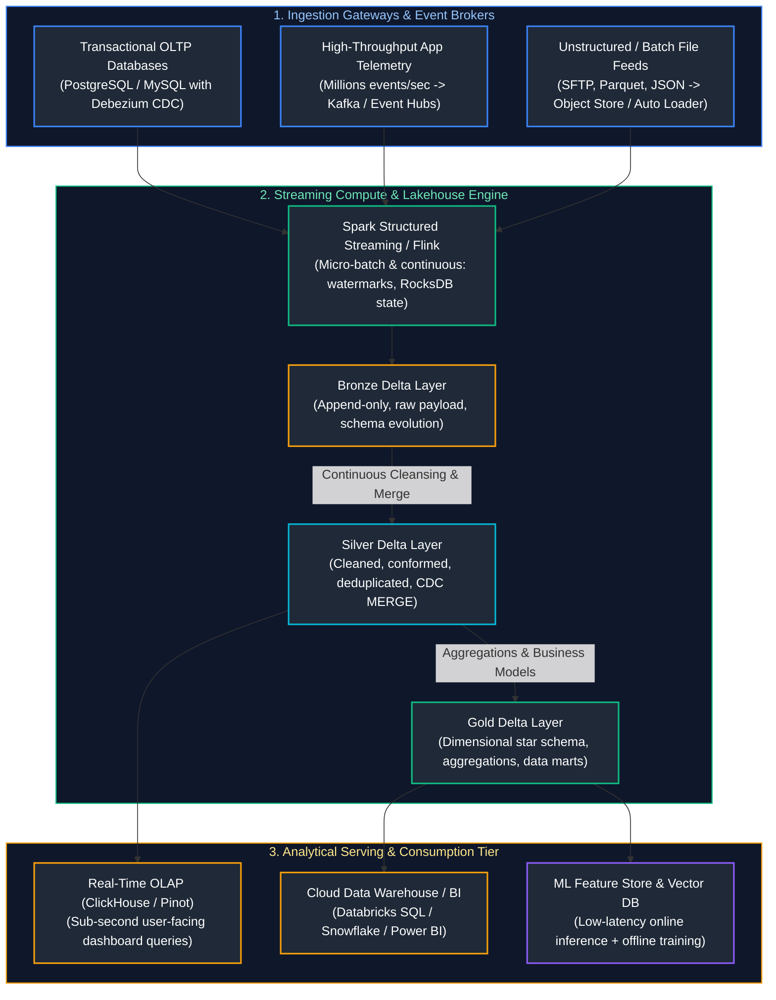

---

## Table of Contents
1. [System Design Fundamentals: Distributed Trade-Offs & Mechanics](#1-system-design-fundamentals-distributed-trade-offs--mechanics)
   - [1.1 The CAP and PACELC Theorems in Analytical Systems](#11-the-cap-and-pacelc-theorems-in-analytical-systems)
   - [1.2 Distributed Time, Clocks, and Message Ordering Invariants](#12-distributed-time-clocks-and-message-ordering-invariants)
   - [1.3 Backpressure, Rate Limiting & Queue Decoupling](#13-backpressure-rate-limiting--queue-decoupling)
2. [Quantitative Scale Estimation & Capacity Planning](#2-quantitative-scale-estimation--capacity-planning)
   - [2.1 The Back-of-the-Envelope Estimation Framework](#21-the-back-of-the-envelope-estimation-framework)
   - [2.2 Mathematical Formulas for Storage, IOPS, and Kafka Partitioning](#22-mathematical-formulas-for-storage-iops-and-kafka-partitioning)
   - [2.3 Step-by-Step Worked Capacity Planning Example (50M Connected Vehicles)](#23-step-by-step-worked-capacity-planning-example-50m-connected-vehicles)
3. [Blueprint 1: Multi-Tier Real-Time Lakehouse Platform](#3-blueprint-1-multi-tier-real-time-lakehouse-platform)
   - [3.1 Architecture: Medallion Flow with Delta Lake / Iceberg](#31-architecture-medallion-flow-with-delta-lake--iceberg)
   - [3.2 Production PySpark Structured Streaming Pipeline with RocksDB State](#32-production-pyspark-structured-streaming-pipeline-with-rocksdb-state)
   - [8.3 Compaction, Liquid Clustering, and Storage Optimization](#83-compaction-liquid-clustering-and-storage-optimization)
4. [Blueprint 2: High-Throughput Log-Based Change Data Capture (CDC)](#9-blueprint-2-high-throughput-log-based-change-data-capture-cdc)
   - [9.1 Architecture: Debezium, Kafka Connect, Schema Registry & Delta MERGE](#91-architecture-debezium-kafka-connect-schema-registry--delta-merge)
   - [9.2 Handling Out-of-Order Updates and SCD Type 2 History](#92-handling-out-of-order-updates-and-scd-type-2-history)
5. [Blueprint 3: Sub-Second Real-Time Analytical OLAP Serving Platform](#10-blueprint-3-sub-second-real-time-analytical-olap-serving-platform)
   - [10.1 Architecture: ClickHouse / Apache Pinot Columnar Engine](#101-architecture-clickhouse--apache-pinot-columnar-engine)
   - [10.2 Materialized Views, Vectorized Execution, and Kafka Engine Ingestion](#102-materialized-views-vectorized-execution-and-kafka-engine-ingestion)
6. [Blueprint 4: Enterprise Metadata, Data Contracts & Automated Quality Circuit Breakers](#11-blueprint-4-enterprise-metadata-data-contracts--automated-quality-circuit-breakers)
   - [11.1 Shift-Left Data Contracts & Runtime Validation](#111-shift-left-data-contracts--runtime-validation)
   - [11.2 Automated Circuit Breakers, DLQ Routing, and OpenLineage Lineage](#112-automated-circuit-breakers-dlq-routing-and-openlineage-lineage)
7. [Blueprint 5: Multi-Cloud Disaster Recovery & Geo-Replication](#12-blueprint-5-multi-cloud-disaster-recovery--geo-replication)
   - [12.1 RPO vs. RTO Invariants & Failure Domains](#121-rpo-vs-rto-invariants--failure-domains)
   - [12.2 Active-Passive vs. Active-Active Lakehouse Replication](#122-active-passive-vs-active-active-lakehouse-replication)
8. [Blueprint 6: Real-Time Clickstream & Multi-Touch Attribution Engine](#13-blueprint-6-real-time-clickstream--multi-touch-attribution-engine)
   - [13.1 High-Volume Clickstream Architecture (1 Million Events/Sec)](#131-high-volume-clickstream-architecture-1-million-eventssec)
   - [13.2 Sessionization with Dual-Watermark Stream-Stream Joins](#132-sessionization-with-dual-watermark-stream-stream-joins)
9. [Blueprint 7: Global IoT Fleet Telemetry & Predictive Maintenance](#18-blueprint-7-global-iot-fleet-telemetry--predictive-maintenance)
   - [18.1 Architecture for 50 Million Connected Vehicles at 100 Hz](#181-architecture-for-50-million-connected-vehicles-at-100-hz)
   - [18.2 Storage Tiering, Cold Archival & Anomaly Detection Pipeline](#182-storage-tiering-cold-archival--anomaly-detection-pipeline)
10. [The 4-Step System Design Interview Framework & Production Walkthrough](#19-the-4-step-system-design-interview-framework--production-walkthrough)
   - [19.1 The 4-Step Methodical Execution Blueprint](#191-the-4-step-methodical-execution-blueprint)
   - [19.2 End-to-End Design Case Study: Real-Time Financial Fraud Engine](#192-end-to-end-design-case-study-real-time-financial-fraud-engine)
   - [19.3 Common Trap Questions & How to Answer Them](#193-common-trap-questions--how-to-answer-them)
11. [Summary Comparison & Production Engineering Reference Matrix](#20-summary-comparison--production-engineering-reference-matrix)
12. [References & Further Reading](#21-references--further-reading)

> [!TIP]
> **Deep-Dive Interview Scenarios:**
> - [Q2. Comprehensive Strategy for Late-Arriving & Out-of-Order Data](frequently_asked_questions/10_system_design_for_data_engineering_faq.md#q2-comprehensive-strategy-for-late-arriving--out-of-order-data)
> - [Q19. Legacy Data Platform Modernization: Migration Strategy & Domain Prioritization](frequently_asked_questions/10_system_design_for_data_engineering_faq.md#q19-legacy-data-platform-modernization-migration-strategy--domain-prioritization)
> - [Q20. 10x Data Volume Surge Readiness: Load Testing & End-to-End Optimization Playbook](frequently_asked_questions/10_system_design_for_data_engineering_faq.md#q20-10x-data-volume-surge-readiness-load-testing--end-to-end-optimization-playbook)
---

# 1. System Design Fundamentals: Distributed Trade-Offs & Mechanics

Designing modern data platforms requires balancing physical hardware constraints (CPU cache hierarchies, network saturation, disk IOPS) with distributed systems guarantees (consistency, availability, partition tolerance).

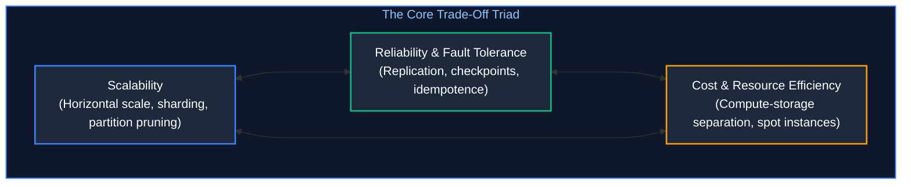

---

### 1.1 The CAP and PACELC Theorems in Analytical Systems

#### 1. The CAP Theorem
In any asynchronous network subject to partitions ($P$):
- **Consistency ($C$):** Every read receives the most recent write or an error.
- **Availability ($A$):** Every non-failing node returns a response, but it may be stale.
- **Partition Tolerance ($P$):** The system continues to operate despite dropped or delayed network packets.

#### 2. The PACELC Theorem
The CAP theorem only dictates behavior **in the presence of network partitions**. The **PACELC Theorem** (Abadi, 2012) models trade-offs during normal operations:
$$\text{If Partition (P)} \implies \text{Choose Availability (A) or Consistency (C);}$$
$$\text{ELSE (E)} \implies \text{Choose Latency (L) or Consistency (C).}$$

| PACELC Archetype | Partition Guarantee ($P$) | Normal Guarantee ($E$) | Latency vs Consistency Profile | Canonical Lakehouse & Database Engines |
| :--- | :--- | :--- | :--- | :--- |
| **PC / EC** | Choose Consistency ($PC$) | Choose Consistency ($EC$) | Higher write latency ($30\text{ms}-100\text{ms}$) due to multi-node distributed consensus or ACID table locks. | **BigQuery, Snowflake, Delta Lake, Google Spanner, PostgreSQL (Sync Replica)** |
| **PA / EL** | Choose Availability ($PA$) | Choose Latency ($EL$) | Ultra-low latency ($1\text{ms}-5\text{ms}$) with asynchronous replication; risk of temporary stale reads or tombstone overhead. | **Apache Cassandra, Amazon DynamoDB (Default), ScyllaDB** |
| **PC / EL** | Choose Consistency ($PC$) | Choose Latency ($EL$) | Moderate latency; reads served from master in-memory cache while writes enforce majority acknowledgment. | **MongoDB (Majority Writes), Redis Sentinel / Cluster** |

---

### 1.2 Distributed Time, Clocks, and Message Ordering Invariants

In distributed data pipelines spanning hundreds of nodes, physical clocks drift due to quartz oscillator imperfections and NTP sync jitter.
- **Wall-Clock Time (System Time):** Inherently unreliable. Never use server system timestamps (`now()`) to order business events across distributed microservices.
- **Monotonic Clocks:** Useful only for measuring relative elapsed durations on a single physical host.
- **Event Time vs. Processing Time:**
  - **Event Time:** The deterministic timestamp generated by the client device at the instant the action occurred.
  - **Processing Time:** The arbitrary wall-clock time when an executor node processed the record.
- **Logical Clocks (Lamport Timestamps & Vector Clocks):** Provide partial and causal ordering across distributed nodes without physical synchronization.
- **TrueTime (Google Spanner):** Hardware-synchronized atomic clocks and GPS receivers bounding clock uncertainty to $\epsilon \le 7\text{ ms}$.

---

### 1.3 Backpressure, Rate Limiting & Queue Decoupling

When upstream producers emit $1,000,000\text{ events/sec}$ while downstream lakehouse sinks can only write $250,000\text{ events/sec}$, unbuffered architectures suffer memory exhaustion and cascading failures:

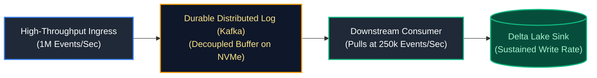

1. **Push-Based Pipelines (Brittle):** Upstream pushes data directly to consumers via HTTP/gRPC. If downstream slows down, buffers overflow, sockets reset, and data is lost.
2. **Pull-Based Pipelines (Resilient):** Consumers read from a persistent append-only broker (Apache Kafka). Downstream workers pull messages at their own sustainable rate (**Backpressure**). Unprocessed messages remain safely buffered on disk.

---

# 2. Quantitative Scale Estimation & Capacity Planning

### 2.1 The Back-of-the-Envelope Estimation Framework

Every system design proposal or technical interview begins with formal mathematical sizing:

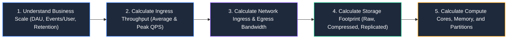

---

### 2.2 Mathematical Formulas for Storage, IOPS, and Kafka Partitioning

1. **Daily Seconds:** $\approx 86,400\text{ seconds} \approx 10^5\text{ seconds}$ (rule of thumb for mental math).
2. **Average Ingress QPS:**
   $$QPS_{\text{avg}} = \frac{\text{Total Daily Events}}{86,400}$$
3. **Peak Ingress QPS:**
   $$QPS_{\text{peak}} = QPS_{\text{avg}} \times \text{Peak Multiplier (Typically } 2\times \text{ to } 3\times)$$
4. **Network Ingress Bandwidth:**
   $$\text{Ingress Bandwidth (Bytes/sec)} = QPS_{\text{peak}} \times \text{Average Payload Size (Bytes)}$$
5. **Storage Footprint (Annual):**
   $$\text{Annual Storage} = (\text{Daily Raw Bytes} \times 365) \times \frac{1}{\text{Compression Ratio}} \times \text{Replication Factor}$$
6. **Kafka Partition Sizing:**
   $$\text{Partitions} = \max\left(\frac{\text{Peak Ingress MB/s}}{2.5\text{ MB/s per producer}}, \frac{\text{Peak Egress MB/s}}{10\text{ MB/s per consumer}}\right)$$

---

### 2.3 Step-by-Step Worked Capacity Planning Example (50M Connected Vehicles)

**Scenario:** Design the ingestion and analytical platform for a global connected electric vehicle fleet:
- **Vehicle Count:** $50,000,000$ active vehicles.
- **Reporting Interval:** 1 telemetry packet every $10\text{ seconds}$.
- **Payload Size:** $200\text{ bytes per packet}$ (JSON/Protobuf).
- **Retention:** 7 years for compliance and ML predictive battery degradation.

#### Calculations:
1. **Average QPS:**
   $$QPS_{\text{avg}} = \frac{50,000,000\text{ vehicles}}{10\text{ seconds}} = \mathbf{5,000,000 \text{ events/sec (5M QPS)}}$$
2. **Peak QPS ($2\times$ rush hour):**
   $$QPS_{\text{peak}} = 5,000,000 \times 2 = \mathbf{10,000,000 \text{ events/sec (10M QPS)}}$$
3. **Network Ingress Bandwidth:**
   $$\text{Bandwidth} = 10,000,000\text{ msgs/s} \times 200\text{ B} = \mathbf{2,000,000,000 \text{ B/s}} = \mathbf{2 \text{ GB/sec}} = \mathbf{16 \text{ Gbps}}$$
4. **Daily Storage (Raw):**
   $$\text{Raw Daily} = 5,000,000\text{ msgs/s} \times 86,400\text{ s} \times 200\text{ B} = \mathbf{86.4 \text{ TB/day}}$$
5. **Daily Storage (Parquet Columnar Compressed with ZSTD, $4\times$ ratio):**
   $$\text{Compressed Daily} = \frac{86.4\text{ TB}}{4} = \mathbf{21.6 \text{ TB/day}}$$
6. **7-Year Storage (Lakehouse Storage):**
   $$\text{7-Year Footprint} = 21.6\text{ TB/day} \times 365 \times 7 = \mathbf{55,188 \text{ TB}} \approx \mathbf{55.2 \text{ Petabytes}}$$
7. **Kafka Partitions Needed:**
   $$\text{Partitions} = \frac{2,000\text{ MB/s}}{2.5\text{ MB/s}} = \mathbf{800 \text{ Partitions minimum}}$$

---

# 3. Blueprint 1: Multi-Tier Real-Time Lakehouse Platform

### 3.1 Architecture: Medallion Flow with Delta Lake / Iceberg

The Medallion pattern structures data refinement into three distinct physical tiers on cloud object storage:

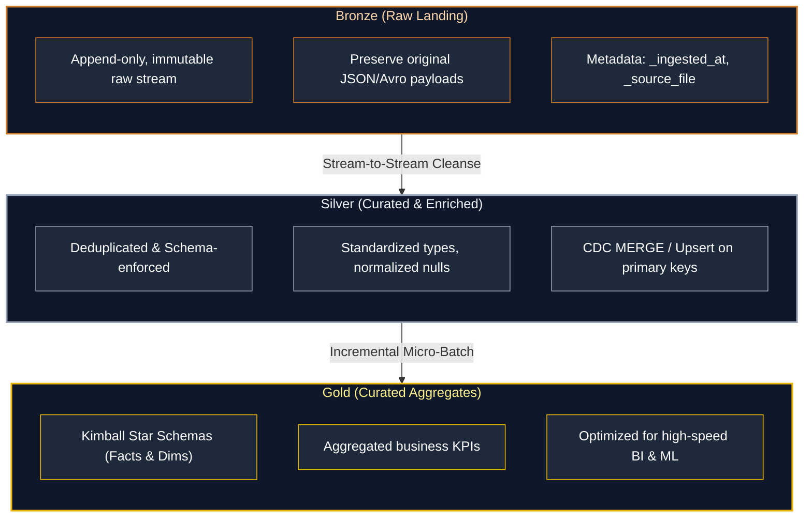

---

### 3.2 Production PySpark Structured Streaming Pipeline with RocksDB State

```python
"""
Production-grade PySpark Structured Streaming Pipeline
- Kafka Ingestion -> Bronze -> Silver
- RocksDB State Store Provider to prevent JVM heap memory GC pauses
- Watermarked deduplication and idempotent Delta Lake upserts
"""
from pyspark.sql import SparkSession
from pyspark.sql.functions import from_json, col, current_timestamp
from pyspark.sql.types import StructType, StructField, StringType, DoubleType, TimestampType
from delta.tables import DeltaTable

# Initialize Spark Session with Delta Lake and RocksDB State Store
spark = (
    SparkSession.builder
    .appName("ProductionLakehouseStream")
    .config("spark.sql.extensions", "io.delta.sql.DeltaSparkSessionExtension")
    .config("spark.sql.catalog.spark_catalog", "org.apache.spark.sql.delta.catalog.DeltaCatalog")
    # Enable off-heap RocksDB state store for stateful streaming operations
    .config("spark.sql.streaming.stateStore.providerClass", 
            "org.apache.spark.sql.execution.streaming.state.RocksDBStateStoreProvider")
    .getOrCreate()
)

# 4. Define Inbound Schema Contract

order_schema = StructType([
    StructField("order_id", StringType(), False),
    StructField("customer_id", StringType(), False),
    StructField("order_amount", DoubleType(), False),
    StructField("order_status", StringType(), False),
    StructField("transaction_timestamp", TimestampType(), False)
])

# 5. Ingest from Kafka with Automatic Offset Management

raw_stream = (
    spark.readStream
    .format("kafka")
    .option("kafka.bootstrap.servers", "broker1:9092,broker2:9092")
    .option("subscribe", "commerce.orders.v1")
    .option("startingOffsets", "latest")
    .option("failOnDataLoss", "false")
    .load()
)

# 6. Cleanse, Parse, and Deduplicate using Event-Time Watermarking

cleansed_stream = (
    raw_stream
    .selectExpr("CAST(value AS STRING) AS json_payload", "timestamp AS kafka_ingest_time")
    .select(from_json(col("json_payload"), order_schema).alias("data"), col("kafka_ingest_time"))
    .select("data.*", "kafka_ingest_time")
    # 30-minute late data watermark bounding state memory
    .withWatermark("transaction_timestamp", "30 minutes")
    .dropDuplicates(["order_id", "transaction_timestamp"])
)

# 7. Idempotent Micro-Batch Merge Sink (Delta Lake Upsert)

def upsert_to_silver(micro_batch_df, batch_id):
    silver_table_path = "s3://production-lakehouse-silver/orders/"
    
    # Initialize Delta Table if exists, else write append
    if DeltaTable.isDeltaTable(spark, silver_table_path):
        silver_delta = DeltaTable.forPath(spark, silver_table_path)
        (
            silver_delta.alias("target")
            .merge(
                micro_batch_df.alias("source"),
                "target.order_id = source.order_id"
            )
            .whenMatchedUpdate(set={
                "order_amount": "source.order_amount",
                "order_status": "source.order_status",
                "transaction_timestamp": "source.transaction_timestamp",
                "_updated_at": current_timestamp()
            })
            .whenNotMatchedInsert(values={
                "order_id": "source.order_id",
                "customer_id": "source.customer_id",
                "order_amount": "source.order_amount",
                "order_status": "source.order_status",
                "transaction_timestamp": "source.transaction_timestamp",
                "_created_at": current_timestamp(),
                "_updated_at": current_timestamp()
            })
            .execute()
        )
    else:
        micro_batch_df.withColumn("_created_at", current_timestamp()) \
                      .withColumn("_updated_at", current_timestamp()) \
                      .write.format("delta").mode("overwrite").save(silver_table_path)

# 8. Start Streaming Query with Checkpointing

streaming_query = (
    cleansed_stream.writeStream
    .foreachBatch(upsert_to_silver)
    .option("checkpointLocation", "s3://production-lakehouse-checkpoints/silver_orders/")
    .trigger(processingTime="10 seconds")
    .start()
)

streaming_query.awaitTermination()
```

---

### 8.3 Compaction, Liquid Clustering, and Storage Optimization

To prevent **Small File Syndrome** caused by streaming micro-batches:
```sql
-- Automatically bin-packs small files into uniform 512 MB Parquet files
-- and applies multi-dimensional clustering without rigid partition hierarchies
OPTIMIZE silver.orders 
CLUSTER BY (customer_id, transaction_timestamp);
```

---

# 9. Blueprint 2: High-Throughput Log-Based Change Data Capture (CDC)

### 9.1 Architecture: Debezium, Kafka Connect, Schema Registry & Delta MERGE

Log-based CDC extracts data modifications directly from the database transaction write-ahead log (WAL / Binlog) without querying the table:

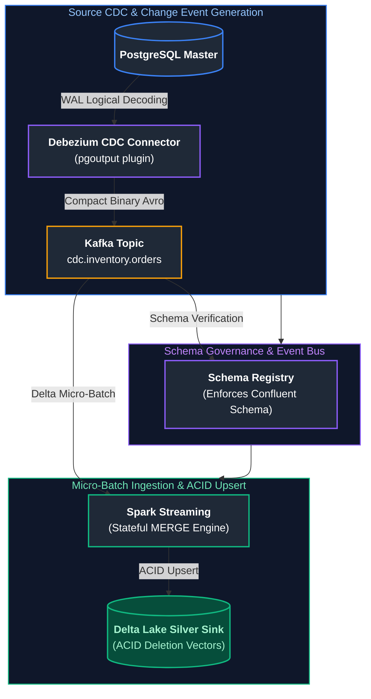

#### Production Debezium PostgreSQL Connector JSON Configuration
```json
{
  "name": "postgres-order-cdc-connector",
  "config": {
    "connector.class": "io.debezium.connector.postgresql.PostgresConnector",
    "tasks.max": "1",
    "plugin.name": "pgoutput",
    "database.hostname": "db-primary.production.internal",
    "database.port": "5432",
    "database.user": "debezium_cdc_user",
    "database.password": "${file:/secrets/db.properties:cdc_password}",
    "database.dbname": "production_commerce",
    "database.server.name": "prod_cdc",
    "table.include.list": "public.orders,public.order_lines",
    "tombstones.on.delete": "true",
    "decimal.handling.mode": "double",
    "value.converter": "io.confluent.connect.avro.AvroConverter",
    "value.converter.schema.registry.url": "http://schema-registry.internal:8081"
  }
}
```

---

### 9.2 Handling Out-of-Order Updates and SCD Type 2 History

In distributed networks, an update for an entity can arrive *before* its insert. To guarantee deterministic CDC synchronization, pipelines use **Log Sequence Number (LSN) Deduplication**:

```sql
-- Deduplicating CDC batch based on database LSN and sequence before executing MERGE
WITH ranked_cdc AS (
    SELECT 
        order_id,
        customer_id,
        order_status,
        order_amount,
        cdc_operation,     -- 'c' (create), 'u' (update), 'd' (delete)
        source_lsn,
        ROW_NUMBER() OVER (
            PARTITION BY order_id 
            ORDER BY source_lsn DESC, source_timestamp DESC
        ) AS row_num
    FROM staging.stg_orders_cdc
)
MERGE INTO silver.orders AS target
USING (SELECT * FROM ranked_cdc WHERE row_num = 1) AS source
ON target.order_id = source.order_id
WHEN MATCHED AND source.cdc_operation = 'd' THEN
    UPDATE SET target.is_deleted = TRUE, target._updated_at = CURRENT_TIMESTAMP()
WHEN MATCHED AND source.source_lsn > target.source_lsn THEN
    UPDATE SET 
        target.order_amount = source.order_amount,
        target.order_status = source.order_status,
        target.source_lsn = source.source_lsn,
        target._updated_at = CURRENT_TIMESTAMP()
WHEN NOT MATCHED AND source.cdc_operation <> 'd' THEN
    INSERT (order_id, customer_id, order_amount, order_status, source_lsn, is_deleted, _created_at, _updated_at)
    VALUES (source.order_id, source.customer_id, source.order_amount, source.order_status, source.source_lsn, FALSE, CURRENT_TIMESTAMP(), CURRENT_TIMESTAMP());
```

> [!TIP]
> **Deep-Dive Interview Scenario:**
> - [Q1. High-Throughput Pipeline Architecture: Millions of Records per Hour](frequently_asked_questions/10_system_design_for_data_engineering_faq.md#q1-high-throughput-pipeline-architecture-millions-of-records-per-hour)

---

# 10. Blueprint 3: Sub-Second Real-Time Analytical OLAP Serving Platform

### 10.1 Architecture: ClickHouse / Apache Pinot Columnar Engine

While Lakehouse engines (Delta, Iceberg) excel at batch transformations and massive multi-table aggregations, user-facing applications (e.g., ad-tech dashboards, live telemetry monitors) require **$< 50\text{ millisecond}$ query latencies at $10,000+\text{ QPS}$**:

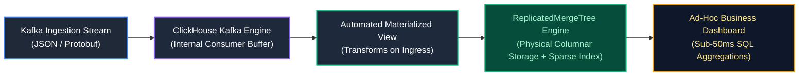

---

### 10.2 Materialized Views, Vectorized Execution, and Kafka Engine Ingestion

```sql
-- Step 1: Kafka Engine Table (Acts as an internal stream consumer)
CREATE TABLE ingestion.kafka_ad_impressions (
    impression_id UUID,
    campaign_id   UInt32,
    advertiser_id UInt32,
    bid_amount    Decimal64(4),
    event_time    DateTime64(3, 'UTC')
) ENGINE = Kafka
SETTINGS 
    kafka_broker_list = 'kafka1:9092,kafka2:9092',
    kafka_topic_list = 'ad_platform.impressions.v1',
    kafka_group_name = 'clickhouse_ad_consumer',
    kafka_format = 'JSONEachRow',
    kafka_num_consumers = 8;

-- Step 2: High-performance physical storage table
CREATE TABLE analytics.ad_impressions (
    impression_id UUID,
    campaign_id   UInt32,
    advertiser_id UInt32,
    bid_amount    Decimal64(4),
    event_time    DateTime64(3, 'UTC'),
    event_date    Date DEFAULT toDate(event_time)
) ENGINE = ReplicatedMergeTree('/clickhouse/tables/{shard}/ad_impressions', '{replica}')
PARTITION BY toYYYYMM(event_date)
ORDER BY (campaign_id, advertiser_id, event_time);

-- Step 3: Materialized View acting as the automated streaming bridge
CREATE MATERIALIZED VIEW ingestion.mv_ad_impressions TO analytics.ad_impressions AS 
SELECT 
    impression_id,
    campaign_id,
    advertiser_id,
    bid_amount,
    event_time,
    toDate(event_time) AS event_date
FROM ingestion.kafka_ad_impressions;

-- Step 4: Analytical Query executing across 500M rows in ~18 milliseconds
SELECT 
    campaign_id,
    count() AS total_impressions,
    round(sum(bid_amount), 2) AS total_spend,
    round(avg(bid_amount), 4) AS avg_cpm
FROM analytics.ad_impressions
WHERE campaign_id = 90210
  AND event_time >= now() - INTERVAL 1 HOUR
GROUP BY campaign_id;
```

---

# 11. Blueprint 4: Enterprise Metadata, Data Contracts & Automated Quality Circuit Breakers

### 11.1 Shift-Left Data Contracts & Runtime Validation

Data contracts shift data governance upstream to software engineers writing production backend services:
1. Data producers declare schemas using **JSON Schema, Protobuf, or Avro**.
2. Contracts are version-controlled in Git and registered in Schema Registry.
3. CI/CD checks prevent breaking backend schema changes from deploying.

---

### 11.2 Automated Circuit Breakers, DLQ Routing, and OpenLineage Lineage

```python
from typing import Dict, Any, List, Tuple

class DataQualityCircuitBreaker:
    """
    Evaluates streaming micro-batches against strict data contracts.
    Implements the Circuit Breaker pattern: trips if error rate exceeds
    the SLA tolerance, preventing downstream corruption.
    """
    def __init__(self, max_quarantine_tolerance: float = 0.02):
        self.max_quarantine_tolerance = max_quarantine_tolerance
        self.is_tripped = False

    def process_and_route_batch(
        self, raw_records: List[Dict[str, Any]]
    ) -> Tuple[List[Dict[str, Any]], List[Dict[str, Any]]]:
        if self.is_tripped:
            raise RuntimeError("CRITICAL: Pipeline halted! Circuit breaker is TRIPPED. Manual intervention required.")

        valid_records: List[Dict[str, Any]] = []
        quarantine_records: List[Dict[str, Any]] = []

        for record in raw_records:
            # Assertion 1: Primary key must be non-null and non-empty
            if not record.get("order_id"):
                record["_rejection_code"] = "NULL_PRIMARY_KEY"
                quarantine_records.append(record)
                continue

            # Assertion 2: Business invariant check (amounts must be positive)
            amount = record.get("order_amount")
            if amount is None or amount <= 0.0:
                record["_rejection_code"] = f"INVALID_AMOUNT: {amount}"
                quarantine_records.append(record)
                continue

            # Assertion 3: Mandatory currency domain
            if record.get("currency") not in {"USD", "EUR", "GBP", "CAD"}:
                record["_rejection_code"] = f"UNSUPPORTED_CURRENCY: {record.get('currency')}"
                quarantine_records.append(record)
                continue

            valid_records.append(record)

        # Calculate error rate against error budget
        total_count = len(raw_records)
        quarantine_rate = len(quarantine_records) / total_count if total_count > 0 else 0.0

        if quarantine_rate > self.max_quarantine_tolerance:
            self.is_tripped = True
            raise ValueError(
                f"CIRCUIT BREAKER TRIPPED! Quarantine rate ({quarantine_rate:.2%}) "
                f"breached error threshold ({self.max_quarantine_tolerance:.2%}). "
                f"Halting downstream sync to protect Gold marts from corruption."
            )

        return valid_records, quarantine_records
```

> [!TIP]
> **Deep-Dive Interview Scenario:**
> - [Q3. Self-Healing & Automated Failure Recovery Pipelines](frequently_asked_questions/10_system_design_for_data_engineering_faq.md#q3-self-healing--automated-failure-recovery-pipelines)

---

# 12. Blueprint 5: Multi-Cloud Disaster Recovery & Geo-Replication

### 12.1 RPO vs. RTO Invariants & Failure Domains

- **Recovery Point Objective (RPO):** *How much data can we afford to lose?* Measured in time (e.g., 15 minutes of data loss).
- **Recovery Time Objective (RTO):** *How long can the platform afford to be down?* Measured in time (e.g., 30 minutes to restore service).

---

### 12.2 Active-Passive vs. Active-Active Lakehouse Replication

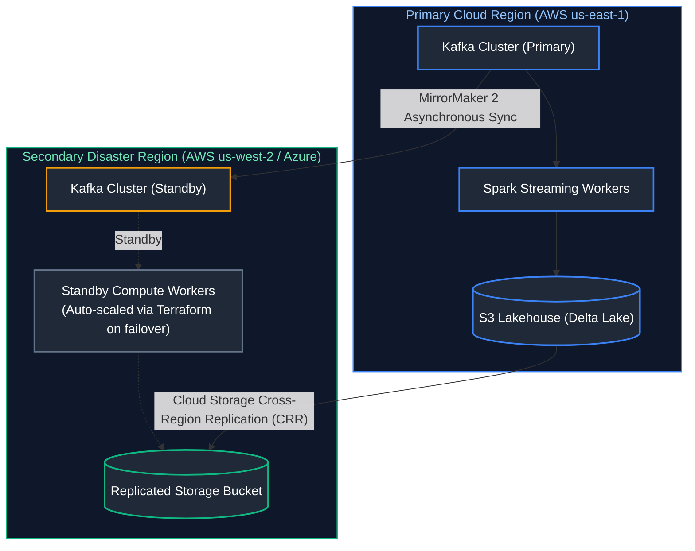

| Strategy | Description | Cost Factor | Typical RPO | Typical RTO | Best Use Case |
| :--- | :--- | :---: | :---: | :---: | :--- |
| **Backup & Restore** | Nightly snapshots archived to cold storage in another region. | $1.1\times$ | 24 Hours | 4–8 Hours | Internal non-critical historical analytics. |
| **Pilot Light** | Storage replicated continuously; compute spun up via Terraform during disaster. | $1.3\times$ | $\le 15\text{ mins}$ | 15–30 Mins | Standard enterprise data platforms. |
| **Warm Standby** | Storage synchronized continuously; minimum compute cluster running 24/7 in secondary region. | $1.8\times$ | $\le 5\text{ mins}$ | $\le 5\text{ mins}$ | Mission-critical business reporting and fraud systems. |
| **Active-Active** | Traffic served from both regions simultaneously with bidirectional Kafka sync. | $2.5\times$ | $\approx 0$ | $0\text{ seconds}$ | High-availability financial transactions. |

---

# 13. Blueprint 6: Real-Time Clickstream & Multi-Touch Attribution Engine

### 13.1 High-Volume Clickstream Architecture (1 Million Events/Sec)

Digital ad-tech and e-commerce platforms process massive clickstreams to evaluate marketing channel attribution (First-Touch, Last-Touch, Linear, Time-Decay Attribution).

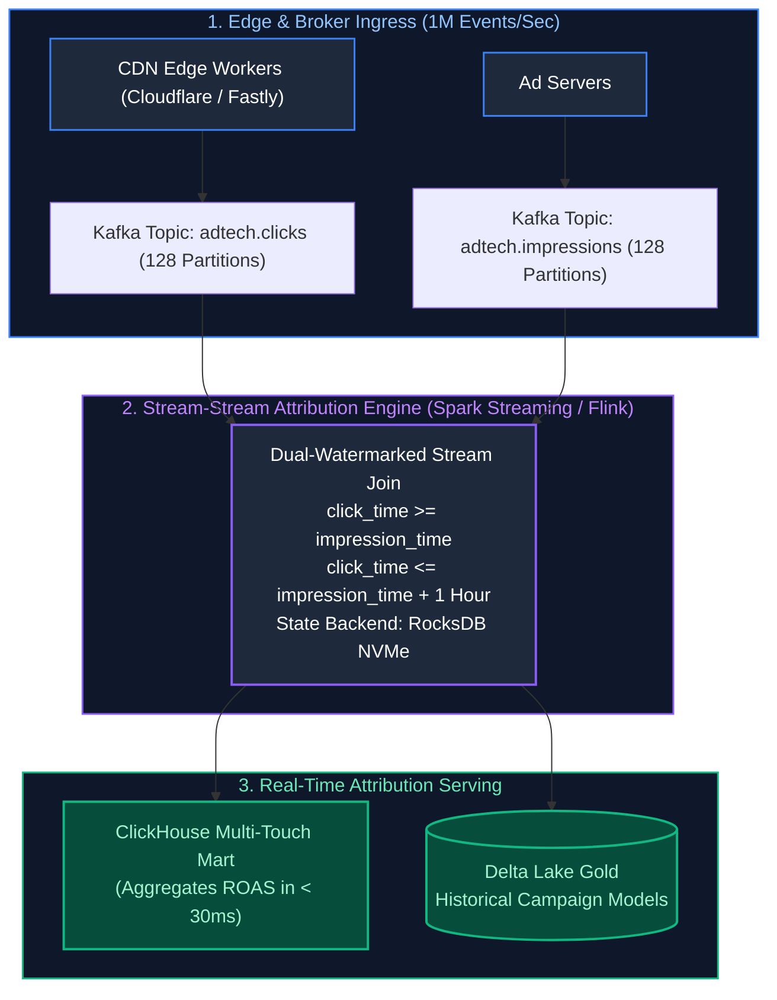

---

### 13.2 Sessionization with Dual-Watermark Stream-Stream Joins

When calculating multi-touch marketing attribution, user impressions and user clicks arrive on separate high-throughput streaming topics with independent, unpredictable network latencies. A **Dual-Watermark Stream-Stream Join** matches clicks to impressions within a sliding attribution window:

#### Production PySpark Structured Streaming Stream-Stream Join:
```python
from pyspark.sql import SparkSession
from pyspark.sql.functions import col, expr

spark = SparkSession.builder \
    .appName("ClickstreamAttributionEngine") \
    .config("spark.sql.streaming.stateStore.providerClass", 
            "org.apache.spark.sql.execution.streaming.state.RocksDBStateStoreProvider") \
    .getOrCreate()

# 14. Read Impressions with 2-hour watermark

impressions = spark.readStream.format("delta").table("bronze.ad_impressions") \
    .withWatermark("impression_time", "2 hours")

# 15. Read Clicks with 3-hour watermark

clicks = spark.readStream.format("delta").table("bronze.ad_clicks") \
    .withWatermark("click_time", "3 hours")

# 16. Dual-Watermarked Stream-Stream Join with Range Constraint

# A click can only attribute to an impression that occurred within the preceding 1 hour
attribution_stream = clicks.join(
    impressions,
    expr("""
        clicks.user_id = impressions.user_id AND
        clicks.campaign_id = impressions.campaign_id AND
        click_time >= impression_time AND
        click_time <= impression_time + interval 1 hour
    """),
    joinType="inner"
).select(
    clicks["user_id"],
    clicks["campaign_id"],
    impressions["impression_time"],
    clicks["click_time"],
    clicks["conversion_value"]
)

# 17. Sink to Delta Lake Gold with RocksDB checkpointing

query = attribution_stream.writeStream \
    .format("delta") \
    .outputMode("append") \
    .option("checkpointLocation", "abfss://checkpoints@datalake.dfs.core.windows.net/attribution") \
    .toTable("gold.attributed_conversions")
```

---

# 18. Blueprint 7: Global IoT Fleet Telemetry & Predictive Maintenance

### 18.1 Architecture for 50 Million Connected Vehicles at 100 Hz

A connected vehicle fleet (e.g., Tesla, Rivian, Uber) emits telemetry packets containing battery voltages, motor temperatures, tyre pressures, and GPS coordinates.

#### Sizing & Capacity Metrics:
- **Vehicle Count:** $50,000,000$ active vehicles.
- **Reporting Interval:** 1 telemetry packet every $10\text{ seconds}$.
- **Ingress QPS:** $\frac{50,000,000}{10} = \mathbf{5,000,000 \text{ pings/sec}}$.
- **Payload Size:** $150\text{ Bytes}$ in compact binary Protobuf.
- **Network Ingress Bandwidth:** $5\text{M} \times 150\text{ B} = 750\text{ MB/sec} = \mathbf{6.0 \text{ Gbps}}$.
- **Daily Ingestion Footprint:** $5\text{M} \times 86,400 \times 150\text{ B} \approx 64.8\text{ TB/day}$ uncompressed $\implies \mathbf{16.2 \text{ TB/day}}$ compressed in Parquet.

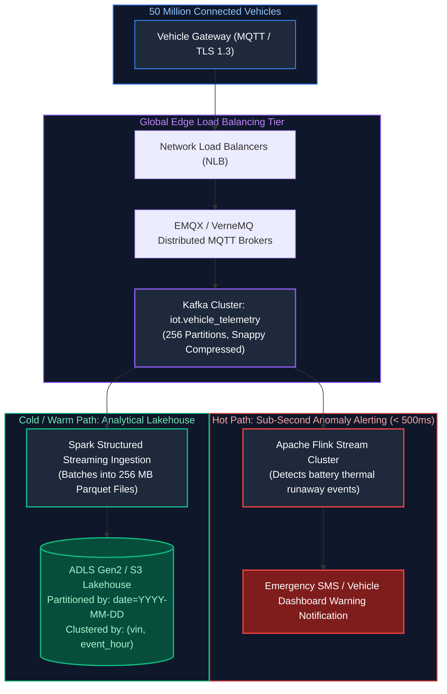

---

### 18.2 Storage Tiering, Cold Archival & Anomaly Detection Pipeline

With 50 million vehicles generating 16.2 TB of compressed Parquet data daily, indefinite hot retention is financially catastrophic. Production IoT platforms implement an automated multi-temperature storage lifecycle:

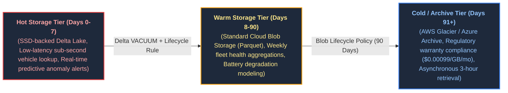

#### Production PySpark Fleet Anomaly Detection (Statistical Z-Score):
```python
from pyspark.sql import functions as F
from pyspark.sql.window import Window

# Detect battery cell temperature thermal runaway using rolling 15-minute Z-score
window_spec = Window.partitionBy("vehicle_id").orderBy(F.col("timestamp").cast("long")).rangeBetween(-900, 0)

telemetry_anomalies = df_telemetry \
    .withColumn("mean_temp", F.avg("cell_temperature_c").over(window_spec)) \
    .withColumn("stddev_temp", F.stddev("cell_temperature_c").over(window_spec)) \
    .withColumn("z_score", (F.col("cell_temperature_c") - F.col("mean_temp")) / (F.col("stddev_temp") + 1e-5)) \
    .filter(F.col("z_score") > 3.0) # Flag temperature spikes > 3 standard deviations

telemetry_anomalies.writeStream \
    .format("delta") \
    .option("checkpointLocation", "abfss://checkpoints@datalake.dfs.core.windows.net/fleet_alerts") \
    .table("gold.critical_battery_alerts")
```

---

# 19. The 4-Step System Design Interview Framework & Production Walkthrough

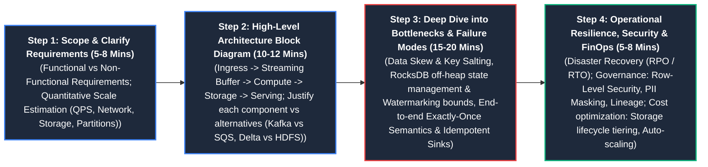

### 19.1 The 4-Step Methodical Execution Blueprint

1. **Step 1: Requirements Clarification & Sizing (5–8 minutes):**
   - Clarify **Functional Requirements** (e.g., "Must calculate 5-minute rolling transaction sums per customer; must provide ad-hoc analytical queries to fraud analysts").
   - Clarify **Non-Functional Requirements** (e.g., Latency SLA: $< 1\text{ second}$ for fraud alerts, sub-second for dashboards; Data freshness: $< 10\text{ seconds}$; Availability: $99.99\%$).
   - Execute quantitative estimation (QPS, payload size, storage/day, network bandwidth, Kafka partitions).
2. **Step 2: High-Level Architecture & Component Selection (10–12 minutes):**
   - Draw the end-to-end block diagram: Ingestion Gateways $\to$ Message Buffers $\to$ Stream Processing $\to$ Lakehouse Storage $\to$ Serving Layer.
   - Justify technologies based on requirements (e.g., "Selecting Kafka over RabbitMQ due to partitioned replayability; selecting Flink/Spark for exactly-once stateful stream joins").
3. **Step 3: Deep Dive into Bottlenecks & Edge Cases (15–20 minutes):**
   - **Data Skew:** What happens if a celebrity or massive corporate account generates $1000\times$ more events than average? (Solution: Key Salting, Adaptive Query Execution).
   - **Late Data:** How are network delays handled? (Solution: Watermarking, RocksDB state expiration, DLQ routing).
   - **Exactly-Once Semantics:** How is duplicate delivery mitigated? (Solution: Idempotent producers, transactional sinks, Delta MERGE on primary key).
4. **Step 4: Operational Resilience, Security & FinOps (5–8 minutes):**
   - Disaster recovery strategy (RPO/RTO).
   - Governance: RBAC, dynamic data masking, row-level security for PII.
   - Cost optimization: Storage lifecycle tiers, auto-scaling compute.

---

### 19.2 End-to-End Design Case Study: Real-Time Financial Fraud Engine

**Interview Prompt:** *"Design a global fraud detection and analytical platform that processes 100,000 credit card transactions per second, evaluates fraud rules within 100 milliseconds, and enables financial analysts to run ad-hoc queries over 3 years of historical transactions."*

#### 1. Requirements & Sizing
- **Throughput:** $100,000\text{ QPS avg}$, Peak factor $3\times \implies 300,000\text{ QPS peak}$.
- **Payload Size:** $500\text{ bytes per transaction}$.
- **Network Ingress:** $300,000 \times 500\text{ B} = 150\text{ MB/sec} = 1.2\text{ Gbps}$.
- **Daily Storage:** $100,000 \times 86,400 \times 500\text{ B} \approx 4.32\text{ TB/day raw}$. Parquet compressed ($80\%$ reduction) $\implies \approx 864\text{ GB/day}$.
- **3-Year Footprint:** $864\text{ GB/day} \times 1,095\text{ days} \approx 946\text{ TB} \approx 1\text{ PB}$.
- **Kafka Partitions:** $\frac{150\text{ MB/s}}{2.5\text{ MB/s per consumer}} = 60\text{ partitions minimum} \implies \text{Provision 64 partitions}$.

#### 2. Architecture Blueprint
- **Ingestion:** API Gateway terminates client TLS, validates JWT tokens, and writes directly to Kafka partitioned by `account_id`.
- **Low-Latency Detection (<100ms):** Apache Flink application reads from Kafka, joins transactions against a distributed Redis Cluster holding customer profiles and rolling 10-minute spending totals, and publishes fraud scores to an egress topic.
- **Durable Lakehouse Ingestion:** Spark Structured Streaming writes Kafka events directly to Delta Lake Bronze (raw append).
- **Silver Processing:** Continuous micro-batch merges bronze transactions into Silver tables, updating customer dimensional state via SCD Type 2.
- **Analytical Serving (<1s ad-hoc):** Hot 90-day transactions are replicated into ClickHouse with a sparse index on `(account_id, transaction_time)`. Historical 3-year transactions are queried via Databricks SQL Serverless reading Delta Lake with partition pruning on `event_date`.

---

### 19.3 Common Trap Questions & How to Answer Them

#### Trap 1: *"Why not write directly from the API into Delta Lake instead of using Kafka?"*
- **The Correct Answer:** *"Writing directly from an API to Delta Lake forces the API to absorb the latency of cloud object storage atomic commits (1 to 3 seconds). If an S3 timeout or commit conflict occurs, the API crashes or times out. Kafka decouples the API, absorbs traffic spikes on NVMe disk in sub-milliseconds, and provides replayable buffers for downstream consumers."*

#### Trap 2: *"How do you handle a celebrity account that generates 1000x normal transaction volume (Data Skew)?"*
- **The Correct Answer:** *"If a single `account_id` produces 1,000x traffic, it saturates a single Kafka partition and causes one Spark executor to crash with an OOM while other executors sit idle. The solution is **Key Salting**: append a random salt between 0 and 9 to the key (`account_id_salt = 401_3`), spreading the traffic evenly across 10 partitions. Downstream aggregations perform a two-stage aggregate: first aggregate by salted key, then combine the 10 subtotals."*

---

# 20. Summary Comparison & Production Engineering Reference Matrix

| Architecture Component | Primary Technologies | Core Guarantees | Optimal Use Case | Anti-Patterns & Misuse |
| :--- | :--- | :--- | :--- | :--- |
| **Distributed Message Log** | Apache Kafka, Apache Pulsar | Ordered by partition, durable retention, pull-based consumers | High-throughput event ingestion, event sourcing, decoupling services | Using as a long-term analytical database or random key-value store. |
| **Transactional Lakehouse** | Delta Lake, Apache Iceberg | ACID transactions, time travel, schema enforcement, OCC | Petabyte-scale enterprise analytics, batch ETL, ML feature stores | Sub-second high-concurrency user-facing dashboard queries. |
| **Real-Time OLAP** | ClickHouse, Apache Pinot, StarRocks | Sub-50ms latency, vectorized SIMD execution, sparse indexing | Interactive user dashboards, real-time telemetry analytics | Heavy transactional updates, deep multi-way distributed joins. |
| **Stream Processing Engine** | Apache Flink, Spark Structured Streaming | Exactly-once stateful processing, event-time watermarking | Real-time fraud detection, complex event processing, CDC merges | Simple batch migrations where stateless SQL queries suffice. |
| **In-Memory Cache** | Redis Cluster, Dragonfly | Sub-millisecond reads/writes, key-value lookup, distributed locks | Session state, rolling aggregations, deduplication gates | Primary durable storage for non-reproducible critical data. |
| **Metadata & Governance** | OpenLineage, Great Expectations, Unity Catalog | Column-level lineage, schema contracts, circuit breakers | Data quality assertions, compliance auditing, catalog discovery | Relying exclusively on manual spreadsheets for data dictionaries. |

---

- **Quantitative Sizing & Capacity Mathematics:** Rigorous system design begins with mathematical sizing: calculate average and peak Query Per Second (QPS), network ingress bandwidth (MB/s), and uncompressed vs compressed storage footprints using $2\times\text{--}3\times$ peak traffic multipliers. Hardware provisioning and node cluster sizing must be strictly mathematically justified.
- **Decoupled Ingestion via Distributed Log:** User-facing transactional write APIs must never write directly to analytical storage engines (Delta Lake or data lakes). Decouple high-volume ingress using distributed partitioned append-only logs (Apache Kafka, AWS Kinesis, or Azure Event Hubs) to absorb sudden traffic spikes, provide replayability buffers, and isolate downstream failures.
- **Partition Cardinality & State Memory Bounding:** Balance partition keys to eliminate data skew and hotspotting while preserving sequential order for transactional entities. Stateful streaming pipelines (Spark Structured Streaming, Apache Flink) must enforce explicit event-time watermarks to bound state-store memory growth and configure RocksDB off-heap state backends for states exceeding 1 GB.
- **Automated Quarantine & Circuit Breaker Gates:** Ingestion workflows must incorporate automated data quality circuit breakers. If corrupt or schema-violating records exceed a predetermined safety threshold (e.g., $> 2\%$), trip the circuit breaker to route poison-pill records to Dead Letter Queues (DLQ) without crashing the pipeline or corrupting clean Gold datasets.
- **Serving Tier Alignment & Multi-Cloud Disaster Recovery:** Direct analytical user queries to the appropriate engine: sub-second operational dashboards require real-time columnar OLAP engines (ClickHouse, Pinot) rather than querying raw object storage. Formally negotiate Recovery Point Objectives (RPO) and Recovery Time Objectives (RTO) with business stakeholders, enabling asynchronous cross-region replication for mission-critical datasets.

---

# 21. References & Further Reading

- [Designing Data-Intensive Applications: The Big Ideas Behind Reliable, Scalable, and Maintainable Systems (Martin Kleppmann)](https://dataintensive.net/) — The canonical distributed systems architecture guide.
- [System Design Interview – An Insider's Guide: Volume 2 (Alex Xu, Sahn Lam)](https://bytebytego.com/) — Distributed message queues, metrics monitoring, and real-time streaming architectures.
- [The Log: What every software engineer should know about real-time data's unifying abstraction (Jay Kreps)](https://engineering.linkedin.com/distributed-systems/log-what-every-software-engineer-should-know-about-real-time-datas-unifying) — The seminal LinkedIn engineering paper on append-only logs.
- [ClickHouse Architecture & Vectorized Query Execution](https://clickhouse.com/docs/en/development/architecture) — Real-time analytical storage engine mechanics.
- [Delta Lake: The Definitive Guide (TD Gopalakrishna et al.)](https://www.oreilly.com/library/view/delta-lake-the/9781098151690/) — Modern lakehouse storage design and ACID transaction management.
