# 11. Streaming & Kafka Event Streaming

A unified, comprehensive, production-grade guide to real-time event streaming architectures, Apache Kafka broker internals (KRaft metadata quorum, segment logs, ISR, consumer rebalancing), and Apache Spark Structured Streaming engines (watermarking, state stores, stream-stream joins, and exactly-once delivery guarantees).

---

## End-to-End Real-Time Event Streaming Architecture

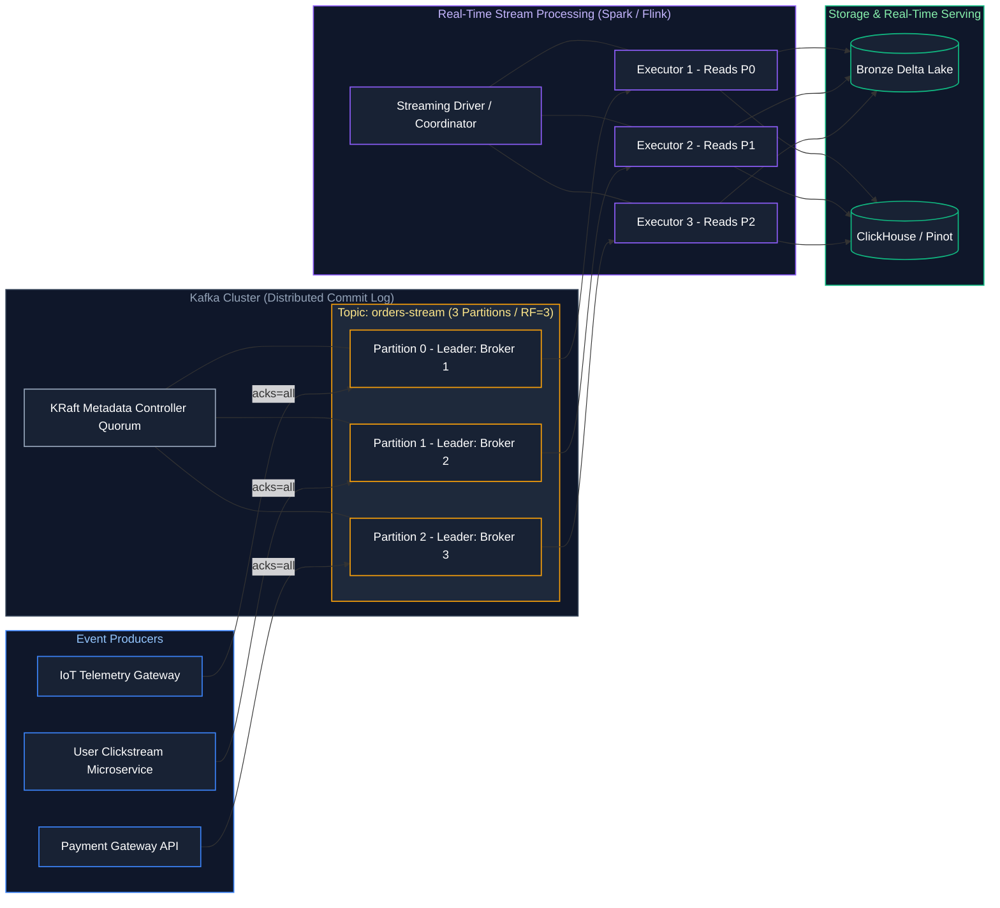

---


## Table of Contents
1. [Kafka Core Fundamentals](#1-kafka-core-fundamentals)
   - [1.1 Topics, Partitions, and Monotonic Offsets](#11-topics-partitions-and-monotonic-offsets)
   - [1.2 Producers, Consumers, and Consumer Groups](#12-producers-consumers-and-consumer-groups)
   - [1.3 Brokers & Cluster Topology](#13-brokers--cluster-topology)
   - [1.4 Message Anatomy](#14-message-anatomy)
   - [1.5 Retention Policies](#15-retention-policies)
   - [1.6 Log Compaction & Tombstones](#16-log-compaction--tombstones)
2. [Kafka Architecture & Storage Internals](#2-kafka-architecture--storage-internals)
   - [2.1 ZooKeeper vs KRaft (Kafka Raft Metadata Mode)](#21-zookeeper-vs-kraft-kafka-raft-metadata-mode)
   - [2.2 Partition Leaders, Followers & High Watermarks](#22-partition-leaders-followers--high-watermarks)
   - [2.3 In-Sync Replicas (ISR)](#23-in-sync-replicas-isr)
   - [2.4 Producer ACKs & min.insync.replicas](#24-producer-acks--mininsyncreplicas)
   - [2.5 Replication Factor & Disaster Recovery](#25-replication-factor--disaster-recovery)
   - [2.6 Physical Segment Files](#26-physical-segment-files)
3. [Kafka Consumers & Rebalancing Mechanics](#3-kafka-consumers--rebalancing-mechanics)
   - [3.1 Consumer Groups & Partition Assignment](#31-consumer-groups--partition-assignment)
   - [3.2 Rebalance Protocols: Eager vs Cooperative Sticky](#32-rebalance-protocols-eager-vs-cooperative-sticky)
   - [3.3 Offset Commit Strategies](#33-offset-commit-strategies)
   - [3.4 Consumer Lag Monitoring & Burrow](#34-consumer-lag-monitoring--burrow)
4. [Kafka in Enterprise Data Engineering](#4-kafka-in-enterprise-data-engineering)
   - [4.1 Kafka Connect Framework](#41-kafka-connect-framework)
   - [4.2 Confluent Schema Registry](#42-confluent-schema-registry)
   - [4.3 Schema Evolution Compatibility Modes](#43-schema-evolution-compatibility-modes)
   - [4.4 Kafka to Delta Lake Streaming Ingestion & DLQ Isolation](#44-kafka-to-delta-lake-streaming-ingestion--dead-letter-queue-dlq-isolation)
   - [4.5 Event-Driven Architecture (EDA) Patterns](#45-event-driven-architecture-eda-patterns)
5. [Spark Structured Streaming Core Engine](#5-spark-structured-streaming-core-engine)
   - [5.1 The Unbounded Table Model & Streaming DataFrames](#51-the-unbounded-table-model--streaming-dataframes)
   - [5.2 Sources, Sinks, and Triggers](#52-sources-sinks-and-triggers)
   - [5.3 Output Modes (Append, Complete, Update)](#53-output-modes-append-complete-update)
   - [5.4 Checkpointing & Offset Commit Management](#54-checkpointing--offset-commit-management)
   - [5.5 Event-Time vs. Processing-Time Semantics](#55-event-time-vs-processing-time-semantics)
   - [5.6 Watermarking & State Expiration](#56-watermarking--state-expiration)
   - [5.7 Streaming Window Operations](#57-streaming-window-operations)
   - [5.8 Streaming Joins](#58-streaming-joins)
   - [5.9 Stateful vs. Stateless Streaming Operations](#59-stateful-vs-stateless-streaming-operations)
   - [5.10 Streaming Deduplication](#510-streaming-deduplication)
6. [Advanced Streaming Infrastructure & Real-Time OLAP](#6-advanced-streaming-infrastructure--real-time-olap)
   - [6.1 End-to-End Delivery Semantics](#61-end-to-end-delivery-semantics)
   - [6.2 Stream Processing Engine Comparison](#62-stream-processing-engine-comparison)
   - [6.3 Cloud Message Brokers Comparison Matrix (Kafka vs. Event Hubs vs. Kinesis)](#63-cloud-message-brokers-comparison-matrix-kafka-vs-event-hubs-vs-kinesis)
   - [6.4 Real-Time OLAP Databases](#64-real-time-olap-databases)
7. [References & Further Reading](#7-references--further-reading)

---

# 1. Kafka Core Fundamentals

---

### 1.1 Topics, Partitions, and Monotonic Offsets

#### Definition
- **Topic:** A named category or feed to which records are published.
- **Partition:** A topic is split into multiple parallel, ordered, append-only commit logs called partitions. The partition is Kafka's fundamental unit of parallelism and horizontal scalability.
- **Offset:** A sequential, monotonically increasing 64-bit integer assigned to each record within a partition that uniquely identifies the message.

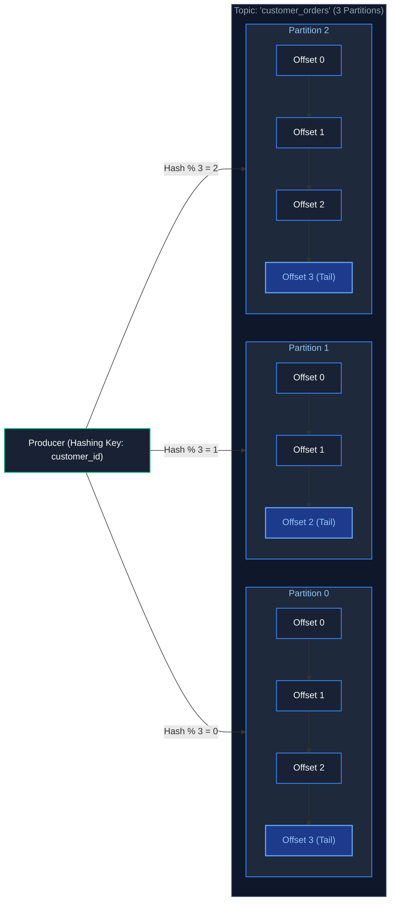

#### Total Ordering vs. Partition Ordering
Kafka **only guarantees message ordering within a single partition**, never globally across multiple partitions of a topic. To guarantee strict chronological ordering for an entity (e.g., all events for `user_101`), you must pass `user_101` as the **Message Key**.

#### References
- [Apache Kafka Official Documentation](https://kafka.apache.org/documentation/)
- [GeeksforGeeks: Apache Kafka Architecture](https://www.geeksforgeeks.org/apache-kafka-architecture/)
- [DataCamp: Introduction to Apache Kafka](https://www.datacamp.com/tutorial/apache-kafka-tutorial)

---

### 1.2 Producers, Consumers, and Consumer Groups

#### Definition
- **Producer:** An application process that publishes messages to Kafka topics.
- **Consumer:** An application process that subscribes to topics and processes message records.
- **Consumer Group:** A set of consumers cooperating to consume data from a topic. Kafka assigns each partition of a topic to **exactly one consumer** within a group.

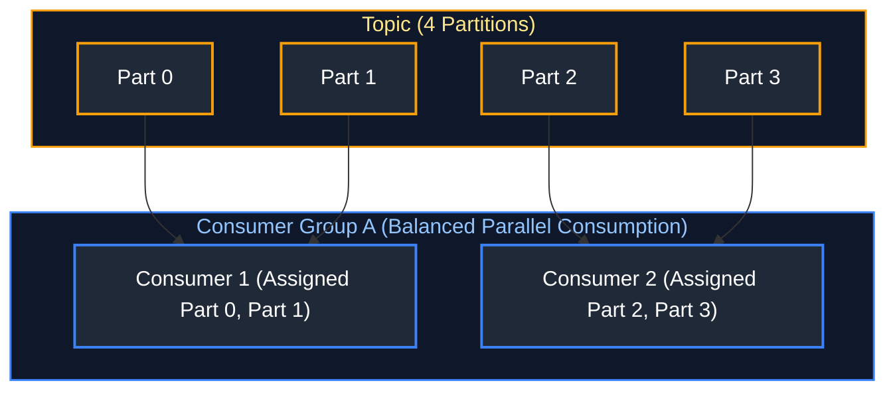

#### Consumer Group Scaling Rule
If a topic has 4 partitions and you deploy 6 consumers in the same group, **2 consumers will sit completely idle**. Max useful concurrency in a consumer group is equal to the partition count.

---

### 1.3 Brokers & Cluster Topology

#### Definition
A Kafka **Broker** is a stateless or stateful server daemon running on a cluster node. A collection of brokers forms a **Kafka Cluster**. One broker is elected as the **Controller**, responsible for partition leader assignments and cluster state reconciliation.

---

### 1.4 Message Anatomy

#### Definition & Structure
A Kafka record is an immutable binary tuple appended to a topic partition commit log. It consists of:
1. **Key (Bytes):** Used for deterministic partition routing (via `MurmurHash2(key) % num_partitions`). Optional.
2. **Value (Bytes):** The actual business payload (Avro, JSON, Protobuf, or raw bytes).
3. **Timestamp (Int64):** Millisecond Unix epoch timestamp (`CreateTime` set by producer or `LogAppendTime` set by broker).
4. **Headers (Array of Key-Value Byte Pairs):** Application metadata such as OpenTelemetry trace IDs, correlation tokens, and schema IDs without altering payload structure.
5. **Partition & Offset:** Monotonically assigned by the broker upon commit.

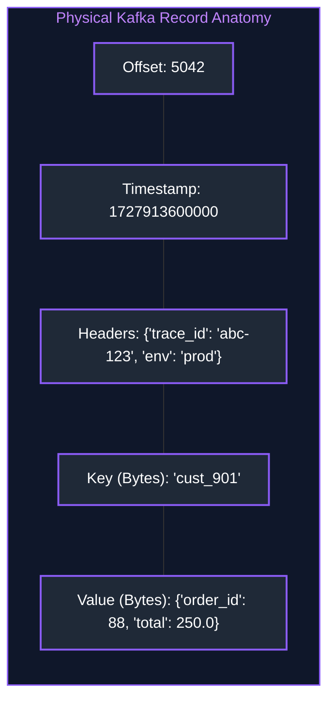

#### Code Example: Publishing Structured Records with Headers & Keys
```python
from confluent_kafka import Producer
import json
import time

def delivery_callback(err, msg):
    """
    Asynchronous callback invoked by librdkafka worker thread upon broker ACK
    or terminal transmission failure.
    """
    if err:
        # Broker rejected or timed out message delivery
        print(f"Message delivery failed: {err}")
    else:
        # Acknowledged: Log topic name, assigned partition, and committed broker offset
        print(f"Delivered to {msg.topic()} [part {msg.partition()}] at offset {msg.offset()}")

# Configure local client connection parameters
conf = {
    'bootstrap.servers': 'localhost:9092',   # Comma-delimited broker bootstrap list
    'client.id': 'order-producer'             # Application tracking identifier for broker telemetry
}
producer = Producer(conf)

# Structured business event payload
payload = {"order_id": "ord_9901", "amount": 149.99, "currency": "USD"}

# Binary metadata headers for distributed tracing, versioning, and routing
headers = [
    ("trace_id", b"d89f-22a0-4c81"),          # Distributed OpenTelemetry correlation ID
    ("schema_version", b"v2.1"),              # Schema contract identifier
    ("source_system", b"checkout_service")    # Originating microservice
]

# Produce event asynchronously into internal memory buffer:
# Key 'cust_402' is hashed using murmur2 to assign to a deterministic partition
producer.produce(
    topic="customer_orders",
    key="cust_402",                           # Deterministic routing key
    value=json.dumps(payload).encode('utf-8'),# Serialized binary byte array
    headers=headers,                          # Metadata headers
    callback=delivery_callback                # Delivery confirmation callback
)

# Block until all buffered messages are transmitted to brokers and acknowledged (graceful shutdown)
producer.flush(timeout=10.0)
```

#### References
- [Confluent Documentation: Kafka Message Formats](https://docs.confluent.io/kafka/design/message-format.html)
- [GeeksforGeeks: Apache Kafka Message Structure](https://www.geeksforgeeks.org/apache-kafka-message-structure/)

---

### 1.5 Retention Policies

Kafka retains messages independently of whether they have been consumed:
- **Time-Based Retention:** `log.retention.hours = 168` (Default: 7 days).
- **Size-Based Retention:** `log.retention.bytes = 1073741824` (Deletes oldest segments when partition exceeds size limit).

---

### 1.6 Log Compaction & Tombstones

#### Definition
Log Compaction retains at least the **most recent record for every message key** within a partition log, discarding older updates. It treats the topic as a changelog (K-V store snapshot).

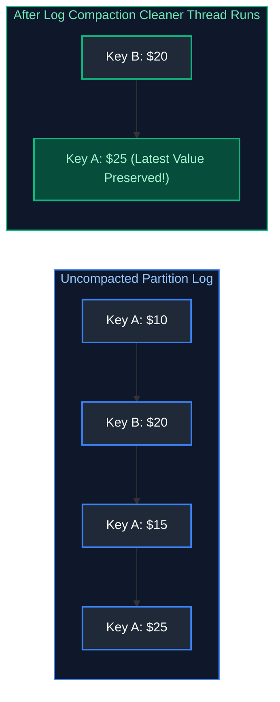

#### Tombstone Records
To delete a key in a compacted topic, a producer writes a message with the target Key and a **`null` Value** (termed a **Tombstone**). The compaction thread purges all historical records matching that key.

#### References
- [Confluent Documentation: Log Compaction](https://docs.confluent.io/kafka/design/log-compaction.html)

---

# 2. Kafka Architecture & Storage Internals

---

### 2.1 ZooKeeper vs KRaft (Kafka Raft Metadata Mode)

#### Definition
- **Legacy ZooKeeper Mode:** Kafka stored cluster metadata (broker registrations, topic configs, leader states) in an external Apache ZooKeeper ensemble. Suffered from slow controller failover (minutes to load 200,000 partitions).
- **Modern KRaft Mode (KIP-500):** Replaces ZooKeeper with an integrated, event-driven Raft consensus quorum running directly inside the Kafka brokers. Controller failover takes **sub-seconds**, supporting millions of partitions per cluster.

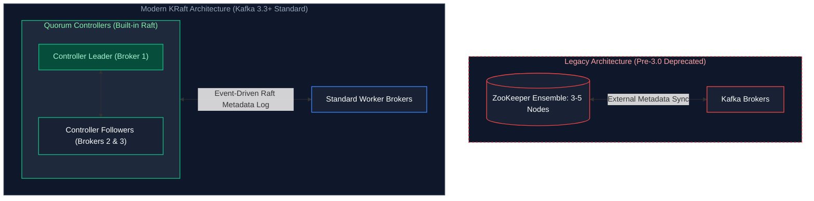

#### References
- [Confluent: KRaft - Kafka Without ZooKeeper](https://developer.confluent.io/learn/kraft/)
- [GeeksforGeeks: ZooKeeper vs KRaft in Apache Kafka](https://www.geeksforgeeks.org/zookeeper-vs-kraft-in-apache-kafka/)

---

### 2.2 Partition Leaders, Followers & High Watermarks

For every partition:
- **Leader Node:** Handles 100% of producer writes and consumer reads (by default).
- **Follower Replicas:** Passive standby nodes that stream and replicate the leader's log.
- **High Watermark (HW):** The highest offset that has been successfully replicated across all In-Sync Replicas. Consumers can only read messages up to the High Watermark to prevent reading uncommitted data.

---

### 2.3 In-Sync Replicas (ISR)

#### Definition
The In-Sync Replicas (ISR) is the subset of replica nodes that are actively caught up with the partition leader's log within the timeout threshold (`replica.lag.time.max.ms`, default 30s). If a follower node slows down or crashes, the leader drops it from the ISR.

---

### 2.4 Producer ACKs & `min.insync.replicas`

#### The Producer `acks` Configuration
- `acks=0`: Fire-and-forget. Producer never waits for acknowledgement. Highest throughput, lowest durability.
- `acks=1`: Leader writes record to local commit log, responds immediately. Default in older Kafka versions. If leader crashes before followers replicate, message is permanently lost.
- `acks=all` (or `-1`): Leader writes to commit log and waits until all In-Sync Replicas acknowledge receipt. Maximum durability guarantee.

#### Delivery Guarantees Comparison Matrix

| Delivery Guarantee | How It Works | Failure Scenario | Required Producer/Consumer Config |
| :--- | :--- | :--- | :--- |
| **At-Most-Once** | Producer does not wait for acks; consumer commits offset *before* processing message. | Network drop causes permanent message loss. Duplicate processing is impossible. | `acks=0`, consumer `enable.auto.commit=true` before record handling. |
| **At-Least-Once** | Producer waits for broker ack (`acks=all`) and retries on failure; consumer commits offset *after* processing. | Network blip during ack transmission triggers producer retry $
ightarrow$ duplicate messages. | `acks=all`, `retries > 0`, consumer manual offset commit after processing. |
| **Exactly-Once (EOS)** | Kafka Idempotent Producer + Transactional API (`sendOffsetsToTransaction`) across read-process-write loops. | Zero loss, zero duplicates across system failures. | `enable.idempotence=true`, `transactional.id` set, consumer `isolation.level=read_committed`. |

#### Code Example: Idempotent Kafka Producer in Python
```python
from confluent_kafka import Producer
import json
import logging

# Set up logging for auditability and observability
logging.basicConfig(level=logging.INFO)
logger = logging.getLogger("KafkaProducer")

# Configure Producer with strict Exactly-Once / Idempotence and full ISR durability
conf = {
    'bootstrap.servers': 'kafka-broker1:9092,kafka-broker2:9092', # High-availability broker cluster endpoints
    'client.id': 'payment-gateway-service',                      # Service identity in broker logs
    'acks': 'all',                                              # Producer blocks until all In-Sync Replicas commit to disk
    'enable.idempotence': True,                                 # Attaches Producer ID (PID) + monotonic sequence numbers
    'retries': 5,                                               # Automatically retry transient leader-election or network drops
    'max.in.flight.requests.per.connection': 5,                 # Preserves strict per-partition ordering even with concurrent in-flight requests
    'compression.type': 'snappy',                               # CPU-efficient batch compression saving network bandwidth
    'linger.ms': 20,                                            # Wait up to 20ms to aggregate record batches before dispatching socket write
    'batch.size': 32768                                         # Target maximum batch size buffer (32 KB)
}

# Initialize low-level C librdkafka wrapper producer instance
producer = Producer(conf)

def delivery_callback(err, msg):
    """Asynchronous confirmation callback triggered upon broker quorum ACK."""
    if err:
        logger.error(f"Message delivery failed: {err}")
    else:
        logger.info(f"Delivered to {msg.topic()} [partition {msg.partition()}] at offset {msg.offset()}")

# Financial payment transaction dictionary
payload = {
    "transaction_id": "TXN-882319",
    "user_id": "USR-4021",
    "amount": 249.99,
    "currency": "USD",
    "timestamp": "2026-03-30T10:15:30Z"
}

# Hashing on key 'ORD-9921' guarantees all state updates for this order arrive at the exact same partition in strict sequence
producer.produce(
    topic='financial-transactions',
    key='ORD-9921',                                             # Order identifier: determines deterministic partition
    value=json.dumps(payload).encode('utf-8'),                  # JSON payload converted to UTF-8 byte stream
    headers=[('source', b'payment-gateway'), ('environment', b'production')], # Contextual metadata
    on_delivery=delivery_callback                               # Callback executed on ACK
)

# Empty internal queue prior to process shutdown; blocks up to 10 seconds
producer.flush(timeout=10)
```

#### The Golden Durability Rule in Enterprise Data Engineering
To prevent catastrophic silent data loss:
- **`acks=all`** on all critical event publishers.
- **`replication.factor >= 3`** on all production topics.
- **`min.insync.replicas = 2`** on all production topics.

If one replica fails, the remaining two maintain quorum. If a second fails, brokers refuse incoming writes with `NotEnoughReplicasException`, preserving consistency over availability (CP mode).

### 2.5 Replication Factor & Disaster Recovery

A replication factor of 3 means 3 independent brokers hold copies of every partition. If Broker 1 experiences a hardware fire, Broker 2 (already in the ISR) is instantly promoted to Partition Leader in $<100$ milliseconds.

---

### 2.6 Physical Segment Files

#### Disk Structure
A Kafka partition directory on the broker filesystem (`/var/lib/kafka/data/orders-0/`) is split into physical 1GB files called **Segments**:
- `00000000000000000000.log`: Raw binary messages stored contiguously.
- `00000000000000000000.index`: Memory-mapped index mapping message offsets to exact byte positions in the `.log` file (enables $O(1)$ offset lookup).
- `00000000000000000000.timeindex`: Maps timestamps to offsets for point-in-time time-travel lookups.

#### Zero-Copy OS Optimization
Kafka streams data from the `.log` segment file directly to the network socket using the Linux OS kernel `sendfile()` system call (**Zero-Copy**). Bytes bypass user-space memory entirely:
$$\text{Disk File Cache} \xrightarrow{\text{OS Kernel DMA}} \text{Network NIC Buffer}$$

---

# 3. Kafka Consumers & Rebalancing Mechanics

---

### 3.1 Consumer Groups & Partition Assignment

Kafka's Group Coordinator assigns partitions across consumers using partition assignment strategies (Range, RoundRobin, Sticky, CooperativeSticky).

---

### 3.2 Rebalance Protocols: Eager vs Cooperative Sticky

#### 1. Eager Rebalance Protocol (Legacy)
When a consumer joins or leaves, **ALL consumers in the group revoke all partitions and stop consuming** (Stop-the-World pause). Can freeze ingestion pipelines for 30+ seconds.

#### 2. Cooperative Sticky Rebalance Protocol (Modern Standard)
Consumers continue reading unaffected partitions without pausing. Only the specific partitions that need to be migrated to the new consumer are reassigned incrementally (**Zero pipeline downtime**).

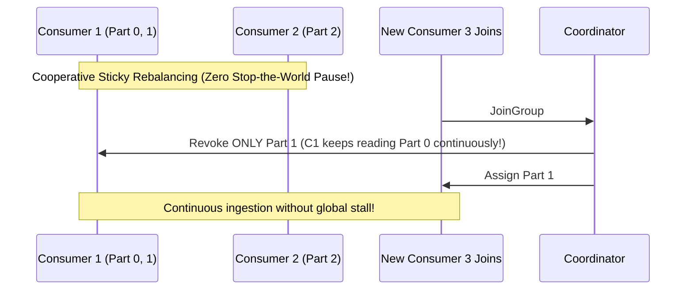

---

### 3.3 Offset Commit Strategies

- **Automatic Commit (`enable.auto.commit = true`):** Commits offsets on a timer (default every 5s). High risk of data loss (offsets committed before worker finishes processing) or duplicates.
- **Manual Synchronous Commit (`commitSync()`):** Commits after processing completes; blocks thread until broker confirms.
- **Manual Asynchronous Commit (`commitAsync()`):** Non-blocking high throughput with retry fallback.

---

### 3.4 Consumer Lag Monitoring & Burrow

#### Definition
Consumer Lag is the numerical difference between the latest offset committed by producers (Log End Offset - LEO) and the current offset read by consumers.
$$\text{Lag} = \text{Log End Offset (LEO)} - \text{Consumer Current Offset}$$

#### Monitoring
Monitored in enterprise pipelines using **Burrow** or Datadog. A continually increasing lag indicates consumer worker starvation or downstream pipeline backpressure.

---

# 4. Kafka in Enterprise Data Engineering

---

### 4.1 Kafka Connect Framework

#### Definition
Kafka Connect is a scalable, fault-tolerant framework for streaming data between Kafka and external databases, key-value stores, and cloud data lakes using modular, configuration-driven plugins:
- **Source Connectors:** Debezium (Postgres/MySQL CDC), JDBC Source, Salesforce Source.
- **Sink Connectors:** S3 Sink, ADLS Gen2 Sink, Snowflake Sink, Elasticsearch Sink.

---

### 4.2 Confluent Schema Registry

#### Definition
A centralized metadata repository that enforces data contracts on Kafka messages using **Apache Avro, Protobuf, or JSON Schema**.

#### Wire Format Efficiency
Instead of embedding the entire JSON schema on every single message (huge bandwidth waste), Kafka producers serialize messages with a **5-byte header**:
`[Magic Byte: 0x0] + [4-byte Schema Registry ID] + [Binary Avro Payload]`
Consumers read the 4-byte ID, fetch the schema from the registry once (cached), and deserialize cleanly.

```mermaid
flowchart LR
    P[Producer] -->|1. Register Schema| SR[(Schema Registry)]
    SR -- 2. Return Schema ID: 42 --> P
    P -->|3. Publish: [ID: 42][Avro Bytes]| K[Kafka Topic]
    K --> C[Consumer]
    C -->|4. Lookup Schema ID: 42| SR
    SR -- 5. Return Avro Schema --> C

    style P fill:#1f2937,stroke:#3b82f6,stroke-width:2px,color:#fff
    style SR fill:#1f2937,stroke:#3b82f6,stroke-width:2px,color:#fff
    style K fill:#1f2937,stroke:#3b82f6,stroke-width:2px,color:#fff
    style C fill:#1f2937,stroke:#3b82f6,stroke-width:2px,color:#fff
```

---

### 4.3 Schema Evolution Compatibility Modes

1. **BACKWARD (Default):** New schema can read data written by older schema (Consumers upgrade first).
2. **FORWARD:** Old schema can read data written by new schema (Producers upgrade first).
3. **FULL:** Both backward and forward compatible.
4. **NONE:** Schema validation disabled.

---

### 4.4 Kafka to Delta Lake Streaming Ingestion & Dead-Letter Queue (DLQ) Isolation

#### Code Example (PySpark Streaming Pipeline with DLQ Handling)
```python
from pyspark.sql import SparkSession
from pyspark.sql import functions as F
from pyspark.sql.types import StructType, StructField, StringType, DoubleType, TimestampType

spark = SparkSession.builder \
    .appName("KafkaToDeltaWithDLQ") \
    .config("spark.sql.extensions", "io.delta.sql.DeltaSparkSessionExtension") \
    .config("spark.sql.catalog.spark_catalog", "org.apache.spark.sql.delta.catalog.DeltaCatalog") \
    .getOrCreate()

# 1. Define strict transaction payload schema
transaction_schema = StructType([
    StructField("transaction_id", StringType(), False),
    StructField("user_id", StringType(), False),
    StructField("event_time", TimestampType(), False),
    StructField("amount", DoubleType(), False),
    StructField("currency", StringType(), True)
])

# 2. Read streaming data from Apache Kafka
kafka_stream = (
    spark.readStream
         .format("kafka")
         .option("kafka.bootstrap.servers", "kafka-broker1:9092,kafka-broker2:9092")
         .option("subscribe", "financial-transactions")
         .option("startingOffsets", "latest")
         .option("failOnDataLoss", "false")
         .load()
)

# 3. Parse JSON value column with PERMISSIVE mode to capture malformed records
parsed_stream = kafka_stream.select(
    F.col("key").cast("string").alias("kafka_key"),
    F.col("timestamp").alias("kafka_timestamp"),
    F.from_json(F.col("value").cast("string"), transaction_schema, {"mode": "PERMISSIVE"}).alias("parsed_payload"),
    F.col("value").cast("string").alias("raw_payload")
)

# 4. Valid parsed stream: non-null transaction_id
valid_stream = parsed_stream \
    .filter(F.col("parsed_payload.transaction_id").isNotNull()) \
    .select("kafka_key", "kafka_timestamp", "parsed_payload.*")

# 5. Dead-Letter Queue (DLQ) stream: Corrupt/unparseable JSON records
dlq_stream = parsed_stream \
    .filter(F.col("parsed_payload.transaction_id").isNull()) \
    .select(
        F.col("kafka_key"),
        F.col("kafka_timestamp"),
        F.col("raw_payload"),
        F.current_timestamp().alias("quarantine_time"),
        F.lit("MALFORMED_JSON_SCHEMA_MISMATCH").alias("error_reason")
    )

# 6. Write valid events to Bronze Delta Lake Table
valid_query = (
    valid_stream.writeStream
        .format("delta")
        .outputMode("append")
        .option("checkpointLocation", "s3://lakehouse-checkpoints/valid_transactions/")
        .start("s3://lakehouse-bronze/transactions/")
)

# 7. Write quarantined events to Dead-Letter Queue Delta Table
dlq_query = (
    dlq_stream.writeStream
        .format("delta")
        .outputMode("append")
        .option("checkpointLocation", "s3://lakehouse-checkpoints/dlq_transactions/")
        .start("s3://lakehouse-quarantine/dlq_transactions/")
)
```

### 4.5 Event-Driven Architecture (EDA) Patterns

In modern enterprise architectures, services communicate via asynchronous event logs rather than direct REST RPC calls. This decouples producers from consumers, provides instant buffering during downstream outages, and allows multiple consumer applications (analytics, fraud detection, notification services) to subscribe to the same business event stream independently.

#### References
- [Confluent: Event-Driven Architecture Guide](https://developer.confluent.io/learn/event-driven-architecture/)
- [GeeksforGeeks: Event-Driven Architecture](https://www.geeksforgeeks.org/event-driven-architecture/)

---

---

---
# 5. Spark Structured Streaming Core Engine

---

### 5.1 The Unbounded Table Model & Streaming DataFrames

#### Definition
Structured Streaming abstracts a live data stream as an **unbounded, continuously growing table**. Every newly arriving event is treated as a new row appended to the input table. Developers write queries using standard DataFrame and SQL APIs; Spark automatically executes the query incrementally across streaming micro-batches or continuous processing.

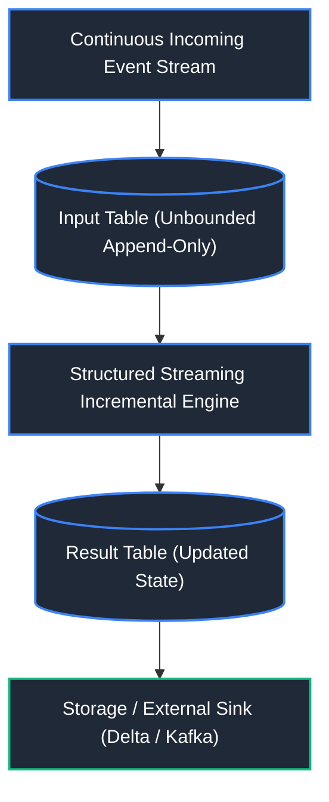

#### References
- [Apache Spark Official Structured Streaming Programming Guide](https://spark.apache.org/docs/latest/structured-streaming-programming-guide.html)
- [GeeksforGeeks: Spark Structured Streaming](https://www.geeksforgeeks.org/spark-structured-streaming/)
- [DataCamp: Real-Time Stream Processing with PySpark](https://www.datacamp.com/tutorial/pyspark-tutorial-getting-started-with-pyspark)

---

### 5.2 Sources, Sinks, and Triggers

#### Core Definitions
- **Source:** Streaming ingest connection (Apache Kafka, Azure Event Hubs, AWS Kinesis, Delta Lake, Socket).
- **Sink:** Target destination where processed data is emitted (Delta Lake, Kafka, JDBC Database, Console, Memory).
- **Trigger:** Defines the timing of streaming execution:
  - Default (Unspecified): Executes the next micro-batch as soon as the previous micro-batch completes.
  - Fixed Interval: `Trigger.ProcessingTime("10 seconds")`
  - One-Time Trigger: `Trigger.Once()` or `Trigger.AvailableNow()` (processes all available data in micro-batches and terminates).
  - Continuous Processing: Sub-millisecond continuous pipeline (`Trigger.Continuous("1 second")`).

#### Code Example
```python
# Streaming from Kafka, processing every 30 seconds, writing to Delta Lake ACID sink
query = df_kafka_parsed.writeStream \
    .format("delta") \                                          # Persist into Delta Lake ACID table format
    .outputMode("append") \                                     # Append newly processed micro-batch records
    .trigger(processingTime="30 seconds") \                     # Micro-batch interval: fires execution every 30 seconds
    .option("checkpointLocation", "s3://lake/checkpoints/orders/") \ # Write-Ahead Log storing micro-batch offsets for fault-tolerance
    .start("/lakehouse/silver/orders/")                          # Target Delta table storage path
```

---

#### Trigger Modes Comparison Matrix

| Trigger Mode | Syntax | Execution Behavior | Best Use Case |
| :--- | :--- | :--- | :--- |
| **Default (Micro-Batch)** | `.trigger()` (no arg) | Next micro-batch begins as soon as previous completes. | Lowest latency standard micro-batch. |
| **Fixed Interval** | `.trigger(processingTime='30 seconds')` | Micro-batch executes at specified regular time intervals. | Throttling downstream write costs and file churn. |
| **One-Time / Available-Now** | `.trigger(availableNow=True)` | Processes all available data in batches, then gracefully stops stream. | Cost-effective scheduled batch runs on Delta Lake / Iceberg. |
| **Continuous Processing** | `.trigger(continuous='1 second')` | Continuous epoch-based execution (~1ms latency, low-level engine). | High-frequency trading and sub-second fraud alerts. |

---

#### Streaming Backlog Mitigation via Trigger Optimization

##### Problem: Streaming Backlog & Consumer Lag Spikes
When streaming pipelines experience downtime for maintenance, network interruptions, or upstream traffic surges (e.g., Black Friday flash sales), millions of unconsumed messages accumulate in Kafka or thousands of raw files pile up in object storage landing buckets.
- If the stream restarts with default micro-batch triggers or legacy `Trigger.Once()`, Spark attempts to ingest the entire backlog into a single massive micro-batch.
- This causes **Executor Heap Exhaustion (OOM)**, extreme Garbage Collection thrashing, or executor heartbeat timeout failures, creating a vicious crash-restart loop.

##### Solution: Trigger Optimization (`Trigger.AvailableNow` + Rate Limiting)
1. **`Trigger.AvailableNow()` (Spark 3.3+):** Replaces legacy `Trigger.Once()`. Instead of packing all backlogged events into one fatal micro-batch, it calculates the total backlog, slices it into multiple **rate-controlled micro-batches**, processes them sequentially, and cleanly shuts down once the backlog is drained.
2. **Rate-Limiting Parameters:**
   - **Kafka Sources:** `.option("maxOffsetsPerTrigger", 50000)` sets a strict upper bound on records fetched per partition per trigger.
   - **File / Cloud Storage Sources:** `.option("maxFilesPerTrigger", 1000)` or `.option("maxBytesPerTrigger", "10g")`.

```python
# Production Backlog Draining Pattern in PySpark Structured Streaming
df_backlog_recovery = spark.readStream \
    .format("kafka") \
    .option("kafka.bootstrap.servers", "kafka-broker.prod:9092") \
    .option("subscribe", "telemetry_events") \
    .option("startingOffsets", "earliest") \
    .option("maxOffsetsPerTrigger", 100000) \               # Limits each micro-batch to 100k events to protect executor memory
    .load()

# Drain the backlog across multiple micro-batches and shut down gracefully
query_drain = df_backlog_recovery.writeStream \
    .format("delta") \
    .outputMode("append") \
    .trigger(availableNow=True) \                          # Drains backlog in safe chunks, then terminates
    .option("checkpointLocation", "s3://lake/checkpoints/recovery/") \
    .start("/lakehouse/silver/events/")

query_drain.awaitTermination()
print("Streaming backlog successfully drained without executor OOM!")
```

---

### 5.3 Output Modes (Append, Complete, Update)

#### Definition
The Output Mode specifies how updated rows in the Result Table are written to the external Sink:

| Output Mode | Behavior | Valid Operations |
| :--- | :--- | :--- |
| **`Append`** (Default) | Only **new rows** finalized since the last trigger are emitted. Existing rows are never modified. | Stateless operations (`select`, `filter`), or stateful operations with Watermarking. |
| **`Complete`** | The **entire updated result table** is re-written to the sink on every trigger. | Only valid for queries with aggregations (`groupBy()`). |
| **`Update`** | Only the **specific rows that changed or were updated** since the last trigger are emitted. | Supported across both aggregations and point updates. |

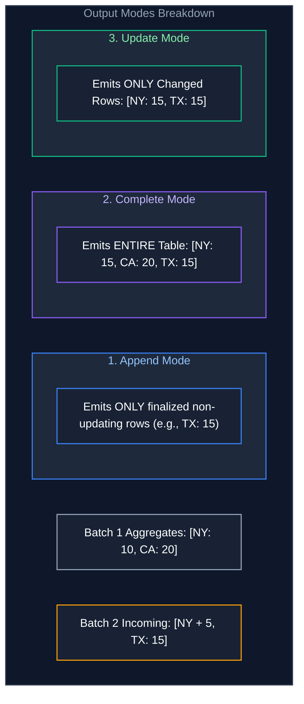

#### References
- [Databricks Documentation: Structured Streaming Output Modes](https://docs.databricks.com/en/structured-streaming/output-modes.html)
- [GeeksforGeeks: Output Modes in Spark Streaming](https://www.geeksforgeeks.org/spark-streaming-output-operations/)

---

### 5.4 Checkpointing & Offset Commit Management

#### Definition
Checkpointing guarantees fault tolerance by writing stream metadata (offsets) and internal state stores to persistent cloud storage (S3/ADLS). 

Inside the checkpoint directory:
- `/offsets/`: Records the starting and ending offsets (e.g., Kafka partition offsets) for each micro-batch.
- `/commits/`: Records batch completion logs.
- `/state/`: Serialized state stores (RocksDB or HDFS-backed) for windowed aggregations and joins.

---

### 5.5 Event-Time vs. Processing-Time Semantics

- **Event-Time:** The timestamp embedded inside the record indicating when the event physically took place on the client device.
- **Processing-Time:** The clock time of the cluster worker node when the record is ingested and evaluated.
- **Why Event-Time is Critical:** In real-world data pipelines, network latency and offline devices delay data arrival. Calculating metrics by Processing-Time distorts analytics; pipelines must always aggregate on Event-Time.

---

### 5.6 Watermarking & State Expiration

#### Definition
In stateful stream processing, intermediate windowed aggregations (e.g., counting orders per 10-minute window) require holding historical events in memory. Without a limit, memory will grow infinitely.

A **Watermark** establishes a point-in-time boundary: any incoming event with an Event-Time older than the watermark is declared too late and dropped, allowing the engine to finalize the window and **evict old state from memory**.

```python
# Declaring a 15-minute watermark: discards events arriving >15 mins later than the maximum observed event_time
df_orders.withWatermark("order_timestamp", "15 minutes") \       # Bounds stateful memory by defining late-data drop threshold
    .groupBy(
        window("order_timestamp", "10 minutes"),                # 10-minute tumbling time window bucket
        "country"                                              # Grouping key
    ) \
    .sum("amount")                                             # Computes running aggregate per window per country
```

---

### 5.7 Streaming Window Operations

#### 1. Tumbling Windows
Fixed-size, contiguous, **non-overlapping** time intervals. Each event belongs to exactly one window.
- *Example:* 10-minute window (00:00-00:10, 00:10-00:20).

#### 2. Sliding Windows
Fixed-size, **overlapping** time intervals defined by window duration and slide duration.
- *Example:* 10-minute window sliding every 5 minutes (00:00-00:10, 00:05-00:15).

#### 3. Session Windows
Dynamic-size windows bounded by an **inactivity gap**. If no events arrive from a user for 30 minutes, the session window closes.

```mermaid
flowchart TD
    subgraph Tumbling ["1. Tumbling Windows (Fixed, No Overlap)"]
        T1["[00:00 - 00:10]"] --> T2["[00:10 - 00:20]"] --> T3["[00:20 - 00:30]"]
    end

    subgraph Sliding ["2. Sliding Windows (Overlapping Intervals)"]
        S1["[00:00 - 00:10]"]
        S2["   [00:05 - 00:15]"]
        S3["      [00:10 - 00:20]"]
        S1 -.-> S2 -.-> S3
    end

    subgraph Session ["3. Session Windows (Inactivity Gap Bounded)"]
        U1["User Clicks (Events 2 mins apart) -> Single 18-Min Session Window"]
        Gap["[30 Min Inactivity Gap]"]
        U2["New User Click -> New Session Window Opened"]
        U1 --> Gap --> U2
    end

    style Tumbling fill:#0f172a,stroke:#3b82f6,stroke-width:1.5px,color:#93c5fd
    style Sliding fill:#0f172a,stroke:#8b5cf6,stroke-width:1.5px,color:#c084fc
    style Session fill:#0f172a,stroke:#10b981,stroke-width:1.5px,color:#6ee7b7

    style T1 fill:#1f2937,stroke:#3b82f6,stroke-width:2px,color:#fff
    style T2 fill:#1f2937,stroke:#3b82f6,stroke-width:2px,color:#fff
    style T3 fill:#1f2937,stroke:#3b82f6,stroke-width:2px,color:#fff
    style S1 fill:#1f2937,stroke:#8b5cf6,stroke-width:2px,color:#fff
    style S2 fill:#1f2937,stroke:#8b5cf6,stroke-width:2px,color:#fff
    style S3 fill:#1f2937,stroke:#8b5cf6,stroke-width:2px,color:#fff
    style U1 fill:#1f2937,stroke:#10b981,stroke-width:2px,color:#fff
    style Gap fill:#1f2937,stroke:#f59e0b,stroke-width:2px,color:#fff
    style U2 fill:#1f2937,stroke:#10b981,stroke-width:2px,color:#fff
```

#### References
- [Apache Spark Documentation: Window Operations](https://spark.apache.org/docs/latest/structured-streaming-programming-guide.html#window-operations-on-event-time)
- [DataCamp: Windowing in Stream Processing](https://www.datacamp.com/tutorial/stream-processing)

---

### 5.8 Streaming Joins

#### 1. Stream-Static Join
Joins a streaming DataFrame with a static batch table (e.g., enriching incoming click streams with static customer account profiles). Fully stateless.

#### 2. Stream-Stream Join
Joins two continuous real-time streams (e.g., matching ad impressions stream with ad clicks stream). Requires buffering events from both sides in state memory. **Dual watermarks and time constraints are mandatory** to prevent unbounded state memory leaks.

```python
# Stream-Stream Join with Watermarks and Time Constraints
impressions_with_wm = df_impressions.withWatermark("impression_time", "2 hours")
clicks_with_wm = df_clicks.withWatermark("click_time", "3 hours")

df_joined_stream = impressions_with_wm.join(
    clicks_with_wm,
    expr("impression_id = click_ad_id AND click_time >= impression_time AND click_time <= impression_time + interval 1 hour"),
    how="inner"
)
```

---

### 5.9 Stateful vs. Stateless Streaming Operations

- **Stateless Operations:** Each event is processed in isolation without needing knowledge of past events (`select`, `filter`, `map`). Requires zero memory overhead.
- **Stateful Operations:** Requires accumulating and preserving past events across micro-batches in memory state stores (`groupBy()`, `dropDuplicates()`, `join()`). Managed using **RocksDB State Store** in production to prevent JVM garbage collection pauses.

---

### 5.10 Streaming Deduplication

#### Code Example
```python
# Streaming deduplication with watermarking to bound state memory
df_deduped_stream = df_stream \
    .withWatermark("event_time", "24 hours") \
    .dropDuplicates(["event_uuid", "event_time"])
```

---

# 6. Advanced Streaming Infrastructure & Real-Time OLAP

---

### 6.1 End-to-End Delivery Semantics

#### The Three Semantics Guarantees
1. **At-Most-Once:** Messages may be dropped but are never duplicated. Offsets committed *before* processing. Unacceptable for financial/e-commerce pipelines.
2. **At-Least-Once:** Messages are guaranteed to be processed, but network retries can introduce duplicates. Offsets committed *after* processing.
3. **Exactly-Once (End-to-End):** Every event affects the final output state exactly once, with zero duplicates and zero dropped events.

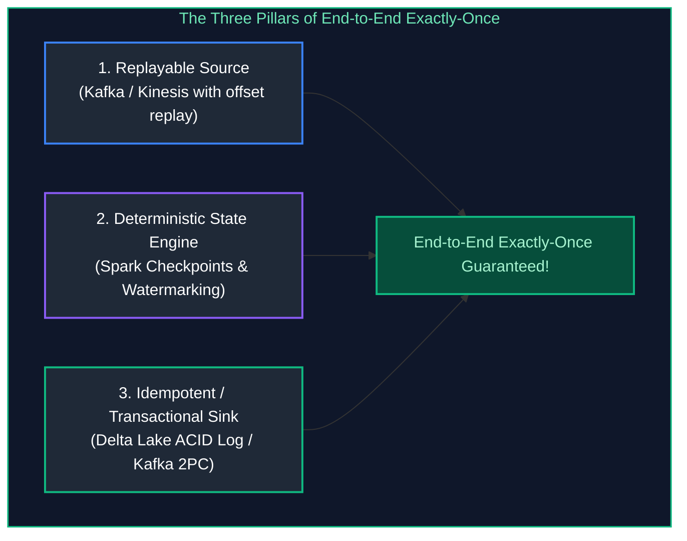

#### References
- [GeeksforGeeks: Message Delivery Guarantees in Distributed Systems](https://www.geeksforgeeks.org/message-delivery-semantics-in-distributed-systems/)

---

### 6.2 Stream Processing Engine Comparison

| Feature | Apache Spark Structured Streaming | Apache Flink | Kafka Streams |
| :--- | :--- | :--- | :--- |
| **Core Architecture** | Micro-batching (default) & Continuous | Native True Streaming (Event-at-a-time) | Native True Streaming |
| **Latency** | 100ms - 500ms (Micro-batch) / ~5ms (Continuous) | **Sub-10ms (Ultra Low)** | 10ms - 50ms |
| **Throughput** | **Highest (Bulk vectorized)** | High | Moderate / High |
| **State Management** | RocksDB / HDFS State Store | Highly optimized RocksDB state | RocksDB state per instance |
| **Ecosystem** | Unified Batch + Stream Lakehouse | Dedicated streaming pipelines | Microservice-embedded Java apps |

#### References
- [DataCamp: Spark vs Flink vs Kafka Streams](https://www.datacamp.com/tutorial/stream-processing)
- [Apache Flink Official Documentation](https://flink.apache.org/)

---

### 6.3 Cloud Message Brokers Comparison Matrix (Kafka vs. Event Hubs vs. Kinesis)

| Feature / Dimension | Apache Kafka (Self-Hosted / Confluent / MSK) | Azure Event Hubs | AWS Kinesis Data Streams |
| :--- | :--- | :--- | :--- |
| **Consensus & Architecture** | KRaft (Kafka Raft) brokers. Custom storage volumes. | Fully managed cloud-native partitioned log. | Fully managed AWS partitioned stream (Shards). |
| **Scaling Unit** | Partition count & Broker nodes. | **Throughput Units (TUs)** or Processing Units (PUs). | **Shards** (1 MB/sec write, 2 MB/sec read per shard). |
| **Kafka API Compatibility** | Native 100%. | **Supported natively** via Kafka client endpoint (port 9093). | Requires AWS MSK (Managed Streaming for Kafka) for native Kafka API. |
| **Max Retention** | Configurable up to infinity. | 1 to 90 days. | 1 to 365 days. |
| **Storage Tiering** | Kafka Tiered Storage (S3 / GCS offload). | **Event Hubs Capture** directly to ADLS Gen2 / Avro. | Kinesis Firehose directly to S3 / Parquet. |
| **Protocol Support** | Kafka binary protocol. | Kafka API, AMQP 1.0, HTTPS. | AWS SDK, Kinesis API, HTTPS. |
| **Disaster Recovery** | MirrorMaker 2, Confluent Cluster Linking. | Geo-Disaster Recovery & Geo-Replication. | Cross-Region Replication (CRR) via Lambda/Kinesis. |
| **Ideal Enterprise Use Case** | Multi-cloud, on-prem, complex event pipelines, strict Kafka API reliance. | Azure-native analytics, direct Fabric/ADLS Gen2 integration. | AWS-native ecosystems, serverless Lambda event streams. |

### 6.4 Real-Time OLAP Databases

#### Definition
Real-Time OLAP databases are specialized columnar storage engines engineered to ingest high-velocity streaming feeds (millions of events/second from Kafka) and serve analytical aggregations with **sub-second query latencies** across billions of rows.

#### Primary Engines
1. **ClickHouse:** Blazing fast vectorized C++ columnar execution. Exceptional data compression. Ideal for web analytics, ad-tech, and log analytics.
2. **Apache Pinot:** Designed by LinkedIn for real-time user-facing analytical queries (e.g. "Who viewed your profile"). Features rich Star-Tree indexes.
3. **Apache Druid:** Time-series columnar store with built-in real-time stream ingestion and bitmap indexing.

```mermaid
flowchart LR
    Kafka[Kafka Event Stream] -->|Direct Real-Time Ingest| RT_OLAP[(ClickHouse / Apache Pinot / Druid)]
    RT_OLAP --> API[User-Facing Analytics API]
    RT_OLAP --> LiveDash[Real-Time Security Dashboard (<50ms Latency)]

    style Kafka fill:#1f2937,stroke:#3b82f6,stroke-width:2px,color:#fff
    style RT_OLAP fill:#1f2937,stroke:#3b82f6,stroke-width:2px,color:#fff
    style API fill:#1f2937,stroke:#3b82f6,stroke-width:2px,color:#fff
    style LiveDash fill:#1f2937,stroke:#3b82f6,stroke-width:2px,color:#fff
```

#### References
- [ClickHouse Official Documentation](https://clickhouse.com/docs)
- [Apache Pinot Official Documentation](https://pinot.apache.org/)
- [GeeksforGeeks: Real-Time OLAP Systems](https://www.geeksforgeeks.org/real-time-olap-databases/)

---
