# 12. Orchestration (Apache Airflow & dbt)

A comprehensive, production-grade guide to workflow orchestration and analytics engineering with Apache Airflow and dbt, covering DAG scheduling internals, deferrable operators, Celery and Kubernetes executors, dbt incremental modeling, Jinja templating, testing, and CI/CD DataOps pipelines.

---

## Architectural Overview: Modern Data Stack Orchestration (Airflow & dbt) Architecture

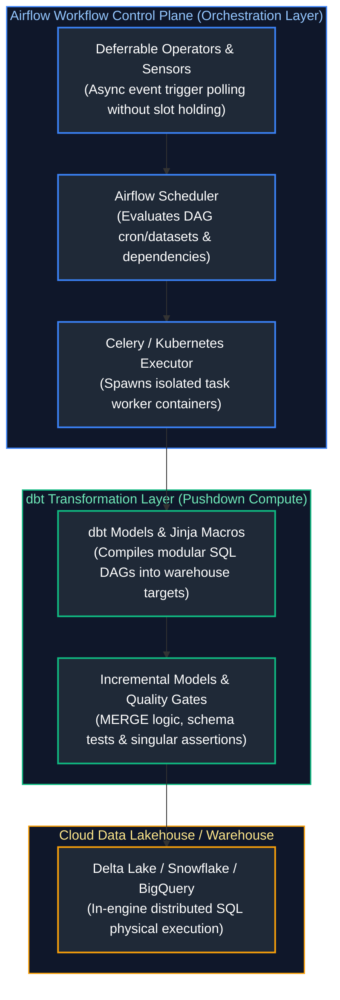

---

## Table of Contents
1. [Apache Airflow Core Architecture](#1-apache-airflow-core-architecture)
   - [1.1 DAGs, Tasks, and Operators](#11-dags-tasks-and-operators)
   - [1.2 Sensors & Deferrable Operators (Triggerer)](#12-sensors-deferrable-operators-triggerer)
   - [1.3 Hooks & Connections Management](#13-hooks-connections-management)
   - [1.4 XComs & Custom XCom Backends](#14-xcoms-custom-xcom-backends)
   - [1.5 Modern TaskFlow API & Dynamic Task Mapping](#15-modern-taskflow-api-dynamic-task-mapping)
   - [1.6 Airflow 5-Component Architecture & Lifecycle State Machine](#16-airflow-5-component-architecture-lifecycle-state-machine)
   - [1.7 Airflow Executors & Operational Cluster Management](#17-airflow-executors-operational-cluster-management)
   - [1.8 Dynamic DAG Generation](#18-dynamic-dag-generation)
   - [1.9 Backfilling, Scheduling Timetables, and Data Intervals](#19-backfilling-scheduling-timetables-and-data-intervals)
   - [1.10 Pools, Slots & Concurrency Throttling](#110-pools-slots-concurrency-throttling)
   - [1.11 Trigger Rules and Advanced DAG Control Flow](#111-trigger-rules-and-advanced-dag-control-flow)
   - [1.12 SLAs, Callbacks & Enterprise Alerting](#112-slas-callbacks-enterprise-alerting)
   - [1.13 Orchestrator Comparison: Airflow vs Prefect vs Dagster](#113-orchestrator-comparison-airflow-vs-prefect-vs-dagster)
   - [1.14 Ecosystem Integration: dbt + Airflow (Cosmos)](#114-ecosystem-integration-dbt-airflow-cosmos)
2. [dbt (Data Build Tool) Modeling & Transformation](#2-dbt-data-build-tool-modeling-transformation)
   - [2.1 dbt Core vs dbt Cloud](#21-dbt-core-vs-dbt-cloud)
   - [2.2 dbt Models & SQL-First Transformation](#22-dbt-models-sql-first-transformation)
   - [2.3 Materialization Strategies](#23-materialization-strategies)
   - [2.4 Incremental Models Deep-Dive (`merge` vs `delete+insert`)](#24-incremental-models-deep-dive-merge-vs-deleteinsert)
   - [2.5 Seeds, Sources, and Automated SCD2 Snapshots](#25-seeds-sources-and-automated-scd2-snapshots)
   - [2.6 dbt Testing & Assertions](#26-dbt-testing-assertions)
   - [2.7 Documentation & Interactive Lineage Graphs](#27-documentation-interactive-lineage-graphs)
   - [2.8 Jinja Templating & Custom Macros](#28-jinja-templating-custom-macros)
   - [2.9 dbt Packages](#29-dbt-packages)
   - [2.10 Exposures & the dbt Semantic Layer](#210-exposures-the-dbt-semantic-layer-metric-standardization)
   - [2.11 `dbt build` vs `dbt run` & CLI Operations Cheatsheet](#211-dbt-build-vs-dbt-run-cli-operations-cheatsheet)
3. [References & Further Reading](#3-references-further-reading)

---

# 1. Apache Airflow Core Architecture

In modern production data platforms, enterprise workloads separate the **orchestration layer** (scheduling, dependency management, sensor polling, cluster provisioning, alerting) from the **transformation layer** (in-warehouse compute, SQL logic, incremental merges). Apache Airflow provides a robust, Python-native control plane to schedule and monitor complex workflow graphs, while transformation engines like dbt execute pushdown compute within cloud warehouses.

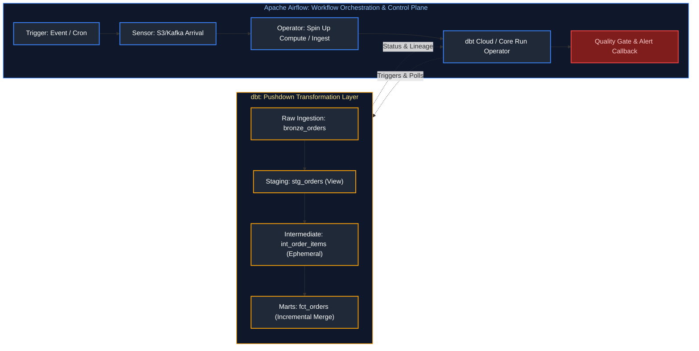

### Deep-Dive Comparison: Apache Airflow vs. dbt

| Architectural Dimension | Apache Airflow | dbt (Data Build Tool) |
| :--- | :--- | :--- |
| **Primary Scope** | General-purpose workflow orchestration and scheduling | In-warehouse SQL/Python data transformation and modeling |
| **Execution Model** | Control plane: Manages execution graphs across external engines | Pushdown engine: Compiles SQL and executes directly inside the target DWH |
| **Underlying Language** | Pure Python (DAGs, Operators, Hooks, Sensors) | Pure SQL + Jinja templating (plus optional Python models) |
| **State & Lineage** | Tracks TaskInstance state in Postgres/MySQL metadata database | Infers lineage dynamically via `{{ ref() }}` and `{{ source() }}` macros |
| **Data Movement** | Orchestrates compute across heterogenous systems (Spark, S3, APIs) | Zero data movement: Transforms data already loaded into warehouse tables |
| **Quality Testing** | Custom Python operators, SQLCheckOperators, external tools (Great Expectations) | Built-in generic schema tests (`unique`, `not_null`) & singular SQL assertions |
| **Failure Handling** | Retry policies, exponential backoff, dead-letter routing, SLAs | Halts downstream model builds on test or compile failure |
| **Extensibility** | Provider packages, Custom Operators, Hooks, Plugins, Custom XComs | dbt packages (e.g., `dbt-utils`, `dbt-expectations`), custom Jinja macros |

---

### 1.1 DAGs, Tasks, and Operators

#### Definition
- **DAG (Directed Acyclic Graph)**: A collection of tasks arranged in a directional graph without circular dependencies. It represents the workflow logic, execution schedule, and dependencies between units of work.
- **Operator**: A declarative template or class that defines a single, reusable unit of work (e.g., `BashOperator`, `PythonOperator`, `SQLExecuteQueryOperator`).
- **Task**: The instantiation of an Operator within the context of a DAG (e.g., `task_1 = BashOperator(...)`).
- **TaskInstance**: A specific run of a task bound to a concrete execution interval / `dag_run_id`, holding state in the metadata database (e.g., `queued`, `running`, `success`).

```mermaid
flowchart LR
    A["Extract Source API (PythonOperator)"] --> B["Stage to S3 (S3CreateObjectOperator)"]
    B --> C["Load to Snowflake (SnowflakeSqlApiOperator)"]
    C --> D["Transform Marts (DbtRunOperator)"]
    D --> E["Notify Data Team (SlackWebhookOperator)"]

    style A fill:#1f2937,stroke:#3b82f6,stroke-width:2px,color:#fff
    style B fill:#1f2937,stroke:#3b82f6,stroke-width:2px,color:#fff
    style C fill:#1f2937,stroke:#3b82f6,stroke-width:2px,color:#fff
    style D fill:#1f2937,stroke:#3b82f6,stroke-width:2px,color:#fff
    style E fill:#1f2937,stroke:#3b82f6,stroke-width:2px,color:#fff
```

#### Real-World Production Example: E-Commerce Pipeline
An e-commerce enterprise ingests daily transaction files from external payment gateways (Stripe, PayPal) stored in Cloud Storage, loads them into Snowflake, executes a suite of dbt models to update customer lifetime value (LTV) marts, and broadcasts downstream notifications.
- **Airflow** schedules the workflow daily at midnight, verifies source file arrival using deferrable sensors, provisions the Snowflake warehouse, triggers the dbt pipeline, and issues Slack alerts on failure.
- **dbt** builds the data models (`stg_orders`, `fct_orders`, `dim_customers`), enforces referential integrity constraints, and documents column-level data lineage.

---

### 1.2 Sensors & Deferrable Operators (Triggerer)

In distributed orchestration, pipelines frequently wait for external preconditions: an S3 file upload by a third-party vendor, a Databricks job completion, or a database partition readiness check. Choosing the wrong polling strategy can exhaust an entire worker fleet.

For hands-on coverage, consult GeeksforGeeks' [Airflow DAGs and Operators](https://www.geeksforgeeks.org/airflow-dags-and-operators/) and DataCamp's [Building an ETL Pipeline with Airflow](https://www.datacamp.com/tutorial/airflow-tutorial).

```mermaid
flowchart TD
    subgraph Standard_Sensor["Standard Sensor (Worker Slot Starvation)"]
        Slot1["Worker Slot 1 (Occupied / Blocked)"] -->|Poke every 60s| S3_1["S3 Bucket"]
        Slot1 -.->|Worker cannot run real ETL tasks!| Blocked["Resource Waste"]
    end

    subgraph Deferrable_Operator["Deferrable Operator (Zero Slot Utilization)"]
        Worker["Worker initializes task"] -->|Suspends itself & releases worker slot| Trig["Airflow Triggerer (AsyncIO Loop)"]
        Trig -->|Async poll via HTTP/Boto3| S3_2["S3 Bucket"]
        Trig -->|Condition Met! Fires Event| ResumedWorker["New Worker Slot allocated to finish job"]
    end

    style Standard_Sensor fill:#0f172a,stroke:#ef4444,stroke-width:1.5px,color:#fca5a5
    style Deferrable_Operator fill:#0f172a,stroke:#10b981,stroke-width:1.5px,color:#6ee7b7

    style Slot1 fill:#7f1d1d,stroke:#ef4444,stroke-width:2px,color:#fecaca
    style S3_1 fill:#1f2937,stroke:#ef4444,stroke-width:2px,color:#fff
    style Blocked fill:#7f1d1d,stroke:#ef4444,stroke-width:2px,color:#fecaca
    style Worker fill:#1f2937,stroke:#10b981,stroke-width:2px,color:#fff
    style Trig fill:#1f2937,stroke:#10b981,stroke-width:2px,color:#fff
    style S3_2 fill:#1f2937,stroke:#10b981,stroke-width:2px,color:#fff
    style ResumedWorker fill:#064e3b,stroke:#10b981,stroke-width:2px,color:#a7f3d0
```

### Definitions: Polling Mechanisms

- **Sensor (`BaseSensorOperator`):** A specialized operator that continuously evaluates a condition at defined intervals (`poke_interval`) until it returns `True` or times out (`timeout`).
- **Poke Mode (`mode='poke'`):** The sensor occupies an active worker execution slot continuously, sleeping between checks.
- **Reschedule Mode (`mode='reschedule'`):** The sensor checks the condition; if unmet, it relinquishes its worker slot, transitions to `up_for_reschedule`, and is re-queued after the interval expires.
- **Deferrable Operator (Async Operator):** An operator that suspends itself when waiting for an external event, serializes its state into the metadata database, and offloads polling to the asynchronous **Airflow Triggerer** service. Upon event completion, the task is re-queued onto an active worker to complete execution.

### Sensor Mode Comparison Matrix

| Sensor Mode | Worker Slot Status | Triggerer Required? | Scalability Limit | Resource Impact |
|---|---|---|---|---|
| **Poke Mode** | Occupies worker process continuously throughout wait time. | No | Very Low (20 waiting sensors consume 20 worker slots). | **High**: Causes worker slot starvation and blocks production tasks. |
| **Reschedule Mode** | Releases slot between pokes; re-queues task after delay. | No | Moderate. | **Low to Moderate**: Repeated task startup/teardown introduces overhead. |
| **Deferrable (Async)** | **Suspends task immediately.** Hands polling to Triggerer async event loop. | **Yes** (`airflow triggerer` daemon) | **Near-Infinite**: A single Triggerer process handles thousands of concurrent waiting tasks. | **Negligible**: Zero worker resources consumed while waiting. |

### Code Comparison: Classic Sensor vs. Deferrable Sensor

```python
"""
sensors_vs_deferrable_comparison.py
Demonstrates standard sensors vs. modern deferrable operators in Airflow.
"""

from datetime import datetime, timedelta
from airflow import DAG
from airflow.sensors.filesystem import FileSensor
from airflow.providers.amazon.aws.sensors.s3 import S3KeySensor

default_args = {
    "owner": "data_engineering",
    "retries": 1,
}

with DAG(
    dag_id="file_ingestion_sensing_comparison",
    start_date=datetime(2026, 1, 1),
    schedule="@daily",
    catchup=False,
    default_args=default_args,
) as dag:

    # ---------------------------------------------------------
    # ANTI-PATTERN: Poke mode sensor waiting on an external file
    # Blocks an entire Celery worker slot for up to 2 hours!
    # ---------------------------------------------------------
    bad_poke_sensor = S3KeySensor(
        task_id="bad_poke_sensor",
        bucket_name="company-landing-zone",
        bucket_key="partner_data/incoming_feed.csv",
        mode="poke",
        poke_interval=60,       # Pokes every 60 seconds
        timeout=7200,           # Holds worker slot for up to 2 hours!
    )

    # ---------------------------------------------------------
    # ACCEPTABLE: Reschedule mode sensor
    # Releases worker slot between checks, re-queuing every 5 minutes
    # ---------------------------------------------------------
    good_reschedule_sensor = S3KeySensor(
        task_id="good_reschedule_sensor",
        bucket_name="company-landing-zone",
        bucket_key="partner_data/incoming_feed.csv",
        mode="reschedule",
        poke_interval=300,      # Checks every 5 minutes
        timeout=7200,
        soft_fail=True,         # If timeout occurs, mark as SKIPPED rather than FAILED
    )

    # ---------------------------------------------------------
    # PRODUCTION STANDARD: Deferrable Operator
    # Suspends execution instantly; offloads polling to Airflow Triggerer!
    # ---------------------------------------------------------
    best_deferrable_sensor = S3KeySensor(
        task_id="best_deferrable_sensor",
        bucket_name="company-landing-zone",
        bucket_key="partner_data/incoming_feed.csv",
        deferrable=True,        # Enables non-blocking async execution
        poke_interval=30,
        timeout=7200,
    )
```

**Code Explanation:**
- `deferrable=True`: Instructs Airflow to immediately yield a `Trigger` object. The worker releases the execution slot within milliseconds, while the `Airflow Triggerer` daemon monitors S3 asynchronously via `aiobotocore`. When the file arrives, the Triggerer emits an event, and the scheduler dispatches the task to a worker to finish execution.
- `soft_fail=True`: When a sensor times out, setting `soft_fail=True` transitions the task to `SKIPPED` rather than `FAILED`, allowing downstream branches configured with appropriate trigger rules to handle missing files gracefully.

### Key Points and Best Practices

- **The Sensor Deadlock Trap:** In clusters with a fixed worker concurrency limit (e.g., 16 worker slots), scheduling 16 DAG runs that all use `mode='poke'` sensors will consume every available slot. If the tasks responsible for producing the files are part of the same cluster, the entire system enters a permanent deadlock.
- **Always Define `timeout`:** Never deploy a sensor without an explicit `timeout` parameter. The default timeout is often 7 days (`60 * 60 * 24 * 7` seconds), which can leave failed tasks hanging indefinitely.
- **Standardize on Deferrable Operators:** For cloud providers (AWS, Azure, GCP, Databricks, Snowflake), use deferrable variants (`deferrable=True`) whenever tasks involve external waiting (e.g., `DatabricksSubmitRunOperator`, `BigQueryInsertJobOperator`).

---

---

### 1.3 Hooks & Connections Management

#### Definition
- **Connection:** Encrypted database records stored in the Airflow Metadata DB (or external secrets backends like AWS Secrets Manager / Azure Key Vault). Stores hostnames, ports, logins, and API tokens.
- **Hook:** Low-level Python abstraction layer that wraps external client libraries (e.g., `PostgresHook`, `S3Hook`, `HttpHook`). Hooks retrieve credentials from Connections automatically, handling retries and connection pooling without exposing secrets in DAG files.

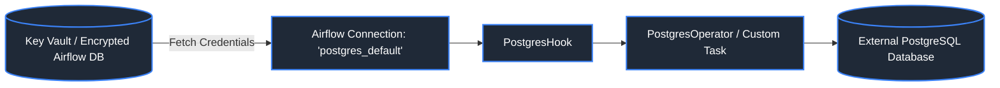

#### Code Example: Using Hooks in TaskFlow Python Functions
```python
from airflow.decorators import task
from airflow.providers.postgres.hooks.postgres import PostgresHook

@task
def query_customer_totals():
    # Automatically pulls credentials from 'postgres_analytics_dw' Connection
    pg_hook = PostgresHook(postgres_conn_id="postgres_analytics_dw")
    
    sql = "SELECT customer_id, SUM(order_total) FROM orders GROUP BY customer_id HAVING SUM(order_total) > 1000;"
    connection = pg_hook.get_conn()
    cursor = connection.cursor()
    cursor.execute(sql)
    records = cursor.fetchall()
    print(f"Extracted {len(records)} high-value customers.")
    return records
```

#### References
- [Apache Airflow Official Documentation: Hooks](https://airflow.apache.org/docs/apache-airflow/stable/authoring-and-scheduling/connections.html)
- [GeeksforGeeks: Airflow Connections and Hooks](https://www.geeksforgeeks.org/apache-airflow-connections-and-hooks/)

---

---

### 1.4 XComs & Custom XCom Backends

In Airflow, tasks run in isolated processes or completely separate containers. **XComs ("Cross-Communications")** provide the mechanism for tasks to exchange state information.

For conceptual overviews, see GeeksforGeeks' [What is Apache Airflow?](https://www.geeksforgeeks.org/what-is-apache-airflow/) and DataCamp's [Create a Customer Insights Pipeline with Airflow and dbt](https://www.datacamp.com/tutorial/airflow-tutorial).

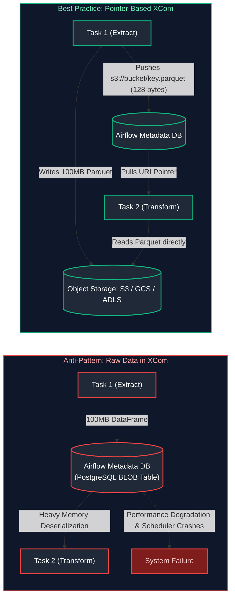

### Definitions: XCom Architecture

- **XCom:** A key-value metadata entry stored in the Airflow metadata database (`xcom` table), defined by a `key`, `value`, `timestamp`, `execution_date`, `task_id`, and `dag_id`.
- **Custom XCom Backend:** A pluggable Python class inheriting from `BaseXCom` that overrides the serialization and deserialization methods (`serialize_value` and `deserialize_value`) to automatically redirect data payloads to external cloud storage (S3, GCS, ADLS) while writing only an object reference pointer to PostgreSQL.

### Comparison: Metadata Database XCom vs. Custom Object Storage Backend

| Architectural Characteristic | Default Metadata Database XCom | Custom Object Storage XCom Backend |
|---|---|---|
| **Underlying Storage** | PostgreSQL `BYTEA` or MySQL `BLOB` column. | Amazon S3, Google Cloud Storage, or Azure Blob Storage. |
| **Payload Size Limit** | Hard limits: MySQL ~64KB, PostgreSQL ~1GB (practical limit < 48KB). | Effectively unlimited (up to 5TB object size in S3/GCS). |
| **Scheduler Impact** | High. Large blobs saturate database connections and cause scheduler OOMs. | Negligible. Database stores only lightweight URI strings. |
| **Data Types Supported** | JSON-serializable primitives (dicts, lists, strings, numbers). | Arbitrary data types: Pandas DataFrames, PyArrow Tables, NumPy arrays, Polars. |
| **Configuration Complexity** | Zero (enabled out-of-the-box). | Requires custom class and `airflow.cfg` setting (`xcom_backend`). |

### Code Example: Production Pointer-Based Passing and Custom XCom Backend

```python
"""
custom_xcom_backend_pattern.py
Demonstrates custom XCom serialization and standard pointer-based data passing.
"""

import json
import uuid
from typing import Any
from airflow.models.xcom import BaseXCom
from airflow.decorators import dag, task
from datetime import datetime

# -------------------------------------------------------------------------
# Enterprise Pattern: Custom XCom Backend Implementation
# Configured via airflow.cfg: [core] xcom_backend = path.to.CustomS3XComBackend
# -------------------------------------------------------------------------
class CustomS3XComBackend(BaseXCom):
    PREFIX = "s3_xcom://"
    BUCKET_NAME = "enterprise-airflow-xcom-storage"

    @staticmethod
    def serialize_value(value: Any, **kwargs) -> Any:
        """
        Intercepts task return values. If large, writes to S3 and returns a URI pointer.
        """
        # Primitive lightweight types remain directly in the metadata DB
        if isinstance(value, (int, float, bool, str)) and len(str(value)) < 256:
            return BaseXCom.serialize_value(value)

        # For dictionaries, dataframes, or large payloads, redirect to cloud storage
        serialized_data = json.dumps(value).encode("utf-8")
        s3_key = f"xcom/{kwargs.get('dag_id')}/{kwargs.get('task_id')}/{uuid.uuid4()}.json"
        
        # In real production: boto3.client('s3').put_object(Bucket=BUCKET_NAME, Key=s3_key, Body=serialized_data)
        print(f"[XCom Backend] Redirected {len(serialized_data)} bytes to s3://{CustomS3XComBackend.BUCKET_NAME}/{s3_key}")
        
        return f"{CustomS3XComBackend.PREFIX}{s3_key}"

    @staticmethod
    def deserialize_value(result: Any) -> Any:
        """
        Detects storage URI pointers and transparently retrieves data from cloud storage.
        """
        if isinstance(result, str) and result.startswith(CustomS3XComBackend.PREFIX):
            s3_key = result.replace(CustomS3XComBackend.PREFIX, "")
            print(f"[XCom Backend] Fetching payload from s3://{CustomS3XComBackend.BUCKET_NAME}/{s3_key}")
            # In real production: response = boto3.client('s3').get_object(...)
            return {"status": "retrieved_from_s3", "data": [1, 2, 3]}
        return BaseXCom.deserialize_value(result)


# -------------------------------------------------------------------------
# Standard DAG Utilizing Pointer-Based Data Passing
# -------------------------------------------------------------------------
@dag(
    dag_id="safe_xcom_data_pipeline",
    start_date=datetime(2026, 1, 1),
    schedule="@daily",
    catchup=False,
    tags=["best_practices"],
)
def safe_xcom_data_pipeline():

    @task
    def extract_large_dataset() -> dict:
        """
        Extracts 1,000,000 records.
        Saves data directly to object storage; passes ONLY the URI pointer via XCom!
        """
        destination_s3_path = "s3://company-lake/raw/sales/2026-10-01/batch_01.parquet"
        print(f"Exported 1,000,000 records to: {destination_s3_path}")
        
        # Return lightweight metadata only!
        return {
            "s3_uri": destination_s3_path,
            "row_count": 1000000,
            "file_size_mb": 42.5,
        }

    @task
    def transform_dataset(extract_metadata: dict):
        """Consumes the lightweight pointer and reads data directly from storage."""
        s3_uri = extract_metadata["s3_uri"]
        row_count = extract_metadata["row_count"]
        print(f"Reading {row_count} records from {s3_uri} into Spark/Snowflake...")

    metadata = extract_large_dataset()
    transform_dataset(metadata)

safe_xcom_data_pipeline()
```

### Key Points and Best Practices

- **The XCom Data Warehouse Anti-Pattern:** Never push Pandas DataFrames, raw JSON files, or query result sets into XCom. Doing so bloats the PostgreSQL metadata database, strains connection pools, degrades webserver responsiveness, and can trigger out-of-memory (OOM) crashes across scheduler pods.
- **Pointer-Based Passing:** Treat Airflow XCom strictly as a **control bus**, never a **data bus**. Pass references (S3/GCS paths, database table names, batch IDs), and let the compute engines (Spark, Trino, Snowflake) read the underlying data directly from storage.
- **XCom Cleanup:** Implement automated maintenance DAGs (e.g., using `airflow.models.xcom.XCom.purge()`) to prune historical XCom records older than 30 or 90 days, keeping metadata database tables lean and responsive.

---

---

### 1.5 Modern TaskFlow API & Dynamic Task Mapping

Introduced in Airflow 2.0, the **TaskFlow API** provides a modern, Pythonic interface for authoring workflows using decorators (`@dag`, `@task`, `@task.branch`). It eliminates verbose boilerplate operators (`PythonOperator`) and automatically manages task dependencies and cross-task communication (XComs) through standard Python function arguments and return values.

For detailed tutorials on the TaskFlow paradigm, refer to GeeksforGeeks' [Airflow DAGs and Operators](https://www.geeksforgeeks.org/airflow-dags-and-operators/) and DataCamp's [Introduction to Airflow in Python](https://www.datacamp.com/courses/introduction-to-airflow-in-python).

### Definitions: TaskFlow and Dynamic Task Mapping

- **TaskFlow API:** A decorator-based framework (`@dag`, `@task`) that treats Python functions as first-class Airflow tasks, automatically wiring dependency graphs and serializing return values into XComs.
- **Dynamic Task Mapping (`.expand()`):** An Airflow 2.3+ capability that allows a task to spawn an arbitrary number of parallel task instances at runtime based on the output of an upstream task (e.g., generating 50 worker tasks for 50 discovered database tables).

### Practical Use Case

A financial institution must ingest and reconcile transaction partitions from multiple international branches (US, EU, APAC). The list of active branches fluctuates dynamically, and database access concurrency must be throttled to avoid exhausting connection pools.

### Production Implementation: Dynamic Partition Pipeline

```python
"""
production_financial_pipeline.py
Production-grade DAG demonstrating TaskFlow API, Dynamic Task Mapping (.expand),
worker concurrency pools, and retry policies.
"""

from datetime import datetime, timedelta
from airflow.decorators import dag, task
from airflow.models.baseoperator import chain

# Define default arguments applied to all tasks
default_args = {
    "owner": "data_engineering",
    "depends_on_past": False,
    "retries": 3,
    "retry_delay": timedelta(minutes=5),
    "retry_exponential_backoff": True,
    "max_retry_delay": timedelta(hours=1),
    "execution_timeout": timedelta(minutes=45),
    "email_on_failure": True,
    "email": ["alerts-de@company.com"],
}

@dag(
    dag_id="financial_revenue_pipeline",
    default_args=default_args,
    description="Extracts transactions, validates contracts, and loads curated marts",
    schedule="0 2 * * *",  # Runs daily at 02:00 UTC
    start_date=datetime(2026, 1, 1),
    catchup=False,
    max_active_runs=1,
    tags=["finance", "critical"],
)
def financial_revenue_pipeline():

    @task
    def get_source_partitions() -> list[str]:
        """
        Discovers active partitions to process dynamically at runtime.
        Returns a lightweight list of partition identifiers.
        """
        active_regions = ["region_us", "region_eu", "region_apac"]
        print(f"Discovered {len(active_regions)} active partitions: {active_regions}")
        return active_regions

    @task(pool="database_heavy_pool")
    def process_partition(partition_id: str) -> dict:
        """
        Processes an individual partition.
        Worker concurrency is strictly capped by the 'database_heavy_pool' slot limit.
        """
        print(f"Extracting and transforming: {partition_id}")
        
        # Production Best Practice: Return lightweight metadata only!
        # NEVER return full raw datasets or DataFrames via XCom!
        return {
            "partition": partition_id,
            "status": "COMPLETED",
            "record_count": 15400,
            "output_uri": f"s3://lakehouse-curated/finance/2026-10-01/{partition_id}.parquet"
        }

    @task
    def aggregate_audit_metrics(results: list[dict]):
        """
        Consolidates partition metadata and verifies record balance.
        Demonstrates collecting dynamic task mapping outputs into a single downstream task.
        """
        total_rows = sum(r["record_count"] for r in results)
        processed_partitions = [r["partition"] for r in results]
        
        print(f"Pipeline finished successfully!")
        print(f"Total partitions processed: {processed_partitions}")
        print(f"Total rows processed across all partitions: {total_rows}")

    # Orchestration: Dynamic Task Mapping (.expand) creates parallel tasks at runtime
    partitions = get_source_partitions()
    partition_results = process_partition.expand(partition_id=partitions)
    aggregate_audit_metrics(partition_results)

financial_revenue_pipeline()
```

### Advanced Dynamic Mapping with `.partial()`

In production scenarios, tasks often require a mix of constant static parameters (e.g., target environment or bucket names) and dynamic parameters (e.g., partition names). The `.partial()` method supplies invariant kwargs:

```python
@task
def load_data_to_snowflake(bucket: str, table: str, partition: str):
    print(f"Loading {partition} from {bucket} into {table}...")

# Pass static arguments via partial() and dynamically map the partition list
load_data_to_snowflake.partial(
    bucket="s3://enterprise-curated-lake",
    table="analytics.finance.fct_daily_orders"
).expand(
    partition=["2026-10-01", "2026-10-02", "2026-10-03"]
)
```

### Key Points and Best Practices

- **Concurrency Control via Pools:** When using Dynamic Task Mapping to generate dozens or hundreds of parallel tasks, assign tasks to an Airflow Pool (`pool="database_heavy_pool"`) configured in the Admin UI. This prevents parallel workers from overwhelming downstream databases with connection requests.
- **Task Return Serialization:** Values returned by `@task` functions are automatically serialized into the Airflow metadata database as XComs. Ensure returned data is lightweight (IDs, row counts, S3 URIs, status strings). Storing large JSON documents or raw rows will rapidly degrade database performance.
- **Type Annotations:** Always annotate `@task` signatures (e.g., `-> list[str]`). Type hints enhance code readability, simplify static analysis with mypy, and facilitate correct XCom deserialization.

---

---

### 1.6 Airflow 5-Component Architecture & Lifecycle State Machine

Apache Airflow is a distributed, horizontally scalable platform for authoring, scheduling, and monitoring workflows as code. Understanding its component topology is essential for diagnosing cluster bottlenecks, worker starvation, and database lock contention.

For an architectural breakdown, refer to GeeksforGeeks' [Apache Airflow Architecture](https://www.geeksforgeeks.org/apache-airflow-architecture/) and DataCamp's [Getting Started with Apache Airflow](https://www.datacamp.com/tutorial/airflow-tutorial).

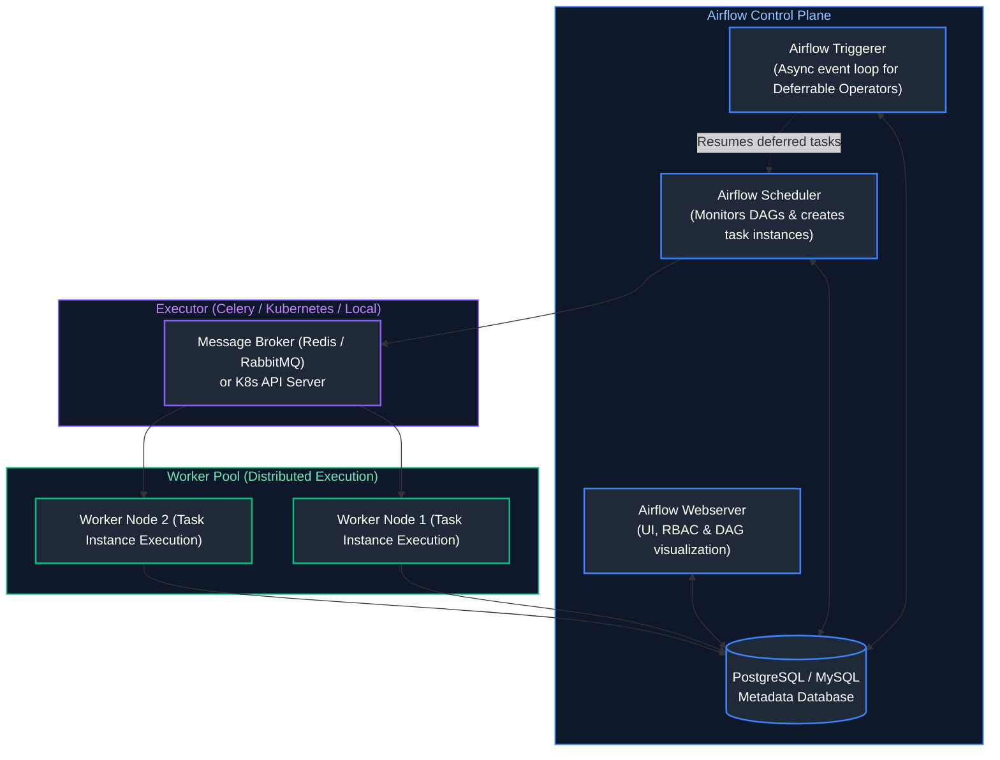

### Definitions of Airflow Cluster Components

1. **Metadata Database (RDBMS):** The central state store (typically PostgreSQL or MySQL) recording DAG definitions, task instances, historical execution runs, variables, connections, and XCom metadata.
2. **Airflow Scheduler:** A multi-threaded background service that continuously parses DAG code files, evaluates data interval dependencies, creates `DagRun` and `TaskInstance` state rows in the database, and schedules executable tasks onto the executor queue.
3. **Airflow Triggerer:** An asynchronous Python `asyncio` event loop designed to handle hundreds of thousands of long-running, idle tasks (deferrable operators/sensors) without consuming worker slots.
4. **Airflow Webserver:** A Flask/Gunicorn-based web application rendering the user interface, DAG visual lineage, task logs, and providing a secure REST API.
5. **Worker Nodes:** Distributed execution processes that pull tasks from the executor queue, initialize execution environments, run task logic, and stream logs back to storage.
6. **Message Broker / Queue:** An intermediary queue service (Redis, RabbitMQ, or the Kubernetes API) used by distributed executors (like Celery) to buffer pending task execution messages dispatched by the scheduler.


### Task Instance Lifecycle State Machine

A task instance transitions through a deterministic series of states during execution:

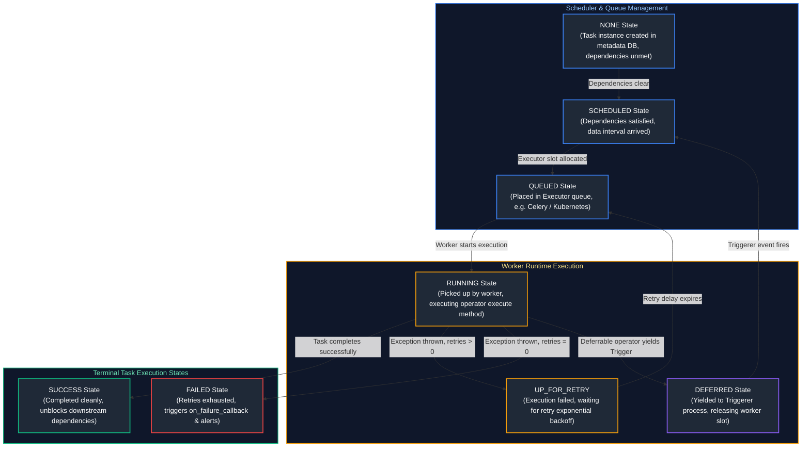

---

### 1.7 Airflow Executors & Operational Cluster Management

### Airflow Executors Comparison Matrix

| Executor | Scaling Mechanism | Operational Complexity | Worker Slot Idle Cost | Best Production Use Case |
|---|---|---|---|---|
| **SequentialExecutor** | Single process (SQLite). Runs 1 task at a time sequentially. | Minimal (zero configuration). | Low | Local testing and development only. **Never use in production.** |
| **LocalExecutor** | Spawns multiple worker processes on the same machine as the scheduler via multiprocessing. | Low (single VM). | Fixed VM cost. | Small-to-medium single-node production environments with moderate task volumes. |
| **CeleryExecutor** | Distributes tasks across a fleet of persistent Celery worker VMs via Redis or RabbitMQ queues. | Moderate to High (requires broker, workers, Flower monitoring). | High (workers run continuously even when idle). | High-throughput, low-latency task execution where worker warm-up latency must be near-zero (< 100ms). |
| **KubernetesExecutor** | Dynamically spawns a dedicated, isolated Kubernetes Pod for every individual task instance. | Moderate (requires K8s cluster and Helm setup). | **Zero idle cost** (pods terminate immediately upon task completion). | **Enterprise multi-tenant standard**: dynamic autoscaling, complete dependency isolation per task, and zero idle resource waste. |
| **CeleryKubernetesExecutor** | Hybrid: Routes routine tasks to Celery workers and heavy/isolated tasks to K8s Pods. | High | Moderate | Mixed enterprise workloads balancing ultra-low latency with heavy isolated compute jobs. |


### Operational CLI Commands and Cluster Configuration

Production Airflow administrators rely on the CLI for database lifecycle management, user provisioning, and worker management:

```bash
# Initialize or upgrade metadata database schema
airflow db migrate

# Create an enterprise admin user with Role-Based Access Control (RBAC)
airflow users create \
    --username dataops_admin \
    --firstname Jane \
    --lastname Doe \
    --role Admin \
    --email admin-de@enterprise.com \
    --password "SecureProductionSecret123!"

# Verify scheduler health and heartbeat
airflow jobs check --job-type SchedulerJob

# Launch individual cluster daemons (typically handled via systemd or K8s Helm charts)
airflow scheduler -D
airflow webserver -p 8080 -D
airflow triggerer -D
airflow celery worker -q default,heavy_compute -c 8
```


### Key Architectural Pitfalls and Best Practices

- **The Database Connection Pool Exhaustion Trap:** In `CeleryExecutor` or `KubernetesExecutor` setups with hundreds of concurrent workers, each worker task opens direct connections to PostgreSQL. Without a connection pooler like **PgBouncer**, the metadata database will exhaust its maximum connection limit (`max_connections`), locking up the entire cluster.
- **Top-Level Code Latency:** Airflow schedulers parse all Python files in the `dags/` folder continuously (every `min_file_process_interval` seconds, default 30s). Any top-level code (e.g., executing `requests.get()`, reading an S3 file, or querying a database outside a task function) will run on every single parse loop, spiking scheduler CPU to 100% and delaying task dispatch.
- **Shared Storage for Logs:** In multi-node Celery and Kubernetes clusters, configure remote task logging to cloud object storage (S3, GCS, or ADLS) via `airflow.cfg` (`remote_logging = True`) so task logs are viewable from the Web UI regardless of which worker node ran the task.

---

---

### 1.8 Dynamic DAG Generation

Generating dozens of DAGs programmatically from a single configuration file (YAML/JSON dictionary) to eliminate boilerplate code.

---

---

### 1.9 Backfilling, Scheduling Timetables, and Data Intervals

A foundational source of confusion in Airflow is the distinction between **Logical Date (formerly `execution_date`)**, **Data Interval**, and **Actual Run Time**.

For hands-on scheduling tutorials, consult GeeksforGeeks' [Airflow DAGs and Operators](https://www.geeksforgeeks.org/airflow-dags-and-operators/) and DataCamp's [Introduction to Airflow in Python](https://www.datacamp.com/courses/introduction-to-airflow-in-python).

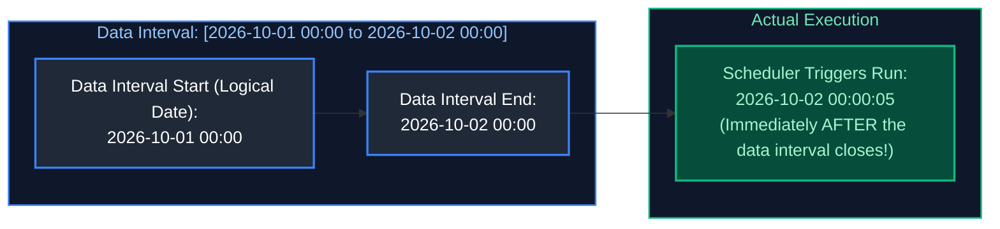

### Definitions: Temporal Concepts in Airflow

- **Data Interval (`data_interval_start` & `data_interval_end`):** The precise time window covering the data that the DAG run is intended to process.
- **Logical Date (`logical_date`):** Formerly referred to as `execution_date`. Represents the beginning of the data interval (`data_interval_start`). It is **not** the wall-clock timestamp when the pipeline actually runs.
- **Start Date (`start_date`):** The historical timestamp marking when the DAG's schedule begins evaluating. A DAG will not schedule any run whose interval starts before this date.
- **Catchup (`catchup`):** A boolean setting on the DAG. If set to `True`, the scheduler automatically generates historical DAG runs for every completed data interval between `start_date` and the current date.

> [!IMPORTANT]
> **The Golden Rule of Airflow Scheduling:** A daily DAG scheduled for `@daily` (midnight) covering October 1st **does NOT run on October 1st at midnight**. It executes on **October 2nd at 00:00:01**, immediately after the full October 1st data collection window has completely closed!

### Common Cron and Preset Timetables

| Schedule Preset | Cron Equivalent | Interval Duration | When Does It First Run? |
|---|---|---|---|
| `@hourly` | `0 * * * *` | 1 hour | At the end of the first hour (e.g., interval `[01:00, 02:00)` runs at `02:00:01`). |
| `@daily` | `0 0 * * *` | 24 hours | At the end of the day (interval `[2026-10-01, 2026-10-02)` runs on `2026-10-02 00:00:01`). |
| `@weekly` | `0 0 * * 0` | 7 days | At midnight on Sunday night / Monday morning following the week. |
| `@monthly` | `0 0 1 * *` | 1 calendar month | At midnight on the 1st of the subsequent month. |
| `None` | (No schedule) | N/A | Only triggered manually via UI or externally via Airflow REST API. |

### Code Example: Building Idempotent Bounded Queries Using Airflow Context

Idempotent pipelines produce identical results regardless of how many times they are rerun. Airflow provides execution context variables (`data_interval_start`, `data_interval_end`, and `ds`) that allow tasks to query exact data partitions deterministically.

```python
"""
idempotent_partition_extract.py
Demonstrates consuming Airflow data interval parameters for deterministic queries.
"""

from datetime import datetime, timedelta
import pendulum
from airflow.decorators import dag, task

@dag(
    dag_id="idempotent_order_extract",
    schedule="0 1 * * *",  # Runs daily at 01:00 UTC (processes previous day's [00:00, 24:00))
    start_date=pendulum.datetime(2026, 1, 1, tz="UTC"),
    catchup=False,
    max_active_runs=1,
    default_args={
        "owner": "analytics_ops",
        "retries": 3,
        "retry_delay": timedelta(minutes=2),
    },
    tags=["core", "idempotency"],
)
def idempotent_order_extract():

    @task
    def extract_transactions(**context) -> str:
        """
        Extracts transaction records strictly bounded by the data interval.
        Accesses interval boundaries from the injected Airflow runtime context.
        """
        # Retrieve interval boundaries as Pendulum datetime objects
        interval_start = context["data_interval_start"].to_iso8601_string()
        interval_end = context["data_interval_end"].to_iso8601_string()
        ds = context["ds"]  # YYYY-MM-DD formatted string representing logical date

        print(f"Executing idempotent extraction for Logical Date (ds): {ds}")
        print(f"Data Interval Window: [{interval_start} -> {interval_end}]")

        # Bounded SQL query: Completely deterministic and safe to re-run!
        bounded_sql = f"""
            SELECT transaction_id, user_id, amount, transaction_timestamp
            FROM raw_transactions
            WHERE transaction_timestamp >= '{interval_start}'
              AND transaction_timestamp < '{interval_end}';
        """
        print(f"Executing query:\n{bounded_sql}")
        
        # Simulate loading extracted data to an idempotent partition location
        destination_partition = f"s3://company-lakehouse/raw/transactions/date={ds}/"
        return destination_partition

    @task
    def validate_partition(partition_path: str):
        print(f"Validating row counts and checksums at: {partition_path}")

    # Wire task dependencies
    partition_location = extract_transactions()
    validate_partition(partition_location)

idempotent_order_extract()
```

### Backfilling and Historical Reprocessing

When business logic changes or new models are introduced, data teams must recalculate months or years of historical data. Airflow provides a safe, parallelized CLI backfill engine:

```bash
# Reprocess historical daily partitions from January 1, 2026 to January 31, 2026
# --reset-dagruns clears existing records and forces clean re-execution
airflow dags backfill \
    --start-date 2026-01-01 \
    --end-date 2026-01-31 \
    --reset-dagruns \
    --verbose \
    idempotent_order_extract
```

### Key Caveats and Best Practices

- **The Dynamic `datetime.now()` Trap:** Never set `start_date=datetime.now()`. Because Airflow parses DAG files dynamically, `datetime.now()` updates on every evaluation cycle. The scheduler will perceive the start date as constantly shifting forward, resulting in tasks that never trigger. Always use fixed, deterministic dates (e.g., `pendulum.datetime(2026, 1, 1, tz="UTC")`).
- **The Catchup Avalanche:** Setting `catchup=True` on a DAG with a `start_date` months or years in the past will instantly flood the executor queue with hundreds of simultaneous DAG runs, overwhelming databases and external APIs. Set `catchup=False` by default; perform historical reloads intentionally using the CLI backfill command.
- **Timezone Standardization:** Always declare DAG start dates and timetables using explicit timezones (preferably UTC) via `pendulum.timezone("UTC")` to prevent schedule irregularities caused by Daylight Saving Time (DST) shifts.

---

---

### 1.10 Pools, Slots & Concurrency Throttling

Airflow **Pools** limit the number of concurrent task instances connecting to resource-constrained external systems (e.g., restricting max concurrent connections to an operational ERP database to 5 slots).

---

---

### 1.11 Trigger Rules and Advanced DAG Control Flow

By default, an Airflow task executes only when all direct upstream tasks have completed with `success` (`trigger_rule="all_success"`). In production workflows, pipelines require conditional branching, error recovery, and guaranteed resource cleanup (e.g., terminating an ephemeral cluster even if processing crashes).

For more on conditional workflows, review GeeksforGeeks' [Airflow DAGs and Operators](https://www.geeksforgeeks.org/airflow-dags-and-operators/).

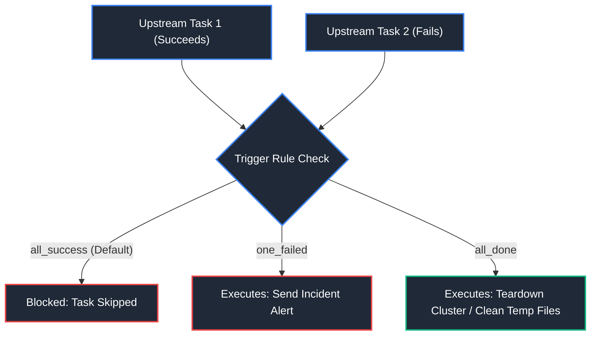

### Definitions: Airflow Trigger Rules

A **Trigger Rule** is a condition evaluated by the scheduler before dispatching a downstream task instance. It inspects the final states (`success`, `failed`, `skipped`, `upstream_failed`) of all direct parent tasks.

### Trigger Rules Reference Matrix

| Trigger Rule Enum | Condition Required for Downstream Execution | Common Enterprise Use Case |
|---|---|---|
| `all_success` (Default) | All direct upstream tasks have completed with `success`. | Standard linear ETL pipeline dependency. |
| `all_failed` | All direct upstream tasks have `failed`. | Fallback failover pipelines. |
| `all_done` | All direct upstream tasks have terminated (`success`, `failed`, or `skipped`). | **Guaranteed resource cleanup** (e.g., shutting down ephemeral Spark clusters or dropping temporary staging tables). |
| `one_failed` | At least one direct upstream task has `failed`. | Immediate error alerting (Slack, PagerDuty, email dispatch). |
| `one_success` | At least one direct upstream task has `success` (does not wait for all to finish). | First-response routing or redundant data source racing. |
| `none_failed` | All upstream tasks succeeded or were skipped; none failed. | Tasks directly following conditional branch operators (`BranchPythonOperator`). |
| `none_failed_min_one_success` | All upstream tasks completed, none failed, and at least one succeeded. | Branch joins where at least one processing path was executed. |
| `all_skipped` | All direct upstream tasks have been `skipped`. | Specialized skip logging or default fallbacks. |

### Code Example: Guaranteed Teardown and Error Alerting

```python
"""
trigger_rules_production_lifecycle.py
Demonstrates Branching, Teardown Cleanup (all_done), and Alerting (one_failed).
"""

from datetime import datetime
from airflow.decorators import dag, task
from airflow.utils.trigger_rule import TriggerRule

@dag(
    dag_id="cluster_lifecycle_with_trigger_rules",
    start_date=datetime(2026, 1, 1),
    schedule="@daily",
    catchup=False,
    tags=["infra", "resilience"],
)
def cluster_lifecycle_with_trigger_rules():

    @task
    def provision_ephemeral_cluster() -> str:
        cluster_id = "spark-cluster-prod-9842"
        print(f"Provisioned ephemeral cloud cluster: {cluster_id}")
        return cluster_id

    @task.branch
    def choose_processing_branch() -> str:
        """Dynamically decides whether to run full batch or delta batch."""
        import random
        # Simulate business decision
        is_delta = True
        return "run_delta_transformation" if is_delta else "run_full_transformation"

    @task
    def run_delta_transformation(cluster_id: str):
        print(f"Running incremental delta job on {cluster_id}...")

    @task
    def run_full_transformation(cluster_id: str):
        print(f"Running full refresh job on {cluster_id}...")

    @task(trigger_rule=TriggerRule.NONE_FAILED_MIN_ONE_SUCCESS)
    def join_branches():
        """Joins after branching without getting skipped by the inactive branch."""
        print("Data transformation branch completed successfully.")

    @task(trigger_rule=TriggerRule.ONE_FAILED)
    def send_incident_alert():
        """Fires immediately if ANY upstream task fails."""
        print("ALERT: One or more upstream tasks failed! Notifying on-call DataOps...")

    @task(trigger_rule=TriggerRule.ALL_DONE)
    def teardown_ephemeral_cluster(cluster_id: str):
        """
        CRITICAL: Guaranteed teardown!
        Executes whether the data processing succeeded, failed, or was skipped.
        Prevents orphaned clusters and cloud billing leaks.
        """
        print(f"Terminating ephemeral cloud cluster: {cluster_id}")

    # Build dependency graph
    cid = provision_ephemeral_cluster()
    branch = choose_processing_branch()
    
    t_delta = run_delta_transformation(cid)
    t_full = run_full_transformation(cid)
    
    cid >> branch >> [t_delta, t_full]
    
    join = join_branches()
    [t_delta, t_full] >> join
    
    # Teardown always executes after processing finishes
    [t_delta, t_full, join] >> teardown_ephemeral_cluster(cid)
    
    # Alert fires if any processing step fails
    [t_delta, t_full, join] >> send_incident_alert()

cluster_lifecycle_with_trigger_rules()
```

### Key Points and Best Practices

- **The "Cascading Skip" Trap:** When using `@task.branch` or `BranchPythonOperator`, tasks on unselected paths are marked as `skipped`. If a downstream join task uses the default `all_success` trigger rule, Airflow treats the skipped upstream task as unmet, causing the join task and all subsequent tasks to be skipped! Always use `none_failed_min_one_success` or `none_failed` on tasks that join divergent branches.
- **Orphaned Cloud Resources:** Always wrap multi-node cloud clusters (EMR, Dataproc, Databricks) in a terminal task with `trigger_rule=TriggerRule.ALL_DONE`. Failing to do so can result in orphaned, running compute instances that accumulate thousands of dollars in cloud charges after an unhandled pipeline exception.

---

---

### 1.12 SLAs, Callbacks & Enterprise Alerting

Enterprise pipelines require robust observability, strict delivery guarantees, and automated alerting to notify on-call engineers before business consumers notice data delays.

For alerting strategies, refer to DataCamp's [Building an ETL Pipeline with Airflow](https://www.datacamp.com/tutorial/airflow-tutorial).

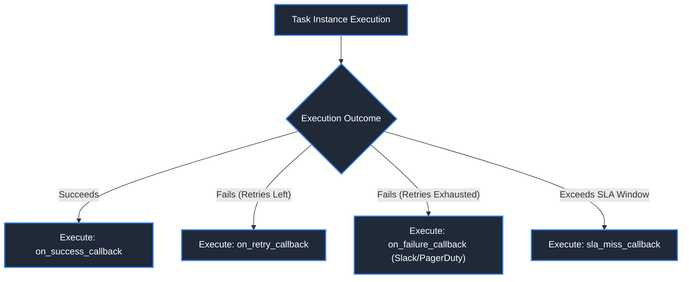

### Definitions: SLAs and Callbacks

- **Service Level Agreement (SLA):** A configured time limit (`sla=timedelta(...)`) specifying the maximum expected elapsed time between a DAG's `data_interval_start` and the completion of a specific task.
- **Callbacks:** Python callable functions automatically invoked by Airflow when a task instance or DAG run undergoes a state transition:
  - `on_failure_callback`: Triggered when a task exhausts all retry attempts and enters the `FAILED` state.
  - `on_retry_callback`: Triggered every time a task encounters an error but has remaining retries.
  - `on_success_callback`: Triggered when a task completes successfully.
  - `sla_miss_callback`: Triggered by the scheduler when a task misses its configured SLA deadline.

### Code Example: Enterprise Alerting with Custom Callbacks

```python
"""
production_alerting_callbacks.py
Demonstrates enterprise-grade failure and SLA callbacks integrating with Slack/Teams.
"""

from datetime import datetime, timedelta
from airflow.decorators import dag, task
import requests

def send_slack_alert(context: dict, alert_type: str = "FAILURE"):
    """
    Constructs and dispatches a rich Slack webhook notification upon task failure.
    Extracts runtime context: DAG ID, Task ID, execution date, log URL, and exception.
    """
    ti = context.get("task_instance")
    dag_id = context.get("dag").dag_id
    task_id = ti.task_id
    execution_date = context.get("ts")
    log_url = ti.log_url
    exception = context.get("exception", "No explicit exception recorded.")

    slack_payload = {
        "text": f"🚨 *Airflow Pipeline {alert_type} Alert*",
        "attachments": [
            {
                "color": "#FF0000" if alert_type == "FAILURE" else "#FFA500",
                "fields": [
                    {"title": "DAG", "value": dag_id, "short": True},
                    {"title": "Task", "value": task_id, "short": True},
                    {"title": "Execution Date", "value": execution_date, "short": False},
                    {"title": "Error Message", "value": f"```{str(exception)[:300]}```", "short": False},
                    {"title": "Log URL", "value": f"<{log_url}|View Task Instance Logs>", "short": False},
                ],
            }
        ],
    }
    
    # In production:
    # webhook_url = BaseHook.get_connection("slack_webhook").get_password()
    # requests.post(webhook_url, json=slack_payload, timeout=5)
    print(f"[SLACK ALERT DISPATCHED] {slack_payload['text']} for {dag_id}.{task_id}")


default_args = {
    "owner": "financial_dataops",
    "retries": 2,
    "retry_delay": timedelta(minutes=3),
    "on_failure_callback": lambda ctx: send_slack_alert(ctx, alert_type="FAILURE"),
    "on_retry_callback": lambda ctx: send_slack_alert(ctx, alert_type="RETRY_WARNING"),
}

@dag(
    dag_id="sla_monitored_revenue_pipeline",
    default_args=default_args,
    start_date=datetime(2026, 1, 1),
    schedule="0 4 * * *",  # Runs daily at 04:00 UTC
    catchup=False,
    sla_miss_callback=lambda dag, task_list, blocking_task_list, slas, blocking_tis: print(
        f"SLA MISSED! The following tasks exceeded their SLA: {task_list}"
    ),
    tags=["monitoring", "sla"],
)
def sla_monitored_revenue_pipeline():

    @task(
        execution_timeout=timedelta(minutes=30),  # Hard kill task if it runs over 30 mins
        sla=timedelta(hours=2),                   # Alert if not finished 2 hours after interval start
    )
    def calculate_daily_pnl():
        print("Calculating daily Profit and Loss...")
        # Simulate processing logic

    calculate_daily_pnl()

sla_monitored_revenue_pipeline()
```

### Key Differences: `execution_timeout` vs. `sla`

| Parameter | What It Measures | What Action Occurs When Breached? | Where It Is Handled |
|---|---|---|---|
| `execution_timeout` | The wall-clock execution duration of a **single task attempt** on a worker. | **Hard termination**: Task is killed (`AirflowTaskTimeout`), retried or marked `FAILED`. | Worker process. |
| `sla` | The elapsed time from the **start of the data interval** to task completion. | **Non-terminating alert**: Triggers `sla_miss_callback` and sends emails; task continues running. | Scheduler daemon. |

---

---

### 1.13 Orchestrator Comparison: Airflow vs Prefect vs Dagster

| Feature | Apache Airflow | Prefect | Dagster |
| :--- | :--- | :--- | :--- |
| **Mental Model** | **Workflow / Task-Centric** (DAG of steps) | **Task-Centric** (Python functions) | **Asset-Centric** (Software-Defined Assets) |
| **Data Passing** | Weak (Historically metadata XComs) | Strong (First-class parameter returns) | **Native Asset Materialization** |
| **Dynamic Workflows** | Moderate (Requires dynamic code generation) | Native dynamic DAGs at runtime | Native dynamic graph generation |
| **Market Share** | **Industry Giant (>75% Enterprise adoption)** | Growing cloud footprint | Rapidly growing in modern data teams |

---

---

### 1.14 Ecosystem Integration: dbt + Airflow (Cosmos)

The modern standard for orchestrating dbt within Apache Airflow is **Astronomer Cosmos** (`astronomer-cosmos`). Instead of running entire dbt projects inside an opaque `BashOperator(bash_command="dbt run")` (which hides individual model status in Airflow UI), Cosmos dynamically parses the dbt project manifest and renders each dbt model as a native Airflow Task within an Airflow `TaskGroup`.

```python
from datetime import datetime
from pathlib import Path
from airflow import DAG
from airflow.operators.empty import EmptyOperator

# In enterprise setups with astronomer-cosmos installed:
# from cosmos import DbtTaskGroup, ProjectConfig, ProfileConfig, RenderConfig
# from cosmos.profiles import SnowflakeUserPasswordProfileMapping

with DAG(
    dag_id="dbt_cosmos_orchestration_enterprise",
    start_date=datetime(2026, 1, 1),
    schedule="@daily",
    catchup=False,
) as dag:

    pre_check = EmptyOperator(task_id="pre_check_raw_data")
    post_notification = EmptyOperator(task_id="notify_pipeline_complete")

    # Cosmos parses the dbt manifest and creates an individual Airflow Task
    # for each stg_, int_, and fct_ model, exposing full DAG lineage in the UI:
    #
    # dbt_tg = DbtTaskGroup(
    #     group_id="dbt_transformation_layer",
    #     project_config=ProjectConfig(manifest_path="/usr/local/airflow/dbt/target/manifest.json"),
    #     profile_config=ProfileConfig(
    #         profile_name="enterprise_dwh",
    #         target_name="prod",
    #         profile_mapping=SnowflakeUserPasswordProfileMapping(conn_id="snowflake_dwh_conn"),
    #     ),
    # )

    pre_check >> post_notification
```

---

# 2. dbt (Data Build Tool) Modeling & Transformation

dbt enables analytics engineers to transform raw data already residing in cloud data warehouses (Snowflake, BigQuery, Databricks, Redshift) using software engineering best practices: version control, modular SQL modeling, testing assertions, continuous integration, and automated data documentation.

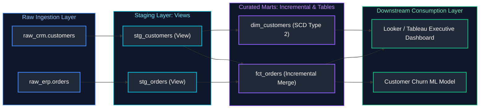

---

### 2.1 dbt Core vs dbt Cloud

- **dbt Core:** Open-source command-line tool (CLI) invoked via `dbt run`, `dbt test`, and orchestrated in Airflow/GitLab.
- **dbt Cloud:** Hosted SaaS platform with a web-based IDE, job scheduler, semantic layer interface, and CI/CD integration.

---

---

### 2.2 dbt Models & SQL-First Transformation

#### Definition
A dbt model is a single `SELECT` statement residing in a `.sql` file inside the `models/` directory. dbt wraps this query in DDL/DML (e.g., `CREATE TABLE AS SELECT` or `MERGE INTO`) to persist the relation into the data warehouse. Models reference upstream tables using the `{{ ref('model_name') }}` and `{{ source('source_name', 'table_name') }}` Jinja macros, establishing an automated dependency DAG.

#### Staging Layer Model Implementation (`models/staging/stg_orders.sql`)
Staging models clean, rename, and cast raw source fields without applying business aggregation:

```sql
{{ config(
    materialized='view',
    schema='staging',
    tags=['hourly', 'staging']
) }}

WITH raw_orders AS (
    SELECT * FROM {{ source('ecommerce_raw', 'orders') }}
),

renamed_and_cast AS (
    SELECT
        CAST(order_id AS VARCHAR(64))            AS order_id,
        CAST(customer_id AS VARCHAR(64))         AS customer_id,
        CAST(order_date AS DATE)                 AS order_date,
        LOWER(TRIM(order_status))                AS order_status,
        CAST(net_amount_cents / 100.0 AS NUMERIC(18, 2)) AS net_amount_usd,
        CAST(_loaded_at AS TIMESTAMP_NTZ)        AS ingested_at
    FROM raw_orders
)

SELECT * FROM renamed_and_cast
```

> For SQL Common Table Expression (CTE) syntax, inlining vs materialization semantics, and modular query patterns, see [02. Advanced SQL](02_advanced_sql.md#22-common-table-expressions-ctes--materialization-semantics). For foundational SQL data types, safe conversions, and string functions, see [01. SQL Fundamentals](01_sql_fundamentals.md#2-data-types-casting--defensive-conversions).

---

### 2.3 Materialization Strategies

dbt provides four primary materialization strategies configured via `dbt_project.yml` or within individual model `{{ config(...) }}` blocks:

| Materialization | Underlying DDL Executed | Storage Footprint | Refresh Latency / Cost | Recommended Use Case |
| :--- | :--- | :--- | :--- | :--- |
| **`view`** | `CREATE OR REPLACE VIEW ... AS SELECT` | Zero (stores query metadata only) | High query latency; zero write cost | Staging layer, lightweight data cleanup, low-frequency queries |
| **`table`** | `CREATE OR REPLACE TABLE ... AS SELECT` | Full relation size | Heavy compute cost on rebuild; fast reads | Aggregated presentation marts with complex transformations (< 10M rows) |
| **`incremental`** | `MERGE INTO ... USING` or `INSERT INTO` | Persistent storage with append/upsert | Minimal compute cost; transforms only new/updated records | High-volume fact tables (billions of rows), append-heavy event logs |
| **`ephemeral`** | Inlined CTE in downstream queries (`WITH ... AS`) | Zero (never written to DWH) | Inherited by downstream query | Reusable intermediate mathematical logic or code cleanup helper blocks |

---

### 2.4 Incremental Models Deep-Dive (`merge` vs `delete+insert`)

#### Incremental Model Logic
On the first run (`dbt run --full-refresh`), an incremental model builds the entire table. On subsequent runs, dbt executes only the logic inside the `` Jinja block to process records updated since the last build.

#### Curated Mart Layer: Incremental Fact Model (`models/marts/fct_orders.sql`)
```sql
{{ config(
    materialized='incremental',
    unique_key='order_id',
    incremental_strategy='merge',
    on_schema_change='append_new_columns',
    cluster_by=['order_date'],
    schema='marts'
) }}

WITH stg_orders AS (
    SELECT * FROM {{ ref('stg_orders') }}
    
        -- Process only records ingested within the last 3 days to accommodate late-arriving data
        WHERE ingested_at > (
            SELECT DATEADD(day, -3, MAX(ingested_at)) 
            FROM {{ this }}
        )
    
),

stg_customers AS (
    SELECT customer_id, customer_segment FROM {{ ref('stg_customers') }}
),

final_fact AS (
    SELECT
        o.order_id,
        o.customer_id,
        c.customer_segment,
        o.order_date,
        o.order_status,
        o.net_amount_usd,
        o.ingested_at,
        CURRENT_TIMESTAMP() AS dbt_updated_at
    FROM stg_orders o
    LEFT JOIN stg_customers c ON o.customer_id = c.customer_id
)

SELECT * FROM final_fact
```

#### Merge vs. Delete+Insert Strategies
- **`merge` (Snowflake, BigQuery, Databricks)**: Executes an ANSI SQL `MERGE INTO target USING source ON target.unique_key = source.unique_key`. Updates matched records and inserts unmatched rows atomically.
- **`delete+insert` (Redshift, PostgreSQL)**: Deletes records matching the unique key in the target table, then inserts new rows. Ideal for warehouses lacking native partition-level `MERGE` performance.

> For underlying MERGE and UPSERT SQL mechanics, deduplicating CDC staging feeds, and handling non-unique join key constraints, see [02. Advanced SQL](02_advanced_sql.md#51-merge--upsert--change-data-capture-cdc-patterns).

---

### 2.5 Seeds, Sources, and Automated SCD2 Snapshots

- **Sources**: Raw tables loaded into the warehouse by ingestion extractors (Airbyte, Fivetran, Kafka Connect). Defined in YAML along with freshness SLA thresholds.
- **Seeds**: Static CSV files checked into git under `seeds/` (e.g., country codes, zip codes, mapping dictionaries) and loaded via `dbt seed`.
- **Snapshots**: Automated Slowly Changing Dimension Type 2 (SCD2) tables that capture point-in-time record mutations by maintaining validity intervals (`dbt_valid_from`, `dbt_valid_to`).

#### Declaring Sources and Freshness: `models/staging/sources.yml`
```yaml
version: 2

sources:
  - name: ecommerce_raw
    database: raw_datalake
    schema: public
    freshness:
      warn_after: {count: 12, period: hour}
      error_after: {count: 24, period: hour}
    loaded_at_field: _loaded_at
    tables:
      - name: orders
        description: "Raw transaction payloads ingested from payment gateways."
        columns:
          - name: order_id
            description: "Primary key in upstream billing service."
            data_tests:
              - unique
              - not_null
      - name: customers
        description: "Customer registration records."
```

#### Historical Tracking: SCD Type 2 Snapshots (`snapshots/snap_customers.sql`)
```sql


{{
    config(
      target_database='analytics_dwh',
      target_schema='snapshots',
      unique_key='customer_id',
      strategy='check',
      check_cols=['customer_email', 'shipping_address', 'loyalty_tier'],
      invalidate_hard_deletes=True
    )
}}

SELECT
    customer_id,
    customer_email,
    shipping_address,
    loyalty_tier,
    updated_at
FROM {{ source('ecommerce_raw', 'customers') }}


```
When executed via `dbt snapshot`, dbt tracks changes to `loyalty_tier` or `shipping_address`, stamping historical records with `dbt_valid_to = CURRENT_TIMESTAMP()` and inserting new current records where `dbt_valid_to IS NULL`.

---

### 2.6 dbt Testing & Assertions

dbt supports two categories of tests:
1. **Generic Schema Tests**: Declared in YAML (`unique`, `not_null`, `accepted_values`, `relationships`), reusable across columns.
2. **Singular SQL Tests**: Custom queries stored in `tests/`. If the query returns **zero rows**, the test passes; if it returns **one or more rows**, the test fails.

#### Test Assertions: `models/marts/schema.yml`
```yaml
version: 2

models:
  - name: fct_orders
    description: "Curated incremental fact table of customer purchases."
    data_tests:
      - dbt_utils.unique_combination_of_columns:
          combination_of_columns:
            - order_id
            - order_date
    columns:
      - name: order_id
        data_tests:
          - not_null
          - unique
      - name: customer_id
        data_tests:
          - not_null
          - relationships:
              to: ref('dim_customers')
              field: customer_id
      - name: order_status
        data_tests:
          - accepted_values:
              values: ['completed', 'pending', 'cancelled', 'refunded']
      - name: net_amount_usd
        data_tests:
          - not_null
          - dbt_expectations.expect_column_values_to_be_between:
              min_value: 0
              max_value: 500000
```

---

### 2.7 Documentation & Interactive Lineage Graphs

Running `dbt docs generate && dbt docs serve` parses the project DAG and renders an interactive web portal showing column definitions, test results, and **full visual model lineage**:

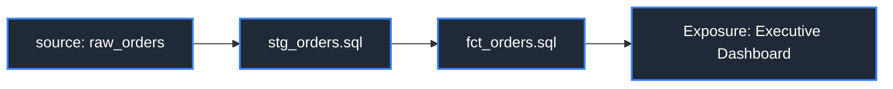

---

---

### 2.8 Jinja Templating & Custom Macros

#### Macro Example
```sql
-- macros/cents_to_dollars.sql

    ROUND(CAST({{ column_name }} AS NUMERIC) / 100.0, 2)


-- Usage in Model:
SELECT order_id, {{ cents_to_dollars('amount_in_cents') }} AS amount_usd FROM raw_sales;
```

---

---

### 2.9 dbt Packages

Modular libraries (e.g., `dbt-utils`, `dbt-expectations`) installed via `packages.yml` to provide advanced SQL macros, cross-database compatibility, and statistical testing.

---

---

### 2.10 Exposures & the dbt Semantic Layer (Metric Standardization)

#### Problem: Inconsistent Metrics Across Downstream Tools
When business metrics (such as Gross Margin, Churn Rate, or Monthly Active Users) are authored inside individual BI tools (Tableau, Power BI, Looker) or ad-hoc SQL queries, definitions diverge. Different analysts apply conflicting filter conditions (`WHERE status != 'cancelled'` vs `WHERE is_refunded IS FALSE`), resulting in contradictory business reports.

#### Solution: Metric Standardization via the dbt Semantic Layer (MetricFlow)
The **dbt Semantic Layer** (powered by MetricFlow) standardizes metric definitions as version-controlled code directly inside the dbt repository. Downstream consumers query metrics via standard JDBC or GraphQL APIs, ensuring identical metrics across all BI dashboards and Python notebooks.

```yaml
# models/marts/semantic_models/orders_semantic.yml
version: 2

semantic_models:
  - name: orders_semantic
    model: ref('fct_orders')
    description: "Semantic model defining financial order measures and dimensions."
    defaults:
      agg_time_dimension: order_date

    entities:
      - name: order_id
        type: primary
      - name: customer_id
        type: foreign

    dimensions:
      - name: order_date
        type: time
        type_params:
          time_granularity: day
      - name: order_status
        type: categorical

    measures:
      - name: total_revenue
        description: "Gross revenue generated across orders."
        agg: sum
        expr: net_amount_usd
      - name: completed_order_count
        description: "Count of all successfully completed orders."
        agg: count
        expr: order_id

# models/marts/metrics/revenue_metrics.yml
metrics:
  - name: average_order_value
    description: "Average financial value generated per order."
    type: ratio
    type_params:
      numerator: total_revenue
      denominator: completed_order_count
```

#### Exposures: Documenting Downstream Consumption (`models/exposures.yml`)
Exposures formally register external dashboards and applications in the dbt lineage graph, enabling automated impact analysis before modifying upstream models:

```yaml
version: 2

exposures:
  - name: executive_financial_kpi_dashboard
    type: dashboard
    maturity: high
    url: https://app.powerbi.com/groups/.../reports/...
    description: "C-level executive dashboard reporting daily revenue and AOV."
    depends_on:
      - ref('fct_orders')
      - metric('average_order_value')
    owner:
      name: Financial Analytics Team
      email: analytics-eng@enterprise.com
```

---

---

### 2.11 `dbt build` vs `dbt run` & CLI Operations Cheatsheet

`dbt run` compiles and executes only model transformations. In contrast, **`dbt build`** is the recommended modern command that executes models, runs tests, seeds static data, and executes snapshots in proper DAG topological order. If a model's upstream test fails, `dbt build` immediately halts execution of dependent downstream models.

```bash
# Verify connection to warehouse and validate profiles.yml
dbt debug

# Install external packages defined in packages.yml
dbt deps

# Compile SQL models and preview rendered warehouse dialect queries
dbt compile

# Run models matching a specific tag or path
dbt run --select marts.fct_orders+

# Execute tests on curated models only
dbt test --select tag:production

# Execute dbt build: compiles models, runs tests, and executes snapshots in DAG order
dbt build --select +tag:hourly

# Build only models that have been modified compared to the git main branch (Slim CI)
dbt build --select state:modified+ --state ./target-base

# Generate and host automated interactive documentation and lineage graph
dbt docs generate && dbt docs serve --port 8081
```

---

# 3. References & Further Reading

- [GeeksforGeeks: Apache Airflow Tutorial](https://www.geeksforgeeks.org/apache-airflow/)
- [GeeksforGeeks: Airflow DAG Architecture & TaskFlow API](https://www.geeksforgeeks.org/introduction-to-airflow-dag/)
- [DataCamp: Introduction to Apache Airflow in Python](https://www.datacamp.com/courses/introduction-to-airflow-in-python)
- [DataCamp: Introduction to dbt (Data Build Tool)](https://www.datacamp.com/courses/introduction-to-dbt)
- [Apache Airflow Official Documentation](https://airflow.apache.org/docs/)
- [Astronomer Cosmos: Running dbt in Airflow](https://astronomer.github.io/astronomer-cosmos/)
- [dbt Official Documentation](https://docs.getdbt.com/)
- [dbt Packages Hub](https://hub.getdbt.com/)
