# 13. Azure Data Engineering & DataOps DevOps

A comprehensive production-grade guide to Microsoft Azure data platform services (ADLS Gen2, Data Factory, Synapse Analytics, Databricks, Event Hubs), enterprise cloud security and networking, and end-to-end DataOps engineering (Docker, Kubernetes, Terraform IaC, CI/CD automation, testing, and zero-downtime deployment strategies).

## Table of Contents
1. [End-to-End Enterprise Data Architecture on Microsoft Azure](#1-end-to-end-enterprise-data-architecture-on-microsoft-azure)
   - [1.1 Architecture Blueprint & Security Fundamentals](#11-architecture-blueprint--security-fundamentals)
   - [1.2 Infrastructure as Code: Complete Terraform Deployment](#12-infrastructure-as-code-complete-terraform-deployment)
   - [1.3 Production PySpark Medallion Pipeline on Azure Databricks](#13-production-pyspark-medallion-pipeline-on-azure-databricks)
2. [Core Azure Data Platform Services](#2-core-azure-data-platform-services)
   - [2.1 Enterprise Lakehouse Reference Architecture on Azure](#21-enterprise-lakehouse-reference-architecture-on-azure)
   - [2.2 ADLS Gen2](#22-adls-gen2)
   - [2.3 Azure Data Factory (ADF) Overview](#23-azure-data-factory-adf-overview)
   - [2.4 Azure Synapse Analytics](#24-azure-synapse-analytics)
   - [2.5 Azure Databricks](#25-azure-databricks)
   - [2.6 Azure Event Hubs](#26-azure-event-hubs)
   - [2.7 Azure Stream Analytics](#27-azure-stream-analytics)
   - [2.8 Azure SQL Database](#28-azure-sql-database)
   - [2.9 Azure Cosmos DB](#29-azure-cosmos-db)
   - [2.10 Azure Key Vault](#210-azure-key-vault)
   - [2.11 Azure Monitor & Log Analytics](#211-azure-monitor--log-analytics)
3. [Identity, Security & Cloud Networking](#3-identity-security--cloud-networking)
   - [3.1 Microsoft Entra ID (Azure AD)](#31-microsoft-entra-id-azure-ad)
   - [3.2 Service Principals & App Registrations](#32-service-principals--app-registrations)
   - [3.3 Managed Identities](#33-managed-identities)
   - [3.4 Role-Based Access Control (RBAC)](#34-role-based-access-control-rbac)
   - [3.5 Key Vault Secret Scopes Integration](#35-key-vault-secret-scopes-integration)
   - [3.6 Virtual Networks (VNets) & Network Security Groups (NSGs)](#36-virtual-networks-vnets--network-security-groups-nsgs)
   - [3.7 Private Endpoints & Azure Private Link](#37-private-endpoints--azure-private-link)
4. [Azure Data Factory (ADF) Deep-Dive](#4-azure-data-factory-adf-deep-dive)
   - [4.1 Pipelines, Activities & Control Flow](#41-pipelines-activities--control-flow)
   - [4.2 Core Activities](#42-core-activities)
   - [4.3 Mapping Data Flows](#43-mapping-data-flows)
   - [4.4 Integration Runtimes (IR)](#44-integration-runtimes-ir)
   - [4.5 Linked Services vs Datasets](#45-linked-services-vs-datasets)
   - [4.6 Triggers](#46-triggers)
   - [4.7 Parameters vs Variables](#47-parameters-vs-variables)
   - [4.8 Monitoring & Alerts](#48-monitoring--alerts)
5. [Azure Synapse Analytics Deep-Dive](#5-azure-synapse-analytics-deep-dive)
   - [5.1 Synapse Dedicated SQL Pools (MPP Architecture)](#51-synapse-dedicated-sql-pools-mpp-architecture)
   - [5.2 Data Distribution Strategies](#52-data-distribution-strategies)
   - [5.3 Synapse Serverless SQL Pools (OPENROWSET)](#53-synapse-serverless-sql-pools-openrowset)
   - [5.4 Synapse Spark Pools](#54-synapse-spark-pools)
   - [5.5 Synapse Pipelines](#55-synapse-pipelines)
6. [DataOps, CI/CD & Version Control](#6-dataops-cicd--version-control)
   - [6.1 The DataOps CI/CD Lifecycle](#61-the-dataops-cicd-lifecycle)
   - [6.2 Git Branching Strategies](#62-git-branching-strategies)
   - [6.3 Automated Pre-Commit Hooks](#63-automated-pre-commit-hooks)
7. [Containers & Cloud Infrastructure as Code](#7-containers--cloud-infrastructure-as-code)
   - [7.1 Docker for Data Engineering](#71-docker-for-data-engineering)
   - [7.2 Kubernetes for Data](#72-kubernetes-for-data)
   - [7.3 Infrastructure as Code (Terraform)](#73-infrastructure-as-code-terraform)
   - [7.4 Multi-Environment Promotion](#74-multi-environment-promotion)
8. [Testing & Release Engineering for Data Pipelines](#8-testing--release-engineering-for-data-pipelines)
   - [8.1 Unit Testing Transformation Logic with pytest](#81-unit-testing-transformation-logic-with-pytest)
   - [8.2 Integration Testing with Testcontainers](#82-integration-testing-with-testcontainers)
   - [8.3 End-to-End Pipeline Testing](#83-end-to-end-pipeline-testing)
   - [8.4 Synthetic Test Data Generation with Faker](#84-synthetic-test-data-generation-with-faker)
   - [8.5 Blue-Green Deployments for Data Pipelines](#85-blue-green-deployments-for-data-pipelines)
   - [8.6 Canary Deployments & Shadow Pipelines](#86-canary-deployments--shadow-pipelines)
9. [References & Further Reading](#9-references--further-reading)

---

# 1. End-to-End Enterprise Data Architecture on Microsoft Azure

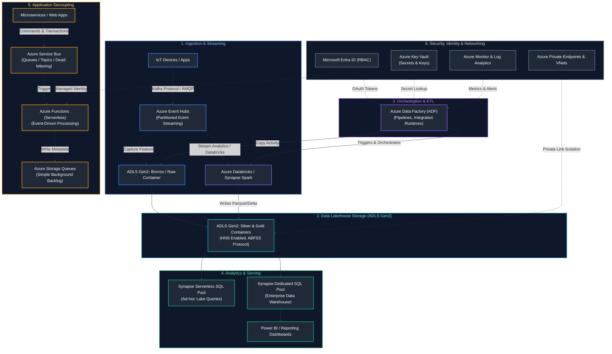

### 1.1 Architecture Blueprint & Security Fundamentals
In an enterprise Azure data platform, isolation, governance, and zero-trust security are paramount:
1. **Network Isolation (Hub-and-Spoke VNet Topology)**:
   - **Hub VNet**: Hosts shared network appliances, Azure Firewall, ExpressRoute/VPN gateways, and Private DNS Zones.
   - **Spoke VNets**: Segregate Data Ingestion (ADF, Event Hubs) and Compute (Azure Databricks with VNet injection).
   - **Zero Public Access**: All public blob endpoints and workspace URLs are disabled. Communication flows strictly across **Azure Private Endpoints** using private IP addresses.
2. **Identity & Secrets (Zero-Credential Management)**:
   - Authentication relies entirely on **Microsoft Entra ID Managed Identities**. Pipelines never store plaintext connection strings or API keys in configuration files.
   - Azure Key Vault stores third-party credentials and uses Azure Role-Based Access Control (RBAC) to grant read access only to authorized service principals.
3. **Medallion Lakehouse with Delta Lake & Unity Catalog**:
   - **Bronze**: Exact raw copy of transactional sources, partitioned by ingestion date.
   - **Silver**: Cleansed, validated, conformed Delta tables with schema enforcement, deletion vectors, and SCD Type 2 tracking.
   - **Gold**: Business-level aggregations and star schemas optimized for reporting and machine learning.
   - **Unity Catalog**: Centralized governance over all data assets, row-level filtering, column-level masking, and end-to-end data lineage.

---

### 1.2 Infrastructure as Code: Complete Terraform Deployment
The following production Terraform script provisions the core storage, networking private endpoints, and Key Vault:

```hcl
# main.tf - Enterprise Azure Data Platform Infrastructure
terraform {
  required_version = ">= 1.5.0"
  required_providers {
    azurerm = {
      source  = "hashicorp/azurerm"
      version = "~> 3.80.0"
    }
  }
}

provider "azurerm" {
  features {}
}

# Resource Group
resource "azurerm_resource_group" "rg" {
  name     = "rg-enterprise-data-prod-eastus2"
  location = "East US 2"
  tags = {
    Environment = "Production"
    Team        = "DataEngineering"
    ManagedBy   = "Terraform"
  }
}

# Secure ADLS Gen2 Storage Account (Hierarchical Namespace Enabled)
resource "azurerm_storage_account" "adls" {
  name                     = "stadlsprodeastus2"
  resource_group_name      = azurerm_resource_group.rg.name
  location                 = azurerm_resource_group.rg.location
  account_tier             = "Standard"
  account_replication_type = "ZRS" # Zone-Redundant Storage
  account_kind             = "StorageV2"
  is_hns_enabled           = true  # Enables ADLS Gen2 Hierarchical Namespace
  min_tls_version          = "TLS1_2"
  public_network_access_enabled = false # Zero public IP access

  network_rules {
    default_action = "Deny"
    bypass         = ["AzureServices"]
  }
}

# Medallion Containers
resource "azurerm_storage_data_lake_gen2_filesystem" "bronze" {
  name               = "bronze"
  storage_account_id = azurerm_storage_account.adls.id
}

resource "azurerm_storage_data_lake_gen2_filesystem" "silver" {
  name               = "silver"
  storage_account_id = azurerm_storage_account.adls.id
}

resource "azurerm_storage_data_lake_gen2_filesystem" "gold" {
  name               = "gold"
  storage_account_id = azurerm_storage_account.adls.id
}

# Azure Key Vault with RBAC
resource "azurerm_key_vault" "kv" {
  name                       = "kv-dataprod-eastus2-01"
  location                   = azurerm_resource_group.rg.location
  resource_group_name        = azurerm_resource_group.rg.name
  tenant_id                  = data.azurerm_client_config.current.tenant_id
  sku_name                   = "standard"
  enable_rbac_authorization = true
  purge_protection_enabled   = true
}

data "azurerm_client_config" "current" {}
```

---

### 1.3 Production PySpark Medallion Pipeline on Azure Databricks
The following production script runs on Azure Databricks with Unity Catalog, ingesting raw JSON from ADLS Gen2 Bronze, asserting data quality rules, and executing an idempotent ACID `MERGE` into Delta Silver:

```python
from pyspark.sql import SparkSession
from pyspark.sql.functions import col, current_timestamp, to_date
from delta.tables import DeltaTable

spark = SparkSession.builder.appName("AzureEnterpriseBronzeToSilver").getOrCreate()

# Path configuration using ABFSS (Azure Blob File System Secure) driver
STORAGE_ACCOUNT = "stadlsprodeastus2"
BRONZE_PATH = f"abfss://bronze@{STORAGE_ACCOUNT}.dfs.core.windows.net/raw_transactions/"
SILVER_TABLE = "prod_catalog.silver_sales.transactions"

# 1. Read Raw Bronze Data
df_raw = spark.read.format("json").load(BRONZE_PATH)

# 2. Transformation & Data Cleansing
df_cleansed = df_raw \
    .filter(col("transaction_id").isNotNull()) \
    .filter(col("amount") > 0.0) \
    .withColumn("amount", col("amount").cast("decimal(18,2)")) \
    .withColumn("event_date", to_date(col("event_timestamp"))) \
    .withColumn("ingested_at", current_timestamp())

# 3. Idempotent Upsert (MERGE) into Delta Silver Table
delta_silver = DeltaTable.forName(spark, SILVER_TABLE)

delta_silver.alias("target").merge(
    source=df_cleansed.alias("source"),
    condition="target.transaction_id = source.transaction_id AND target.event_date = source.event_date"
).whenMatchedUpdate(
    set={
        "amount": col("source.amount"),
        "customer_id": col("source.customer_id"),
        "status": col("source.status"),
        "ingested_at": col("source.ingested_at")
    }
).whenNotMatchedInsert(
    values={
        "transaction_id": col("source.transaction_id"),
        "customer_id": col("source.customer_id"),
        "amount": col("source.amount"),
        "status": col("source.status"),
        "event_date": col("source.event_date"),
        "ingested_at": col("source.ingested_at")
    }
).execute()

print(f"Successfully processed Bronze -> Silver for table: {SILVER_TABLE}")
```

---

---

# 2. Core Azure Data Platform Services

---

### 2.1 Enterprise Lakehouse Reference Architecture on Azure

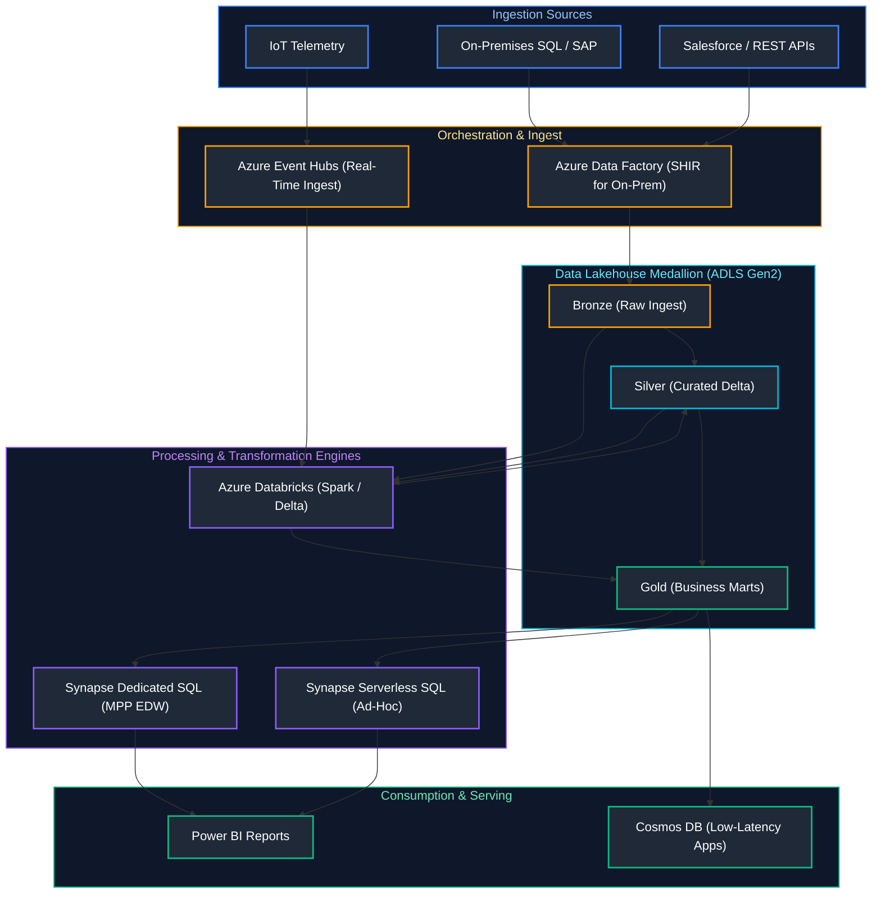

---

### 2.2 ADLS Gen2
The scalable, secure data lake foundation combining Hierarchical Namespace (HNS) performance with low-cost Blob Storage.

---

#### ADLS Gen2 vs. Azure Blob Storage Comparison Matrix

| Architectural Dimension | Azure Blob Storage (Flat Namespace) | Azure Data Lake Storage Gen2 (HNS Enabled) |
| :--- | :--- | :--- |
| **Namespace Model** | Flat object namespace. Directories are virtual strings separated by forward slashes (`/`). | True **Hierarchical Namespace (HNS)**. Directories are first-class filesystem objects. |
| **Directory Operations** | Renaming a directory requires copying every single object within it (O(N) operation). | Atomic metadata operation (O(1) operation). Fast and zero-copy. |
| **Big Data Workload Speed** | Slow for Spark / Hadoop: multi-part writes and directory renames cause high I/O latency. | **High performance:** Native ABFSS driver optimizes batch write commitments. |
| **Access Control (ACLs)** | Azure RBAC at container level; Shared Access Signatures (SAS tokens). | **POSIX-compliant Access Control Lists (ACLs)** + Azure RBAC down to file/directory level. |
| **Storage Pricing** | Standard object storage rates (Hot, Cool, Cold, Archive tiers). | Same storage cost as Blob Storage; slight transactional charge for HNS operations. |

### 2.3 Azure Data Factory (ADF) Overview
A fully managed, serverless cloud data integration and orchestration ETL/ELT service with 100+ native connectors.

---

### 2.4 Azure Synapse Analytics
A unified analytics service that brings together data integration (ADF pipelines), enterprise data warehousing (Dedicated SQL Pools), and big data processing (Serverless SQL and Apache Spark).

---

#### Synapse SQL Pools Comparison Matrix

| Synapse Component | Compute Engine | Primary Use Case | Scaling / Pricing Model |
| :--- | :--- | :--- | :--- |
| **Serverless SQL Pool** | Distributed query processing over data lake files (`OPENROWSET`). | Ad-hoc data exploration, querying Parquet/CSV/Delta directly in ADLS without provisioning servers. | Pay-per-query (\$5 per TB of data scanned). Zero idle compute cost. |
| **Dedicated SQL Pool** | Massively Parallel Processing (MPP) distributed relational engine (Control + 60 Compute nodes). | Enterprise enterprise data warehousing, high-concurrency production reporting, fixed SLAs. | Provisioned scale units (DWU - Data Warehouse Units, e.g., DW100c to DW30000c). Hourly billing. |

### 2.5 Azure Databricks
First-party Microsoft-managed Apache Spark Lakehouse platform natively integrated with Microsoft Entra ID, Azure Monitor, and Azure Key Vault.

---

### 2.6 Azure Event Hubs
A big-data streaming platform and event ingestion service capable of receiving and processing millions of events per second with native Kafka wire-protocol compatibility.

---

#### Azure Messaging Services Comparison Matrix

| Feature / Dimension | Azure Event Hubs | Azure Service Bus | Azure Storage Queues |
| :--- | :--- | :--- | :--- |
| **Primary Intent** | High-throughput **event streaming ingestion** (telemetry, logs, clickstreams). | Enterprise **business message brokering** (orders, financial commands, workflows). | Simple, lightweight task queuing between microservices. |
| **Paradigm** | Append-only partitioned consumer log (Kafka-compatible). | AMQP message broker with transactional topics and subscriptions. | First-In, First-Out (FIFO) basic polling queue. |
| **Throughput / Scalability** | Millions of events/sec; partitioned consumer model. | Up to tens of thousands msgs/sec; session handling and deduplication. | Up to 2,000 msgs/sec per storage queue. |
| **Ordering Guarantees** | Strict order guaranteed **per partition key**. | Strict FIFO ordering using **Message Sessions**. | Best-effort; duplicate processing possible. |
| **Max Message Size** | 1 MB (standard) / 100 MB (dedicated tier). | 100 MB (Premium tier) / 256 KB (Standard). | 64 KB per message payload. |

### 2.7 Azure Stream Analytics
A serverless real-time event processing engine that executes streaming SQL queries over real-time Event Hubs and IoT Hub feeds with sub-second latency.

---

### 2.8 Azure SQL Database
A fully managed Platform-as-a-Service (PaaS) relational database engine running the latest stable version of Microsoft SQL Server with automatic patching, backups, and hyper-scale compute.

---

### 2.9 Azure Cosmos DB
A globally distributed, multi-model NoSQL database providing single-digit millisecond response times, 99.999% SLA availability, and multi-region active-active replication (Core SQL, MongoDB, Cassandra APIs).

---

### 2.10 Azure Key Vault
A secure cloud service for managing cryptographic keys, application passwords, database connection strings, and certificates with Hardware Security Module (HSM) backing.

---

### 2.11 Azure Monitor & Log Analytics
A centralized observability platform that collects metrics and telemetry logs from all Azure data services, querying logs via **Kusto Query Language (KQL)** to generate operational dashboards and alert notifications.

---

# 3. Identity, Security & Cloud Networking

---

### 3.1 Microsoft Entra ID (Azure AD)

#### Definition
Microsoft Entra ID is the multi-tenant cloud-based identity and access management service that centrally secures authentication across all Azure data resources.

---

### 3.2 Service Principals & App Registrations

#### Definition
A Service Principal is an identity created for applications, automated CI/CD pipelines, and external tools to access specific Azure resources (equivalent to a service account).

---

### 3.3 Managed Identities

#### Definition
Managed Identities eliminate the risk of hardcoding secrets or credentials in code by providing an automatically managed Entra ID identity for Azure resources.
- **System-Assigned:** Created directly on an Azure resource instance (e.g., an ADF factory or Synapse workspace). Deleted automatically if the resource is deleted.
- **User-Assigned:** An independent standalone resource that can be assigned to multiple VMs or Databricks clusters.

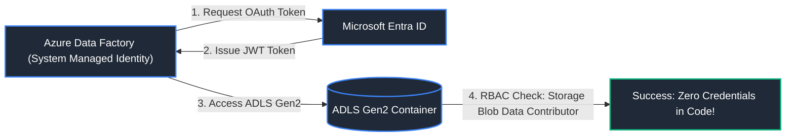

---

#### Azure Managed Identity vs. Service Principal Comparison Matrix

| Security Dimension | Azure Managed Identity (System / User-Assigned) | Azure Service Principal (App Registration) |
| :--- | :--- | :--- |
| **Credential Management** | **100% Azure-Managed.** Credentials, keys, and tokens are rotated automatically by Azure. Zero secrets stored in configuration. | **Customer-Managed.** Requires generating client secrets (max 2-year lifetime) or certificates and rotating them manually. |
| **Secret Leak Risk** | **Zero.** Tokens are fetched directly from internal Azure instance metadata service (`http://169.254.169.254/`). | Risk of accidental git commits or exposure in CI/CD pipeline variables. |
| **Multi-Cloud / On-Prem** | Restricted to Azure compute resources (VMs, Databricks, Functions, AKS). | Can authenticate from anywhere: AWS, on-prem servers, GitHub Actions, local machines. |
| **Recommended Usage** | Azure-to-Azure service communication (e.g. ADF -> ADLS Gen2, Databricks -> Key Vault). | CI/CD automated deployments (Terraform, GitHub Actions) and hybrid workloads. |

### 3.4 Role-Based Access Control (RBAC)

#### Core Built-in Roles for Data Engineering
- **Storage Blob Data Contributor:** Read, write, and delete blobs in ADLS Gen2.
- **Storage Blob Data Reader:** Read-only access to blobs.
- **Key Vault Secrets User:** Read secret contents from Azure Key Vault.
- **Data Factory Contributor:** Author and deploy ADF pipelines.

---

### 3.5 Key Vault Secret Scopes Integration

#### Secure Credential Pattern in Azure Databricks
```python
# Databricks Python: Retrieve secrets securely from Azure Key Vault
db_password = dbutils.secrets.get(scope="akv-prod-secrets", key="SalesDbPassword")
```

---

### 3.6 Virtual Networks (VNets) & Network Security Groups (NSGs)

#### Definition
- **VNet (Virtual Network):** Isolates cloud infrastructure inside a private IP address space (e.g. `10.0.0.0/16`).
- **NSG (Network Security Group):** Acts as a virtual firewall controlling inbound and outbound traffic rules at the subnet level.

---

#### Azure Secure Networking Reference Matrix

| Networking Component | Purpose & Architecture | Security Best Practice |
| :--- | :--- | :--- |
| **Virtual Network (VNet)** | Private, isolated IP address space in Azure (RFC 1918). Enables VMs and clusters to communicate securely. | Plan CIDR blocks carefully to prevent overlapping ranges with on-prem networks. |
| **Network Security Group (NSG)** | Stateful packet filter containing Layer 4 firewall rules (5-tuple: source/dest IP & port, protocol). | Apply least-privilege inbound rules; place deny-all default rules at lowest priority. |
| **Azure Private Link / Endpoint** | Projects a private IP from your VNet directly onto an Azure PaaS service (Storage, Synapse, SQL DB). | Disable public network access on ADLS Gen2 and force all ingestion through Private Endpoints. |

### 3.7 Private Endpoints & Azure Private Link

#### Architecture
Private Endpoints project a private IP from your VNet directly onto PaaS services (ADLS Gen2, Synapse, SQL DB), disabling public internet routing.

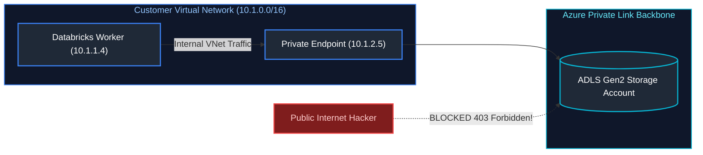

---

# 4. Azure Data Factory (ADF) Deep-Dive

---

### 4.1 Pipelines, Activities & Control Flow

#### Definition
An ADF **Pipeline** is a logical grouping of **Activities** that together perform a unit of work. Control flow activities (`IfCondition`, `ForEach`, `Until`, `Switch`) orchestrate sequential and parallel execution.

---

### 4.2 Core Activities

1. **Copy Activity:** Highly optimized data movement engine transferring data between 100+ heterogeneous sources and sinks.
2. **Lookup Activity:** Reads a configuration record or query result from a database or file.
3. **Get Metadata Activity:** Inspects storage to retrieve file size, child items (file lists), exists flag, and structure.
4. **ForEach Activity:** Iterates over an array in parallel or sequentially.
5. **Execute Pipeline:** Modularly calls a child pipeline with parameters.

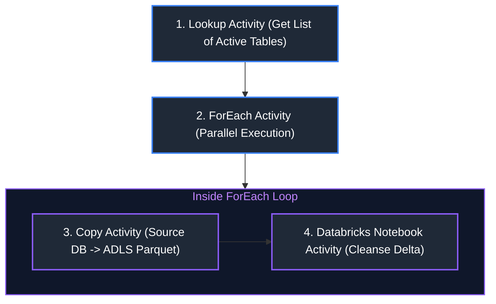

---

### 4.3 Mapping Data Flows

#### Definition
Mapping Data Flows provide visually designed data transformations (joins, aggregates, conditional splits) in ADF that the runtime translates into optimized **Apache Spark code** running on a managed Databricks/Spark cluster behind the scenes.

---

### 4.4 Integration Runtimes (IR)

#### Types of Integration Runtimes
| Integration Runtime | Hosting Environment | Primary Use Case |
| :--- | :--- | :--- |
| **Azure IR** | Fully managed Azure cloud | Cloud-to-cloud data movement and Data Flows |
| **Self-Hosted IR (SHIR)** | On-premises VM or private VNet | Securely accessing on-premises data behind corporate firewalls |
| **Azure-SSIS IR** | Managed VMs running SQL Server | Lift-and-shift legacy SSIS packages to the cloud |

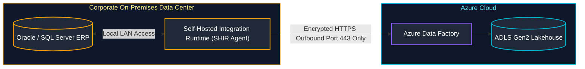

---

### 4.5 Linked Services vs Datasets

- **Linked Service:** Connection string / authentication credentials to a data store or compute engine (e.g., connection details to a PostgreSQL database).
- **Dataset:** A named view of the data pointing to a specific table, file, or folder path within the Linked Service (e.g., `customers.parquet` on ADLS Gen2).

---

### 4.6 Triggers

1. **Schedule Trigger:** Standard wall-clock scheduler (e.g., run every 2 hours).
2. **Tumbling Window Trigger:** Operates on contiguous, non-overlapping time slices. Supports dependency tracking (cannot run 2:00 PM slice until 1:00 PM slice finishes) and automated historical backfilling.
3. **Event-Based Trigger:** Automatically fires in response to storage events (`BlobCreated`, `BlobDeleted`) via Azure Event Grid.

---

### 4.7 Parameters vs Variables

- **Parameters:** External inputs passed into a pipeline or dataset at runtime (read-only within execution).
- **Variables:** Internal state stored within a pipeline run that can be updated dynamically via `Set Variable` or `Append Variable`.

---

### 4.8 Monitoring & Alerts

The ADF Monitor hub visualizes pipeline runs, activity status, Gantt execution timelines, and logs metrics to Azure Log Analytics to trigger email/SMS alerts when pipeline failures occur.

---

# 5. Azure Synapse Analytics Deep-Dive

---

### 5.1 Synapse Dedicated SQL Pools (MPP Architecture)

#### Definition
Dedicated SQL Pools utilize a **Massively Parallel Processing (MPP)** architecture designed to run high-performance analytical queries across terabytes and petabytes of data.

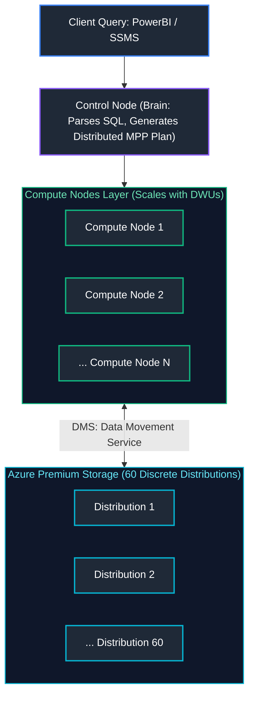

#### How Dedicated SQL Works
- A Dedicated SQL pool divides data into **exactly 60 underlying storage distributions**.
- When you scale compute (measured in **DWUs - Data Warehouse Units**, e.g., DW100c to DW30000c), Synapse allocates more compute VMs to divide the work of scanning the 60 distributions.

---

### 5.2 Data Distribution Strategies

Every table created in a Dedicated SQL Pool must declare its physical distribution strategy across the 60 storage buckets:

| Distribution Strategy | Mechanism | Best Used For |
| :--- | :--- | :--- |
| **Hash Distribution** | Uses a deterministic hash of a single column to assign rows to 1 of 60 buckets. | **Large Fact Tables (>2GB)**. Choose high-cardinality join key (e.g., `customer_id`) to avoid data skew. |
| **Round Robin Distribution** | Distributes rows evenly in a circular sequence across all 60 buckets. | **Staging Tables**; fast ingestion without needing key analysis. |
| **Replicated Distribution** | Replicates a complete copy of the entire table to **every single compute node**. | **Small Dimension Tables (<2GB)**. Eliminates data movement (DMS) during joins with fact tables. |

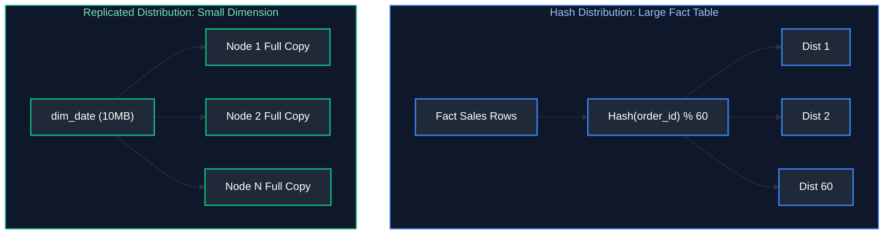

#### Code Example (Synapse Table Creation)
```sql
-- Hash Distributed Fact Table across Azure Synapse 60 Control-to-Compute nodes
CREATE TABLE warehouse.fact_orders (
    order_id BIGINT NOT NULL,               -- Unique transaction identifier
    customer_id BIGINT NOT NULL,            -- Hash distribution column key
    order_date_key INT NOT NULL,            -- Surrogate integer date key referencing dim_date
    order_amount DECIMAL(12, 2) NOT NULL    -- Monetary transaction value
)
WITH (
    -- Distributes table across 60 compute nodes using deterministic hash of customer_id
    DISTRIBUTION = HASH(customer_id),
    -- Compresses columnar data into high-density 1-million-row rowgroups for rapid analytical scanning
    CLUSTERED COLUMNSTORE INDEX
);

-- Replicated Dimension Table (Zero shuffle data movement when joined with fact tables!)
CREATE TABLE warehouse.dim_date (
    order_date_key INT NOT NULL,            -- Primary surrogate key
    calendar_date DATE NOT NULL,            -- Gregorian calendar date
    calendar_year INT NOT NULL              -- Calendar year integer
)
WITH (
    -- Stores a full copy of this dimension table on every compute node; eliminates network shuffle!
    DISTRIBUTION = REPLICATE,
    -- Columnar index maximizes compression and analytical query read throughput
    CLUSTERED COLUMNSTORE INDEX
);
```

#### References
- [Microsoft Learn: Distributed Tables in Synapse](https://learn.microsoft.com/en-us/azure/synapse-analytics/sql-data-warehouse/sql-data-warehouse-tables-distribute)
- [GeeksforGeeks: Azure Synapse Analytics](https://www.geeksforgeeks.org/azure-synapse-analytics/)

---

### 5.3 Synapse Serverless SQL Pools (`OPENROWSET`)

#### Definition
Serverless SQL Pools provide a pay-per-query query engine ($5 per TB scanned) that queries data files (Parquet, Delta Lake, CSV) directly on ADLS Gen2 storage **without needing to spin up or maintain a dedicated database cluster**.

#### Code Example (Querying Parquet directly on ADLS)
```sql
-- Serverless SQL Pool: Ad-hoc querying directly over data lake Parquet files without ingesting into tables
SELECT 
    customer_id,                                    -- Customer dimension key
    COUNT(order_id) AS total_orders,                -- Aggregate total purchase count
    SUM(order_amount) AS gross_revenue              -- Aggregate sum of customer spending
FROM OPENROWSET(
    -- Wildcard scan over Parquet files in ADLS Gen2 data lake container
    BULK 'https://datalakeprod.dfs.core.windows.net/curated/orders/*.parquet',
    FORMAT = 'PARQUET'                             -- Vectorized columnar Parquet reader
) AS [orders]
GROUP BY customer_id;                               -- Aggregate metrics per customer
```

#### References
- [Microsoft Learn: How to use OPENROWSET in Serverless SQL](https://learn.microsoft.com/en-us/azure/synapse-analytics/sql/how-to-openrowset)

---

### 5.4 Synapse Spark Pools
Fully managed, auto-scaling Apache Spark compute clusters integrated natively with the Synapse studio notebook environment.

---

### 5.5 Synapse Pipelines
Provides the exact same pipeline orchestration engine, data flow designer, and monitoring capabilities as Azure Data Factory embedded directly within the Synapse Workspace.

---

---

---

# 6. DataOps, CI/CD & Version Control

---

### 6.1 The DataOps CI/CD Lifecycle

#### Definition
DataOps applies DevOps practices (automated testing, continuous integration, version control, and declarative deployments) to data engineering pipelines to improve quality and reduce cycle times.

```mermaid
flowchart LR
    Dev["1. Developer Commit"] --> Lint["2. Lint & Format (sqlfluff, black)"]
    Lint --> Unit["3. Run Unit Tests (pytest)"]
    Unit --> Build["4. Build Docker Container / DAB Bundle"]
    Build --> TestInt["5. Integration Test on Ephemeral DB"]
    TestInt --> Deploy["6. Deploy to Production via Service Principal"]

    style Dev fill:#1f2937,stroke:#3b82f6,stroke-width:2px,color:#fff
    style Lint fill:#1f2937,stroke:#3b82f6,stroke-width:2px,color:#fff
    style Unit fill:#1f2937,stroke:#3b82f6,stroke-width:2px,color:#fff
    style Build fill:#1f2937,stroke:#3b82f6,stroke-width:2px,color:#fff
    style TestInt fill:#1f2937,stroke:#3b82f6,stroke-width:2px,color:#fff
    style Deploy fill:#1f2937,stroke:#3b82f6,stroke-width:2px,color:#fff
```

#### References
- [DataCamp: What is DataOps?](https://www.datacamp.com/tutorial/what-is-dataops)
- [GeeksforGeeks: DevOps Pipeline Architecture](https://www.geeksforgeeks.org/devops-lifecycle/)

---

### 6.2 Git Branching Strategies

| Strategy | Workflow | Best Used For |
| :--- | :--- | :--- |
| **Trunk-Based Development** (Modern Standard) | Developers push short-lived branches into `main` multiple times daily; automated CI tests enforce health. | Agile data teams, dbt projects, high-velocity CI/CD. |
| **GitFlow** | Multiple long-lived branches (`feature` $\rightarrow$ `develop` $\rightarrow$ `release` $\rightarrow$ `main`). | Rigid enterprise release cycles with formal audit gates. |

---

### 6.3 Automated Pre-Commit Hooks

#### Definition
Pre-commit hooks are automated scripts that execute locally before `git commit` succeeds, enforcing code formatting, SQL style consistency, and preventing credential leaks.

#### Configuration (`.pre-commit-config.yaml`)
```yaml
repos:
  - repo: https://github.com/sqlfluff/sqlfluff
    rev: 2.3.5
    hooks:
      - id: sqlfluff-lint
        args: [--dialect, postgres]
  - repo: https://github.com/psf/black
    rev: 23.9.1
    hooks:
      - id: black
  - repo: https://github.com/gitleaks/gitleaks
    rev: v8.18.0
    hooks:
      - id: gitleaks # Prevents committing API keys or passwords!
```

---

# 7. Containers & Cloud Infrastructure as Code

---

### 7.1 Docker for Data Engineering

#### Definition
Docker packages data transformation code, language interpreters, system C-libraries, and database drivers into an immutable, portable container image, eliminating "it works on my machine" failures.

#### Multi-Stage Production Dockerfile for PySpark
```dockerfile
# Stage 1: Builder stage to isolate and compile Python dependencies
FROM python:3.11-slim AS builder
WORKDIR /app
# Copy only requirements file to leverage Docker layer caching
COPY requirements.txt .
# Install packages into user directory, disabling cache to minimize intermediate image bloat
RUN pip install --no-cache-dir --user -r requirements.txt

# Stage 2: Minimal runtime production container containing OpenJDK for Spark execution
FROM openjdk:17-slim
WORKDIR /app
# Copy only compiled Python site-packages from the builder stage
COPY --from=builder /root/.local /root/.local
# Copy application source code into the production image
COPY src/ /app/src/
# Expose user-installed Python binaries in PATH
ENV PATH=/root/.local/bin:$PATH
# Define default immutable entrypoint for pipeline invocation
ENTRYPOINT ["python", "src/main_pipeline.py"]
```

---

### 7.2 Kubernetes for Data

#### 1. Apache Spark on Kubernetes
Replaces legacy YARN clusters. The `Spark-on-K8s` operator listens for `SparkApplication` custom resources (CRDs), spinning up an ephemeral Driver Pod which dynamically requests Worker Executor Pods. When the job finishes, pods terminate immediately (true scale-to-zero).

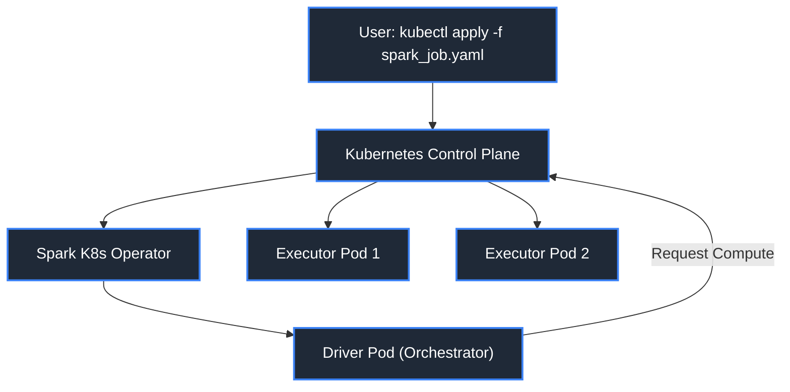

#### 2. Apache Airflow on Kubernetes (`KubernetesExecutor`)
Every single task in an Airflow DAG launches inside its own isolated Kubernetes Pod with dedicated CPU/RAM requests, custom Docker images, and independent environment variables.

---

### 7.3 Infrastructure as Code (Terraform)

#### Definition
Terraform provisions and manages cloud data infrastructure (cloud storage buckets, IAM permissions, database instances, networking rules) declaratively in version-controlled `.tf` configuration files.

#### Code Example (Terraform ADLS Gen2 Data Lake)
```hcl
resource "azurerm_storage_account" "datalake" {
  name                     = "enterpriselakehouseprod"
  resource_group_name      = "rg-data-platform"
  location                 = "eastus"
  account_tier             = "Standard"
  account_replication_type = "GRS"
  is_hns_enabled           = true # Enables ADLS Gen2 Hierarchical Namespace
}
```

---

### 7.4 Multi-Environment Promotion

Enterprise DataOps isolates data across three distinct environments:
1. **Development (`dev`):** Developers test against synthetic data or sanitized sample tables.
2. **Staging (`stage`):** Full integration testing, automated dbt tests, and performance benchmarking on recent production clones.
3. **Production (`prod`):** Strictly locked down; access restricted to automated CI/CD service principals.

---

# 8. Testing & Release Engineering for Data Pipelines

---

### 8.1 Unit Testing Transformation Logic with `pytest`

#### Best Practice
Extract business transformation logic into pure, stateless Python functions independent of Spark or database sessions, allowing lightning-fast local testing.

```python
# test_transformations.py - Unit test suite for data pipeline business logic
import pytest

def calculate_net_revenue(gross: float, tax_rate: float, discount: float) -> float:
    """Calculates net revenue applying promotional discount and regional tax rate."""
    if gross < 0:
        # Defensive validation: reject negative gross revenues
        raise ValueError("Gross revenue cannot be negative")
    # Compute net: (Gross - Discount) * (1 + Tax) rounded to 2 decimal places
    return round((gross - discount) * (1.0 + tax_rate), 2)

def test_calculate_net_revenue_valid():
    """Assert standard happy path: ($100 - $10) * 1.10 = $99.00."""
    assert calculate_net_revenue(100.0, 0.10, 10.0) == 99.0

def test_calculate_net_revenue_negative():
    """Assert error handling: negative gross amounts must raise ValueError."""
    with pytest.raises(ValueError, match="Gross revenue cannot be negative"):
        calculate_net_revenue(-50.0, 0.10, 0.0)
```

---

### 8.2 Integration Testing with Testcontainers

#### Definition
Testcontainers is a Python library that spins up real, ephemeral Docker containers (e.g., a real PostgreSQL database or LocalStack S3) during integration test runs, executing tests against real database engines and tearing them down automatically.

---

### 8.3 End-to-End Pipeline Testing

Validates the full pipeline flow: ingesting synthetic files, triggering transformations, and asserting final Gold-layer analytical aggregates.

---

### 8.4 Synthetic Test Data Generation with `Faker`

#### Code Example
```python
from faker import Faker
import pandas as pd

# Initialize synthetic data generator with consistent seed for test reproducibility
fake = Faker()
Faker.seed(42)

def generate_mock_customers(n: int = 1000) -> pd.DataFrame:
    """Generates synthetic customer demographic records for CI/CD pipeline integration tests."""
    records = []
    for _ in range(n):
        records.append({
            "customer_id": fake.uuid4(),                  # RFC 4122 compliant UUID
            "name": fake.name(),                          # Realistic human name
            "email": fake.email(),                        # Syntactically valid email address
            "country": fake.country_code(),               # ISO 3166-1 alpha-2 country code
            "signup_date": fake.date_this_decade()        # Synthetic date within current decade
        })
    return pd.DataFrame(records)

# Generate batch of 500 mock customer profiles
df_mock = generate_mock_customers(500)
# Export synthetic fixture to CSV for automated pipeline integration tests
df_mock.to_csv("test_data_customers.csv", index=False)
print(f"Generated {len(df_mock)} mock customer rows for CI test suite.")
```

---


---

### 8.5 Blue-Green Deployments for Data Pipelines

#### Definition
Blue-Green deployments eliminate downtime and prevent publishing broken data to executive dashboards. 
- **Blue (Active):** Currently serving production queries.
- **Green (Idle):** New pipeline version writes to a new staging table.
- Once data quality tests pass on Green, a single atomic view swap or pointer change routes all user queries to Green.

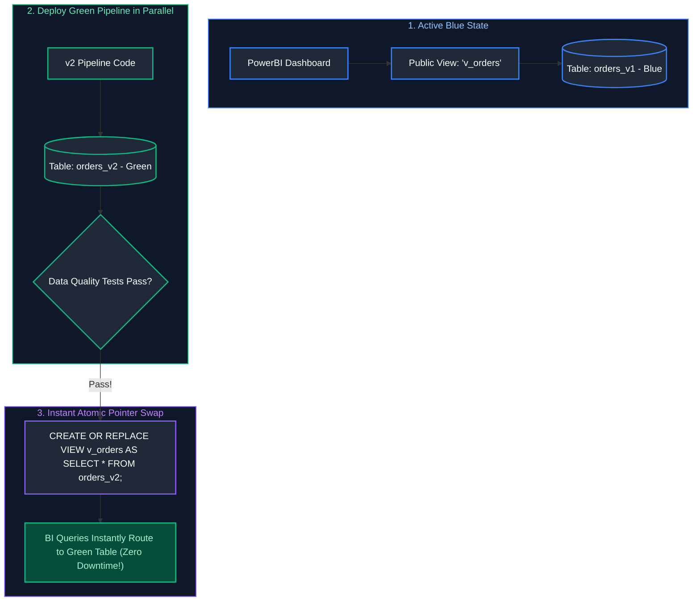

---

### 8.6 Canary Deployments & Shadow Pipelines

- **Shadow Pipeline:** The new pipeline version runs concurrently in parallel with the live production pipeline, consuming live data streams. Outputs are programmatically diffed; once zero regression is verified over 48 hours, the old pipeline is decommissioned.
- **Canary Pipeline:** Routes 5% of incoming customer traffic to the new data model, monitoring for query latency or error spikes before rolling out to 100%.

#### References
- [GeeksforGeeks: Blue Green Deployment](https://www.geeksforgeeks.org/what-is-blue-green-deployment/)
- [DataCamp: CI/CD for Machine Learning and Data](https://www.datacamp.com/tutorial/ci-cd-for-machine-learning)

---