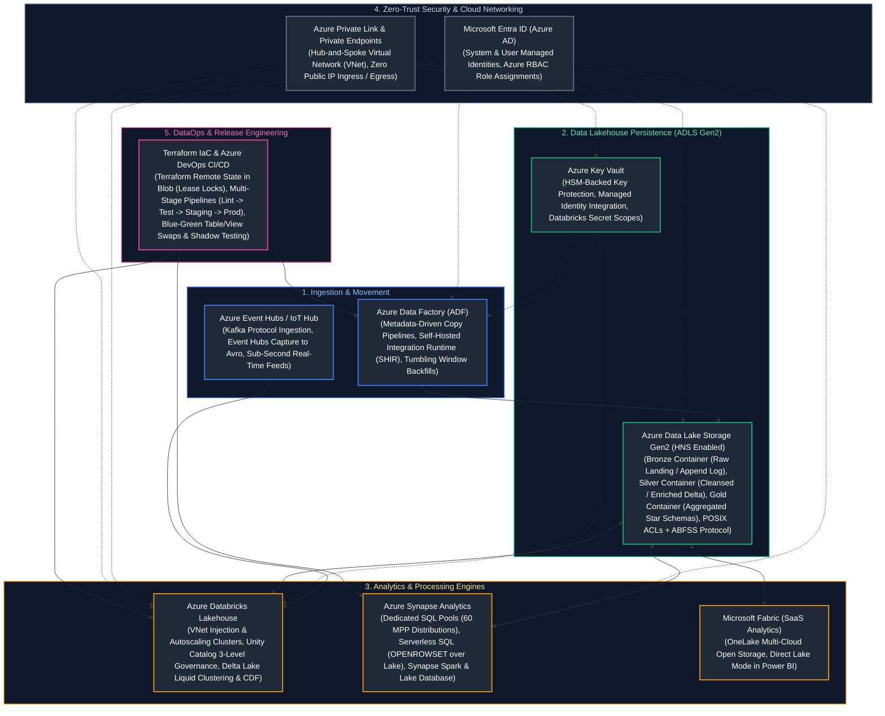
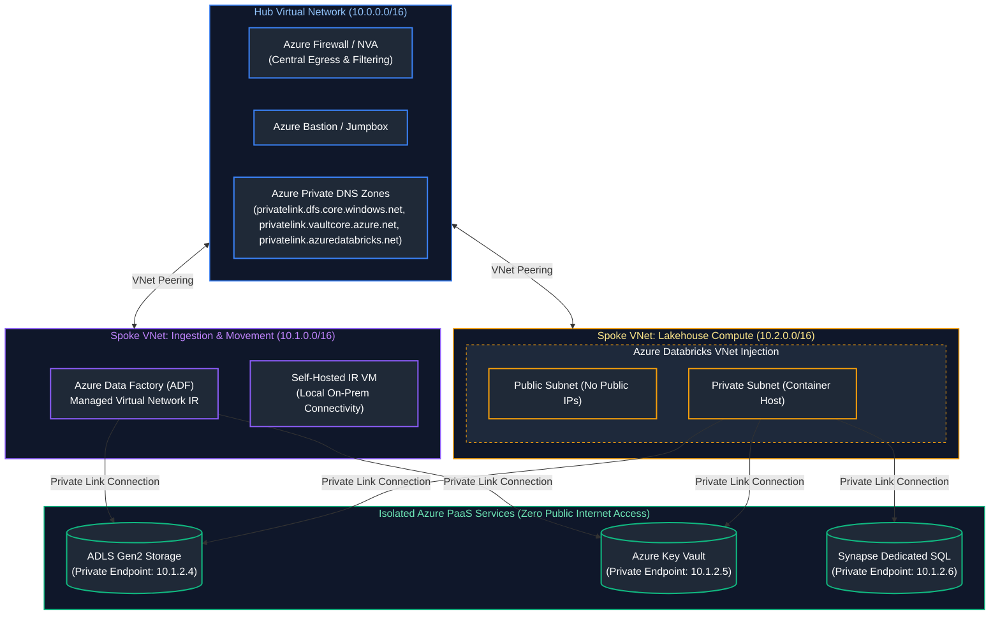
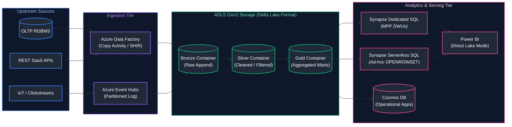
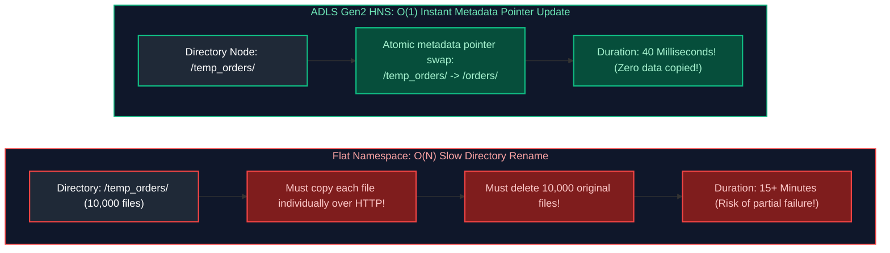
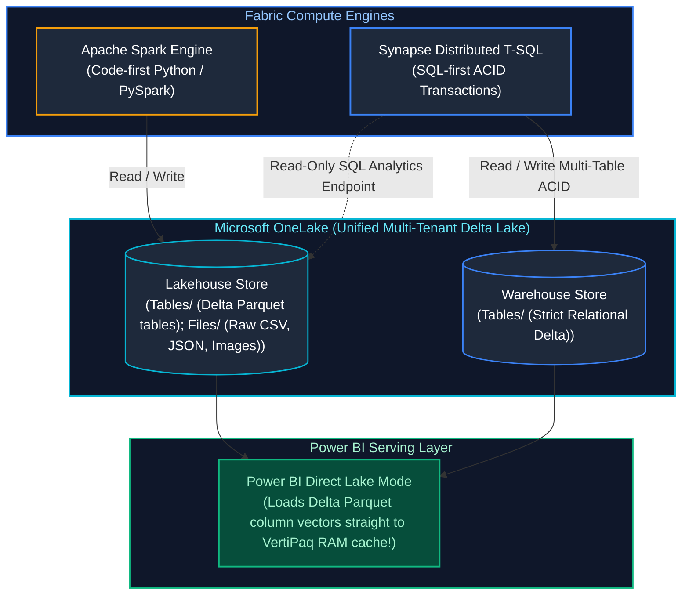
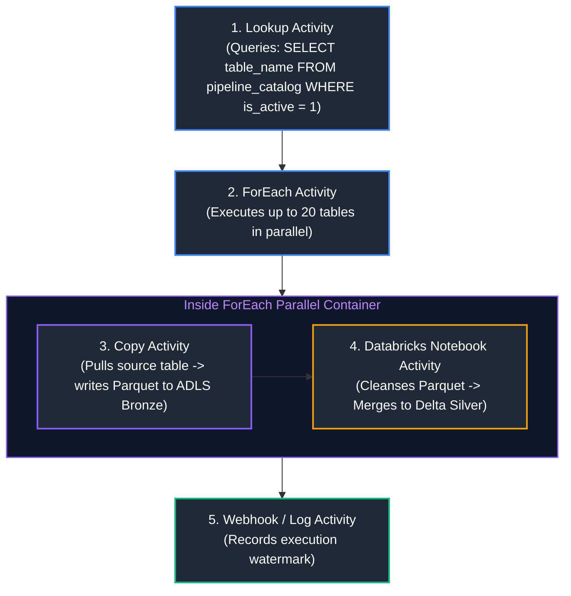
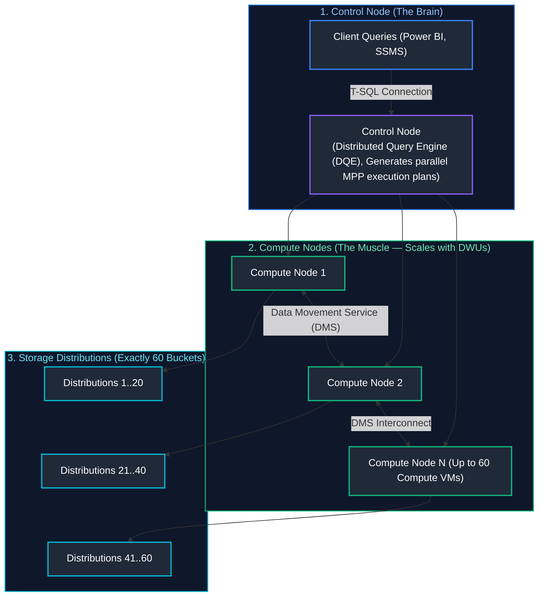
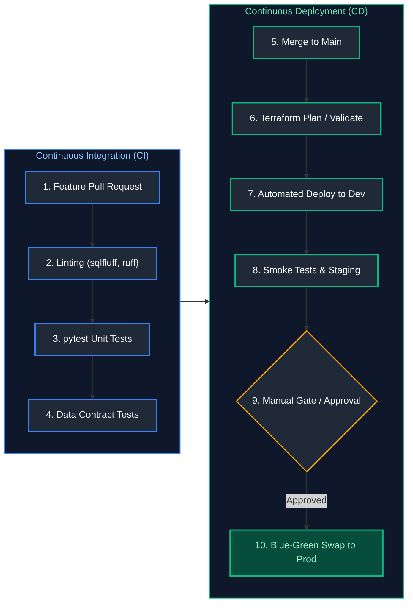
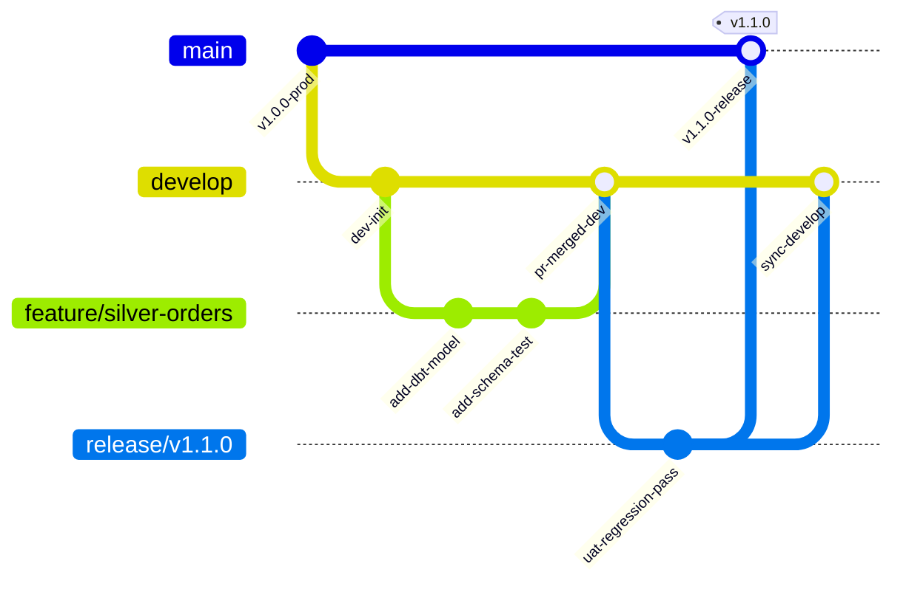
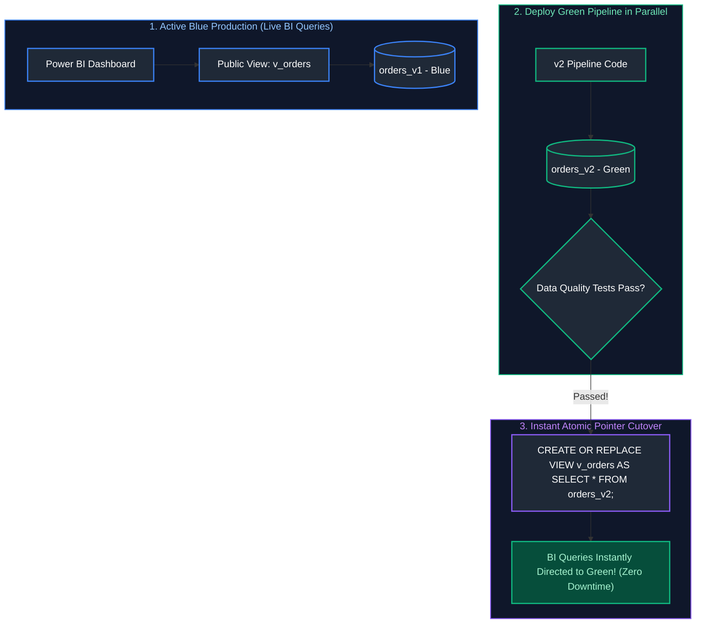

# 13. Azure Data Engineering & DataOps DevOps

A comprehensive, production-grade guide to Microsoft Azure data platform services (ADLS Gen2, Azure Data Factory, Synapse Analytics, Azure Databricks, Event Hubs, Stream Analytics, Cosmos DB, Key Vault, and Microsoft Fabric), enterprise cloud security and zero-trust networking (Entra ID, Managed Identities, Private Endpoints, Hub-and-Spoke VNets), and end-to-end DataOps engineering (Docker, Kubernetes, Terraform IaC, Azure DevOps CI/CD automation, pytest with Testcontainers, synthetic data generation, and blue-green zero-downtime deployments).

---

## Architectural Overview: Enterprise Azure Data Platform & DataOps Architecture



---

## Table of Contents
1. [End-to-End Enterprise Data Architecture on Microsoft Azure](#1-end-to-end-enterprise-data-architecture-on-microsoft-azure)
   - [1.1 Enterprise Architecture Blueprint & Security Fundamentals](#11-enterprise-architecture-blueprint--security-fundamentals)
   - [1.2 Infrastructure as Code: Complete Terraform Deployment](#12-infrastructure-as-code-complete-terraform-deployment)
   - [1.3 Production PySpark Medallion Pipeline on Azure Databricks](#13-production-pyspark-medallion-pipeline-on-azure-databricks)
2. [Core Azure Data Platform Services](#2-core-azure-data-platform-services)
   - [2.1 Enterprise Lakehouse Reference Architecture on Azure](#21-enterprise-lakehouse-reference-architecture-on-azure)
   - [2.2 ADLS Gen2: Hierarchical Namespace (HNS) Internals & POSIX ACLs](#22-adls-gen2-hierarchical-namespace-hns-internals--posix-acls)
   - [2.3 Azure Data Factory (ADF) Overview](#23-azure-data-factory-adf-overview)
   - [2.4 Azure Synapse Analytics: Dedicated vs. Serverless SQL Pools](#24-azure-synapse-analytics-dedicated-vs-serverless-sql-pools)
   - [2.5 Azure Databricks: Lakehouse, Unity Catalog & VNet Injection](#25-azure-databricks-lakehouse-unity-catalog--vnet-injection)
   - [2.6 Azure Event Hubs: Real-Time Stream Ingestion & Capture](#26-azure-event-hubs-real-time-stream-ingestion--capture)
   - [2.7 Azure Stream Analytics: Real-Time Windowing SQL](#27-azure-stream-analytics-real-time-windowing-sql)
   - [2.8 Azure SQL Database & Hyperscale Architecture](#28-azure-sql-database--hyperscale-architecture)
   - [2.9 Azure Cosmos DB: Multi-Model Distributed NoSQL](#29-azure-cosmos-db-multi-model-distributed-nosql)
   - [2.10 Azure Key Vault & Hardware Security Modules (HSM)](#210-azure-key-vault--hardware-security-modules-hsm)
   - [2.11 Azure Monitor, Log Analytics & KQL Queries](#211-azure-monitor-log-analytics--kql-queries)
   - [2.12 Microsoft Fabric: Lakehouse vs. Warehouse Architecture & OneLake](#212-microsoft-fabric-lakehouse-vs-warehouse-architecture--onelake)
3. [Identity, Security & Cloud Networking](#3-identity-security-cloud-networking)
   - [3.1 Microsoft Entra ID (Azure AD) Fundamentals](#31-microsoft-entra-id-azure-ad-fundamentals)
   - [3.2 Service Principals & App Registrations](#32-service-principals--app-registrations)
   - [3.3 Managed Identities: System-Assigned vs. User-Assigned](#33-managed-identities-system-assigned-vs-user-assigned)
   - [3.4 Role-Based Access Control (Azure RBAC)](#34-role-based-access-control-azure-rbac)
   - [3.5 Databricks Secret Scopes with Azure Key Vault](#35-databricks-secret-scopes-with-azure-key-vault)
   - [3.6 Hub-and-Spoke VNets & Network Security Groups (NSGs)](#36-hub-and-spoke-vnets--network-security-groups-nsgs)
   - [3.7 Private Endpoints & Azure Private Link](#37-private-endpoints--azure-private-link)
4. [Azure Data Factory (ADF) Deep-Dive](#4-azure-data-factory-adf-deep-dive)
   - [4.1 Pipelines, Activities & Control Flow Mechanics](#41-pipelines-activities--control-flow-mechanics)
   - [4.2 Core Activities (Copy, Lookup, Get Metadata, ForEach)](#42-core-activities-copy-lookup-get-metadata-foreach)
   - [4.3 Mapping Data Flows & Spark Execution Translation](#43-mapping-data-flows--spark-execution-translation)
   - [4.4 Integration Runtimes (Azure IR vs. Self-Hosted IR vs. SSIS)](#44-integration-runtimes-azure-ir-vs-self-hosted-ir-vs-ssis)
   - [4.5 Linked Services vs. Datasets](#45-linked-services-vs-datasets)
   - [4.6 Triggers (Schedule vs. Tumbling Window vs. Storage Events)](#46-triggers-schedule-vs-tumbling-window-vs-storage-events)
   - [4.7 Parameters vs. Variables (Dynamic Content Expressions)](#47-parameters-vs-variables-dynamic-content-expressions)
   - [4.8 ADF Monitoring, Alerting & SLA Tracking](#48-adf-monitoring-alerting--sla-tracking)
5. [Azure Synapse Analytics Deep-Dive](#5-azure-synapse-analytics-deep-dive)
   - [5.1 Synapse Dedicated SQL Pools: Massively Parallel Processing (MPP)](#51-synapse-dedicated-sql-pools-massively-parallel-processing-mpp)
   - [5.2 Data Distribution Strategies (Hash vs. Replicated vs. Round Robin)](#52-data-distribution-strategies-hash-vs-replicated-vs-round-robin)
   - [5.3 Synapse Serverless SQL Pools (`OPENROWSET` over Data Lake)](#53-synapse-serverless-sql-pools-openrowset-over-data-lake)
   - [5.4 Synapse Spark Pools & Lake Databases](#54-synapse-spark-pools--lake-databases)
   - [5.5 Synapse Pipelines vs. Standalone ADF](#55-synapse-pipelines-vs-standalone-adf)
6. [DataOps, CI/CD & Version Control](#6-dataops-cicd--version-control)
   - [6.1 The DataOps CI/CD Lifecycle](#61-the-dataops-cicd-lifecycle)
   - [6.2 Git Branching Strategies for Data Engineering](#62-git-branching-strategies-for-data-engineering)
   - [6.3 Automated Pre-Commit Hooks (SQLFluff, Black, Gitleaks)](#63-automated-pre-commit-hooks-sqlfluff-black-gitleaks)
7. [Containers & Cloud Infrastructure as Code](#7-containers-cloud-infrastructure-as-code)
   - [7.1 Docker for Data Engineering: Multi-Stage Containerization](#71-docker-for-data-engineering-multi-stage-containerization)
   - [7.2 Kubernetes for Data: Spark-on-K8s & Airflow KubernetesExecutor](#72-kubernetes-for-data-spark-on-k8s--airflow-kubernetesexecutor)
   - [7.3 Infrastructure as Code: Terraform Architecture & State Locking](#73-infrastructure-as-code-terraform-architecture--state-locking)
   - [7.4 Multi-Environment Promotion (`dev` $\rightarrow$ `stage` $\rightarrow$ `prod`)](#74-multi-environment-promotion-dev-rightarrow-stage-rightarrow-prod)
8. [Testing & Release Engineering for Data Pipelines](#8-testing--release-engineering-for-data-pipelines)
   - [8.1 Unit Testing Transformation Logic with `pytest`](#81-unit-testing-transformation-logic-with-pytest)
   - [8.2 Integration Testing with Testcontainers & Azurite](#82-integration-testing-with-testcontainers--azurite)
   - [8.3 End-to-End Pipeline Testing & Regression Baselines](#83-end-to-end-pipeline-testing--regression-baselines)
   - [8.4 Synthetic Test Data Generation with `Faker`](#84-synthetic-test-data-generation-with-faker)
   - [8.5 Blue-Green Deployments for Zero-Downtime Pipeline Releases](#85-blue-green-deployments-for-zero-downtime-pipeline-releases)
   - [8.6 Canary Deployments & Shadow Pipelines](#86-canary-deployments--shadow-pipelines)
9. [Azure Production Engineering Summary & Operational Governance](#9-azure-production-engineering-summary--operational-governance)
10. [References & Further Reading](#10-references--further-reading)

---

# 1. End-to-End Enterprise Data Architecture on Microsoft Azure

---

### 1.1 Enterprise Architecture Blueprint & Security Fundamentals

In an enterprise Microsoft Azure data platform, isolation, governance, and zero-trust security are foundational requirements:



#### Core Enterprise Security Principles
1. **Network Isolation via Hub-and-Spoke Topology:**
   - **Hub VNet:** Houses centralized network inspection appliances, Azure Firewall, ExpressRoute gateways connecting on-premises datacenters, and Azure Private DNS Zones.
   - **Spoke VNets:** Workload-specific subnets (e.g., Ingestion Spoke for ADF, Analytics Spoke for Azure Databricks with VNet injection).
   - **Zero Public Access:** Storage accounts, Key Vaults, and database instances have `public_network_access_enabled = false`. Ingress and egress occur exclusively via **Azure Private Endpoints** using private RFC 1918 IP addresses.
2. **Zero-Credential Management (Managed Identities):**
   - No plaintext passwords, database connection strings, or access tokens exist in pipeline source code or configuration files.
   - Authentication across services is handled natively via **Microsoft Entra ID System-Assigned Managed Identities** and **User-Assigned Managed Identities**.
   - Azure Key Vault stores external third-party API credentials, accessible only through Entra ID Role-Based Access Control (RBAC).
3. **Medallion Lakehouse Governance with Unity Catalog:**
   - **Bronze:** Append-only landing zone preserving 100% of raw source schema fidelity.
   - **Silver:** Conformed, cleansed Delta Lake tables with schema enforcement, deletion vectors, and SCD Type 2 history.
   - **Gold:** Curated, dimensional business marts (star schemas) optimized for Power BI and low-latency serving.
   - **Unity Catalog:** Provides a unified 3-level namespace (`catalog.schema.table`), fine-grained Row-Level Security (RLS), dynamic Column-Level Masking (CLS), and automated audit lineage.

---

### 1.2 Infrastructure as Code: Complete Terraform Deployment

The following enterprise Terraform blueprint provisions a secure Resource Group, Spoke Virtual Network, Subnets, ADLS Gen2 Storage Account with Hierarchical Namespace (HNS), Private Endpoints, and an RBAC-governed Azure Key Vault:

```hcl
# main.tf - Enterprise Azure Data Platform Infrastructure as Code
terraform {
  required_version = ">= 1.5.0"
  required_providers {
    azurerm = {
      source  = "hashicorp/azurerm"
      version = "~> 3.85.0"
    }
  }
  # Remote backend using Azure Blob Storage with Lease-Based State Locking
  backend "azurerm" {
    resource_group_name  = "rg-terraform-state"
    storage_account_name = "sttfstateenterpriseprod"
    container_name       = "tfstate"
    key                  = "data-platform-prod.terraform.tfstate"
  }
}

provider "azurerm" {
  features {
    key_vault {
      purge_soft_delete_on_destroy    = false
      recover_soft_deleted_key_vaults = true
    }
  }
}

# 1. Resource Group
resource "azurerm_resource_group" "rg" {
  name     = "rg-enterprise-data-prod-eastus2"
  location = "East US 2"
  tags = {
    Environment = "Production"
    Team        = "DataPlatform"
    ManagedBy   = "Terraform"
  }
}

# 2. Spoke Virtual Network & Subnets
resource "azurerm_virtual_network" "vnet" {
  name                = "vnet-data-spoke-prod"
  resource_group_name = azurerm_resource_group.rg.name
  location            = azurerm_resource_group.rg.location
  address_space       = ["10.2.0.0/16"]
}

resource "azurerm_subnet" "snet_private_endpoints" {
  name                 = "snet-private-endpoints"
  resource_group_name  = azurerm_resource_group.rg.name
  virtual_network_name = azurerm_virtual_network.vnet.name
  address_prefixes     = ["10.2.1.0/24"]
}

# 3. Secure ADLS Gen2 Storage Account (HNS Enabled + Zero Public Access)
resource "azurerm_storage_account" "adls" {
  name                          = "stadlsprodeastus2"
  resource_group_name           = azurerm_resource_group.rg.name
  location                      = azurerm_resource_group.rg.location
  account_tier                  = "Standard"
  account_replication_type      = "ZRS" # Zone-Redundant Storage
  account_kind                  = "StorageV2"
  is_hns_enabled                = true  # Enables ADLS Gen2 Hierarchical Namespace
  min_tls_version               = "TLS1_2"
  public_network_access_enabled  = false # Prohibits public internet traversal

  network_rules {
    default_action = "Deny"
    bypass         = ["AzureServices", "Logging", "Metrics"]
  }
}

# Medallion Containers
resource "azurerm_storage_data_lake_gen2_filesystem" "bronze" {
  name               = "bronze"
  storage_account_id = azurerm_storage_account.adls.id
}

resource "azurerm_storage_data_lake_gen2_filesystem" "silver" {
  name               = "silver"
  storage_account_id = azurerm_storage_account.adls.id
}

resource "azurerm_storage_data_lake_gen2_filesystem" "gold" {
  name               = "gold"
  storage_account_id = azurerm_storage_account.adls.id
}

# 4. Azure Key Vault with Azure RBAC Authorization
resource "azurerm_key_vault" "kv" {
  name                          = "kv-dataprod-eastus2-01"
  location                      = azurerm_resource_group.rg.location
  resource_group_name           = azurerm_resource_group.rg.name
  tenant_id                     = data.azurerm_client_config.current.tenant_id
  sku_name                      = "standard"
  enable_rbac_authorization    = true # Modern RBAC model (No legacy access policies)
  purge_protection_enabled      = true
  soft_delete_retention_days    = 90
  public_network_access_enabled = false
}

# 5. Private Endpoint for ADLS Gen2 DFS Sub-Resource
resource "azurerm_private_endpoint" "pe_adls_dfs" {
  name                = "pe-adls-dfs-prod"
  location            = azurerm_resource_group.rg.location
  resource_group_name = azurerm_resource_group.rg.name
  subnet_id           = azurerm_subnet.snet_private_endpoints.id

  private_service_connection {
    name                           = "psc-adls-dfs"
    private_connection_resource_id = azurerm_storage_account.adls.id
    subresource_names              = ["dfs"]
    is_manual_connection           = false
  }
}

data "azurerm_client_config" "current" {}
```

---

### 1.3 Production PySpark Medallion Pipeline on Azure Databricks

The following production script runs inside an Azure Databricks cluster governed by Unity Catalog. It reads raw JSON events from the ADLS Gen2 Bronze container using the secure ABFSS protocol, performs schema enforcement and quality filtering, and executes an idempotent ACID `MERGE` into Delta Silver:

```python
from pyspark.sql import SparkSession
from pyspark.sql.functions import col, current_timestamp, to_date, sha2, concat_ws
from delta.tables import DeltaTable

# Initialize Spark session
spark = SparkSession.builder.appName("AzureEnterpriseBronzeToSilver").getOrCreate()

# Path configuration using ABFSS driver (Azure Blob File System Secure)
STORAGE_ACCOUNT = "stadlsprodeastus2"
BRONZE_URI = f"abfss://bronze@{STORAGE_ACCOUNT}.dfs.core.windows.net/raw_transactions/"
SILVER_TABLE_NAME = "enterprise_prod.silver_sales.transactions"

# 1. Read Raw Streaming / Batch JSON Files from ADLS Gen2 Bronze
df_raw = spark.read.format("json").load(BRONZE_URI)

# 2. Defensive Data Cleansing & Deduplication
# Generate deterministic row hash for duplicate payload detection
df_cleansed = df_raw \
    .filter(col("transaction_id").isNotNull()) \
    .filter(col("amount") > 0.0) \
    .withColumn("amount", col("amount").cast("decimal(18,2)")) \
    .withColumn("event_date", to_date(col("event_timestamp"))) \
    .withColumn("row_hash", sha2(concat_ws("||", col("transaction_id"), col("amount"), col("status")), 256)) \
    .withColumn("_ingested_at", current_timestamp())

# 3. Idempotent ACID Upsert (MERGE) into Delta Silver Table
delta_silver = DeltaTable.forName(spark, SILVER_TABLE_NAME)

delta_silver.alias("target").merge(
    source=df_cleansed.alias("source"),
    condition="target.transaction_id = source.transaction_id AND target.event_date = source.event_date"
).whenMatchedUpdate(
    condition="target.row_hash != source.row_hash",  # Only update if payload actually changed
    set={
        "amount": col("source.amount"),
        "customer_id": col("source.customer_id"),
        "status": col("source.status"),
        "row_hash": col("source.row_hash"),
        "_ingested_at": col("source._ingested_at")
    }
).whenNotMatchedInsert(
    values={
        "transaction_id": col("source.transaction_id"),
        "customer_id": col("source.customer_id"),
        "amount": col("source.amount"),
        "status": col("source.status"),
        "event_date": col("source.event_date"),
        "row_hash": col("source.row_hash"),
        "_ingested_at": col("source._ingested_at")
    }
).execute()

print(f"Successfully processed Bronze -> Silver for table: {SILVER_TABLE_NAME}")
```

---

# 2. Core Azure Data Platform Services

---

### 2.1 Enterprise Lakehouse Reference Architecture on Azure

The modern enterprise Lakehouse on Azure unifies data warehouse governance with data lake scalability:



---

### 2.2 ADLS Gen2: Hierarchical Namespace (HNS) Internals & POSIX ACLs

#### Hierarchical Namespace (HNS) vs. Flat Object Storage
In standard object storage (Amazon S3 or Azure Blob Storage without HNS), directories do not physically exist. A path like `bronze/year=2026/month=03/part-01.parquet` is merely a single long string key.
- **The $O(N)$ Rename Bottleneck:** When an Apache Spark job commits a batch, it writes to a `_temporary/` directory and renames it to the target directory. In flat object storage, renaming a directory with 10,000 files requires **copying all 10,000 objects one by one** over HTTP and then deleting the old ones ($O(N)$ network I/O).
- **The $O(1)$ Atomic HNS Solution:** In ADLS Gen2 with HNS enabled, directories are true filesystem nodes. Renaming a directory modifies a single pointer in the metadata catalog in milliseconds ($O(1)$ operation), eliminating data movement and enabling atomic job commits.



#### POSIX Access Control Lists (ACLs)
ADLS Gen2 supports Linux-style POSIX ACLs in addition to Azure RBAC:
- **Access ACLs:** Enforce read (`r`), write (`w`), and execute (`x`) permissions on specific existing files and directories.
- **Default ACLs:** Templates applied to a parent directory that automatically inherit down to all newly created child files and subdirectories.

---

### 2.3 Azure Data Factory (ADF) Overview

Azure Data Factory is a serverless, hybrid data integration service capable of visual ELT orchestration, data movement across 100+ native connectors, and dispatching distributed transformations to Databricks and Synapse.

---

### 2.4 Azure Synapse Analytics: Dedicated vs. Serverless SQL Pools

| Architectural Dimension | Synapse Dedicated SQL Pool | Synapse Serverless SQL Pool |
| :--- | :--- | :--- |
| **Compute Model** | Provisioned MPP cluster (1 Control node + up to 60 Compute nodes) | Serverless query execution engine distributed on-demand |
| **Primary Workload** | Enterprise Data Warehousing (EDW), fixed SLAs, high concurrency | Ad-hoc lake exploration, querying Parquet/CSV/Delta directly |
| **Storage Architecture** | Decoupled into **exactly 60 underlying storage distributions** | Queries data directly in-place on ADLS Gen2 (`OPENROWSET`) |
| **Billing / Cost Model** | Hourly provisioned capacity measured in DWUs (e.g. DW100c to DW30000c) | Pay-per-query (\$5.00 per TB of data processed/scanned) |
| **Data Modifications** | Full DDL/DML (`INSERT`, `UPDATE`, `DELETE`, `MERGE`, CTAS) | **Read-Only** queries; writes require `CREATE EXTERNAL TABLE AS SELECT` (CETAS) |

---

### 2.5 Azure Databricks: Lakehouse, Unity Catalog & VNet Injection

Azure Databricks is a first-party Microsoft cloud service that provides a collaborative Apache Spark engine:
- **VNet Injection:** Databricks clusters run inside the customer’s private Azure Virtual Network across two subnets: **Public Subnet** (coordinates control plane communication; public IPs can be completely disabled) and **Private Subnet** (inter-worker executor shuffle communication).
- **Unity Catalog:** Centralized data governance layer across all Databricks workspaces in a tenant. Implements a 3-level namespace: `catalog.schema.table`.

---

### 2.6 Azure Event Hubs: Real-Time Stream Ingestion & Capture

Azure Event Hubs provides high-throughput streaming event ingestion with native Apache Kafka protocol wire compatibility.
- **Event Hubs Capture:** An automated feature that streams incoming event batches directly into ADLS Gen2 as compressed **Avro** files without writing code.
- **Partitioned Consumer Model:** Multiple independent consumer groups read from the same partitioned log at different offsets without impacting one another.

---

### 2.7 Azure Stream Analytics: Real-Time Windowing SQL

Azure Stream Analytics (ASA) executes complex temporal queries over real-time streaming data using a SQL-based language:

| Window Function Paradigm | Temporal Overlap Semantics | State Output Trigger Condition | Memory State Retention | Canonical Real-World Scenario |
| :--- | :--- | :--- | :--- | :--- |
| **Tumbling Window** | Fixed, non-overlapping contiguous intervals (e.g., every 5 minutes). | Emits exactly once at the close of every distinct window interval. | Flushes state completely after each window closes; minimal memory footprint. | 5-minute rolling average server telemetry metrics; hourly sales summaries. |
| **Hopping Window** | Fixed duration, overlapping intervals (e.g., 5-minute window hopping every 1 minute). | Emits on every hop interval, summarizing the trailing window duration. | Holds multiple overlapping window states simultaneously in memory. | Moving averages for stock price momentum or algorithmic trading triggers. |
| **Sliding Window** | Evaluates only when an event enters or exits the time duration. | Emits whenever an event arrives, provided at least one event resides in window. | Keeps precise event arrival timestamps in memory buffer. | Alerting when more than 5 failed login attempts occur within any 10-minute span. |
| **Session Window** | Variable duration; groups events by continuous user activity. | Closes and emits only when inactivity gap exceeds timeout threshold. | Variable state duration; expands dynamically until inactivity gap expires. | Tracking user web clickstream sessions; session ends after 15 minutes of inactivity. |

#### Code Example: Real-Time Fraud Aggregation via Tumbling Window
```sql
-- Stream Analytics Query: Detects card transactions exceeding $10,000 in a 5-minute tumbling window
SELECT 
    System.Timestamp() AS window_end_time,
    card_number,
    COUNT(*) AS transaction_count,
    SUM(transaction_amount) AS total_spent
FROM EventHubInput TIMESTAMP BY transaction_time
GROUP BY 
    card_number, 
    TumblingWindow(minute, 5)
HAVING SUM(transaction_amount) > 10000.00;
```

---

### 2.8 Azure SQL Database & Hyperscale Architecture

Azure SQL Database Hyperscale utilizes a distributed tiered architecture that decouples compute from storage:
- **Compute Tier:** Primary read-write replica + up to 30 independent read-scale replicas.
- **Page Servers:** Distributed storage caching tier serving database pages over high-speed RDMA.
- **Log Service:** Ultra-low latency distributed Write-Ahead Log engine enabling near-instantaneous backups and restores regardless of database size (scales up to 100 TB).

---

### 2.9 Azure Cosmos DB: Multi-Model Distributed NoSQL

Azure Cosmos DB is a globally distributed, multi-model NoSQL database with single-digit millisecond response times and multi-region active-active replication.
- **Request Units (RU/s):** Normalized currency measuring CPU, memory, and IOPS consumed per database operation (a 1 KB point read costs 1 RU).
- **The 5 Consistency Levels:**
  1. *Strong:* Linearizability; zero stale data; highest latency.
  2. *Bounded Staleness:* Stale reads bounded by time ($T$) or versions ($K$).
  3. *Session:* Monotonic reads within the user's session (Default).
  4. *Consistent Prefix:* Preserves causal update sequence.
  5. *Eventual:* Lowest latency, highest availability; out-of-order convergence.

---

### 2.10 Azure Key Vault & Hardware Security Modules (HSM)

Azure Key Vault centrally stores and encrypts secrets, passwords, certificates, and encryption keys.
- **Standard SKU:** Software-protected keys backed by FIPS 140-2 Level 2 compliance.
- **Premium SKU:** Dedicated Hardware Security Modules (HSM) with FIPS 140-2 Level 3 validation.
- **Databricks Secret Scopes:** Maps Key Vault secrets directly into Databricks notebooks (`dbutils.secrets.get()`), redacting plaintext passwords from console logs automatically.

---

### 2.11 Azure Monitor, Log Analytics & KQL Queries

Azure Monitor aggregates metrics and execution logs into Log Analytics workspaces. Data engineers use **Kusto Query Language (KQL)** to write operational observability alerts:

```kusto
// KQL Query: Identify all ADF pipeline failures in the last 24 hours with error messages
ADFPipelineRun
| where TimeGenerated >= ago(24h)
| where Status == "Failed"
| project 
    TimeGenerated, 
    PipelineName, 
    RunId, 
    ErrorMessage = FailureMessage, 
    ExecutionDurationMinutes = DurationMs / 60000
| order by TimeGenerated desc
```

---

### 2.12 Microsoft Fabric: Lakehouse vs. Warehouse Architecture & OneLake

Microsoft Fabric is an all-in-one SaaS analytics platform built on **OneLake** using open **Delta Parquet** format:



#### Fabric Lakehouse vs. Fabric Warehouse Comparison

| Architectural Trait | Fabric Lakehouse | Fabric Warehouse |
| :--- | :--- | :--- |
| **Primary Persona** | Data Engineers, Data Scientists, Spark developers | Enterprise SQL Developers, BI Architects |
| **Compute Engines** | Apache Spark (Notebooks) + SQL Analytics Endpoint (Read-Only) | Distributed T-SQL (Synapse Distributed Query Engine) |
| **Data Scope** | **Structured, Semi-Structured & Unstructured** (JSON, Images) | **Structured Tabular Data Only** |
| **Folder Layout in OneLake** | Dual: `Tables/` (Delta tables) and `Files/` (raw folder tree) | Single: `Tables/` (Managed Delta Parquet tables only) |
| **Transaction Scope** | Single-table ACID via Delta Lake commit log | **Multi-table cross-statement ACID transactions** |
| **Power BI Integration** | Direct Lake mode | Direct Lake mode + DirectQuery + Import |

---

# 3. Identity, Security & Cloud Networking

---

### 3.1 Microsoft Entra ID (Azure AD) Fundamentals

Microsoft Entra ID is the central identity provider in Azure, issuing cryptographically signed JSON Web Tokens (OAuth 2.0 / OIDC) that authenticate users, automated services, and applications.

---

### 3.2 Service Principals & App Registrations

A **Service Principal** represents an application identity within an Entra ID tenant. Used in CI/CD pipelines (Terraform, GitHub Actions, Azure DevOps) to deploy infrastructure automatically without human intervention.
- *Security Best Practice:* Authenticate Service Principals using **X.509 Certificates** or **Federated OIDC Credentials** rather than long-lived client secret strings.

---

### 3.3 Managed Identities: System-Assigned vs. User-Assigned

Managed Identities eliminate the risk of credential leaks by providing an automatically managed Entra ID identity for Azure resources:
- **System-Assigned Managed Identity:** Tied directly to the lifecycle of a specific resource instance (e.g., Azure Data Factory). If the ADF instance is deleted, the identity is automatically deleted.
- **User-Assigned Managed Identity:** Created as an independent Azure resource. Can be assigned to multiple compute resources (e.g., shared across 10 Databricks worker VMs).

#### How Managed Identity Operates Under the Hood
Compute instances request access tokens locally from the non-routable Azure Instance Metadata Service (IMDS) at `http://169.254.169.254/metadata/identity/oauth2/token`. Azure validates the host VM's identity and returns a short-lived bearer token without any password ever being stored on disk!

---

### 3.4 Role-Based Access Control (Azure RBAC)

Azure RBAC enforces authorization using the principle of least privilege across four scope levels:

$$\text{Management Group} \longrightarrow \text{Subscription} \longrightarrow \text{Resource Group} \longrightarrow \text{Resource}$$

#### Core Built-in Roles for Data Engineers
- `Storage Blob Data Contributor`: Full read, write, and delete permissions on ADLS Gen2 containers.
- `Storage Blob Data Reader`: Read-only access to lakehouse files.
- `Key Vault Secrets User`: Read secret values from Azure Key Vault without administrative permissions.
- `Data Factory Contributor`: Author, edit, and trigger ADF pipelines.

---

### 3.5 Databricks Secret Scopes with Azure Key Vault

```python
# Secure Credential Pattern in Azure Databricks
# The secret value is never displayed in plaintext and is automatically redacted from logs
db_password = dbutils.secrets.get(scope="akv-prod-secrets", key="SalesDatabasePassword")
```

---

### 3.6 Hub-and-Spoke VNets & Network Security Groups (NSGs)

- **VNet (Virtual Network):** Isolates infrastructure inside a private RFC 1918 IP address space (e.g., `10.2.0.0/16`).
- **Network Security Group (NSG):** Stateful Layer 4 packet filter containing inbound and outbound security rules (5-tuple: source IP, source port, destination IP, destination port, protocol).
- **VNet Peering:** Connects the Hub VNet to Spoke VNets over Microsoft's high-speed private backbone network with ultra-low latency and zero internet routing.

---

### 3.7 Private Endpoints & Azure Private Link

Private Endpoints assign a private IP address from your VNet subnet directly to PaaS services (ADLS Gen2, Key Vault, Synapse):
- Public internet access is disabled: `public_network_access_enabled = false`.
- DNS resolution is overridden using Azure Private DNS Zones (e.g., `stadlsprodeastus2.privatelink.dfs.core.windows.net` $\rightarrow$ `10.2.1.4`).
- Traffic flows strictly through the private network switch, neutralizing data exfiltration risks.

---

# 4. Azure Data Factory (ADF) Deep-Dive

---

### 4.1 Pipelines, Activities & Control Flow Mechanics

An ADF **Pipeline** coordinates a sequence of **Activities**:
- **Execution Dependencies:** Connect activities using `Succeeded`, `Failed`, `Completed`, or `Skipped` condition links.
- **Control Flow:** `ForEach` iterates over dynamic arrays in parallel (up to 50 concurrent batches); `IfCondition` branches logic based on runtime parameters.

---

### 4.2 Core Activities (Copy, Lookup, Get Metadata, ForEach)



---

### 4.3 Mapping Data Flows & Spark Execution Translation

Mapping Data Flows allow visual construction of ETL transformations without writing code:
- When triggered, ADF provisions an ephemeral **Azure Databricks / Spark cluster** behind the scenes.
- The visual DAG (Join, Aggregate, Conditional Split) is compiled into optimized Scala / Spark Catalyst expressions and executed across Spark executors.

---

### 4.4 Integration Runtimes (Azure IR vs. Self-Hosted IR vs. SSIS)

| Integration Runtime | Hosting Infrastructure | Primary Production Use Case |
| :--- | :--- | :--- |
| **Azure IR** | Fully managed, serverless cloud compute | Cloud-to-cloud data movement, external SaaS APIs, Mapping Data Flows |
| **Self-Hosted IR (SHIR)** | Customer-managed VM on-prem or in a private VNet | Securely extracting data from on-prem databases (Oracle, SAP, SQL Server) behind corporate firewalls |
| **Azure-SSIS IR** | Managed cluster of Azure VMs | Re-hosting legacy SQL Server Integration Services (SSIS) packages in the cloud |

#### Self-Hosted IR Network Security Architecture
The SHIR agent VM initiates **outbound connections only over HTTPS Port 443** to the Azure cloud. **Zero inbound firewall ports need to be opened** on the corporate perimeter firewall, satisfying strict enterprise infosec policies.

---

### 4.5 Linked Services vs. Datasets

- **Linked Service:** Defines the connection string, authentication method, and network path to a data source or compute target (analogous to a connection string).
- **Dataset:** Points to a specific data structure (table, file name, folder path) within the Linked Service.

---

### 4.6 Triggers (Schedule vs. Tumbling Window vs. Storage Events)

1. **Schedule Trigger:** Standard recurring clock trigger (e.g., execute daily at 02:00 AM).
2. **Tumbling Window Trigger:** Fires over contiguous, non-overlapping historical time slices. Essential for historical backfills and maintaining task dependencies (e.g., window 12:00-13:00 cannot run until window 11:00-12:00 completes).
3. **Storage Event Trigger:** Listens to Azure Event Grid events (`Microsoft.Storage.BlobCreated`) to trigger instant processing when a file lands in ADLS Gen2.

---

### 4.7 Parameters vs. Variables (Dynamic Content Expressions)

- **Parameters:** External, read-only arguments passed into the pipeline at runtime:
  ```json
  "@pipeline().parameters.TargetEnvironment"
  ```
- **Variables:** Internal, mutable state updated dynamically during execution via `Set Variable` or `Append Variable` activities.

---

### 4.8 ADF Monitoring, Alerting & SLA Tracking

ADF integrates natively with Azure Monitor:
- Tracks pipeline run metrics: `PipelineRunSucceededRate`, `ActivityDuration`, `DataRead`, `DataWritten`.
- Diagnostic settings forward execution logs to Azure Log Analytics workspaces, triggering PagerDuty / email alerts when SLAs are breached.

---

# 5. Azure Synapse Analytics Deep-Dive

---

### 5.1 Synapse Dedicated SQL Pools: Massively Parallel Processing (MPP)

Synapse Dedicated SQL Pool implements a classic MPP architecture that scales analytical queries across 60 underlying storage distributions:



---

### 5.2 Data Distribution Strategies (Hash vs. Replicated vs. Round Robin)

Every table created in a Dedicated SQL Pool must explicitly declare its physical distribution across the 60 storage buckets:

| Distribution Strategy | Mechanism | Recommended Table Type |
| :--- | :--- | :--- |
| **`HASH(column)`** | Uses a deterministic hashing algorithm on a single key to assign rows to 1 of 60 buckets. | **Large Fact Tables ($>2\text{ GB}$).** Choose high-cardinality join key to prevent data skew. |
| **`REPLICATE`** | Stores a complete physical copy of the entire table on **every single compute node**. | **Small Dimension Tables ($<2\text{ GB}$).** Eliminates network Data Movement Service (DMS) shuffles during joins. |
| **`ROUND_ROBIN`** | Distributes incoming rows sequentially in a circular buffer across all 60 distributions. | **Staging Tables**; fastest possible data loading without key hashing overhead. |

#### Production DDL Example in Synapse Dedicated SQL
```sql
-- Hash Distributed Fact Table with Clustered Columnstore Index
CREATE TABLE edw.fact_financial_transactions (
    transaction_id BIGINT NOT NULL,
    customer_id BIGINT NOT NULL,              -- High-cardinality distribution hash key
    transaction_date_key INT NOT NULL,
    amount DECIMAL(18, 2) NOT NULL
)
WITH (
    DISTRIBUTION = HASH(customer_id),
    CLUSTERED COLUMNSTORE INDEX               -- Maximizes compression into 1M row rowgroups
);

-- Replicated Dimension Table (Zero network shuffle during star schema joins)
CREATE TABLE edw.dim_customers (
    customer_id BIGINT NOT NULL,
    customer_name VARCHAR(100) NOT NULL,
    region_code VARCHAR(10) NOT NULL
)
WITH (
    DISTRIBUTION = REPLICATE,
    CLUSTERED COLUMNSTORE INDEX
);
```

---

### 5.3 Synapse Serverless SQL Pools (`OPENROWSET` over Data Lake)

Synapse Serverless SQL allows querying data files directly in ADLS Gen2 without provisioning or managing a cluster:

```sql
-- Query Parquet files directly in ADLS Gen2 with Serverless SQL
SELECT 
    customer_id,
    COUNT(order_id) AS total_orders,
    SUM(order_amount) AS gross_spend
FROM OPENROWSET(
    BULK 'https://stadlsprodeastus2.dfs.core.windows.net/curated/sales/orders/*.parquet',
    FORMAT = 'PARQUET'
) AS [orders]
GROUP BY customer_id;
```

---

### 5.4 Synapse Spark Pools & Lake Databases

Synapse Spark Pools provide managed auto-scaling Apache Spark clusters integrated with Synapse Studio notebooks, sharing metadata catalogs natively with SQL pools via **Lake Databases**.

---

### 5.5 Synapse Pipelines vs. Standalone ADF

Synapse Pipelines share the identical core codebase, JSON specification, and execution runtime as Azure Data Factory. 
- *Key Difference:* ADF supports cross-service enterprise orchestration with Git integration at the factory level, whereas Synapse Pipelines are embedded within the Synapse workspace environment.

---

# 6. DataOps, CI/CD & Version Control

---

### 6.1 The DataOps CI/CD Lifecycle

DataOps brings agile software engineering rigor to data platform delivery:



---

### 6.2 Git Branching Strategies for Data Engineering

- **Trunk-Based Development (Recommended):** Developers work on short-lived feature branches (`feature/add-tax-calculation`) and merge into `main` multiple times per day. Automated CI test suites prevent regressions. Ideal for fast-moving analytics engineering and dbt projects.
- **GitFlow:** Strict branching model with `feature` $\rightarrow$ `develop` $\rightarrow$ `release` $\rightarrow$ `main`. Best suited for regulated enterprise data platforms requiring multi-week formal UAT audit windows.



---

### 6.3 Automated Pre-Commit Hooks (SQLFluff, Black, Gitleaks)

Pre-commit hooks validate code locally on the developer's workstation before a git commit is allowed:

```yaml
# .pre-commit-config.yaml
repos:
  - repo: https://github.com/sqlfluff/sqlfluff
    rev: 2.3.5
    hooks:
      - id: sqlfluff-lint
        args: [--dialect, databricks]
  - repo: https://github.com/psf/black
    rev: 23.9.1
    hooks:
      - id: black
  - repo: https://github.com/gitleaks/gitleaks
    rev: v8.18.0
    hooks:
      - id: gitleaks  # Blocks committing API keys, tokens, or private certificates
```

---

# 7. Containers & Cloud Infrastructure as Code

---

### 7.1 Docker for Data Engineering: Multi-Stage Containerization

Multi-stage Docker builds isolate build-time dependencies, producing minimal, secure production container images:

```dockerfile
# Stage 1: Build & Dependency Isolation
FROM python:3.11-slim AS builder
WORKDIR /install
COPY requirements.txt .
RUN pip install --no-cache-dir --prefix=/install -r requirements.txt

# Stage 2: Minimal Production Runtime with Java JRE for PySpark
FROM eclipse-temurin:17-jre-jammy
WORKDIR /app

# Install minimal Python runtime
RUN apt-get update && apt-get install -y --no-install-recommends \
    python3 \
    python3-pip \
    && rm -rf /var/lib/apt/lists/*

# Copy pre-compiled Python packages from builder stage
COPY --from=builder /install /usr/local
COPY src/ /app/src/

ENV PYTHONPATH="/app"
ENTRYPOINT ["python3", "src/pipeline_entrypoint.py"]
```

---

### 7.2 Kubernetes for Data: Spark-on-K8s & Airflow KubernetesExecutor

1. **Apache Spark on Kubernetes (Spark-on-K8s):**
   - The Spark K8s Operator manages `SparkApplication` custom resources (CRDs).
   - An ephemeral Driver Pod launches and dynamically provisions Worker Executor Pods.
   - When computation completes, executor pods terminate immediately, achieving true **scale-to-zero** cost efficiency.
2. **Apache Airflow `KubernetesExecutor`:**
   - Every individual DAG task runs inside its own isolated Docker container pod.
   - Eliminates package dependency conflicts between different data engineering teams.

---

### 7.3 Infrastructure as Code: Terraform Architecture & State Locking

In production, Terraform state files are stored in an Azure Blob Storage container with **Lease-Based Locking**:
- When `terraform apply` executes, Terraform acquires an exclusive lease lock on the state blob.
- Concurrent pipeline executions are blocked, preventing corrupted infrastructure state.

---

### 7.4 Multi-Environment Promotion (`dev` $\rightarrow$ `stage` $\rightarrow$ `prod`)

| Environment | Data Scope | Access Permissions | Compute Sizing |
| :--- | :--- | :--- | :--- |
| **Development (`dev`)** | Synthetic data or sanitized samples | Developers have Contributor access | Minimal single-node or autoscaling clusters |
| **Staging (`stage`)** | Full production snapshot clone | Automated CI/CD service principals + QA testers | Sized identical to production for load testing |
| **Production (`prod`)** | Live enterprise transactional data | **Zero human interactive access**; CI/CD SPN only | Enterprise resilient multi-node clusters |

---

# 8. Testing & Release Engineering for Data Pipelines

---

### 8.1 Unit Testing Transformation Logic with `pytest`

Pure business transformations should be extracted into stateless Python functions to allow instant execution in local CI test suites:

```python
import pytest

def calculate_customer_tier(total_spend: float, tenure_months: int) -> str:
    """Classifies customers into loyalty tiers based on lifetime spend and tenure."""
    if total_spend < 0:
        raise ValueError("Total spend cannot be negative")
    if total_spend >= 10000.0 and tenure_months >= 12:
        return "PLATINUM"
    elif total_spend >= 5000.0:
        return "GOLD"
    elif total_spend >= 1000.0:
        return "SILVER"
    return "BRONZE"

def test_calculate_customer_tier_platinum():
    assert calculate_customer_tier(12500.0, 18) == "PLATINUM"

def test_calculate_customer_tier_negative_spend():
    with pytest.raises(ValueError, match="Total spend cannot be negative"):
        calculate_customer_tier(-100.0, 5)
```

---

### 8.2 Integration Testing with Testcontainers & Azurite

**Testcontainers** spins up real Docker containers during integration test runs:
- Spins up the **Microsoft Azure Storage Azurite Emulator** container in Docker.
- Tests upload, read, and write operations against the local emulator container.
- Tears down the container automatically upon test completion.

```python
import pytest
from testcontainers.core.container import DockerContainer
from azure.storage.blob import BlobServiceClient

@pytest.fixture(scope="session")
def azurite_container():
    """Spins up local Azurite Azure Storage Emulator inside Docker for testing."""
    with DockerContainer("mcr.microsoft.com/azure-storage/azurite").with_bind_ports(10000, 10000) as container:
        yield container

def test_adls_upload_integration(azurite_container):
    connection_string = "DefaultEndpointsProtocol=http;AccountName=devstoreaccount1;AccountKey=Eby8vdM02xNOcqFlqUwJPLlmEtlCDXJ1OUzFT50uSRZ6IFsuFq2UVErCz4I6tq/K1SZFPTOtr/KBHBeksoGMGw==;BlobEndpoint=http://127.0.0.1:10000/devstoreaccount1;"
    client = BlobServiceClient.from_connection_string(connection_string)
    container_client = client.create_container("test-bronze")
    
    blob_client = container_client.get_blob_client("test_data.parquet")
    blob_client.upload_blob(b"PAR1_MOCK_BYTES", overwrite=True)
    
    assert blob_client.exists() == True
```

---

### 8.3 End-to-End Pipeline Testing & Regression Baselines

End-to-end integration tests execute pipelines against isolated test environments, comparing output datasets against historical golden baselines using statistical diffing.

---

### 8.4 Synthetic Test Data Generation with `Faker`

```python
from faker import Faker
import pandas as pd

fake = Faker()
Faker.seed(42)

def generate_mock_transactions(count: int = 500) -> pd.DataFrame:
    """Generates synthetic e-commerce transaction data for automated integration tests."""
    data = []
    for _ in range(count):
        data.append({
            "transaction_id": fake.uuid4(),
            "customer_id": fake.random_int(min=1000, max=9999),
            "amount": round(fake.pyfloat(left_digits=3, right_digits=2, positive=True), 2),
            "status": fake.random_element(elements=("COMPLETED", "PENDING", "CANCELLED")),
            "event_timestamp": fake.date_time_this_month().isoformat()
        })
    return pd.DataFrame(data)

# Generate synthetic dataset
df_synthetic = generate_mock_transactions(100)
print(f"Generated {len(df_synthetic)} synthetic records for CI pipeline tests.")
```

---

### 8.5 Blue-Green Deployments for Zero-Downtime Pipeline Releases

Blue-Green deployment ensures zero downtime and eliminates broken dashboard queries during pipeline updates:



---

### 8.6 Canary Deployments & Shadow Pipelines

- **Shadow Pipeline:** The new pipeline version runs concurrently against live streaming data in parallel with the production pipeline. Output metrics are compared automatically for 48 hours to guarantee zero regression before cutover.
- **Canary Release:** Routes 5% of read queries or downstream batch runs to the new model, monitoring error logs and query latency before rolling out to 100% of enterprise users.

---

# 9. Azure Production Engineering Summary & Operational Governance

- **Network Isolation & Hub-Spoke Security:** Enterprise Azure data architectures must disable public internet endpoints on ADLS Gen2, Synapse, and Azure Key Vault, routing all intra-cloud traffic across private endpoints linked to hub-and-spoke virtual networks. Azure Databricks workspaces must utilize VNet injection with Secure Cluster Connectivity (No Public IP) to ensure worker nodes communicate entirely within private network perimeters.
- **Identity-First Security & Credential Elimination:** All services and pipeline orchestrators must authenticate via Microsoft Entra ID (formerly Azure AD) System-Assigned or User-Assigned Managed Identities. Static tokens, connection strings, and passwords in pipeline definitions are prohibited; when external secrets are necessary, access Azure Key Vault using Azure RBAC roles (`Key Vault Secrets User`).
- **Lakehouse & Analytical Warehouse Optimization:** Enable ADLS Gen2 Hierarchical Namespace (HNS) for $O(1)$ atomic rename performance during Spark job commits. In Azure Synapse Dedicated SQL Pools, distribute large fact tables ($> 2\text{ GB}$) using hash distribution across 60 compute nodes on high-cardinality join keys, while replicating small dimension tables ($< 2\text{ GB}$) to eliminate data movement service (DMS) shuffle latency.
- **Delta Lake ACID & Merge Efficiency:** Enforce ACID `MERGE` operations on Delta Lake tables with row-level hashing (`SHA-256`) to avoid updating untouched records. Schedule automated compaction (`OPTIMIZE`) and purge deleted tombstones (`VACUUM`) according to negotiated business retention policies.
- **DataOps Automation & Progressive Delivery:** Automate continuous integration with pre-commit credential scanning (`gitleaks`), SQL linting (`sqlfluff`), and containerized integration tests using Testcontainers against Azurite emulators. Enforce Terraform remote state locking with Azure Blob Storage leases, and promote schema updates through shadow pipelines and zero-downtime blue-green table swaps.

---

# 10. References & Further Reading

- [Microsoft Learn: Azure Architecture Center (Data Platform Architecture)](https://learn.microsoft.com/en-us/azure/architecture/)
- [Microsoft Learn: Azure Data Lake Storage Gen2 Introduction](https://learn.microsoft.com/en-us/azure/storage/blobs/data-lake-storage-introduction)
- [Microsoft Learn: Azure Synapse Dedicated SQL Pool Design Guidance](https://learn.microsoft.com/en-us/azure/synapse-analytics/sql-data-warehouse/sql-data-warehouse-tables-distribute)
- [Databricks Documentation: Azure Databricks Architecture & Unity Catalog](https://docs.databricks.com/en/index.html)
- [Microsoft Fabric Documentation & OneLake Architecture](https://learn.microsoft.com/en-us/fabric/)
- [HashiCorp Terraform azurerm Provider Documentation](https://registry.terraform.io/providers/hashicorp/azurerm/latest/docs)
- [Designing Data-Intensive Applications (Martin Kleppmann)](https://dataintensive.net/)
