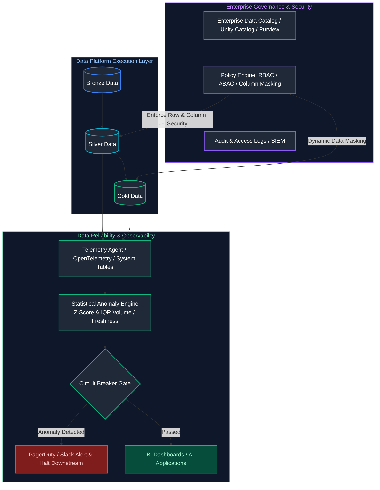
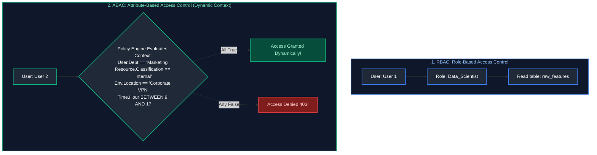
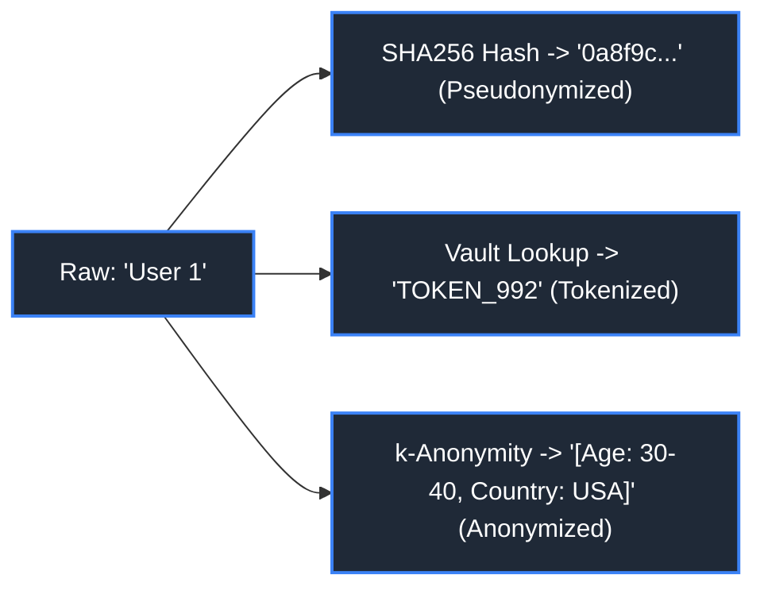
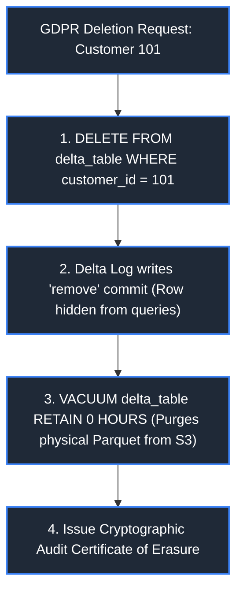
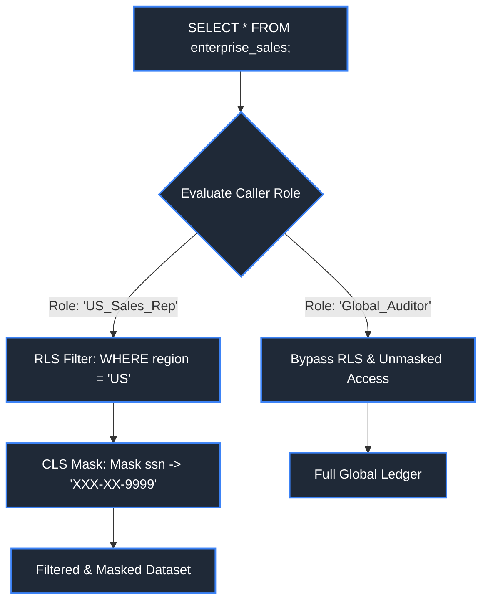
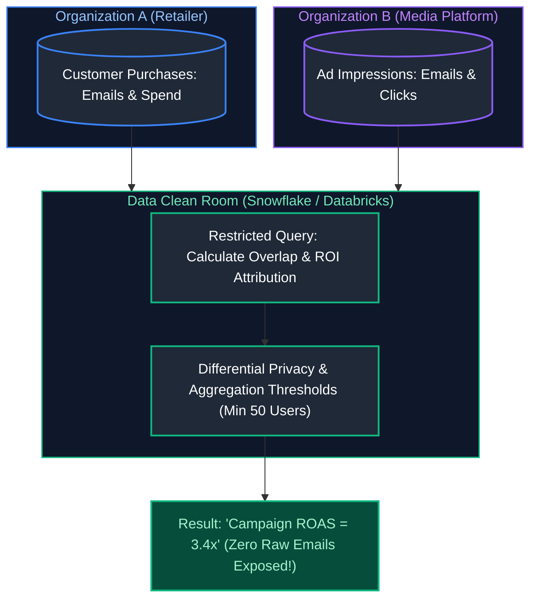
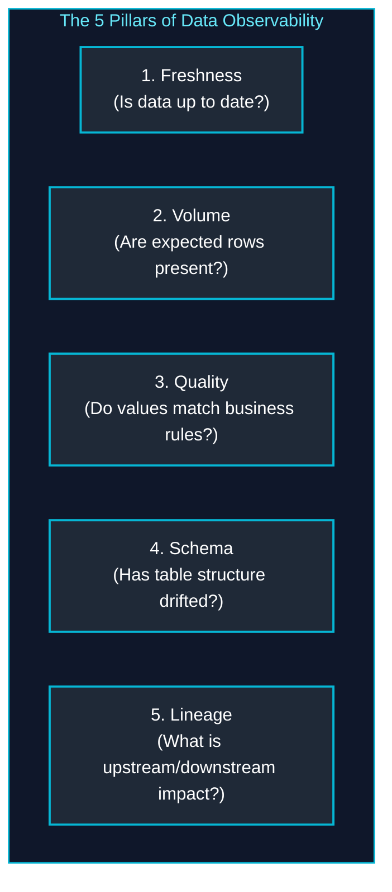
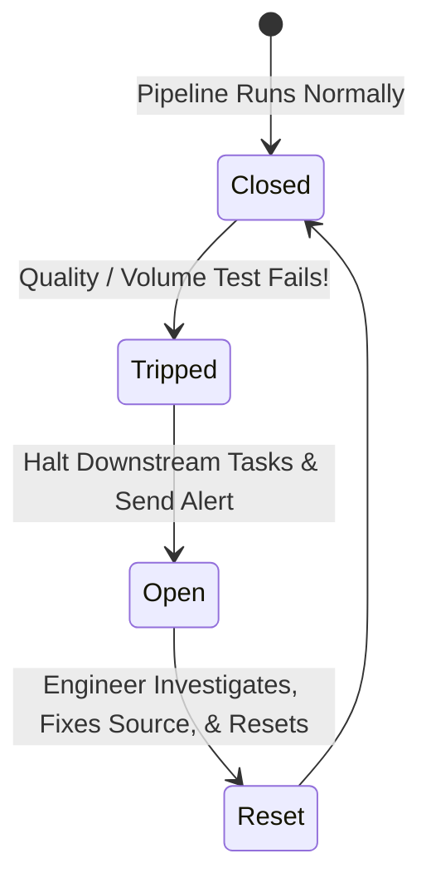
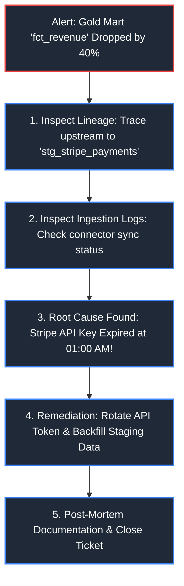

# 14. Data Governance, Security & Observability

A unified, comprehensive, production-grade guide to enterprise data governance, zero-trust security (RBAC vs. ABAC, PII masking, Envelope Encryption, GDPR deletion in Lakehouses), and data reliability engineering (the 5 Pillars of Observability, SLI/SLO/SLA management, automated statistical anomaly detection, and pipeline circuit breakers).

---

## Unified Governance & Observability Control Plane



---

## Table of Contents
1. [Access Control Paradigms](#1-access-control-paradigms)
   - [1.1 RBAC vs ABAC](#11-rbac-vs-abac)
   - [1.2 Principle of Least Privilege (PoLP) & Zero Trust](#12-principle-of-least-privilege-polp--zero-trust)
2. [Data Protection & Obfuscation Techniques](#2-data-protection--obfuscation-techniques)
   - [2.1 Static Data Masking vs Dynamic Data Masking](#21-static-data-masking-vs-dynamic-data-masking)
   - [2.2 Tokenization, Anonymization & Cryptographic Pseudonymization](#22-tokenization-anonymization--cryptographic-pseudonymization)
   - [2.3 Encryption at Rest & Envelope Encryption](#23-encryption-at-rest--envelope-encryption)
   - [2.4 Encryption in Transit (mTLS & TLS 1.3)](#24-encryption-in-transit-mtls--tls-13)
3. [Regulatory Compliance & Lakehouse Privacy](#3-regulatory-compliance--lakehouse-privacy)
   - [3.1 Regulatory Frameworks (GDPR, CCPA, HIPAA, PCI-DSS)](#31-regulatory-frameworks-gdpr-ccpa-hipaa-pci-dss)
   - [3.2 GDPR & CCPA Compliance: The "Right to be Forgotten" in Data Lakes](#32-gdpr--ccpa-compliance-the-right-to-be-forgotten-in-data-lakes)
   - [3.3 Data Retention Policies & Cryptographic Erasure](#33-data-retention-policies--cryptographic-erasure)
4. [Fine-Grained Security & Secure Collaboration](#4-fine-grained-security--secure-collaboration)
   - [4.1 Row-Level Security (RLS) & Column-Level Security (CLS)](#41-row-level-security-rls--column-level-security-cls)
   - [4.2 Data Clean Rooms](#42-data-clean-rooms)
5. [The 5 Pillars of Data Observability](#5-the-5-pillars-of-data-observability)
   - [5.1 Freshness](#51-freshness)
   - [5.2 Volume](#52-volume)
   - [5.3 Quality & Automated Assertion Frameworks](#53-quality--automated-assertion-frameworks)
   - [5.4 Schema Drift Detection](#54-schema-drift-detection)
   - [5.5 End-to-End Lineage Tracking](#55-end-to-end-lineage-tracking)
6. [Data Reliability Engineering & Downtime](#6-data-reliability-engineering--downtime)
   - [6.1 Data Downtime Calculation & Impact](#61-data-downtime-calculation--impact)
   - [6.2 Data SLIs, SLOs, and SLAs](#62-data-slis-slos-and-slas)
   - [6.3 Error Budgets for Data Platforms](#63-error-budgets-for-data-platforms)
7. [Automated Anomaly Detection & Circuit Breakers](#7-automated-anomaly-detection--circuit-breakers)
   - [7.1 Statistical Anomaly Detection (Z-Score & IQR)](#71-statistical-anomaly-detection-z-score--iqr)
   - [7.2 Pipeline Circuit Breakers](#72-pipeline-circuit-breakers)
8. [Observability Tooling & Operational RCA](#8-observability-tooling--operational-rca)
   - [8.1 Tooling Landscape (Elementary, Monte Carlo, OpenLineage)](#81-tooling-landscape-elementary-monte-carlo-openlineage)
   - [8.2 Metadata-Driven Monitoring via Warehouse System Tables](#82-metadata-driven-monitoring-via-warehouse-system-tables)
   - [8.3 Alert Fatigue Prevention Strategies](#83-alert-fatigue-prevention-strategies)
   - [8.4 Root Cause Analysis (RCA) Workflows](#84-root-cause-analysis-rca-workflows)
9. [References & Further Reading](#9-references--further-reading)

---

# 1. Access Control Paradigms

---

### 1.1 RBAC vs ABAC

#### Definition
- **RBAC (Role-Based Access Control):** Permissions are attached to static **Roles** (e.g., `Financial_Analyst`), and users are assigned to roles. Simple to administer, but suffers from "Role Explosion" as organizations scale.
- **ABAC (Attribute-Based Access Control):** Permissions are evaluated dynamically at runtime based on **Attributes** of the user (department, clearance), resource (data classification `PII`), action (`SELECT`), and environment context (IP address, time of day, geographic location).



#### Comparison Matrix
| Dimension | RBAC | ABAC |
| :--- | :--- | :--- |
| **Policy Granularity** | Coarse-grained | Highly fine-grained & dynamic |
| **Scalability** | Suffers from Role Explosion (1,000+ roles) | Scales cleanly through declarative rules |
| **Context Awareness** | None (Static role membership) | High (Evaluates IP, device state, time) |

#### References
- [NIST: Guide to Attribute Based Access Control](https://csrc.nist.gov/publications/detail/sp/800-162/final)
- [GeeksforGeeks: Difference between RBAC and ABAC](https://www.geeksforgeeks.org/difference-between-rbac-and-abac/)

---

### 1.2 Principle of Least Privilege (PoLP) & Zero Trust

#### Definition
- **PoLP:** Every identity (user, service principal, script) must be granted only the minimum permissions strictly necessary to perform its specific task, and for the minimum duration required.
- **Zero Trust Architecture:** "Never trust, always verify." Eliminates perimeter security assumptions; verifies identity, device health, and encryption on every internal query.

---

# 2. Data Protection & Obfuscation Techniques

---

### 2.1 Static Data Masking vs Dynamic Data Masking

- **Static Data Masking (SDM):** Permanently alters data in-place on storage. Original sensitive data is overwritten or stripped before replicating to lower non-production environments (QA, Staging). **Irreversible**.
- **Dynamic Data Masking (DDM):** Sensitive data remains stored unmasked in production storage. The database engine dynamically redacts or masks values (`j***@corp.com`) at query runtime based on the querying user's authorization role.

```sql
-- Dynamic Data Masking in Snowflake
-- Replaces raw SSN with masked string unless queried by HR or Compliance roles

CREATE OR REPLACE MASKING POLICY security.ssn_mask AS (val STRING) 
RETURNS STRING ->
    CASE 
        WHEN CURRENT_ROLE() IN ('HR_ADMIN', 'COMPLIANCE_OFFICER') THEN val        -- Privileged access: reveal plain text
        ELSE '***-**-' || RIGHT(val, 4)                                           -- Default: show only last 4 digits
    END;

-- Apply masking policy to sensitive column
ALTER TABLE core.dim_customer 
MODIFY COLUMN ssn 
SET MASKING POLICY security.ssn_mask;
```

> [!NOTE]
> For creating sanitized reporting views and access control abstractions, see [01. SQL Fundamentals](01_sql_fundamentals.md#104-standard-views).

---

### 2.2 Tokenization, Anonymization & Cryptographic Pseudonymization

| Technique | Mechanism | Reversible? | Regulatory Status (GDPR) |
| :--- | :--- | :--- | :--- |
| **Tokenization** | Replaces sensitive value with a random non-sensitive surrogate token stored in a secure lookup vault. | **Yes** (Via Token Vault) | Considered Pseudonymized (Regulated) |
| **Pseudonymization** | Replaces identifiable fields with salted cryptographic hashes (`SHA256(email + salt)`). | **Yes** (If salt/key is known) | Still subject to GDPR safeguards |
| **Anonymization** | Irreversibly strips or generalizes data ($k$-anonymity, differential privacy) so identity can never be reconstructed. | **NO (Irreversible)** | **Exempt from GDPR!** |



#### Code Example: Salted SHA-256 Pseudonymization in Python
```python
import hashlib
import hmac

def pseudonymize_pii_identifier(raw_identifier: str, secret_salt: bytes) -> str:
    """
    Cryptographically hashes sensitive customer identifiers using HMAC-SHA256.
    Protects user identity from rainbow table attacks while preserving joinability.
    
    Args:
        raw_identifier: Raw plaintext string (e.g. email or national ID).
        secret_salt: Secure cryptographic secret key loaded from KMS.
        
    Returns:
        Hex-encoded deterministic hash string.
    """
    clean_val = raw_identifier.strip().lower().encode("utf-8")
    # HMAC-SHA256 provides keyed hashing resistant to dictionary/rainbow attacks
    hashed_token = hmac.new(secret_salt, clean_val, hashlib.sha256).hexdigest()
    return hashed_token

# Usage in ingestion preprocessing
secret_key = b"enterprise-kms-managed-salt-9842"
anon_user_token = pseudonymize_pii_identifier("customer_alice@gmail.com", secret_key)
print(f"Pseudonymized User ID: {anon_user_token[:16]}...")
```

---

### 2.3 Encryption at Rest & Envelope Encryption

#### Key Management Service (KMS)
- **PMK (Platform-Managed Keys):** Cloud provider automatically manages and rotates encryption keys. Zero administrative overhead.
- **CMK (Customer-Managed Keys / BYOK):** The customer controls the master key inside their own Hardware Security Module (AWS KMS, Azure Key Vault). Allows instant cryptographic erasure by revoking the key.

#### Envelope Encryption
Data is encrypted locally using a fast symmetric **Data Encryption Key (DEK)**. The DEK itself is then encrypted using a master **Key Encryption Key (KEK)** managed by KMS, combining high-speed encryption with centralized key governance.

---

### 2.4 Encryption in Transit (mTLS & TLS 1.3)

All data flowing between applications, brokers, and cloud databases must enforce **TLS 1.3**. In microservice architectures, **Mutual TLS (mTLS)** authenticates both the client and server using reciprocal cryptographic certificates.

---

# 3. Regulatory Compliance & Lakehouse Privacy

---

### 3.1 Regulatory Frameworks (GDPR, CCPA, HIPAA, PCI-DSS)

- **GDPR / CCPA:** Regulates consumer privacy, consent tracking, and the Right to Be Forgotten.
- **HIPAA:** Regulates Protected Health Information (PHI) requiring strict audit trails and encryption.
- **PCI-DSS:** Mandates security controls for credit card numbers (Primary Account Numbers - PAN).

---

### 3.2 GDPR & CCPA Compliance: The "Right to be Forgotten" in Data Lakes

#### The Architectural Challenge
Under GDPR Article 17, customers have the legal right to request the permanent deletion of their personal data. In traditional immutable data lakes (storing millions of raw Parquet files and backup snapshots on S3), executing a hard delete was computationally intractable and destroyed immutability.

#### Modern Lakehouse Deletion Workflow
1. Execute `DELETE` or `MERGE` on the Delta Lake / Iceberg table to mark target customer rows logically removed.
2. Trigger **Deletion Vectors** (soft delete pointers) or rewrite the specific data files containing the customer ID.
3. Run `VACUUM` with the retention period expired to permanently purge the physical underlying Parquet files from cloud storage.



> [!NOTE]
> For details on Delta Lake transaction logs, Deletion Vectors, and VACUUM mechanics, see [09. Databricks & Delta Lake](09_databricks_and_delta_lake.md#2-delta-lake-internals--acid-transactions).

---

### 3.3 Data Retention Policies & Cryptographic Erasure

- **Automated Lifecycle Expiration:** Cloud storage buckets transition or delete raw logs after legal retention horizons (e.g. 7 years for financial ledgers, 90 days for raw web clickstreams).
- **Cryptographic Erasure (Crypto-Shredding):** Encrypting each customer's data with a unique per-user encryption key. When the customer requests deletion, simply **destroy the user's specific key**, rendering all historical backups mathematically impossible to decrypt.

---

# 4. Fine-Grained Security & Secure Collaboration

---

### 4.1 Row-Level Security (RLS) & Column-Level Security (CLS)



#### Code Example: PostgreSQL & Snowflake Policy DDL
```sql
-- 1. PostgreSQL Row-Level Security (RLS) Implementation
-- Guarantees sales reps can only see customer records from their assigned territory

ALTER TABLE core.sales_transactions ENABLE ROW LEVEL SECURITY;

CREATE POLICY regional_sales_isolation ON core.sales_transactions
    FOR SELECT                                                -- Restricts read projections
    USING (sales_region = CURRENT_SETTING('app.current_user_region')); -- Evaluates session variable

-- 2. Snowflake Dynamic Data Masking Policy (CLS)
CREATE OR REPLACE MASKING POLICY security.email_mask AS (val STRING) 
RETURNS STRING ->
    CASE 
        WHEN CURRENT_ROLE() IN ('MARKETING_ADMIN', 'COMPLIANCE') THEN val
        ELSE REGEXP_REPLACE(val, '(^[^@]{2})[^@]+(@.*$)', '\\1****\\2') -- e.g. al****@corp.com
    END;

ALTER TABLE core.dim_customer 
MODIFY COLUMN email 
SET MASKING POLICY security.email_mask;
```

---

### 4.2 Data Clean Rooms

#### Definition
A Data Clean Room is a secure, privacy-preserving computational environment that allows two or more distinct organizations (e.g., a Retailer and an Advertiser) to collaborate and analyze joint datasets **without either party sharing or exposing their raw underlying customer data**.



#### Core Safeguards in Clean Rooms
1. **Differential Privacy:** Adds mathematical noise to results to prevent re-identification.
2. **Minimum Aggregation Thresholds:** Queries returning fewer than 50 or 100 rows are blocked to prevent single-user inference.
3. **No Direct Data Extraction:** Raw underlying records cannot be queried or downloaded.

---

# 5. The 5 Pillars of Data Observability



---

### 5.1 Freshness
Measures the latency between when data was generated and when it became available in analytical tables. If daily orders typically land by 2:00 AM and have not updated by 4:00 AM, a freshness alert fires.

---

### 5.2 Volume
Monitors the completeness of ingested data volumes. Detects sudden anomalies such as:
- **Zero-Row Ingestion:** Upstream API failure returned an empty payload.
- **Volume Explosion:** Upstream service loop emitted 10x normal volume.

---

### 5.3 Quality & Automated Assertion Frameworks
Verifies the domain accuracy and distribution of data inside columns:
- Null rates (e.g., checking if `user_id` null percentage jumped from 0% to 15%).
- Out-of-bounds metrics (e.g., negative prices, percentages $>100\%$).

#### Code Example: Data Quality Testing with Great Expectations (Python)
```python
import great_expectations as gx

# 1. Initialize data context and batch request
context = gx.get_context()
datasource = context.sources.add_pandas("orders_datasource")
data_asset = datasource.add_dataframe_asset("orders_asset")
batch_request = data_asset.build_batch_request(dataframe=df_orders)

# 2. Define declarative Expectation Suite (Contract)
suite = context.add_expectation_suite("orders_contract_v1")
validator = context.get_validator(batch_request=batch_request, expectation_suite=suite)

# Assertion 1: Primary key must be non-null and unique
validator.expect_column_values_to_not_be_null(column="order_id")
validator.expect_column_values_to_be_unique(column="order_id")

# Assertion 2: Business domain bounds (amounts must be positive)
validator.expect_column_values_to_be_between(column="order_amount", min_value=0.01, max_value=100000.0)

# Assertion 3: Categorical domain check
validator.expect_column_values_to_be_in_set(
    column="order_status", 
    value_set=["PENDING", "PROCESSING", "COMPLETED", "REFUNDED"]
)

# 3. Validate batch and generate checkpoint results
validation_result = validator.validate()
if not validation_result.success:
    raise ValueError(f"Data quality contract violated! Results: {validation_result.statistics}")
```

---

### 5.4 Schema Drift Detection
Detects unexpected schema changes: added columns, renamed columns, dropped columns, or altered data types (`INT` to `STRING`).

---

### 5.5 End-to-End Lineage Tracking
Maps end-to-end asset dependencies. Connects upstream data sources to downstream transformations, models, and BI reports, enabling instant impact analysis when an incident occurs.

---

# 6. Data Reliability Engineering & Downtime

---

### 6.1 Data Downtime Calculation & Impact

$$\text{Data Downtime} = \text{Incident Duration (Hours)} \times \text{Number of Impacted Tables}$$

#### Real-World Business Impact
- Executive leadership making erroneous multi-million dollar capital decisions based on broken dashboards.
- Automated ML pricing models setting prices to zero.
- Regulatory fines under GDPR / SOX for reporting misstated financial ledger data.

---

### 6.2 Data SLIs, SLOs, and SLAs

- **SLI (Service Level Indicator):** A quantifiable metric of data health (e.g., *% of orders loaded within 15 minutes of creation*).
- **SLO (Service Level Objective):** The internal target reliability threshold (e.g., *99.5% of daily orders must meet the 15-minute SLI*).
- **SLA (Service Level Agreement):** The contractual commitment to stakeholders with business or financial penalties if breached (e.g., *Daily KPI reports must be published by 7:00 AM EST with 99.0% availability*).

---

### 6.3 Error Budgets for Data Platforms

An **Error Budget** is the allowable margin of unreliability ($1.0 - \text{SLO}$). If your SLO is 99.5%, your error budget is **0.5%**. If data downtime exhausts the budget during a month, all new feature development halts, and the data team focuses 100% on pipeline hardening and technical debt.

---

# 7. Automated Anomaly Detection & Circuit Breakers

---

### 7.1 Statistical Anomaly Detection (Z-Score & IQR)

Modern observability platforms discard static hardcoded thresholds in favor of dynamic statistical algorithms:
- **Z-Score Modeling:** Evaluates standard deviations from rolling averages:
$$Z = \frac{x - \mu}{\sigma} \quad (\text{Flag if } |Z| > 3.0)$$
- **Interquartile Range (IQR):** Robust to historical outliers.
- **Holt-Winters Seasonal Forecasting:** Automatically anticipates weekly traffic seasonality.

---

### 7.2 Pipeline Circuit Breakers

A Circuit Breaker halts downstream DAG tasks whenever staging data fails volume or quality assertions, preventing corrupted records from polluting production Gold marts.



```sql
-- Circuit Breaker implementation in dbt / SQL
-- If null count > 0, query returns non-empty result and halts downstream execution

SELECT 
    COUNT(*) AS null_pk_violations,
    CURRENT_TIMESTAMP AS test_execution_time
FROM staging.stg_orders
WHERE order_id IS NULL
HAVING COUNT(*) > 0;                                          -- Halts orchestrator if violations exist
```

> [!NOTE]
> For executing assertions, automated schema tests, and test-driven transformations in dbt, see [12. Orchestration (Apache Airflow & dbt)](12_orchestration_airflow_and_dbt.md#26-dbt-testing--assertions).

---

# 8. Observability Tooling & Operational RCA

---

### 8.1 Tooling Landscape (Elementary, Monte Carlo, OpenLineage)

- **Elementary Data:** Open-source, dbt-native observability framework that runs anomaly tests directly inside your cloud warehouse via dbt models.
- **Monte Carlo:** Enterprise end-to-end SaaS observability platform integrating with warehouses, lakes, and BI tools.
- **OpenLineage:** Vendor-neutral open standard for collecting end-to-end pipeline metadata and DAG lineage graphs.

---

### 8.2 Metadata-Driven Monitoring via Warehouse System Tables

Data engineers can build automated freshness monitors using warehouse system tables without running expensive queries against base tables:

```sql
-- Snowflake: Detect Gold Mart tables unrefreshed for > 24 hours
SELECT 
    table_schema,
    table_name,
    row_count,
    last_altered,
    DATEDIFF('hour', last_altered, CURRENT_TIMESTAMP()) AS hours_since_last_refresh
FROM snowflake.account_usage.tables
WHERE deleted IS NULL                                         -- Exclude dropped tables
  AND table_schema = 'GOLD_MARTS'                             -- Target presentation layer
  AND last_altered < DATEADD('hour', -24, CURRENT_TIMESTAMP()) -- Flag tables older than 24h SLA
ORDER BY hours_since_last_refresh DESC;
```

---

### 8.3 Alert Fatigue Prevention Strategies

- **Severity Tiers:** P1 (Page on-call engineer at 3:00 AM for broken production dashboards), P3 (Send low-priority Slack message for non-urgent staging warning).
- **Alert Aggregation:** Group related column errors into a single incident card rather than sending 50 individual emails.
- **Self-Healing Runbooks:** Attach direct troubleshooting documentation links to every notification.

---

### 8.4 Root Cause Analysis (RCA) Workflows



---

## 9. References & Further Reading
- [Monte Carlo: The 5 Pillars of Data Observability](https://www.montecarlodata.com/blog-what-is-data-observability/)
- [Elementary Data Official Documentation](https://docs.elementary-data.com/)
- [Great Expectations Documentation](https://docs.greatexpectations.io/)
- [Snowflake Documentation: Dynamic Data Masking](https://docs.snowflake.com/en/user-guide/security-column-ddm-intro)
- [PostgreSQL Documentation: Row Security Policies](https://www.postgresql.org/docs/current/ddl-rowsecurity.html)
