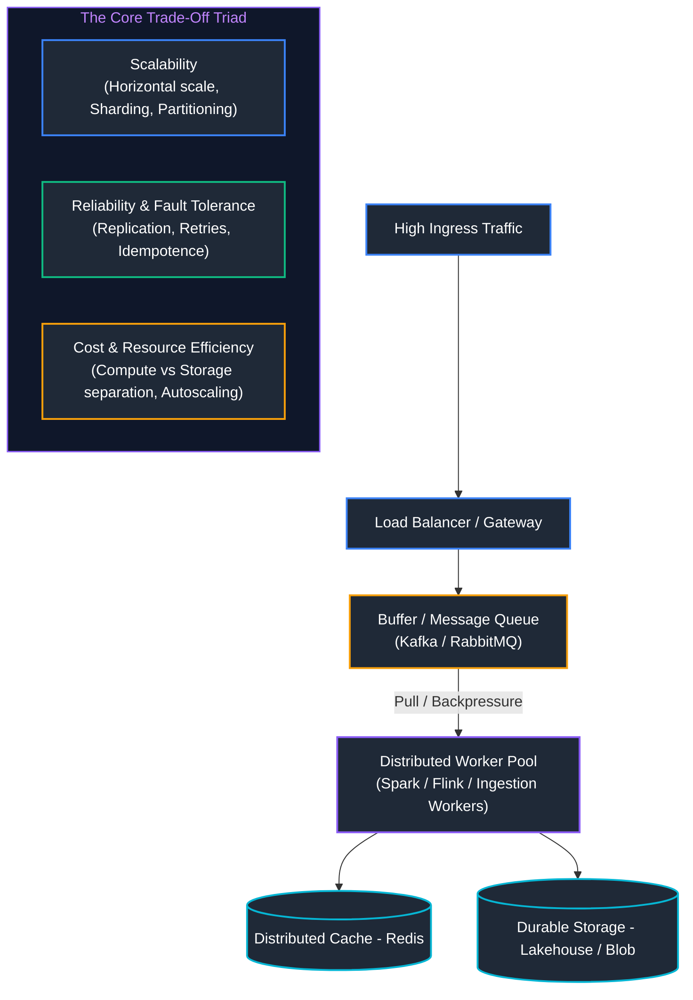
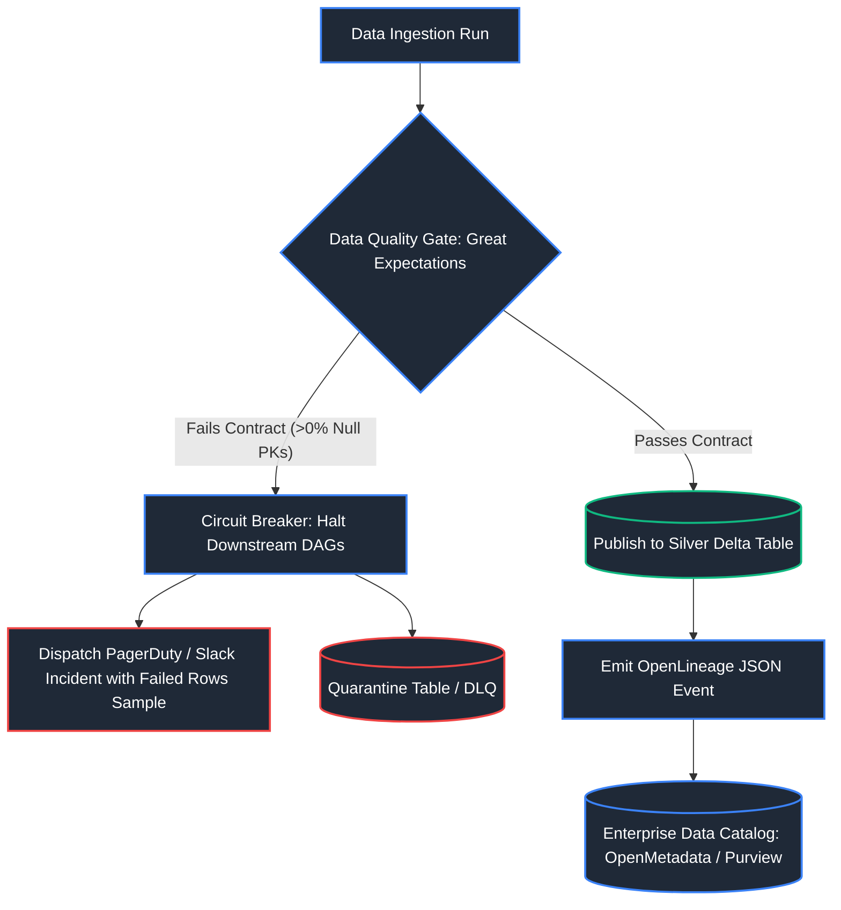
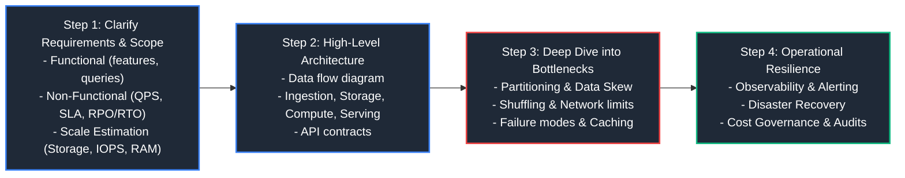

# 15. System Design for Data Engineering

A comprehensive, production-grade guide to end-to-end system design for enterprise data platforms, lakehouses, streaming pipelines, real-time CDC, and real-time analytical OLAP architectures.

---

## Table of Contents
1. [System Design Fundamentals: Distributed Trade-Offs & Mechanics](#1-system-design-fundamentals-distributed-trade-offs--mechanics)
   - [1.1 Core Architectural Dimensions](#11-core-architectural-dimensions)
2. [Enterprise Data Platform System Designs](#2-enterprise-data-platform-system-designs)
   - [2.1 Blueprint 1: End-to-End Real-Time Lakehouse Architecture](#21-blueprint-1-end-to-end-real-time-lakehouse-architecture)
   - [2.2 Blueprint 2: Change Data Capture (CDC) Pipeline](#22-blueprint-2-change-data-capture-cdc-pipeline)
   - [2.3 Blueprint 3: Real-Time Analytics Platform (ClickHouse / Pinot)](#23-blueprint-3-real-time-analytics-platform-clickhouse--pinot)
   - [2.4 Blueprint 4: Enterprise Metadata & Automated Data Quality Platform](#24-blueprint-4-enterprise-metadata--automated-data-quality-platform)
3. [System Design Interview Framework (The 4-Step Method)](#3-system-design-interview-framework-the-4-step-method)
   - [3.1 Quantitative Estimation Cheat-Sheet for Interviews](#31-quantitative-estimation-cheat-sheet-for-interviews)
4. [Summary & System Design Best Practices](#4-summary--system-design-best-practices)

---

## 1. System Design Fundamentals: Distributed Trade-Offs & Mechanics



### 1.1 Core Architectural Dimensions
- **Scalability**: Ability of a system to handle linearly growing workloads by adding resources (Horizontal / Scale-Out) without redesigning software architecture.
- **Reliability & Availability**:
  - *Availability*: Percentage of time the system is operational ($99.9\% = 8.76\text{h}$ downtime/yr, $99.99\% = 52.6\text{m}$ downtime/yr).
  - *Reliability*: Probability that a system performs its required function without failure over a specified time window.
- **Backpressure & Queue Decoupling**: Prevents fast producers from overwhelming slow downstream consumers by buffering bursts into durable distributed logs (Kafka/Pulsar) and pulling data at consumer-regulated rates.
- **RPO & RTO (Disaster Recovery)**:
  - **RPO (Recovery Point Objective)**: Maximum acceptable age of data loss following a disaster (e.g., $15\text{ minutes}$ of transaction logs).
  - **RTO (Recovery Time Objective)**: Maximum acceptable duration of system downtime before restoration (e.g., $1\text{ hour}$ to failover to secondary region).

> [!NOTE]
> For distributed computing fundamentals, CAP/PACELC trade-offs, and consensus algorithms, see [05. Distributed Systems & APIs](05_distributed_systems_and_apis.md).

---

## 2. Enterprise Data Platform System Designs

### 2.1 Blueprint 1: End-to-End Real-Time Lakehouse Architecture
> [!NOTE]
> Detailed implementations of components in this blueprint can be found in [06. Data Architecture & Modeling](06_data_architecture_and_modeling.md), [08. Apache Spark & PySpark](08_apache_spark_pyspark.md), [09. Databricks & Delta Lake](09_databricks_and_delta_lake.md), and [11. Streaming & Kafka Event Streaming](11_streaming_and_kafka_event_streaming.md).

```mermaid
flowchart LR
    subgraph Ingestion ["Ingestion Tier"]
        RDBMS[(OLTP DB)] --> Debezium[Debezium CDC]
        Debezium --> KafkaTopic[Kafka Bronze Topic]
        Logs[App Logs / APIs] --> AutoLoader[Cloud Storage / Auto Loader]
    end

    subgraph ProcessingEngine ["Processing Engine - Spark / Databricks"]
        KafkaTopic --> StructuredStreaming[Spark Structured Streaming]
        AutoLoader --> StructuredStreaming
        StructuredStreaming --> BronzeTable[(Bronze Delta Table\nRaw Ingest / Immutable)]
        BronzeTable -- Cleanse, Deduplicate, Validate --> SilverTable[(Silver Delta Table\nConformed / Validated)]
        SilverTable -- Business Aggregations & Joins --> GoldTable[(Gold Delta Table\nStar Schema / Aggregates)]
    end

    subgraph ServingConsumption ["Serving & Consumption Tier"]
        GoldTable --> BI[Power BI / Tableau]
        GoldTable --> FeatureStore[ML Feature Store]
        GoldTable --> VectorSearch[Downstream Vector / Search Index]
    end

    style Ingestion fill:#0f172a,stroke:#3b82f6,stroke-width:1.5px,color:#93c5fd
    style ProcessingEngine fill:#0f172a,stroke:#8b5cf6,stroke-width:1.5px,color:#c084fc
    style ServingConsumption fill:#0f172a,stroke:#10b981,stroke-width:1.5px,color:#6ee7b7
    style RDBMS fill:#1f2937,stroke:#3b82f6,stroke-width:2px,color:#fff
    style Debezium fill:#1f2937,stroke:#3b82f6,stroke-width:2px,color:#fff
    style KafkaTopic fill:#1f2937,stroke:#f59e0b,stroke-width:2px,color:#fff
    style Logs fill:#1f2937,stroke:#3b82f6,stroke-width:2px,color:#fff
    style AutoLoader fill:#1f2937,stroke:#3b82f6,stroke-width:2px,color:#fff
    style StructuredStreaming fill:#1f2937,stroke:#8b5cf6,stroke-width:2px,color:#fff
    style BronzeTable fill:#1f2937,stroke:#f59e0b,stroke-width:2px,color:#fff
    style SilverTable fill:#1f2937,stroke:#06b6d4,stroke-width:2px,color:#fff
    style GoldTable fill:#1f2937,stroke:#10b981,stroke-width:2px,color:#fff
    style BI fill:#1f2937,stroke:#10b981,stroke-width:2px,color:#fff
    style FeatureStore fill:#1f2937,stroke:#10b981,stroke-width:2px,color:#fff
    style VectorSearch fill:#1f2937,stroke:#10b981,stroke-width:2px,color:#fff
```



---

### 2.2 Blueprint 2: Change Data Capture (CDC) Pipeline
- **Problem**: Ingesting database mutations (INSERT, UPDATE, DELETE) from PostgreSQL/MySQL without impacting production OLTP read/write performance.
- **Solution**:
  - **Log-Based CDC**: Debezium tails the database binary log (`binlog` / WAL) asynchronously with near-zero OLTP impact.
  - **Deduplication & MERGE**: Spark Structured Streaming reads Kafka CDC events and executes an idempotent `MERGE INTO silver_table USING cdc_batch ON key` operation using sequence numbers.

#### Code Example: Idempotent Ingest Gate (Python)
```python
from typing import Dict, Any, Set

class IdempotentIngestGate:
    """
    Guarantees exactly-once processing semantics at ingestion gates.
    Tracks processed event IDs and filters out duplicate or corrupt messages.
    """
    def __init__(self):
        # In production, backed by Redis cluster with TTL or an ACID control ledger
        self.committed_event_ids: Set[str] = set()

    def process_incoming_event(self, event_payload: Dict[str, Any]) -> str:
        """
        Validates payload schema, checks idempotency cache, and commits valid events.
        """
        event_id = event_payload.get("event_id")
        
        # 1. Validation check: event_id must be present
        if not event_id:
            return "REJECTED_MISSING_ID: Event lacks mandatory primary key"
            
        # 2. Idempotency check: discard already committed records (replay protection)
        if event_id in self.committed_event_ids:
            return f"IGNORED_DUPLICATE: Event {event_id} already committed"
            
        # 3. Data Quality Gate: Validate required numeric boundary
        order_amount = event_payload.get("amount")
        if order_amount is None or order_amount <= 0:
            return f"QUARANTINED_BAD_DATA: Event {event_id} has invalid amount ({order_amount})"
            
        # 4. Atomic Commit: Record event ID into state store
        self.committed_event_ids.add(event_id)
        return f"COMMITTED_SUCCESSFULLY: Event {event_id} ($ {order_amount:.2f})"

# Ingestion execution test
gate = IdempotentIngestGate()
incoming_stream_batch = [
    {"event_id": "tx_101", "amount": 250.0},
    {"event_id": "tx_102", "amount": -10.0},                 # Caught by quality contract
    {"event_id": "tx_101", "amount": 250.0},                 # Caught by idempotency gate
    {"event_id": "tx_103", "amount": 420.50},
]

for event in incoming_stream_batch:
    print(gate.process_incoming_event(event))
```

> [!NOTE]
> For CDC event streaming architectures and offset management, see [10. Data Pipeline Design & Ingestion](10_data_pipeline_design_and_ingestion.md). For SQL `MERGE` statement mechanics, see [02. Advanced SQL](02_advanced_sql.md#51-merge--upsert--change-data-capture-cdc-patterns).

---

### 2.3 Blueprint 3: Real-Time Analytics Platform (ClickHouse / Pinot)
- **Requirements**: Ingest 50,000 events/sec from Kafka, support sub-50ms analytical aggregate queries across billions of rows, zero impact on OLTP.
- **Architectural Solution**: Real-Time OLAP architecture using ClickHouse or Apache Pinot with sparse primary indexing, columnar compression, and vectorized SIMD execution.

```mermaid
flowchart LR
    AppClients[Client Mobile / Web Apps] --> EventIngress[Event Hub / Kafka Topic]
    
    subgraph ClickHouseCluster ["ClickHouse Real-Time OLAP Cluster"]
        KafkaTable["Kafka Engine Table (Virtual Consumer)"]
        MaterializedView["Materialized View (Parse & Cleanse)"]
        MergeTree["ReplacingMergeTree / SummingMergeTree Table"]
        
        KafkaTable --> MaterializedView --> MergeTree
    end

    EventIngress --> KafkaTable
    MergeTree --> Dashboard["Real-Time Analytics Dashboard / Grafana (50ms P99)"]

    style ClickHouseCluster fill:#0f172a,stroke:#10b981,stroke-width:1.5px,color:#6ee7b7
    style AppClients fill:#1f2937,stroke:#3b82f6,stroke-width:2px,color:#fff
    style EventIngress fill:#1f2937,stroke:#f59e0b,stroke-width:2px,color:#fff
    style KafkaTable fill:#1f2937,stroke:#10b981,stroke-width:2px,color:#fff
    style MaterializedView fill:#1f2937,stroke:#10b981,stroke-width:2px,color:#fff
    style MergeTree fill:#1f2937,stroke:#10b981,stroke-width:2px,color:#fff
    style Dashboard fill:#1f2937,stroke:#3b82f6,stroke-width:2px,color:#fff
```



#### Code Example: ClickHouse Real-Time Kafka Ingestion Pipeline (SQL)
```sql
-- 1. Virtual Kafka Engine Table (Acts as continuous in-database Kafka consumer)
CREATE TABLE ingestion.kafka_orders_stream (
    event_id UUID,                                           -- Unique event identifier
    customer_id UInt32,                                      -- Customer foreign key
    order_amount Decimal(10, 2),                             -- Numeric transaction amount
    event_timestamp DateTime                                 -- Transaction timestamp
) ENGINE = Kafka
SETTINGS kafka_broker_list = 'kafka:9092',                    -- Kafka broker connection
         kafka_topic_list = 'customer_orders',               -- Target Kafka topic
         kafka_group_name = 'clickhouse_orders_consumer',    -- Distributed consumer group
         kafka_format = 'JSONEachRow';                       -- Streaming message format

-- 2. Destination Persistent Columnar Storage Table (MergeTree)
CREATE TABLE analytics.orders_analytics (
    event_id UUID,
    customer_id UInt32,
    order_amount Decimal(10, 2),
    event_timestamp DateTime
) ENGINE = MergeTree()
PARTITION BY toYYYYMM(event_timestamp)                       -- Monthly partition directory pruning
ORDER BY (customer_id, event_timestamp);                     -- Sparse primary index sort key

-- 3. Materialized View acting as continuous pushdown streaming ETL bridge
-- Automatically transforms and pipes every incoming Kafka message into the MergeTree table
CREATE MATERIALIZED VIEW ingestion.mv_kafka_to_analytics 
TO analytics.orders_analytics AS
SELECT 
    event_id, 
    customer_id, 
    order_amount, 
    event_timestamp
FROM ingestion.kafka_orders_stream;
```

> [!NOTE]
> For the architectural differences between Row-Oriented and Column-Oriented storage engines, see [04. Database Internals & Performance](04_database_internals_and_performance.md#12-row-oriented-vs-column-oriented-databases).

---

### 2.4 Blueprint 4: Enterprise Metadata & Automated Data Quality Platform
- **Requirements**: Automatic schema crawler, upstream/downstream column-level lineage, pre-ingestion data contracts, and automatic Slack alerts with pipeline halts when null thresholds exceed SLA.



> [!NOTE]
> For Great Expectations test contracts, data quality circuit breakers, and SLA error budgets, see [14. Data Governance, Security & Observability](14_data_governance_security_and_observability.md).

---

## 3. System Design Interview Framework (The 4-Step Method)



### 3.1 Quantitative Estimation Cheat-Sheet for Interviews

| Engineering Dimension | Rule-of-Thumb Baseline | Scale Example | Calculation Formula |
| :--- | :--- | :--- | :--- |
| **Storage (Daily Volume)** | 1 KB per JSON event / record | 100M events/day = 100 GB/day | $\text{Daily} \times 365 \approx 36.5\text{ TB/year}$ |
| **Throughput (Avg QPS)** | 1 day = 86,400 seconds ($\approx 10^5$ s) | 10M events/day $\approx$ 115 QPS | $\text{Daily Events} / 86,400\text{ sec}$ |
| **Throughput (Peak QPS)** | Peak is typically $3\times - 5\times$ Average | 115 QPS avg $\to$ ~500 Peak QPS | $\text{Avg QPS} \times 4$ |
| **Network Bandwidth** | QPS $\times$ Payload Size | $500\text{ QPS} \times 1\text{ KB} = 500\text{ KB/s}$ | $\approx 4\text{ Mbps}$ (Well within 10GbE network limits) |
| **RAM for Hot Working Set**| 20% Pareto principle (80/20 rule) | 100 GB daily working set | $20\text{ GB RAM}$ in Redis/Memcached |

---

## 4. Summary & System Design Best Practices

1. **Decouple Storage and Compute**: Always separate persistent state (GCS/S3/ADLS Gen2) from elastic compute workers (Dataproc/Databricks/Kubernetes).
2. **Design for Idempotence**: In distributed pipelines, duplicate events are inevitable. Use natural primary keys, watermarking, and merge operations.
3. **Fail Fast with Circuit Breakers**: When downstream services or third-party APIs degrade, prevent cascading thread pool exhaustion by tripping circuit breakers early.
4. **Instrument Metrics from Day One**: Build OpenTelemetry, schema drift monitoring, and cost allocation tags into infrastructure as code.

- **Sources & References**:
  - [Designing Data-Intensive Applications (Martin Kleppmann)](https://dataintensive.net/)
  - [Google Cloud Architecture Framework](https://cloud.google.com/architecture/framework)
  - [Databricks Lakehouse Architecture Guide](https://docs.databricks.com/lakehouse/index.html)
  - [System Design Primer (GitHub)](https://github.com/donnemartin/system-design-primer)
