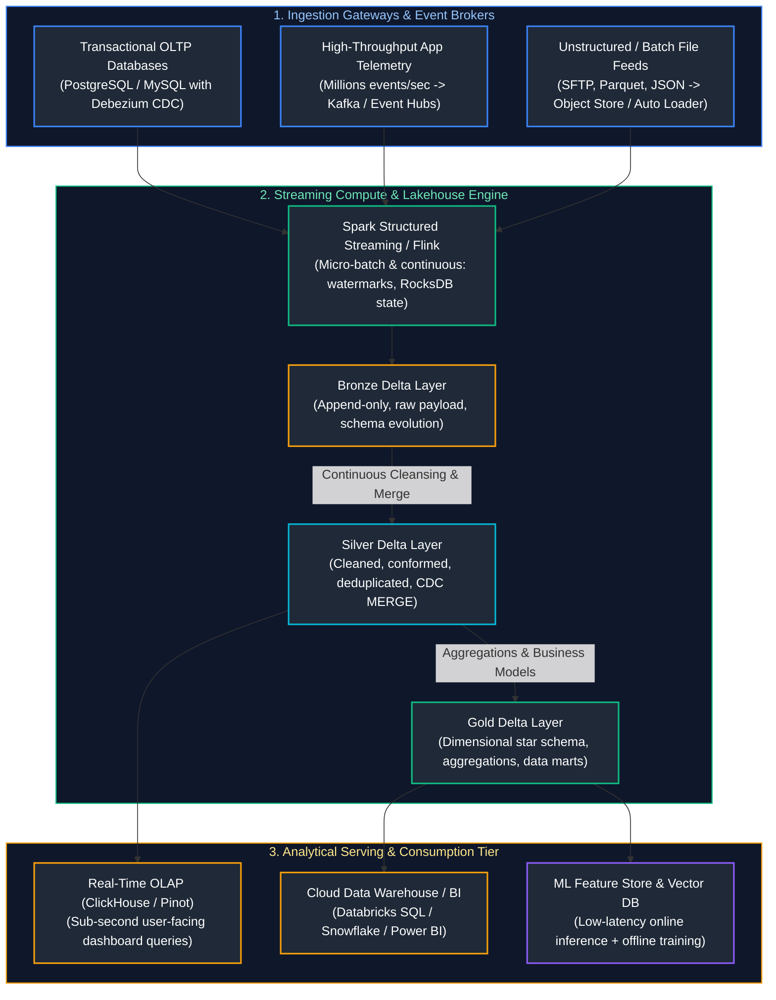
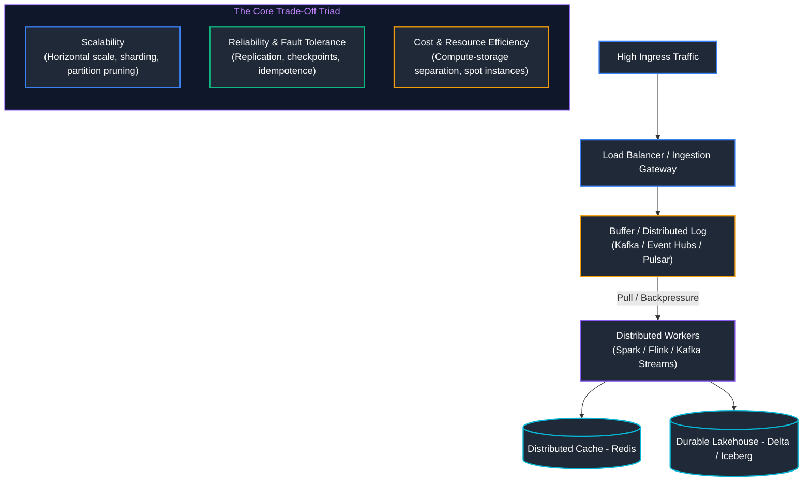
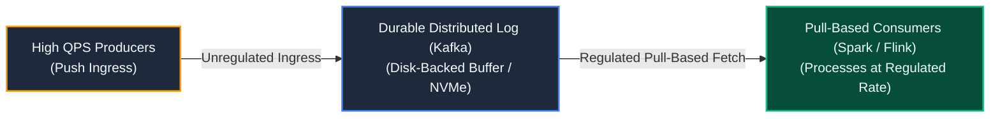
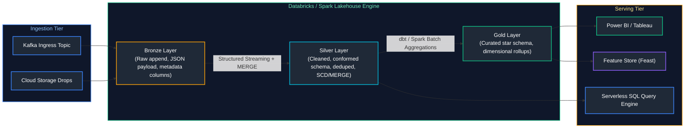
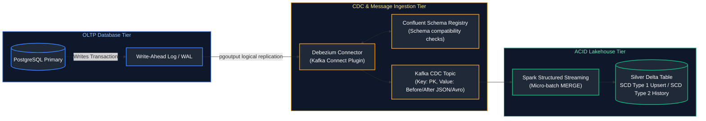
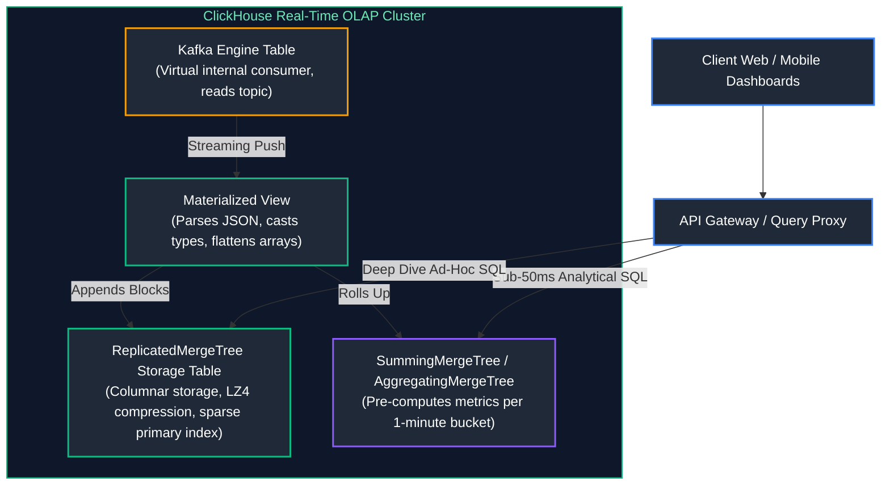
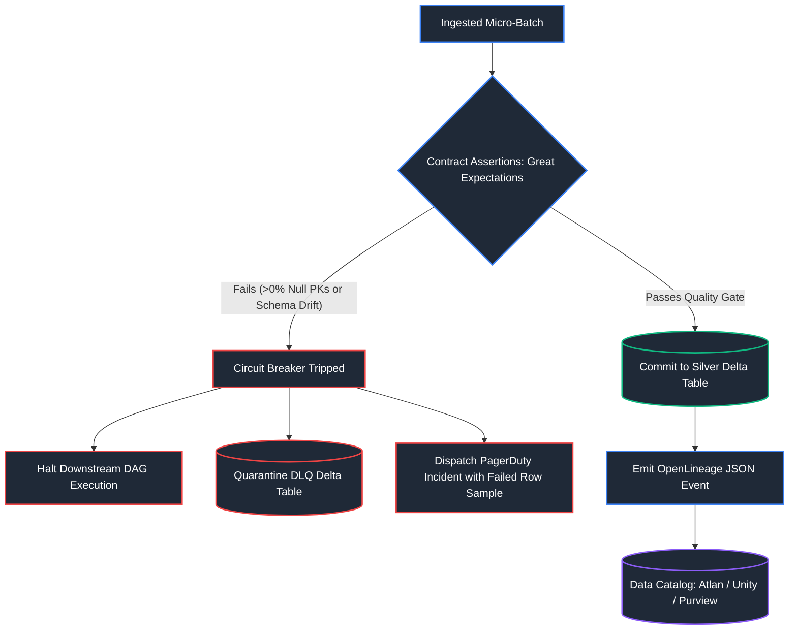
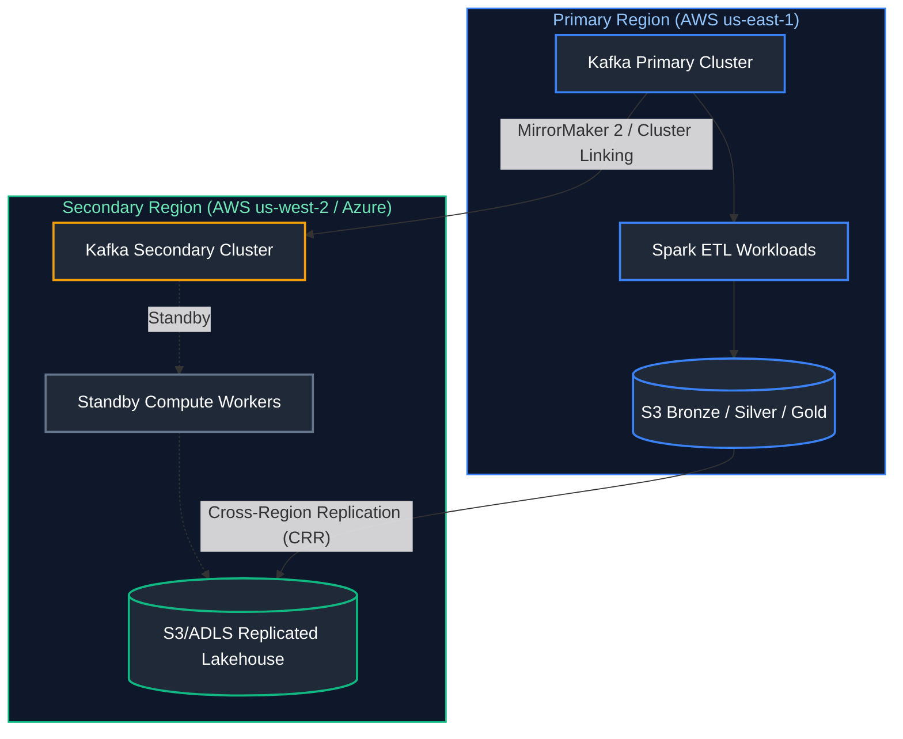
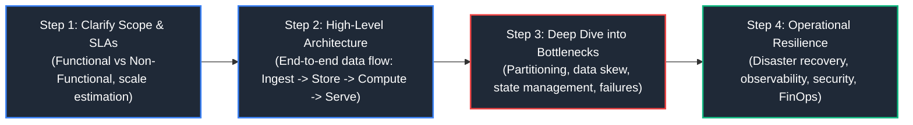

# 15. System Design for Data Engineering

A comprehensive, production-grade guide to end-to-end system design for enterprise data platforms, lakehouses, streaming pipelines, real-time CDC, sub-second analytical OLAP architectures, disaster recovery, quantitative capacity planning, and the 4-step interview methodology tailored for Senior Data Engineers, Staff Engineers, and Data Architects.

---

## Architectural Overview: High-Throughput Real-Time Lakehouse System Design



---

## Table of Contents
1. [System Design Fundamentals: Distributed Trade-Offs & Mechanics](#1-system-design-fundamentals-distributed-trade-offs-mechanics)
   - [1.1 The CAP and PACELC Theorems in Analytical Systems](#11-the-cap-and-pacelc-theorems-in-analytical-systems)
   - [1.2 Distributed Time, Clocks, and Message Ordering Invariants](#12-distributed-time-clocks-and-message-ordering-invariants)
   - [1.3 Backpressure, Rate Limiting & Queue Decoupling](#13-backpressure-rate-limiting-queue-decoupling)
2. [Quantitative Scale Estimation & Capacity Planning](#2-quantitative-scale-estimation-capacity-planning)
   - [2.1 The Back-of-the-Envelope Estimation Framework](#21-the-back-of-the-envelope-estimation-framework)
   - [2.2 Mathematical Formulas for Storage, IOPS, and Kafka Partitioning](#22-mathematical-formulas-for-storage-iops-and-kafka-partitioning)
3. [Blueprint 1: Multi-Tier Real-Time Lakehouse Platform](#3-blueprint-1-multi-tier-real-time-lakehouse-platform)
   - [3.1 Architecture: Medallion Flow with Delta Lake / Iceberg](#31-architecture-medallion-flow-with-delta-lake-iceberg)
   - [3.2 Production PySpark Structured Streaming Pipeline with RocksDB State](#32-production-pyspark-structured-streaming-pipeline-with-rocksdb-state)
4. [Blueprint 2: High-Throughput Log-Based Change Data Capture (CDC)](#4-blueprint-2-high-throughput-log-based-change-data-capture-cdc)
   - [4.1 Architecture: Debezium, Kafka Connect, Schema Registry & Delta MERGE](#41-architecture-debezium-kafka-connect-schema-registry-delta-merge)
   - [4.2 Handling Out-of-Order Updates and SCD Type 2 History](#42-handling-out-of-order-updates-and-scd-type-2-history)
5. [Blueprint 3: Sub-Second Real-Time Analytical OLAP Serving Platform](#5-blueprint-3-sub-second-real-time-analytical-olap-serving-platform)
   - [5.1 Architecture: ClickHouse / Apache Pinot Columnar Engine](#51-architecture-clickhouse-apache-pinot-columnar-engine)
   - [5.2 Materialized Views, Vectorized Execution, and Kafka Engine Ingestion](#52-materialized-views-vectorized-execution-and-kafka-engine-ingestion)
6. [Blueprint 4: Enterprise Metadata, Data Contracts & Automated Quality Circuit Breakers](#6-blueprint-4-enterprise-metadata-data-contracts-automated-quality-circuit-breakers)
   - [6.1 Shift-Left Data Contracts & Runtime Validation](#61-shift-left-data-contracts-runtime-validation)
   - [6.2 Automated Circuit Breakers, DLQ Routing, and OpenLineage Lineage](#62-automated-circuit-breakers-dlq-routing-and-openlineage-lineage)
7. [Blueprint 5: Multi-Cloud Disaster Recovery & Geo-Replication](#7-blueprint-5-multi-cloud-disaster-recovery-geo-replication)
   - [7.1 RPO vs. RTO Invariants & Failure Domains](#71-rpo-vs-rto-invariants-failure-domains)
   - [7.2 Active-Passive vs. Active-Active Lakehouse Replication](#72-active-passive-vs-active-active-lakehouse-replication)
8. [The 4-Step System Design Interview Framework & Production Walkthrough](#8-the-4-step-system-design-interview-framework-production-walkthrough)
   - [8.1 The 4-Step Methodical Execution Blueprint](#81-the-4-step-methodical-execution-blueprint)
   - [8.2 End-to-End Design Case Study: Real-Time Financial Fraud Engine](#82-end-to-end-design-case-study-real-time-financial-fraud-engine)
9. [Summary Comparison & Engineering Reference Matrix](#9-summary-comparison-engineering-reference-matrix)
10. [References & Further Reading](#10-references-further-reading)

---

# 1. System Design Fundamentals: Distributed Trade-Offs & Mechanics

Designing modern data platforms requires balancing physical hardware constraints (CPU cache hierarchies, network saturation, disk IOPS) with distributed systems guarantees (consistency, availability, partition tolerance).



### 1.1 The CAP and PACELC Theorems in Analytical Systems

The classical **CAP Theorem** states that under a network partition ($P$), a distributed system must choose between:
* **Consistency ($C$):** Every read receives the most recent write or an error.
* **Availability ($A$):** Every non-failing node returns a non-error response, without guaranteeing it contains the most recent write.

The **PACELC Theorem** extends CAP to normal non-partitioned operations:
$$\text{If Partition } (P) \implies \text{Choose } (A) \text{ or } (C); \quad \text{Else } (E) \implies \text{Choose Latency } (L) \text{ or Consistency } (C)$$

| System | Classification | Behavior During Network Partition ($P$) | Behavior During Normal Operation ($E$) | Production Rationale |
| :--- | :---: | :--- | :--- | :--- |
| **Apache Kafka** (`min.insync.replicas > 1`) | **CP / EC** | Rejects writes if in-sync replicas $< \text{threshold}$ | Waits for ACK from all ISRs before acknowledging producer | Guarantees zero data loss for critical event streaming. |
| **Delta Lake / Iceberg** | **CP / EC** | Optimistic concurrency control (OCC) aborts conflicting commits | Enforces serializable metadata commits via object store atomic put / catalog | Guarantees ACID transactions over cheap object storage. |
| **Apache Cassandra** (`ANY` / `ONE`) | **AP / EL** | Accepts writes to available replicas; repairs via hinted handoff | Returns stale reads immediately without waiting for cross-node sync | Optimized for write-heavy telemetry where minor staleness is acceptable. |
| **ClickHouse** | **AP / EL** | ReplicatedMergeTree continues local ingestion if ZooKeeper drops | Queries execute against local columnar shards without global locks | Delivers sub-50ms analytical dashboard query latency. |

---

### 1.2 Distributed Time, Clocks, and Message Ordering Invariants

In distributed data pipelines, physical machine clocks drift due to quartz crystal temperature variations (clock skew). Relying on machine local time (`System.currentTimeMillis()`) leads to data corruption, lost updates, and incorrect analytical windowing.

1. **Event Time vs. Ingestion Time vs. Processing Time**:
   - **Event Time:** Timestamp embedded in the record when the event occurred on the client device. The only mathematically correct clock for business metrics.
   - **Ingestion Time:** Timestamp recorded when the message enters Kafka brokers. Monotonically increasing per partition.
   - **Processing Time:** Local system clock of the Spark/Flink worker evaluating the transformation. Non-deterministic and non-reproducible.
2. **Watermarking Invariants**:
   A watermark is a monotonically increasing time threshold $W(t) = \max(\text{EventTime}) - \Delta t_{\text{delay}}$ emitted into the stream.
   $$\text{Drop Condition: Record } e \text{ is dropped if } e.\text{timestamp} < W(t)$$
   Any record with an event timestamp older than the watermark is deemed too late to update state and is either dropped or routed to a Dead Letter Queue (DLQ).
3. **Lamport Timestamps & Vector Clocks**:
   To establish a strict partial ordering ($\to$, "happened-before") without synchronized physical clocks, distributed systems increment a logical counter $L$ on every event:
   $$L_{\text{receiver}} = \max(L_{\text{local}}, L_{\text{message}}) + 1$$

---

### 1.3 Backpressure, Rate Limiting & Queue Decoupling

When upstream event producers produce traffic spikes that exceed downstream processing throughput, unbuffered systems encounter thread starvation, memory exhaustion, and cascading Out-Of-Memory (OOM) failures.



- **Queue Decoupling:** Ingestion buffers (Kafka/Event Hubs) absorb traffic bursts on persistent NVMe disks. Upstream APIs return `202 Accepted` immediately without waiting for ETL completion.
- **Spark Backpressure Rate Formula:** Spark Structured Streaming dynamically calculates the maximum records per second to pull from Kafka based on proportional-integral-derivative (PID) feedback:
  $$\text{MaxRate}_{t} = \min\left(R_{\text{max}}, \ \frac{\text{BatchDuration}_{\text{target}}}{\text{BatchDuration}_{t-1}} \times R_{t-1}\right)$$
  If batch $t-1$ exceeded the trigger interval, the driver throttles the next batch size to prevent executor memory exhaustion.

> [!NOTE]
> For in-depth distributed consensus algorithms (Raft, Paxos), see [05. Distributed Systems & APIs](05_distributed_systems_and_apis.md#3-distributed-consensus--replication).

---

# 2. Quantitative Scale Estimation & Capacity Planning

Senior system design interviews require rapid, precise quantitative estimations. Never design a pipeline without first establishing throughput, storage footprint, network saturation, and compute sizing.

### 2.1 The Back-of-the-Envelope Estimation Framework

| Metric / Unit | Exact Value | Interview Approximation | Storage / Traffic Equivalent |
| :--- | :--- | :--- | :--- |
| **1 Day** | 86,400 seconds | $\approx 10^5 \text{ seconds}$ | Standard daily time quantum |
| **1 Month (30 Days)** | $2.59 \times 10^6 \text{ seconds}$ | $\approx 3 \times 10^6 \text{ seconds}$ | Monthly billing / partition cycle |
| **1 Year (365 Days)** | $3.15 \times 10^7 \text{ seconds}$ | $\approx 3 \times 10^7 \text{ seconds}$ | Annual retention baseline |
| **1 MB** | $1,024 \text{ KB}$ | $10^6 \text{ Bytes}$ | Medium document / telemetry batch |
| **1 GB** | $1,024 \text{ MB}$ | $10^9 \text{ Bytes}$ | Memory partition / Parquet block |
| **1 TB** | $1,024 \text{ GB}$ | $10^{12} \text{ Bytes}$ | Daily data warehouse ingress |
| **1 PB** | $1,024 \text{ TB}$ | $10^{15} \text{ Bytes}$ | Large-scale analytical lakehouse |
| **100 Million QPD** | $10^8 / 86,400$ | $\approx 1,150 \text{ QPS}$ | Moderate consumer platform scale |
| **1 Billion QPD** | $10^9 / 86,400$ | $\approx 11,500 \text{ QPS}$ | Global enterprise scale |

---

### 2.2 Mathematical Formulas for Storage, IOPS, and Kafka Partitioning

#### 1. Ingress Throughput (Average vs. Peak QPS)
$$QPS_{\text{avg}} = \frac{N_{\text{daily events}}}{86,400} \approx \frac{N_{\text{daily events}}}{10^5}$$
$$QPS_{\text{peak}} = QPS_{\text{avg}} \times \text{Peak Factor} \quad (\text{typically } 3\times \text{ to } 5\times)$$

#### 2. Network Ingress Bandwidth
$$\text{Bandwidth}_{\text{in}} = QPS_{\text{peak}} \times S_{\text{payload size}}$$
$$\text{Example: } 50,000 \text{ QPS} \times 1\text{ KB} = 50\text{ MB/sec} = 400\text{ Mbps} \quad (\text{Fits comfortably in a 10 Gbps NIC})$$

#### 3. Daily and Annual Durable Storage Footprint
$$\text{Storage}_{\text{raw/day}} = N_{\text{daily events}} \times S_{\text{payload size}}$$
$$\text{Storage}_{\text{lakehouse/day}} = \text{Storage}_{\text{raw/day}} \times (1 - C_{\text{ratio}}) \times R_{\text{factor}}$$
* $C_{\text{ratio}}$: Columnar Parquet/ZSTD compression savings (typically $70\% - 85\%$, i.e., $C_{\text{ratio}} = 0.75$).
* $R_{\text{factor}}$: Cloud object storage replication (Standard S3/ADLS uses erasure coding, billing $1\times$ raw size).

#### 4. Kafka Partition Sizing Formula
Kafka partitions are the fundamental unit of parallelism. Sizing must account for producer write limits ($P_{\text{limit}} \approx 10\text{ MB/s}$) and consumer processing limits ($C_{\text{limit}} \approx 2.5\text{ MB/s}$ with deserialization):
$$\text{Partitions} = \max\left(\left\lceil \frac{\text{Throughput}_{\text{peak}}}{P_{\text{limit}}} \right\rceil, \ \left\lceil \frac{\text{Throughput}_{\text{peak}}}{C_{\text{limit}}} \right\rceil\right)$$
$$\text{Example: } \frac{50\text{ MB/s}}{2.5\text{ MB/s}} = 20\text{ partitions minimum (provision 24 or 32 for headroom)}$$

#### 5. Hot Memory (RAM) Sizing (Pareto 80/20 Rule)
$$RAM_{\text{cache}} = 0.20 \times \text{Daily Active Working Set} \times \text{Replication Factor}$$
$$\text{For a 1 TB/day platform: } 0.20 \times 1\text{ TB} \times 1 = 200\text{ GB RAM across Redis / Memory Nodes}$$

---

# 3. Blueprint 1: Multi-Tier Real-Time Lakehouse Platform

A production Lakehouse combines the low-cost scalability of cloud object storage (ADLS Gen2 / Amazon S3 / Google Cloud Storage) with the ACID transactional guarantees, time-travel, and schema enforcement of columnar table formats (Delta Lake, Apache Iceberg).



### 3.1 Architecture: Medallion Flow with Delta Lake / Iceberg

1. **Bronze Layer (Raw Ingest):**
   - **Properties:** Append-only, immutable, raw payload stored as original text/JSON or binary alongside ingestion metadata (`_ingest_timestamp`, `_source_file`, `_kafka_offset`).
   - **Retention:** 30–90 days on hot storage, archived to cold/glacier tiers.
2. **Silver Layer (Conformed & Validated):**
   - **Properties:** Enforced schema, NULL rejection, canonical UTC timezone normalization, deduplicated on primary key.
   - **Operations:** ACID `MERGE INTO` operations executed via Spark Structured Streaming with stateful watermarks.
3. **Gold Layer (Business Aggregations & Marts):**
   - **Properties:** Dimensional models (Kimball Fact & Dimension tables), pre-aggregated metrics, optimized for high-performance BI reporting.
   - **Optimization:** Liquid Clustering or `OPTIMIZE ... ZORDER BY (tenant_id, event_date)`.

---

### 3.2 Production PySpark Structured Streaming Pipeline with RocksDB State

Below is an enterprise-grade streaming ingestion pipeline demonstrating schema validation, watermarking, state store optimization via RocksDB, and micro-batch idempotent Delta upserts.

```python
from pyspark.sql import SparkSession
from pyspark.sql.functions import from_json, col, current_timestamp, to_date
from pyspark.sql.types import StructType, StructField, StringType, DoubleType, TimestampType
from delta.tables import DeltaTable

# Initialize Spark Session configured for Delta Lake and RocksDB state backend
spark = (
    SparkSession.builder
    .appName("EnterpriseLakehouseIngest")
    .config("spark.sql.extensions", "io.delta.sql.DeltaSparkSessionExtension")
    .config("spark.sql.catalog.spark_catalog", "org.apache.spark.sql.delta.catalog.DeltaCatalog")
    # RocksDB State Store prevents Heap OOM on large stateful operations
    .config("spark.sql.streaming.stateStore.providerClass", 
            "org.apache.spark.sql.execution.streaming.state.RocksDBStateStoreProvider")
    .getOrCreate()
)

# 1. Define explicit payload schema (Never rely on runtime schema inference in streaming)
payload_schema = StructType([
    StructField("order_id", StringType(), False),
    StructField("customer_id", StringType(), False),
    StructField("order_amount", DoubleType(), False),
    StructField("currency", StringType(), False),
    StructField("event_time", TimestampType(), False)
])

# 2. Read streaming messages from Kafka cluster
raw_kafka_df = (
    spark.readStream
    .format("kafka")
    .option("kafka.bootstrap.servers", "kafka-broker1.corp:9092,kafka-broker2.corp:9092")
    .option("subscribe", "telemetry.orders.v1")
    .option("startingOffsets", "latest")
    .option("failOnDataLoss", "false")
    .option("maxOffsetsPerTrigger", 100000)  # Backpressure guard
    .load()
)

# 3. Parse JSON payload, attach audit metadata, and apply event-time watermark
silver_stream = (
    raw_kafka_df
    .selectExpr("CAST(key AS STRING) AS message_key", "CAST(value AS STRING) AS json_payload")
    .withColumn("data", from_json(col("json_payload"), payload_schema))
    .select("data.*")
    .filter(col("order_id").isNotNull() & (col("order_amount") > 0.0))  # Quality gate
    .withColumn("ingest_timestamp", current_timestamp())
    .withColumn("order_date", to_date(col("event_time")))
    # Watermark: allow up to 30 minutes of late-arriving network events
    .withWatermark("event_time", "30 minutes")
    .dropDuplicates(["order_id", "event_time"])
)

# 4. Micro-batch function for idempotent Delta Lake MERGE
def merge_into_silver(batch_df, batch_id):
    delta_table_path = "s3a://enterprise-datalake-prod/silver/orders"
    delta_table = DeltaTable.forPath(spark, delta_table_path)
    
    (
        delta_table.alias("target")
        .merge(
            source=batch_df.alias("source"),
            condition="target.order_id = source.order_id AND target.order_date = source.order_date"
        )
        .whenMatchedUpdateAll()
        .whenNotMatchedInsertAll()
        .execute()
    )

# 5. Start streaming query with checkpointing
query = (
    silver_stream.writeStream
    .format("delta")
    .foreachBatch(merge_into_silver)
    .option("checkpointLocation", "s3a://enterprise-datalake-prod/checkpoints/silver_orders")
    .trigger(processingTime="10 seconds")
    .start()
)

query.awaitTermination()
```

> [!CAUTION]
> In production Spark Structured Streaming, **never** use the default in-memory HDFS state store for stateful deduplication windows exceeding 2 hours. Always configure `RocksDBStateStoreProvider` to store state off-heap on local NVMe SSDs, avoiding JVM Garbage Collection pauses and executor OOMs.

---

# 4. Blueprint 2: High-Throughput Log-Based Change Data Capture (CDC)

Query-based CDC (polling databases via `SELECT * FROM tbl WHERE updated_at > last_poll`) introduces catastrophic performance degradation: it locks tables, misses hard `DELETE` operations, and creates high database CPU spikes. Production CDC architectures rely exclusively on **Log-Based CDC**.



### 4.1 Architecture: Debezium, Kafka Connect, Schema Registry & Delta MERGE

1. **Logical Decoding:** Debezium connects to PostgreSQL's `pgoutput` plugin or MySQL's binary log (`binlog`). As transactions commit, Debezium reads the WAL directly from disk with near-zero impact on query throughput.
2. **CDC Event Envelope:** Each message contains:
   - `op`: Operation type (`c` = Create/Insert, `u` = Update, `d` = Delete, `r` = Read/Snapshot).
   - `before`: Full row state prior to mutation (nullable on inserts).
   - `after`: Full row state following mutation (null on deletes).
   - `source`: Transaction sequence number (PostgreSQL LSN / MySQL GTID) and commit timestamp.
3. **Partitioning by Primary Key:** Kafka messages are keyed by the table's primary key (`customer_id`). This guarantees that all mutations for a specific entity land on the **exact same Kafka partition**, preserving chronological sequence.

---

### 4.2 Handling Out-of-Order Updates and SCD Type 2 History

When network retries or distributed consumers cause events to arrive out of order, applying updates blindly causes the "Lost Update" anomaly. The target table must evaluate log sequence numbers before overwriting data.

#### Production SQL: Idempotent CDC MERGE with LSN Sequence Guard
```sql
-- Delta Lake / Databricks SQL: Safe CDC Upsert Guarding Against Out-of-Order Events
MERGE INTO silver.customers AS target
USING (
    -- Rank multiple mutations for the same customer within the current micro-batch
    SELECT 
        customer_id,
        first_name,
        last_name,
        email,
        op_type,
        lsn_sequence,
        updated_at
    FROM (
        SELECT 
            after.customer_id,
            after.first_name,
            after.last_name,
            after.email,
            op AS op_type,
            source.lsn AS lsn_sequence,
            source.ts_ms AS updated_at,
            ROW_NUMBER() OVER (
                PARTITION BY after.customer_id 
                ORDER BY source.lsn DESC
            ) AS rank_in_batch
        FROM cdc_raw_stream_batch
    )
    WHERE rank_in_batch = 1
) AS source
ON target.customer_id = source.customer_id
-- 1. Apply mutation ONLY if incoming event is newer than the persisted state
WHEN MATCHED AND source.op_type = 'd' AND source.lsn_sequence > target.lsn_sequence THEN
    DELETE
WHEN MATCHED AND source.op_type IN ('c', 'u') AND source.lsn_sequence > target.lsn_sequence THEN
    UPDATE SET 
        target.first_name = source.first_name,
        target.last_name = source.last_name,
        target.email = source.email,
        target.lsn_sequence = source.lsn_sequence,
        target.last_updated_at = source.updated_at
WHEN NOT MATCHED AND source.op_type != 'd' THEN
    INSERT (customer_id, first_name, last_name, email, lsn_sequence, last_updated_at)
    VALUES (source.customer_id, source.first_name, source.last_name, source.email, source.lsn_sequence, source.updated_at);
```

> [!IMPORTANT]
> Always verify that your CDC ingestion framework handles tombstone records (`null` payload with non-null key). In Kafka, log compaction discards deleted records permanently when a tombstone is received, preventing disk bloat.

---

# 5. Blueprint 3: Sub-Second Real-Time Analytical OLAP Serving Platform

While Delta Lake and Apache Iceberg excel at multi-terabyte batch scans and complex multi-table joins, their metadata overhead and object store latency cannot support sub-100ms concurrency for user-facing interactive dashboards. For high-QPS, sub-second analytics, platforms deploy a specialized **Real-Time OLAP** layer (ClickHouse, Apache Pinot, StarRocks).



### 5.1 Architecture: ClickHouse / Apache Pinot Columnar Engine

1. **Vectorized Execution:** Processes data in column chunks (vectors of 65,536 values) utilizing CPU SIMD (Single Instruction, Multiple Data) instructions, maximizing memory bandwidth.
2. **Sparse Primary Index:** Instead of indexing every individual row (which causes massive B-Tree memory overhead in Postgres/MySQL), ClickHouse creates an index entry for every 8,192 physical rows (an index mark). This allows the entire index for 10 billion rows to fit into less than 100 MB of RAM.
3. **MergeTree Data Lifecycle:** Data is written in immutable physical parts. Background merge threads asynchronously combine smaller parts into larger sorted parts, executing deduplication and pre-aggregation.

---

### 5.2 Materialized Views, Vectorized Execution, and Kafka Engine Ingestion

```sql
-- 1. Virtual Kafka Engine Table: Connects directly to streaming message bus
CREATE TABLE ingestion.kafka_ad_clicks (
    click_id UUID,
    campaign_id UInt32,
    publisher_id UInt32,
    cost_usd Decimal64(4),
    click_time DateTime64(3, 'UTC')
) ENGINE = Kafka
SETTINGS 
    kafka_broker_list = 'kafka1.prod:9092,kafka2.prod:9092',
    kafka_topic_list = 'ad_network.clicks.v1',
    kafka_group_name = 'clickhouse_ad_clicks_consumer',
    kafka_format = 'JSONEachRow',
    kafka_num_consumers = 4;

-- 2. Destination Storage Table: Columnar physical table partitioned by month
CREATE TABLE analytics.ad_clicks (
    click_id UUID,
    campaign_id UInt32,
    publisher_id UInt32,
    cost_usd Decimal64(4),
    click_time DateTime64(3, 'UTC'),
    event_date Date DEFAULT toDate(click_time)
) ENGINE = ReplicatedMergeTree('/clickhouse/tables/{shard}/ad_clicks', '{replica}')
PARTITION BY toYYYYMM(event_date)
ORDER BY (campaign_id, publisher_id, click_time);  -- Sparse primary sort key

-- 3. Streaming ETL Bridge: Pushdown Materialized View
-- Automatically routes and transforms incoming Kafka records into the MergeTree table
CREATE MATERIALIZED VIEW ingestion.mv_kafka_ad_clicks 
TO analytics.ad_clicks AS 
SELECT 
    click_id,
    campaign_id,
    publisher_id,
    cost_usd,
    click_time,
    toDate(click_time) AS event_date
FROM ingestion.kafka_ad_clicks;

-- 4. High-Performance Dashboard Query: Evaluates across 500M rows in ~15ms
SELECT 
    campaign_id,
    count() AS total_clicks,
    round(sum(cost_usd), 2) AS total_spend,
    round(avg(cost_usd), 4) AS cost_per_click
FROM analytics.ad_clicks
WHERE campaign_id = 40182 
  AND click_time >= now() - INTERVAL 1 HOUR
GROUP BY campaign_id;
```

---

# 6. Blueprint 4: Enterprise Metadata, Data Contracts & Automated Quality Circuit Breakers

In enterprise platforms, silent data corruption (schema drift, null primary keys, negative prices) is more dangerous than complete system outages. Modern architectures implement **Data Contracts** and automated **Circuit Breakers**.



### 6.1 Shift-Left Data Contracts & Runtime Validation

- **Shift-Left Principle:** Data producers (backend microservices) own the schema contract and commit it as JSON Schema / Protobuf specifications in a centralized repository.
- **CI/CD Schema Compatibility:** Pull requests in application services are automatically checked against Confluent Schema Registry. Breaking changes (e.g., deleting a field or altering a type) fail the build.

---

### 6.2 Automated Circuit Breakers, DLQ Routing, and OpenLineage Lineage

Below is a production Python implementation of an automated Data Quality Gate with an active Circuit Breaker:

```python
from typing import Dict, Any, List, Tuple

class DataQualityCircuitBreaker:
    """
    Evaluates micro-batches against SLAs. If failure rates exceed 
    critical thresholds, trips circuit breaker to halt downstream pipeline.
    """
    def __init__(self, max_allowed_quarantine_rate: float = 0.02):
        self.max_allowed_quarantine_rate = max_allowed_quarantine_rate
        self.circuit_tripped = False

    def validate_and_route_batch(
        self, records: List[Dict[str, Any]]
    ) -> Tuple[List[Dict[str, Any]], List[Dict[str, Any]]]:
        if self.circuit_tripped:
            raise RuntimeError("CRITICAL: Pipeline halted! Circuit breaker is currently tripped.")

        valid_records: List[Dict[str, Any]] = []
        quarantine_records: List[Dict[str, Any]] = []

        for record in records:
            # Assertion 1: Mandatory primary key existence
            if not record.get("order_id"):
                record["_rejection_reason"] = "MISSING_PRIMARY_KEY"
                quarantine_records.append(record)
                continue

            # Assertion 2: Numeric boundary invariant
            amount = record.get("order_amount")
            if amount is None or amount <= 0.0:
                record["_rejection_reason"] = f"INVALID_ORDER_AMOUNT: {amount}"
                quarantine_records.append(record)
                continue

            valid_records.append(record)

        # Calculate error budget consumption
        total = len(records)
        quarantine_rate = len(quarantine_records) / total if total > 0 else 0.0

        if quarantine_rate > self.max_allowed_quarantine_rate:
            self.circuit_tripped = True
            raise ValueError(
                f"CIRCUIT BREAKER TRIPPED! Quarantine rate ({quarantine_rate:.2%}) "
                f"exceeded maximum allowed tolerance ({self.max_allowed_quarantine_rate:.2%}). "
                f"Halting job to prevent downstream data corruption."
            )

        return valid_records, quarantine_records
```

> [!NOTE]
> For Great Expectations test suites and OpenLineage metadata standards, see [14. Data Governance, Security & Observability](14_data_governance_security_and_observability.md#2-data-governance--compliance-frameworks).

---

# 7. Blueprint 5: Multi-Cloud Disaster Recovery & Geo-Replication

Enterprise organizations operating in finance, healthcare, and retail require multi-region or multi-cloud business continuity strategies to survive regional cloud outages.



### 7.1 RPO vs. RTO Invariants & Failure Domains

- **Recovery Point Objective (RPO):** The maximum tolerable volume of data loss measured in time.
  - $\text{RPO} = 0$: Requires synchronous multi-region writes (high latency, violates CAP/PACELC).
  - $\text{RPO} \le 15\text{ minutes}$: Achieved via asynchronous cross-region replication.
- **Recovery Time Objective (RTO):** The maximum acceptable duration of system downtime.
  - $\text{Active-Passive (Warm Standby)} \implies \text{RTO} \approx 15 - 30\text{ minutes}$ (spin up compute nodes, point DNS).
  - $\text{Active-Active (Multi-Region)} \implies \text{RTO} \approx 0\text{ seconds}$ (automated DNS failover via Route 53 / Cloudflare).

---

### 7.2 Active-Passive vs. Active-Active Lakehouse Replication

| Strategy | Architecture | Cost Overhead | RPO | RTO | Operational Complexity |
| :--- | :--- | :---: | :---: | :---: | :--- |
| **Backup & Restore** | Daily snapshots archived to cold storage in secondary region | $1.1\times$ | 24 Hours | 4–8 Hours | Low; recovery requires manual infrastructure provisioning. |
| **Pilot Light** | Cross-region storage replication active; compute provisioned via Terraform on disaster | $1.3\times$ | $\le 15\text{ mins}$ | 15–30 Mins | Moderate; requires automated IaC failover runbooks. |
| **Warm Standby** | Storage synchronized continuously; minimum compute cluster running 24/7 in secondary region | $1.8\times$ | $\le 5\text{ mins}$ | $\le 5\text{ mins}$ | High; requires active metadata catalog synchronization. |
| **Active-Active** | Traffic served from both regions simultaneously; bidirectional Kafka MirrorMaker 2 | $2.5\times$ | $\approx 0$ | $0$ | Extremely high; requires distributed conflict resolution. |

---

# 8. The 4-Step System Design Interview Framework & Production Walkthrough

In senior and staff data engineering interviews, candidates are judged on their ability to structure ambiguous requirements, formulate quantitative bounds, justify architectural trade-offs, and drill into deep operational bottlenecks.



### 8.1 The 4-Step Methodical Execution Blueprint

1. **Step 1: Requirements Clarification & Sizing (5–8 minutes):**
   - Clarify **Functional Requirements** (e.g., "Must calculate 5-minute rolling transaction sums per customer; must provide ad-hoc analytical queries to fraud analysts").
   - Clarify **Non-Functional Requirements** (e.g., Latency SLA: $< 1\text{ second}$ for fraud alerts, sub-second for dashboards; Data freshness: $< 10\text{ seconds}$; Availability: $99.99\%$).
   - Execute quantitative estimation (QPS, payload size, storage/day, network bandwidth, Kafka partitions).
2. **Step 2: High-Level Architecture & Component Selection (10–12 minutes):**
   - Draw the end-to-end block diagram: Ingestion Gateways $\to$ Message Buffers $\to$ Stream Processing $\to$ Lakehouse Storage $\to$ Serving Layer.
   - Justify technologies based on requirements (e.g., "Selecting Kafka over RabbitMQ due to partitioned replayability; selecting Flink/Spark for exactly-once stateful stream joins").
3. **Step 3: Deep Dive into Bottlenecks & Edge Cases (15–20 minutes):**
   - **Data Skew:** What happens if a celebrity or massive corporate account generates $1000\times$ more events than average? (Solution: Key Salting, Adaptive Query Execution).
   - **Late Data:** How are network delays handled? (Solution: Watermarking, RocksDB state expiration, DLQ routing).
   - **Exactly-Once Semantics:** How is duplicate delivery mitigated? (Solution: Idempotent producers, transactional sinks, Delta MERGE on primary key).
4. **Step 4: Operational Resilience, Security & FinOps (5–8 minutes):**
   - Disaster recovery strategy (RPO/RTO).
   - Governance: RBAC, dynamic data masking, row-level security for PII.
   - Cost optimization: Storage lifecycle tiers, auto-scaling compute.

---

### 8.2 End-to-End Design Case Study: Real-Time Financial Fraud Engine

**Interview Prompt:** *"Design a global fraud detection and analytical platform that processes 100,000 credit card transactions per second, evaluates fraud rules within 100 milliseconds, and enables financial analysts to run ad-hoc queries over 3 years of historical transactions."*

#### 1. Requirements & Sizing
- **Throughput:** $100,000\text{ QPS avg}$, Peak factor $3\times \implies 300,000\text{ QPS peak}$.
- **Payload Size:** $500\text{ bytes per transaction}$.
- **Network Ingress:** $300,000 \times 500\text{ B} = 150\text{ MB/sec} = 1.2\text{ Gbps}$.
- **Daily Storage:** $100,000 \times 86,400 \times 500\text{ B} \approx 4.32\text{ TB/day raw}$. Parquet compressed ($80\%$ reduction) $\implies \approx 864\text{ GB/day}$.
- **3-Year Footprint:** $864\text{ GB/day} \times 1,095\text{ days} \approx 946\text{ TB} \approx 1\text{ PB}$.
- **Kafka Partitions:** $\frac{150\text{ MB/s}}{2.5\text{ MB/s per consumer}} = 60\text{ partitions minimum} \implies \text{Provision 64 partitions}$.

#### 2. Architecture Blueprint
- **Ingestion:** API Gateway terminates client TLS, validates JWT tokens, and writes directly to Kafka partitioned by `account_id`.
- **Low-Latency Detection (<100ms):** Apache Flink application reads from Kafka, joins transactions against a distributed Redis Cluster holding customer profiles and rolling 10-minute spending totals, and publishes fraud scores to an egress topic.
- **Durable Lakehouse Ingestion:** Spark Structured Streaming writes Kafka events directly to Delta Lake Bronze (raw append).
- **Silver Processing:** Continuous micro-batch merges bronze transactions into Silver tables, updating customer dimensional state via SCD Type 2.
- **Analytical Serving (<1s ad-hoc):** Hot 90-day transactions are replicated into ClickHouse with a sparse index on `(account_id, transaction_time)`. Historical 3-year transactions are queried via Databricks SQL Serverless reading Delta Lake with partition pruning on `event_date`.

---

# 9. Summary Comparison & Engineering Reference Matrix

| Architecture Component | Primary Technologies | Core Guarantees | Optimal Use Case | Anti-Patterns & Misuse |
| :--- | :--- | :--- | :--- | :--- |
| **Distributed Message Log** | Apache Kafka, Apache Pulsar | Ordered by partition, durable retention, pull-based consumers | High-throughput event ingestion, event sourcing, decoupling services | Using as a long-term analytical database or random key-value store. |
| **Transactional Lakehouse** | Delta Lake, Apache Iceberg | ACID transactions, time travel, schema enforcement, OCC | Petabyte-scale enterprise analytics, batch ETL, ML feature stores | Sub-second high-concurrency user-facing dashboard queries. |
| **Real-Time OLAP** | ClickHouse, Apache Pinot, StarRocks | Sub-50ms latency, vectorized SIMD execution, sparse indexing | Interactive user dashboards, real-time telemetry analytics | Heavy transactional updates, deep multi-way distributed joins. |
| **Stream Processing Engine** | Apache Flink, Spark Structured Streaming | Exactly-once stateful processing, event-time watermarking | Real-time fraud detection, complex event processing, CDC merges | Simple batch migrations where stateless SQL queries suffice. |
| **In-Memory Cache** | Redis Cluster, Dragonfly | Sub-millisecond reads/writes, key-value lookup, distributed locks | Session state, rolling aggregations, deduplication gates | Primary durable storage for non-reproducible critical data. |
| **Metadata & Governance** | OpenLineage, Great Expectations, Unity Catalog | Column-level lineage, schema contracts, circuit breakers | Data quality assertions, compliance auditing, catalog discovery | Relying exclusively on manual spreadsheets for data dictionaries. |

---

# 10. References & Further Reading

- [Martin Kleppmann: Designing Data-Intensive Applications](https://dataintensive.net/) — The definitive guide to distributed storage, consensus, and stream processing.
- [The Delta Lake Architecture Paper (Armbrust et al., VLDB 2020)](https://www.databricks.com/wp-content/uploads/2020/08/p975-armbrust.pdf) — Formal specification of ACID transactions over cloud object storage.
- [Apache Iceberg: An Architectural Look Under the Hood](https://iceberg.apache.org/docs/latest/) — Specification of metadata tree hierarchies and snapshot isolation.
- [ClickHouse Architecture Guide](https://clickhouse.com/docs/en/development/architecture) — Vectorized execution, sparse primary indexing, and MergeTree internals.
- [The OpenLineage Standard](https://openlineage.io/) — Open specification for pipeline metadata, dataset lineage, and job telemetry.
- [Google Cloud Architecture Framework: Data Analytics](https://cloud.google.com/architecture/framework/data-analytics) — Enterprise cloud design principles and scalability baselines.
