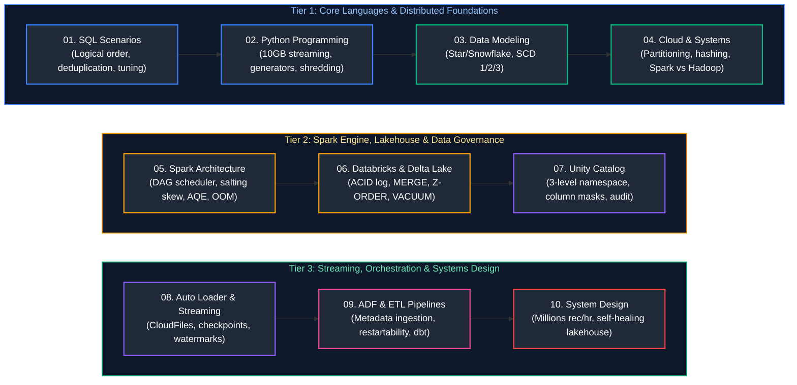

# Data Engineering Interview Questions & Comprehensive Solutions Master Guide

This directory contains the production-grade, deeply analyzed answers to the complete collection of real-world Data Engineering interview questions from [`data_engineering_interview_questions.md`](data_engineering_interview_questions.md).

All questions have been systematically grouped by conceptual similarity, mapped to enterprise data engineering disciplines, and organized in the **optimal chronological order in which they should be studied**. Each guide provides formal definitions, architectural diagrams, mathematical/memory analysis, production-grade code snippets, edge-case handling, and troubleshooting playbooks matching the rigorous style of the base concepts guides.

---

## Recommended Chronological Study Order

---

## Topic Guides & Coverage Overview

| Study Order | Guide File | Questions & Patterns Covered | Corresponding Base Concepts | Key Topics & Grouped Scenarios |
| :---: | :--- | :--- | :--- | :--- |
| **01** | [`01_sql_faq.md`](01_sql_faq.md) | SQL Q1–Q71 | [`01_sql_fundamentals.md`](../01_sql_fundamentals.md) [`02_advanced_sql.md`](../02_advanced_sql.md) [`04_database_internals_and_performance.md`](../04_database_internals_and_performance.md) | Logical execution order, 5-join troubleshooting, deduplication, N-th salaries, islands & gaps, consecutive numbers (LeetCode 180), rolling 30-day window delta, ride proximity (<10m), repeat orders within 7 days, WoW driver variance, bidirectional route normalization (`LEAST`/`GREATEST`), unconverted products funnel, 500M relational division, clickstream session duration, watch hours, running balance, recursive org trees, keyset pagination (`OFFSET 100000`), index degradation, `ROW_NUMBER` vs `RANK` vs `DENSE_RANK`, consecutive active months streak, average sessions per user, anti-join mechanics (`A not in B`), highest-grossing movie, periodic sales rollup via `GROUPING SETS` and `ROLLUP`, Cartesian empty table zero-multiplication, rolling 7-day average with missing dates, latest designation via `ROW_NUMBER()`, cross-tenant data leakage triage. |
| **02** | [`02_python_and_programming_faq.md`](02_python_and_programming_faq.md) | Python Q1–Q35 | [`03_python_for_data_engineering.md`](../03_python_for_data_engineering.md) | 10GB CSV chunking & memory downcasting, JSON flattening, order-preserving dedup, decorators, \*args/\*\*kwargs, dead-letter exception handling, prefix sum $O(N)$, continuous stream median (dual heaps), LRU cache from scratch, DAG cycle detection (3-color DFS), merge K sorted streams ($O(N \log K)$), longest ride streak ($O(N)$ set), multithreading vs multiprocessing (GIL), infinite generator Fibonacci, pure Python merge sort, two-pointer palindrome, memoized factorial, word tokenizer, single-pass min/max, enterprise strings/lists/dicts manipulations, common key pairing, duplicate character frequency, list appending memory reallocation (`append` vs `extend` vs `+`), email username extraction, stock span monotonic stack, large-scale 100GB log table parser, interval merging $O(N \log N)$, sliding window longest distinct substring, stream first non-repeating element, linked list cycle detection (Floyd's algorithm), Number of Islands (BFS), Top K frequent elements (Min-Heap/Bucket Sort), dictionary unique value extraction. |
| **03** | [`03_data_modeling_and_warehousing_faq.md`](03_data_modeling_and_warehousing_faq.md) | Data Modeling Q1–Q30 | [`06_data_architecture_and_modeling.md`](../06_data_architecture_and_modeling.md) [`07_file_formats_and_storage.md`](../07_file_formats_and_storage.md) | Star vs Snowflake, OLTP vs OLAP, Medallion Lakehouse Architecture (Bronze/Silver/Gold), row vs columnar storage, partitioning vs bucketing, Vendor Payment & Lending Book designs, SCD Types 1/2/3, inferred members, multi-currency conversion, large-scale log modeling, bitemporal data, enterprise data governance, Unity Catalog RLS & dynamic PII masking, multi-level periodic sales modeling, billion-row Delta optimization, cloud storage cost reduction & VACUUM, Microsoft Fabric Lakehouse vs Warehouse, high-concurrency movie-booking DB design, expand-contract schema evolution, transient vs temporary tables, card-present swipe payment API & double-entry ledger, university 3NF schema, 50k events/sec web telemetry schema, post-incremental load data discrepancy triage. |
| **04** | [`04_cloud_and_distributed_systems_faq.md`](04_cloud_and_distributed_systems_faq.md) | Cloud & Dist Q1–Q20 | [`05_distributed_systems_and_apis.md`](../05_distributed_systems_and_apis.md) [`07_file_formats_and_storage.md`](../07_file_formats_and_storage.md) [`13_azure_data_engineering_and_devops.md`](../13_azure_data_engineering_and_devops.md) | Partitioning vs sharding vs bucketing, consistent hashing, Hadoop/MapReduce vs Spark, Synapse Dedicated vs Serverless (100GB CSV), AWS Glue, Athena vs Redshift, Lambda layers, Hive external tables, log-based CDC vs Change Tracking (CDT), Data Lake Storage (HNS) vs flat blob storage, compound upstream SLA availability mathematics, intermittent idle connection reset (`ECONNRESET`). |
| **05** | [`05_apache_spark_and_pyspark_faq.md`](05_apache_spark_and_pyspark_faq.md) | PySpark Q1–Q71 | [`08_apache_spark_pyspark.md`](../08_apache_spark_pyspark.md) | Spark cluster architecture, DAG scheduler, join strategies (BHJ vs SMJ), data skew salting, AQE, coalesce vs repartition, small files, unified memory tuning, OOM debugging, live coding scenarios, the 40% partition skew breakdown, petabyte-scale partitioning heuristics, JDBC parallel read stalls & bounds tuning, driver/executor memory leaks & Py4J retention, RDD vs DataFrame vs Dataset internals, SparkContext vs SparkSession, broadcast BitTorrent protocol, Bloom filters, joining multi-TB datasets, Snowflake/Snowpark best practices, departmental sales aggregations, whiteboarding without an IDE, 2 TB with 200 MB asymmetric join, memory leak diagnostic framework, window functions performance impact & unpartitioned window trap, lazy evaluation & Catalyst DAG lineage, decoupled Parquet vs Delta vs Spark compute architecture, null user_id cleaning & dead-letter routing, 1M to 100M records scaling bottleneck triage, broadcast join executor memory exhaustion, distributed lock TTL expiration & STW GC split-brain fencing tokens, Kubernetes OOMKilled off-heap Netty/Python diagnostics, repartition vs coalesce vs repartitionByRange, multi-source CRM/ERP deduplication, regional top 3 products. |
| **06** | [`06_databricks_and_delta_lake_faq.md`](06_databricks_and_delta_lake_faq.md) | Databricks Q1–Q34 | [`09_databricks_and_delta_lake.md`](../09_databricks_and_delta_lake.md) | Delta ACID transaction log, incremental loads, multiple-match MERGE trap, OPTIMIZE/Z-ORDER/VACUUM, Time Travel rollback, Job vs All-Purpose clusters, 3x slowdown root causes, Change Data Feed (CDF), enterprise multi-tenancy, CI/CD with Databricks Asset Bundles (DABs), Azure Key Vault secret scopes, multi-terabyte table performance optimization, ADLS Gen2 small files root causes & resolution, partitioning vs Liquid Clustering strategy, Databricks Lakeflow Connect & Pipelines, Unity Catalog managed table vs direct path reads, source-to-target migration validation framework, Gold-layer dashboard tuning, manual Parquet versioning vs Delta transaction log, Medallion Bronze/Silver/Gold record discrepancy tracing, programmatic notebook execution via `dbutils.notebook.run` vs Databricks Workflows. |
| **07** | [`07_unity_catalog_faq.md`](07_unity_catalog_faq.md) | Unity Catalog Q1–Q15 | [`09_databricks_and_delta_lake.md`](../09_databricks_and_delta_lake.md) [`14_data_governance_security_and_observability.md`](../14_data_governance_security_and_observability.md) | 3-level namespace (`catalog.schema.table`), multi-environment RBAC, column masking (`MASK()`), row-level filters (`ROW FILTER`), permission diagnostics, automated lineage, system audit tables, storage credentials, multi-department Finance/Marketing/Operations data governance with dynamic row filters & column masking. |
| **08** | [`08_auto_loader_and_structured_streaming_faq.md`](08_auto_loader_and_structured_streaming_faq.md) | Auto Loader & Streaming Q1–Q29 | [`11_streaming_and_kafka_event_streaming.md`](../11_streaming_and_kafka_event_streaming.md) [`09_databricks_and_delta_lake.md`](../09_databricks_and_delta_lake.md) | Batch vs micro-batch vs continuous streaming, Auto Loader directory listing vs file notification, checkpointing internals, end-to-end exactly-once processing, schema evolution, `_rescued_data`, stream dedup, backlogs, watermarks, poison pills, Kafka 12 partitions vs 15 consumers (idle state), rebalance event duplication & idempotent consumers, burst deduplication (50 in 10s), streaming Delta duplicates prevention, structured streaming lag RCA, Kafka vs Kinesis vs Event Hubs vs Pub/Sub comparison matrix, millions of files ADLS ingestion with Auto Loader & Delta MERGE, Kafka-to-Spark-to-Delta streaming code. |
| **09** | [`09_etl_data_pipelines_and_adf_faq.md`](09_etl_data_pipelines_and_adf_faq.md) | ADF & ETL Q1–Q59 | [`10_data_pipeline_design_and_ingestion.md`](../10_data_pipeline_design_and_ingestion.md) [`12_orchestration_airflow_and_dbt.md`](../12_orchestration_airflow_and_dbt.md) [`13_azure_data_engineering_and_devops.md`](../13_azure_data_engineering_and_devops.md) | Pipeline idempotency, checkpoint restarts, metadata-driven ADF (100+ tables), dynamic Databricks invocation, dependency branching, Azure vs Self-Hosted IR, dbt framework, data quality gates, PDF/image ingestion, systematic 3h-8h slowdown RCA playbook, weekend delivery time drift RCA, downstream API degradation controls (circuit breaker, rate limiter, DLQ), Airflow multi-worker race conditions, silent data loss in ADF, high-watermark incremental load from Azure SQL, 1,000 asynchronously arriving files, zero-downtime column rename (expand/contract), duplicate triage & long-term containment, Sev-1 peak hour incident runbook, large-scale ETL case study, CDC ingestion with Debezium & Delta Lake MERGE, enterprise Unity Catalog governance & data sharing, repartition vs coalesce in large-scale ETL pipelines, duplicate pipeline run triage & concurrency limits, incremental load without timestamps via SQL Change Tracking, checkpoint control table retry logic, SCD Type 2 mapping data flows, multi-database on-prem SQL ingestion to ADLS & Synapse via SHIR, pipeline idempotency & partial failure retries, strict task sequential execution (`T1 >> T2 >> T3`), upstream dependency delay cascade, reusable metadata-driven ETL framework, PostgreSQL 90% CPU ingestion spike triage, production deployment failure rate spike rollback vs fix-forward. |
| **10** | [`10_system_design_and_architecture_faq.md`](10_system_design_and_architecture_faq.md) | Architecture & System Design Q1–Q23 | [`15_system_design_for_data_engineering.md`](../15_system_design_for_data_engineering.md) [`10_data_pipeline_design_and_ingestion.md`](../10_data_pipeline_design_and_ingestion.md) | High-throughput design (millions/hour), comprehensive late-arriving data strategy, self-healing automated failure recovery, global lakehouse system design capstone, real-time fraud detection (<500ms SLA, 3M orders), event-driven surge pricing with H3 hex cells, 100M GPS pings/day analytics, real-time flash sale inventory (50M products, zero overselling), emergency 48h 100x traffic surge (500 to 50k orders/sec), real-time recommendation engine (80M-400M users, cold start), pricing algorithm bug containment (800k orders), metadata-driven ingestion for 500,000 sellers, global video streaming watch-history lakehouse, banking regulatory & compliance data platform (BCBS 239), high-scale e-commerce platform architecture, multi-source structured/semi-structured/unstructured pipeline design, 100GB daily pipeline optimization & observability under SLAs, multi-team dependency management & data contracts, legacy platform modernization & Strangler Fig domain prioritization, 10x volume surge load testing & capacity planning. |

