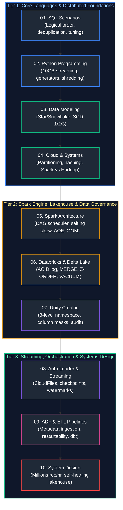

# Data Engineering Interview Questions & Comprehensive Solutions Master Guide

This directory contains the production-grade, deeply analyzed answers to the complete collection of real-world Data Engineering interview questions from [`data_engineering_interview_questions.md`](data_engineering_interview_questions.md).

All questions have been systematically grouped by conceptual similarity, mapped to enterprise data engineering disciplines, and organized in the **optimal chronological order in which they should be studied**. Each guide provides formal definitions, architectural diagrams, mathematical/memory analysis, production-grade code snippets, edge-case handling, and troubleshooting playbooks matching the rigorous style of the base concepts guides.

---

## Recommended Chronological Study Order

---

## Topic Guides & Coverage Overview

| Study Order | Guide File | Questions Covered | Corresponding Base Concepts | Key Topics & Grouped Scenarios |
| :---: | :--- | :--- | :--- | :--- |
| **01** | [`01_sql.md`](01_sql.md) | SQL Q1–Q39 | [`01_sql_fundamentals.md`](../01_sql_fundamentals.md) [`02_advanced_sql.md`](../02_advanced_sql.md) [`04_database_internals_and_performance.md`](../04_database_internals_and_performance.md) | Logical execution order, 5-join troubleshooting, deduplication, N-th salaries, islands & gaps, partition switching, dynamic PIVOT, MERGE vs UPSERT. |
| **02** | [`02_python_and_programming.md`](02_python_and_programming.md) | Python Q1–Q8 + Prefix Sum | [`03_python_for_data_engineering.md`](../03_python_for_data_engineering.md) | 10GB CSV chunking & memory downcasting, JSON flattening, order-preserving dedup, decorators, \*args/\*\*kwargs, dead-letter exception handling, prefix sum $O(N)$ algorithm. |
| **03** | [`03_data_modeling_and_warehousing.md`](03_data_modeling_and_warehousing.md) | Data Modeling Q1–Q12 | [`06_data_architecture_and_modeling.md`](../06_data_architecture_and_modeling.md) [`07_file_formats_and_storage.md`](../07_file_formats_and_storage.md) | Star vs Snowflake, OLTP vs OLAP, row vs columnar storage, Vendor Payment & Lending Book designs, SCD Types 1/2/3, inferred members, multi-currency conversion. |
| **04** | [`04_cloud_and_distributed_systems.md`](04_cloud_and_distributed_systems.md) | Cloud & Dist Q1–Q16 | [`05_distributed_systems_and_apis.md`](../05_distributed_systems_and_apis.md) [`07_file_formats_and_storage.md`](../07_file_formats_and_storage.md) [`13_azure_data_engineering_and_devops.md`](../13_azure_data_engineering_and_devops.md) | Partitioning vs sharding vs bucketing, consistent hashing, Hadoop/MapReduce vs Spark, Synapse Dedicated vs Serverless (100GB CSV), AWS Glue, Athena vs Redshift, Lambda layers, Hive external tables. |
| **05** | [`05_apache_spark_and_pyspark.md`](05_apache_spark_and_pyspark.md) | PySpark Q1–Q45 | [`08_apache_spark_pyspark.md`](../08_apache_spark_pyspark.md) | Spark cluster architecture, DAG scheduler, join strategies (BHJ vs SMJ), data skew salting, AQE, coalesce vs repartition, small files, unified memory tuning, OOM debugging, live coding scenarios. |
| **06** | [`06_databricks_and_delta_lake.md`](06_databricks_and_delta_lake.md) | Databricks Q1–Q22 | [`09_databricks_and_delta_lake.md`](../09_databricks_and_delta_lake.md) | Delta ACID transaction log, incremental loads, multiple-match MERGE trap, OPTIMIZE/Z-ORDER/VACUUM, Time Travel rollback, Job vs All-Purpose clusters, 3x slowdown root causes, Change Data Feed (CDF). |
| **07** | [`07_unity_catalog.md`](07_unity_catalog.md) | Unity Catalog Q1–Q14 | [`09_databricks_and_delta_lake.md`](../09_databricks_and_delta_lake.md) [`14_data_governance_security_and_observability.md`](../14_data_governance_security_and_observability.md) | 3-level namespace (`catalog.schema.table`), multi-environment RBAC, column masking (`MASK()`), row-level filters (`ROW FILTER`), permission diagnostics, automated lineage, system audit tables, storage credentials. |
| **08** | [`08_auto_loader_and_structured_streaming.md`](08_auto_loader_and_structured_streaming.md) | Auto Loader Q1–Q17, Streaming Q1–Q2 | [`11_streaming_and_kafka_event_streaming.md`](../11_streaming_and_kafka_event_streaming.md) [`09_databricks_and_delta_lake.md`](../09_databricks_and_delta_lake.md) | Batch vs streaming, Auto Loader directory listing vs file notification, checkpointing internals, exactly-once processing, schema evolution, `_rescued_data`, stream dedup, backlogs, watermarks, poison pills. |
| **09** | [`09_etl_data_pipelines_and_adf.md`](09_etl_data_pipelines_and_adf.md) | ADF Q1–Q17, ETL Q1–Q16 | [`10_data_pipeline_design_and_ingestion.md`](../10_data_pipeline_design_and_ingestion.md) [`12_orchestration_airflow_and_dbt.md`](../12_orchestration_airflow_and_dbt.md) [`13_azure_data_engineering_and_devops.md`](../13_azure_data_engineering_and_devops.md) | Pipeline idempotency, checkpoint restarts, metadata-driven ADF (100+ tables), dynamic Databricks invocation, dependency branching, Azure vs Self-Hosted IR, dbt framework, data quality gates, PDF/image ingestion. |
| **10** | [`10_system_design_and_architecture.md`](10_system_design_and_architecture.md) | Architecture Q1–Q3 + Capstone | [`15_system_design_for_data_engineering.md`](../15_system_design_for_data_engineering.md) [`10_data_pipeline_design_and_ingestion.md`](../10_data_pipeline_design_and_ingestion.md) | High-throughput design (millions/hour), comprehensive late-arriving data strategy, self-healing automated failure recovery, global lakehouse system design capstone. |
