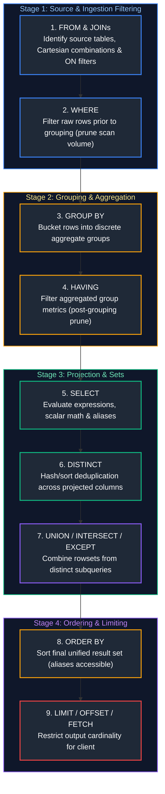
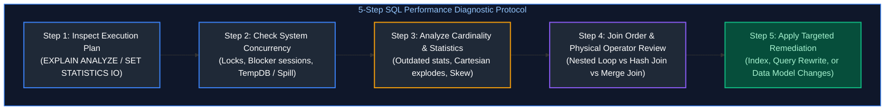
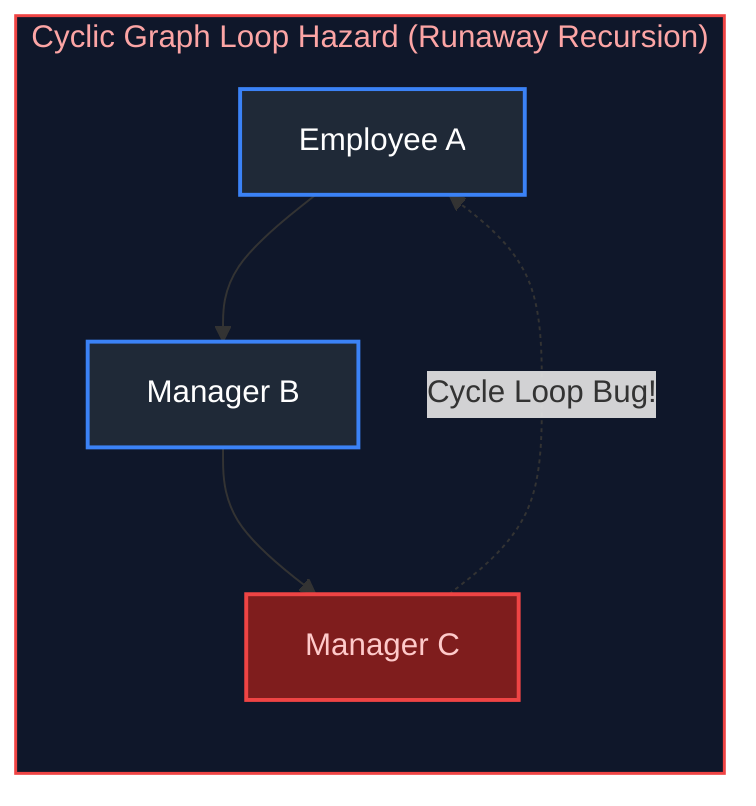
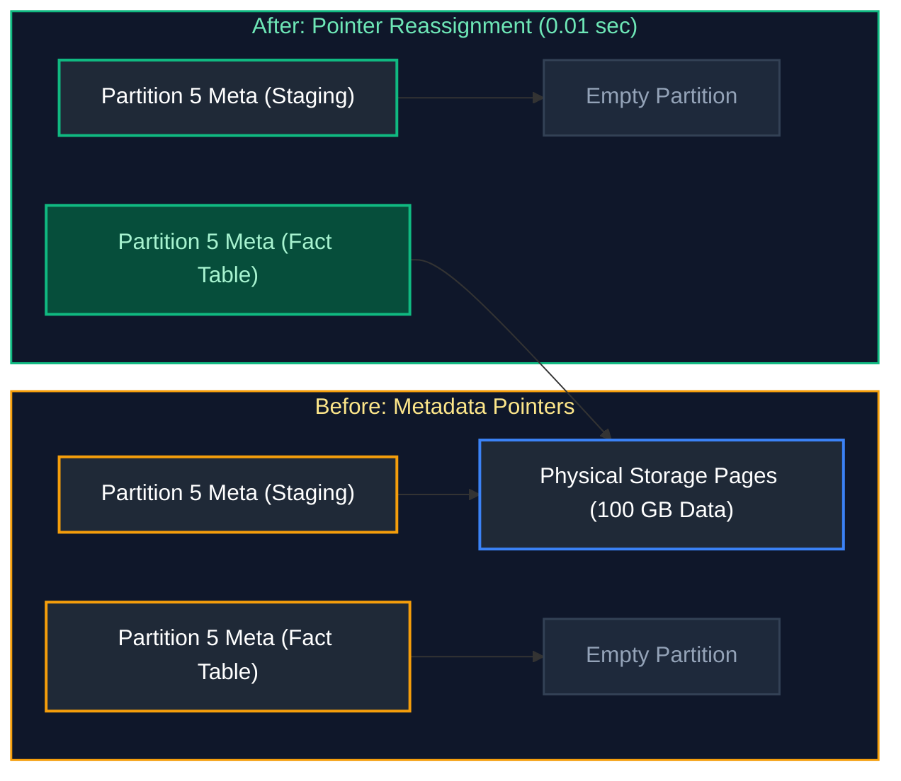
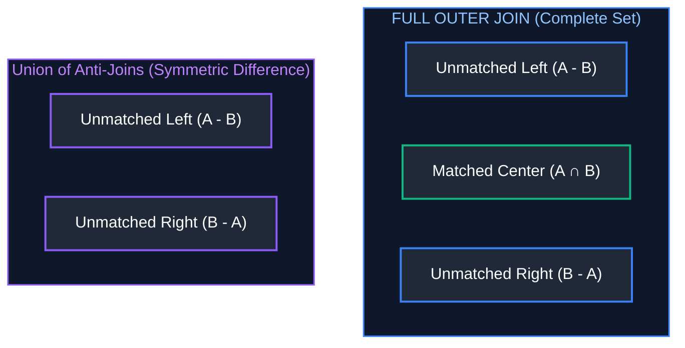

# 01. SQL – Real-Time & Advanced Scenarios: Interview Questions & Deep-Dive Solutions

A comprehensive, production-grade guide answering real-time and advanced SQL interview scenarios. Covers query execution internals, window functions, deduplication, gaps and islands, recursive CTEs, joins, query troubleshooting, and performance tuning for Data Engineers and Analytics Architects.

---

## Table of Contents & Question Mapping

1. **Logical Query Execution Order & Core Architecture**
   - [Q37. Logical SQL Query Execution Order](#q37-logical-sql-query-execution-order)
2. **Views vs Materialized Views**
   - [Q38. View vs Materialized View](#q38-view-vs-materialized-view)
3. **Query Troubleshooting & Performance Tuning**
   - [Q1. Troubleshooting a Slow-Running Query (30m to 2m)](#q1-troubleshooting-a-slow-running-query-30m-to-2m)
   - [Q2. Identifying Bottlenecks Across 5 Joined Large Tables](#q2-identifying-bottlenecks-across-5-joined-large-tables)
   - [Q39. Query Optimization: Indexes vs Query Rewrites vs Data Model Changes](#q39-query-optimization-indexes-vs-query-rewrites-vs-data-model-changes)
4. **Deduplication & Retrieving Latest Records**
   - [Q3 & Q4. Identifying and Purging Duplicate Records While Keeping One Copy](#q3--q4-identifying-and-purging-duplicate-records-while-keeping-one-copy)
   - [Q14. Retrieving Only the Latest Transaction per Customer](#q14-retrieving-only-the-latest-transaction-per-customer)
   - [Q15. Retrieving Only the Most Recently Updated Address per Customer](#q15-retrieving-only-the-most-recently-updated-address-per-customer)
5. **Rankings & N-th Highest Values**
   - [Q5. Second-Highest Salary in Each Department](#q5-second-highest-salary-in-each-department)
   - [Q6. Third-Highest Salary Without TOP or LIMIT](#q6-third-highest-salary-without-top-or-limit)
   - [Q13. Top 3 Products by Revenue in Each Category](#q13-top-3-products-by-revenue-in-each-category)
   - [Q34. Second Most Recent Login per User Using Window Functions](#q34-second-most-recent-login-per-user-using-window-functions)
6. **Hierarchical & Comparative Analytics**
   - [Q7. Employees Earning More Than Department Average](#q7-employees-earning-more-than-department-average)
   - [Q8. Employees Earning More Than Their Direct Manager](#q8-employees-earning-more-than-their-direct-manager)
7. **NULL Value Handling & 3-Valued Logic**
   - [Q9. Defensive Handling of NULLs in Critical Columns](#q9-defensive-handling-of-nulls-in-critical-columns)
8. **Table Diffs & Change Tracking**
   - [Q10. Table Comparison: Identifying Inserted, Deleted, and Modified Records](#q10-table-comparison-identifying-inserted-deleted-and-modified-records)
   - [Q11. Identifying Employee Records Changed Between Two Dates](#q11-identifying-employee-records-changed-between-two-dates)
9. **Relational Completeness & Temporal Aggregations**
   - [Q12. Customers Purchasing in Every Month of a Year (Relational Division)](#q12-customers-purchasing-in-every-month-of-a-year-relational-division)
   - [Q16. Customers with 2025 Spending Higher Than 2024 Spending](#q16-customers-with-2025-spending-higher-than-2024-spending)
   - [Q19 & Q30. Month-over-Month Spending Growth & LAG vs LEAD Functions](#q19--q30-month-over-month-spending-growth--lag-vs-lead-functions)
10. **Islands, Gaps & Date Range Overlaps**
    - [Q17 & Q18. Gaps in a Sequence of IDs and Consecutive Islands](#q17--q18-gaps-in-a-sequence-of-ids-and-consecutive-islands)
    - [Q29. Calculating Total Number of Overlapping Days Across Date Ranges](#q29-calculating-total-number-of-overlapping-days-across-date-ranges)
11. **Anti-Joins & Inactivity Detection**
    - [Q20 & Q21. Identifying Customers with No Purchases in 6 to 12 Months](#q20--q21-identifying-customers-with-no-purchases-in-6-to-12-months)
12. **CTEs, Temp Tables & Recursive Safety**
    - [Q22. CTE vs Temp Table Execution Plan Reuse & Recompiles](#q22-cte-vs-temp-table-execution-plan-reuse--recompiles)
    - [Q28. Recursive CTEs, MAXRECURSION & Preventing Runaway Recursion](#q28-recursive-ctes-maxrecursion--preventing-runaway-recursion)
13. **Dynamic PIVOT & Schema Transformation**
    - [Q23. Dynamic PIVOT When Column Values Are Unknown Ahead of Time](#q23-dynamic-pivot-when-column-values-are-unknown-ahead-of-time)
14. **Partition Switching & Physical Storage Mechanics**
    - [Q24. Partition Switching Mechanics & Near-Instant Metadata Swaps](#q24-partition-switching-mechanics--near-instant-metadata-swaps)
15. **Relational Joins, Anti-Joins & Set Theory**
    - [Q25. FULL OUTER JOIN vs Union of Left and Right Anti-Joins](#q25-full-outer-join-vs-union-of-left-and-right-anti-joins)
    - [Q26. INNER JOIN vs LEFT JOIN vs CROSS JOIN Mechanics](#q26-inner-join-vs-left-join-vs-cross-join-mechanics)
16. **Group By vs Window Functions & Filter Semantics**
    - [Q27. GROUP BY vs Window Aggregation and Row Cardinality](#q27-group-by-vs-window-aggregation-and-row-cardinality)
    - [Q31. WHERE vs HAVING Semantics and Filter Scoping](#q31-where-vs-having-semantics-and-filter-scoping)
17. **E-Commerce Aggregations & Customer Analytics**
    - [Q32. Total Revenue per Customer from Orders and Order Items](#q32-total-revenue-per-customer-from-orders-and-order-items)
    - [Q33. Highest Spending Customers in the Last Month](#q33-highest-spending-customers-in-the-last-month)
    - [Q36. Users Placing >20 Critical Orders Every Week for >= 1 Month](#q36-users-placing-20-critical-orders-every-week-for--1-month)
18. **MERGE vs UPSERT Implementation**
    - [Q35. MERGE Statement Semantics vs ANSI UPSERT](#q35-merge-statement-semantics-vs-ansi-upsert)
---

# 1. Logical Query Execution Order & Core Architecture

---

### Q37. Logical SQL Query Execution Order
**Topic Covered:** Relational Engine Processing Pipeline & Clause Evaluation Order  
**Question:** What is the logical SQL query execution order?

#### Definition & Core Concepts
While SQL queries are written starting with `SELECT`, the database management system (RDBMS) evaluates clauses in a strictly defined logical pipeline. Understanding this lifecycle is critical because it dictates column alias visibility, filtering efficiency, and aggregation scoping.

#### Visual Flow


#### Engineering Implications
1. **Alias Invisibility in WHERE:** `WHERE total_amount > 100` fails if `total_amount` is defined in `SELECT` as `SELECT (qty * price) AS total_amount`. The `WHERE` clause executes at Step 2, long before `SELECT` creates the alias at Step 5.
2. **Alias Visibility in ORDER BY:** `ORDER BY total_amount DESC` succeeds because `ORDER BY` executes at Step 8, after projection.
3. **WHERE vs HAVING Efficiency:** Always filter non-aggregate conditions in `WHERE` to prune row volume before the costly distributed hash or sort aggregation in Step 3.

---

# 2. Views vs Materialized Views

---

### Q38. View vs Materialized View
**Topic Covered:** Virtual vs Physical Table Materialization & Refresh Semantics  
**Question:** View vs Materialized View

#### Definition & Comparison Matrix
| Architectural Dimension | Standard View (Virtual Table) | Materialized View (Physical Snapshot) |
| :--- | :--- | :--- |
| **Physical Storage** | Zero bytes on disk. Only stores SQL text metadata in system catalog. | Consumes disk space. Stores the query's evaluated result set physically as a table. |
| **Execution Cost** | Evaluates underlying query every time the view is queried. Adds compute overhead. | Reads pre-computed physical data directly. Lightning fast response time ($O(1)$ scans). |
| **Data Freshness** | Always 100% real-time and up-to-date with underlying base tables. | Can become stale. Requires manual or scheduled refreshes (Complete or Incremental). |
| **Write Impact** | Zero overhead on DML operations on base tables. | Maintenance overhead during base table `INSERT`/`UPDATE` if auto-refreshed. |
| **Indexes** | Cannot be indexed directly (except Indexed Views in SQL Server with strict schemas). | Supports secondary B-Tree/Bitmap indexes on the materialized result set. |

#### Production Implementation
```sql
-- PostgreSQL Standard View (Dynamic query macro)
CREATE OR REPLACE VIEW v_customer_order_summary AS
SELECT 
    c.customer_id,
    c.customer_name,
    COUNT(o.order_id) AS total_orders,
    SUM(o.order_amount) AS total_revenue
FROM customers c
JOIN orders o ON c.customer_id = o.customer_id
GROUP BY c.customer_id, c.customer_name;

-- PostgreSQL Materialized View (Physically persisted dataset)
CREATE MATERIALIZED VIEW mv_customer_order_summary AS
SELECT 
    c.customer_id,
    c.customer_name,
    COUNT(o.order_id) AS total_orders,
    SUM(o.order_amount) AS total_revenue
FROM customers c
JOIN orders o ON c.customer_id = o.customer_id
GROUP BY c.customer_id, c.customer_name;

-- Add an index on the materialized data
CREATE UNIQUE INDEX idx_mv_cust_id ON mv_customer_order_summary(customer_id);

-- Refresh strategy (Non-blocking concurrent refresh)
REFRESH MATERIALIZED VIEW CONCURRENTLY mv_customer_order_summary;
```

---

# 3. Query Troubleshooting & Performance Tuning

---

### Q1. Troubleshooting a Slow-Running Query (30m to 2m)
**Topic Covered:** Query Performance Diagnostics & Execution Plan Analysis  
**Question:** A query is running for 30 minutes instead of 2 minutes. How would you troubleshoot it?

#### Systematic Troubleshooting Playbook (The 5-Step Diagnostic Protocol)


---

### Q2. Identifying Bottlenecks Across 5 Joined Large Tables
**Topic Covered:** Multi-Table Join Execution Bottlenecks & Cardinality Mismatch  
**Question:** A query is joining 5 large tables and taking too long. How would you identify which join is causing the performance issue?

#### Identifying Bottlenecks Across 5 Joined Tables
To pinpoint the problematic join among 5 large tables:
1. **Analyze Physical vs Estimated Rows:** In `EXPLAIN (ANALYZE, BUFFERS)` (Postgres) or Graphical Execution Plan (SQL Server), compare `Estimated Rows` vs `Actual Rows`. If a join estimates 1,000 rows but emits 10,000,000, the optimizer chose a **Nested Loop Join** instead of a **Hash Join**, causing catastrophic thrashing.
2. **Examine Disk Spills:** Look for operators with high `Spill to Workfile` or `TempDB Spill`. A Hash Join whose hash table exceeds RAM spills partitions to disk.
3. **Cartesian Product Explosion:** Check join predicates. A missing composite key component (e.g., joining on `customer_id` without `tenant_id`) produces an accidental $M \times N$ multiplier.

```sql
-- PostgreSQL: Deep diagnostic execution analysis
EXPLAIN (ANALYZE, BUFFERS, TIMING, COSTS, VERBOSE)
SELECT 
    c.customer_id, o.order_id, p.product_name, s.supplier_name, sh.shipping_status
FROM customers c
JOIN orders o ON c.customer_id = o.customer_id
JOIN order_items oi ON o.order_id = oi.order_id
JOIN products p ON oi.product_id = p.product_id
JOIN suppliers s ON p.supplier_id = s.supplier_id
JOIN shipments sh ON o.order_id = sh.order_id
WHERE o.order_date >= CURRENT_DATE - INTERVAL '30 days';
```

---

### Q39. Query Optimization: Indexes vs Query Rewrites vs Data Model Changes
**Topic Covered:** 3-Tier Optimization Hierarchy (Physical Storage, Logical Plan, Schema Model)  
**Question:** Query Optimization (Index vs Query Rewrite vs Data Model Changes)

#### Remediation Matrix: Indexing vs Query Rewrite vs Model Redesign
| Strategy Level | When to Apply | Concrete Action Examples |
| :--- | :--- | :--- |
| **1. Index Optimization** | Filter or Join columns perform full table scans (Sequential Scans). | • Create Composite Index matching filter order: `CREATE INDEX idx_orders ON orders(order_date, customer_id);`<br/>• Covering Index: Include projected fields (`INCLUDE (order_amount)`) to enable Index-Only Scans. |
| **2. Query Rewrite** | Query forces non-SARGable evaluations or suboptimal subplans. | • Eliminate scalar functions on indexed columns (change `WHERE YEAR(created_at) = 2024` to `WHERE created_at >= '2024-01-01' AND created_at < '2025-01-01'`).<br/>• Replace correlated subqueries with window functions or CTEs.<br/>• Replace `IN (subquery)` with `EXISTS` to avoid NULL evaluation hazards. |
| **3. Data Model Changes** | High-cardinality snowflaking or excessive joins at petabyte scale. | • Denormalize normalized tables into dimensional Star Schemas.<br/>• Introduce Table Partitioning (by `order_date` RANGE) and Clustering.<br/>• Pre-aggregate into Materialized Views or Delta Gold tables. |

---

# 4. Deduplication & Retrieving Latest Records

---

### Q3 & Q4. Identifying and Purging Duplicate Records While Keeping One Copy
**Topic Covered:** Window Deduplication & Deletion Strategies  
**Questions Covered:**
- **Q3**: A table contains duplicate customer records. How would you identify and remove duplicates while keeping the latest record?
- **Q4**: How would you find duplicate records in a table and delete only the duplicates while keeping one copy?

#### Core Concept: Window Deduplication Framework
To identify and retain the single most recent record (by timestamp or surrogate ID) while purging duplicates, the industry-standard approach uses `ROW_NUMBER() OVER (PARTITION BY ... ORDER BY ... DESC)`.

#### Production Queries: Identification, Read-Only Retrieval & Deletion

##### Step 1: Identify Duplicate Customer Records
```sql
SELECT 
    customer_id,
    email,
    COUNT(*) AS record_count
FROM customer_records
GROUP BY customer_id, email
HAVING COUNT(*) > 1;
```

---

### Q14. Retrieving Only the Latest Transaction per Customer
**Topic Covered:** Event-Time Deduplication via Window Partitioning  
**Question:** You have transaction records with multiple updates for the same customer. How would you retrieve only the latest transaction for each customer?

---

### Q15. Retrieving Only the Most Recently Updated Address per Customer
**Topic Covered:** Temporal Address Entity Resolution  
**Question:** A customer has multiple addresses. How would you retrieve only the most recently updated address for each customer?

##### Step 2: Retrieve Only the Latest Transaction / Address per Customer (Q14 & Q15)
```sql
-- Solution using CTE with ROW_NUMBER()
WITH ranked_transactions AS (
    SELECT 
        customer_id,
        transaction_id,
        transaction_date,
        amount,
        ROW_NUMBER() OVER (
            PARTITION BY customer_id 
            ORDER BY transaction_date DESC, transaction_id DESC
        ) AS rn
    FROM customer_transactions
)
SELECT 
    customer_id,
    transaction_id,
    transaction_date,
    amount
FROM ranked_transactions
WHERE rn = 1;
```

##### Step 3: Physically Delete Duplicates While Retaining One Latest Copy (Q3 & Q4)

*Approach A: SQL Server / Oracle CTE Deletion*
```sql
WITH deduplication_cte AS (
    SELECT 
        customer_id,
        updated_at,
        ROW_NUMBER() OVER (
            PARTITION BY customer_id 
            ORDER BY updated_at DESC, id DESC
        ) AS row_num
    FROM customer_records
)
DELETE FROM deduplication_cte
WHERE row_num > 1;
```

*Approach B: PostgreSQL / MySQL CTID or Primary Key Self-Join*
```sql
DELETE FROM customer_records
WHERE id IN (
    SELECT id
    FROM (
        SELECT id,
               ROW_NUMBER() OVER (
                   PARTITION BY customer_id 
                   ORDER BY updated_at DESC, id DESC
               ) AS rn
        FROM customer_records
    ) sub
    WHERE sub.rn > 1
);
```

---

# 5. Rankings & N-th Highest Values

---

#### Ranking Functions Comparison
- `ROW_NUMBER()`: Monotonically increasing unique numbers (1, 2, 3, 4...). Never produces ties.
- `RANK()`: Assigns identical rank for ties, but **skips subsequent ranks** (1, 2, 2, 4...).
- `DENSE_RANK()`: Assigns identical rank for ties **without skipping subsequent ranks** (1, 2, 2, 3...). **Crucial for N-th highest salary calculations.**

| Salary Value | `ROW_NUMBER()` | `RANK()` | `DENSE_RANK()` | Operational Ranking Behavior |
| :---: | :---: | :---: | :---: | :--- |
| **\$100** | 1 | 1 | 1 | Highest salary (1st rank) |
| **\$90** | 2 | 2 | 2 | Tied salary (shares 2nd rank) |
| **\$90** | 3 | 2 | 2 | Tied salary (shares 2nd rank; `RANK` records tie) |
| **\$80** | 4 | 4 | 3 | Next distinct salary (`RANK` skips 3 to 4; `DENSE_RANK` smoothly continues to 3) |

---

### Q5. Second-Highest Salary in Each Department
**Topic Covered:** Window Ranking Functions (`DENSE_RANK` vs `ROW_NUMBER`)  
**Question:** How would you find the second-highest salary in each department?

#### Production Query: Second-Highest Salary per Department (Q5)
```sql
WITH ranked_salaries AS (
    SELECT 
        department_id,
        employee_id,
        salary,
        DENSE_RANK() OVER (
            PARTITION BY department_id 
            ORDER BY salary DESC
        ) AS salary_rank
    FROM employees
)
SELECT 
    department_id,
    employee_id,
    salary
FROM ranked_salaries
WHERE salary_rank = 2;
```

---

### Q6. Third-Highest Salary Without TOP or LIMIT
**Topic Covered:** ANSI Subquery Offsets & Correlated Subqueries  
**Question:** Write a SQL query to fetch the third highest salary from the Employee table without using TOP or LIMIT.

#### Production Query: Third-Highest Salary WITHOUT TOP or LIMIT (Q6)

*Method 1: DENSE_RANK Window Function*
```sql
WITH ranked_emp AS (
    SELECT 
        salary,
        DENSE_RANK() OVER (ORDER BY salary DESC) AS rnk
    FROM employees
)
SELECT DISTINCT salary 
FROM ranked_emp 
WHERE rnk = 3;
```

*Method 2: Correlated Subquery / Self-Join (Pure ANSI SQL-92)*
```sql
SELECT DISTINCT e1.salary
FROM employees e1
WHERE 2 = (
    SELECT COUNT(DISTINCT e2.salary)
    FROM employees e2
    WHERE e2.salary > e1.salary
);
```

---

### Q13. Top 3 Products by Revenue in Each Category
**Topic Covered:** Category Partitioning & Dense Ranking  
**Question:** How would you find the top 3 products by revenue in each category?

#### Production Query: Top 3 Products by Revenue per Category (Q13)
```sql
WITH product_revenues AS (
    SELECT 
        category_id,
        product_id,
        SUM(sales_amount) AS total_revenue
    FROM order_details
    GROUP BY category_id, product_id
),
ranked_products AS (
    SELECT 
        category_id,
        product_id,
        total_revenue,
        DENSE_RANK() OVER (
            PARTITION BY category_id 
            ORDER BY total_revenue DESC
        ) AS rev_rank
    FROM product_revenues
)
SELECT 
    category_id,
    product_id,
    total_revenue
FROM ranked_products
WHERE rev_rank <= 3
ORDER BY category_id, total_revenue DESC;
```

---

### Q34. Second Most Recent Login per User Using Window Functions
**Topic Covered:** Event-Time Ordering with Window Qualification  
**Question:** How do you find the second most recent login for every user using Window functions?

#### Production Query: Second Most Recent Login per User (Q34)
```sql
WITH user_logins AS (
    SELECT 
        user_id,
        login_timestamp,
        ip_address,
        ROW_NUMBER() OVER (
            PARTITION BY user_id 
            ORDER BY login_timestamp DESC
        ) AS login_seq
    FROM user_login_events
)
SELECT 
    user_id,
    login_timestamp AS second_recent_login,
    ip_address
FROM user_logins
WHERE login_seq = 2;
```

---

# 6. Hierarchical & Comparative Analytics

---

### Q7. Employees Earning More Than Department Average
**Topic Covered:** Correlated Subqueries & Window Aggregations (`AVG() OVER (PARTITION BY)`)  
**Question:** How would you find employees whose salary is higher than their department's average salary?

#### Question 7: Salary Higher Than Department Average
We compare an individual row metric against an aggregated partition metric. The most performant approach is an analytical window function `AVG() OVER (PARTITION BY ...)`.

```sql
-- Solution using Window Function (Single Table Scan)
WITH emp_with_dept_avg AS (
    SELECT 
        employee_id,
        employee_name,
        department_id,
        salary,
        AVG(salary) OVER(PARTITION BY department_id) AS dept_avg_salary
    FROM employees
)
SELECT 
    employee_id,
    employee_name,
    department_id,
    salary,
    ROUND(dept_avg_salary, 2) AS dept_avg_salary
FROM emp_with_dept_avg
WHERE salary > dept_avg_salary;
```

---

### Q8. Employees Earning More Than Their Direct Manager
**Topic Covered:** Self-Joins & Manager-Employee Hierarchies  
**Question:** Write an SQL query to find employees who earn more than their direct manager.

#### Question 8: Employees Earning More Than Their Direct Manager
This requires an adjacency list self-join connecting the employee table `e` to itself as manager `m` on `e.manager_id = m.employee_id`.

```sql
SELECT 
    e.employee_id AS emp_id,
    e.employee_name AS emp_name,
    e.salary AS emp_salary,
    m.employee_id AS manager_id,
    m.employee_name AS manager_name,
    m.salary AS manager_salary
FROM employees e
INNER JOIN employees m 
    ON e.manager_id = m.employee_id
WHERE e.salary > m.salary;
```

---

# 7. NULL Value Handling & 3-Valued Logic

---

### Q9. Defensive Handling of NULLs in Critical Columns
**Topic Covered:** Three-Valued Logic (3VL) & Defensive NULL Handling  
**Question:** You have NULL values in a critical column. How would you handle them?

#### Core Concept: Three-Valued Logic (3VL)
In SQL, `NULL` represents the **absence of a value** or an **unknown**. SQL implements Three-Valued Logic with truth values: `TRUE`, `FALSE`, and `UNKNOWN`.
- `NULL = NULL` evaluates to `UNKNOWN`, not `TRUE`.
- `WHERE column <> 5` discards rows where `column IS NULL` because `NULL <> 5` is `UNKNOWN`.
- **The NOT IN NULL Trap:** `WHERE id NOT IN (1, 2, NULL)` evaluates to `UNKNOWN` for all rows, returning an empty result set!

#### Defensive Handling Strategies
1. **Fallback Coalescing:** `COALESCE(val1, val2, ...)` returns the first non-null argument.
2. **Division by Zero Protection:** `NULLIF(denominator, 0)` converts 0 to `NULL`, preventing runtime crash.
3. **Imputation:** Populate missing values using moving averages or business defaults.
4. **Sentinel Flags:** Create an indicator column `is_missing_flag = CASE WHEN col IS NULL THEN 1 ELSE 0 END`.

```sql
-- Comprehensive production NULL handling pattern
SELECT 
    customer_id,
    -- Strategy 1: Default fallback string
    COALESCE(phone_number, 'NOT_PROVIDED') AS sanitized_phone,
    
    -- Strategy 2: Defensive division using NULLIF
    COALESCE(total_spend / NULLIF(total_orders, 0), 0.0) AS avg_spend_per_order,
    
    -- Strategy 3: Window forward-fill imputation for temporal time-series
    COALESCE(
        current_price, 
        LAST_VALUE(current_price IGNORE NULLS) OVER (
            PARTITION BY asset_id 
            ORDER BY timestamp_utc 
            ROWS BETWEEN UNBOUNDED PRECEDING AND CURRENT ROW
        )
    ) AS imputed_price
FROM customer_financials;
```

---

# 8. Table Diffs & Change Tracking

---

### Q10. Table Comparison: Identifying Inserted, Deleted, and Modified Records
**Topic Covered:** Full Outer Join, CHECKSUM & EXCEPT Set Differences  
**Question:** How would you compare two tables and identify inserted, deleted, and modified records?

#### Question 10: Table Comparison (INSERT, DELETE, UPDATE)
Given `table_previous` (Day T-1) and `table_current` (Day T):
- **INSERTED:** Exists in Current, missing in Previous.
- **DELETED:** Exists in Previous, missing in Current.
- **MODIFIED:** Exists in both on Primary Key, but attributes/hash differ.

```sql
WITH table_diff AS (
    SELECT 
        COALESCE(curr.id, prev.id) AS entity_id,
        CASE 
            WHEN prev.id IS NULL THEN 'INSERT'
            WHEN curr.id IS NULL THEN 'DELETE'
            WHEN curr.hash_diff <> prev.hash_diff THEN 'UPDATE'
            ELSE 'UNCHANGED'
        END AS change_type,
        prev.data_payload AS old_data,
        curr.data_payload AS new_data
    FROM (
        SELECT id, data_payload, 
               MD5(CONCAT(col1, '|', col2, '|', col3)) AS hash_diff 
        FROM table_current
    ) curr
    FULL OUTER JOIN (
        SELECT id, data_payload, 
               MD5(CONCAT(col1, '|', col2, '|', col3)) AS hash_diff 
        FROM table_previous
    ) prev 
        ON curr.id = prev.id
)
SELECT * 
FROM table_diff 
WHERE change_type <> 'UNCHANGED';
```

---

### Q11. Identifying Employee Records Changed Between Two Dates
**Topic Covered:** Temporal Self-Joins & Attribute Comparison  
**Question:** A table contains multiple records for the same employee. How would you identify the records that have changed between two dates?

#### Question 11: Identifying Employee Records Changed Between Two Dates
```sql
SELECT 
    t1.employee_id,
    t1.record_date AS date_start,
    t2.record_date AS date_end,
    t1.department AS dept_at_start,
    t2.department AS dept_at_end,
    t1.salary AS salary_at_start,
    t2.salary AS salary_at_end
FROM employee_history t1
JOIN employee_history t2 
    ON t1.employee_id = t2.employee_id
WHERE t1.record_date = '2024-01-01'
  AND t2.record_date = '2024-12-31'
  AND (
      t1.department <> t2.department 
      OR t1.salary <> t2.salary 
      OR t1.designation <> t2.designation
  );
```

---

# 9. Relational Completeness & Temporal Aggregations

---

### Q12. Customers Purchasing in Every Month of a Year (Relational Division)
**Topic Covered:** Relational Division & Group Count Completeness  
**Question:** How would you find customers who made purchases in every month of a year?

#### Question 12: Customers Purchasing in Every Month of a Year (Relational Division)
```sql
SELECT customer_id
FROM transactions
WHERE transaction_date >= '2024-01-01' 
  AND transaction_date < '2025-01-01'
GROUP BY customer_id
-- Distinct count of transaction months must equal exactly 12
HAVING COUNT(DISTINCT EXTRACT(MONTH FROM transaction_date)) = 12;
```

---

### Q16. Customers with 2025 Spending Higher Than 2024 Spending
**Topic Covered:** Conditional Aggregation (`FILTER / CASE WHEN`) & Year-over-Year Comparison  
**Question:** A source table has records for 2024 and 2025, but the business wants customers whose 2025 spending is higher than their 2024 spending. How would you write the query?

#### Question 16: Customers with 2025 Spending Higher Than 2024 Spending
We aggregate conditional sums by year using `CASE WHEN`:
```sql
SELECT 
    customer_id,
    SUM(CASE WHEN EXTRACT(YEAR FROM order_date) = 2024 THEN amount ELSE 0 END) AS spend_2024,
    SUM(CASE WHEN EXTRACT(YEAR FROM order_date) = 2025 THEN amount ELSE 0 END) AS spend_2025
FROM customer_orders
WHERE EXTRACT(YEAR FROM order_date) IN (2024, 2025)
GROUP BY customer_id
HAVING 
    SUM(CASE WHEN EXTRACT(YEAR FROM order_date) = 2025 THEN amount ELSE 0 END) > 
    SUM(CASE WHEN EXTRACT(YEAR FROM order_date) = 2024 THEN amount ELSE 0 END);
```

---

### Q19 & Q30. Month-over-Month Spending Growth & LAG vs LEAD Functions
**Topic Covered:** Temporal Offsets & Growth Metrics  
**Questions Covered:**
- **Q19**: A customer has transactions on multiple dates. How would you find the month-over-month change in their spending?
- **Q30**: What is the difference between LAG and LEAD, with a churn or month-over-month use case?

#### Questions 19 & 30: Month-over-Month (MoM) Growth & LAG vs LEAD

##### Definition: LAG vs LEAD
- `LAG(col, offset, default)`: Accesses data from a previous row at a specified physical offset prior to the current row.
- `LEAD(col, offset, default)`: Accesses data from a subsequent row at a specified offset ahead of the current row.

```mermaid
flowchart LR
    subgraph WindowOffsets ["Window Analytical Offsets: LAG vs LEAD"]
        R1["Row N-1 (Previous Month)"] -->|LAG(amount, 1)| R2["Row N (Current Month)"]
        R2 -->|LEAD(amount, 1)| R3["Row N+1 (Next Month)"]
    end

    style WindowOffsets fill:#0f172a,stroke:#8b5cf6,stroke-width:1.5px,color:#c084fc
    style R1 fill:#1f2937,stroke:#3b82f6,stroke-width:2px,color:#fff
    style R2 fill:#1f2937,stroke:#10b981,stroke-width:2px,color:#fff
    style R3 fill:#1f2937,stroke:#f59e0b,stroke-width:2px,color:#fff
```

```sql
WITH monthly_customer_spend AS (
    SELECT 
        customer_id,
        DATE_TRUNC('month', transaction_date) AS txn_month,
        SUM(amount) AS current_spend
    FROM transactions
    GROUP BY customer_id, DATE_TRUNC('month', transaction_date)
),
mom_calculation AS (
    SELECT 
        customer_id,
        txn_month,
        current_spend,
        LAG(current_spend, 1) OVER (
            PARTITION BY customer_id 
            ORDER BY txn_month
        ) AS previous_month_spend
    FROM monthly_customer_spend
)
SELECT 
    customer_id,
    txn_month,
    current_spend,
    previous_month_spend,
    (current_spend - previous_month_spend) AS absolute_mom_growth,
    ROUND(
        100.0 * (current_spend - previous_month_spend) / NULLIF(previous_month_spend, 0), 
        2
    ) AS percentage_mom_growth
FROM mom_calculation;
```

---

# 10. Islands, Gaps & Date Range Overlaps

---

### Q17 & Q18. Gaps in a Sequence of IDs and Consecutive Islands
**Topic Covered:** Gaps and Islands Problem via Window Functions (`LAG` & Difference of Row Numbers)  
**Questions Covered:**
- **Q17**: How would you identify gaps in a sequence of transaction IDs?
- **Q18**: Write a query to find gaps in a sequence of IDs / dates (islands & gaps problem).

#### Questions 17 & 18: Gaps in a Sequence of IDs
A gap occurs when `next_id - current_id > 1`. We use `LEAD()`:

```sql
WITH sequence_gaps AS (
    SELECT 
        transaction_id AS current_id,
        LEAD(transaction_id) OVER (ORDER BY transaction_id) AS next_id
    FROM transactions
)
SELECT 
    current_id + 1 AS gap_start,
    next_id - 1 AS gap_end,
    (next_id - current_id - 1) AS missing_count
FROM sequence_gaps
WHERE next_id - current_id > 1;
```

#### The Islands Problem (Consecutive Date Sequences)
```sql
-- Finding contiguous islands of activity dates
WITH ranked_dates AS (
    SELECT 
        user_id,
        activity_date,
        -- The difference between continuous dates and a sequential row number produces a constant group key!
        activity_date - (ROW_NUMBER() OVER (PARTITION BY user_id ORDER BY activity_date) * INTERVAL '1 day') AS island_key
    FROM user_activities
)
SELECT 
    user_id,
    MIN(activity_date) AS island_start,
    MAX(activity_date) AS island_end,
    COUNT(*) AS consecutive_days
FROM ranked_dates
GROUP BY user_id, island_key
ORDER BY user_id, island_start;
```

---

### Q29. Calculating Total Number of Overlapping Days Across Date Ranges
**Topic Covered:** Temporal Range Consolidation & Overlap Merging  
**Question:** A table has a start_date and end_date column. How would you calculate the total number of overlapping days across all rows?

#### Question 29: Calculating Total Number of Overlapping Days
When intervals overlap, simply summing `end_date - start_date` double-counts days. We must merge overlapping intervals into unified non-overlapping blocks first:

```sql
WITH ordered_intervals AS (
    SELECT 
        start_date,
        end_date,
        -- Track the highest end_date observed so far
        MAX(end_date) OVER (
            ORDER BY start_date 
            ROWS BETWEEN UNBOUNDED PRECEDING AND 1 PRECEDING
        ) AS max_prev_end
    FROM intervals
),
island_starts AS (
    SELECT 
        start_date,
        end_date,
        -- A new island begins when current start_date > max_prev_end
        CASE WHEN max_prev_end IS NULL OR start_date > max_prev_end THEN 1 ELSE 0 END AS is_new_island
    FROM ordered_intervals
),
island_groups AS (
    SELECT 
        start_date,
        end_date,
        SUM(is_new_island) OVER (ORDER BY start_date ROWS UNBOUNDED PRECEDING) AS island_id
    FROM island_starts
),
merged_intervals AS (
    SELECT 
        island_id,
        MIN(start_date) AS merged_start,
        MAX(end_date) AS merged_end
    FROM island_groups
    GROUP BY island_id
)
SELECT 
    -- Total raw days minus merged non-overlapping days equals total overlapping days
    (SELECT SUM(end_date - start_date) FROM intervals) - 
    (SELECT SUM(merged_end - merged_start) FROM merged_intervals) AS total_overlapping_days;
```

---

# 11. Anti-Joins & Inactivity Detection

---

### Q20 & Q21. Identifying Customers with No Purchases in 6 to 12 Months
**Topic Covered:** Anti-Join Patterns (`NOT EXISTS`, `LEFT JOIN ... WHERE NULL`, `NOT IN`)  
**Questions Covered:**
- **Q20**: How would you find customers who have never made a purchase in the last 12 months?
- **Q21**: Given two tables — Customers and Orders — write a query to find customers who haven't placed any orders in the last 6 months.

#### Architectural Evaluation: Anti-Join Strategies
There are three standard methods to write an Anti-Join:
1. `LEFT JOIN ... WHERE right.key IS NULL`
2. `NOT EXISTS (SELECT 1 FROM ...)`
3. `NOT IN (SELECT key FROM ...)`

> [!WARNING]
> Never use `NOT IN` if the subquery column can contain `NULL` values. If a single `NULL` is returned, the entire condition evaluates to `UNKNOWN` and returns zero rows. Prefer `NOT EXISTS` or `LEFT JOIN ... WHERE right.key IS NULL`.

#### Production Query: Customers Without Orders in the Last 6 Months (Q21)

*Pattern A: NOT EXISTS (Optimizer Recommended - Short Circuits on Match)*
```sql
SELECT 
    c.customer_id,
    c.customer_name
FROM customers c
WHERE NOT EXISTS (
    SELECT 1 
    FROM orders o 
    WHERE o.customer_id = c.customer_id
      AND o.order_date >= CURRENT_DATE - INTERVAL '6 months'
);
```

*Pattern B: LEFT JOIN Anti-Join*
```sql
SELECT 
    c.customer_id,
    c.customer_name
FROM customers c
LEFT JOIN orders o 
    ON c.customer_id = o.customer_id 
   AND o.order_date >= CURRENT_DATE - INTERVAL '6 months'
WHERE o.order_id IS NULL;
```

---

# 12. CTEs, Temp Tables & Recursive Safety

---

### Q22. CTE vs Temp Table Execution Plan Reuse & Recompiles
**Topic Covered:** Physical Materialization, Optimizer Inlining & TempDB Spooling  
**Question:** Difference between a CTE and a temp table in terms of plan reuse and recompiles.

#### CTE vs Temporary Table Comparison
| Dimension | Common Table Expression (CTE) | Temporary Table (`#temp_table`) |
| :--- | :--- | :--- |
| **Lifecycle** | Statement scope only. Ceases to exist immediately after the query. | Session scope. Persists until explicitly dropped or session disconnects. |
| **Materialization** | Inlined as a derived table (unless using `MATERIALIZED` hint in PostgreSQL 12+). Evaluated on every reference. | Physically written to disk/TempDB. Materialized once. |
| **Statistics & Indexes** | No statistics; no dedicated indexes. Query optimizer must guess cardinality. | Maintains full distribution statistics; supports clustered and non-clustered indexes. |
| **Plan Reuse & Recompiles**| Does not trigger stored procedure recompiles. Re-evaluated per reference. | May trigger procedure recompilations upon schema definition changes. Ideal for complex multi-step pipelines. |

---

### Q28. Recursive CTEs, MAXRECURSION & Preventing Runaway Recursion
**Topic Covered:** Recursive Query Evaluation, Graph Traversal Cycles & Safety Limits  
**Question:** What is MAXRECURSION on a recursive CTE, and how do you prevent runaway recursion?

#### Question 28: Recursive CTEs & MAXRECURSION
Recursive CTEs traverse hierarchical trees or graph relationships. Runaway recursion occurs if data contains cyclic loops (e.g., A reports to B, B reports to A).



#### Production Query: Organizational Hierarchy with Cycle Detection & MAXRECURSION
```sql
-- SQL Server syntax with OPTION (MAXRECURSION 100)
WITH OrgTree AS (
    -- Anchor Member: Root CEO
    SELECT 
        employee_id,
        manager_id,
        employee_name,
        1 AS depth,
        CAST(employee_id AS VARCHAR(MAX)) AS audit_path
    FROM employees
    WHERE manager_id IS NULL
    
    UNION ALL
    
    -- Recursive Member
    SELECT 
        e.employee_id,
        e.manager_id,
        e.employee_name,
        ot.depth + 1,
        CONCAT(ot.audit_path, '->', e.employee_id)
    FROM employees e
    INNER JOIN OrgTree ot ON e.manager_id = ot.employee_id
    -- Defensive Guard against cyclic data graph
    WHERE ot.audit_path NOT LIKE CONCAT('%', CAST(e.employee_id AS VARCHAR(MAX)), '%')
)
SELECT * FROM OrgTree
OPTION (MAXRECURSION 50); -- Limits recursion depth to 50 iterations; throws error on 51st
```

---

# 13. Dynamic PIVOT & Schema Transformation

---

### Q23. Dynamic PIVOT When Column Values Are Unknown Ahead of Time
**Topic Covered:** Dynamic SQL, Relational Metaprogramming & Crosstab Projections  
**Question:** How do you write a dynamic PIVOT when the column values aren't known ahead of time?

#### Technical Challenge
Static `PIVOT` statements require hardcoding all output column names in the query text. When pivot categories are created dynamically (e.g., new products, dynamic fiscal quarters), dynamic SQL must extract the distinct categories into an aggregated string variable before executing.

#### Production Solution: Dynamic SQL PIVOT (SQL Server)
```sql
DECLARE @ColumnNames NVARCHAR(MAX) = '';
DECLARE @SQLStatement NVARCHAR(MAX) = '';

-- 1. Construct comma-separated list of quoted distinct column values
SELECT @ColumnNames += QUOTENAME(category_name) + ','
FROM (SELECT DISTINCT category_name FROM sales_records) AS categories;

-- Remove trailing comma
SET @ColumnNames = LEFT(@ColumnNames, LEN(@ColumnNames) - 1);

-- 2. Construct the full dynamic SQL PIVOT statement
SET @SQLStatement = '
SELECT sale_year, ' + @ColumnNames + '
FROM (
    SELECT 
        sale_year,
        category_name,
        sale_amount
    FROM sales_records
) AS SourceTable
PIVOT (
    SUM(sale_amount)
    FOR category_name IN (' + @ColumnNames + ')
) AS PivotTable
ORDER BY sale_year;';

-- 3. Execute safely using sp_executesql
EXEC sp_executesql @SQLStatement;
```

---

# 14. Partition Switching & Physical Storage Mechanics

---

### Q24. Partition Switching Mechanics & Near-Instant Metadata Swaps
**Topic Covered:** Storage Engine B-Tree Pointer Swapping & Allocation Unit Relinking  
**Question:** What is partition switching in SQL Server, and why is it near-instant?

#### Definition & Core Mechanics
**Partition Switching** is a metadata-only DDL operation (`ALTER TABLE ... SWITCH PARTITION ... TO ...`) that moves an entire partition of data from one table to another (or staging table) almost instantaneously ($<100\text{ ms}$), regardless of whether the partition contains 100 rows or 100 million rows.

#### Why Is It Near-Instant?
Partition switching does **not** perform physical I/O or copy data blocks across storage clusters. Instead:
1. The database engine simply updates the pointer in the system catalog metadata (`sys.allocation_units`).
2. The data pages allocated to the source partition are re-assigned to the target table's partition metadata.



#### Strict Prerequisites for Partition Switching
- Both source and target tables must exist on the exact same filegroup.
- Both tables must have identical schemas (columns, data types, nullability, collations).
- Indexes must be identically partition-aligned.
- The staging table must have a `CHECK` constraint matching the exact boundary values of the target partition.

---

# 15. Relational Joins, Anti-Joins & Set Theory

---

### Q25. FULL OUTER JOIN vs Union of Left and Right Anti-Joins
**Topic Covered:** Relational Set Theory & Disjoint Join Partitioning  
**Question:** Difference between a full outer join and a union of left + right anti joins.

#### Question 25: FULL OUTER JOIN vs Union of Anti-Joins
- **FULL OUTER JOIN:** Returns:
  1. All matched rows from both tables ($A \cap B$).
  2. Unmatched rows from the left table ($A - B$).
  3. Unmatched rows from the right table ($B - A$).
- **Union of Left Anti-Join + Right Anti-Join:** Returns **only the symmetric difference** ($(A - B) \cup (B - A)$). It strictly **excludes** all matching rows!



---

### Q26. INNER JOIN vs LEFT JOIN vs CROSS JOIN Mechanics
**Topic Covered:** Relational Join Predicates & Cartesian Products  
**Question:** Explain the difference between INNER JOIN, LEFT JOIN, and CROSS JOIN with an example.

#### Question 26: INNER JOIN vs LEFT JOIN vs CROSS JOIN Illustrated
```sql
-- Sample Datasets:
-- Users: [ID 1: Alice, ID 2: Bob]
-- Orders: [OrderID 101, UserID 1], [OrderID 102, UserID 3]

-- 1. INNER JOIN: Returns only intersecting matches (Alice / Order 101)
SELECT u.name, o.order_id 
FROM users u 
INNER JOIN orders o ON u.user_id = o.user_id;

-- 2. LEFT JOIN: Returns ALL left users, filling NULLs for orders (Alice/101, Bob/NULL)
SELECT u.name, o.order_id 
FROM users u 
LEFT JOIN orders o ON u.user_id = o.user_id;

-- 3. CROSS JOIN: Cartesian Product (2 users * 2 orders = 4 combinations)
SELECT u.name, o.order_id 
FROM users u 
CROSS JOIN orders o;
```

---

# 16. Group By vs Window Functions & Filter Semantics

---

### Q27. GROUP BY vs Window Aggregation and Row Cardinality
**Topic Covered:** Aggregation Cardinality Reduction vs In-Line Window Computations  
**Question:** Difference between GROUP BY and a window aggregation. When does each return more rows?

#### Question 27: GROUP BY vs Window Aggregation
- `GROUP BY`: Collapses raw rows into a single aggregated row per unique key combination. Reduces row cardinality.
- `WINDOW AGGREGATION` (`OVER (...)`): Computes aggregated values over a partition while **retaining every individual raw row**. Row cardinality is preserved.

```sql
-- GROUP BY collapses 1,000 rows into 10 rows (1 per dept)
SELECT department_id, AVG(salary) AS avg_sal
FROM employees
GROUP BY department_id;

-- Window Aggregation returns all 1,000 rows with dept avg attached to each row
SELECT employee_id, salary, AVG(salary) OVER(PARTITION BY department_id) AS dept_avg_sal
FROM employees;
```

---

### Q31. WHERE vs HAVING Semantics and Filter Scoping
**Topic Covered:** Pre-Aggregation vs Post-Aggregation Filtering Scoping  
**Question:** Difference between WHERE and HAVING, and why HAVING can't always be replaced by WHERE.

#### Question 31: WHERE vs HAVING
- `WHERE` executes **before** aggregation (Step 2). Evaluates row-level predicates on raw columns. Cannot evaluate aggregate functions like `SUM(amount) > 500`.
- `HAVING` executes **after** aggregation (Step 4). Evaluates group-level predicates on calculated aggregates.
- **Why HAVING cannot always be replaced by WHERE:** If a condition tests an aggregate metric (e.g., `HAVING COUNT(*) > 5` or `HAVING SUM(sales) > 10000`), the metric does not exist until the rows are grouped. Writing `WHERE SUM(sales) > 10000` throws a syntax error.

---

# 17. E-Commerce Aggregations & Customer Analytics

---

### Q32. Total Revenue per Customer from Orders and Order Items
**Topic Covered:** Multi-Table Financial Aggregations  
**Question:** Calculate total revenue per customer using Orders and Order_Items tables.

#### Question 32: Total Revenue per Customer
```sql
SELECT 
    o.customer_id,
    SUM(oi.quantity * oi.unit_price) AS total_revenue
FROM orders o
JOIN order_items oi ON o.order_id = oi.order_id
GROUP BY o.customer_id;
```

---

### Q33. Highest Spending Customers in the Last Month
**Topic Covered:** Rolling Temporal Filters & Aggregate Ordering  
**Question:** Write SQL to get customers who spent the most in the last month.

#### Question 33: Highest Spending Customers in the Last Month
```sql
SELECT 
    o.customer_id,
    SUM(oi.quantity * oi.unit_price) AS last_month_spend
FROM orders o
JOIN order_items oi ON o.order_id = oi.order_id
WHERE o.order_date >= DATE_TRUNC('month', CURRENT_DATE - INTERVAL '1 month')
  AND o.order_date < DATE_TRUNC('month', CURRENT_DATE)
GROUP BY o.customer_id
ORDER BY last_month_spend DESC
LIMIT 5;
```

---

### Q36. Users Placing >20 Critical Orders Every Week for >= 1 Month
**Topic Covered:** Multi-Level Temporal Grouping & Consecutiveness Verification  
**Question:** From a transactions table, write a query to identify users who placed more than 20 critical orders every week for at least 1 month.

#### Question 36: Users Placing >20 Critical Orders Every Week for >= 1 Month
To qualify, a user must have at least 4 contiguous weeks (1 month) where each week contains $>20$ critical orders.

```sql
WITH weekly_critical_orders AS (
    SELECT 
        user_id,
        DATE_TRUNC('week', order_timestamp) AS order_week,
        COUNT(*) AS critical_count
    FROM orders
    WHERE order_priority = 'CRITICAL'
    GROUP BY user_id, DATE_TRUNC('week', order_timestamp)
    HAVING COUNT(*) > 20
),
weekly_islands AS (
    SELECT 
        user_id,
        order_week,
        -- Group consecutive weeks using row number difference
        order_week - (ROW_NUMBER() OVER (PARTITION BY user_id ORDER BY order_week) * INTERVAL '1 week') AS island_key
    FROM weekly_critical_orders
)
SELECT 
    user_id,
    COUNT(*) AS consecutive_weeks_count,
    MIN(order_week) AS streak_start,
    MAX(order_week) AS streak_end
FROM weekly_islands
GROUP BY user_id, island_key
HAVING COUNT(*) >= 4; -- At least 4 consecutive weeks (~1 month)
```

---

# 18. MERGE vs UPSERT Implementation

---

### Q35. MERGE Statement Semantics vs ANSI UPSERT
**Topic Covered:** Atomic Conditional Mutations & Dialect Differences  
**Question:** Explain the MERGE statement. How is it different from UPSERT?

#### Definition & Core Differences
- **`MERGE` (ANSI SQL Standard):** A single atomic statement that joins a target table with a source dataset on a predicate and conditionally executes `INSERT`, `UPDATE`, or `DELETE` depending on whether matches are found. Supported natively in SQL Server, Oracle, Snowflake, and Databricks Delta Lake.
- **`UPSERT`:** A vendor-specific shortcut dialect (such as PostgreSQL's `INSERT ... ON CONFLICT DO UPDATE` or MySQL's `INSERT ... ON DUPLICATE KEY UPDATE`).

| Dimension | ANSI MERGE Statement | Vendor UPSERT (`ON CONFLICT`) |
| :--- | :--- | :--- |
| **Operations Supported** | Supports `INSERT`, `UPDATE`, and `DELETE` simultaneously. | Supports `INSERT` and `UPDATE` (or `DO NOTHING`). |
| **Concurrency / Deadlocks**| Prone to race conditions and deadlocks without table hints (`HOLDLOCK`) in SQL Server. | Atomic row-level lock on unique/primary key constraint; highly concurrent. |
| **Source Data** | Can merge an entire table, CTE, or complex query expression. | Operates directly on the incoming `VALUES` or `SELECT` tuple. |

#### Production Implementation: ANSI MERGE
```sql
MERGE INTO customers AS target
USING customer_staging AS source
    ON target.customer_id = source.customer_id
WHEN MATCHED AND source.is_deleted = TRUE THEN
    DELETE
WHEN MATCHED AND source.updated_at > target.updated_at THEN
    UPDATE SET 
        target.customer_name = source.customer_name,
        target.email = source.email,
        target.updated_at = source.updated_at
WHEN NOT MATCHED THEN
    INSERT (customer_id, customer_name, email, created_at, updated_at)
    VALUES (source.customer_id, source.customer_name, source.email, source.created_at, source.updated_at);
```

#### Production Implementation: PostgreSQL ON CONFLICT (UPSERT)
```sql
INSERT INTO customers (customer_id, customer_name, email, updated_at)
VALUES (101, 'Jane Doe', 'jane@example.com', CURRENT_TIMESTAMP)
ON CONFLICT (customer_id) 
DO UPDATE SET 
    customer_name = EXCLUDED.customer_name,
    email = EXCLUDED.email,
    updated_at = EXCLUDED.updated_at;
```
