# 01. SQL – Real-Time & Advanced Scenarios: Interview Questions & Deep-Dive Solutions

A comprehensive, production-grade guide answering real-time and advanced SQL interview scenarios. Covers query execution internals, window functions, deduplication, gaps and islands, recursive CTEs, joins, query troubleshooting, and performance tuning for Data Engineers and Analytics Architects.

---

## Table of Contents & Question Mapping

1. **Logical Query Execution Order & Core Architecture**
   - [Q37. Logical SQL Query Execution Order](#q37-logical-sql-query-execution-order)
2. **Views vs Materialized Views**
   - [Q38. View vs Materialized View](#q38-view-vs-materialized-view)
3. **Query Troubleshooting & Performance Tuning**
   - [Q1. Troubleshooting a Slow-Running Query (30m to 2m)](#q1-troubleshooting-a-slow-running-query-30m-to-2m)
   - [Q2. Identifying Bottlenecks Across 5 Joined Large Tables](#q2-identifying-bottlenecks-across-5-joined-large-tables)
   - [Q39. Query Optimization: Indexes vs Query Rewrites vs Data Model Changes](#q39-query-optimization-indexes-vs-query-rewrites-vs-data-model-changes)
4. **Deduplication & Retrieving Latest Records**
   - [Q3 & Q4. Identifying and Purging Duplicate Records While Keeping One Copy](#q3--q4-identifying-and-purging-duplicate-records-while-keeping-one-copy)
   - [Q14. Retrieving Only the Latest Transaction per Customer](#q14-retrieving-only-the-latest-transaction-per-customer)
   - [Q15. Retrieving Only the Most Recently Updated Address per Customer](#q15-retrieving-only-the-most-recently-updated-address-per-customer)
5. **Rankings & N-th Highest Values**
   - [Q5. Second-Highest Salary in Each Department](#q5-second-highest-salary-in-each-department)
   - [Q6. Third-Highest Salary Without TOP or LIMIT](#q6-third-highest-salary-without-top-or-limit)
   - [Q13. Top 3 Products by Revenue in Each Category](#q13-top-3-products-by-revenue-in-each-category)
   - [Q34. Second Most Recent Login per User Using Window Functions](#q34-second-most-recent-login-per-user-using-window-functions)
6. **Hierarchical & Comparative Analytics**
   - [Q7. Employees Earning More Than Department Average](#q7-employees-earning-more-than-department-average)
   - [Q8. Employees Earning More Than Their Direct Manager](#q8-employees-earning-more-than-their-direct-manager)
7. **NULL Value Handling & 3-Valued Logic**
   - [Q9. Defensive Handling of NULLs in Critical Columns](#q9-defensive-handling-of-nulls-in-critical-columns)
8. **Table Diffs & Change Tracking**
   - [Q10. Table Comparison: Identifying Inserted, Deleted, and Modified Records](#q10-table-comparison-identifying-inserted-deleted-and-modified-records)
   - [Q11. Identifying Employee Records Changed Between Two Dates](#q11-identifying-employee-records-changed-between-two-dates)
9. **Relational Completeness & Temporal Aggregations**
   - [Q12. Customers Purchasing in Every Month of a Year (Relational Division)](#q12-customers-purchasing-in-every-month-of-a-year-relational-division)
   - [Q16. Customers with 2025 Spending Higher Than 2024 Spending](#q16-customers-with-2025-spending-higher-than-2024-spending)
   - [Q19 & Q30. Month-over-Month Spending Growth & LAG vs LEAD Functions](#q19--q30-month-over-month-spending-growth--lag-vs-lead-functions)
10. **Islands, Gaps & Date Range Overlaps**
    - [Q17 & Q18. Gaps in a Sequence of IDs and Consecutive Islands](#q17--q18-gaps-in-a-sequence-of-ids-and-consecutive-islands)
    - [Q29. Calculating Total Number of Overlapping Days Across Date Ranges](#q29-calculating-total-number-of-overlapping-days-across-date-ranges)
11. **Anti-Joins & Inactivity Detection**
    - [Q20 & Q21. Identifying Customers with No Purchases in 6 to 12 Months](#q20--q21-identifying-customers-with-no-purchases-in-6-to-12-months)
12. **CTEs, Temp Tables & Recursive Safety**
    - [Q22. CTE vs Temp Table Execution Plan Reuse & Recompiles](#q22-cte-vs-temp-table-execution-plan-reuse--recompiles)
    - [Q28. Recursive CTEs, MAXRECURSION & Preventing Runaway Recursion](#q28-recursive-ctes-maxrecursion--preventing-runaway-recursion)
13. **Dynamic PIVOT & Schema Transformation**
    - [Q23. Dynamic PIVOT When Column Values Are Unknown Ahead of Time](#q23-dynamic-pivot-when-column-values-are-unknown-ahead-of-time)
14. **Partition Switching & Physical Storage Mechanics**
    - [Q24. Partition Switching Mechanics & Near-Instant Metadata Swaps](#q24-partition-switching-mechanics--near-instant-metadata-swaps)
15. **Relational Joins, Anti-Joins & Set Theory**
    - [Q25. FULL OUTER JOIN vs Union of Left and Right Anti-Joins](#q25-full-outer-join-vs-union-of-left-and-right-anti-joins)
    - [Q26. INNER JOIN vs LEFT JOIN vs CROSS JOIN Mechanics](#q26-inner-join-vs-left-join-vs-cross-join-mechanics)
16. **Group By vs Window Functions & Filter Semantics**
    - [Q27. GROUP BY vs Window Aggregation and Row Cardinality](#q27-group-by-vs-window-aggregation-and-row-cardinality)
    - [Q31. WHERE vs HAVING Semantics and Filter Scoping](#q31-where-vs-having-semantics-and-filter-scoping)
17. **E-Commerce Aggregations & Customer Analytics**
    - [Q32. Total Revenue per Customer from Orders and Order Items](#q32-total-revenue-per-customer-from-orders-and-order-items)
    - [Q33. Highest Spending Customers in the Last Month](#q33-highest-spending-customers-in-the-last-month)
    - [Q36. Users Placing >20 Critical Orders Every Week for >= 1 Month](#q36-users-placing-20-critical-orders-every-week-for--1-month)
18. **MERGE vs UPSERT Implementation**
    - [Q35. MERGE Statement Semantics vs ANSI UPSERT](#q35-merge-statement-semantics-vs-ansi-upsert)
19. **Consecutive Sequence Analysis & Gaps-and-Islands Variations**
    - [Q40. Numbers Appearing at Least Three Times Consecutively](#q40-numbers-appearing-at-least-three-times-consecutively)
20. **Temporal Windows, Metric Deltas & Proximity Analysis**
    - [Q41. Restaurant Rating Drop Analysis Across Consecutive 30-Day Windows](#q41-restaurant-rating-drop-analysis-across-consecutive-30-day-windows)
    - [Q42. Event Proximity Detection: Users Booking Multiple Rides Within 10 Minutes](#q42-event-proximity-detection-users-booking-multiple-rides-within-10-minutes)
    - [Q43. Cohort Repeat Order Rates: Top 3 Cuisines Ordered by Same User Within 7 Days](#q43-cohort-repeat-order-rates-top-3-cuisines-ordered-by-same-user-within-7-days)
    - [Q44. Driver Trip Count Variance Between Consecutive Weeks](#q44-driver-trip-count-variance-between-consecutive-weeks)
21. **Bidirectional Route Normalization, Funnel Conversion & Relational Division**
    - [Q45. Most Frequently Traveled Route in 30 Days (Bidirectional Normalization)](#q45-most-frequently-traveled-route-in-30-days-bidirectional-normalization)
    - [Q46. High-Interest Unconverted Products: Viewed >100 Times Without Purchase](#q46-high-interest-unconverted-products-viewed-100-times-without-purchase)
    - [Q47. Relational Division at Massive Scale (Purchased in Every Category Across 500M Records)](#q47-relational-division-at-massive-scale-purchased-in-every-category-across-500m-records)
22. **Clickstream Sessionization & Cumulative Balances**
    - [Q48. Per-Session Duration by Device Type from Clickstream Play/Pause/Stop Events](#q48-per-session-duration-by-device-type-from-clickstream-playpausestop-events)
    - [Q49. Top 10 Users by Video Watch Hours in the Last Month](#q49-top-10-users-by-video-watch-hours-in-the-last-month)
    - [Q50. Running Account Balance Calculation with Explicit Frame Semantics](#q50-running-account-balance-calculation-with-explicit-frame-semantics)
23. **Hierarchical Traversal & Recursive Queries**
    - [Q51. Recursive Multi-Level Organizational Hierarchy Analysis](#q51-recursive-multi-level-organizational-hierarchy-analysis)
24. **Physical Storage, Pagination & Indexing Mechanics**
    - [Q52. Deep Pagination Performance: OFFSET 100,000 vs Keyset / Seek Pagination](#q52-deep-pagination-performance-offset-100000-vs-keyset--seek-pagination)
    - [Q53. Why Adding an Index Can Degrade Query Performance](#q53-why-adding-an-index-can-degrade-query-performance)
    - [Q54. Window Ranking Mechanics: ROW_NUMBER() vs RANK() vs DENSE_RANK()](#q54-window-ranking-mechanics-row_number-vs-rank-vs-dense_rank)
25. **Filtered Projections, DML Mutations & Threshold Analytics**
    - [Q55. Filtered Projections & Conditional In-Place DML Updates](#q55-filtered-projections--conditional-in-place-dml-updates)
    - [Q56. Email Deduplication in Person Table & Relational Deletions](#q56-email-deduplication-in-person-table--relational-deletions)
    - [Q57. Second Highest Salary from Employee Table with Strict NULL Fallback](#q57-second-highest-salary-from-employee-table-with-strict-null-fallback)
    - [Q58. Employees Who Earn More Than Their Direct Managers](#q58-employees-who-earn-more-than-their-direct-managers)
    - [Q59. Aggregated Driver Ratings with Minimum Trip Thresholds (>100 Trips)](#q59-aggregated-driver-ratings-with-minimum-trip-thresholds-100-trips)
    - [Q60. Customer Deduplication by Timestamp / UpdatedDate (Deterministic Winner Selection)](#q60-customer-deduplication-by-timestamp--updateddate-deterministic-winner-selection)
    - [Q61. Window Functions: Customer Transaction Ranking & Partitioned Over Clauses](#q61-window-functions-customer-transaction-ranking--partitioned-over-clauses)
    - [Q62. 90-Day Dormant Customer Inactivity Detection (Anti-Join vs NOT EXISTS)](#q62-90-day-dormant-customer-inactivity-detection-anti-join-vs-not-exists)
26. **Temporal Cohorts, Streak Analysis & Sessionization**
    - [Q63. Consecutive Month Order Detection & Customer Streak Analysis](#q63-consecutive-month-order-detection--customer-streak-analysis)
    - [Q64. Average Number of Sessions per User Over a Specified Window](#q64-average-number-of-sessions-per-user-over-a-specified-window)
27. **Anti-Joins, Multi-Dimensional Rollups & Domain Analytics**
    - [Q65. Anti-Join Mechanics & Extracting Non-Matching Rows Across Datasets](#q65-anti-join-mechanics--extracting-non-matching-rows-across-datasets)
    - [Q66. Highest-Grossing Movie of the Current Month & Booking System Analytics](#q66-highest-grossing-movie-of-the-current-month--booking-system-analytics)
    - [Q67. Periodic Sales Rollup by Product, Vendor, and Location](#q67-periodic-sales-rollup-by-product-vendor-and-location)
28. **Physical Relational Joins, Date Framing & Data Isolation Triage**
    - [Q68. Cartesian Product Mechanics & Empty Table Zero-Multiplication](#q68-cartesian-product-mechanics--empty-table-zero-multiplication)
    - [Q69. Rolling Seven-Day Average with Missing Dates (Calendar Spine & Frame Semantics)](#q69-rolling-seven-day-average-with-missing-dates-calendar-spine--frame-semantics)
    - [Q70. Most Recent Designation per Employee Using Window Functions](#q70-most-recent-designation-per-employee-using-window-functions)
    - [Q71. Cross-Tenant Data Leakage Triage in Analytical Reports (No Cache Involved)](#q71-cross-tenant-data-leakage-triage-in-analytical-reports-no-cache-involved)
---

# 1. Logical Query Execution Order & Core Architecture

---

### Q37. Logical SQL Query Execution Order
**Topic Covered:** Relational Engine Processing Pipeline & Clause Evaluation Order  
**Question:** What is the logical SQL query execution order?

#### Definition & Core Concepts
While SQL queries are written starting with `SELECT`, the database management system (RDBMS) evaluates clauses in a strictly defined logical pipeline. Understanding this lifecycle is critical because it dictates column alias visibility, filtering efficiency, and aggregation scoping.

#### Visual Flow
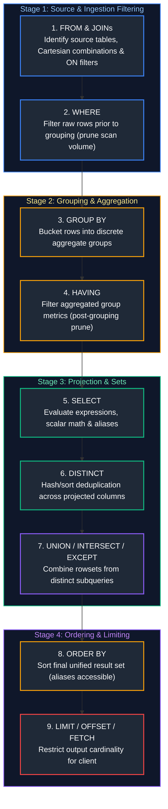

#### Engineering Implications
1. **Alias Invisibility in WHERE:** `WHERE total_amount > 100` fails if `total_amount` is defined in `SELECT` as `SELECT (qty * price) AS total_amount`. The `WHERE` clause executes at Step 2, long before `SELECT` creates the alias at Step 5.
2. **Alias Visibility in ORDER BY:** `ORDER BY total_amount DESC` succeeds because `ORDER BY` executes at Step 8, after projection.
3. **WHERE vs HAVING Efficiency:** Always filter non-aggregate conditions in `WHERE` to prune row volume before the costly distributed hash or sort aggregation in Step 3.

---

# 2. Views vs Materialized Views

---

### Q38. View vs Materialized View
**Topic Covered:** Virtual vs Physical Table Materialization & Refresh Semantics  
**Question:** View vs Materialized View

#### Definition & Comparison Matrix
| Architectural Dimension | Standard View (Virtual Table) | Materialized View (Physical Snapshot) |
| :--- | :--- | :--- |
| **Physical Storage** | Zero bytes on disk. Only stores SQL text metadata in system catalog. | Consumes disk space. Stores the query's evaluated result set physically as a table. |
| **Execution Cost** | Evaluates underlying query every time the view is queried. Adds compute overhead. | Reads pre-computed physical data directly. Lightning fast response time ($O(1)$ scans). |
| **Data Freshness** | Always 100% real-time and up-to-date with underlying base tables. | Can become stale. Requires manual or scheduled refreshes (Complete or Incremental). |
| **Write Impact** | Zero overhead on DML operations on base tables. | Maintenance overhead during base table `INSERT`/`UPDATE` if auto-refreshed. |
| **Indexes** | Cannot be indexed directly (except Indexed Views in SQL Server with strict schemas). | Supports secondary B-Tree/Bitmap indexes on the materialized result set. |

#### Production Implementation
```sql
-- PostgreSQL Standard View (Dynamic query macro)
CREATE OR REPLACE VIEW v_customer_order_summary AS
SELECT 
    c.customer_id,
    c.customer_name,
    COUNT(o.order_id) AS total_orders,
    SUM(o.order_amount) AS total_revenue
FROM customers c
JOIN orders o ON c.customer_id = o.customer_id
GROUP BY c.customer_id, c.customer_name;

-- PostgreSQL Materialized View (Physically persisted dataset)
CREATE MATERIALIZED VIEW mv_customer_order_summary AS
SELECT 
    c.customer_id,
    c.customer_name,
    COUNT(o.order_id) AS total_orders,
    SUM(o.order_amount) AS total_revenue
FROM customers c
JOIN orders o ON c.customer_id = o.customer_id
GROUP BY c.customer_id, c.customer_name;

-- Add an index on the materialized data
CREATE UNIQUE INDEX idx_mv_cust_id ON mv_customer_order_summary(customer_id);

-- Refresh strategy (Non-blocking concurrent refresh)
REFRESH MATERIALIZED VIEW CONCURRENTLY mv_customer_order_summary;
```

---

# 3. Query Troubleshooting & Performance Tuning

---

### Q1. Troubleshooting a Slow-Running Query (30m to 2m)
**Topic Covered:** Query Performance Diagnostics & Execution Plan Analysis  
**Question:** A query is running for 30 minutes instead of 2 minutes. How would you troubleshoot it?

#### Systematic Troubleshooting Playbook (The 5-Step Diagnostic Protocol)
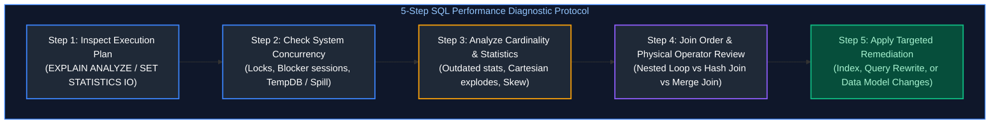

---

### Q2. Identifying Bottlenecks Across 5 Joined Large Tables
**Topic Covered:** Multi-Table Join Execution Bottlenecks & Cardinality Mismatch  
**Question:** A query is joining 5 large tables and taking too long. How would you identify which join is causing the performance issue?

#### Identifying Bottlenecks Across 5 Joined Tables
To pinpoint the problematic join among 5 large tables:
1. **Analyze Physical vs Estimated Rows:** In `EXPLAIN (ANALYZE, BUFFERS)` (Postgres) or Graphical Execution Plan (SQL Server), compare `Estimated Rows` vs `Actual Rows`. If a join estimates 1,000 rows but emits 10,000,000, the optimizer chose a **Nested Loop Join** instead of a **Hash Join**, causing catastrophic thrashing.
2. **Examine Disk Spills:** Look for operators with high `Spill to Workfile` or `TempDB Spill`. A Hash Join whose hash table exceeds RAM spills partitions to disk.
3. **Cartesian Product Explosion:** Check join predicates. A missing composite key component (e.g., joining on `customer_id` without `tenant_id`) produces an accidental $M \times N$ multiplier.

```sql
-- PostgreSQL: Deep diagnostic execution analysis
EXPLAIN (ANALYZE, BUFFERS, TIMING, COSTS, VERBOSE)
SELECT 
    c.customer_id, o.order_id, p.product_name, s.supplier_name, sh.shipping_status
FROM customers c
JOIN orders o ON c.customer_id = o.customer_id
JOIN order_items oi ON o.order_id = oi.order_id
JOIN products p ON oi.product_id = p.product_id
JOIN suppliers s ON p.supplier_id = s.supplier_id
JOIN shipments sh ON o.order_id = sh.order_id
WHERE o.order_date >= CURRENT_DATE - INTERVAL '30 days';
```

---

### Q39. Query Optimization: Indexes vs Query Rewrites vs Data Model Changes
**Topic Covered:** 3-Tier Optimization Hierarchy (Physical Storage, Logical Plan, Schema Model)  
**Question:** Query Optimization (Index vs Query Rewrite vs Data Model Changes)

#### Remediation Matrix: Indexing vs Query Rewrite vs Model Redesign
| Strategy Level | When to Apply | Concrete Action Examples |
| :--- | :--- | :--- |
| **1. Index Optimization** | Filter or Join columns perform full table scans (Sequential Scans). | • Create Composite Index matching filter order: `CREATE INDEX idx_orders ON orders(order_date, customer_id);`<br/>• Covering Index: Include projected fields (`INCLUDE (order_amount)`) to enable Index-Only Scans. |
| **2. Query Rewrite** | Query forces non-SARGable evaluations or suboptimal subplans. | • Eliminate scalar functions on indexed columns (change `WHERE YEAR(created_at) = 2024` to `WHERE created_at >= '2024-01-01' AND created_at < '2025-01-01'`).<br/>• Replace correlated subqueries with window functions or CTEs.<br/>• Replace `IN (subquery)` with `EXISTS` to avoid NULL evaluation hazards. |
| **3. Data Model Changes** | High-cardinality snowflaking or excessive joins at petabyte scale. | • Denormalize normalized tables into dimensional Star Schemas.<br/>• Introduce Table Partitioning (by `order_date` RANGE) and Clustering.<br/>• Pre-aggregate into Materialized Views or Delta Gold tables. |

---

# 4. Deduplication & Retrieving Latest Records

---

### Q3 & Q4. Identifying and Purging Duplicate Records While Keeping One Copy
**Topic Covered:** Window Deduplication & Deletion Strategies  
**Questions Covered:**
- **Q3**: A table contains duplicate customer records. How would you identify and remove duplicates while keeping the latest record?
- **Q4**: How would you find duplicate records in a table and delete only the duplicates while keeping one copy?

#### Core Concept: Window Deduplication Framework
To identify and retain the single most recent record (by timestamp or surrogate ID) while purging duplicates, the industry-standard approach uses `ROW_NUMBER() OVER (PARTITION BY ... ORDER BY ... DESC)`.

#### Production Queries: Identification, Read-Only Retrieval & Deletion

##### Step 1: Identify Duplicate Customer Records
```sql
SELECT 
    customer_id,
    email,
    COUNT(*) AS record_count
FROM customer_records
GROUP BY customer_id, email
HAVING COUNT(*) > 1;
```

---

### Q14. Retrieving Only the Latest Transaction per Customer
**Topic Covered:** Event-Time Deduplication via Window Partitioning  
**Question:** You have transaction records with multiple updates for the same customer. How would you retrieve only the latest transaction for each customer?

---

### Q15. Retrieving Only the Most Recently Updated Address per Customer
**Topic Covered:** Temporal Address Entity Resolution  
**Question:** A customer has multiple addresses. How would you retrieve only the most recently updated address for each customer?

##### Step 2: Retrieve Only the Latest Transaction / Address per Customer (Q14 & Q15)
```sql
-- Solution using CTE with ROW_NUMBER()
WITH ranked_transactions AS (
    SELECT 
        customer_id,
        transaction_id,
        transaction_date,
        amount,
        ROW_NUMBER() OVER (
            PARTITION BY customer_id 
            ORDER BY transaction_date DESC, transaction_id DESC
        ) AS rn
    FROM customer_transactions
)
SELECT 
    customer_id,
    transaction_id,
    transaction_date,
    amount
FROM ranked_transactions
WHERE rn = 1;
```

##### Step 3: Physically Delete Duplicates While Retaining One Latest Copy (Q3 & Q4)

*Approach A: SQL Server / Oracle CTE Deletion*
```sql
WITH deduplication_cte AS (
    SELECT 
        customer_id,
        updated_at,
        ROW_NUMBER() OVER (
            PARTITION BY customer_id 
            ORDER BY updated_at DESC, id DESC
        ) AS row_num
    FROM customer_records
)
DELETE FROM deduplication_cte
WHERE row_num > 1;
```

*Approach B: PostgreSQL / MySQL CTID or Primary Key Self-Join*
```sql
DELETE FROM customer_records
WHERE id IN (
    SELECT id
    FROM (
        SELECT id,
               ROW_NUMBER() OVER (
                   PARTITION BY customer_id 
                   ORDER BY updated_at DESC, id DESC
               ) AS rn
        FROM customer_records
    ) sub
    WHERE sub.rn > 1
);
```

---

# 5. Rankings & N-th Highest Values

---

#### Ranking Functions Comparison
- `ROW_NUMBER()`: Monotonically increasing unique numbers (1, 2, 3, 4...). Never produces ties.
- `RANK()`: Assigns identical rank for ties, but **skips subsequent ranks** (1, 2, 2, 4...).
- `DENSE_RANK()`: Assigns identical rank for ties **without skipping subsequent ranks** (1, 2, 2, 3...). **Crucial for N-th highest salary calculations.**

| Salary Value | `ROW_NUMBER()` | `RANK()` | `DENSE_RANK()` | Operational Ranking Behavior |
| :---: | :---: | :---: | :---: | :--- |
| **\$100** | 1 | 1 | 1 | Highest salary (1st rank) |
| **\$90** | 2 | 2 | 2 | Tied salary (shares 2nd rank) |
| **\$90** | 3 | 2 | 2 | Tied salary (shares 2nd rank; `RANK` records tie) |
| **\$80** | 4 | 4 | 3 | Next distinct salary (`RANK` skips 3 to 4; `DENSE_RANK` smoothly continues to 3) |

---

### Q5. Second-Highest Salary in Each Department
**Topic Covered:** Window Ranking Functions (`DENSE_RANK` vs `ROW_NUMBER`)  
**Question:** How would you find the second-highest salary in each department?

#### Production Query: Second-Highest Salary per Department (Q5)
```sql
WITH ranked_salaries AS (
    SELECT 
        department_id,
        employee_id,
        salary,
        DENSE_RANK() OVER (
            PARTITION BY department_id 
            ORDER BY salary DESC
        ) AS salary_rank
    FROM employees
)
SELECT 
    department_id,
    employee_id,
    salary
FROM ranked_salaries
WHERE salary_rank = 2;
```

---

### Q6. Third-Highest Salary Without TOP or LIMIT
**Topic Covered:** ANSI Subquery Offsets & Correlated Subqueries  
**Question:** Write a SQL query to fetch the third highest salary from the Employee table without using TOP or LIMIT.

#### Production Query: Third-Highest Salary WITHOUT TOP or LIMIT (Q6)

*Method 1: DENSE_RANK Window Function*
```sql
WITH ranked_emp AS (
    SELECT 
        salary,
        DENSE_RANK() OVER (ORDER BY salary DESC) AS rnk
    FROM employees
)
SELECT DISTINCT salary 
FROM ranked_emp 
WHERE rnk = 3;
```

*Method 2: Correlated Subquery / Self-Join (Pure ANSI SQL-92)*
```sql
SELECT DISTINCT e1.salary
FROM employees e1
WHERE 2 = (
    SELECT COUNT(DISTINCT e2.salary)
    FROM employees e2
    WHERE e2.salary > e1.salary
);
```

---

### Q13. Top 3 Products by Revenue in Each Category
**Topic Covered:** Category Partitioning & Dense Ranking  
**Question:** How would you find the top 3 products by revenue in each category?

#### Production Query: Top 3 Products by Revenue per Category (Q13)
```sql
WITH product_revenues AS (
    SELECT 
        category_id,
        product_id,
        SUM(sales_amount) AS total_revenue
    FROM order_details
    GROUP BY category_id, product_id
),
ranked_products AS (
    SELECT 
        category_id,
        product_id,
        total_revenue,
        DENSE_RANK() OVER (
            PARTITION BY category_id 
            ORDER BY total_revenue DESC
        ) AS rev_rank
    FROM product_revenues
)
SELECT 
    category_id,
    product_id,
    total_revenue
FROM ranked_products
WHERE rev_rank <= 3
ORDER BY category_id, total_revenue DESC;
```

---

### Q34. Second Most Recent Login per User Using Window Functions
**Topic Covered:** Event-Time Ordering with Window Qualification  
**Question:** How do you find the second most recent login for every user using Window functions?

#### Production Query: Second Most Recent Login per User (Q34)
```sql
WITH user_logins AS (
    SELECT 
        user_id,
        login_timestamp,
        ip_address,
        ROW_NUMBER() OVER (
            PARTITION BY user_id 
            ORDER BY login_timestamp DESC
        ) AS login_seq
    FROM user_login_events
)
SELECT 
    user_id,
    login_timestamp AS second_recent_login,
    ip_address
FROM user_logins
WHERE login_seq = 2;
```

---

# 6. Hierarchical & Comparative Analytics

---

### Q7. Employees Earning More Than Department Average
**Topic Covered:** Correlated Subqueries & Window Aggregations (`AVG() OVER (PARTITION BY)`)  
**Question:** How would you find employees whose salary is higher than their department's average salary?

#### Question 7: Salary Higher Than Department Average
We compare an individual row metric against an aggregated partition metric. The most performant approach is an analytical window function `AVG() OVER (PARTITION BY ...)`.

```sql
-- Solution using Window Function (Single Table Scan)
WITH emp_with_dept_avg AS (
    SELECT 
        employee_id,
        employee_name,
        department_id,
        salary,
        AVG(salary) OVER(PARTITION BY department_id) AS dept_avg_salary
    FROM employees
)
SELECT 
    employee_id,
    employee_name,
    department_id,
    salary,
    ROUND(dept_avg_salary, 2) AS dept_avg_salary
FROM emp_with_dept_avg
WHERE salary > dept_avg_salary;
```

---

### Q8. Employees Earning More Than Their Direct Manager
**Topic Covered:** Self-Joins & Manager-Employee Hierarchies  
**Question:** Write an SQL query to find employees who earn more than their direct manager.

#### Question 8: Employees Earning More Than Their Direct Manager
This requires an adjacency list self-join connecting the employee table `e` to itself as manager `m` on `e.manager_id = m.employee_id`.

```sql
SELECT 
    e.employee_id AS emp_id,
    e.employee_name AS emp_name,
    e.salary AS emp_salary,
    m.employee_id AS manager_id,
    m.employee_name AS manager_name,
    m.salary AS manager_salary
FROM employees e
INNER JOIN employees m 
    ON e.manager_id = m.employee_id
WHERE e.salary > m.salary;
```

---

# 7. NULL Value Handling & 3-Valued Logic

---

### Q9. Defensive Handling of NULLs in Critical Columns
**Topic Covered:** Three-Valued Logic (3VL) & Defensive NULL Handling  
**Question:** You have NULL values in a critical column. How would you handle them?

#### Core Concept: Three-Valued Logic (3VL)
In SQL, `NULL` represents the **absence of a value** or an **unknown**. SQL implements Three-Valued Logic with truth values: `TRUE`, `FALSE`, and `UNKNOWN`.
- `NULL = NULL` evaluates to `UNKNOWN`, not `TRUE`.
- `WHERE column <> 5` discards rows where `column IS NULL` because `NULL <> 5` is `UNKNOWN`.
- **The NOT IN NULL Trap:** `WHERE id NOT IN (1, 2, NULL)` evaluates to `UNKNOWN` for all rows, returning an empty result set!

#### Defensive Handling Strategies
1. **Fallback Coalescing:** `COALESCE(val1, val2, ...)` returns the first non-null argument.
2. **Division by Zero Protection:** `NULLIF(denominator, 0)` converts 0 to `NULL`, preventing runtime crash.
3. **Imputation:** Populate missing values using moving averages or business defaults.
4. **Sentinel Flags:** Create an indicator column `is_missing_flag = CASE WHEN col IS NULL THEN 1 ELSE 0 END`.

```sql
-- Comprehensive production NULL handling pattern
SELECT 
    customer_id,
    -- Strategy 1: Default fallback string
    COALESCE(phone_number, 'NOT_PROVIDED') AS sanitized_phone,
    
    -- Strategy 2: Defensive division using NULLIF
    COALESCE(total_spend / NULLIF(total_orders, 0), 0.0) AS avg_spend_per_order,
    
    -- Strategy 3: Window forward-fill imputation for temporal time-series
    COALESCE(
        current_price, 
        LAST_VALUE(current_price IGNORE NULLS) OVER (
            PARTITION BY asset_id 
            ORDER BY timestamp_utc 
            ROWS BETWEEN UNBOUNDED PRECEDING AND CURRENT ROW
        )
    ) AS imputed_price
FROM customer_financials;
```

---

# 8. Table Diffs & Change Tracking

---

### Q10. Table Comparison: Identifying Inserted, Deleted, and Modified Records
**Topic Covered:** Full Outer Join, CHECKSUM & EXCEPT Set Differences  
**Question:** How would you compare two tables and identify inserted, deleted, and modified records?

#### Question 10: Table Comparison (INSERT, DELETE, UPDATE)
Given `table_previous` (Day T-1) and `table_current` (Day T):
- **INSERTED:** Exists in Current, missing in Previous.
- **DELETED:** Exists in Previous, missing in Current.
- **MODIFIED:** Exists in both on Primary Key, but attributes/hash differ.

```sql
WITH table_diff AS (
    SELECT 
        COALESCE(curr.id, prev.id) AS entity_id,
        CASE 
            WHEN prev.id IS NULL THEN 'INSERT'
            WHEN curr.id IS NULL THEN 'DELETE'
            WHEN curr.hash_diff <> prev.hash_diff THEN 'UPDATE'
            ELSE 'UNCHANGED'
        END AS change_type,
        prev.data_payload AS old_data,
        curr.data_payload AS new_data
    FROM (
        SELECT id, data_payload, 
               MD5(CONCAT(col1, '|', col2, '|', col3)) AS hash_diff 
        FROM table_current
    ) curr
    FULL OUTER JOIN (
        SELECT id, data_payload, 
               MD5(CONCAT(col1, '|', col2, '|', col3)) AS hash_diff 
        FROM table_previous
    ) prev 
        ON curr.id = prev.id
)
SELECT * 
FROM table_diff 
WHERE change_type <> 'UNCHANGED';
```

---

### Q11. Identifying Employee Records Changed Between Two Dates
**Topic Covered:** Temporal Self-Joins & Attribute Comparison  
**Question:** A table contains multiple records for the same employee. How would you identify the records that have changed between two dates?

#### Question 11: Identifying Employee Records Changed Between Two Dates
```sql
SELECT 
    t1.employee_id,
    t1.record_date AS date_start,
    t2.record_date AS date_end,
    t1.department AS dept_at_start,
    t2.department AS dept_at_end,
    t1.salary AS salary_at_start,
    t2.salary AS salary_at_end
FROM employee_history t1
JOIN employee_history t2 
    ON t1.employee_id = t2.employee_id
WHERE t1.record_date = '2024-01-01'
  AND t2.record_date = '2024-12-31'
  AND (
      t1.department <> t2.department 
      OR t1.salary <> t2.salary 
      OR t1.designation <> t2.designation
  );
```

---

# 9. Relational Completeness & Temporal Aggregations

---

### Q12. Customers Purchasing in Every Month of a Year (Relational Division)
**Topic Covered:** Relational Division & Group Count Completeness  
**Question:** How would you find customers who made purchases in every month of a year?

#### Question 12: Customers Purchasing in Every Month of a Year (Relational Division)
```sql
SELECT customer_id
FROM transactions
WHERE transaction_date >= '2024-01-01' 
  AND transaction_date < '2025-01-01'
GROUP BY customer_id
-- Distinct count of transaction months must equal exactly 12
HAVING COUNT(DISTINCT EXTRACT(MONTH FROM transaction_date)) = 12;
```

---

### Q16. Customers with 2025 Spending Higher Than 2024 Spending
**Topic Covered:** Conditional Aggregation (`FILTER / CASE WHEN`) & Year-over-Year Comparison  
**Question:** A source table has records for 2024 and 2025, but the business wants customers whose 2025 spending is higher than their 2024 spending. How would you write the query?

#### Question 16: Customers with 2025 Spending Higher Than 2024 Spending
We aggregate conditional sums by year using `CASE WHEN`:
```sql
SELECT 
    customer_id,
    SUM(CASE WHEN EXTRACT(YEAR FROM order_date) = 2024 THEN amount ELSE 0 END) AS spend_2024,
    SUM(CASE WHEN EXTRACT(YEAR FROM order_date) = 2025 THEN amount ELSE 0 END) AS spend_2025
FROM customer_orders
WHERE EXTRACT(YEAR FROM order_date) IN (2024, 2025)
GROUP BY customer_id
HAVING 
    SUM(CASE WHEN EXTRACT(YEAR FROM order_date) = 2025 THEN amount ELSE 0 END) > 
    SUM(CASE WHEN EXTRACT(YEAR FROM order_date) = 2024 THEN amount ELSE 0 END);
```

---

### Q19 & Q30. Month-over-Month Spending Growth & LAG vs LEAD Functions
**Topic Covered:** Temporal Offsets & Growth Metrics  
**Questions Covered:**
- **Q19**: A customer has transactions on multiple dates. How would you find the month-over-month change in their spending?
- **Q30**: What is the difference between LAG and LEAD, with a churn or month-over-month use case?

#### Questions 19 & 30: Month-over-Month (MoM) Growth & LAG vs LEAD

##### Definition: LAG vs LEAD
- `LAG(col, offset, default)`: Accesses data from a previous row at a specified physical offset prior to the current row.
- `LEAD(col, offset, default)`: Accesses data from a subsequent row at a specified offset ahead of the current row.

```mermaid
flowchart LR
    subgraph WindowOffsets ["Window Analytical Offsets: LAG vs LEAD"]
        R1["Row N-1 (Previous Month)"] -->|LAG(amount, 1)| R2["Row N (Current Month)"]
        R2 -->|LEAD(amount, 1)| R3["Row N+1 (Next Month)"]
    end

    style WindowOffsets fill:#0f172a,stroke:#8b5cf6,stroke-width:1.5px,color:#c084fc
    style R1 fill:#1f2937,stroke:#3b82f6,stroke-width:2px,color:#fff
    style R2 fill:#1f2937,stroke:#10b981,stroke-width:2px,color:#fff
    style R3 fill:#1f2937,stroke:#f59e0b,stroke-width:2px,color:#fff
```

```sql
WITH monthly_customer_spend AS (
    SELECT 
        customer_id,
        DATE_TRUNC('month', transaction_date) AS txn_month,
        SUM(amount) AS current_spend
    FROM transactions
    GROUP BY customer_id, DATE_TRUNC('month', transaction_date)
),
mom_calculation AS (
    SELECT 
        customer_id,
        txn_month,
        current_spend,
        LAG(current_spend, 1) OVER (
            PARTITION BY customer_id 
            ORDER BY txn_month
        ) AS previous_month_spend
    FROM monthly_customer_spend
)
SELECT 
    customer_id,
    txn_month,
    current_spend,
    previous_month_spend,
    (current_spend - previous_month_spend) AS absolute_mom_growth,
    ROUND(
        100.0 * (current_spend - previous_month_spend) / NULLIF(previous_month_spend, 0), 
        2
    ) AS percentage_mom_growth
FROM mom_calculation;
```

---

# 10. Islands, Gaps & Date Range Overlaps

---

### Q17 & Q18. Gaps in a Sequence of IDs and Consecutive Islands
**Topic Covered:** Gaps and Islands Problem via Window Functions (`LAG` & Difference of Row Numbers)  
**Questions Covered:**
- **Q17**: How would you identify gaps in a sequence of transaction IDs?
- **Q18**: Write a query to find gaps in a sequence of IDs / dates (islands & gaps problem).

#### Questions 17 & 18: Gaps in a Sequence of IDs
A gap occurs when `next_id - current_id > 1`. We use `LEAD()`:

```sql
WITH sequence_gaps AS (
    SELECT 
        transaction_id AS current_id,
        LEAD(transaction_id) OVER (ORDER BY transaction_id) AS next_id
    FROM transactions
)
SELECT 
    current_id + 1 AS gap_start,
    next_id - 1 AS gap_end,
    (next_id - current_id - 1) AS missing_count
FROM sequence_gaps
WHERE next_id - current_id > 1;
```

#### The Islands Problem (Consecutive Date Sequences)
```sql
-- Finding contiguous islands of activity dates
WITH ranked_dates AS (
    SELECT 
        user_id,
        activity_date,
        -- The difference between continuous dates and a sequential row number produces a constant group key!
        activity_date - (ROW_NUMBER() OVER (PARTITION BY user_id ORDER BY activity_date) * INTERVAL '1 day') AS island_key
    FROM user_activities
)
SELECT 
    user_id,
    MIN(activity_date) AS island_start,
    MAX(activity_date) AS island_end,
    COUNT(*) AS consecutive_days
FROM ranked_dates
GROUP BY user_id, island_key
ORDER BY user_id, island_start;
```

---

### Q29. Calculating Total Number of Overlapping Days Across Date Ranges
**Topic Covered:** Temporal Range Consolidation & Overlap Merging  
**Question:** A table has a start_date and end_date column. How would you calculate the total number of overlapping days across all rows?

#### Question 29: Calculating Total Number of Overlapping Days
When intervals overlap, simply summing `end_date - start_date` double-counts days. We must merge overlapping intervals into unified non-overlapping blocks first:

```sql
WITH ordered_intervals AS (
    SELECT 
        start_date,
        end_date,
        -- Track the highest end_date observed so far
        MAX(end_date) OVER (
            ORDER BY start_date 
            ROWS BETWEEN UNBOUNDED PRECEDING AND 1 PRECEDING
        ) AS max_prev_end
    FROM intervals
),
island_starts AS (
    SELECT 
        start_date,
        end_date,
        -- A new island begins when current start_date > max_prev_end
        CASE WHEN max_prev_end IS NULL OR start_date > max_prev_end THEN 1 ELSE 0 END AS is_new_island
    FROM ordered_intervals
),
island_groups AS (
    SELECT 
        start_date,
        end_date,
        SUM(is_new_island) OVER (ORDER BY start_date ROWS UNBOUNDED PRECEDING) AS island_id
    FROM island_starts
),
merged_intervals AS (
    SELECT 
        island_id,
        MIN(start_date) AS merged_start,
        MAX(end_date) AS merged_end
    FROM island_groups
    GROUP BY island_id
)
SELECT 
    -- Total raw days minus merged non-overlapping days equals total overlapping days
    (SELECT SUM(end_date - start_date) FROM intervals) - 
    (SELECT SUM(merged_end - merged_start) FROM merged_intervals) AS total_overlapping_days;
```

---

# 11. Anti-Joins & Inactivity Detection

---

### Q20 & Q21. Identifying Customers with No Purchases in 6 to 12 Months
**Topic Covered:** Anti-Join Patterns (`NOT EXISTS`, `LEFT JOIN ... WHERE NULL`, `NOT IN`)  
**Questions Covered:**
- **Q20**: How would you find customers who have never made a purchase in the last 12 months?
- **Q21**: Given two tables — Customers and Orders — write a query to find customers who haven't placed any orders in the last 6 months.

#### Architectural Evaluation: Anti-Join Strategies
There are three standard methods to write an Anti-Join:
1. `LEFT JOIN ... WHERE right.key IS NULL`
2. `NOT EXISTS (SELECT 1 FROM ...)`
3. `NOT IN (SELECT key FROM ...)`

> [!WARNING]
> Never use `NOT IN` if the subquery column can contain `NULL` values. If a single `NULL` is returned, the entire condition evaluates to `UNKNOWN` and returns zero rows. Prefer `NOT EXISTS` or `LEFT JOIN ... WHERE right.key IS NULL`.

#### Production Query: Customers Without Orders in the Last 6 Months (Q21)

*Pattern A: NOT EXISTS (Optimizer Recommended - Short Circuits on Match)*
```sql
SELECT 
    c.customer_id,
    c.customer_name
FROM customers c
WHERE NOT EXISTS (
    SELECT 1 
    FROM orders o 
    WHERE o.customer_id = c.customer_id
      AND o.order_date >= CURRENT_DATE - INTERVAL '6 months'
);
```

*Pattern B: LEFT JOIN Anti-Join*
```sql
SELECT 
    c.customer_id,
    c.customer_name
FROM customers c
LEFT JOIN orders o 
    ON c.customer_id = o.customer_id 
   AND o.order_date >= CURRENT_DATE - INTERVAL '6 months'
WHERE o.order_id IS NULL;
```

---

# 12. CTEs, Temp Tables & Recursive Safety

---

### Q22. CTE vs Temp Table Execution Plan Reuse & Recompiles
**Topic Covered:** Physical Materialization, Optimizer Inlining & TempDB Spooling  
**Question:** Difference between a CTE and a temp table in terms of plan reuse and recompiles.

#### CTE vs Temporary Table Comparison
| Dimension | Common Table Expression (CTE) | Temporary Table (`#temp_table`) |
| :--- | :--- | :--- |
| **Lifecycle** | Statement scope only. Ceases to exist immediately after the query. | Session scope. Persists until explicitly dropped or session disconnects. |
| **Materialization** | Inlined as a derived table (unless using `MATERIALIZED` hint in PostgreSQL 12+). Evaluated on every reference. | Physically written to disk/TempDB. Materialized once. |
| **Statistics & Indexes** | No statistics; no dedicated indexes. Query optimizer must guess cardinality. | Maintains full distribution statistics; supports clustered and non-clustered indexes. |
| **Plan Reuse & Recompiles**| Does not trigger stored procedure recompiles. Re-evaluated per reference. | May trigger procedure recompilations upon schema definition changes. Ideal for complex multi-step pipelines. |

---

### Q28. Recursive CTEs, MAXRECURSION & Preventing Runaway Recursion
**Topic Covered:** Recursive Query Evaluation, Graph Traversal Cycles & Safety Limits  
**Question:** What is MAXRECURSION on a recursive CTE, and how do you prevent runaway recursion?

#### Question 28: Recursive CTEs & MAXRECURSION
Recursive CTEs traverse hierarchical trees or graph relationships. Runaway recursion occurs if data contains cyclic loops (e.g., A reports to B, B reports to A).

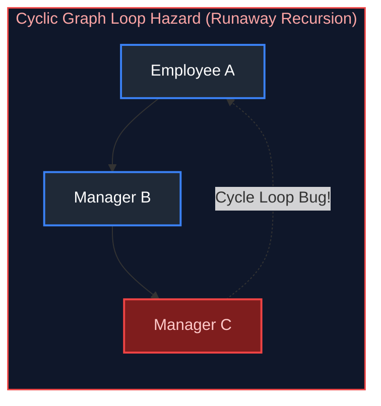

#### Production Query: Organizational Hierarchy with Cycle Detection & MAXRECURSION
```sql
-- SQL Server syntax with OPTION (MAXRECURSION 100)
WITH OrgTree AS (
    -- Anchor Member: Root CEO
    SELECT 
        employee_id,
        manager_id,
        employee_name,
        1 AS depth,
        CAST(employee_id AS VARCHAR(MAX)) AS audit_path
    FROM employees
    WHERE manager_id IS NULL
    
    UNION ALL
    
    -- Recursive Member
    SELECT 
        e.employee_id,
        e.manager_id,
        e.employee_name,
        ot.depth + 1,
        CONCAT(ot.audit_path, '->', e.employee_id)
    FROM employees e
    INNER JOIN OrgTree ot ON e.manager_id = ot.employee_id
    -- Defensive Guard against cyclic data graph
    WHERE ot.audit_path NOT LIKE CONCAT('%', CAST(e.employee_id AS VARCHAR(MAX)), '%')
)
SELECT * FROM OrgTree
OPTION (MAXRECURSION 50); -- Limits recursion depth to 50 iterations; throws error on 51st
```

---

# 13. Dynamic PIVOT & Schema Transformation

---

### Q23. Dynamic PIVOT When Column Values Are Unknown Ahead of Time
**Topic Covered:** Dynamic SQL, Relational Metaprogramming & Crosstab Projections  
**Question:** How do you write a dynamic PIVOT when the column values aren't known ahead of time?

#### Technical Challenge
Static `PIVOT` statements require hardcoding all output column names in the query text. When pivot categories are created dynamically (e.g., new products, dynamic fiscal quarters), dynamic SQL must extract the distinct categories into an aggregated string variable before executing.

#### Production Solution: Dynamic SQL PIVOT (SQL Server)
```sql
DECLARE @ColumnNames NVARCHAR(MAX) = '';
DECLARE @SQLStatement NVARCHAR(MAX) = '';

-- 1. Construct comma-separated list of quoted distinct column values
SELECT @ColumnNames += QUOTENAME(category_name) + ','
FROM (SELECT DISTINCT category_name FROM sales_records) AS categories;

-- Remove trailing comma
SET @ColumnNames = LEFT(@ColumnNames, LEN(@ColumnNames) - 1);

-- 2. Construct the full dynamic SQL PIVOT statement
SET @SQLStatement = '
SELECT sale_year, ' + @ColumnNames + '
FROM (
    SELECT 
        sale_year,
        category_name,
        sale_amount
    FROM sales_records
) AS SourceTable
PIVOT (
    SUM(sale_amount)
    FOR category_name IN (' + @ColumnNames + ')
) AS PivotTable
ORDER BY sale_year;';

-- 3. Execute safely using sp_executesql
EXEC sp_executesql @SQLStatement;
```

---

# 14. Partition Switching & Physical Storage Mechanics

---

### Q24. Partition Switching Mechanics & Near-Instant Metadata Swaps
**Topic Covered:** Storage Engine B-Tree Pointer Swapping & Allocation Unit Relinking  
**Question:** What is partition switching in SQL Server, and why is it near-instant?

#### Definition & Core Mechanics
**Partition Switching** is a metadata-only DDL operation (`ALTER TABLE ... SWITCH PARTITION ... TO ...`) that moves an entire partition of data from one table to another (or staging table) almost instantaneously ($<100\text{ ms}$), regardless of whether the partition contains 100 rows or 100 million rows.

#### Why Is It Near-Instant?
Partition switching does **not** perform physical I/O or copy data blocks across storage clusters. Instead:
1. The database engine simply updates the pointer in the system catalog metadata (`sys.allocation_units`).
2. The data pages allocated to the source partition are re-assigned to the target table's partition metadata.

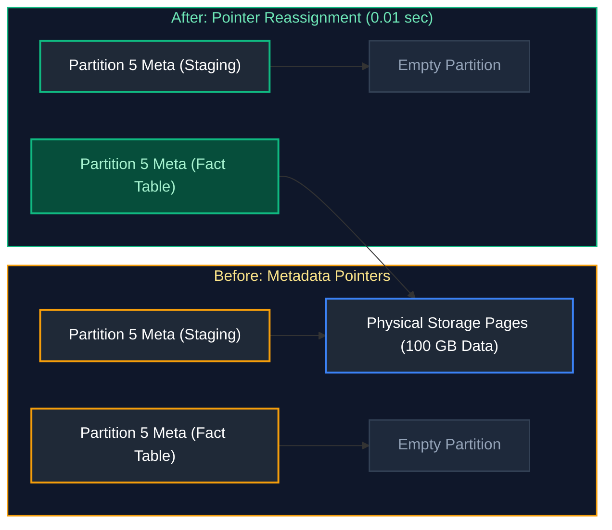

#### Strict Prerequisites for Partition Switching
- Both source and target tables must exist on the exact same filegroup.
- Both tables must have identical schemas (columns, data types, nullability, collations).
- Indexes must be identically partition-aligned.
- The staging table must have a `CHECK` constraint matching the exact boundary values of the target partition.

---

# 15. Relational Joins, Anti-Joins & Set Theory

---

### Q25. FULL OUTER JOIN vs Union of Left and Right Anti-Joins
**Topic Covered:** Relational Set Theory & Disjoint Join Partitioning  
**Question:** Difference between a full outer join and a union of left + right anti joins.

#### Question 25: FULL OUTER JOIN vs Union of Anti-Joins
- **FULL OUTER JOIN:** Returns:
  1. All matched rows from both tables ($A \cap B$).
  2. Unmatched rows from the left table ($A - B$).
  3. Unmatched rows from the right table ($B - A$).
- **Union of Left Anti-Join + Right Anti-Join:** Returns **only the symmetric difference** ($(A - B) \cup (B - A)$). It strictly **excludes** all matching rows!

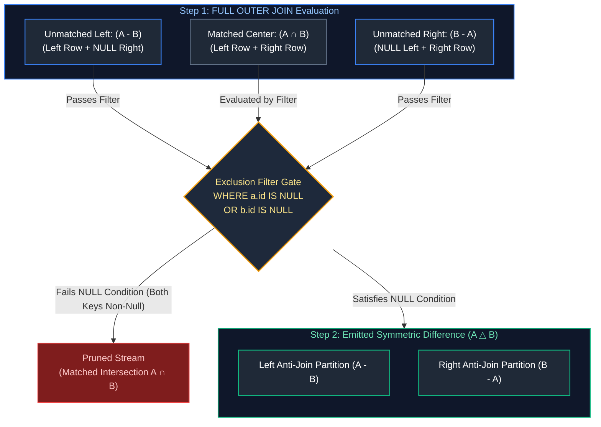

##### Relational Pattern Comparison: Symmetric Difference

| Pattern | SQL Formulation | Engine Execution Mechanism | Optimizer Cost Profile | Production Recommendation |
| :--- | :--- | :--- | :--- | :--- |
| **Filtered FULL OUTER JOIN** | `FROM A FULL JOIN B ON A.id = B.id WHERE A.id IS NULL OR B.id IS NULL` | Single Sort-Merge or Hash Join pass; evaluates post-join filter on emitted null-padded streams. | Requires single dual-table shuffle, but materializes and discards matched intersection in memory. | **Recommended** when tables have comparable size; minimizes physical shuffle passes. |
| **Union of Anti-Joins** | `SELECT * FROM A WHERE NOT EXISTS (...) UNION ALL SELECT * FROM B WHERE NOT EXISTS (...)` | Two separate Left Anti-Semi Joins followed by concatenation (`UNION ALL`). | Requires two independent scans of both tables and two separate join stages. | **Recommended** when an index exists on join keys or one table is dramatically smaller. |

---

### Q26. INNER JOIN vs LEFT JOIN vs CROSS JOIN Mechanics
**Topic Covered:** Relational Join Predicates & Cartesian Products  
**Question:** Explain the difference between INNER JOIN, LEFT JOIN, and CROSS JOIN with an example.

#### Question 26: INNER JOIN vs LEFT JOIN vs CROSS JOIN Illustrated
```sql
-- Sample Datasets:
-- Users: [ID 1: Alice, ID 2: Bob]
-- Orders: [OrderID 101, UserID 1], [OrderID 102, UserID 3]

-- 1. INNER JOIN: Returns only intersecting matches (Alice / Order 101)
SELECT u.name, o.order_id 
FROM users u 
INNER JOIN orders o ON u.user_id = o.user_id;

-- 2. LEFT JOIN: Returns ALL left users, filling NULLs for orders (Alice/101, Bob/NULL)
SELECT u.name, o.order_id 
FROM users u 
LEFT JOIN orders o ON u.user_id = o.user_id;

-- 3. CROSS JOIN: Cartesian Product (2 users * 2 orders = 4 combinations)
SELECT u.name, o.order_id 
FROM users u 
CROSS JOIN orders o;
```

---

# 16. Group By vs Window Functions & Filter Semantics

---

### Q27. GROUP BY vs Window Aggregation and Row Cardinality
**Topic Covered:** Aggregation Cardinality Reduction vs In-Line Window Computations  
**Question:** Difference between GROUP BY and a window aggregation. When does each return more rows?

#### Question 27: GROUP BY vs Window Aggregation
- `GROUP BY`: Collapses raw rows into a single aggregated row per unique key combination. Reduces row cardinality.
- `WINDOW AGGREGATION` (`OVER (...)`): Computes aggregated values over a partition while **retaining every individual raw row**. Row cardinality is preserved.

```sql
-- GROUP BY collapses 1,000 rows into 10 rows (1 per dept)
SELECT department_id, AVG(salary) AS avg_sal
FROM employees
GROUP BY department_id;

-- Window Aggregation returns all 1,000 rows with dept avg attached to each row
SELECT employee_id, salary, AVG(salary) OVER(PARTITION BY department_id) AS dept_avg_sal
FROM employees;
```

---

### Q31. WHERE vs HAVING Semantics and Filter Scoping
**Topic Covered:** Pre-Aggregation vs Post-Aggregation Filtering Scoping  
**Question:** Difference between WHERE and HAVING, and why HAVING can't always be replaced by WHERE.

#### Question 31: WHERE vs HAVING
- `WHERE` executes **before** aggregation (Step 2). Evaluates row-level predicates on raw columns. Cannot evaluate aggregate functions like `SUM(amount) > 500`.
- `HAVING` executes **after** aggregation (Step 4). Evaluates group-level predicates on calculated aggregates.
- **Why HAVING cannot always be replaced by WHERE:** If a condition tests an aggregate metric (e.g., `HAVING COUNT(*) > 5` or `HAVING SUM(sales) > 10000`), the metric does not exist until the rows are grouped. Writing `WHERE SUM(sales) > 10000` throws a syntax error.

---

# 17. E-Commerce Aggregations & Customer Analytics

---

### Q32. Total Revenue per Customer from Orders and Order Items
**Topic Covered:** Multi-Table Financial Aggregations  
**Question:** Calculate total revenue per customer using Orders and Order_Items tables.

#### Question 32: Total Revenue per Customer
```sql
SELECT 
    o.customer_id,
    SUM(oi.quantity * oi.unit_price) AS total_revenue
FROM orders o
JOIN order_items oi ON o.order_id = oi.order_id
GROUP BY o.customer_id;
```

---

### Q33. Highest Spending Customers in the Last Month
**Topic Covered:** Rolling Temporal Filters & Aggregate Ordering  
**Question:** Write SQL to get customers who spent the most in the last month.

#### Question 33: Highest Spending Customers in the Last Month
```sql
SELECT 
    o.customer_id,
    SUM(oi.quantity * oi.unit_price) AS last_month_spend
FROM orders o
JOIN order_items oi ON o.order_id = oi.order_id
WHERE o.order_date >= DATE_TRUNC('month', CURRENT_DATE - INTERVAL '1 month')
  AND o.order_date < DATE_TRUNC('month', CURRENT_DATE)
GROUP BY o.customer_id
ORDER BY last_month_spend DESC
LIMIT 5;
```

---

### Q36. Users Placing >20 Critical Orders Every Week for >= 1 Month
**Topic Covered:** Multi-Level Temporal Grouping & Consecutiveness Verification  
**Question:** From a transactions table, write a query to identify users who placed more than 20 critical orders every week for at least 1 month.

#### Question 36: Users Placing >20 Critical Orders Every Week for >= 1 Month
To qualify, a user must have at least 4 contiguous weeks (1 month) where each week contains $>20$ critical orders.

```sql
WITH weekly_critical_orders AS (
    SELECT 
        user_id,
        DATE_TRUNC('week', order_timestamp) AS order_week,
        COUNT(*) AS critical_count
    FROM orders
    WHERE order_priority = 'CRITICAL'
    GROUP BY user_id, DATE_TRUNC('week', order_timestamp)
    HAVING COUNT(*) > 20
),
weekly_islands AS (
    SELECT 
        user_id,
        order_week,
        -- Group consecutive weeks using row number difference
        order_week - (ROW_NUMBER() OVER (PARTITION BY user_id ORDER BY order_week) * INTERVAL '1 week') AS island_key
    FROM weekly_critical_orders
)
SELECT 
    user_id,
    COUNT(*) AS consecutive_weeks_count,
    MIN(order_week) AS streak_start,
    MAX(order_week) AS streak_end
FROM weekly_islands
GROUP BY user_id, island_key
HAVING COUNT(*) >= 4; -- At least 4 consecutive weeks (~1 month)
```

---

# 18. MERGE vs UPSERT Implementation

---

### Q35. MERGE Statement Semantics vs ANSI UPSERT
**Topic Covered:** Atomic Conditional Mutations & Dialect Differences  
**Question:** Explain the MERGE statement. How is it different from UPSERT?

#### Definition & Core Differences
- **`MERGE` (ANSI SQL Standard):** A single atomic statement that joins a target table with a source dataset on a predicate and conditionally executes `INSERT`, `UPDATE`, or `DELETE` depending on whether matches are found. Supported natively in SQL Server, Oracle, Snowflake, and Databricks Delta Lake.
- **`UPSERT`:** A vendor-specific shortcut dialect (such as PostgreSQL's `INSERT ... ON CONFLICT DO UPDATE` or MySQL's `INSERT ... ON DUPLICATE KEY UPDATE`).

| Dimension | ANSI MERGE Statement | Vendor UPSERT (`ON CONFLICT`) |
| :--- | :--- | :--- |
| **Operations Supported** | Supports `INSERT`, `UPDATE`, and `DELETE` simultaneously. | Supports `INSERT` and `UPDATE` (or `DO NOTHING`). |
| **Concurrency / Deadlocks**| Prone to race conditions and deadlocks without table hints (`HOLDLOCK`) in SQL Server. | Atomic row-level lock on unique/primary key constraint; highly concurrent. |
| **Source Data** | Can merge an entire table, CTE, or complex query expression. | Operates directly on the incoming `VALUES` or `SELECT` tuple. |

#### Production Implementation: ANSI MERGE
```sql
MERGE INTO customers AS target
USING customer_staging AS source
    ON target.customer_id = source.customer_id
WHEN MATCHED AND source.is_deleted = TRUE THEN
    DELETE
WHEN MATCHED AND source.updated_at > target.updated_at THEN
    UPDATE SET 
        target.customer_name = source.customer_name,
        target.email = source.email,
        target.updated_at = source.updated_at
WHEN NOT MATCHED THEN
    INSERT (customer_id, customer_name, email, created_at, updated_at)
    VALUES (source.customer_id, source.customer_name, source.email, source.created_at, source.updated_at);
```

#### Production Implementation: PostgreSQL ON CONFLICT (UPSERT)
```sql
INSERT INTO customers (customer_id, customer_name, email, updated_at)
VALUES (101, 'Jane Doe', 'jane@example.com', CURRENT_TIMESTAMP)
ON CONFLICT (customer_id) 
DO UPDATE SET 
    customer_name = EXCLUDED.customer_name,
    email = EXCLUDED.email,
    updated_at = EXCLUDED.updated_at;
```


---

# 19. Consecutive Sequence Analysis & Gaps-and-Islands Variations

---

### Q40. Numbers Appearing at Least Three Times Consecutively
**Topic Covered:** Consecutive Sequences, Window Offset Functions vs Island Grouping  
**Questions Covered:**
- Write an SQL query to find all numbers that appear at least three times consecutively.
- Find numbers appearing three times consecutively in a table.
- Find all numbers that appear at least three times consecutively in a table.
- Detect recurring transaction IDs or statuses with consecutive streaks.

#### Definition & Core Concepts
Consecutive streak detection is a foundational SQL pattern (frequently asked in LeetCode 180 and production fraud monitoring). A sequence is "consecutive" if adjacent rows ordered by an auto-incrementing ID or timestamp share identical values.

Two primary techniques solve this:
1. **Window Lookahead (`LEAD` / `LAG`):** Evaluates $N-1$ forward or backward rows. Best when streak length $K$ is fixed and small (e.g., $K=3$).
2. **Gaps & Islands (Row Number Difference):** Assigns a dense group ID to unbroken streaks. Scalable to arbitrary streak lengths $K \ge N$.

#### Production Implementation: Pattern 1 – Fixed Window (LEAD / LAG)
```sql
-- Solution for: Numbers appearing >= 3 times consecutively
WITH ranked_stream AS (
    SELECT 
        id,
        num,
        LAG(num, 1) OVER (ORDER BY id) AS prev_num,
        LEAD(num, 1) OVER (ORDER BY id) AS next_num
    FROM logs
)
SELECT DISTINCT num AS ConsecutiveNums
FROM ranked_stream
WHERE num = prev_num AND num = next_num;
```

#### Production Implementation: Pattern 2 – Arbitrary Streak Length (Row Number Difference Island Method)
```sql
WITH numbered_records AS (
    SELECT 
        id,
        num,
        -- Global row order vs partition row order
        ROW_NUMBER() OVER (ORDER BY id) - 
        ROW_NUMBER() OVER (PARTITION BY num ORDER BY id) AS island_id
    FROM logs
),
streak_counts AS (
    SELECT 
        num,
        island_id,
        COUNT(*) AS streak_length,
        MIN(id) AS streak_start_id,
        MAX(id) AS streak_end_id
    FROM numbered_records
    GROUP BY num, island_id
)
SELECT DISTINCT num
FROM streak_counts
WHERE streak_length >= 3;
```

---

# 20. Temporal Windows, Metric Deltas & Proximity Analysis

---

### Q41. Restaurant Rating Drop Analysis Across Consecutive 30-Day Windows
**Topic Covered:** Rolling Temporal Windows, Cohort Metric Drift & Conditional Aggregations  
**Questions Covered:**
- Write a query to find restaurants with a rating drop of more than 0.5 stars in the last 30 days compared to previous 30 days
- Write a query to find restaurants with a rating drop of more than 0.5 stars in the last 30 days compared to the previous 30 days.

#### Architectural Mechanics
Comparing two contiguous time windows requires:
1. Setting the reference boundaries: Current Window (`[T - 30 days, T]`) and Baseline Window (`[T - 60 days, T - 30 days)`).
2. Aggregating ratings per restaurant conditionally using `CASE` expressions or distinct window aggregations.
3. Filtering for entities meeting both minimum sample count thresholds (to avoid low-volume false alarms) and the $\Delta \le -0.5$ drop criteria.

#### Production Implementation
```sql
WITH window_boundaries AS (
    SELECT 
        CURRENT_DATE AS anchor_date,
        CURRENT_DATE - INTERVAL '30 day' AS split_date,
        CURRENT_DATE - INTERVAL '60 day' AS base_date
),
restaurant_ratings AS (
    SELECT 
        r.restaurant_id,
        r.restaurant_name,
        -- Last 30 Days (Recent Window)
        AVG(CASE 
            WHEN rev.review_date >= b.split_date AND rev.review_date <= b.anchor_date 
            THEN rev.rating 
        END) AS avg_rating_last_30d,
        COUNT(CASE 
            WHEN rev.review_date >= b.split_date AND rev.review_date <= b.anchor_date 
            THEN 1 
        END) AS review_count_last_30d,
        -- Prior 30 Days (Previous Window: 31-60 days ago)
        AVG(CASE 
            WHEN rev.review_date >= b.base_date AND rev.review_date < b.split_date 
            THEN rev.rating 
        END) AS avg_rating_prior_30d,
        COUNT(CASE 
            WHEN rev.review_date >= b.base_date AND rev.review_date < b.split_date 
            THEN 1 
        END) AS review_count_prior_30d
    FROM restaurants r
    CROSS JOIN window_boundaries b
    INNER JOIN reviews rev 
        ON r.restaurant_id = rev.restaurant_id
        AND rev.review_date >= b.base_date
    GROUP BY r.restaurant_id, r.restaurant_name
)
SELECT 
    restaurant_id,
    restaurant_name,
    ROUND(avg_rating_prior_30d, 2) AS prior_rating,
    ROUND(avg_rating_last_30d, 2) AS recent_rating,
    ROUND(avg_rating_last_30d - avg_rating_prior_30d, 2) AS rating_drop
FROM restaurant_ratings
WHERE review_count_prior_30d >= 10   -- Statistical significance filter
  AND review_count_last_30d >= 10
  AND (avg_rating_prior_30d - avg_rating_last_30d) > 0.5
ORDER BY rating_drop ASC;
```

---

### Q42. Event Proximity Detection: Users Booking Multiple Rides Within 10 Minutes
**Topic Covered:** Temporal Self-Joins vs Window LAG, Fraud & Duplicate Booking Detection  
**Questions Covered:**
- Find users who booked a ride more than once within a 10-minute window (use self-join or window functions).
- Find users who booked a ride more than once within a 10-minute window. Compare self-join vs window function approaches.

#### Visual Flow


#### Production Implementation: Method 1 – Window LAG (Recommended: O(N log N))
```sql
WITH ordered_bookings AS (
    SELECT 
        booking_id,
        user_id,
        booking_time,
        LAG(booking_time) OVER (
            PARTITION BY user_id 
            ORDER BY booking_time
        ) AS prev_booking_time,
        LAG(booking_id) OVER (
            PARTITION BY user_id 
            ORDER BY booking_time
        ) AS prev_booking_id
    FROM ride_bookings
)
SELECT 
    user_id,
    prev_booking_id,
    booking_id AS current_booking_id,
    prev_booking_time,
    booking_time AS current_booking_time,
    EXTRACT(EPOCH FROM (booking_time - prev_booking_time)) / 60.0 AS diff_minutes
FROM ordered_bookings
WHERE prev_booking_time IS NOT NULL
  AND booking_time <= prev_booking_time + INTERVAL '10 minute';
```

#### Production Implementation: Method 2 – Self-Join (When Intersecting Multiple Concurrent Rides)
```sql
SELECT DISTINCT
    b1.user_id,
    b1.booking_id AS first_booking_id,
    b2.booking_id AS second_booking_id,
    b1.booking_time AS first_time,
    b2.booking_time AS second_time
FROM ride_bookings b1
INNER JOIN ride_bookings b2
    ON b1.user_id = b2.user_id
    AND b1.booking_id < b2.booking_id -- Avoid self-matching & duplicates
    AND b2.booking_time >= b1.booking_time
    AND b2.booking_time <= b1.booking_time + INTERVAL '10 minute';
```
> [!TIP]
> **Performance Comparison:** On a 100M-row dataset, the `LAG()` window function requires only a single partition sort ($O(N \log N)$), whereas a self-join without strict partition pushdown can degenerate into an $O(N^2)$ Cartesian explosion.

---

### Q43. Cohort Repeat Order Rates: Top 3 Cuisines Ordered by Same User Within 7 Days
**Topic Covered:** Cohort Retention, Multi-level Aggregation & Dense Ranking  
**Questions Covered:**
- Find top 3 cuisines by repeat order rate per city. A repeat order means same user ordering from same cuisine within 7 days.
- Find top 3 cuisines by repeat order rate per city. A repeat order is defined as the same user ordering from the same cuisine within 7 days of their previous order.

#### Production Implementation
```sql
WITH customer_cuisine_orders AS (
    SELECT 
        o.order_id,
        o.user_id,
        o.city_id,
        r.cuisine_id,
        r.cuisine_name,
        o.order_timestamp,
        LAG(o.order_timestamp) OVER (
            PARTITION BY o.user_id, r.cuisine_id 
            ORDER BY o.order_timestamp
        ) AS last_order_same_cuisine
    FROM orders o
    INNER JOIN restaurants r ON o.restaurant_id = r.restaurant_id
),
repeat_flags AS (
    SELECT 
        city_id,
        cuisine_id,
        cuisine_name,
        order_id,
        CASE 
            WHEN last_order_same_cuisine IS NOT NULL 
             AND order_timestamp <= last_order_same_cuisine + INTERVAL '7 day'
            THEN 1 ELSE 0 
        END AS is_repeat_order
    FROM customer_cuisine_orders
),
cuisine_repeat_metrics AS (
    SELECT 
        city_id,
        cuisine_name,
        COUNT(*) AS total_orders,
        SUM(is_repeat_order) AS repeat_orders,
        ROUND(SUM(is_repeat_order)::NUMERIC / NULLIF(COUNT(*), 0) * 100.0, 2) AS repeat_rate_pct,
        DENSE_RANK() OVER (
            PARTITION BY city_id 
            ORDER BY (SUM(is_repeat_order)::NUMERIC / NULLIF(COUNT(*), 0)) DESC
        ) AS rank_in_city
    FROM repeat_flags
    GROUP BY city_id, cuisine_name
    HAVING COUNT(*) >= 50 -- Minimum order threshold per city/cuisine
)
SELECT 
    city_id,
    cuisine_name,
    total_orders,
    repeat_orders,
    repeat_rate_pct
FROM cuisine_repeat_metrics
WHERE rank_in_city <= 3
ORDER BY city_id, rank_in_city;
```

---

### Q44. Driver Trip Count Variance Between Consecutive Weeks
**Topic Covered:** Week-over-Week Variance, Date Truncation & Trend Analysis  
**Question:** Find the difference in trip counts between two consecutive weeks for each driver.

#### Production Implementation
```sql
WITH weekly_driver_trips AS (
    SELECT 
        driver_id,
        DATE_TRUNC('week', trip_timestamp) AS trip_week,
        COUNT(trip_id) AS trip_count
    FROM trips
    GROUP BY driver_id, DATE_TRUNC('week', trip_timestamp)
),
week_over_week_comparison AS (
    SELECT 
        driver_id,
        trip_week,
        trip_count AS current_week_trips,
        LAG(trip_week) OVER (
            PARTITION BY driver_id ORDER BY trip_week
        ) AS previous_week,
        LAG(trip_count) OVER (
            PARTITION BY driver_id ORDER BY trip_week
        ) AS previous_week_trips
    FROM weekly_driver_trips
)
SELECT 
    driver_id,
    trip_week AS current_week,
    previous_week,
    current_week_trips,
    COALESCE(previous_week_trips, 0) AS previous_week_trips,
    (current_week_trips - COALESCE(previous_week_trips, 0)) AS wow_trip_delta,
    CASE 
        WHEN previous_week_trips IS NULL OR previous_week_trips = 0 THEN NULL
        ELSE ROUND(((current_week_trips - previous_week_trips)::NUMERIC / previous_week_trips) * 100.0, 2)
    END AS wow_growth_pct
FROM week_over_week_comparison
-- Ensure we are strictly comparing adjacent weeks (accounting for inactive weeks)
WHERE previous_week = trip_week - INTERVAL '1 week';
```

---

# 21. Bidirectional Route Normalization, Funnel Conversion & Relational Division

---

### Q45. Most Frequently Traveled Route in 30 Days (Bidirectional Normalization)
**Topic Covered:** Commute Pair Normalization, LEAST/GREATEST Idiom & High-Cardinality Grouping  
**Question:** Given a rides table, find the most frequently traveled route in the past 30 days.

#### Core Dilemma: Directed vs Undirected Commutes
In transportation networks, trips from `Point A -> Point B` and `Point B -> Point A` often represent the same physical corridor (e.g., Downtown to Airport). If analyzed separately, traffic density is cut in half.
- **Directional Route:** `A -> B` and `B -> A` are separate rows.
- **Bidirectional Route (Corridor):** Normalizing pickup and dropoff alphabetically (`LEAST(pickup, dropoff)`, `GREATEST(pickup, dropoff)`) collapses both directions into a single corridor.

#### Production Implementation
```sql
WITH last_30d_rides AS (
    SELECT 
        pickup_location_id,
        dropoff_location_id
    FROM rides
    WHERE ride_time >= CURRENT_DATE - INTERVAL '30 day'
      AND pickup_location_id IS NOT NULL 
      AND dropoff_location_id IS NOT NULL
      AND pickup_location_id <> dropoff_location_id
),
normalized_routes AS (
    SELECT 
        -- Corridor normalization
        LEAST(pickup_location_id, dropoff_location_id) AS corridor_point_a,
        GREATEST(pickup_location_id, dropoff_location_id) AS corridor_point_b,
        -- Track directionality
        CASE WHEN pickup_location_id < dropoff_location_id THEN 1 ELSE 0 END AS outbound_flag
    FROM last_30d_rides
)
SELECT 
    corridor_point_a,
    corridor_point_b,
    COUNT(*) AS total_corridor_trips,
    SUM(outbound_flag) AS a_to_b_trips,
    COUNT(*) - SUM(outbound_flag) AS b_to_a_trips
FROM normalized_routes
GROUP BY corridor_point_a, corridor_point_b
ORDER BY total_corridor_trips DESC
LIMIT 1;
```

---

### Q46. High-Interest Unconverted Products: Viewed >100 Times Without Purchase
**Topic Covered:** Anti-Joins with Metric Filters, Conversion Funnel Drop-off & Window Partition Ranking  
**Question:** Write a query to find products that were viewed more than 100 times but never purchased in the last 30 days. Rank them by view count per category.

#### Production Implementation
```sql
WITH last_30d_views AS (
    SELECT 
        category_id,
        product_id,
        COUNT(*) AS total_views
    FROM product_views
    WHERE view_timestamp >= CURRENT_DATE - INTERVAL '30 day'
    GROUP BY category_id, product_id
    HAVING COUNT(*) > 100
),
recent_purchases AS (
    SELECT DISTINCT product_id
    FROM order_items oi
    INNER JOIN orders o ON oi.order_id = o.order_id
    WHERE o.order_timestamp >= CURRENT_DATE - INTERVAL '30 day'
),
unpurchased_products AS (
    SELECT 
        v.category_id,
        v.product_id,
        v.total_views,
        DENSE_RANK() OVER (
            PARTITION BY v.category_id 
            ORDER BY v.total_views DESC
        ) AS rank_in_category
    FROM last_30d_views v
    LEFT ANTI JOIN recent_purchases p ON v.product_id = p.product_id
    -- In standard SQL: WHERE NOT EXISTS (SELECT 1 FROM recent_purchases p WHERE p.product_id = v.product_id)
)
SELECT 
    category_id,
    product_id,
    total_views,
    rank_in_category
FROM unpurchased_products
ORDER BY category_id, rank_in_category;
```

---

### Q47. Relational Division at Massive Scale (Purchased in Every Category Across 500M Records)
**Topic Covered:** Exact Relational Division, Set Containment & High-Volume Query Optimization  
**Questions Covered:**
- Find customers who purchased in every single category at least once in last 90 days. How do you optimize this query for 500M customer records?
- Find customers who purchased in every single category at least once in the last 90 days. How do you optimize this query for 500 million customer records?

#### The Relational Division Problem
Let $C$ be the total count of distinct active categories ($|C|$). We need all customers where $|	ext{Categories Purchased by Customer}| = |C|$.
On 500M records, a naive `COUNT(DISTINCT category_id)` over raw transactions causes massive shuffle and hash aggregation memory spills.

#### Production Optimization Strategies:
1. **Pre-aggregate to Customer-Category Pairs:** First deduplicate `(customer_id, category_id)` so the subsequent aggregation operates on at most $N_{customers} 	imes N_{categories}$ rows.
2. **Deterministic Category Count via CTE:** Compute total category count once in a scalar subquery to allow optimizer broadcast.
3. **HyperLogLog / Bitmap Aggregation (Warehouse-Specific):** In systems like Snowflake or ClickHouse, use integer bitmaps (`BITMAP_CONSTRUCT_AGG`) or integer masks.

#### Production Implementation
```sql
WITH active_categories AS (
    SELECT COUNT(DISTINCT category_id) AS total_active_categories
    FROM categories
    WHERE is_active = TRUE
),
customer_category_purchases AS (
    -- Step 1: Collapse 500M rows to unique (customer, category) pairs in the last 90 days
    SELECT 
        o.customer_id,
        p.category_id
    FROM orders o
    INNER JOIN order_items oi ON o.order_id = oi.order_id
    INNER JOIN products p ON oi.product_id = p.product_id
    WHERE o.order_date >= CURRENT_DATE - INTERVAL '90 day'
    GROUP BY o.customer_id, p.category_id
)
-- Step 2: Relational Division filter
SELECT 
    cc.customer_id
FROM customer_category_purchases cc
CROSS JOIN active_categories ac
GROUP BY cc.customer_id, ac.total_active_categories
HAVING COUNT(cc.category_id) = ac.total_active_categories;
```

---

# 22. Clickstream Sessionization & Cumulative Balances

---

### Q48. Per-Session Duration by Device Type from Clickstream Play/Pause/Stop Events
**Topic Covered:** Event Lifecycles, Session Duration Math & Window Boundaries  
**Questions Covered:**
- Given a click-stream dataset (user_id, session_id, show_id, event_timestamp, event_type like play/pause/stop), how would you compute per-session duration by device type?
- Given a clickstream dataset (`user_id`, `session_id`, `show_id`, `event_timestamp`, `event_type` like play/pause/stop, `device_type`), how would you compute per-session duration by device type?

#### Engineering Considerations
1. **Active Play Duration vs Wall-Clock Duration:** Wall-clock duration is `MAX(timestamp) - MIN(timestamp)`. True watch duration only accumulates while the user is actively playing (between `play` and `pause`/`stop`).
2. **Session Wall-Clock Duration:** The total elapsed time of the user's interactive session by device.

#### Production Implementation: Wall-Clock Session Duration
```sql
WITH session_device_summary AS (
    SELECT 
        user_id,
        session_id,
        device_type,
        MIN(event_timestamp) AS session_start_time,
        MAX(event_timestamp) AS session_end_time,
        COUNT(*) AS total_events,
        EXTRACT(EPOCH FROM (MAX(event_timestamp) - MIN(event_timestamp))) AS session_duration_seconds
    FROM clickstream_events
    GROUP BY user_id, session_id, device_type
)
SELECT 
    device_type,
    COUNT(DISTINCT session_id) AS total_sessions,
    ROUND(AVG(session_duration_seconds) / 60.0, 2) AS avg_session_duration_minutes,
    ROUND(PERCENTILE_CONT(0.5) WITHIN GROUP (ORDER BY session_duration_seconds) / 60.0, 2) AS median_duration_minutes
FROM session_device_summary
GROUP BY device_type;
```

#### Production Implementation: True Active Playback Duration (Between Play & Pause/Stop)
```sql
WITH paired_events AS (
    SELECT 
        session_id,
        device_type,
        event_type,
        event_timestamp,
        LEAD(event_type) OVER (PARTITION BY session_id ORDER BY event_timestamp) AS next_event_type,
        LEAD(event_timestamp) OVER (PARTITION BY session_id ORDER BY event_timestamp) AS next_event_timestamp
    FROM clickstream_events
),
play_segments AS (
    SELECT 
        session_id,
        device_type,
        EXTRACT(EPOCH FROM (next_event_timestamp - event_timestamp)) AS active_play_seconds
    FROM paired_events
    WHERE event_type = 'play' 
      AND next_event_type IN ('pause', 'stop', 'heartbeat')
      AND next_event_timestamp > event_timestamp
)
SELECT 
    device_type,
    ROUND(SUM(active_play_seconds) / 3600.0, 2) AS total_playback_hours,
    ROUND(AVG(active_play_seconds) / 60.0, 2) AS avg_playback_per_session_minutes
FROM play_segments
GROUP BY device_type;
```

---

### Q49. Top 10 Users by Video Watch Hours in the Last Month
**Topic Covered:** Aggregations with Precise Time Boundaries, Duration Conversions & Ranking  
**Question:** Write a SQL query to identify the top 10 users with the most watch hours in the last month.

#### Production Implementation
```sql
WITH last_month_bounds AS (
    SELECT 
        DATE_TRUNC('month', CURRENT_DATE - INTERVAL '1 month') AS start_date,
        DATE_TRUNC('month', CURRENT_DATE) AS end_date
),
user_watch_aggregates AS (
    SELECT 
        wh.user_id,
        SUM(wh.watch_duration_seconds) AS total_duration_seconds
    FROM watch_history wh
    CROSS JOIN last_month_bounds b
    WHERE wh.watch_timestamp >= b.start_date 
      AND wh.watch_timestamp < b.end_date
    GROUP BY wh.user_id
)
SELECT 
    u.user_id,
    u.user_name,
    u.email,
    ROUND(a.total_duration_seconds / 3600.0, 2) AS total_watch_hours,
    DENSE_RANK() OVER (ORDER BY a.total_duration_seconds DESC) AS watch_rank
FROM user_watch_aggregates a
INNER JOIN users u ON a.user_id = u.user_id
ORDER BY watch_rank ASC
LIMIT 10;
```

---

### Q50. Running Account Balance Calculation with Explicit Frame Semantics
**Topic Covered:** Window Aggregation, Default Frame Pitfalls (`RANGE` vs `ROWS`)  
**Question:** Write a SQL query to calculate a running account balance for each customer transaction.

#### The Critical Distinction: `RANGE` vs `ROWS`
In SQL, omitting the window frame when an `ORDER BY` is present defaults to:
`RANGE BETWEEN UNBOUNDED PRECEDING AND CURRENT ROW`
- **The Bug:** If two transactions share the identical `transaction_timestamp`, `RANGE` bundles them and returns the sum of *both* transactions for both rows!
- **The Solution:** Always declare `ROWS BETWEEN UNBOUNDED PRECEDING AND CURRENT ROW` for strict deterministic cumulative sums.

#### Production Implementation
```sql
SELECT 
    account_id,
    transaction_id,
    transaction_timestamp,
    transaction_type,
    amount,
    -- Signed transaction calculation: deposits add, withdrawals subtract
    CASE WHEN transaction_type = 'DEPOSIT' THEN amount ELSE -amount END AS net_change,
    SUM(CASE WHEN transaction_type = 'DEPOSIT' THEN amount ELSE -amount END) OVER (
        PARTITION BY account_id
        ORDER BY transaction_timestamp, transaction_id
        ROWS BETWEEN UNBOUNDED PRECEDING AND CURRENT ROW
    ) AS running_balance
FROM bank_transactions
ORDER BY account_id, transaction_timestamp, transaction_id;
```

---

# 23. Hierarchical Traversal & Recursive Queries

---

### Q51. Recursive Multi-Level Organizational Hierarchy Analysis
**Topic Covered:** Recursive CTEs, Manager-Reportee Trees, Path Tracking & Infinite Loop Protection  
**Questions Covered:**
- Write a recursive SQL query to analyse hierarchical employee data.
- Write a recursive SQL query to analyze hierarchical employee data, showing each employee's management chain, organizational depth, and root executive.

#### Visual Flow
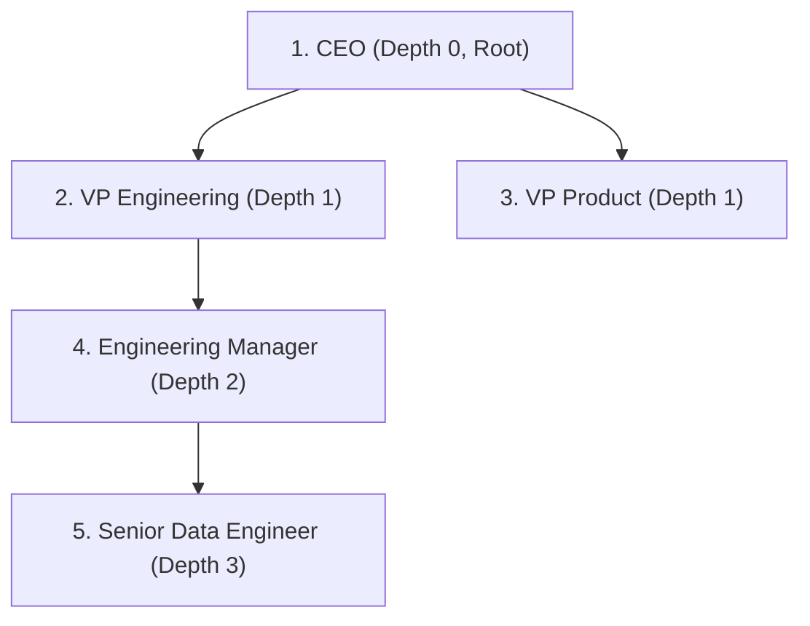

#### Production Implementation
```sql
WITH RECURSIVE org_chart AS (
    -- 1. Anchor Member: Find top-level executives (manager_id IS NULL)
    SELECT 
        employee_id,
        employee_name,
        manager_id,
        0 AS depth,
        ARRAY[employee_id] AS hierarchy_path,
        employee_id AS root_executive_id,
        CAST(employee_name AS VARCHAR(1000)) AS reporting_chain
    FROM employees
    WHERE manager_id IS NULL

    UNION ALL

    -- 2. Recursive Member: Join subordinates to their managers
    SELECT 
        e.employee_id,
        e.employee_name,
        e.manager_id,
        o.depth + 1,
        o.hierarchy_path || e.employee_id,
        o.root_executive_id,
        CAST(o.reporting_chain || ' -> ' || e.employee_name AS VARCHAR(1000))
    FROM employees e
    INNER JOIN org_chart o ON e.manager_id = o.employee_id
    -- Infinite cycle guard: Prevent infinite loops if cycles exist in bad data
    WHERE NOT (e.employee_id = ANY(o.hierarchy_path))
      AND o.depth < 15 -- Hard recursion limiter
)
SELECT 
    employee_id,
    employee_name,
    manager_id,
    depth,
    root_executive_id,
    reporting_chain
FROM org_chart
ORDER BY depth, manager_id, employee_id;
```

---

# 24. Physical Storage, Pagination & Indexing Mechanics

---

### Q52. Deep Pagination Performance: OFFSET 100,000 vs Keyset / Seek Pagination
**Topic Covered:** Storage Engine Row Scanning, B-Tree Traversal & Keyset Pagination Pattern  
**Questions Covered:**
- A SQL query using OFFSET 100000 takes several seconds on a large warehouse table. Why, and what pagination strategy would you use instead?
- A SQL query using `OFFSET 100000` takes several seconds on a large warehouse table. Why, and what pagination strategy would you use instead?

#### Why `OFFSET 100000` Is Catastrophically Slow
When executing:
```sql
SELECT * FROM transactions ORDER BY transaction_id LIMIT 50 OFFSET 100000;
```
1. The database cannot jump directly to the 100,001st row.
2. It must physically scan, sort, and parse **100,050 rows**, materialize them in memory/tempdb, and then discard the first 100,000 rows!
3. Time complexity is $O(M + N)$ where $M$ is the offset. As the user pages deeper, response time degrades linearly.

#### The Keyset / Seek Pagination Pattern: $O(\log N)$
Instead of offsets, use the last retrieved record's sort key (`transaction_id`) as a filtering predicate. The B-Tree index jumps directly to the key in $O(\log N)$ time.

```sql
-- Client requests page 2001, providing the last transaction_id seen (e.g., 948102)
SELECT 
    transaction_id,
    customer_id,
    amount,
    transaction_timestamp
FROM transactions
WHERE transaction_id > 948102 -- Seek predicate: direct B-tree branch jump!
ORDER BY transaction_id ASC
LIMIT 50;
```

| Pagination Strategy | Query Complexity | Disk I/O | Concurrency & Stability |
| :--- | :--- | :--- | :--- |
| **`OFFSET / LIMIT`** | $O(M + N)$ (Degrades with depth) | Massive sequential page reads | Unstable (rows shift if new rows inserted) |
| **Keyset (Seek Method)** | $O(\log N + K)$ (Constant fast) | Exact target index pages only | Immune to row shifting and duplicate pages |

---

### Q53. Why Adding an Index Can Degrade Query Performance
**Topic Covered:** Cost-Based Optimizer (CBO), Clustering Factor & Random vs Sequential I/O  
**Question:** You add an index to improve a SQL query, but performance gets worse. How can indexing increase query cost?

#### Architectural Reasons for Index Performance Regressions
1. **The Clustering Factor & Random Page Access:**
   - A table scan reads entire 64 KB storage blocks sequentially (multi-block read).
   - An unclustered secondary index scan first reads index leaves, then performs **random single-block I/O** to fetch each base row. If the query retrieves > 5% to 15% of table rows (the *tipping point*), reading the table sequentially is much faster than millions of random disk seeks.
2. **Cardinality Misestimation & Bad Optimizer Plan Choice:**
   - Stale catalog statistics may cause the CBO to believe an index returns 10 rows when it actually returns 500,000 rows. It picks a nested loop with index lookups instead of a hash join, causing query runtime to explode.
3. **Write Amplification on Ingestion Pipelines:**
   - Every index added to a table must be synchronously updated on every `INSERT`, `UPDATE`, and `DELETE`. A table with 10 indexes incurs 10x write amplification, fragmenting B-Tree nodes and locking buffer pools.
4. **Cache Eviction:**
   - Large secondary indexes compete with critical working memory and buffer pools, displacing hot cached data and forcing physical disk I/O.

---

### Q54. Window Ranking Mechanics: ROW_NUMBER() vs RANK() vs DENSE_RANK()
**Topic Covered:** Tied Values, Gap Creation & Partition Numbering  
**Questions Covered:**
- Difference between ROW_NUMBER(), RANK(), and DENSE_RANK().
- Explain the difference between `ROW_NUMBER()`, `RANK()`, and `DENSE_RANK()`. Provide a comparison on identical data values.

#### Comparison Matrix on Tied Values
Given the dataset: `[100, 90, 90, 80]`

| Value | `ROW_NUMBER()` | `RANK()` | `DENSE_RANK()` | Architectural Behavior |
| :---: | :---: | :---: | :---: | :--- |
| **100** | 1 | 1 | 1 | All three assign 1 to the first unique record. |
| **90** | 2 | 2 | 2 | First occurrence of tie. |
| **90** | 3 | 2 | 2 | `ROW_NUMBER` increments deterministically; `RANK` & `DENSE_RANK` preserve the tie. |
| **80** | 4 | **4** | **3** | `RANK` skips to 4 (creates gaps = count of preceding ties); `DENSE_RANK` assigns consecutive integer 3 (zero gaps). |

#### Production Guideline:
- Use `ROW_NUMBER()` for **deduplication** and selecting a single winner (`WHERE rn = 1`).
- Use `DENSE_RANK()` for **business leaderboards** (e.g., "Top 3 highest salaries") so the 3rd highest distinct salary is not skipped when ties occur.
- Use `RANK()` for **Olympic-style scoring** where ties legitimately defer the subsequent rank by the number of tied contestants.


---

# 25. Filtered Projections, DML Mutations & Threshold Analytics

---

### Q55. Filtered Projections & Conditional In-Place DML Updates
*(Grouped together: Basic relational filtering and in-place DML mutations on department-scoped entities)*  
**Topic Covered:** Relational Projection, Filtering Predicates & Atomic DML Updates  
**Questions Covered:**
- You need to retrieve the names and salaries of employees from the employees table, but only for those working in the Finance department.
- You need to increase the salary of all employees in the IT department by 10%.

#### Definition & Core Concepts
Relational projections restrict output attributes (columns) while filter predicates (`WHERE`) restrict row cardinality. When executing DML mutations (`UPDATE`), databases acquire exclusive row-level or page-level locks. Updating a subset of rows based on joined foreign keys requires atomic transaction scoping to prevent lock escalation and deadlocks.

#### Visual Flow
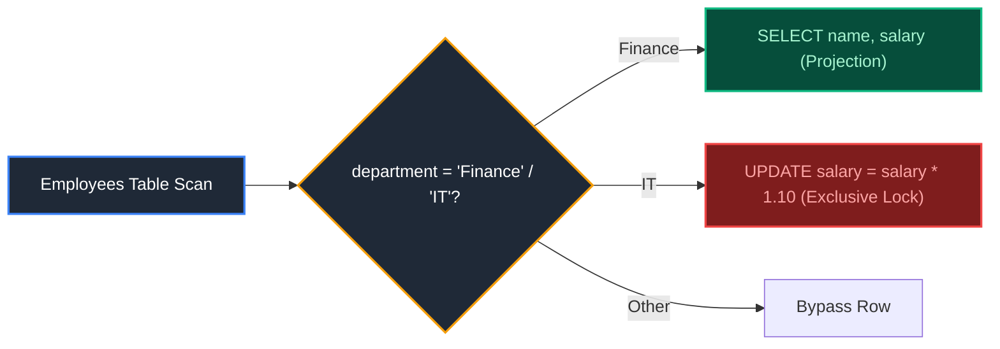

#### Production Implementation / Code Solution
```sql
-- 1. Read: Names and Salaries of Finance Employees
SELECT 
    e.first_name || ' ' || e.last_name AS employee_name,
    e.salary
FROM employees e
INNER JOIN departments d 
    ON e.department_id = d.department_id
WHERE d.department_name = 'Finance';

-- 2. Write: 10% Salary Increase for IT Department
UPDATE employees
SET salary = salary * 1.10
WHERE department_id IN (
    SELECT department_id 
    FROM departments 
    WHERE department_name = 'IT'
);
```
- **Time Complexity:** $O(N)$ with index scan on `department_id`; $O(N \log N)$ or table scan without index.
- **Space Complexity:** $O(1)$ auxiliary memory.

#### Engineering Implications & Production Pitfalls
1. **Lock Escalation Hazard:** Updating 500,000 rows in a single `UPDATE` statement causes RDBMS lock escalation from row locks to exclusive table locks (`X-LOCK`), blocking all incoming analytical and transactional reads. Always batch large DML updates in chunks of 5,000–10,000 rows.
2. **Interview Talking Point:** In PostgreSQL, `UPDATE` creates new row versions (MVCC dead tuples). High-frequency bulk updates require immediate `VACUUM` to prevent table bloat.

---

### Q56. Email Deduplication in Person Table & Relational Deletions
**Topic Covered:** Relational Aggregations, Grouping Filters & Self-Join Purges  
**Question:** Write a SQL query to find all duplicate emails in a table named Person.

#### Definition & Core Concepts
Deduplicating emails is a classic LeetCode (Problem 182) and enterprise CRM sanitation task. Finding duplicates uses `GROUP BY email HAVING COUNT(*) > 1`. Removing duplicates while retaining the lowest `id` uses an anti-join or self-join `DELETE`.

#### Visual Flow
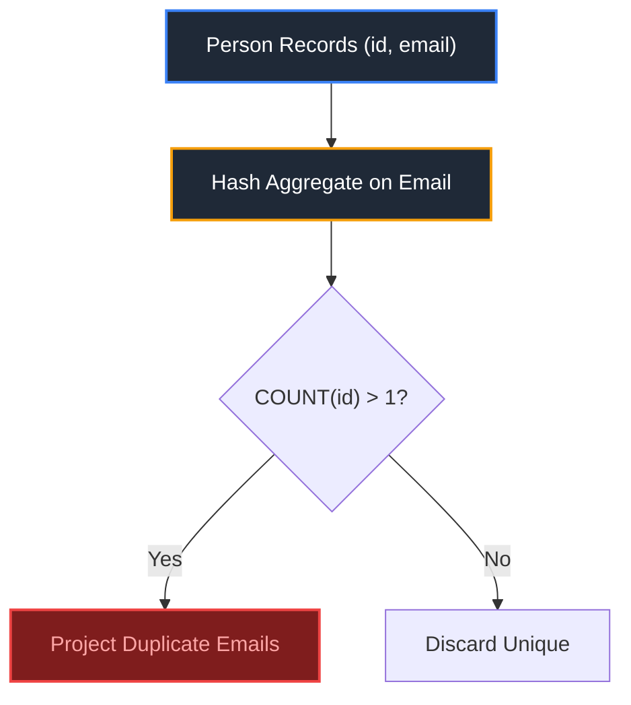

#### Production Implementation / Code Solution
```sql
-- Query 1: Find all duplicate emails
SELECT email
FROM Person
GROUP BY email
HAVING COUNT(*) > 1;

-- Query 2: Delete duplicate emails, keeping only the smallest id
DELETE FROM Person p1
USING Person p2
WHERE p1.email = p2.email 
  AND p1.id > p2.id;
```
- **Time Complexity:** $O(N)$ hash aggregation; $O(N \log N)$ sort-based aggregation.
- **Space Complexity:** $O(K)$ hash table space where $K$ is the number of distinct emails.

#### Engineering Implications & Production Pitfalls
1. **Case Sensitivity Pitfall:** Standard SQL `email = email` performs case-sensitive matching in PostgreSQL. An email `john@corp.com` will not match `John@corp.com`. Always use `LOWER(TRIM(email))` in production CRM pipelines.
2. **Interview Talking Point:** In BigQuery or Snowflake, `DELETE` with self-joins rewrites underlying immutable columnar micro-partitions. Prefer creating a deduplicated CTAS (`CREATE TABLE AS SELECT ... ROW_NUMBER() ... WHERE rn = 1`) over in-place deletes.

---

### Q57. Second Highest Salary from Employee Table with Strict NULL Fallback
**Topic Covered:** Subqueries, Limit Offsets & NULL Handling (LeetCode 176)  
**Question:** Write a SQL query to get the second highest salary from the Employee table.

#### Definition & Core Concepts
Finding the $N$-th highest value requires handling two critical edge cases:
1. **Duplicate Top Salaries:** Multiple employees may share the identical maximum salary ($100k, $100k, $90k $\to$ 2nd highest is $90k, not $100k). Must use `DISTINCT`.
2. **No Second Highest Value:** If the table contains only 1 employee (or empty), the query must deterministically return `NULL`, not an empty rowset.

#### Visual Flow


#### Production Implementation / Code Solution
```sql
-- Pattern 1: ANSI SQL Subquery (Guarantees NULL if no record exists)
SELECT (
    SELECT DISTINCT salary
    FROM Employee
    ORDER BY salary DESC
    LIMIT 1 OFFSET 1
) AS SecondHighestSalary;

-- Pattern 2: Scalar Subquery with MAX (Immune to dialect offset limits)
SELECT MAX(salary) AS SecondHighestSalary
FROM Employee
WHERE salary < (SELECT MAX(salary) FROM Employee);
```
- **Time Complexity:** $O(N)$ with single index scan on `salary`; $O(N \log N)$ if full table sort is required.
- **Space Complexity:** $O(1)$ auxiliary space.

#### Engineering Implications & Production Pitfalls
1. **Empty Result Set vs NULL:** Using `SELECT DISTINCT salary FROM Employee ORDER BY salary DESC LIMIT 1 OFFSET 1;` without wrapping in an outer scalar subquery returns an empty rowset (`0 rows`), which fails automated enterprise schema contracts expecting a single tuple `(NULL)`.
2. **Interview Talking Point:** In BigQuery, `OFFSET` without an `ORDER BY` is non-deterministic. Always provide a deterministic sort key.

---

### Q58. Employees Who Earn More Than Their Direct Managers
**Topic Covered:** Self-Joins, Hierarchical Foreign Keys (LeetCode 181)  
**Question:** Given the Employee table, write a SQL query that finds out employees who earn more than their managers.

#### Definition & Core Concepts
An adjacency list hierarchy stores the relationship directly on the employee row via `manager_id -> employee_id`. Evaluating relative compensation between an employee and their direct manager requires a self-join (`e.manager_id = m.id`).

#### Visual Flow
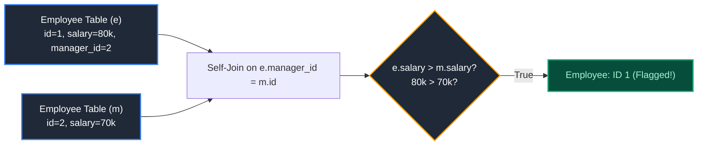

#### Production Implementation / Code Solution
```sql
SELECT e.name AS Employee
FROM Employee e
INNER JOIN Employee m 
    ON e.manager_id = m.id
WHERE e.salary > m.salary;
```
- **Time Complexity:** $O(N)$ with index on `id`; $O(N \log N)$ without index.
- **Space Complexity:** $O(N)$ join hash table.

#### Engineering Implications & Production Pitfalls
1. **NULL Manager Handling:** Top-level executives (CEO) have `manager_id IS NULL`. An `INNER JOIN` correctly prunes these rows automatically, avoiding three-valued `NULL > salary` comparison traps.
2. **Interview Talking Point:** If querying across multi-tier management (earning more than *any* manager above them in the tree), a simple self-join fails; a recursive CTE is required.

---

### Q59. Aggregated Driver Ratings with Minimum Trip Thresholds (>100 Trips)
**Topic Covered:** Aggregations with HAVING Filters & Window Dense Ranking  
**Question:** Write an SQL query to find the top 3 drivers by average rating, only including drivers with more than 100 trips.

#### Definition & Core Concepts
Leaderboards that rank entities on average performance metrics (driver ratings, merchant review scores) must enforce **minimum sample size thresholds** (`HAVING COUNT(*) >= 100`) to prevent low-volume statistical anomalies (e.g., a driver with only 1 trip rated 5.0 stars ranking higher than an veteran driver with 5,000 trips rated 4.98 stars).

#### Visual Flow
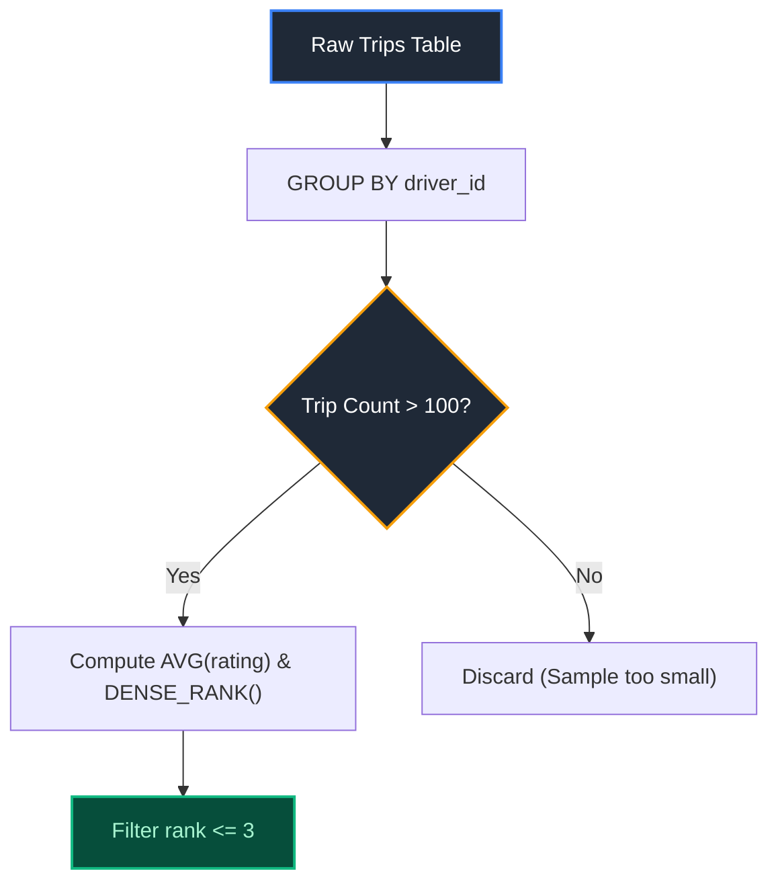

#### Production Implementation / Code Solution
```sql
WITH driver_aggregates AS (
    SELECT 
        driver_id,
        COUNT(trip_id) AS total_trips,
        ROUND(AVG(rating)::NUMERIC, 3) AS avg_rating
    FROM trips
    WHERE rating IS NOT NULL
    GROUP BY driver_id
    HAVING COUNT(trip_id) > 100 -- Minimum trip threshold
),
ranked_drivers AS (
    SELECT 
        driver_id,
        total_trips,
        avg_rating,
        DENSE_RANK() OVER (ORDER BY avg_rating DESC) AS rating_rank
    FROM driver_aggregates
)
SELECT 
    driver_id,
    total_trips,
    avg_rating,
    rating_rank
FROM ranked_drivers
WHERE rating_rank <= 3
ORDER BY rating_rank ASC, total_trips DESC;
```
- **Time Complexity:** $O(N)$ hash aggregation + $O(K \log K)$ sort on aggregated drivers ($K \ll N$).
- **Space Complexity:** $O(K)$ hash table memory.

#### Engineering Implications & Production Pitfalls
1. **WHERE vs HAVING Trap:** Placing `COUNT(trip_id) > 100` in `WHERE` causes a syntax error because aggregate counts are evaluated at Stage 2 (Grouping), whereas `WHERE` evaluates at Stage 1 (Row Filtering).
2. **Interview Talking Point:** In Bayesian rating systems, enterprise platforms replace simple arithmetic averages with the **Dirichlet-multinomial / Laplace-smoothed average** to account for rating distributions.

---

### Q60. Customer Deduplication by Timestamp / UpdatedDate (Deterministic Winner Selection)
*(Grouped together: Identifying and pruning duplicate records while preserving the latest version)*  
**Topic Covered:** Window Deduplication, Deterministic Tie-Breaking & SCD Pruning  
**Questions Covered:**
- Write an efficient query to detect duplicates based on customer ID and timestamp but only return the latest record.
- Write a SQL query to identify duplicate customer records and retain only the latest record based on UpdatedDate.
- Write a SQL query to find duplicate records from an employee table.

#### Definition & Core Concepts
When distributed streams or operational CDC pipelines emit duplicate records for the same entity, the data warehouse must deduplicate records deterministically. Using `ROW_NUMBER() OVER (PARTITION BY entity_id ORDER BY updated_date DESC)` guarantees that exactly one record (the latest state) is retained.

#### Visual Flow
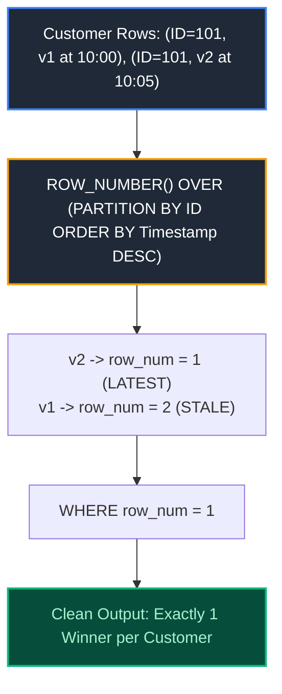

#### Production Implementation / Code Solution
```sql
WITH ranked_customers AS (
    SELECT 
        customer_id,
        customer_name,
        email,
        updated_date,
        -- Deterministic tie-breaker: order by updated_date DESC, then transaction_id DESC
        ROW_NUMBER() OVER (
            PARTITION BY customer_id 
            ORDER BY updated_date DESC, transaction_id DESC
        ) AS row_num
    FROM customers
)
SELECT 
    customer_id,
    customer_name,
    email,
    updated_date
FROM ranked_customers
WHERE row_num = 1;
```
- **Time Complexity:** $O(N \log M)$ where $M$ is the average partition depth per customer.
- **Space Complexity:** $O(N)$ shuffle partition memory.

#### Engineering Implications & Production Pitfalls
1. **Non-Deterministic Tie-Breaking:** If two updates share the exact same `updated_date`, omitting secondary sort keys (`transaction_id DESC`) causes `ROW_NUMBER()` to select an arbitrary row on each rerun, breaking pipeline idempotency.
2. **Interview Talking Point:** In Snowflake and Databricks Delta Lake, this pattern can be replaced with native `QUALIFY ROW_NUMBER() OVER (...) = 1` syntax, eliminating the outer CTE wrapper.

---

### Q61. Window Functions: Customer Transaction Ranking & Partitioned Over Clauses
**Topic Covered:** Analytical Windowing Mechanics, Frame Specifications & Ranking  
**Question:** Explain Window Functions and write a query to rank transactions by customer.

#### Definition & Core Concepts
Unlike `GROUP BY` (which collapses rows into a single summary tuple), **Window Functions** compute aggregate or ranking metrics across a subset of rows (the "window") while **preserving individual row identity**.
$$\text{Syntax: } \text{FUNCTION}() \text{ OVER } (\text{PARTITION BY } C_1 \text{ ORDER BY } C_2 \text{ [FRAME]})$$

#### Visual Flow
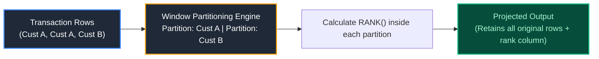

#### Production Implementation / Code Solution
```sql
SELECT 
    customer_id,
    transaction_id,
    transaction_date,
    amount,
    -- Rank highest transaction to lowest per customer
    DENSE_RANK() OVER (
        PARTITION BY customer_id 
        ORDER BY amount DESC
    ) AS transaction_size_rank,
    -- Running total spend per customer
    SUM(amount) OVER (
        PARTITION BY customer_id 
        ORDER BY transaction_date
        ROWS BETWEEN UNBOUNDED PRECEDING AND CURRENT ROW
    ) AS customer_cumulative_spend
FROM customer_transactions
ORDER BY customer_id, transaction_size_rank;
```
- **Time Complexity:** $O(N \log N)$ distributed partition sort.
- **Space Complexity:** $O(N)$ execution frame memory.

#### Engineering Implications & Production Pitfalls
1. **Spill to Disk on Unpartitioned Over():** Executing `OVER (ORDER BY amount DESC)` without a `PARTITION BY` forces the entire distributed dataset into a single coordinator node / partition to sort globally, causing immediate out-of-memory crashes.
2. **Interview Talking Point:** In Spark SQL, window partitions with high data skew can be identified in the Spark UI as long-running single tasks.

---

### Q62. 90-Day Dormant Customer Inactivity Detection (Anti-Join vs NOT EXISTS)
**Topic Covered:** Relational Inactivity Detection, Anti-Joins, NULL Semantics  
**Question:** Write a SQL query to identify customers who have not performed any transactions in the last 90 days.

#### Definition & Core Concepts
Detecting churn or dormancy requires finding entities in a primary table (`Customers`) that have zero matching records in an event table (`Transactions`) within a specified temporal range.

#### Visual Flow
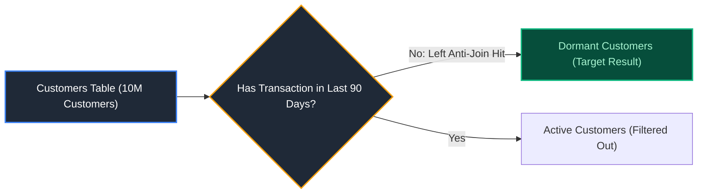

#### Production Implementation / Code Solution
```sql
-- Pattern 1: NOT EXISTS (Optimal Optimizer Short-Circuit)
SELECT 
    c.customer_id,
    c.customer_name,
    c.email,
    c.signup_date
FROM customers c
WHERE NOT EXISTS (
    SELECT 1 
    FROM transactions t
    WHERE t.customer_id = c.customer_id
      AND t.transaction_date >= CURRENT_DATE - INTERVAL '90 day'
);

-- Pattern 2: LEFT JOIN ... WHERE ... IS NULL (Anti-Join Equivalent)
SELECT 
    c.customer_id,
    c.customer_name
FROM customers c
LEFT JOIN transactions t
    ON c.customer_id = t.customer_id
    AND t.transaction_date >= CURRENT_DATE - INTERVAL '90 day'
WHERE t.transaction_id IS NULL;
```
- **Time Complexity:** $O(N + M)$ with hash join on `customer_id` and index on `transaction_date`.
- **Space Complexity:** $O(N)$ hash table.

#### Engineering Implications & Production Pitfalls
1. **The NOT IN NULL Trap:** Never use `WHERE customer_id NOT IN (SELECT customer_id FROM transactions)`. If even a single row in `transactions.customer_id` contains a `NULL`, the entire `NOT IN` expression evaluates to `UNKNOWN` for every row, returning **0 results**!
2. **Interview Talking Point:** Modern cost-based optimizers (CBOs) in Snowflake, PostgreSQL, and BigQuery rewrite `NOT EXISTS` and `LEFT JOIN ... WHERE IS NULL` into identical physical Hash Left Anti-Join operators.

---

### Q63. Consecutive Month Order Detection & Customer Streak Analysis
**Topic Covered:** Temporal Cohorts, Gaps-and-Islands & Consecutive Month Analysis  
**Question:** Write a SQL query to identify customers who have placed orders in consecutive months (at least two or three consecutive months).

#### Definition & Core Concepts
Analyzing consecutive activity periods requires converting exact order timestamps into discrete year-month buckets, deduplicating within each month, and detecting whether adjacent buckets have a difference of exactly 1 month. This is achieved using `LAG()` or the classic **Gaps-and-Islands** technique (`date_trunc('month', ...) - DENSE_RANK() * INTERVAL '1 month'`).

#### Visual Flow
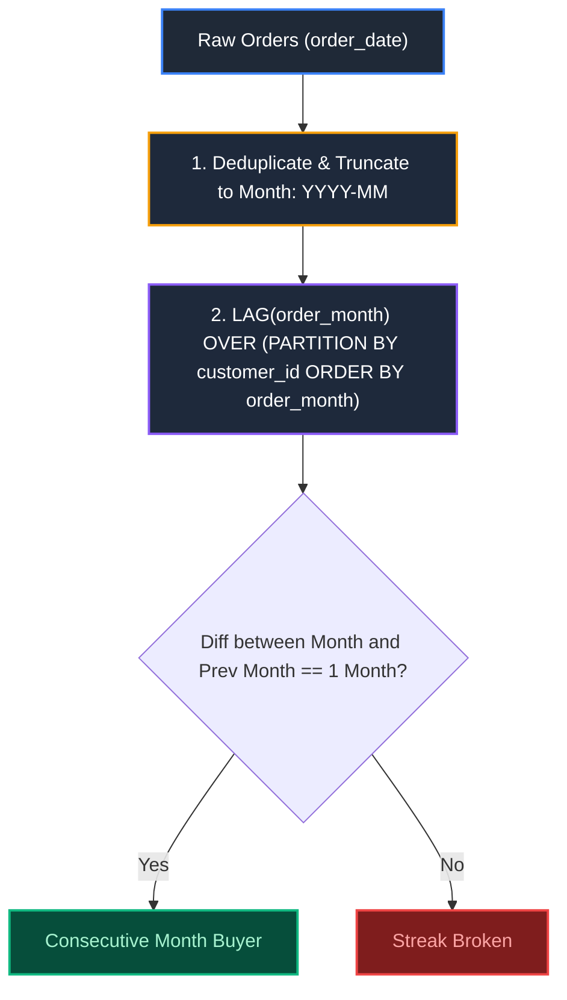

#### Production Implementation / Code Solution
```sql
-- Pattern: Identify customers who purchased in at least 2 consecutive months
WITH monthly_customer_orders AS (
    -- Step 1: Normalize order date to start of month and deduplicate multiple orders in same month
    SELECT DISTINCT
        customer_id,
        DATE_TRUNC('month', order_date)::DATE AS order_month
    FROM orders
),
consecutive_lags AS (
    -- Step 2: Retrieve previous purchase month using window LAG()
    SELECT 
        customer_id,
        order_month,
        LAG(order_month, 1) OVER (
            PARTITION BY customer_id 
            ORDER BY order_month
        ) AS prev_order_month
    FROM monthly_customer_orders
)
-- Step 3: Filter where the difference between consecutive purchase months is exactly 1 month
SELECT DISTINCT 
    customer_id,
    prev_order_month AS initial_month,
    order_month AS consecutive_month
FROM consecutive_lags
WHERE order_month = prev_order_month + INTERVAL '1 month';
```
- **Time Complexity:** $O(N \log N)$ due to sorting inside the `PARTITION BY customer_id ORDER BY order_month` window.
- **Space Complexity:** $O(N)$ for window buffer materialization.

#### Engineering Implications & Production Pitfalls
1. **Multiple Orders Per Month:** If a customer places 5 orders in March and 2 in April, failing to deduplicate via `DISTINCT order_month` before calculating `LAG()` will compare March with March, falsely declaring non-consecutiveness!
2. **Year-Boundary Hazard:** Calculating month difference using simple subtraction (`month(curr) - month(prev) == 1`) breaks when crossing from December (Month 12) to January (Month 1). Always use date interval arithmetic or epoch month difference (`(extract(year from curr)*12 + extract(month from curr)) - (...) = 1`).

---

### Q64. Average Number of Sessions per User Over a Specified Window
**Topic Covered:** Clickstream Sessionization, Window Inactivity Timeouts & User Aggregation  
**Question:** Write a SQL query to find the average number of sessions per user over a specified period (e.g. past 30 days), assuming an inactivity timeout of 30 minutes defines a new session.

#### Definition & Core Concepts
In clickstream telemetry, web events do not carry explicit session IDs. A "session" is demarcated when a user's inactivity gap exceeds a predefined threshold (typically 30 minutes).
1. Calculate the time difference between current event and previous event using `LAG(event_time)`.
2. Flag rows where `event_time - prev_event_time > 30 minutes` as `1`, otherwise `0`.
3. Compute a cumulative sum of the flags to generate a unique `session_id` per user.
4. Count distinct sessions per user, and calculate the global or cohort average.

#### Visual Flow
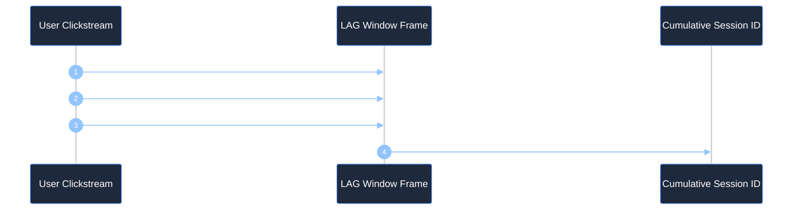

#### Production Implementation / Code Solution
```sql
WITH user_event_lags AS (
    -- Step 1: Calculate time delta from previous event for each user
    SELECT 
        user_id,
        event_time,
        LAG(event_time) OVER (
            PARTITION BY user_id 
            ORDER BY event_time
        ) AS prev_event_time
    FROM web_events
    WHERE event_time >= CURRENT_DATE - INTERVAL '30 day'
),
session_markers AS (
    -- Step 2: Demarcate session boundary if gap exceeds 30 minutes or is first event
    SELECT 
        user_id,
        event_time,
        CASE 
            WHEN prev_event_time IS NULL 
                 OR event_time > prev_event_time + INTERVAL '30 minute' THEN 1 
            ELSE 0 
        END AS is_new_session
    FROM user_event_lags
),
user_session_counts AS (
    -- Step 3: Total sessions per user over the 30-day window
    SELECT 
        user_id,
        SUM(is_new_session) AS total_sessions
    FROM session_markers
    GROUP BY user_id
)
-- Step 4: Compute overall average and distribution metrics
SELECT 
    COUNT(user_id) AS total_active_users,
    SUM(total_sessions) AS total_aggregate_sessions,
    ROUND(AVG(total_sessions), 2) AS avg_sessions_per_user,
    PERCENTILE_CONT(0.5) WITHIN GROUP (ORDER BY total_sessions) AS median_sessions_per_user
FROM user_session_counts;
```
- **Time Complexity:** $O(N \log N)$ distributed sorting per partition.
- **Space Complexity:** $O(N)$ for intermediate window frame buffers.

#### Engineering Implications & Production Pitfalls
1. **Unbounded Frame Performance:** In high-volume event tables (billions of rows), partitioning raw clicks by `user_id` without an event date predicate causes massive executor memory spill. Pre-filter by date range before windowing.
2. **Session Timeout Tuning:** In mobile data, users may leave apps running in the background. Without an upper session cap (e.g. 12 hours), a single background session could artificially span multiple days.

---

### Q65. Anti-Join Mechanics: Extracting Non-Matching Rows Across Datasets
**Topic Covered:** Relational Anti-Joins, Optimizer Execution Plans, Null-Safety  
**Question:** Write a SQL query to extract non-matching rows from two tables (e.g., users in Table A who do not exist in Table B). Explain the trade-offs of different approaches.

#### Definition & Core Concepts
Extracting disjoint relational sets (Rows in $A \setminus B$) can be written using four distinct SQL constructs:
1. `NOT EXISTS` (Subquery correlated filter)
2. `LEFT JOIN ... WHERE B.id IS NULL` (Left Anti-Join)
3. `EXCEPT` / `MINUS` (Set operator)
4. `NOT IN` (Subquery inclusion check)

#### Comparison Matrix & Optimizer Plans

| Approach | ANSI Standard | NULL Behavior in Table B | Optimizer Execution Plan | Recommendation |
| :--- | :---: | :---: | :---: | :--- |
| **`NOT EXISTS`** | Yes | Safe (NULL rows in B ignored) | Hash Left Anti-Join (Short-circuits upon first match) | **Preferred Standard** |
| **`LEFT JOIN ... WHERE NULL`** | Yes | Safe (Filter on non-nullable PK) | Hash Left Anti-Join / Hash Left Outer Join + Filter | Excellent (Clear syntax) |
| **`EXCEPT` / `MINUS`** | Yes | Safe (Treats NULL as matching) | Hash Set Difference (Requires identical projected columns) | Great for entire row diffs |
| **`NOT IN`** | Yes | **UNSAFE DANGER:** If B contains any NULL, returns **0 rows**! | Subplan / Materialized Subquery (Poor performance) | **Avoid in production** |

#### Production Implementation / Code Solution
```sql
-- Approach 1: NOT EXISTS (Production Gold Standard - Null Safe & Highly Performant)
SELECT 
    a.user_id,
    a.user_name,
    a.created_at
FROM users_a a
WHERE NOT EXISTS (
    SELECT 1 
    FROM users_b b 
    WHERE b.user_id = a.user_id
);

-- Approach 2: LEFT ANTI JOIN (Explicit engine optimization in Spark SQL & Snowflake)
SELECT 
    a.user_id,
    a.user_name
FROM users_a a
LEFT ANTI JOIN users_b b 
    ON a.user_id = b.user_id;

-- Approach 3: LEFT JOIN ... WHERE ... IS NULL
SELECT 
    a.user_id,
    a.user_name
FROM users_a a
LEFT JOIN users_b b 
    ON a.user_id = b.user_id
WHERE b.user_id IS NULL;
```

#### Engineering Implications & Production Pitfalls
> [!CAUTION]
> **The Critical `NOT IN` Trap:** If `users_b` contains even a single `NULL` in `user_id`, `a.user_id NOT IN (1, 2, NULL)` evaluates to `NOT (UNKNOWN)` $\to$ `UNKNOWN`. Because `WHERE` filters out any row where the condition is not `TRUE`, the entire query returns **0 rows**, silently dropping all unmatched records!

---

### Q66. Highest-Grossing Movie of the Current Month & Booking System Analytics
**Topic Covered:** Multi-Table Joins, Aggregate Windowing, Month Boundaries & Filtering  
**Question:** Given a movie-booking system database, write a SQL query to find the highest-grossing movie of the current month, including total tickets sold, revenue, and theater occupancy.

#### Production Implementation / Code Solution
```sql
WITH current_month_movie_revenue AS (
    SELECT 
        m.movie_id,
        m.title AS movie_title,
        m.genre,
        COUNT(b.booking_id) AS total_tickets_sold,
        SUM(b.ticket_price) AS total_gross_revenue,
        COUNT(DISTINCT s.theater_id) AS active_theaters_count,
        DENSE_RANK() OVER (ORDER BY SUM(b.ticket_price) DESC) AS revenue_rank
    FROM movies m
    JOIN showtimes s 
        ON m.movie_id = s.movie_id
    JOIN bookings b 
        ON s.showtime_id = b.showtime_id
    WHERE b.booking_status = 'CONFIRMED'
      AND b.booking_timestamp >= DATE_TRUNC('month', CURRENT_DATE)
      AND b.booking_timestamp < (DATE_TRUNC('month', CURRENT_DATE) + INTERVAL '1 month')
    GROUP BY m.movie_id, m.title, m.genre
)
SELECT 
    movie_id,
    movie_title,
    genre,
    total_tickets_sold,
    total_gross_revenue,
    active_theaters_count
FROM current_month_movie_revenue
WHERE revenue_rank = 1;
```
- **Time Complexity:** $O(N \log N)$ where $N$ is the number of distinct movies in the current month.
- **Space Complexity:** $O(N)$ hash table storage for group by aggregation.

---

### Q67. Periodic Sales Rollup by Product, Vendor, and Location
**Topic Covered:** Multi-Dimensional Aggregation, GROUPING SETS, ROLLUP, CUBE  
**Question:** Write an analytical SQL query to calculate yearly and monthly sales revenue rolled up simultaneously by product, vendor, and geographic location.

#### Definition & Core Concepts
In executive reporting and financial audits, dashboards require aggregations at varying dimensional granularities (e.g. Total Revenue by Year, Total Revenue by Year + Vendor, and Total Revenue by Year + Month + Product + Location). Rather than executing 4 separate queries joined via `UNION ALL`, ANSI SQL provides **`GROUPING SETS`**, **`ROLLUP`**, and **`CUBE`**, which allow the database engine to compute all dimensional aggregations in a single physical table scan.

#### Production Implementation / Code Solution
```sql
SELECT 
    d.year,
    d.month,
    COALESCE(p.category_name, '--- ALL CATEGORIES ---') AS product_category,
    COALESCE(v.vendor_name, '--- ALL VENDORS ---') AS vendor_name,
    COALESCE(l.country, '--- GLOBAL ---') AS location_country,
    SUM(f.sales_amount) AS total_revenue,
    SUM(f.quantity_sold) AS total_units_sold,
    -- GROUPING() function returns 1 if column is aggregated away, 0 if included in group
    GROUPING(d.month) AS is_yearly_rollup,
    GROUPING(v.vendor_name) AS is_vendor_rollup
FROM fact_sales f
JOIN dim_date d ON f.date_key = d.date_key
JOIN dim_product p ON f.product_key = p.product_key
JOIN dim_vendor v ON f.vendor_key = v.vendor_key
JOIN dim_location l ON f.location_key = l.location_key
WHERE d.year = EXTRACT(YEAR FROM CURRENT_DATE)
GROUP BY GROUPING SETS (
    (d.year, v.vendor_name),                                      -- Yearly revenue per vendor
    (d.year, d.month, v.vendor_name),                             -- Monthly revenue per vendor
    (d.year, d.month, p.category_name, l.country),                -- Monthly category sales by country
    (d.year)                                                      -- Full annual grand total
)
ORDER BY d.year, d.month NULLS FIRST, total_revenue DESC;
```
- **Time Complexity:** $O(N \log K)$ single scan with multi-pass hash aggregation.
- **Space Complexity:** $O(K)$ hash state storage where $K$ is the number of unique dimensional groups.

#### Engineering Implications & Production Pitfalls
1. **Cartesian Group Explosion with `CUBE`:** Avoid using `CUBE(a, b, c, d, e)` on high-cardinality keys. 5 dimensions generate $2^5 = 32$ grouping combinations; 10 dimensions generate 1,024 combinations, causing severe query memory thrashing. Always use explicit `GROUPING SETS` specifying only the business-required slices.
2. **COALESCE on NULL Dimensions:** Use the `GROUPING(col)` function to distinguish between an actual `NULL` value in the underlying dimension data vs a `NULL` generated by the rollup aggregation.


---

# 28. Physical Relational Joins, Date Framing & Data Isolation Triage

---

### Q68. Cartesian Product Mechanics & Empty Table Zero-Multiplication
**Topic Covered:** Relational Cross Joins, Cardinality Multiplication & Empty Set Semantics  
**Question:** Table A has 10 rows. Table B has 20 rows. What does `SELECT * FROM A, B` return? Now delete every row from Table A. What happens to the result?

#### Definition & Core Concepts
In relational algebra, listing tables separated by a comma without an explicit `ON` or `WHERE` clause (`SELECT * FROM A, B`) denotes a **Cartesian Product (CROSS JOIN)**:
$$|A 	imes B| = |A| 	imes |B|$$
1. **Initial State ($|A|=10, |B|=20$):**
   Every row in Table A is paired with every row in Table B. The query produces:
   $$10 	imes 20 = 200 	ext{ rows}$$
2. **Post-Deletion State ($|A|=0, |B|=20$):**
   When all rows from Table A are deleted (`DELETE FROM A;`), Table A becomes an empty relation (cardinality 0). The Cartesian product requires a tuple $(a, b)$ where $a \in A$ and $b \in B$. Since there is no element $a \in A$, the Cartesian product yields:
   $$0 	imes 20 = 0 	ext{ rows}$$
   The query returns exactly **0 rows (an empty result set)**. It does **not** return 20 rows with NULLs for Table A (which only occurs in a `RIGHT OUTER JOIN`).

#### Visual Flow
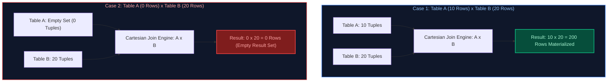

#### Production Implementation / Code Solution
```sql
-- Demonstrating Cartesian Cross Join mechanics and empty table suppression in PostgreSQL / Snowflake
CREATE TEMPORARY TABLE table_a (id INT, val_a VARCHAR(10));
CREATE TEMPORARY TABLE table_b (id INT, val_b VARCHAR(10));

-- Populate 10 rows into table_a and 20 rows into table_b
INSERT INTO table_a SELECT g, 'val_a_' || g FROM generate_series(1, 10) g;
INSERT INTO table_b SELECT g, 'val_b_' || g FROM generate_series(1, 20) g;

-- Query 1: Returns exactly 200 rows
SELECT COUNT(*) AS cartesian_row_count
FROM table_a, table_b;
-- Result: 200

-- Delete all rows from table_a
TRUNCATE TABLE table_a;

-- Query 2: Returns exactly 0 rows
SELECT COUNT(*) AS post_deletion_count
FROM table_a, table_b;
-- Result: 0

-- Contrast with RIGHT JOIN: If preserving Table B rows when Table A is empty is required
SELECT COUNT(*) AS right_join_preserved_count
FROM table_a
RIGHT JOIN table_b ON 1=1;
-- Result: 20 rows (with val_a populated as NULL)
```
- **Time Complexity:** $O(|A| 	imes |B|)$ physical nested loop or broadcast cross-join scan. When $|A|=0$, the scan short-circuits in $O(1)$.
- **Space Complexity:** $O(1)$ streaming memory if projected directly, or $O(|A| 	imes |B|)$ if buffered into temporary query spool memory.

#### Engineering Implications & Production Pitfalls
1. **Accidental Cartesian Explosions:** Forgetting a join predicate on large tables (e.g. joining a 1M row orders table with a 500k row customer table) produces $5 	imes 10^{11}$ records (500 billion rows), immediately exhausting tempdb/disk spool and triggering database crashes.
2. **Anti-Pattern of Comma Joins:** ANSI SQL-89 syntax (`FROM A, B`) is strongly discouraged in enterprise engineering standards. Always use explicit ANSI SQL-92 `CROSS JOIN` syntax to make intent clear and prevent accidental missing join conditions during refactoring.

#### Core Curriculum Cross-Reference
*Deep-dive theoretical reference: See [01. SQL Fundamentals: Relational Joins & Set Operations](../01_sql_fundamentals.md#3-relational-joins-and-set-operations)*

---

### Q69. Rolling Seven-Day Average with Missing Dates (Calendar Spine & Frame Semantics)
**Topic Covered:** Window Frames, Date Spine Generation & Physical vs Logical Range  
**Question:** How would you calculate a rolling seven-day moving average of daily revenue when some dates are completely missing from the transactions table?

#### Definition & Core Concepts
A naive moving average query uses:
`AVG(revenue) OVER (ORDER BY transaction_date ROWS BETWEEN 6 PRECEDING AND CURRENT ROW)`
This produces **incorrect metrics** when dates are missing (e.g. weekend closures or days without sales). `ROWS BETWEEN 6 PRECEDING` counts the preceding 6 *physical rows* in the table, which could span 20 or 30 actual calendar days.
To calculate a true chronological 7-day moving average when dates are sparse:
1. **Method 1: Date Spine Generation (Recommended for Data Warehouses):**
   Generate a contiguous calendar dimension using a recursive CTE, `generate_series()`, or `dim_date`, and `LEFT JOIN` the aggregated sales data, imputing `$0.00` for missing dates via `COALESCE(daily_revenue, 0)`. Then apply `ROWS BETWEEN 6 PRECEDING AND CURRENT ROW`.
2. **Method 2: Logical Range Windowing:**
   Use ANSI SQL `RANGE` window frames:
   `AVG(daily_revenue) OVER (ORDER BY transaction_date RANGE BETWEEN INTERVAL '6 DAYS' PRECEDING AND CURRENT ROW)`
   *(Note: This averages only the recorded days within the 7-day calendar window; if missing days should contribute $0, a date spine is strictly required).*

#### Visual Flow
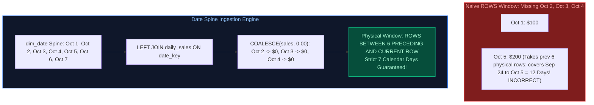

#### Production Implementation / Code Solution
```sql
WITH RECURSIVE date_spine AS (
    -- Anchor member: Start of reporting window
    SELECT DATE '2024-01-01' AS calendar_date
    UNION ALL
    -- Recursive member: Increment by 1 day until end date
    SELECT calendar_date + INTERVAL '1 day'
    FROM date_spine
    WHERE calendar_date < DATE '2024-12-31'
),
aggregated_daily_sales AS (
    -- Aggregate raw transactions per day to eliminate intra-day duplicates
    SELECT 
        order_date::DATE AS sales_date,
        SUM(order_amount) AS total_revenue
    FROM fact_orders
    WHERE order_date >= DATE '2024-01-01' AND order_date <= DATE '2024-12-31'
    GROUP BY order_date::DATE
),
dense_calendar_sales AS (
    -- Join date spine to guarantee 1 row per physical calendar day
    SELECT 
        ds.calendar_date,
        COALESCE(s.total_revenue, 0.00) AS daily_revenue
    FROM date_spine ds
    LEFT JOIN aggregated_daily_sales s ON ds.calendar_date = s.sales_date
)
SELECT 
    calendar_date,
    daily_revenue,
    -- Strict 7-day moving average across dense calendar frame
    ROUND(
        AVG(daily_revenue) OVER (
            ORDER BY calendar_date
            ROWS BETWEEN 6 PRECEDING AND CURRENT ROW
        ), 2
    ) AS rolling_7day_avg_revenue,
    -- Rolling 7-day cumulative total
    SUM(daily_revenue) OVER (
        ORDER BY calendar_date
        ROWS BETWEEN 6 PRECEDING AND CURRENT ROW
    ) AS rolling_7day_sum_revenue
FROM dense_calendar_sales
ORDER BY calendar_date;
```
- **Time Complexity:** $O(D \log D)$ where $D$ is the number of calendar days in the date range. Window frame calculation over sorted dense dates operates in $O(D)$.
- **Space Complexity:** $O(D)$ memory to materialize the contiguous date spine.

#### Engineering Implications & Production Pitfalls
1. **Division by Zero / Missing Denominator:** If using `RANGE BETWEEN INTERVAL '6 DAYS' PRECEDING AND CURRENT ROW` without a date spine, `AVG()` divides by the *count of existing rows*, not 7. If only 2 sales occurred in 7 days ($100 and $200), `AVG()` yields $(100+200)/2 = 150$, whereas true calendar daily velocity is $(100+200)/7 = 42.86$.
2. **Enterprise Conformance:** In enterprise dimensional data models, never generate date spines on-the-fly via recursive CTEs in production dashboards. Always join against the pre-computed, partitioned `dim_date` dimension table.

#### Core Curriculum Cross-Reference
*Deep-dive theoretical reference: See [02. Advanced SQL: Window Functions & Analytic Frame Specifications](../02_advanced_sql.md#1-advanced-window-functions--frame-specifications)*

---

### Q70. Most Recent Designation per Employee Using Window Functions
**Topic Covered:** Window Ranking, Partitioning & Deduplication to Latest Effective Record  
**Question:** Write an SQL query using window functions to find the most recent designation and department of each employee from a historical job changes audit table.

#### Definition & Core Concepts
In HR systems, CRM histories, and asset tracking, status changes are recorded as append-only event logs (`employee_designation_history`). To obtain the current/latest profile of each entity:
1. Partition the stream by the business entity key (`PARTITION BY employee_id`).
2. Order the history descending by event timestamp or effective start date (`ORDER BY effective_date DESC, change_id DESC`).
3. Apply `ROW_NUMBER()` to assign an integer sequence starting from 1 to the newest event.
4. Filter where `ranking = 1` in an outer query or CTE.
Using `ROW_NUMBER()` guarantees exactly one winning record per employee even if two promotions share the identical date (using `change_id` as the tie-breaker), avoiding duplicate rows that occur with `RANK()`.

#### Visual Flow
```mermaid
flowchart TD
    subgraph RawAudit ["Raw Employee History Table"]
        E1["Emp 101 | Junior Analyst | 2021-06-01 | change_id 1"]
        E2["Emp 101 | Senior Analyst | 2023-01-15 | change_id 14"]
        E3["Emp 101 | Lead Engineer  | 2024-05-10 | change_id 42"]
        E4["Emp 102 | Associate Data | 2023-09-01 | change_id 22"]
    end

    subgraph Windowing ["ROW_NUMBER() OVER (PARTITION BY emp_id ORDER BY date DESC, change_id DESC)"]
        W1["Emp 101: Lead Engineer (2024-05-10) -> rn = 1"]
        W2["Emp 101: Senior Analyst (2023-01-15) -> rn = 2"]
        W3["Emp 101: Junior Analyst (2021-06-01) -> rn = 3"]
        W4["Emp 102: Associate Data (2023-09-01) -> rn = 1"]
    end

    subgraph FinalFilter ["Filter: WHERE rn = 1"]
        F1["Emp 101 -> Lead Engineer"]
        F2["Emp 102 -> Associate Data"]
    end

    RawAudit --> Windowing --> FinalFilter

    style RawAudit fill:#0f172a,stroke:#64748b,stroke-width:1.5px,color:#93c5fd
    style Windowing fill:#0f172a,stroke:#3b82f6,stroke-width:1.5px,color:#93c5fd
    style FinalFilter fill:#064e3b,stroke:#10b981,stroke-width:2px,color:#a7f3d0
```

#### Production Implementation / Code Solution
```sql
WITH ranked_designations AS (
    SELECT 
        employee_id,
        designation_title,
        department_name,
        salary,
        effective_date,
        change_id,
        -- ROW_NUMBER guarantees strict deduplication (exactly 1 record per employee)
        ROW_NUMBER() OVER (
            PARTITION BY employee_id 
            ORDER BY effective_date DESC, change_id DESC
        ) AS rn
    FROM employee_designation_history
)
SELECT 
    employee_id,
    designation_title AS current_designation,
    department_name AS current_department,
    salary AS current_salary,
    effective_date AS designation_effective_date
FROM ranked_designations
WHERE rn = 1
ORDER BY employee_id;
```
- **Time Complexity:** $O(N \log(N/E))$ where $N$ is total history rows and $E$ is unique employees. The database sorts within hash-partitioned employee buckets.
- **Space Complexity:** $O(N)$ for window buffer allocation during query evaluation.

#### Engineering Implications & Production Pitfalls
1. **Correlated Subquery Anti-Pattern:** A naive approach joins against `(SELECT employee_id, MAX(effective_date) FROM history GROUP BY employee_id)`. If an employee received two role transfers on the same date, the inner join returns duplicate rows. Window `ROW_NUMBER()` with a deterministic tie-breaker (`change_id DESC`) prevents pipeline-breaking cardinality blowups.
2. **Indexing Optimization:** For large tables ($>100	ext{M}$ rows), optimize this window operation by creating a composite B-Tree index on `(employee_id, effective_date DESC, change_id DESC)`. The database engine scans the index in-order, skipping expensive in-memory sort stages entirely.

#### Core Curriculum Cross-Reference
*Deep-dive theoretical reference: See [02. Advanced SQL: Window Functions & Ranking Mechanics](../02_advanced_sql.md#1-advanced-window-functions--frame-specifications)*

---

### Q71. Cross-Tenant Data Leakage Triage in Analytical Reports (No Cache Involved)
**Topic Covered:** Row-Level Security, Tenant Isolation, Join Conditions & Data Triage  
**Question:** One business unit sees another unit’s confidential data in a downstream analytical report. There is no caching layer involved. What would you check first, and how would you resolve the incident?

#### Definition & Core Concepts
Cross-tenant data contamination in non-cached analytical architectures occurs when data isolation boundaries fail in the storage, query, or view layers.
When an incident is reported, the Senior Data Engineer must execute a structured forensic investigation:
1. **Unconstrained Joins (Missing Tenant Predicate):** When joining a tenant-partitioned fact table with a shared dimension or bridge table, omitting `tenant_id` on the join condition allows records to cross-join or align across tenants.
2. **Row-Level Security (RLS) Policy Invalidation:** In engines with RLS (PostgreSQL, Snowflake, Databricks Unity Catalog), policies can be bypassed if the reporting service connects via a superuser / elevated service principal (`BYPASSRLS`), or if an `ALTER TABLE` statement detached the security policy.
3. **Partition Switching / File Overwrite Contamination:** In lakehouse architectures, a batch pipeline may have swapped partition directories or staged files into the wrong tenant ADLS/S3 directory.
4. **Session Variable / Connection Pool Leakage:** In connection poolers (e.g. PgBouncer), session-level tenant variables (`SET LOCAL app.current_tenant = 'BU1'`) can bleed into subsequent queries if connections are returned to the pool without running `DISCARD ALL` or `RESET ALL`.

#### Visual Flow
```mermaid
flowchart TD
    Incident["🚨 Alert: BU 'Alpha' Sees BU 'Beta' Confidential Data"] --> CheckRole{"1. Check Connection Credentials & Roles"}
    CheckRole -- "Connected as Admin/Service Principal" --> SuperuserLeak["Root Cause: BYPASSRLS / Admin Role ignores Row-Level Security Policies"]
    CheckRole -- "Standard Reporting User" --> CheckQuery{"2. Inspect Physical SQL Plan & Joins"}

    CheckQuery -- "Join Missing tenant_id" --> JoinLeak["Root Cause: Fact JOIN Shared Dim without tenant_id predicate on bridge"]
    CheckQuery -- "Joins Valid" --> CheckRLS{"3. Verify RLS Policy Definition & State"}

    CheckRLS -- "Policy Disabled / Syntax Flaw" --> PolicyLeak["Root Cause: Unity Catalog / PG Row Filter bypassed or altered"]
    CheckRLS -- "Policy Intact" --> CheckConnPool["4. Inspect Connection Pooler (PgBouncer)<br/>Stale session-state bleed between pooled clients"]

    style Incident fill:#7f1d1d,stroke:#ef4444,stroke-width:2px,color:#fca5a5
    style SuperuserLeak fill:#1e293b,stroke:#f59e0b,stroke-width:1.5px,color:#fef3c7
    style JoinLeak fill:#1e293b,stroke:#f59e0b,stroke-width:1.5px,color:#fef3c7
    style PolicyLeak fill:#1e293b,stroke:#f59e0b,stroke-width:1.5px,color:#fef3c7
    style CheckConnPool fill:#0f172a,stroke:#3b82f6,stroke-width:1.5px,color:#93c5fd
```

#### Production Implementation / Diagnostic Playbook
```sql
-- Step 1: Immediately audit the current user's session role and RLS enforcement status
SELECT current_user, session_user, current_setting('is_superuser', true);

-- Step 2: Test query output with explicit tenant impersonation
SET ROLE reporting_readonly_role;
SET app.current_tenant_id = 'BU_ALPHA';

-- Inspect execution plan to confirm RLS filter injection
EXPLAIN ANALYZE
SELECT 
    f.order_id,
    f.tenant_id,
    f.order_amount,
    d.department_name
FROM fact_orders f
JOIN dim_department d ON f.department_key = d.department_key
WHERE f.tenant_id = current_setting('app.current_tenant_id');

-- Step 3: Implement defense-in-depth: Enforce mandatory Row-Level Security policy
ALTER TABLE fact_orders ENABLE ROW LEVEL SECURITY;
ALTER TABLE fact_orders FORCE ROW LEVEL SECURITY; -- Enforces even for table owner!

CREATE POLICY tenant_isolation_policy ON fact_orders
    AS RESTRICTIVE
    FOR ALL
    TO reporting_readonly_role
    USING (tenant_id = current_setting('app.current_tenant_id'));
```
- **Time Complexity:** $O(1)$ policy enforcement injection overhead during query compilation.
- **Space Complexity:** $O(1)$ auxiliary storage for security catalog metadata.

#### Engineering Implications & Production Pitfalls
1. **The `FORCE ROW LEVEL SECURITY` Imperative:** In PostgreSQL and relational warehouses, `ENABLE ROW LEVEL SECURITY` applies to standard users, but **table owners and superusers bypass RLS by default**. If the BI connector uses the schema owner credentials, RLS is completely bypassed! Always execute `FORCE ROW LEVEL SECURITY`.
2. **Partitioned Lakehouse Directory Isolation:** In Databricks / Snowflake, avoid storing multiple business units in a single unpartitioned folder. Enforce directory-level ABAC/RBAC via Unity Catalog (`catalog.bu_alpha.orders`) with distinct storage credentials.

#### Core Curriculum Cross-Reference
*Deep-dive theoretical reference: See [14. Data Governance, Security, and Observability: Fine-Grained Access Control & RLS](../14_data_governance_security_and_observability.md#1-fine-grained-access-control-rbac-abac-row-level-security--column-masking)*
