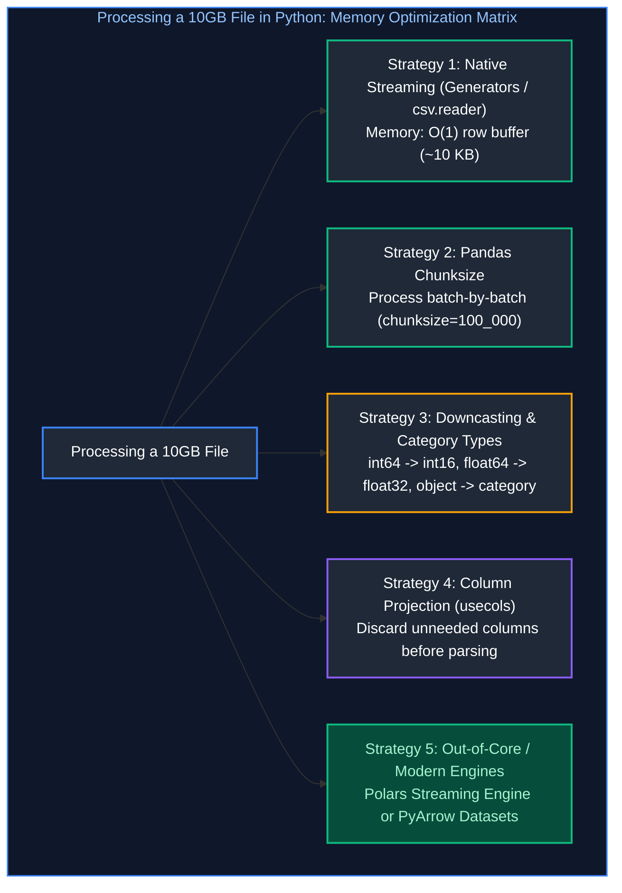
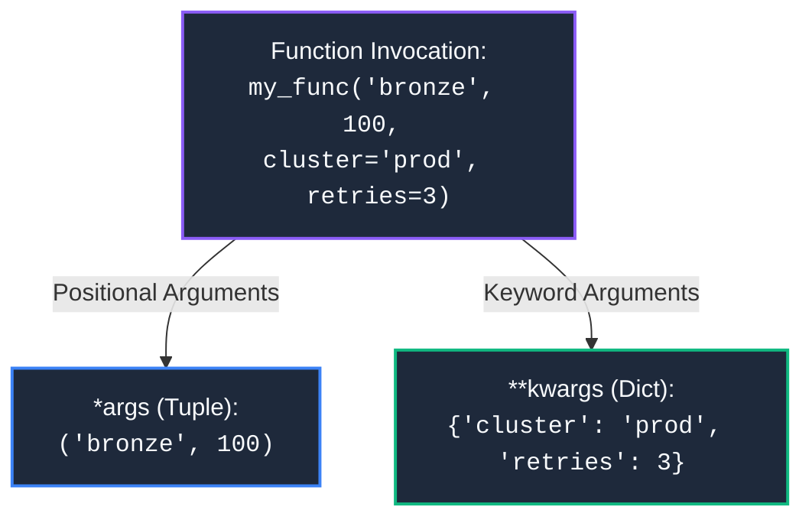
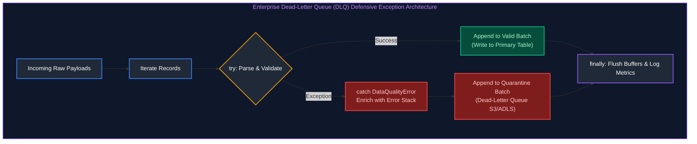

# 02. Python & Programming Concepts: Interview Questions & Deep-Dive Solutions

A comprehensive, production-grade guide answering Python and core programming interview scenarios for Data Engineers. Covers large file streaming, chunked memory optimization, nested JSON flattening, decorators, exception handling patterns, deduplication algorithms, and prefix sums.

---

## Table of Contents & Question Mapping

1. **Large File Processing & 10GB CSV Memory Optimization**
   - [Q1. Chunked CSV Reading & Filtering Output Stream](#q1-chunked-csv-reading--filtering-output-stream)
   - [Q4. Memory Optimization Strategies for 10GB CSV Processing](#q4-memory-optimization-strategies-for-10gb-csv-processing)
2. **Nested JSON Flattening & Shredding into Pandas**
   - [Q2. Nested JSON Flattening & Shredding into Pandas](#q2-nested-json-flattening--shredding-into-pandas)
3. **Deduplication Algorithms: Python Sequences & Pandas**
   - [Q3. Order-Preserving List Deduplication](#q3-order-preserving-list-deduplication)
   - [Q5. High-Performance Deduplication in Pandas](#q5-high-performance-deduplication-in-pandas)
4. **Python Decorators & Production Engineering Wrappers**
   - [Q6. Python Decorators in Production Data Pipelines](#q6-python-decorators-in-production-data-pipelines)
5. **Variable-Length Arguments (*args & **kwargs)**
   - [Q7. Variable-Length Arguments (*args & **kwargs) in Pipeline Design](#q7-variable-length-arguments-args--kwargs-in-pipeline-design)
6. **Enterprise Exception Handling & Dead-Letter Patterns**
   - [Q8. Enterprise Exception Handling & Dead-Letter Queue Patterns](#q8-enterprise-exception-handling--dead-letter-queue-patterns)
7. **Algorithmic Foundations: Prefix Sum Implementation & Complexity**
   - [Prefix Sum Array Transformation & Algorithmic Complexity](#prefix-sum-array-transformation--algorithmic-complexity)
---

# 1. Large File Processing & 10GB CSV Memory Optimization

---

### Q1. Chunked CSV Reading & Filtering Output Stream
**Topic Covered:** Streaming I/O, Generators & Chunked Data Ingestion  
**Question:** How would you read a large CSV file in chunks, filter only required rows, and write the output into a new file using Python?

#### Problem Statement & Memory Constraints
A standard Python process attempting to execute `pd.read_csv("10gb_file.csv")` on a machine with 8GB or 16GB of RAM causes an immediate operating system crash (`MemoryError` or Linux Out-Of-Memory OOM Killer). In memory, Pandas DataFrames often consume **2× to 3× the raw CSV file size on disk** due to Python object overhead and string boxing.

#### Core Optimization Strategies


#### Production Implementation: Chunked Filtering with Pandas (Q1)
```python
import os
import pandas as pd

def process_large_csv_in_chunks(
    input_file: str, 
    output_file: str, 
    filter_column: str, 
    target_value: str, 
    chunk_size: int = 100_000
) -> int:
    """
    Reads a large CSV in chunks, filters rows matching criteria, 
    and writes to an output CSV in append mode without loading the full dataset.
    """
    total_retained_rows = 0
    header_written = False

    # Remove existing output file if present
    if os.path.exists(output_file):
        os.remove(output_file)

    # Stream the file in batches
    with pd.read_csv(input_file, chunksize=chunk_size, low_memory=False) as reader:
        for chunk in reader:
            # Vectorized Boolean filtering
            filtered_chunk = chunk[chunk[filter_column] == target_value]
            
            if not filtered_chunk.empty:
                total_retained_rows += len(filtered_chunk)
                # Write to disk: write header only for the very first chunk
                filtered_chunk.to_csv(
                    output_file, 
                    mode="a", 
                    index=False, 
                    header=not header_written
                )
                header_written = True

    return total_retained_rows
```

---

### Q4. Memory Optimization Strategies for 10GB CSV Processing
**Topic Covered:** Out-of-Core Processing, Downcasting, Categoricals & Polars  
**Question:** In Python, how would you optimize data transformations when processing a 10GB CSV file?

#### Production Implementation: Memory Optimization Playbook for 10GB CSV (Q4)

##### Downcasting Schema & PyArrow Engine
```python
import polars as pl
import pyarrow.dataset as ds

# Method A: Polars Out-Of-Core Streaming
def process_10gb_with_polars(input_path: str, output_path: str):
    """
    Polars uses Apache Arrow memory layout and a Rust-backed streaming engine
    capable of executing queries out-of-core with minimal RAM.
    """
    query = (
        pl.scan_csv(input_path)
        .filter(pl.col("status") == "COMPLETED")
        .select([
            pl.col("customer_id").cast(pl.Int32),
            pl.col("transaction_date").str.to_date(),
            pl.col("amount").cast(pl.Float32)
        ])
        .group_by("customer_id")
        .agg(pl.col("amount").sum().alias("total_spend"))
    )
    
    # Executes in streaming mode with low memory footprint
    query.sink_parquet(output_path)
```

##### Pandas Memory Profiling & Type Optimization
```python
import numpy as np
import pandas as pd

def optimize_pandas_memory(df: pd.DataFrame) -> pd.DataFrame:
    """Downcasts numeric types and converts repeated strings to category."""
    for col in df.columns:
        col_type = df[col].dtype
        if col_type == "int64":
            df[col] = pd.to_numeric(df[col], downcast="integer")
        elif col_type == "float64":
            df[col] = pd.to_numeric(df[col], downcast="float")
        elif col_type == "object" and df[col].nunique() / len(df[col]) < 0.2:
            # Low cardinality string -> category reduces memory by 80-90%
            df[col] = df[col].astype("category")
    return df
```

---

# 2. Nested JSON Flattening & Shredding into Pandas

---

### Q2. Nested JSON Flattening & Shredding into Pandas
**Topic Covered:** Semi-Structured Data Ingestion & JSON Normalization  
**Question:** You have a nested dictionary of JSON records from an API. How would you flatten it and load it into a Pandas DataFrame?

#### Core Concept: Semi-Structured JSON Shredding
REST APIs commonly return hierarchical payloads containing nested dictionaries and embedded arrays of objects. For relational analytical modeling, these structures must be unnested (shredded) into tabular rows and columns.

#### Visual Architecture
```json
{
  "user_id": 101,
  "profile": {"name": "Alice", "country": "US"},
  "orders": [
    {"order_id": 5001, "amount": 120.0},
    {"order_id": 5002, "amount": 85.5}
  ]
}
```

$$\Big\downarrow \quad \text{\small \texttt{pd.json\_normalize(record\_path='orders', meta=['user\_id', ['profile', 'name']])}}$$

| `user_id` | `profile.name` | `order_id` | `amount` |
| :---: | :--- | :---: | :---: |
| 101 | Alice | 5001 | 120.0 |
| 101 | Alice | 5002 | 85.5 |

#### Production Implementation
```python
import json
import pandas as pd

api_payload = [
    {
        "user_id": 101,
        "profile": {
            "first_name": "Alice",
            "last_name": "Smith",
            "location": {"city": "Seattle", "state": "WA"}
        },
        "orders": [
            {"order_id": "ORD-1", "sku": "TECH-01", "price": 49.99},
            {"order_id": "ORD-2", "sku": "BOOK-05", "price": 14.50}
        ]
    },
    {
        "user_id": 102,
        "profile": {
            "first_name": "Bob",
            "last_name": "Jones",
            "location": {"city": "Austin", "state": "TX"}
        },
        "orders": [
            {"order_id": "ORD-3", "sku": "HOME-09", "price": 120.00}
        ]
    }
]

# Scenario 1: Flattening nested dictionary properties (No Array Unnesting)
flat_users_df = pd.json_normalize(api_payload, sep="_")
print(flat_users_df.columns.tolist())
# Output: ['user_id', 'orders', 'profile_first_name', 'profile_last_name', 'profile_location_city', 'profile_location_state']

# Scenario 2: Unnesting Embedded Arrays while Retaining Parent Metadata
flat_orders_df = pd.json_normalize(
    api_payload,
    record_path=["orders"],
    meta=[
        "user_id",
        ["profile", "first_name"],
        ["profile", "location", "city"]
    ],
    sep="_"
)
print(flat_orders_df)
# Output columns: ['order_id', 'sku', 'price', 'user_id', 'profile_first_name', 'profile_location_city']
```

---

# 3. Deduplication Algorithms: Python Sequences & Pandas

---

### Q3. Order-Preserving List Deduplication
**Topic Covered:** In-Memory Deduplication & Hash Set Lookups  
**Question:** Write a Python script to remove duplicates from a list while maintaining the original order.

#### Question 3: Order-Preserving List Deduplication

##### Why `list(set(seq))` Fails
Calling `set()` strips out duplicates, but sets in Python are **unordered hash tables**. Converting back to a list corrupts the chronological or sequential ordering of events.

##### Optimal Solution: `dict.fromkeys()` (Python 3.7+)
Since Python 3.7, dictionaries maintain insertion order by standard language specification. `dict.fromkeys(seq)` deduplicates keys in $O(N)$ time while preserving the original sequence.

```python
def deduplicate_preserve_order(sequence: list) -> list:
    """
    Removes duplicates from a sequence while maintaining insertion order.
    Time Complexity: O(N) amortized
    Space Complexity: O(N)
    """
    return list(dict.fromkeys(sequence))

# Test Example:
raw_event_ids = ["e3", "e1", "e2", "e1", "e4", "e3", "e5"]
deduped = deduplicate_preserve_order(raw_event_ids)
print(deduped)
# Result: ['e3', 'e1', 'e2', 'e4', 'e5'] (Exact original order maintained!)
```

---

### Q5. High-Performance Deduplication in Pandas
**Topic Covered:** Vectorized DataFrame Deduplication & Deterministic Retain Rules  
**Question:** How do you handle and remove duplicates efficiently using pandas?

#### Question 5: Production Deduplication in Pandas
In distributed ETL pipelines, duplicate records can arrive due to network retries, streaming replays, or source system syncs.

```python
import pandas as pd

df = pd.DataFrame({
    "customer_id": [1, 2, 1, 3, 2],
    "email": ["a@test.com", "b@test.com", "a@test.com", "c@test.com", "b@test.com"],
    "updated_at": ["2024-01-01", "2024-01-05", "2024-01-08", "2024-01-02", "2024-01-03"],
    "score": [10, 20, 15, 30, 25]
})

# 1. Identify Duplicates (Audit logging)
duplicate_mask = df.duplicated(subset=["customer_id"], keep=False)
print(f"Detected {duplicate_mask.sum()} duplicate rows:")
print(df[duplicate_mask])

# 2. Sort to guarantee determinism before deduplicating
df["updated_at"] = pd.to_datetime(df["updated_at"])
df_sorted = df.sort_values(by=["customer_id", "updated_at"], ascending=[True, False])

# 3. Retain the single latest record per customer
df_deduped = df_sorted.drop_duplicates(
    subset=["customer_id"], 
    keep="first", 
    ignore_index=True
)
print("Deduplicated Result (Latest Record Kept):")
print(df_deduped)
```

---

# 4. Python Decorators & Production Engineering Wrappers

---

### Q6. Python Decorators in Production Data Pipelines
**Topic Covered:** First-Class Functions, Closures & Production Wrapper Syntaxes  
**Question:** What are decorators?

#### Definition & Core Concepts
A **decorator** is a callable design pattern that takes another function as an argument, extends or alters its behavior without modifying its source code, and returns the modified wrapper function. It relies on Python closures and first-class functions.

#### Real-World Production Use Cases in Data Pipelines
1. **Execution Profiling:** Logging query runtime and memory consumption.
2. **Transient Error Retries:** Exponential backoff retry logic for REST APIs or cloud database connections.
3. **Data Quality Assertion:** Validating DataFrame schemas before and after transformation execution.

#### Production Implementation: Production Retry & Latency Tracker
```python
import functools
import logging
import time
from typing import Any, Callable

logging.basicConfig(level=logging.INFO)
logger = logging.getLogger("ETL_Pipeline")

def retry_with_backoff(max_retries: int = 3, initial_delay: float = 1.0, backoff_factor: float = 2.0):
    """
    Enterprise decorator: Automatically retries failing API/DB calls with exponential backoff.
    """
    def decorator(func: Callable) -> Callable:
        @functools.wraps(func)
        def wrapper(*args: Any, **kwargs: Any) -> Any:
            delay = initial_delay
            last_exception = None
            
            for attempt in range(1, max_retries + 1):
                try:
                    start_time = time.perf_counter()
                    result = func(*args, **kwargs)
                    elapsed = time.perf_counter() - start_time
                    logger.info(f"Function '{func.__name__}' succeeded on attempt {attempt} in {elapsed:.3f}s")
                    return result
                except Exception as exc:
                    last_exception = exc
                    logger.warning(
                        f"Attempt {attempt}/{max_retries} failed for '{func.__name__}' with error: {exc}. "
                        f"Retrying in {delay}s..."
                    )
                    time.sleep(delay)
                    delay *= backoff_factor
                    
            logger.error(f"Function '{func.__name__}' exhausted all {max_retries} retries.")
            raise last_exception
        return wrapper
    return decorator

# Usage in Data Ingestion
@retry_with_backoff(max_retries=3, initial_delay=0.5)
def fetch_api_records(endpoint_url: str) -> dict:
    # Simulated network call
    return {"status": 200, "data": [1, 2, 3]}
```

---

# 5. Variable-Length Arguments (*args & **kwargs)

---

### Q7. Variable-Length Arguments (*args & **kwargs) in Pipeline Design
**Topic Covered:** Positional & Keyword Argument Packing/Unpacking  
**Question:** Explain *args and **kwargs.

#### Core Concept & Mechanics
In Python, `*args` and `**kwargs` allow a function to accept an arbitrary, unspecified number of arguments:
- `*args` (Non-Keyword Arguments): Packs positional arguments into a **tuple**.
- `**kwargs` (Keyword Arguments): Packs named key-value arguments into a **dictionary**.



#### Production Data Engineering Pipeline Pattern
In production frameworks, `*args` and `**kwargs` allow creating generic orchestration wrappers and pluggable hook systems:

```python
from typing import Callable, Any

def execute_pipeline_task(task_name: str, task_fn: Callable, *args: Any, **kwargs: Any) -> Any:
    """
    Generic task executor that passes positional and keyword parameters 
    transparently to downstream ingestion functions.
    """
    print(f"[START] Executing task: {task_name}")
    print(f"  Positional args: {args}")
    print(f"  Keyword options: {kwargs}")
    
    # Unpack arguments directly into the target function
    result = task_fn(*args, **kwargs)
    
    print(f"[COMPLETED] Task: {task_name}")
    return result

def load_table(schema: str, table: str, mode: str = "append", validate_nulls: bool = True):
    return f"Loaded {schema}.{table} (mode={mode}, validate={validate_nulls})"

# Dynamic invocation:
execute_pipeline_task(
    "LoadCustomerGold",
    load_table,
    "gold_db", "dim_customers", # Passed as *args
    mode="overwrite", validate_nulls=False # Passed as **kwargs
)
```

---

# 6. Enterprise Exception Handling & Dead-Letter Patterns

---

### Q8. Enterprise Exception Handling & Dead-Letter Queue Patterns
**Topic Covered:** Defensive Data Pipelines, Fault Tolerance & Quarantine Queues  
**Question:** Explain a real scenario where you implemented exception handling.

#### Real Production Scenario: Ingesting 100,000 JSON Records with Corrupt Payloads
During nightly ingestion from a vendor third-party webhook, records can contain corrupt formats (e.g., malformed JSON, missing critical keys, invalid dates). 

**The Anti-Pattern:** A single unhandled exception halts the pipeline after processing 80,000 records, discarding the entire run.

**The Solution:** Implement a **Dead-Letter Queue (DLQ)** pattern with structured `try...except...finally` error handling:
1. Valid records are batched and written to the primary Gold destination.
2. Malformed records are caught, enriched with metadata (error trace, timestamp, raw payload), and diverted to a Dead-Letter storage path for debugging.
3. System resources (database connections, file handles) are deterministically closed in `finally`.



#### Production Implementation
```python
import json
import logging
from datetime import datetime

logger = logging.getLogger("DeadLetterPipeline")

def process_event_stream_with_dlq(raw_events: list[str], valid_sink, dlq_sink):
    success_count = 0
    failure_count = 0
    
    for raw_record in raw_events:
        try:
            # 1. Parse JSON payload
            record = json.loads(raw_record)
            
            # 2. Schema validation
            if "event_id" not in record or "timestamp" not in record:
                raise ValueError("Missing mandatory keys: 'event_id' or 'timestamp'")
            
            # 3. Type parsing
            event_time = datetime.fromisoformat(record["timestamp"])
            
            # Valid record saved to primary sink
            valid_sink.write({"event_id": record["event_id"], "timestamp": event_time})
            success_count += 1
            
        except json.JSONDecodeError as jde:
            # Quarantine malformed JSON
            failure_count += 1
            dlq_sink.write({
                "raw_payload": raw_record,
                "error_type": "JSON_CORRUPT",
                "error_message": str(jde),
                "quarantine_time": datetime.utcnow().isoformat()
            })
            
        except (ValueError, KeyError) as ve:
            # Quarantine schema validation violations
            failure_count += 1
            dlq_sink.write({
                "raw_payload": raw_record,
                "error_type": "SCHEMA_VIOLATION",
                "error_message": str(ve),
                "quarantine_time": datetime.utcnow().isoformat()
            })
            
        except Exception as unk:
            # Catch unexpected system faults
            logger.critical(f"Unexpected fatal error: {unk}", exc_info=True)
            raise
            
        finally:
            # Periodic heartbeats / telemetry
            pass
            
    logger.info(f"Ingestion finished: {success_count} succeeded, {failure_count} sent to DLQ.")
```

---

# 7. Algorithmic Foundations: Prefix Sum Implementation & Complexity

---

### Prefix Sum Array Transformation & Algorithmic Complexity
**Topic Covered:** Cumulative Range Aggregation & In-Place Pointer Mathematics  
**Covered Problem:**
- **Given**: `[1, 2, 3, 4]`
- **Generate**: `[1, 3, 6, 10]`
- **Follow-ups**: Explain the approach, time complexity, and space complexity.

#### Algorithmic Definition
A **Prefix Sum** (cumulative sum array) is an algorithm where each element at index $i$ in the output array is the sum of all elements from index $0$ to index $i$ of the input array:
$$P[i] = \sum_{k=0}^{i} A[k] = P[i-1] + A[i]$$

#### Why Prefix Sums Matter in Data Engineering
1. **$O(1)$ Range Sum Queries:** Once a prefix sum array is precomputed in $O(N)$, the sum of any arbitrary slice from index $L$ to $R$ can be evaluated in $O(1)$ constant time:
   $$\text{Sum}(L, R) = P[R] - P[L-1]$$
2. **Cumulative Financial & Analytical Aggregations:** Computes running balances, rolling revenue, and cumulative user retention.

#### Code Implementations

##### Approach 1: Out-of-Place Iterative Accumulation ($O(N)$ Time, $O(N)$ Space)
```python
def compute_prefix_sum(nums: list[int]) -> list[int]:
    """
    Computes prefix sum array out-of-place.
    Time Complexity: O(N) - single linear pass through the array.
    Space Complexity: O(N) - allocating a new output array of length N.
    """
    if not nums:
        return []
    
    prefix = [0] * len(nums)
    prefix[0] = nums[0]
    
    for i in range(1, len(nums)):
        prefix[i] = prefix[i - 1] + nums[i]
        
    return prefix

# Test:
arr = [1, 2, 3, 4]
print(compute_prefix_sum(arr))  # Output: [1, 3, 6, 10]
```

##### Approach 2: In-Place Mutation ($O(N)$ Time, $O(1)$ Auxiliary Space)
```python
def compute_prefix_sum_inplace(nums: list[int]) -> list[int]:
    """
    Mutates the array in-place to achieve O(1) auxiliary memory.
    Time Complexity: O(N)
    Space Complexity: O(1) auxiliary memory (excluding input array).
    """
    for i in range(1, len(nums)):
        nums[i] += nums[i - 1]
    return nums

# Test:
arr = [1, 2, 3, 4]
compute_prefix_sum_inplace(arr)
print(arr)  # Output: [1, 3, 6, 10]
```

##### Approach 3: Python Standard Library (`itertools.accumulate`)
```python
import itertools

arr = [1, 2, 3, 4]
prefix_gen = list(itertools.accumulate(arr))
print(prefix_gen)  # Output: [1, 3, 6, 10]
```

#### Complexity Analysis Matrix
| Approach | Time Complexity | Auxiliary Space Complexity | Mutation Risk |
| :--- | :--- | :--- | :--- |
| **Out-of-Place Iterative** | $O(N)$ | $O(N)$ | Safe (Leaves input unchanged) |
| **In-Place Mutation** | $O(N)$ | $O(1)$ | High (Modifies input array directly) |
| **`itertools.accumulate`** | $O(N)$ (C-optimized) | $O(N)$ or $O(1)$ if generator | Safe |
