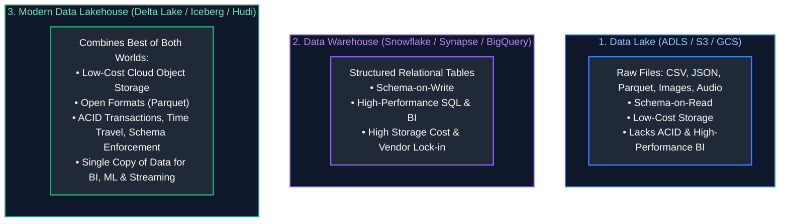
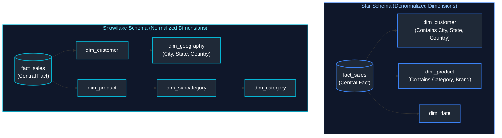
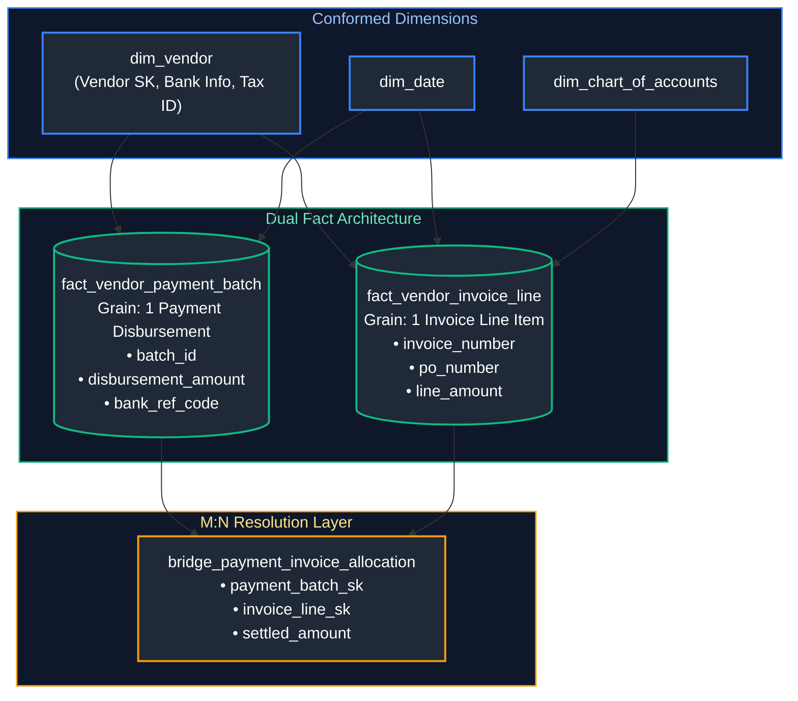
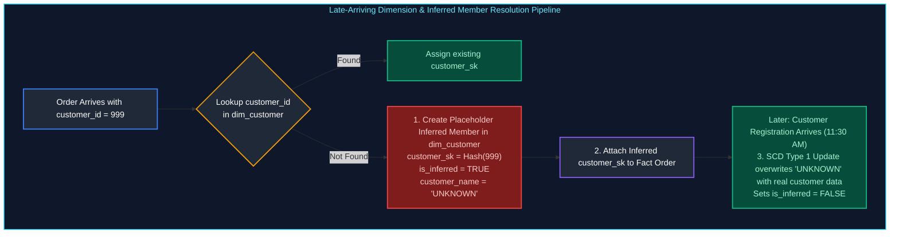

# 03. Data Modeling & Warehousing: Interview Questions & Deep-Dive Solutions

A comprehensive, production-grade guide answering dimensional modeling, data warehousing, physical storage, and schema design interview scenarios. Covers Star vs Snowflake architectures, Kimball methodology, Slowly Changing Dimensions (SCD Types 1, 2, 3), domain modeling (Vendor Payments, Lending Book), inferred members, and multi-currency exchange handling.

---

## Table of Contents & Question Mapping

1. **OLTP vs OLAP Architecture & Normalization vs Denormalization**
   - [Q9. OLTP vs OLAP Architecture & Why Analytical Queries Bypass OLTP](#q9-oltp-vs-olap-architecture--why-analytical-queries-bypass-oltp)
   - [Q4. Normalization vs Denormalization in Data Warehouses](#q4-normalization-vs-denormalization-in-data-warehouses)
2. **Data Lake vs Data Warehouse vs Data Lakehouse**
   - [Q11. Data Lake vs Data Warehouse vs Data Lakehouse Architecture](#q11-data-lake-vs-data-warehouse-vs-data-lakehouse-architecture)
3. **Dimensional Modeling Foundations: Star vs Snowflake Schemas**
   - [Q2 & Q6. Star Schema vs Snowflake Schema Architecture & Selection Criteria](#q2--q6-star-schema-vs-snowflake-schema-architecture--selection-criteria)
   - [Q12. Sales Fact Table Design with Product and Customer Dimensions](#q12-sales-fact-table-design-with-product-and-customer-dimensions)
4. **Row-Oriented vs Columnar Physical Storage**
   - [Q7. Row-Oriented vs Columnar Physical Storage Mechanics](#q7-row-oriented-vs-columnar-physical-storage-mechanics)
5. **Domain Data Model Design: Vendor Payment System**
   - [Q1. End-to-End Data Model Design: Vendor Payment System](#q1-end-to-end-data-model-design-vendor-payment-system)
6. **Domain Data Model Design: Lending Book Architecture**
   - [Q3. End-to-End Data Model Design: Lending Book Architecture](#q3-end-to-end-data-model-design-lending-book-architecture)
7. **Slowly Changing Dimensions (SCD Types 1, 2, 3) in Spark & Delta Lake**
   - [Q5. Slowly Changing Dimensions (SCD Types 1, 2, 3) in Spark & Delta Lake](#q5-slowly-changing-dimensions-scd-types-1-2-3-in-spark--delta-lake)
8. **Handling Inferred Members & Late-Arriving Dimensions**
   - [Q8. Handling Inferred Members & Late-Arriving Dimensions](#q8-handling-inferred-members--late-arriving-dimensions)
9. **Global Multi-Currency Sales Modeling & Daily Exchange Rates**
   - [Q10. Multi-Currency Sales Fact Modeling & Daily Exchange Rate Joins](#q10-multi-currency-sales-fact-modeling--daily-exchange-rate-joins)
---

# 1. OLTP vs OLAP Architecture & Normalization vs Denormalization

---

### Q9. OLTP vs OLAP Architecture & Why Analytical Queries Bypass OLTP
**Topic Covered:** Relational Systems vs Distributed Analytical Warehouses  
**Question:** Difference between OLTP and OLAP systems — and why you don't report directly off OLTP.

#### Architectural Comparison Matrix: OLTP vs OLAP
| Architectural Dimension | OLTP (Online Transaction Processing) | OLAP (Online Analytical Processing) |
| :--- | :--- | :--- |
| **Primary Workload** | High-concurrency, short, atomic ACID reads and writes. | Long-running, high-throughput complex analytical scans and aggregations. |
| **Data Schema** | Highly normalized (3NF / BCNF) to eliminate redundancy. | Denormalized (Star, Snowflake, One Big Table - OBT) to eliminate joins. |
| **Storage Layout** | Row-oriented storage (e.g., PostgreSQL heap, MySQL InnoDB). | Columnar storage (Parquet, ORC, Snowflake FDN, Delta Lake). |
| **Query Pattern** | `SELECT * FROM orders WHERE order_id = 9812;` ($O(1)$ index lookup). | `SELECT category, SUM(amount) FROM sales GROUP BY category;` (Terabyte scan). |
| **Indexing** | Highly indexed with B-Tree indexes on Primary/Foreign keys. | Min/Max zone maps, sparse indexes, data clustering / Z-ordering. |

#### Why You Must NEVER Run Analytical Reporting Directly off OLTP
1. **Catastrophic Lock Contention:** Analytical queries execute long table scans. In OLTP engines (like MySQL or SQL Server with default isolation levels), shared read locks (`S` locks) block incoming transactional write locks (`X` locks), causing timeouts and operational downtime for customer checkouts.
2. **Resource Exhaustion:** Complex joins and aggregations saturate CPU and RAM buffer pools, starving the transaction engine.
3. **Lack of Point-in-Time History:** OLTP databases overwrite historical values (e.g., updating a customer address overwrites the past). Analytical reporting requires historical accuracy (point-in-time state).
4. **Dispersed Data Silos:** OLTP systems only reflect their isolated application database. Warehouses aggregate CRM, ERP, payments, and web analytics into an integrated enterprise model.

---

### Q4. Normalization vs Denormalization in Data Warehouses
**Topic Covered:** Normal Forms (3NF) vs Dimensional Flattening & Query Performance  
**Question:** Normal Forms and Normalization vs Denormalization (why warehouses denormalize on purpose).

#### Why Data Warehouses Denormalize on Purpose
In relational theory, 3NF ensures no data redundancy by splitting entities into distinct tables. In distributed data warehousing (Snowflake, BigQuery, Databricks), joining 15 normalized tables requires massive distributed **network shuffles**. 

**Denormalization** deliberately duplicates dimension attributes directly into wider dimension tables (or flat fact tables). 
- Eliminates multi-hop joins across distributed worker nodes.
- Vastly simplifies BI tool query construction and reporting usability.
- Enables extreme compression in columnar formats where repeating column values compress by 80–95% via Run-Length Encoding (RLE).

---

# 2. Data Lake vs Data Warehouse vs Data Lakehouse

---

### Q11. Data Lake vs Data Warehouse vs Data Lakehouse Architecture
**Topic Covered:** Modern Lakehouse Architecture & Storage Engine Evolution  
**Question:** How do you design a data lake vs a data warehouse, and when would you use each?

#### Architectural Evolution & Comparison


#### Decision Matrix: When to Use Which
| Scenario / Requirement | Data Lake | Data Warehouse | Data Lakehouse |
| :--- | :---: | :---: | :---: |
| **Unstructured Data (Audio, Video, PDFs)** |  (Ideal) |  (Not supported) |  (Via metadata links) |
| **Strict Sub-Second Executive BI Dashboards** |  (Too slow) |  (Native strength) |  (With BI caching) |
| **Unified Platform for BI + ML Training** |  (Clunky) |  (Expensive) |  (Optimal choice) |
| **Total Cost of Ownership (Petabyte Scale)**|  (Lowest cost) |  (Can be high) |  (Balanced) |

---

# 3. Dimensional Modeling Foundations: Star vs Snowflake Schemas

---

### Q2 & Q6. Star Schema vs Snowflake Schema Architecture & Selection Criteria
**Topic Covered:** Dimensional Modeling Foundations & Schema Selection Trade-offs  
**Questions Covered:**
- **Q2**: Star vs Snowflake Schema — differences and when to choose one over the other.
- **Q6**: Choosing the right schema for a given data application + justification.

#### Kimball's 4-Step Dimensional Design Process
1. **Select the Business Process:** e.g., Retail Sales Checkout.
2. **Declare the Grain:** The individual line item on a retail sales receipt.
3. **Identify the Dimensions:** Date, Customer, Store, Product, Promotion.
4. **Identify the Numeric Facts:** Quantity Sold, Unit Selling Price, Discount Amount, Net Extended Sales Amount, Tax Amount.

#### Star Schema vs Snowflake Schema Comparison


| Dimension | Star Schema | Snowflake Schema |
| :--- | :--- | :--- |
| **Dimension Structure** | Completely denormalized. Single table per dimension. | Normalized. Hierarchies split into sub-dimension tables. |
| **Query Complexity** | Simplest SQL queries (1 join per dimension). | Complex SQL with multi-level nested joins. |
| **Performance** | Significantly faster in OLAP engines (fewer distributed shuffles). | Slower query execution due to excessive join hops. |
| **Maintenance** | Dimension updates require updating redundant rows (addressed by SCD).| Updates to a category occur in 1 normalized row. |
| **When to Choose** | Standard Enterprise Data Warehouses, Databricks Lakehouse, PowerBI. | Specialized edge cases with huge, highly dynamic attribute trees. |

---

### Q12. Sales Fact Table Design with Product and Customer Dimensions
**Topic Covered:** Kimball Fact Table DDL, Surrogate Keys & Grain Definition  
**Question:** Explain dimensional modeling and how you would design a sales fact table with product and customer dimensions.

#### Production DDL Design: Sales Fact Table with Product & Customer Dimensions (Q12)
```sql
-- Dimension: Customer (Denormalized)
CREATE TABLE dim_customer (
    customer_sk BIGINT PRIMARY KEY, -- Surrogate Key
    customer_id VARCHAR(64) NOT NULL, -- Business / Natural Key
    first_name VARCHAR(100),
    last_name VARCHAR(100),
    email VARCHAR(255),
    city VARCHAR(100),
    state_code VARCHAR(10),
    country VARCHAR(50),
    customer_tier VARCHAR(20),
    effective_start_date DATE NOT NULL,
    effective_end_date DATE NOT NULL,
    is_current BOOLEAN NOT NULL
);

-- Dimension: Product (Denormalized)
CREATE TABLE dim_product (
    product_sk BIGINT PRIMARY KEY,
    product_id VARCHAR(64) NOT NULL,
    sku VARCHAR(100) NOT NULL,
    product_name VARCHAR(255),
    subcategory_name VARCHAR(100),
    category_name VARCHAR(100),
    brand_name VARCHAR(100),
    base_unit_cost NUMERIC(12, 4)
);

-- Fact: Retail Sales (Grain: One Line Item per Receipt)
CREATE TABLE fact_retail_sales (
    sales_receipt_id VARCHAR(64) NOT NULL, -- Degenerate Dimension
    line_item_number INT NOT NULL,         -- Degenerate Dimension
    date_sk INT NOT NULL,                  -- Foreign Key -> dim_date
    customer_sk BIGINT NOT NULL,          -- Foreign Key -> dim_customer
    product_sk BIGINT NOT NULL,           -- Foreign Key -> dim_product
    store_sk INT NOT NULL,                -- Foreign Key -> dim_store
    
    -- Additive Numeric Metrics
    quantity_sold INT NOT NULL,
    unit_price NUMERIC(12, 4) NOT NULL,
    discount_amount NUMERIC(12, 4) DEFAULT 0.0,
    tax_amount NUMERIC(12, 4) DEFAULT 0.0,
    net_sales_amount NUMERIC(12, 4) NOT NULL,
    cost_amount NUMERIC(12, 4) NOT NULL,
    gross_margin_amount NUMERIC(12, 4) NOT NULL,
    
    CONSTRAINT pk_fact_sales PRIMARY KEY (sales_receipt_id, line_item_number)
);
```

---

# 4. Row-Oriented vs Columnar Physical Storage

---

### Q7. Row-Oriented vs Columnar Physical Storage Mechanics
**Topic Covered:** Physical Disk Page Layout, I/O Projection Pruning & Vectorized Scans  
**Question:** Row vs. Columnar Storage

#### Visual Comparison: Physical Layout on Disk
```
Logical Table:
Row 0: [ID: 1, Name: "Alice", Amount: 100]
Row 1: [ID: 2, Name: "Bob",   Amount: 200]
Row 2: [ID: 3, Name: "Carol", Amount: 300]

1. Row-Oriented Storage (PostgreSQL Heap, CSV):
Disk Block 1: [1, "Alice", 100] | [2, "Bob", 200] | [3, "Carol", 300]

2. Columnar Storage (Parquet, ORC, Delta Lake):
Disk Block 1 (ID):     [1, 2, 3]
Disk Block 2 (Name):   ["Alice", "Bob", "Carol"]
Disk Block 3 (Amount): [100, 200, 300]
```

#### Why Columnar Storage Dominates Data Warehousing
1. **Column Pruning (I/O Elimination):** In analytical queries like `SELECT SUM(amount) FROM sales`, a columnar engine reads **only Disk Block 3**. Row stores must read all columns for every row into RAM, wasting 90% of disk I/O bandwidth.
2. **Extreme Compression Ratios:** Columns contain values of the exact same data type and high cardinality repetition. Columnar stores apply Run-Length Encoding (RLE), Dictionary Encoding, and Snappy/ZSTD, achieving $5\times$ to $10\times$ disk compression.
3. **Vectorized SIMD Processing:** Modern CPUs process 512-bit vector registers simultaneously (processing 16 numbers in a single CPU cycle) directly over contiguous columnar memory arrays.

---

# 5. Domain Data Model Design: Vendor Payment System

---

### Q1. End-to-End Data Model Design: Vendor Payment System
**Topic Covered:** Financial Event Modeling, Invoice-Payment Granularity & Fact Lineage  
**Question:** Design a Vendor Payment System (Fact vs Dimension, Business Events mapping, Granularity, Payment Batch vs Order-Level Tracking).

#### Business Process & Event Mapping
In enterprise ERPs (SAP, NetSuite), the Procure-to-Pay lifecycle involves distinct business events:
1. **Purchase Order (PO) Created** $\to$ Commitment.
2. **Goods Receipt (GR) Logged** $\to$ Inventory Receipt.
3. **Vendor Invoice Received** $\to$ Accounts Payable Liability.
4. **Payment Batch Executed** $\to$ Cash Disbursement.

#### Granularity Dilemma: Payment Batch vs Order/Invoice Line Item
- **The Problem:** A single vendor invoice can reference 10 purchase orders. A single bank payment batch can settle 500 invoices across 50 vendors.
- **The Solution:** We implement a **Grain-Aligned Dual Fact Architecture**:
  1. `fact_vendor_invoice_line`: Detailed invoice line level tracking.
  2. `fact_vendor_payment_disbursement`: Payment execution batch level tracking.
  3. `bridge_payment_invoice`: Bridge table resolving the Many-to-Many ($M:N$) settlement mapping between payment allocations and invoices.

#### Relational Architecture Diagram


---

# 6. Domain Data Model Design: Lending Book Architecture

---

### Q3. End-to-End Data Model Design: Lending Book Architecture
**Topic Covered:** Loan Lifecycle Modeling, Periodic Snapshot vs Accumulating Snapshot Facts  
**Question:** Design a Data Model for a Lending Book.

#### Core Lending Book Domain Concepts
A lending institution (Fintech, Bank) manages a portfolio of loans. A robust data model requires tracking:
1. **Origination & Underwriting:** Principal loan amount, interest rate, term, risk rating.
2. **Amortization Schedule:** Expected monthly installments (Principal + Interest).
3. **Repayment Transactions:** Actual borrower payments, early prepayments, late fees.
4. **Daily Lending Book Snapshot (Periodic Snapshot Fact):** Current outstanding balance, accrued interest, Days Past Due (DPD), and loan delinquency bucket (Performing, 30 DPD, 60 DPD, Default).

#### Lending Book Schema Design
```sql
-- Dimension: Loan Account (SCD Type 2 to track status changes)
CREATE TABLE dim_loan_account (
    loan_account_sk BIGINT PRIMARY KEY,
    loan_id VARCHAR(64) NOT NULL,
    borrower_sk BIGINT NOT NULL,
    product_type VARCHAR(50),      -- Personal, Mortgage, SME
    origination_date DATE NOT NULL,
    maturity_date DATE NOT NULL,
    initial_principal_amount NUMERIC(15, 2) NOT NULL,
    interest_rate_apr NUMERIC(5, 4) NOT NULL,
    loan_term_months INT NOT NULL,
    loan_status VARCHAR(30) NOT NULL, -- Active, Settled, Defaulted, Written-off
    effective_start_date DATE NOT NULL,
    effective_end_date DATE NOT NULL,
    is_current BOOLEAN NOT NULL
);

-- Fact 1: Loan Transactions (Transaction Fact Table)
-- Grain: One financial transaction event (Disbursement, Repayment, Fee, Adjustment)
CREATE TABLE fact_loan_transaction (
    transaction_id VARCHAR(64) PRIMARY KEY,
    loan_account_sk BIGINT NOT NULL,
    transaction_date_sk INT NOT NULL,
    transaction_type VARCHAR(30) NOT NULL, -- DISBURSEMENT, REPAYMENT, PENALTY
    principal_component NUMERIC(15, 2) NOT NULL,
    interest_component NUMERIC(15, 2) NOT NULL,
    fee_component NUMERIC(15, 2) NOT NULL,
    total_transaction_amount NUMERIC(15, 2) NOT NULL
);

-- Fact 2: Daily Loan Book Snapshot (Periodic Snapshot Fact Table)
-- Grain: One record per active loan account per day (Crucial for risk & delinquency analytics)
CREATE TABLE fact_daily_loan_snapshot (
    snapshot_date_sk INT NOT NULL,
    loan_account_sk BIGINT NOT NULL,
    current_principal_outstanding NUMERIC(15, 2) NOT NULL,
    accrued_interest_receivable NUMERIC(15, 2) NOT NULL,
    days_past_due (DPD) INT NOT NULL,
    delinquency_bucket VARCHAR(20) NOT NULL, -- 'CURRENT', '1-30 DPD', '31-60 DPD', '90+ DPD'
    expected_monthly_installment NUMERIC(15, 2) NOT NULL,
    cumulative_principal_repaid NUMERIC(15, 2) NOT NULL,
    cumulative_interest_paid NUMERIC(15, 2) NOT NULL,
    is_non_performing_loan (NPL) BOOLEAN NOT NULL,
    
    CONSTRAINT pk_daily_loan_snapshot PRIMARY KEY (snapshot_date_sk, loan_account_sk)
);
```

---

# 7. Slowly Changing Dimensions (SCD Types 1, 2, 3) in Spark & Delta Lake

---

### Q5. Slowly Changing Dimensions (SCD Types 1, 2, 3) in Spark & Delta Lake
**Topic Covered:** Temporal History Preservation & Delta Lake MERGE Implementation  
**Question:** SCD (Slowly Changing Dimensions) Types (Type 1, 2, 3) and implementation in Spark/Delta Lake.

#### SCD Types Overview
- **SCD Type 0 (Fixed):** Values never change (e.g., `date_of_birth`).
- **SCD Type 1 (Overwrite):** Updates existing record in-place. **No history retained**. Ideal for correcting data entry typos.
- **SCD Type 2 (Add New Row):** Preserves full historical audit trail by inserting a new record with `effective_start_date`, `effective_end_date`, and `is_current` flag.
- **SCD Type 3 (Add New Column):** Tracks only current and previous value side-by-side using dedicated columns (`current_city`, `previous_city`). Limited historical window.

#### SCD Type 2 Architecture
```
Incoming Event: Customer 101 moves from 'Seattle' to 'New York' on 2024-06-01

Resulting dim_customer Table:
┌─────────┬─────────────┬──────────┬──────────────┬────────────┬───────────┐
│ cust_sk │ customer_id │ city     │ start_date   │ end_date   │ is_current│
├─────────┼─────────────┼──────────┼──────────────┼────────────┼───────────┤
│ 1001    │ 101         │ Seattle  │ 2021-01-01   │ 2024-05-31 │ FALSE     │
│ 1002    │ 101         │ New York │ 2024-06-01   │ 9999-12-31 │ TRUE      │
└─────────┴─────────────┴──────────┴──────────────┴────────────┴───────────┘
```

#### Production PySpark Delta Lake Implementation: SCD Type 2
```python
from delta.tables import DeltaTable
from pyspark.sql import functions as F

def merge_scd_type2_delta(spark, delta_table_path: str, staging_df, merge_key: str):
    """
    Executes a performant SCD Type 2 MERGE in Delta Lake.
    """
    target_table = DeltaTable.forPath(spark, delta_table_path)
    
    # 1. Prepare staging records for both:
    # A) Closing out existing current records (UPDATE)
    # B) Inserting the new current record (INSERT)
    
    staged_updates = staging_df.join(
        target_table.toDF().filter("is_current = true"),
        on=merge_key,
        how="inner"
    ).filter(
        # Detect if any monitored attribute has changed
        staging_df["city"] != target_table.toDF()["city"]
    ).select(
        staging_df[merge_key],
        staging_df["city"],
        staging_df["effective_date"]
    )
    
    # Rows needing update (set is_current = false, end_date = effective_date)
    update_rows = staged_updates.withColumn("merge_key_join", F.col(merge_key))
    
    # Rows needing insert (new version with is_current = true)
    insert_rows = staging_df.withColumn("merge_key_join", F.lit(None))
    
    combined_staging = update_rows.unionByName(insert_rows)
    
    # Delta MERGE
    target_table.alias("tgt").merge(
        combined_staging.alias("stg"),
        "tgt.customer_id = stg.merge_key_join AND tgt.is_current = true"
    ).whenMatchedUpdate(
        condition="tgt.city != stg.city",
        set={
            "is_current": "false",
            "effective_end_date": "stg.effective_date"
        }
    ).whenNotMatchedInsert(
        values={
            "customer_id": "stg.customer_id",
            "city": "stg.city",
            "effective_start_date": "stg.effective_date",
            "effective_end_date": "to_date('9999-12-31')",
            "is_current": "true"
        }
    ).execute()
```

---

# 8. Handling Inferred Members & Late-Arriving Dimensions

---

### Q8. Handling Inferred Members & Late-Arriving Dimensions
**Topic Covered:** Referential Integrity Enforcement & Surrogate Placeholder Resolution  
**Question:** How do you handle a fact that arrives with an unknown dimension key (inferred / late-arriving member)?

#### The Problem: Referential Integrity Breach
In distributed pipelines, events arrive out of sequence. An order event containing `customer_id = 999` arrives at 10:00 AM, but the customer registration record in the CRM only lands in the data warehouse at 11:30 AM.

If the fact load enforces strict foreign key constraints or relies on inner joins for surrogate key lookups, the order is dropped or the pipeline fails.

#### Production Solution: Inferred Member Pattern


#### SQL Implementation
```sql
-- Step 1: Default Sentinel Records in Dimension (Built during table init)
INSERT INTO dim_customer (customer_sk, customer_id, customer_name, is_inferred)
VALUES 
    (-1, 'N/A', 'NOT APPLICABLE', FALSE),
    (-2, 'CORRUPT', 'CORRUPT DATA', FALSE);

-- Step 2: Inferred Member Creation during Fact ETL
INSERT INTO dim_customer (customer_sk, customer_id, customer_name, is_inferred, effective_start_date, effective_end_date, is_current)
SELECT 
    ABS(HASHTEXT(stg.customer_id)) AS customer_sk,
    stg.customer_id,
    'INFERRED_PENDING_REGISTRATION' AS customer_name,
    TRUE AS is_inferred,
    CURRENT_DATE,
    '9999-12-31',
    TRUE
FROM staging_orders stg
LEFT JOIN dim_customer dim ON stg.customer_id = dim.customer_id
WHERE dim.customer_id IS NULL;
```

---

# 9. Global Multi-Currency Sales Modeling & Daily Exchange Rates

---

### Q10. Multi-Currency Sales Fact Modeling & Daily Exchange Rate Joins
**Topic Covered:** FX Triangulation, Daily Exchange Rates & Weekend Interval Filling  
**Question:** How do you handle currency conversion in a global sales model with daily rates?

#### Architectural Design Considerations
1. **Transaction Currency vs Corporate Reporting Currency:** Never store only converted currencies. Always preserve the raw transactional amount in its local originating currency alongside the converted reporting amount.
2. **Exchange Rate Timing:** Retail sales convert at the exact transaction date's spot rate. General Ledger balances often convert at month-end closing rates.
3. **Missing Rates (Weekends & Bank Holidays):** FX markets close on weekends. Pipelines must implement forward-fill logic to apply Friday's closing rate to Saturday and Sunday sales.

#### Recommended Fact Table Structure
```sql
CREATE TABLE fact_global_sales (
    sales_id VARCHAR(64) PRIMARY KEY,
    date_sk INT NOT NULL,
    transaction_currency VARCHAR(3) NOT NULL, -- e.g., 'EUR', 'GBP', 'JPY'
    reporting_currency VARCHAR(3) NOT NULL,   -- e.g., 'USD'
    
    -- Local Original Currency Metrics
    local_sales_amount NUMERIC(15, 2) NOT NULL,
    
    -- Exchange Rate Applied
    applied_daily_exchange_rate NUMERIC(12, 6) NOT NULL,
    
    -- Standardized Corporate Reporting Metrics
    usd_sales_amount NUMERIC(15, 2) NOT NULL -- local_sales_amount * applied_daily_exchange_rate
);
```

#### Production Query: Joining Sales with Daily FX Rates (Handling Missing Weekends)
```sql
WITH daily_fx_with_forward_fill AS (
    SELECT 
        rate_date,
        currency_code,
        exchange_rate_to_usd,
        -- Forward fill rate across non-trading days
        COALESCE(
            exchange_rate_to_usd,
            LAST_VALUE(exchange_rate_to_usd IGNORE NULLS) OVER (
                PARTITION BY currency_code 
                ORDER BY rate_date 
                ROWS BETWEEN UNBOUNDED PRECEDING AND CURRENT ROW
            )
        ) AS filled_fx_rate
    FROM dim_exchange_rates
)
SELECT 
    s.sales_id,
    s.order_date,
    s.local_amount,
    s.currency_code,
    fx.filled_fx_rate AS fx_rate_used,
    ROUND(s.local_amount * fx.filled_fx_rate, 2) AS normalized_usd_amount
FROM staging_sales s
JOIN daily_fx_with_forward_fill fx 
    ON s.order_date = fx.rate_date 
   AND s.currency_code = fx.currency_code;
```
