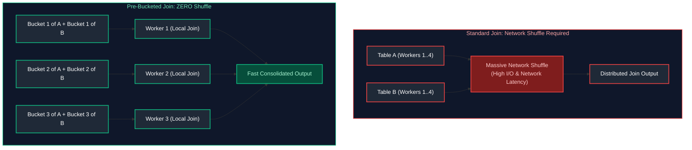
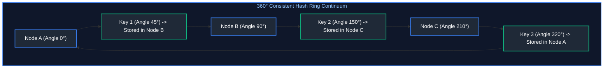
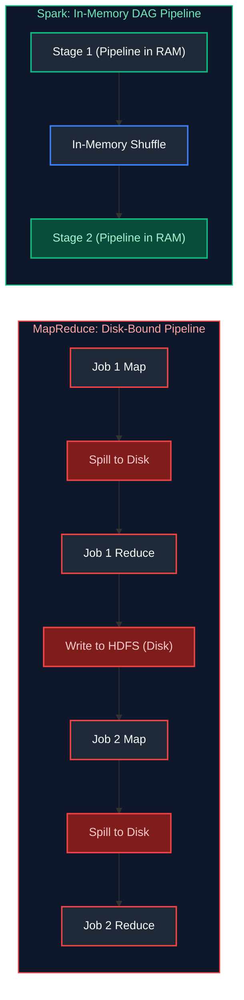
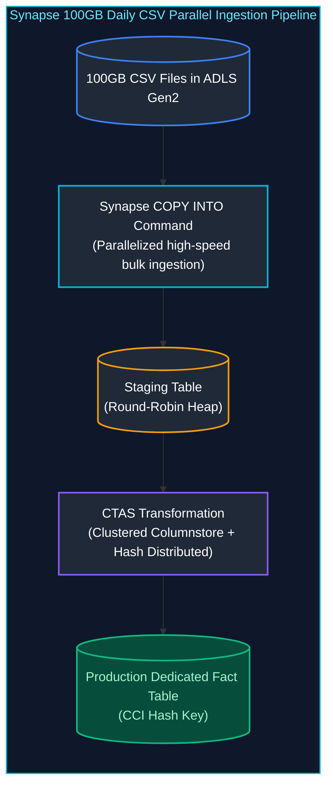
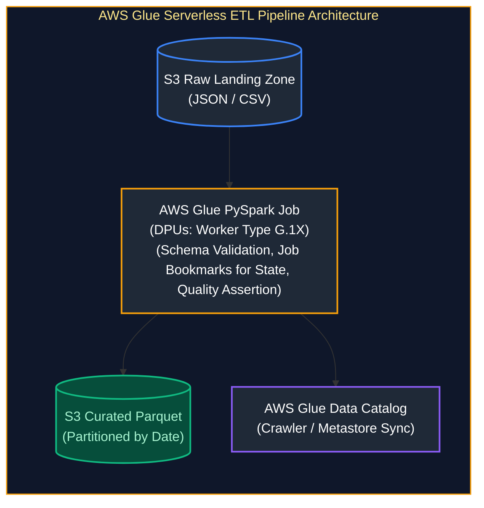
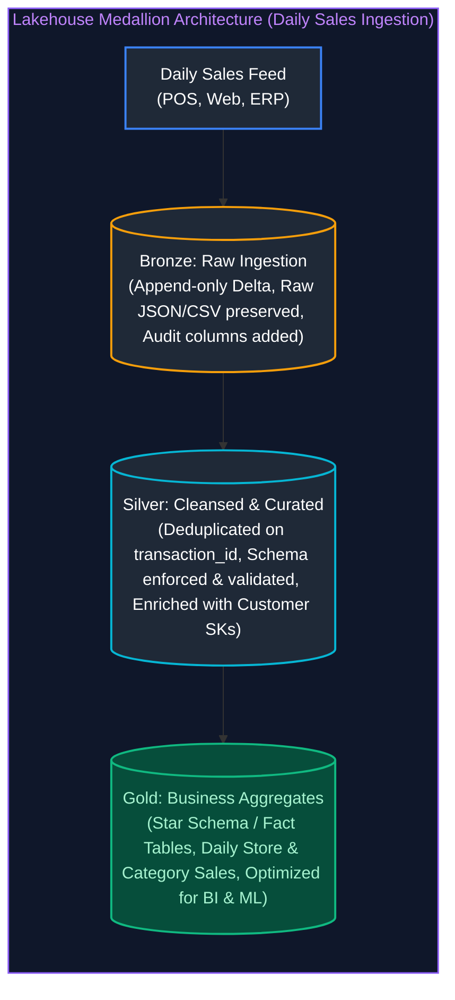

# 04. Cloud & Distributed Systems: Interview Questions & Deep-Dive Solutions

A comprehensive, production-grade guide answering Cloud and Distributed Systems interview scenarios for Data Engineers. Covers distributed data partitioning, consistent hashing, Hadoop/MapReduce internals vs Spark, Hive metastore storage, Azure Synapse Analytics, AWS Glue, Athena vs Redshift, multi-cloud networking, and cost optimization.

---

## Table of Contents & Question Mapping

1. **Distributed Data Organization: Partitioning vs Sharding vs Bucketing**
   - [Q1. Distributed Data Organization: Partitioning vs Sharding vs Bucketing](#q1-distributed-data-organization-partitioning-vs-sharding-vs-bucketing)
2. **Consistent Hashing & Distributed Ring Topology**
   - [Q2. Consistent Hashing & Distributed Ring Topology](#q2-consistent-hashing--distributed-ring-topology)
3. **Hadoop Ecosystem Internals vs Apache Spark**
   - [Q11. Hadoop Ecosystem Core Components & MapReduce vs Spark Architecture](#q11-hadoop-ecosystem-core-components--mapreduce-vs-spark-architecture)
   - [Q12. RecordReader and Combiner Internal Mechanics](#q12-recordreader-and-combiner-internal-mechanics)
4. **Hive Metastore Architecture: Managed vs External Tables**
   - [Q16. Hive Metastore Architecture: Managed vs External Tables](#q16-hive-metastore-architecture-managed-vs-external-tables)
5. **Azure Synapse Analytics: Dedicated vs Serverless SQL Pools**
   - [Q5. Azure Synapse Analytics: Dedicated vs Serverless SQL Pools](#q5-azure-synapse-analytics-dedicated-vs-serverless-sql-pools)
   - [Q6. Ingesting & Transforming 100GB of CSV Files Daily in Synapse](#q6-ingesting--transforming-100gb-of-csv-files-daily-in-synapse)
   - [Q7. Hybrid ADF Ingestion Pipeline: On-Prem SQL to ADLS to Synapse](#q7-hybrid-adf-ingestion-pipeline-on-prem-sql-to-adls-to-synapse)
6. **Cloud CDC Strategies & Azure Cost Optimization**
   - [Q8. Cloud Change Data Capture (CDC) Strategies in Azure](#q8-cloud-change-data-capture-cdc-strategies-in-azure)
   - [Q9. Cost-Efficient Pipeline Architecture (ADF + Databricks + ADLS)](#q9-cost-efficient-pipeline-architecture-adf--databricks--adls)
7. **Multi-Cloud Architecture: AWS & Azure Secure Federation**
   - [Q10. Multi-Cloud Architecture: AWS & Azure Secure Federation](#q10-multi-cloud-architecture-aws--azure-secure-federation)
8. **AWS Big Data Stack: Glue ETL, Athena, Redshift & Lambda Layers**
   - [Q13. End-to-End AWS Glue PySpark ETL Pipeline](#q13-end-to-end-aws-glue-pyspark-etl-pipeline)
   - [Q14. Amazon Athena vs Amazon Redshift & Distribution Styles](#q14-amazon-athena-vs-amazon-redshift--distribution-styles)
   - [Q15. Packaging Custom Dependencies in AWS Lambda Layers](#q15-packaging-custom-dependencies-in-aws-lambda-layers)
9. **Distributed Streaming Engines: Kafka vs Kinesis vs Pub/Sub**
   - [Q3. Distributed Streaming Decision Matrix: Kafka vs Kinesis vs Pub/Sub](#q3-distributed-streaming-decision-matrix-kafka-vs-kinesis-vs-pubsub)
10. **Lakehouse Medallion Architecture for Daily Sales**
    - [Q4. Lakehouse Medallion Architecture for Daily Sales Ingestion](#q4-lakehouse-medallion-architecture-for-daily-sales-ingestion)
---

# 1. Distributed Data Organization: Partitioning vs Sharding vs Bucketing

---

### Q1. Distributed Data Organization: Partitioning vs Sharding vs Bucketing
**Topic Covered:** Physical Data Distribution & Join Optimization  
**Question:** Partitioning Strategies, Data Sharding, and Bucketing (which improves join performance better and why).

#### Definitions & Conceptual Distinctions
- **Partitioning:** Splitting a table into coarse-grained directory subfolders based on low-cardinality values (e.g., `year=2024/month=10/`). Used for coarse-grained folder pruning during query scans.
- **Sharding:** Horizontal horizontal partitioning of data across distinct physical database servers/nodes, often using consistent hashing. Each shard acts as an independent database instance.
- **Bucketing (Clustering):** Hash-partitioning rows into a fixed number of physical files ($K$ buckets) based on the hash of a high-cardinality key (e.g., `hash(user_id) % 32`).

#### Which Improves Join Performance Better and Why?
**Bucketing improves join performance significantly better than partitioning.**

##### The Mechanism: Eliminating Distributed Network Shuffles
In distributed systems (Spark, Hive, Presto), a join between two massive tables typically requires a **Shuffle Sort-Merge Join**, which moves petabytes of data across the network switches to align matching keys onto the same worker nodes.

When two tables are **pre-bucketed on the join key with identical (or multiple) bucket counts**, the distributed engine performs a **Bucket-Map-Join (Sort-Merge Join without Shuffle)**:
1. Bucket $i$ of Table A is guaranteed to only match Bucket $i$ of Table B.
2. Spark executes the join **locally on worker nodes without any network data transfer**.
3. Partitioning only prunes file scans; it does not align keys across worker nodes, meaning partition-filtered tables still incur a 100% network shuffle during joins.



---

# 2. Consistent Hashing & Distributed Ring Topology

---

### Q2. Consistent Hashing & Distributed Ring Topology
**Topic Covered:** Distributed Hash Rings, Virtual Nodes & Rebalancing  
**Question:** Consistent Hashing

#### Problem with Traditional Modulo Hashing
In traditional distributed caching and sharding:
$$\text{Node} = \text{hash}(\text{key}) \pmod N$$
When the cluster scales from $N$ to $N+1$ (or a node crashes to $N-1$), almost **100% of keys are re-mapped to different nodes**. This causes catastrophic cache stampedes and massive data re-balancing across the cluster.

#### Consistent Hashing Mechanics
Consistent Hashing maps both **nodes (servers)** and **keys** to points on a 360-degree circular ring (the hash continuum, typically $0$ to $2^{32}-1$).
1. A key is assigned to the **first server encountered by moving clockwise** along the ring.
2. **Adding a node:** Only keys located between the new node and its counter-clockwise neighbor are moved. All other nodes remain untouched ($O(K/N)$ keys remapped).
3. **Removing a node:** Only keys previously belonging to that node move to the next clockwise node.



#### The Role of Virtual Nodes (V-Nodes)
- **Problem:** With few physical nodes, keys distribute unevenly across the ring (hotspots).
- **Solution:** Each physical machine is mapped to hundreds of **virtual positions** on the ring (e.g., `NodeA_v1`, `NodeA_v2`, `NodeA_v3`). This guarantees statistically uniform data distribution across all physical hardware.

---

# 3. Hadoop Ecosystem Internals vs Apache Spark

---

### Q11. Hadoop Ecosystem Core Components & MapReduce vs Spark Architecture
**Topic Covered:** Distributed Compute Lifecycle & In-Memory RDD Advantages  
**Question:** What are the core Hadoop components and their responsibilities, and what limitations of MapReduce did Spark address?

#### Core Hadoop Components
1. **HDFS (Hadoop Distributed File System):** Distributed storage layer.
   - **NameNode:** Master node managing metadata, namespace tree, and block locations.
   - **DataNode:** Worker nodes storing actual data blocks (default 128 MB blocks with 3x replication).
2. **YARN (Yet Another Resource Negotiator):** Cluster resource scheduler.
   - **ResourceManager:** Cluster-wide resource arbitrator (allocates CPU/RAM).
   - **NodeManager:** Agent running on each worker monitoring container resources.
3. **MapReduce:** Batch processing engine executing Map and Reduce phases.

---

### Q12. RecordReader and Combiner Internal Mechanics
**Topic Covered:** MapReduce InputFormat Serialization & Map-Side Pre-Aggregation  
**Question:** What is a RecordReader and Combiner?

#### RecordReader and Combiner Defined
- **RecordReader:** Component that breaks an `InputSplit` into discrete `<Key, Value>` pairs for consumption by the Mapper (e.g., `LineRecordReader` emits `<ByteOffset, LineText>`).
- **Combiner (Mini-Reducer):** Map-side pre-aggregation optimization. Executes locally on the mapper's output in-memory buffer before data is written to disk or sent over the network shuffle.
  - *Example:* For word count, instead of sending `("spark", 1)` 1,000 times across the network, the Combiner aggregates locally to `("spark", 1000)` and sends a single record over the network.

#### Limitations of MapReduce Addressed by Spark


| Dimension | Hadoop MapReduce | Apache Spark |
| :--- | :--- | :--- |
| **Execution Medium** | Writes every intermediate stage output to physical disk (HDFS). | In-memory pipelined processing via Resilient Distributed Datasets (RDDs). |
| **Iterative ML / Loops**| Severely inefficient; must re-read from disk on every iteration. | $10\times$ to $100\times$ faster; caches datasets directly in executor memory. |
| **DAG Scheduling** | Fixed 2-stage execution: Map $\to$ Reduce. | Arbitrary Direct Acyclic Graphs (DAGs) optimized by Catalyst and Tungsten. |

---

# 4. Hive Metastore Architecture: Managed vs External Tables

---

### Q16. Hive Metastore Architecture: Managed vs External Tables
**Topic Covered:** Catalog Metadata Ownership & Data Deletion Semantics  
**Question:** What is the difference between Hive external and managed tables?

#### Managed (Internal) vs External Tables
| Feature | Managed Table (`CREATE TABLE`) | External Table (`CREATE EXTERNAL TABLE`) |
| :--- | :--- | :--- |
| **Data Ownership** | Hive / Metastore owns both the table metadata and physical data files. | Metastore owns only metadata. The underlying data is owned by external systems. |
| **Default Storage** | Warehouse directory (e.g., `/user/hive/warehouse/table_name`). | Custom specified location (e.g., `s3://my-bucket/path/` or `abfss://...`). |
| **DROP TABLE Behavior** | **Permanently deletes BOTH metadata AND physical underlying data files.** | **Deletes ONLY metadata.** Physical data files on S3/ADLS remain 100% intact. |
| **Recommended Use** | Temporary scratch tables or isolated single-application workloads. | Enterprise production data lakes where multiple tools (Spark, Presto, ADF) access data. |

```sql
-- Production DDL: Safe External Table Creation
CREATE EXTERNAL TABLE curated_customers (
    customer_id STRING,
    customer_name STRING,
    spend DOUBLE
)
STORED AS PARQUET
LOCATION 'abfss://curated@datalakeprod.dfs.core.windows.net/customers/';
```

---

# 5. Azure Synapse Analytics: Dedicated vs Serverless SQL Pools

---

### Q5. Azure Synapse Analytics: Dedicated vs Serverless SQL Pools
**Topic Covered:** Provisioned MPP vs On-Demand Ad-Hoc Compute Models  
**Question:** What are the key differences between Dedicated SQL Pool and Serverless SQL Pool in Synapse?

#### Dedicated SQL Pool vs Serverless SQL Pool
| Dimension | Dedicated SQL Pool (formerly Azure SQL DW) | Serverless SQL Pool |
| :--- | :--- | :--- |
| **Architecture** | Provisioned Massively Parallel Processing (MPP) cluster (60 distributions). | On-demand distributed query processing engine. |
| **Billing Model** | Fixed hourly cost based on DWUs (Data Warehouse Units: DW100c to DW30000c). | Pay-per-query based on TB of data processed (\$5 per TB scanned). |
| **Storage** | Persisted managed columnar tables inside the pool storage. | Queries raw data directly in ADLS Gen2 (Parquet, Delta, CSV) without loading. |
| **Best For** | Enterprise data warehousing, sub-second reporting, heavy updates/deletes. | Ad-hoc data lake exploration, logical views over Bronze/Silver, low TCO. |

---

### Q6. Ingesting & Transforming 100GB of CSV Files Daily in Synapse
**Topic Covered:** High-Scale Staging via PolyBase / COPY INTO & Hash Distribution  
**Question:** You are asked to ingest and transform 100GB of CSV files daily in Synapse. What is your approach?

#### Ingesting & Transforming 100GB CSV Files Daily in Synapse (Q6)


1. **Ingest via `COPY INTO`:** Never use row-by-row `INSERT`. Use `COPY INTO` with parallel file splits.
2. **Staging Table Design:** Create a staging table with **Round-Robin** distribution and Heap storage to maximize write throughput.
3. **Transform using CTAS (Create Table As Select):** Transform raw data into a **Clustered Columnstore Index (CCI)** table with **Hash Distribution** on the high-cardinality join key (e.g., `customer_id`).

```sql
-- Step 1: Staging table (Round-Robin distribution for max write speed)
CREATE TABLE stage_daily_sales (
    order_id VARCHAR(50),
    customer_id INT,
    amount DECIMAL(18, 2),
    order_date DATE
)
WITH (
    DISTRIBUTION = ROUND_ROBIN,
    HEAP
);

-- Step 2: High-speed parallel ingestion
COPY INTO stage_daily_sales
FROM 'https://myaccount.dfs.core.windows.net/raw/sales/2024/*.csv'
WITH (
    FILE_TYPE = 'CSV',
    CREDENTIAL = (IDENTITY = 'Storage Account Key', SECRET = '...'),
    FIELDTERMINATOR = ',',
    ROWTERMINATOR = '0x0A',
    FIRSTROW = 2
);

-- Step 3: Transform to Production Fact Table (Hash Distributed on join key)
CREATE TABLE fact_sales
WITH (
    DISTRIBUTION = HASH(customer_id),
    CLUSTERED COLUMNSTORE INDEX
)
AS
SELECT order_id, customer_id, amount, order_date
FROM stage_daily_sales;
```

---

### Q7. Hybrid ADF Ingestion Pipeline: On-Prem SQL to ADLS to Synapse
**Topic Covered:** Self-Hosted Integration Runtime & Staged PolyBase Loads  
**Question:** How would you design an ADF pipeline to move data from multiple on-prem SQL databases to Azure Data Lake and then load into Synapse Analytics?

#### ADF Pipeline: On-Prem SQL $\to$ ADLS $\to$ Synapse (Q7)
1. **Self-Hosted Integration Runtime (SHIR):** Deployed on an on-prem VM inside the corporate firewall to establish secure outbound connectivity.
2. **Metadata-Driven Lookup & ForEach:** An ADF Lookup activity reads database table names from a metadata control table. A ForEach activity iterates in parallel.
3. **Copy Activity (Staging in ADLS):** Copies tables from on-prem SQL to ADLS Gen2 raw zone in Parquet format.
4. **Synapse Ingestion Activity:** Executes a Synapse stored procedure or `COPY INTO` command to load staging Parquet data into Synapse Dedicated SQL Pool.

---

# 6. Cloud CDC Strategies & Azure Cost Optimization

---

### Q8. Cloud Change Data Capture (CDC) Strategies in Azure
**Topic Covered:** Watermarking, Azure SQL CDC, Event Hubs & Delta Lake CDF  
**Question:** Explain your approach for incremental and CDC (Change Data Capture) data loading in Azure.

#### Incremental and CDC Strategies in Azure (Q8)
1. **Native Azure SQL CDC:** Enable SQL Server CDC to capture row-level changes into `cdc.fn_cdc_get_net_changes` tables. ADF natively reads SQL CDC deltas via the Copy Activity.
2. **High-Watermark Ingestion:** For systems without CDC, track a numeric timestamp column (`updated_at` or `rowversion`) stored in an ADF control table:
   ```sql
   SELECT * FROM source_table 
   WHERE updated_at > @LastWatermark AND updated_at <= @CurrentWatermark;
   ```
3. **Delta Lake Change Data Feed (CDF):** Within Databricks, enable CDF to downstream tables to capture row-level `_change_type` (`insert`, `update_preimage`, `update_postimage`, `delete`).

---

### Q9. Cost-Efficient Pipeline Architecture (ADF + Databricks + ADLS)
**Topic Covered:** Spot Instances, Single-Node Clusters & Lifecycle Policies  
**Question:** How would you design a cost-efficient pipeline in Azure using adf, databricks, and adls?

#### Azure Cloud Architecture Cost Optimization Matrix

| Component / Service | Cost Optimization Lever | Technical Mechanism & Configuration | Estimated Cost Savings | Production Boundary / Operational Trade-off |
| :--- | :--- | :--- | :--- | :--- |
| **Azure Data Factory (ADF)** | **Bypass Mapping Data Flows** | Replace expensive managed Spark Data Flows with lightweight native **Copy Activity** (binary/metadata orchestration) or serverless Azure Functions. | **60% – 85%** on pipeline orchestration compute | Complex row transformations must be offloaded to downstream Databricks / Spark jobs. |
| **Azure Databricks** | **Automated Job Clusters** | Run scheduled pipelines exclusively on automated **Job Clusters** instead of All-Purpose interactive clusters. | **~65% reduction** in Databricks Unit (DBU) hourly rates | Job clusters incur 3–5 min initial VM provisioning cold-start latency; unsuitable for ad-hoc user BI. |
| **Azure Databricks** | **Spot / Low-Priority Worker VMs** | Configure Databricks cluster worker nodes to use Azure Spot VMs while maintaining an on-demand driver. | **60% – 80%** on underlying Azure VM infrastructure | Node evictions can trigger task retries; enable Delta Lake transaction checkpoints for resilience. |
| **Azure Databricks** | **Aggressive Auto-Termination** | Enforce aggressive cluster auto-termination policies (10–15 min idle timeout) via Cluster Policies. | **Eliminates 100%** of idle cluster resource waste | Subsequent ad-hoc queries will wait for cluster restart cold starts. |
| **Azure Data Lake Storage (ADLS)** | **Storage Lifecycle Tiering** | Implement blob lifecycle management rules: transition raw Bronze blobs from Hot to Cool after 30 days, and Archive after 90 days. | **50% – 80%** on multi-terabyte persistent storage | Accessing archived data requires asynchronous rehydration (hours); unsuitable for interactive queries. |

---

# 7. Multi-Cloud Architecture: AWS & Azure Secure Federation

---

### Q10. Multi-Cloud Architecture: AWS & Azure Secure Federation
**Topic Covered:** OIDC Cross-Cloud Trust, Parquet Compression & Egress Mitigation  
**Question:** Suppose your pipeline needs to run across AWS and Azure together (multi-cloud). How would you design secure and cost-effective data access?

#### Secure Identity Federation (Zero Long-Lived Credentials)
Never store AWS Access Keys inside Azure or vice versa.
- **OIDC / Workload Identity Federation:** Configure Azure Managed Identity as a trusted Identity Provider inside AWS IAM via OpenID Connect (OIDC).
- The Azure pipeline requests a short-lived token from Microsoft Entra ID and assumes an AWS IAM role with fine-grained S3 permissions.

#### Minimizing Cross-Cloud Egress Costs
Egress charges between cloud providers cost \$0.08–\$0.09 per GB.
1. **Local Compute & Push-Down:** Never transfer raw uncompressed CSV/JSON data across clouds. Run compute locally in AWS to compress, filter, and convert data into **Snappy/ZSTD Parquet** before transferring.
2. **Batch Consolidations:** Transfer once daily or micro-batch to prevent connection overhead.
3. **Cloud Interconnect:** For massive terabyte/petabyte continuous flows, use a dedicated cross-cloud interconnect (e.g., Megaport or Equinix Fabric) to reduce egress transit rates.

---

# 8. AWS Big Data Stack: Glue ETL, Athena, Redshift & Lambda Layers

---

### Q13. End-to-End AWS Glue PySpark ETL Pipeline
**Topic Covered:** DynamicFrames, AWS Glue Catalog & Job Bookmarks  
**Question:** Explain an end-to-end AWS Glue ETL pipeline you have worked on (validation & cleaning using PySpark in Glue).

#### AWS Glue PySpark ETL Pipeline Architecture (Q13)


```python
import sys
from awsglue.transforms import *
from awsglue.utils import getResolvedOptions
from pyspark.context import SparkContext
from awsglue.context import GlueContext
from awsglue.job import Job
from pyspark.sql import functions as F

args = getResolvedOptions(sys.argv, ['JOB_NAME'])
sc = SparkContext()
glueContext = GlueContext(sc)
spark = glueContext.spark_session
job = Job(glueContext)
job.init(args['JOB_NAME'], args)

# Read using Job Bookmarks to prevent re-processing existing files
datasource = glueContext.create_dynamic_frame.from_options(
    connection_type="s3",
    connection_options={"paths": ["s3://landing-bucket/orders/"], "recurse": True},
    format="json",
    transformation_ctx="datasource_orders"
)

df = datasource.toDF()

# Validation & Cleaning
cleaned_df = (
    df.filter(F.col("order_id").isNotNull())
      .filter(F.col("order_amount") > 0)
      .withColumn("order_date", F.to_date(F.col("timestamp")))
      .dropDuplicates(["order_id"])
)

# Write to Curated Zone partitioned by date in Parquet
cleaned_df.write.mode("append").partitionBy("order_date").parquet("s3://curated-bucket/orders/")
job.commit()
```

---

### Q14. Amazon Athena vs Amazon Redshift & Distribution Styles
**Topic Covered:** Serverless Presto Queries vs Provisioned Warehouses (KEY, EVEN, ALL)  
**Question:** Athena vs Redshift — where have you used them, and what are the different Redshift distribution styles?

#### Athena vs Redshift & Redshift Distribution Styles (Q14)
- **Athena:** Serverless Trino engine. Ideal for ad-hoc querying of S3 data lake files. Zero cluster maintenance; pay \$5/TB scanned.
- **Redshift:** Dedicated MPP data warehouse. Ideal for high-concurrency BI dashboards and sub-second analytical reporting.

##### Redshift Distribution Styles
- **`AUTO`:** Redshift automatically manages distribution (starts with `ALL`, transitions to `EVEN` as table grows).
- **`EVEN`:** Rows are distributed across cluster slices using Round-Robin. Best for staging tables or tables without obvious join keys.
- **`KEY`:** Rows are distributed based on values in a single column. All matching keys reside on the same slice. **Best for large fact tables joined with massive dimension tables.**
- **`ALL`:** A full copy of the entire table is duplicated onto every node slice. **Best for small, slowly changing dimension tables (< 3 million rows)**; eliminates all join shuffles.

---

### Q15. Packaging Custom Dependencies in AWS Lambda Layers
**Topic Covered:** Linux Wheel Compilation, Docker-Based Packaging & Layer Linking  
**Question:** Your Python Lambda needs a library that isn't available in the default runtime. How would you deploy it? (packaging dependencies/Lambda Layers, handling psycopg2/pandas).

#### Deploying Non-Default Python Libraries in AWS Lambda (Q15)
AWS Lambda provides a minimal standard execution environment. To deploy external libraries like `pandas` or compiled C-extensions like `psycopg2`:

##### Strategy: AWS Lambda Layers
1. **The Architecture:** Lambda layers extract heavy shared code and binary dependencies from the function zip package.
2. **Handling Compiled C-Extensions (`psycopg2` / `numpy`):** Standard `pip install psycopg2` on macOS compiles binaries for Darwin OS, which fail on Lambda's Amazon Linux runtime.
3. **The Solution:** Build the layer inside an Amazon Linux Docker container or use pre-compiled Wheels:
   ```bash
   # Build layer using Docker aligned with Lambda Amazon Linux runtime
   docker run -v "$PWD":/var/task "public.ecr.aws/sam/build-python3.11" /bin/sh -c "\
       pip install psycopg2-binary pandas -t python/lib/python3.11/site-packages/; \
       zip -r lambda_layer.zip python"
   
   # Publish to AWS
   aws lambda publish-layer-version \
       --layer-name postgres-pandas-layer \
       --zip-file fileb://lambda_layer.zip \
       --compatible-runtimes python3.11
   ```

---

# 9. Distributed Streaming Engines: Kafka vs Kinesis vs Pub/Sub

---

### Q3. Distributed Streaming Decision Matrix: Kafka vs Kinesis vs Pub/Sub
**Topic Covered:** Message Log Architecture, Partition Scaling & Multi-Tenant Brokering  
**Question:** Kafka Overview and how to decide between using Kafka, Kinesis, or Pub/Sub for streaming ingestion.

#### Architectural Decision Matrix
| Feature | Apache Kafka (Self-Hosted / MSK / Confluent) | AWS Kinesis Data Streams | GCP Pub/Sub |
| :--- | :--- | :--- | :--- |
| **Model** | Distributed commit log (Partition-based pull). | Distributed commit log (Shard-based pull). | Serverless message broker (Topic/Subscription push/pull). |
| **Ordering** | Strict total order guaranteed **within a partition**. | Strict total order guaranteed **within a shard**. | Global ordering via Ordering Keys; otherwise unordered. |
| **Replayability** |  Offset replay for arbitrary retention duration (days/months). |  Replay by sequence number (up to 365 days). |  Seek to timestamp (retains acknowledged messages up to 7 days). |
| **Scaling** | Partition count fixed at creation; manual repartitioning. | Shard scaling (or on-demand auto-sharding). | **Fully serverless auto-scaling** without capacity planning. |
| **Ecosystem** | Multi-cloud, on-premises, enterprise hybrid. | AWS native integration (Lambda, Firehose, S3). | Google Cloud native (Dataflow, BigQuery). |

---

# 10. Lakehouse Medallion Architecture for Daily Sales

---

### Q4. Lakehouse Medallion Architecture for Daily Sales Ingestion
**Topic Covered:** Multi-Hop Architecture, Append-Only Bronze, Cleaned Silver & Aggregated Gold  
**Question:** Explain how you would build a Medallion Architecture (Bronze-Silver-Gold) in Databricks / Data Lakehouse to process daily sales data.

#### Architectural Blueprint: Multi-Hop Medallion Pipeline


#### Production PySpark Implementation
```python
from pyspark.sql import functions as F
from delta.tables import DeltaTable

# 1. Bronze Layer: Ingest Raw Daily Sales (Append-only)
raw_sales_df = (
    spark.read.format("json")
    .load("abfss://raw@datalake.dfs.core.windows.net/sales/2024-10-05/")
    .withColumn("ingestion_timestamp", F.current_timestamp())
    .withColumn("source_file", F.input_file_name())
)
raw_sales_df.write.format("delta").mode("append").saveAsTable("bronze.raw_sales")

# 2. Silver Layer: Cleanse, Validate & Deduplicate
silver_staged = (
    spark.table("bronze.raw_sales")
    .filter(F.col("order_id").isNotNull())
    .filter(F.col("amount") >= 0)
    .withColumn("order_date", F.to_date(F.col("order_time")))
    .dropDuplicates(["order_id"])
)

# Merge idempotently into Silver Delta table
silver_table = DeltaTable.forName(spark, "silver.cleansed_sales")
silver_table.alias("tgt").merge(
    silver_staged.alias("src"),
    "tgt.order_id = src.order_id"
).whenMatchedUpdateAll(
).whenNotMatchedInsertAll(
).execute()

# 3. Gold Layer: Pre-aggregated Business Metrics
gold_daily_summary = (
    spark.table("silver.cleansed_sales")
    .groupBy("order_date", "store_id", "category")
    .agg(
        F.sum("amount").alias("total_daily_revenue"),
        F.count("order_id").alias("total_transactions"),
        F.avg("amount").alias("average_basket_size")
    )
)
gold_daily_summary.write.format("delta").mode("overwrite").saveAsTable("gold.daily_store_sales_summary")
```
