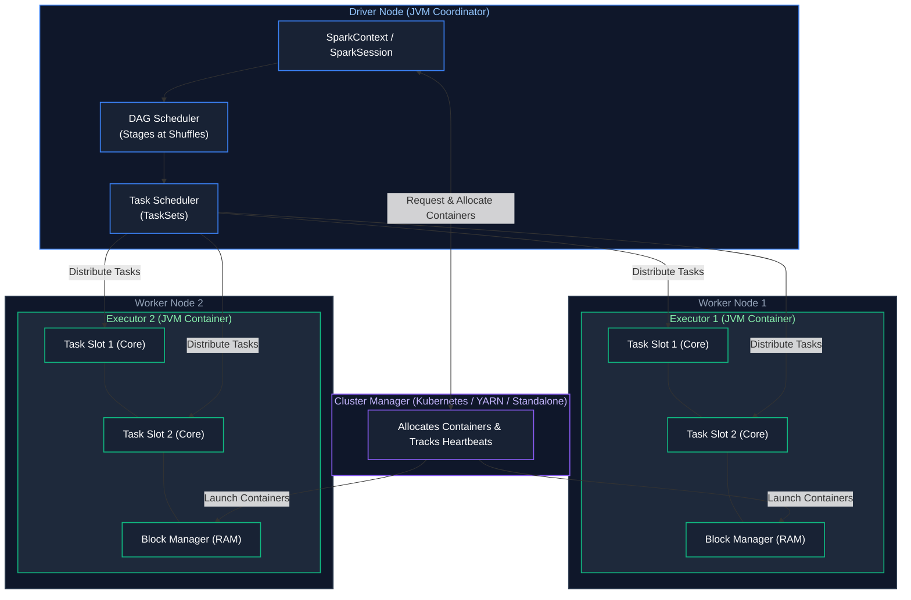
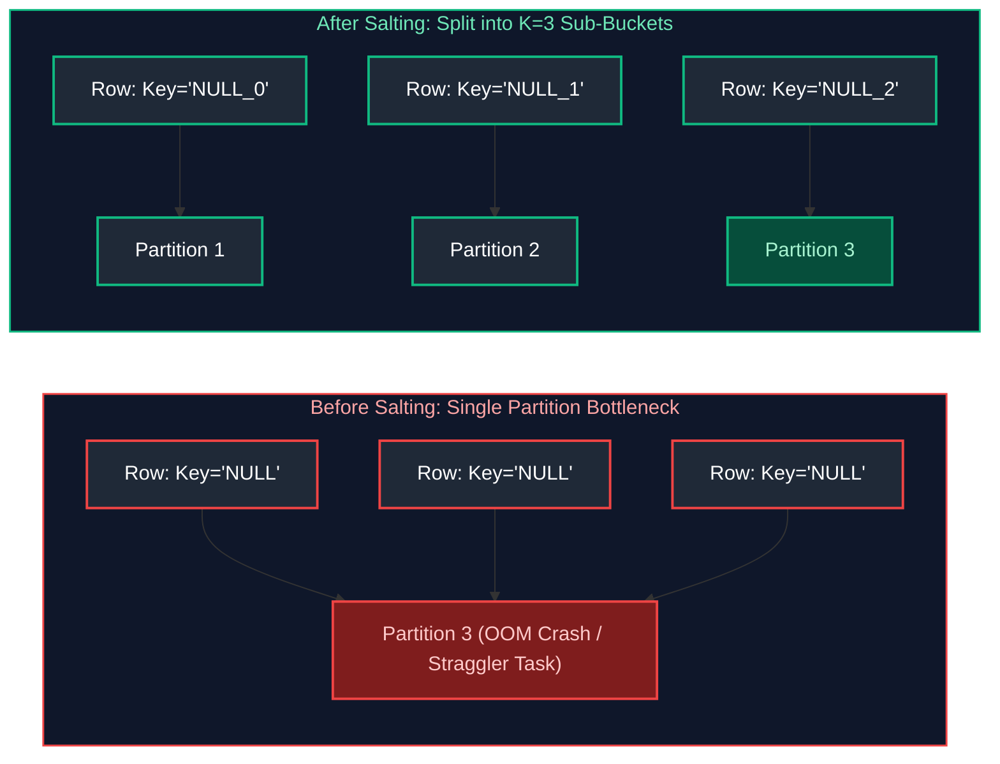
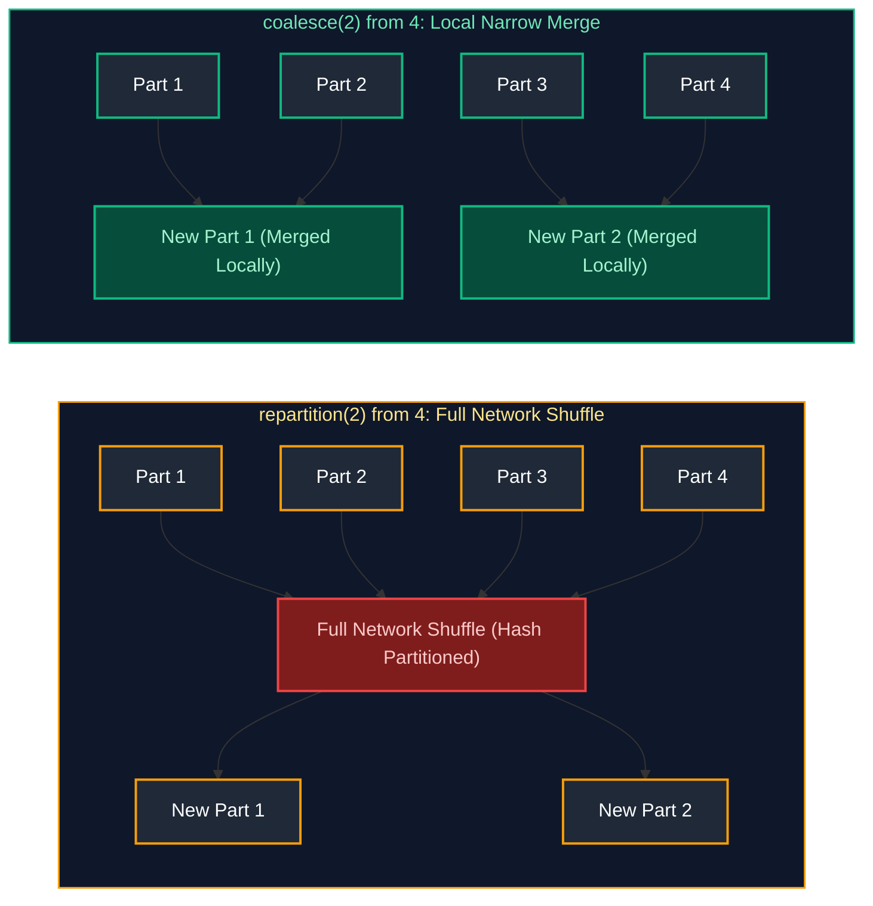
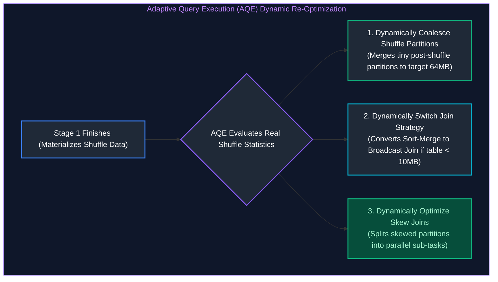
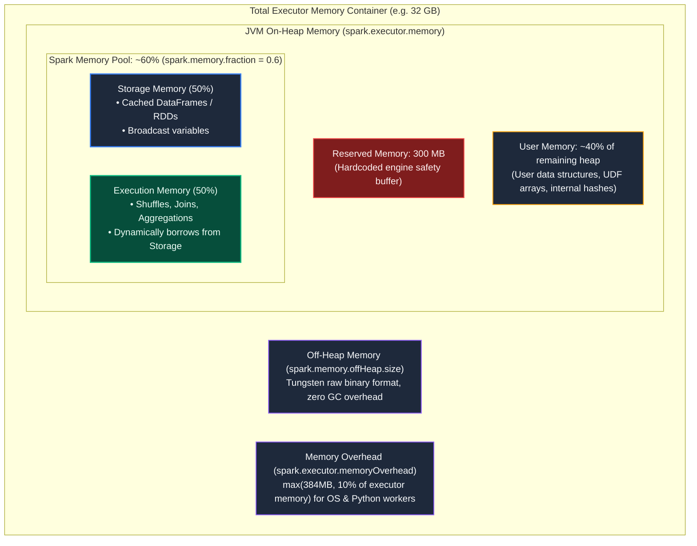
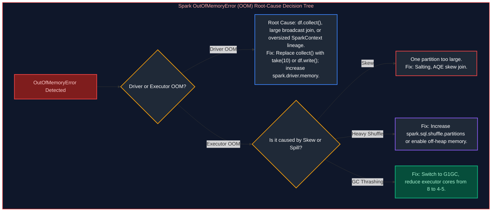

# 05. Apache Spark & PySpark: Interview Questions & Deep-Dive Solutions

A comprehensive, production-grade guide answering Apache Spark and PySpark architecture, optimization, and coding interview scenarios. Covers internal execution engines, DAG and task scheduling, join strategies, data skew salting, Adaptive Query Execution (AQE), memory management, OOM debugging, and real-time PySpark coding problems.

---

## Table of Contents & Question Mapping

1. **Spark Engine Architecture & Execution Lifecycle**
   - [Q30. Spark Physical Cluster Architecture](#q30-spark-physical-cluster-architecture)
   - [Q43. Spark Execution Flow from spark-submit to Completion](#q43-spark-execution-flow-from-spark-submit-to-completion)
   - [Q40. Narrow vs Wide Transformations & Stage Boundaries](#q40-narrow-vs-wide-transformations--stage-boundaries)
   - [Q41. RDD Immutability & Lineage-Based Fault Tolerance](#q41-rdd-immutability--lineage-based-fault-tolerance)
   - [Q42. reduceByKey() vs groupByKey() Efficiency](#q42-reducebykey-vs-groupbykey-efficiency)
   - [Q44. map() vs flatMap() Mechanics](#q44-map-vs-flatmap-mechanics)
2. **Distributed Join Strategies & Accidental Multipliers**
   - [Q4, Q5 & Q6. Spark Join Strategies & Optimizer Selection Matrix](#q4-q5--q6-spark-join-strategies--optimizer-selection-matrix)
   - [Q23. Joining 500 GB DataFrame with 50 MB Lookup DataFrame](#q23-joining-500-gb-dataframe-with-50-mb-lookup-dataframe)
   - [Q28. Diagnosing Join Record Multipliers & Cartesian Explodes](#q28-diagnosing-join-record-multipliers--cartesian-explodes)
   - [Q34. Joining Two DataFrames with Different Schemas via Row Number](#q34-joining-two-dataframes-with-different-schemas-via-row-number)
3. **Data Skew Detection, Stragglers & Mitigation**
   - [Q1. Root Causes of the 1-Task Straggler](#q1-root-causes-of-the-1-task-straggler)
   - [Q2. Identifying Data Skew in the Spark Web UI](#q2-identifying-data-skew-in-the-spark-web-ui)
   - [Q3 & Q25. Mitigating Data Skew via Key Salting & AQE Skew Join](#q3--q25-mitigating-data-skew-via-key-salting--aqe-skew-join)
4. **Partition Management: Repartition vs Coalesce & Small Files**
   - [Q7 & Q8. repartition() vs coalesce() Architectural Comparison](#q7--q8-repartition-vs-coalesce-architectural-comparison)
   - [Q18. Partition Sizing Heuristics (Increasing vs Decreasing)](#q18-partition-sizing-heuristics-increasing-vs-decreasing)
   - [Q20 & Q21. The Small File Problem & Resolution in Spark](#q20--q21-the-small-file-problem--resolution-in-spark)
   - [Q45. Partition Pruning Mechanics](#q45-partition-pruning-mechanics)
5. **Shuffle Mechanics, Intermediate DataFrames & AQE**
   - [Q14 & Q15. Identifying & Reducing Excessive Shuffling](#q14--q15-identifying--reducing-excessive-shuffling)
   - [Q16. Adaptive Query Execution (AQE) 3-Pillar Architecture](#q16-adaptive-query-execution-aqe-3-pillar-architecture)
   - [Q22 & Q26. Optimizing Large Intermediate DataFrames & Multiple groupBy Operations](#q22--q26-optimizing-large-intermediate-dataframes--multiple-groupby-operations)
6. **Spark Memory Architecture, Caching, GC & OOM Debugging**
   - [Q36. Spark Unified Memory Architecture Breakdown](#q36-spark-unified-memory-architecture-breakdown)
   - [Q13. cache() vs persist() Storage Levels](#q13-cache-vs-persist-storage-levels)
   - [Q17. OutOfMemoryError (OOM) Diagnostic Playbook](#q17-outofmemoryerror-oom-diagnostic-playbook)
   - [Q24. Garbage Collection (GC) Optimization & Executor Sizing](#q24-garbage-collection-gc-optimization--executor-sizing)
7. **Production Troubleshooting Playbook & Scaling to 10 TB**
   - [Q9, Q11 & Q12. Production Troubleshooting Playbook for 2hr vs 20min Slowdowns](#q9-q11--q12-production-troubleshooting-playbook-for-2hr-vs-20min-slowdowns)
   - [Q10. Why Spark Jobs Run Fine in Dev but Crash in Production](#q10-why-spark-jobs-run-fine-in-dev-but-crash-in-production)
   - [Q19. Scaling Playbook for Processing 10 TB Datasets](#q19-scaling-playbook-for-processing-10-tb-datasets)
8. **Transformations: Built-in Functions vs UDFs, Schemas & JSON**
   - [Q27 & Q38. Built-in transform() vs Python UDF vs Pandas UDF](#q27--q38-built-in-transform-vs-python-udf-vs-pandas-udf)
   - [Q29 & Q31. Handling Inconsistent Schemas, Null Values & Incorrect Casing](#q29--q31-handling-inconsistent-schemas-null-values--incorrect-casing)
   - [Q39. Parsing & Flattening Nested JSON in PySpark](#q39-parsing--flattening-nested-json-in-pyspark)
9. **Production PySpark Live Coding Scenarios**
   - [Q32. PySpark Live Coding: Days Between Status Changes per User](#q32-pyspark-live-coding-days-between-status-changes-per-user)
   - [Q33. PySpark Live Coding: Upserting New Files into Delta Tables](#q33-pyspark-live-coding-upserting-new-files-into-delta-tables)
   - [Q35. PySpark Live Coding: Store Spending > ₹1000 in the Last Month](#q35-pyspark-live-coding-store-spending--1000-in-the-last-month)
   - [Q37. PySpark Live Coding: Department-wise Employee Ranking](#q37-pyspark-live-coding-department-wise-employee-ranking)
---

# 1. Spark Engine Architecture & Execution Lifecycle

---

### Q30. Spark Physical Cluster Architecture
**Topic Covered:** Driver, Executors, Cluster Manager & Task Scheduling  
**Question:** Spark Architecture (Driver, Executors, Cluster Manager, DAG Scheduler, and Task Scheduler).

#### Spark Physical Cluster Architecture (Q30)


---

### Q43. Spark Execution Flow from spark-submit to Completion
**Topic Covered:** Complete Lifecycle from Client Submit to Action Evaluation  
**Question:** Explain the complete Spark execution flow from spark-submit to job completion (Jobs → Stages → Tasks & stage boundaries).

#### Complete Execution Flow: spark-submit to Completion (Q43)
1. **Application Launch:** Client executes `spark-submit`. Cluster Manager allocates container for Driver.
2. **DAG Construction:** Driver executes user code lazily. When an **Action** is invoked (`count()`, `collect()`, `write()`), a **Job** is triggered.
3. **Stage Breakdown:** The **DAG Scheduler** examines transformations. Wherever a **Wide Dependency** (shuffle) occurs, it introduces a stage boundary.
4. **Task Generation:** Each stage is converted into a `TaskSet`. The number of tasks in a stage equals the number of partitions in the DataFrame at that point.
5. **Task Scheduling:** The **Task Scheduler** schedules tasks onto available executor cores respecting data locality (`PROCESS_LOCAL` > `NODE_LOCAL` > `RACK_LOCAL` > `ANY`).
6. **Task Completion:** Executors return status to Driver. Once all stages complete, the action terminates.

---

### Q40. Narrow vs Wide Transformations & Stage Boundaries
**Topic Covered:** Transformation Lineage, Shuffles & Stage Pipelining  
**Question:** What is the difference between narrow and wide transformations in Spark? Can you give examples?

#### Narrow vs Wide Transformations (Q40)
- **Narrow Transformation:** Each partition of the parent RDD is consumed by **at most one partition** of the child RDD. No data needs to be transferred across the network. Pipelined in RAM!
  - *Examples:* `map()`, `filter()`, `flatMap()`, `union()`.
- **Wide Transformation:** Multiple child partitions depend on data from multiple parent partitions. Requires a physical **Shuffle** where data is partitioned by hash across the network.
  - *Examples:* `groupByKey()`, `reduceByKey()`, `join()`, `distinct()`, `repartition()`.

---

### Q41. RDD Immutability & Lineage-Based Fault Tolerance
**Topic Covered:** Resilient Distributed Datasets, Deterministic Recomputation  
**Question:** What is an RDD and why is it immutable?

#### RDD Immutability & Fault Tolerance (Q41)
An **RDD (Resilient Distributed Dataset)** is an immutable, distributed collection of elements partitioned across cluster nodes.
- **Why Immutable?** Immutability guarantees deterministic execution and thread-safety. 
- **Lineage Graph Fault Tolerance:** Instead of replicating terabytes of in-memory data across nodes (which is too expensive), Spark records the exact sequence of transformations (the Lineage Graph). If an executor crashes and a partition is lost, Spark simply re-executes the lineage graph for that specific missing partition.

---

### Q42. reduceByKey() vs groupByKey() Efficiency
**Topic Covered:** Map-Side Combine, Shuffle Spills & Memory Thrashing  
**Question:** reduceByKey() vs groupByKey() — why is one generally more efficient?

#### reduceByKey() vs groupByKey() (Q42)
- **`groupByKey()` (Anti-Pattern):** Shuffles **all individual `<K, V>` pairs** across the network before grouping. Satures network bandwidth and causes catastrophic Executor OOMs.
- **`reduceByKey()` (Optimized):** Performs a **Map-Side Combiner** locally on each executor prior to shuffling. It aggregates values for each key in-memory, sending only the single reduced value across the network. Reduces network shuffle by 95%+.

```mermaid
flowchart TD
    subgraph groupByKey ["groupByKey: Massive Network Transfer (Anti-Pattern)"]
        direction LR
        M1["Mapper: ('a', 1), ('a', 1), ('a', 1)"] --> S1["Shuffle ALL 3 records over Network"] --> R1["Reducer: ('a', [1, 1, 1])"]
    end
    
    subgraph reduceByKey ["reduceByKey: Local Pre-Aggregation (Combiner Optimized)"]
        direction LR
        M2["Mapper: ('a', 1), ('a', 1), ('a', 1)"] --> C1["Map-Side Combiner: ('a', 3)"] --> S2["Shuffle ONLY 1 record over Network"] --> R2["Reducer: ('a', 3)"]
    end

    style groupByKey fill:#0f172a,stroke:#ef4444,stroke-width:1.5px,color:#fca5a5
    style reduceByKey fill:#0f172a,stroke:#10b981,stroke-width:1.5px,color:#6ee7b7
    style M1 fill:#1f2937,stroke:#ef4444,stroke-width:2px,color:#fff
    style S1 fill:#7f1d1d,stroke:#ef4444,stroke-width:2px,color:#fecaca
    style R1 fill:#1f2937,stroke:#ef4444,stroke-width:2px,color:#fff
    style M2 fill:#1f2937,stroke:#10b981,stroke-width:2px,color:#fff
    style C1 fill:#1f2937,stroke:#3b82f6,stroke-width:2px,color:#fff
    style S2 fill:#1f2937,stroke:#10b981,stroke-width:2px,color:#fff
    style R2 fill:#064e3b,stroke:#10b981,stroke-width:2px,color:#a7f3d0
```



---

### Q44. map() vs flatMap() Mechanics
**Topic Covered:** One-to-One vs One-to-Many Iterator Transformation  
**Question:** map() vs flatMap().

#### map() vs flatMap() (Q44)
- **`map()` (1-to-1):** Transforms each input element into exactly one output element: `[1, 2] -> [[1], [2]]`.
- **`flatMap()` (1-to-Many / Flatten):** Transforms each element into an iterable and flattens the resulting collections into a single stream: `["hello world"] -> ["hello", "world"]`.

---

# 2. Distributed Join Strategies & Accidental Multipliers

---

### Q4, Q5 & Q6. Spark Join Strategies & Optimizer Selection Matrix
**Topic Covered:** Distributed Join Topologies (BHJ, SMJ, SHJ, Cartesian)  
**Questions Covered:**
- **Q4**: When would you use Broadcast Join vs Sort-Merge Join?
- **Q5**: What is a broadcast join, and when does the optimizer choose it over a shuffle join?
- **Q6**: What are the different join strategies in Spark and when to use each?

#### Spark Join Strategies Decision Matrix (Q4, Q5, Q6)
| Join Strategy | Mechanism | Network Shuffle | Prerequisites / Thresholds | When to Use |
| :--- | :--- | :---: | :--- | :--- |
| **Broadcast Hash Join (BHJ)** | Copies the small DataFrame entirely to every executor's RAM. | **None** | One side $\le 10\text{ MB}$ (configurable via `spark.sql.autoBroadcastJoinThreshold`). Equi-join. | Whenever one table is small. Fastest join in Spark. |
| **Shuffle Hash Join (SHJ)** | Hashes both tables by join key and builds an in-memory hash table for the smaller side. | **Yes** | Equi-join. Build side fits in executor memory. | When Sort-Merge sort overhead is too high and table is moderately sized. |
| **Sort-Merge Join (SMJ)** | Hashes both sides, sorts partitions by join key on disk/RAM, then merges sequentially. | **Yes** | Default for joining two large DataFrames. Equi-join keys sortable. | Joining two large tables ($> 100\text{ GB}$). Resilient against OOMs. |
| **Broadcast Nested Loop (BNLJ)** | Broadcasts small table; nested loops each row against large table. | **None** | Non-equi joins (`<, >, !=`). Small table. | Range joins or when no equality predicate exists. Very slow! |
| **Cartesian Product Join** | Evaluates full $M \times N$ matrix. | **Yes** | Triggered on cross joins without predicates. | Avoid at all costs in distributed workloads. |

---

### Q23. Joining 500 GB DataFrame with 50 MB Lookup DataFrame
**Topic Covered:** Broadcast Hash Join Optimization & Auto-Broadcast Thresholds  
**Question:** You have a 500 GB DataFrame and a 50 MB lookup DataFrame. How would you join them efficiently, and why?

#### Joining 500 GB DataFrame with 50 MB Lookup DataFrame (Q23)
Use a **Broadcast Hash Join (BHJ)** with explicit hint `broadcast()`:
```python
from pyspark.sql.functions import broadcast

# 500 GB fact table joined with 50 MB dimension
joined_df = fact_df_500gb.join(
    broadcast(lookup_df_50mb), 
    on="lookup_id", 
    how="inner"
)
```
##### Rationale:
If executed with standard Sort-Merge Join, Spark will shuffle and sort all 500 GB of fact data across the network, consuming massive I/O. With BHJ, the 50 MB lookup table is serialized and broadcast once to each executor. **Zero bytes of the 500 GB fact table are shuffled.**

---

### Q28. Diagnosing Join Record Multipliers & Cartesian Explodes
**Topic Covered:** Non-Unique Keys, Composite Key Omissions & Row Explosion Diagnostics  
**Question:** A Spark join produces a huge increase in the number of records. How would you determine whether the join is creating duplicate/multiple matches?

#### Diagnosing Join Record Multiplication (Cartesian Explode) (Q28)
When a join causes an unexpected explosion in output row count (e.g., 10M rows in, 80M rows out):
1. **Diagnosis:** Run key cardinality checks on both DataFrames prior to joining:
```python
# Check for duplicate keys causing 1:N or M:N Cartesian fan-out
dup_keys_left = df_left.groupBy("join_key").count().filter("count > 1")
dup_keys_right = df_right.groupBy("join_key").count().filter("count > 1")

print(f"Left duplicate keys: {dup_keys_left.count()}")
print(f"Right duplicate keys: {dup_keys_right.count()}")
```
2. **Remediation:** If the dimension side has duplicate keys, deduplicate via `dropDuplicates(["join_key"])` or window function before joining.

---

### Q34. Joining Two DataFrames with Different Schemas via Row Number
**Topic Covered:** Window Row Number Generation & Positional Schema Merging  
**Question:** PySpark scenario: Join two DataFrames with different schemas using row numbers / Window functions.

#### Joining Two DataFrames with Different Schemas via Row Number (Q34)
When two DataFrames have no common join key but need to be aligned positionally:
```python
from pyspark.sql import Window, functions as F

w = Window.orderBy(F.monotonically_increasing_id())

df1_indexed = df1.withColumn("row_id", F.row_number().over(w))
df2_indexed = df2.withColumn("row_id", F.row_number().over(w))

aligned_df = df1_indexed.join(df2_indexed, on="row_id", how="inner").drop("row_id")
```

---

# 3. Data Skew Detection, Stragglers & Mitigation

---

### Q1. Root Causes of the 1-Task Straggler
**Topic Covered:** Distributed Partition Asymmetry & Single-Key Hotspots  
**Question:** A Spark job has 200 tasks, but one task runs much longer than the others. What could be the reason?

#### Root Cause of the 1-Task Straggler (Q1)
When 199 tasks finish in 10 seconds but Task 200 runs for 45 minutes:
1. **Data Skew:** A single join or group key (e.g., `NULL`, `0`, or default country `'US'`) contains 80% of all rows. All these rows are hashed to that single task partition.
2. **Non-Splittable Compressed File:** Reading a large file compressed with GZIP (which cannot be split into parallel blocks). A single task must decompress the entire file.
3. **Hardware Straggler / Thermal Throttling:** Bad executor host suffering network packet loss or bad disk I/O.

---

### Q2. Identifying Data Skew in the Spark Web UI
**Topic Covered:** Task Duration Quantiles, Shuffle Read Spikes & Executor Memory  
**Question:** How would you identify and handle data skew in a Spark join?

#### How to Identify Data Skew in the Spark UI (Q2)
1. Open the **Stages Tab** in Spark UI.
2. Scroll to the **Task Metrics Summary Table**.
3. Inspect the **Duration** and **Shuffle Read Size** percentiles:
   - **Healthy Stage:** Min: 5s, Median: 6s, 75th: 6s, Max: 7s.
   - **Skewed Stage:** Min: 2s, Median: 4s, 75th: 5s, **Max: 42 minutes!** (Max is orders of magnitude higher than 75th percentile).

---

### Q3 & Q25. Mitigating Data Skew via Key Salting & AQE Skew Join
**Topic Covered:** Synthetic Key Salting, DataFrame Key Replication & Partition Balancing  
**Questions Covered:**
- **Q3**: What is data skew in PySpark, and how would you handle skewed joins in large datasets (including Salting and AQE)?
- **Q25**: How would you handle a DataFrame with highly uneven partition sizes?

#### Mitigation Technique 1: Key Salting (Q3)
**Salting** breaks down a hot skewed key into $K$ uniform sub-keys by appending a random integer.


```python
from pyspark.sql import functions as F

# Large Skewed Table: Salt the join key with random number 0..4
SALT_FACTOR = 4
large_salted = large_df.withColumn(
    "salted_key", 
    F.concat(F.col("join_key"), F.lit("_"), F.floor(F.rand() * SALT_FACTOR))
)

# Small Lookup Table: Replicate (explode) each row SALT_FACTOR times
small_exploded = small_df.withColumn(
    "salt_array", F.array([F.lit(i) for i in range(SALT_FACTOR)])
).withColumn("salt_val", F.explode("salt_array")) \
 .withColumn("salted_key", F.concat(F.col("join_key"), F.lit("_"), F.col("salt_val")))

# Join on the salted key - perfectly uniform distribution!
balanced_join = large_salted.join(small_exploded, on="salted_key", how="inner").drop("salted_key", "salt_val", "salt_array")
```

#### Mitigation Technique 2: Adaptive Query Execution (AQE) Skew Join
Spark 3.x introduced automatic skew join handling:
```python
spark.conf.set("spark.sql.adaptive.enabled", "true")
spark.conf.set("spark.sql.adaptive.skewJoin.enabled", "true")
spark.conf.set("spark.sql.adaptive.skewJoin.skewedPartitionFactor", "5")
spark.conf.set("spark.sql.adaptive.skewJoin.skewedPartitionThresholdInBytes", "256MB")
```
When AQE detects a partition larger than the threshold, it automatically splits that large partition into multiple smaller sub-partitions and joins them in parallel.

---

# 4. Partition Management: Repartition vs Coalesce & Small Files

---

### Q7 & Q8. repartition() vs coalesce() Architectural Comparison
**Topic Covered:** Full Hash Shuffle vs Narrow Partition Merging  
**Questions Covered:**
- **Q7**: What is the difference between repartition() and coalesce()?
- **Q8**: Difference between repartition() and coalesce() with real production use cases.

#### repartition() vs coalesce() Architectural Comparison (Q7, Q8)
| Dimension | `repartition(N)` | `coalesce(N)` |
| :--- | :--- | :--- |
| **Network Shuffle** | **Full Network Shuffle.** Reshuffles data across all worker nodes. | **Zero Network Shuffle.** Merges adjacent local partitions. |
| **Resize Direction** | Can **increase** or **decrease** partition count. | Can **only decrease** partition count efficiently. |
| **Partition Size Balance**| Creates uniformly balanced partitions. Fixes skew. | Can result in uneven partition sizes (stragglers). |
| **Production Use Case** | Before an expensive join or group-by to eliminate skew, or to scale up partition count. | Right before writing output to disk to reduce small files without triggering a shuffle! |



---

### Q18. Partition Sizing Heuristics (Increasing vs Decreasing)
**Topic Covered:** Cluster Core Multiples & Target 128MB Partition Rule  
**Question:** Your DataFrame has 500 partitions. How would you decide whether to increase or decrease them?

#### Sizing Heuristic for 500 Partitions (Q18)
The golden rule for Spark partition sizing is **100 MB to 200 MB per partition in RAM**:
$$\text{Ideal Partitions} = \frac{\text{Total Uncompressed Dataset Size}}{128\text{ MB}}$$
- If total DataFrame size is **50 GB**: $\frac{50,000\text{ MB}}{128\text{ MB}} \approx 390$ partitions. 500 partitions is appropriate.
- If total DataFrame size is **500 MB**: 500 partitions results in 1 MB per partition (extreme small task overhead). **Decrease to 4–8 partitions using `coalesce(4)`**.
- Also check available cluster cores: Partitions should ideally be $2\times$ to $3\times$ the total executor cores to ensure all cores stay saturated.

---

### Q20 & Q21. The Small File Problem & Resolution in Spark
**Topic Covered:** NameNode Metadata Overhead, I/O IOPS Bottlenecks & Post-Processing Compaction  
**Questions Covered:**
- **Q20**: A Spark job generates thousands of small files. How would you identify and fix the issue?
- **Q21**: What is the small-file problem and why does it hurt performance? How would you solve it?

#### The Small File Problem & Resolution (Q20, Q21)
- **Why it hurts performance:**
  1. **Storage Metadata Strain:** Millions of small files saturate HDFS NameNode memory or Cloud Storage LIST API quotas.
  2. **Task Scheduling Overhead:** Spark launches 1 task per file split. Scheduling 10,000 tasks that each run for 200 ms spends 95% of cluster time on JVM task scheduling overhead rather than real computation.
- **How to Fix:**
  1. `df.coalesce(num_files).write.parquet(...)` prior to output sink.
  2. Delta Lake auto-compaction: `OPTIMIZE table_name` or set `spark.databricks.delta.autoCompact.enabled = true`.
  3. Enable AQE partition coalescing: `spark.sql.adaptive.coalescePartitions.enabled = true`.

---

### Q45. Partition Pruning Mechanics
**Topic Covered:** File Index Skipping & Directory Scanning Elimination  
**Question:** What is partition pruning?

#### Partition Pruning (Q45)
**Partition Pruning** is an optimization where the query engine skips reading directory partitions that do not match the query filter (e.g., `WHERE date >= '2024-10-01'`).
- **Dynamic Partition Pruning (DPP):** In star schema joins, when a fact table is joined with a filtered dimension table, Spark evaluates the dimension filter at runtime and prunes physical partitions from the large fact table before scanning.

---

# 5. Shuffle Mechanics, Intermediate DataFrames & AQE

---

### Q14 & Q15. Identifying & Reducing Excessive Shuffling
**Topic Covered:** Shuffle File I/O, Disk Spill Mitigation & Shuffle Pruning  
**Questions Covered:**
- **Q14**: How would you reduce unnecessary shuffle operations?
- **Q15**: How would you identify whether a Spark job is suffering from excessive shuffling?

#### Identifying & Reducing Excessive Shuffling (Q14, Q15)
- **Identification:** In Spark UI, inspect **Shuffle Read Size / Records** and **Shuffle Write Size / Records**. If Shuffle Read exceeds input data volume by multiple times, or if high **Spill (Memory)** and **Spill (Disk)** are present, the job is shuffle-bound.
- **Reduction Techniques:**
  1. **Broadcast Joins:** Convert Sort-Merge joins to Broadcast Hash Joins where possible.
  2. **Filter & Project Early:** Strip unneeded columns and filter rows *before* join or groupBy.
  3. **Colocate Bucketed Tables:** Pre-bucket tables on the join key.
  4. **Combine Aggregations:** Merge multiple sequential `groupBy` operations into a single multi-dimensional grouping using `GROUPING SETS`, `ROLLUP`, or `CUBE`.

---

### Q16. Adaptive Query Execution (AQE) 3-Pillar Architecture
**Topic Covered:** Dynamic Coalescing, Runtime Join Switching & Dynamic Skew Handling  
**Question:** How does AQE (Adaptive Query Execution) improve Spark performance?

#### Adaptive Query Execution (AQE) 3-Pillar Architecture (Q16)
AQE re-optimizes execution plans at runtime based on actual stage runtime statistics:


---

### Q22 & Q26. Optimizing Large Intermediate DataFrames & Multiple groupBy Operations
**Topic Covered:** Projection Pushing, Checkpointing Lineage Truncation & Multi-Aggregation Optimization  
**Questions Covered:**
- **Q22**: A PySpark transformation creates a very large intermediate DataFrame and causes performance issues. How would you optimize it?
- **Q26**: How would you optimize a PySpark job that performs multiple groupBy() operations?

#### Optimizing Large Intermediate DataFrames (Q22)
When an intermediate DataFrame becomes massive and degrades downstream stages:
1. **Break the Lineage via Checkpointing:** `df.checkpoint()` breaks an excessively long Catalyst lineage graph, cutting query planning time and serializing clean data to reliable storage.
2. **Selective Persist:** Use `df.persist(StorageLevel.MEMORY_AND_DISK_SER)` if the intermediate DataFrame is reused in multiple downstream actions.

---

# 6. Spark Memory Architecture, Caching, GC & OOM Debugging

---

### Q36. Spark Unified Memory Architecture Breakdown
**Topic Covered:** JVM Heap Division: Storage Memory, Execution Memory, User Memory & Overhead  
**Question:** How does Spark memory management work? Explain caching, persistence, garbage collection, and executor memory tuning.

#### Spark Unified Memory Architecture Breakdown (Q36)
Inside each Executor JVM container (e.g., 32 GB RAM):


| Memory Region | Allocation / Configuration Flag | Operational Purpose & Eviction Behavior |
| :--- | :--- | :--- |
| **Reserved Memory** | Hardcoded `300 MB` | Spark internal engine execution safety buffer. Unaffected by configs. |
| **User Memory** | `(Heap - 300MB) * (1 - spark.memory.fraction)` (~40%) | User-defined data structures, custom Python/Java UDF arrays, metadata hashes. |
| **Storage Memory** | `Spark Pool * spark.memory.storageFraction` (~50% of pool) | Cached DataFrames (`persist`), broadcast variables, unrolled block buffers. |
| **Execution Memory** | `Spark Pool * (1 - storageFraction)` (~50% of pool) | Shuffle buffers, hash aggregation maps, join sorting. Can borrow from Storage memory dynamically. |
| **Off-Heap Memory** | `spark.memory.offHeap.size` | Off-heap memory managed via Project Tungsten; avoids JVM GC pauses. |
| **Overhead Memory** | `spark.executor.memoryOverhead` (`max(384MB, 10%)`) | Container OS overhead, native libraries, and PySpark daemon processes. |

---

### Q13. cache() vs persist() Storage Levels
**Topic Covered:** Default MEMORY_AND_DISK Storage Level vs Custom Deserialization Policies  
**Question:** When would you use cache() vs persist()?

#### cache() vs persist() (Q13)
- **`cache()`:** Shortcut syntax for `persist(StorageLevel.MEMORY_AND_DISK)`. Deserialized in memory, spills to disk when full.
- **`persist(StorageLevel)`:** Allows specifying exact custom storage tiers:
  - `MEMORY_ONLY`: Fastest, but re-computes dropped partitions on eviction.
  - `MEMORY_AND_DISK_SER`: Serialized bytes in RAM; saves 60% memory footprint compared to deserialized objects.
  - `OFF_HEAP`: Stores data outside JVM garbage collection, eliminating GC pauses.

---

### Q17. OutOfMemoryError (OOM) Diagnostic Playbook
**Topic Covered:** Driver OOM vs Executor OOM & Disk Spill Diagnostics  
**Question:** A PySpark job is running out of memory (OutOfMemoryError). What would you check first?

#### OutOfMemoryError (OOM) Diagnostic Playbook (Q17)


---

### Q24. Garbage Collection (GC) Optimization & Executor Sizing
**Topic Covered:** G1GC Tuning, Object Churn Elimination & Safe Core-to-Executor Ratios  
**Question:** A Spark job has frequent Garbage Collection and executor failures. What would you check and how would you fix it?

#### Garbage Collection (GC) Optimization (Q24)
- **Root Cause:** Large numbers of long-lived Java objects cause full stop-the-world GC pauses. If GC pause exceeds heartbeat timeout (default 120s), the Driver assumes the executor is dead and kills it (`ExecutorLostFailure`).
- **Remediation:**
  1. Use the **G1GC** collector:
     `--conf "spark.executor.extraJavaOptions=-XX:+UseG1GC -XX:InitiatingHeapOccupancyPercent=35"`
  2. Optimal executor core sizing: **Never allocate $>5$ cores per executor**. High core counts (e.g., 16 cores) lead to severe memory allocation thrashing. Best configuration is 4–5 cores and 20–30 GB RAM per executor.

---

# 7. Production Troubleshooting Playbook & Scaling to 10 TB

---

### Q9, Q11 & Q12. Production Troubleshooting Playbook for 2hr vs 20min Slowdowns
**Topic Covered:** Systematic Pipeline Performance Diagnostics & Intermittent Failure Resolution  
**Questions Covered:**
- **Q9**: A Spark job is taking 2 hours instead of 20 minutes. How would you troubleshoot it?
- **Q11**: How would you optimize a slow PySpark job processing billions of records?
- **Q12**: Scenario-based question: "You have a Spark pipeline failing randomly in production. How would you debug and fix it?"

---

### Q10. Why Spark Jobs Run Fine in Dev but Crash in Production
**Topic Covered:** Data Volume Multipliers, Unseen Data Skew & Cluster Contention  
**Question:** A Spark job works fine in development but is very slow in production. How would you troubleshoot it?

#### Why Jobs Run Fine in Dev but Crash in Prod (Q10)
1. **Data Volume & Partition Sizing:** Dev has 10 MB (runs in 1 partition); Prod has 10 TB. Default `spark.sql.shuffle.partitions=200` means each partition in Prod receives 50 GB of data, causing immediate memory spill and crash.
2. **Data Distribution & Real-World Skew:** Dev mock data is uniformly distributed. Prod data has millions of `NULL` customer IDs or extreme holiday spikes.
3. **Cluster Allocation Differences:** Dev runs locally or with dedicated resources; Prod shares multi-tenant cluster capacity subject to preemption.

---

### Q19. Scaling Playbook for Processing 10 TB Datasets
**Topic Covered:** Petabyte-Scale Architecture, Executor Cluster Sizing & Storage Compaction  
**Question:** How would you process a 10 TB dataset efficiently using PySpark?

#### Scaling Playbook for 10 TB Dataset (Q19)
1. **Storage Layout:** Ingest as columnar Snappy/ZSTD **Parquet** or **Delta Lake** with partition pruning on date.
2. **Shuffle Partition Tuning:** Set shuffle partitions to handle 10 TB appropriately:
   $$\text{Partitions} = \frac{10,000,000\text{ MB}}{150\text{ MB}} \approx 65,000\text{ partitions}$$
3. **Turn on Adaptive Query Execution (AQE):** Auto-tunes post-shuffle partitions and mitigates data skew.
4. **Executor Topology:** Allocate balanced instances: 4–5 cores, 28 GB RAM per executor with 10% overhead memory.
5. **Off-Heap Execution:** Enable Project Tungsten off-heap allocation to bypass JVM GC overhead:
   `spark.memory.offHeap.enabled = true`, `spark.memory.offHeap.size = 6g`.

---

# 8. Transformations: Built-in Functions vs UDFs, Schemas & JSON

---

### Q27 & Q38. Built-in transform() vs Python UDF vs Pandas UDF
**Topic Covered:** JVM Py4J Serialization Overhead vs Vectorized Arrow Batches  
**Questions Covered:**
- **Q27**: A PySpark job uses a Python UDF and is running slowly. How would you identify the issue and optimize it?
- **Q38**: Explain the difference between transform() and udf(). Which is more efficient?

#### Built-in `transform()` vs Standard Python UDF vs Pandas UDF (Q27, Q38)
- **Standard Python UDF (Extremely Slow):** Serializes JVM data, sends it through a Unix pipe to a separate Python worker process, computes row-by-row, and serializes back to JVM. **Bypasses Catalyst Optimizer and Tungsten code-gen!**
- **Pandas UDF (Vectorized via PyArrow):** Transmits data in batches using Apache Arrow memory format. Fast, but still incurs JVM-Python context switching.
- **Built-in `DataFrame.transform()` / Spark SQL Functions (Fastest):** Compiles directly into high-performance JVM bytecode via Whole-Stage Code Generation. **Always preferred.**

```python
# SLOW: Standard Python UDF
@F.udf(returnType="string")
def slow_upper(val):
    return val.upper() if val else None

# FAST: Native Spark SQL expression (10x faster)
fast_df = df.withColumn("name_upper", F.upper(F.col("name")))
```

---

### Q29 & Q31. Handling Inconsistent Schemas, Null Values & Incorrect Casing
**Topic Covered:** Schema Merging, Defensive Casting & Null Sanitization  
**Questions Covered:**
- **Q29**: A Spark job reads a large number of files with different schemas. How would you handle schema inconsistencies efficiently?
- **Q31**: How would you handle null values and incorrect casing in a PySpark DataFrame?

#### Handling Inconsistent Schemas Across Large Files (Q29)
When files have varying schemas over time:
```python
# Enable schema merging
df = spark.read.option("mergeSchema", "true").parquet("path/to/files/")

# Or use permissive mode with explicit schema
df_json = spark.read.option("mode", "PERMISSIVE") \
                    .option("columnNameOfCorruptRecord", "_corrupt_record") \
                    .json("path/to/json/")
```

---

### Q39. Parsing & Flattening Nested JSON in PySpark
**Topic Covered:** Recursive Schema Traversal, StructType Unpacking & Array Explodes  
**Question:** Given a nested JSON file, how would you parse and flatten it in PySpark?

#### Parsing & Flattening Nested JSON in PySpark (Q39)
```python
from pyspark.sql import functions as F

# Sample nested schema: customer: { name: str, address: { city: str } }, items: [ { sku: str, price: float } ]
flat_df = (
    raw_df
    # Access nested struct fields using dot notation
    .withColumn("customer_name", F.col("customer.name"))
    .withColumn("customer_city", F.col("customer.address.city"))
    # Explode nested array into separate rows
    .withColumn("item", F.explode("items"))
    .withColumn("item_sku", F.col("item.sku"))
    .withColumn("item_price", F.col("item.price"))
    .drop("customer", "items", "item")
)
```

---

# 9. Production PySpark Live Coding Scenarios

---

### Q32. PySpark Live Coding: Days Between Status Changes per User
**Topic Covered:** Window Lead/Lag Offset & Date Difference Calculation  
**Question:** Write a PySpark logic to compute the difference in days between two status changes for each user.

#### Scenario 1: Days Between Status Changes per User (Q32)
```python
from pyspark.sql import Window, functions as F

window_spec = Window.partitionBy("user_id").orderBy("status_timestamp")

status_diff_df = (
    user_status_df
    .withColumn("prev_status_time", F.lag("status_timestamp", 1).over(window_spec))
    .withColumn("prev_status", F.lag("status", 1).over(window_spec))
    .withColumn(
        "days_between_change", 
        F.datediff(F.col("status_timestamp"), F.col("prev_status_time"))
    )
    .filter(F.col("prev_status_time").isNotNull())
)
```

---

### Q33. PySpark Live Coding: Upserting New Files into Delta Tables
**Topic Covered:** DeltaTable MERGE Python API & Match Predicates  
**Question:** How would you write a PySpark job to merge (upsert) data from a new file into an existing Delta table?

#### Scenario 2: Upserting New File into Existing Delta Table (Q33)
```python
from delta.tables import DeltaTable

delta_table = DeltaTable.forPath(spark, "/mnt/delta/customers")
updates_df = spark.read.parquet("/mnt/landing/customer_updates.parquet")

delta_table.alias("target").merge(
    updates_df.alias("source"),
    "target.customer_id = source.customer_id"
).whenMatchedUpdate(
    condition="source.updated_at > target.updated_at",
    set={
        "name": "source.name",
        "email": "source.email",
        "updated_at": "source.updated_at"
    }
).whenNotMatchedInsertAll().execute()
```

---

### Q35. PySpark Live Coding: Store Spending > ₹1000 in the Last Month
**Topic Covered:** Multi-Table Broadcast Joins, Rolling Date Filtering & Aggregations  
**Question:** PySpark live coding: Write code to find customers who spent more than ₹1000 from store S1 in the last month using Customer, Store, and Sales datasets (joins, add_months(), aggregation).

#### Scenario 3: Store S1 > ₹1000 Spending in Last Month (Q35)
```python
from pyspark.sql import functions as F

# Datasets: customer_df, store_df, sales_df
# Step 1: Filter Store S1
s1_store = store_df.filter(F.col("store_name") == "S1")

# Step 2: Calculate Start of Last Month (relative to current date)
# E.g., Between add_months(current_date, -1) and current_date
one_month_ago = F.add_months(F.current_date(), -1)

# Step 3: Join and Aggregate
high_spenders_df = (
    sales_df
    .filter(F.col("sales_date") >= one_month_ago)
    .join(s1_store, on="store_id", how="inner")
    .join(customer_df, on="customer_id", how="inner")
    .groupBy("customer_id", "customer_name")
    .agg(F.sum("amount").alias("total_spent"))
    .filter(F.col("total_spent") > 1000.0)
    .orderBy(F.col("total_spent").desc())
)
```

---

### Q37. PySpark Live Coding: Department-wise Employee Ranking
**Topic Covered:** Window Partitioning & Dense Ranking  
**Question:** Write a PySpark query to rank employees department-wise using Window Functions.

#### Scenario 4: Department-wise Employee Ranking (Q37)
```python
from pyspark.sql import Window, functions as F

dept_window = Window.partitionBy("department_id").orderBy(F.col("salary").desc())

ranked_employees = (
    employees_df
    .withColumn("salary_rank", F.dense_rank().over(dept_window))
    .filter(F.col("salary_rank") <= 3) # Top 3 per department
)
```
