# 05. Apache Spark & PySpark: Interview Questions & Deep-Dive Solutions

A comprehensive, production-grade guide answering Apache Spark and PySpark architecture, optimization, and coding interview scenarios. Covers internal execution engines, DAG and task scheduling, join strategies, data skew salting, Adaptive Query Execution (AQE), memory management, OOM debugging, and real-time PySpark coding problems.

---

## Table of Contents & Question Mapping

1. **Spark Engine Architecture & Execution Lifecycle**
   - [Q30. Spark Physical Cluster Architecture](#q30-spark-physical-cluster-architecture)
   - [Q43. Spark Execution Flow from spark-submit to Completion](#q43-spark-execution-flow-from-spark-submit-to-completion)
   - [Q40. Narrow vs Wide Transformations & Stage Boundaries](#q40-narrow-vs-wide-transformations--stage-boundaries)
   - [Q41. RDD Immutability & Lineage-Based Fault Tolerance](#q41-rdd-immutability--lineage-based-fault-tolerance)
   - [Q42. reduceByKey() vs groupByKey() Efficiency](#q42-reducebykey-vs-groupbykey-efficiency)
   - [Q44. map() vs flatMap() Mechanics](#q44-map-vs-flatmap-mechanics)
2. **Distributed Join Strategies & Accidental Multipliers**
   - [Q4, Q5 & Q6. Spark Join Strategies & Optimizer Selection Matrix](#q4-q5--q6-spark-join-strategies--optimizer-selection-matrix)
   - [Q23. Joining 500 GB DataFrame with 50 MB Lookup DataFrame](#q23-joining-500-gb-dataframe-with-50-mb-lookup-dataframe)
   - [Q28. Diagnosing Join Record Multipliers & Cartesian Explodes](#q28-diagnosing-join-record-multipliers--cartesian-explodes)
   - [Q34. Joining Two DataFrames with Different Schemas via Row Number](#q34-joining-two-dataframes-with-different-schemas-via-row-number)
3. **Data Skew Detection, Stragglers & Mitigation**
   - [Q1. Root Causes of the 1-Task Straggler](#q1-root-causes-of-the-1-task-straggler)
   - [Q2. Identifying Data Skew in the Spark Web UI](#q2-identifying-data-skew-in-the-spark-web-ui)
   - [Q3 & Q25. Mitigating Data Skew via Key Salting & AQE Skew Join](#q3--q25-mitigating-data-skew-via-key-salting--aqe-skew-join)
4. **Partition Management: Repartition vs Coalesce & Small Files**
   - [Q7 & Q8. repartition() vs coalesce() Architectural Comparison](#q7--q8-repartition-vs-coalesce-architectural-comparison)
   - [Q18. Partition Sizing Heuristics (Increasing vs Decreasing)](#q18-partition-sizing-heuristics-increasing-vs-decreasing)
   - [Q20 & Q21. The Small File Problem & Resolution in Spark](#q20--q21-the-small-file-problem--resolution-in-spark)
   - [Q45. Partition Pruning Mechanics](#q45-partition-pruning-mechanics)
5. **Shuffle Mechanics, Intermediate DataFrames & AQE**
   - [Q14 & Q15. Identifying & Reducing Excessive Shuffling](#q14--q15-identifying--reducing-excessive-shuffling)
   - [Q16. Adaptive Query Execution (AQE) 3-Pillar Architecture](#q16-adaptive-query-execution-aqe-3-pillar-architecture)
   - [Q22 & Q26. Optimizing Large Intermediate DataFrames & Multiple groupBy Operations](#q22--q26-optimizing-large-intermediate-dataframes--multiple-groupby-operations)
6. **Spark Memory Architecture, Caching, GC & OOM Debugging**
   - [Q36. Spark Unified Memory Architecture Breakdown](#q36-spark-unified-memory-architecture-breakdown)
   - [Q13. cache() vs persist() Storage Levels](#q13-cache-vs-persist-storage-levels)
   - [Q17. OutOfMemoryError (OOM) Diagnostic Playbook](#q17-outofmemoryerror-oom-diagnostic-playbook)
   - [Q24. Garbage Collection (GC) Optimization & Executor Sizing](#q24-garbage-collection-gc-optimization--executor-sizing)
7. **Production Troubleshooting Playbook & Scaling to 10 TB**
   - [Q9, Q11 & Q12. Production Troubleshooting Playbook for 2hr vs 20min Slowdowns](#q9-q11--q12-production-troubleshooting-playbook-for-2hr-vs-20min-slowdowns)
   - [Q10. Why Spark Jobs Run Fine in Dev but Crash in Production](#q10-why-spark-jobs-run-fine-in-dev-but-crash-in-production)
   - [Q19. Scaling Playbook for Processing 10 TB Datasets](#q19-scaling-playbook-for-processing-10-tb-datasets)
8. **Transformations: Built-in Functions vs UDFs, Schemas & JSON**
   - [Q27 & Q38. Built-in transform() vs Python UDF vs Pandas UDF](#q27--q38-built-in-transform-vs-python-udf-vs-pandas-udf)
   - [Q29 & Q31. Handling Inconsistent Schemas, Null Values & Incorrect Casing](#q29--q31-handling-inconsistent-schemas-null-values--incorrect-casing)
   - [Q39. Parsing & Flattening Nested JSON in PySpark](#q39-parsing--flattening-nested-json-in-pyspark)
9. **Production PySpark Live Coding Scenarios**
   - [Q32. PySpark Live Coding: Days Between Status Changes per User](#q32-pyspark-live-coding-days-between-status-changes-per-user)
   - [Q33. PySpark Live Coding: Upserting New Files into Delta Tables](#q33-pyspark-live-coding-upserting-new-files-into-delta-tables)
   - [Q35. PySpark Live Coding: Store Spending > ₹1000 in the Last Month](#q35-pyspark-live-coding-store-spending--1000-in-the-last-month)
   - [Q37. PySpark Live Coding: Department-wise Employee Ranking](#q37-pyspark-live-coding-department-wise-employee-ranking)
10. **Severe Data Skew Mechanics & The 40% Partition Nightmare**
    - [The 40% Skew Partition Breakdown: Stages, Tasks, and Execution Dynamics](#the-40-skew-partition-breakdown-stages-tasks-and-execution-dynamics)
    - [Petabyte-Scale Strategic Partitioning Heuristics](#petabyte-scale-strategic-partitioning-heuristics)
11. **External Source Bottlenecks & JDBC Ingestion Tuning**
    - [Spark Executor JDBC Read Stalls: The 4-Step Diagnosis](#spark-executor-jdbc-read-stalls-the-4-step-diagnosis)
12. **Driver & Executor Memory Leaks in Iterative / Streaming Pipelines**
    - [Progressive Memory Creep & Py4J Object Retention Debugging](#progressive-memory-creep--py4j-object-retention-debugging)
13. **Engine Abstractions: RDDs vs DataFrames vs Datasets & Context vs Session**
    - [RDDs vs DataFrames vs Datasets: Catalyst & Tungsten Internals](#rdds-vs-dataframes-vs-datasets-catalyst--tungsten-internals)
    - [SparkContext vs SparkSession from a Modern Data Architecture Perspective](#sparkcontext-vs-sparksession-from-a-modern-data-architecture-perspective)
    - [Broadcast Variables Internals & Torrent Protocol](#broadcast-variables-internals--torrent-protocol)
    - [Bloom Filters in Spark & Delta Lake for Runtime File Skipping](#bloom-filters-in-spark--delta-lake-for-runtime-file-skipping)
14. **Distributed Massive Joins & Snowflake Lakehouse Integration**
    - [Joining Two Massive Multi-Terabyte Datasets Beyond Memory Spills](#joining-two-massive-multi-terabyte-datasets-beyond-memory-spills)
    - [Best Practices for Analysing Snowflake Data Using Python & Snowpark](#best-practices-for-analysing-snowflake-data-using-python--snowpark)
    - [PySpark Live Coding: DataFrame Deduplication & Department Sales Aggregations](#pyspark-live-coding-dataframe-deduplication--department-sales-aggregations)
15. **Senior Whiteboarding & Production Join Scenarios (Without an IDE)**
    - [Q46. Solving Data Transformations Without an IDE (Whiteboarding Best Practices)](#q46-solving-data-transformations-without-an-ide-whiteboarding-best-practices)
    - [Q47. Joining 2 TB Fact Table with 200 MB Dimension Table](#q47-joining-2-tb-fact-table-with-200-mb-dimension-table)
    - [Q48. High Memory Usage & Slow Data Processing Diagnostic Framework](#q48-high-memory-usage--slow-data-processing-diagnostic-framework)
16. **Distributed Windowing, Lazy Execution & Storage Engine Decoupling**
    - [Q49. Performance Impact of Window Functions in Distributed Spark Execution](#q49-performance-impact-of-window-functions-in-distributed-spark-execution)
    - [Q50. Spark Lazy Evaluation: Lineage Graph Construction, Pipelining & Fault Recovery](#q50-spark-lazy-evaluation-lineage-graph-construction-pipelining--fault-recovery)
    - [Q51. Decoupled Architecture: Apache Parquet vs Delta Lake vs Spark Executors](#q51-decoupled-architecture-apache-parquet-vs-delta-lake-vs-spark-executors)
17. **Production Data Cleansing & 100x Scale-Up Diagnostics**
    - [Q52. Production Data Cleansing: Filtering Null Identifiers & Dead-Letter Routing](#q52-production-data-cleansing-filtering-null-identifiers--dead-letter-routing)
    - [Q53. Diagnosing Spark Job Slowdown: Scaling from 1M to 100M Records](#q53-diagnosing-spark-job-slowdown-scaling-from-1m-to-100m-records)
18. **Broadcast Memory Limits, Distributed Locks & Kubernetes Diagnostics**
    - [Q66. Spark Broadcast Join Exceeding Executor Memory: Failure Modes & Safeguards](#q66-spark-broadcast-join-exceeding-executor-memory-failure-modes--safeguards)
    - [Q67. Distributed Lock Expiration & Split-Brain Hazard During Long Spark GC Pauses](#q67-distributed-lock-expiration--split-brain-hazard-during-long-spark-gc-pauses)
    - [Q68. Kubernetes OOMKilled Executor Pod with Low JVM Heap Usage](#q68-kubernetes-oomkilled-executor-pod-with-low-jvm-heap-usage)
    - [Q69. Spark Repartition vs Coalesce vs RepartitionByRange Execution Mechanics](#q69-spark-repartition-vs-coalesce-vs-repartitionbyrange-execution-mechanics)
    - [Q70. Multi-Source Customer Record Deduplication Across CRM and ERP in PySpark](#q70-multi-source-customer-record-deduplication-across-crm-and-erp-in-pyspark)
    - [Q71. PySpark Regional Top 3 Products Sold (Window Ranking Live Coding)](#q71-pyspark-regional-top-3-products-sold-window-ranking-live-coding)
---

# 1. Spark Engine Architecture & Execution Lifecycle

---

### Q30. Spark Physical Cluster Architecture
**Topic Covered:** Driver, Executors, Cluster Manager & Task Scheduling  
**Question:** Spark Architecture (Driver, Executors, Cluster Manager, DAG Scheduler, and Task Scheduler).

#### Spark Physical Cluster Architecture (Q30)
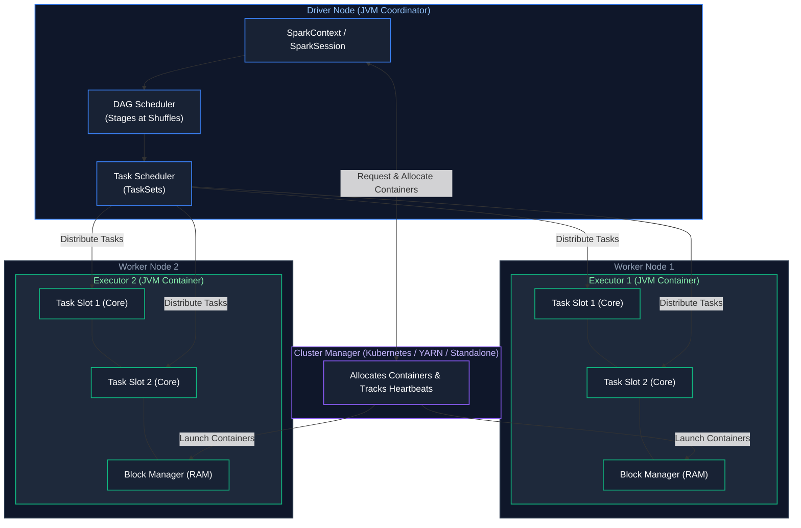

---

### Q43. Spark Execution Flow from spark-submit to Completion
**Topic Covered:** Complete Lifecycle from Client Submit to Action Evaluation  
**Questions Covered:**
- How do Spark’s lazy evaluation and the DAG (Directed Acyclic Graph) execution model work?
- What is the difference between transformations and actions in Spark?
- Explain the complete Spark execution flow from spark-submit to job completion (Jobs → Stages → Tasks & stage boundaries).
*(Grouped together: Lazy evaluation, DAG construction, transformations vs actions, and stage boundaries)*

#### Complete Execution Flow: spark-submit to Completion (Q43)
1. **Application Launch:** Client executes `spark-submit`. Cluster Manager allocates container for Driver.
2. **DAG Construction & Lazy Evaluation:** Driver executes user code lazily. Transformations (e.g., `map()`, `filter()`, `select()`) only append logical operations to the lineage DAG without triggering distributed compute. When an **Action** is invoked (`count()`, `collect()`, `write()`), physical DAG execution begins and a **Job** is triggered.
3. **Stage Breakdown:** The **DAG Scheduler** examines transformations. Wherever a **Wide Dependency** (shuffle) occurs, it introduces a stage boundary.
4. **Task Generation:** Each stage is converted into a `TaskSet`. The number of tasks in a stage equals the number of partitions in the DataFrame at that point.
5. **Task Scheduling:** The **Task Scheduler** schedules tasks onto available executor cores respecting data locality (`PROCESS_LOCAL` > `NODE_LOCAL` > `RACK_LOCAL` > `ANY`).
6. **Task Completion:** Executors return status to Driver. Once all stages complete, the action terminates.

---

### Q40. Narrow vs Wide Transformations & Stage Boundaries
**Topic Covered:** Transformation Lineage, Shuffles & Stage Pipelining  
**Questions Covered:**
- What is the difference between transformations and actions in Spark?
- What is the difference between narrow and wide transformations in Spark? Can you give examples?
*(Grouped together: Transformation categorization, narrow vs wide shuffle boundaries, and action triggers)*

#### Narrow vs Wide Transformations (Q40)
- **Narrow Transformation:** Each partition of the parent RDD is consumed by **at most one partition** of the child RDD. No data needs to be transferred across the network. Pipelined in RAM!
  - *Examples:* `map()`, `filter()`, `flatMap()`, `union()`.
- **Wide Transformation:** Multiple child partitions depend on data from multiple parent partitions. Requires a physical **Shuffle** where data is partitioned by hash across the network.
  - *Examples:* `groupByKey()`, `reduceByKey()`, `join()`, `distinct()`, `repartition()`.

---

### Q41. RDD Immutability & Lineage-Based Fault Tolerance
**Topic Covered:** Resilient Distributed Datasets, Deterministic Recomputation  
**Question:** What is an RDD and why is it immutable?

#### RDD Immutability & Fault Tolerance (Q41)
An **RDD (Resilient Distributed Dataset)** is an immutable, distributed collection of elements partitioned across cluster nodes.
- **Why Immutable?** Immutability guarantees deterministic execution and thread-safety. 
- **Lineage Graph Fault Tolerance:** Instead of replicating terabytes of in-memory data across nodes (which is too expensive), Spark records the exact sequence of transformations (the Lineage Graph). If an executor crashes and a partition is lost, Spark simply re-executes the lineage graph for that specific missing partition.

---

### Q42. reduceByKey() vs groupByKey() Efficiency
**Topic Covered:** Map-Side Combine, Shuffle Spills & Memory Thrashing  
**Question:** reduceByKey() vs groupByKey() — why is one generally more efficient?

#### reduceByKey() vs groupByKey() (Q42)
- **`groupByKey()` (Anti-Pattern):** Shuffles **all individual `<K, V>` pairs** across the network before grouping. Satures network bandwidth and causes catastrophic Executor OOMs.
- **`reduceByKey()` (Optimized):** Performs a **Map-Side Combiner** locally on each executor prior to shuffling. It aggregates values for each key in-memory, sending only the single reduced value across the network. Reduces network shuffle by 95%+.

```mermaid
flowchart TD
    subgraph groupByKey ["groupByKey: Massive Network Transfer (Anti-Pattern)"]
        direction LR
        M1["Mapper: ('a', 1), ('a', 1), ('a', 1)"] --> S1["Shuffle ALL 3 records over Network"] --> R1["Reducer: ('a', [1, 1, 1])"]
    end
    
    subgraph reduceByKey ["reduceByKey: Local Pre-Aggregation (Combiner Optimized)"]
        direction LR
        M2["Mapper: ('a', 1), ('a', 1), ('a', 1)"] --> C1["Map-Side Combiner: ('a', 3)"] --> S2["Shuffle ONLY 1 record over Network"] --> R2["Reducer: ('a', 3)"]
    end

    style groupByKey fill:#0f172a,stroke:#ef4444,stroke-width:1.5px,color:#fca5a5
    style reduceByKey fill:#0f172a,stroke:#10b981,stroke-width:1.5px,color:#6ee7b7
    style M1 fill:#1f2937,stroke:#ef4444,stroke-width:2px,color:#fff
    style S1 fill:#7f1d1d,stroke:#ef4444,stroke-width:2px,color:#fecaca
    style R1 fill:#1f2937,stroke:#ef4444,stroke-width:2px,color:#fff
    style M2 fill:#1f2937,stroke:#10b981,stroke-width:2px,color:#fff
    style C1 fill:#1f2937,stroke:#3b82f6,stroke-width:2px,color:#fff
    style S2 fill:#1f2937,stroke:#10b981,stroke-width:2px,color:#fff
    style R2 fill:#064e3b,stroke:#10b981,stroke-width:2px,color:#a7f3d0
```

---

### Q44. map() vs flatMap() Mechanics
**Topic Covered:** One-to-One vs One-to-Many Iterator Transformation  
**Question:** map() vs flatMap().

#### map() vs flatMap() (Q44)
- **`map()` (1-to-1):** Transforms each input element into exactly one output element: `[1, 2] -> [[1], [2]]`.
- **`flatMap()` (1-to-Many / Flatten):** Transforms each element into an iterable and flattens the resulting collections into a single stream: `["hello world"] -> ["hello", "world"]`.

---

# 2. Distributed Join Strategies & Accidental Multipliers

---

### Q4, Q5 & Q6. Spark Join Strategies & Optimizer Selection Matrix
**Topic Covered:** Distributed Join Topologies (BHJ, SMJ, SHJ, Cartesian)  
**Questions Covered:**
- How do you optimize joins in Spark for large datasets?
- Explain how different join strategies affect the analysis of large datasets.
- When would you use Broadcast Join vs Sort-Merge Join?
- What is a broadcast join, and when does the optimizer choose it over a shuffle join?
- What are the different join strategies in Spark and when to use each?
*(Grouped together: Distributed join strategies, selection criteria, shuffle implications, and large-scale join optimization)*

#### Spark Join Strategies Decision Matrix (Q4, Q5, Q6)
| Join Strategy | Mechanism | Network Shuffle | Prerequisites / Thresholds | When to Use |
| :--- | :--- | :---: | :--- | :--- |
| **Broadcast Hash Join (BHJ)** | Copies the small DataFrame entirely to every executor's RAM. | **None** | One side $\le 10\text{ MB}$ (configurable via `spark.sql.autoBroadcastJoinThreshold`). Equi-join. | Whenever one table is small. Fastest join in Spark. |
| **Shuffle Hash Join (SHJ)** | Hashes both tables by join key and builds an in-memory hash table for the smaller side. | **Yes** | Equi-join. Build side fits in executor memory. | When Sort-Merge sort overhead is too high and table is moderately sized. |
| **Sort-Merge Join (SMJ)** | Hashes both sides, sorts partitions by join key on disk/RAM, then merges sequentially. | **Yes** | Default for joining two large DataFrames. Equi-join keys sortable. | Joining two large tables ($> 100\text{ GB}$). Resilient against OOMs. |
| **Broadcast Nested Loop (BNLJ)** | Broadcasts small table; nested loops each row against large table. | **None** | Non-equi joins (`<, >, !=`). Small table. | Range joins or when no equality predicate exists. Very slow! |
| **Cartesian Product Join** | Evaluates full $M \times N$ matrix. | **Yes** | Triggered on cross joins without predicates. | Avoid at all costs in distributed workloads. |

---

### Q23. Joining 500 GB DataFrame with 50 MB Lookup DataFrame
**Topic Covered:** Broadcast Hash Join Optimization & Auto-Broadcast Thresholds  
**Questions Covered:**
- You join a 500 GB fact table with a 200 MB dimension table. Would you use a Broadcast Join? Why?
- You have a 500 GB DataFrame and a 50 MB lookup DataFrame. How would you join them efficiently, and why?
*(Grouped together: Asymmetric join optimization between massive fact tables and dimension lookups)*

#### Joining 500 GB DataFrame with 50 MB Lookup DataFrame (Q23)
Use a **Broadcast Hash Join (BHJ)** with explicit hint `broadcast()`:
```python
from pyspark.sql.functions import broadcast

# 500 GB fact table joined with 50 MB / 200 MB dimension table
joined_df = fact_df_500gb.join(
    broadcast(lookup_df_50mb), 
    on="lookup_id", 
    how="inner"
)
```
##### Rationale:
If executed with standard Sort-Merge Join, Spark will shuffle and sort all 500 GB of fact data across the network, consuming massive I/O. With BHJ, the 50 MB or 200 MB lookup table is serialized and broadcast once to each executor (increasing `spark.sql.autoBroadcastJoinThreshold` to `209715200` or using explicit `broadcast()`). **Zero bytes of the 500 GB fact table are shuffled.**

---

### Q28. Diagnosing Join Record Multipliers & Cartesian Explodes
**Topic Covered:** Non-Unique Keys, Composite Key Omissions & Row Explosion Diagnostics  
**Question:** A Spark join produces a huge increase in the number of records. How would you determine whether the join is creating duplicate/multiple matches?

#### Diagnosing Join Record Multiplication (Cartesian Explode) (Q28)
When a join causes an unexpected explosion in output row count (e.g., 10M rows in, 80M rows out):
1. **Diagnosis:** Run key cardinality checks on both DataFrames prior to joining:
```python
# Check for duplicate keys causing 1:N or M:N Cartesian fan-out
dup_keys_left = df_left.groupBy("join_key").count().filter("count > 1")
dup_keys_right = df_right.groupBy("join_key").count().filter("count > 1")

print(f"Left duplicate keys: {dup_keys_left.count()}")
print(f"Right duplicate keys: {dup_keys_right.count()}")
```
2. **Remediation:** If the dimension side has duplicate keys, deduplicate via `dropDuplicates(["join_key"])` or window function before joining.

---

### Q34. Joining Two DataFrames with Different Schemas via Row Number
**Topic Covered:** Window Row Number Generation & Positional Schema Merging  
**Question:** PySpark scenario: Join two DataFrames with different schemas using row numbers / Window functions.

#### Joining Two DataFrames with Different Schemas via Row Number (Q34)
When two DataFrames have no common join key but need to be aligned positionally:
```python
from pyspark.sql import Window, functions as F

w = Window.orderBy(F.monotonically_increasing_id())

df1_indexed = df1.withColumn("row_id", F.row_number().over(w))
df2_indexed = df2.withColumn("row_id", F.row_number().over(w))

aligned_df = df1_indexed.join(df2_indexed, on="row_id", how="inner").drop("row_id")
```

---

# 3. Data Skew Detection, Stragglers & Mitigation

---

### Q1. Root Causes of the 1-Task Straggler
**Topic Covered:** Distributed Partition Asymmetry & Single-Key Hotspots  
**Questions Covered:**
- One Spark task takes 2 hours while 199 tasks finish in 10 minutes. How would you diagnose the bottleneck?
- What is data skew, and how can it affect query performance?
- A Spark job has 200 tasks, but one task runs much longer than the others. What could be the reason?
*(Grouped together: Single-task stragglers, data skew causes, and query runtime degradation)*

#### Root Cause of the 1-Task Straggler (Q1)
When 199 tasks finish in 10 seconds but Task 200 runs for 45 minutes or 2 hours:
1. **Data Skew:** A single join or group key (e.g., `NULL`, `0`, or default country `'US'`) contains 80% of all rows. All these rows are hashed to that single task partition, overloading that executor.
2. **Non-Splittable Compressed File:** Reading a large file compressed with GZIP (which cannot be split into parallel blocks). A single task must decompress the entire file.
3. **Hardware Straggler / Thermal Throttling:** Bad executor host suffering network packet loss or bad disk I/O.

---

### Q2. Identifying Data Skew in the Spark Web UI
**Topic Covered:** Task Duration Quantiles, Shuffle Read Spikes & Executor Memory  
**Question:** How would you identify and handle data skew in a Spark join?

#### How to Identify Data Skew in the Spark UI (Q2)
1. Open the **Stages Tab** in Spark UI.
2. Scroll to the **Task Metrics Summary Table**.
3. Inspect the **Duration** and **Shuffle Read Size** percentiles:
   - **Healthy Stage:** Min: 5s, Median: 6s, 75th: 6s, Max: 7s.
   - **Skewed Stage:** Min: 2s, Median: 4s, 75th: 5s, **Max: 42 minutes!** (Max is orders of magnitude higher than 75th percentile).

---

### Q3 & Q25. Mitigating Data Skew via Key Salting & AQE Skew Join
**Topic Covered:** Synthetic Key Salting, DataFrame Key Replication & Partition Balancing  
**Questions Covered:**
- How would you optimize a Spark job that is suffering from data skew and excessive shuffle?
- When would you use key salting, and how does it reduce skew during Joins & Aggregations?
- How do you handle data skew or imbalanced joins in PySpark?
- How would you optimize a PySpark job suffering from data skew?
- How can you optimize performance in PySpark jobs?
- What is data skew in PySpark, and how would you handle skewed joins in large datasets (including Salting and AQE)?
- How would you handle a DataFrame with highly uneven partition sizes?
*(Grouped together: Comprehensive data skew resolution, key salting patterns, and Adaptive Query Execution)*

#### Mitigation Technique 1: Key Salting (Q3)
**Salting** breaks down a hot skewed key into $K$ uniform sub-keys by appending a random integer.
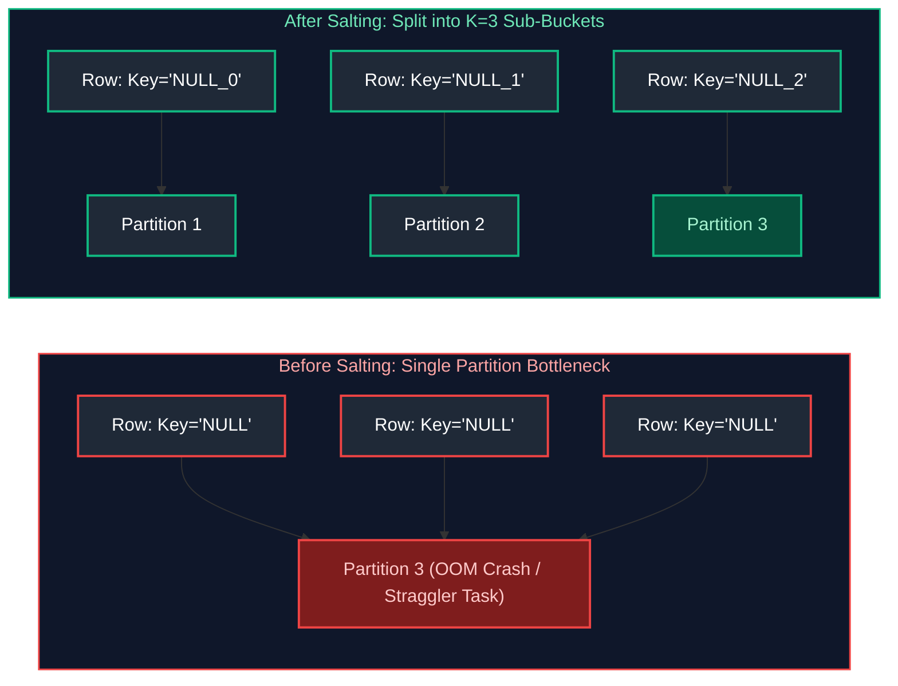

```python
from pyspark.sql import functions as F

# Large Skewed Table: Salt the join key with random number 0..4
SALT_FACTOR = 4
large_salted = large_df.withColumn(
    "salted_key", 
    F.concat(F.col("join_key"), F.lit("_"), F.floor(F.rand() * SALT_FACTOR))
)

# Small Lookup Table: Replicate (explode) each row SALT_FACTOR times
small_exploded = small_df.withColumn(
    "salt_array", F.array([F.lit(i) for i in range(SALT_FACTOR)])
).withColumn("salt_val", F.explode("salt_array")) \
 .withColumn("salted_key", F.concat(F.col("join_key"), F.lit("_"), F.col("salt_val")))

# Join on the salted key - perfectly uniform distribution!
balanced_join = large_salted.join(small_exploded, on="salted_key", how="inner").drop("salted_key", "salt_val", "salt_array")
```

#### Mitigation Technique 2: Adaptive Query Execution (AQE) Skew Join
Spark 3.x introduced automatic skew join handling:
```python
spark.conf.set("spark.sql.adaptive.enabled", "true")
spark.conf.set("spark.sql.adaptive.skewJoin.enabled", "true")
spark.conf.set("spark.sql.adaptive.skewJoin.skewedPartitionFactor", "5")
spark.conf.set("spark.sql.adaptive.skewJoin.skewedPartitionThresholdInBytes", "256MB")
```
When AQE detects a partition larger than the threshold, it automatically splits that large partition into multiple smaller sub-partitions and joins them in parallel.

---

# 4. Partition Management: Repartition vs Coalesce & Small Files

---

### Q7 & Q8. repartition() vs coalesce() Architectural Comparison
**Topic Covered:** Full Hash Shuffle vs Narrow Partition Merging  
**Questions Covered:**
- Explain the difference between repartition() and coalesce() in PySpark. When would you use each?
- Difference between repartition() and coalesce() in Spark.
- What is the difference between repartition() and coalesce()?
- Difference between repartition() and coalesce() with real production use cases.
*(Grouped together: Repartition vs coalesce mechanics, shuffle vs local merge, and use case selection)*

#### repartition() vs coalesce() Architectural Comparison (Q7, Q8)
| Dimension | `repartition(N)` | `coalesce(N)` |
| :--- | :--- | :--- |
| **Network Shuffle** | **Full Network Shuffle.** Reshuffles data across all worker nodes. | **Zero Network Shuffle.** Merges adjacent local partitions. |
| **Resize Direction** | Can **increase** or **decrease** partition count. | Can **only decrease** partition count efficiently. |
| **Partition Size Balance**| Creates uniformly balanced partitions. Fixes skew. | Can result in uneven partition sizes (stragglers). |
| **Production Use Case** | Before an expensive join or group-by to eliminate skew, or to scale up partition count. | Right before writing output to disk to reduce small files without triggering a shuffle! |

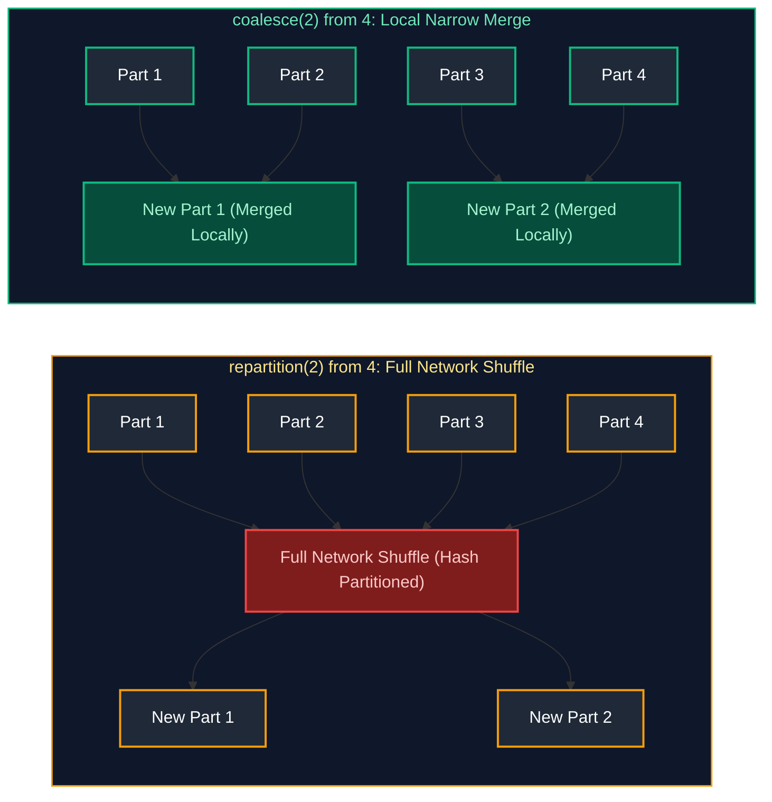

---

### Q18. Partition Sizing Heuristics (Increasing vs Decreasing)
**Topic Covered:** Cluster Core Multiples & Target 128MB Partition Rule  
**Questions Covered:**
- Your Spark cluster has available compute, but the job still runs slowly. How would you optimize partitions, shuffles, executor memory, and parallelism?
- Your DataFrame has 500 partitions. How would you decide whether to increase or decrease them?
*(Grouped together: Partition sizing heuristics, parallelism alignment, and compute resource optimization)*

#### Sizing Heuristic for 500 Partitions (Q18)
The golden rule for Spark partition sizing is **100 MB to 200 MB per partition in RAM**:
$$\text{Ideal Partitions} = \frac{\text{Total Uncompressed Dataset Size}}{128\text{ MB}}$$
- If total DataFrame size is **50 GB**: $\frac{50,000\text{ MB}}{128\text{ MB}} \approx 390$ partitions. 500 partitions is appropriate.
- If total DataFrame size is **500 MB**: 500 partitions results in 1 MB per partition (extreme small task overhead). **Decrease to 4–8 partitions using `coalesce(4)`**.
- Also check available cluster cores: Partitions should ideally be $2\times$ to $3\times$ the total executor cores to ensure all cores stay saturated.

---

### Q20 & Q21. The Small File Problem & Resolution in Spark
**Topic Covered:** NameNode Metadata Overhead, I/O IOPS Bottlenecks & Post-Processing Compaction  
**Questions Covered:**
- **Q20**: A Spark job generates thousands of small files. How would you identify and fix the issue?
- **Q21**: What is the small-file problem and why does it hurt performance? How would you solve it?

#### The Small File Problem & Resolution (Q20, Q21)
- **Why it hurts performance:**
  1. **Storage Metadata Strain:** Millions of small files saturate HDFS NameNode memory or Cloud Storage LIST API quotas.
  2. **Task Scheduling Overhead:** Spark launches 1 task per file split. Scheduling 10,000 tasks that each run for 200 ms spends 95% of cluster time on JVM task scheduling overhead rather than real computation.
- **How to Fix:**
  1. `df.coalesce(num_files).write.parquet(...)` prior to output sink.
  2. Delta Lake auto-compaction: `OPTIMIZE table_name` or set `spark.databricks.delta.autoCompact.enabled = true`.
  3. Enable AQE partition coalescing: `spark.sql.adaptive.coalescePartitions.enabled = true`.

---

### Q45. Partition Pruning Mechanics
**Topic Covered:** File Index Skipping & Directory Scanning Elimination  
**Question:** What is partition pruning?

#### Partition Pruning (Q45)
**Partition Pruning** is an optimization where the query engine skips reading directory partitions that do not match the query filter (e.g., `WHERE date >= '2024-10-01'`).
- **Dynamic Partition Pruning (DPP):** In star schema joins, when a fact table is joined with a filtered dimension table, Spark evaluates the dimension filter at runtime and prunes physical partitions from the large fact table before scanning.

---

# 5. Shuffle Mechanics, Intermediate DataFrames & AQE

---

### Q14 & Q15. Identifying & Reducing Excessive Shuffling
**Topic Covered:** Shuffle File I/O, Disk Spill Mitigation & Shuffle Pruning  
**Questions Covered:**
- **Q14**: How would you reduce unnecessary shuffle operations?
- **Q15**: How would you identify whether a Spark job is suffering from excessive shuffling?

#### Identifying & Reducing Excessive Shuffling (Q14, Q15)
- **Identification:** In Spark UI, inspect **Shuffle Read Size / Records** and **Shuffle Write Size / Records**. If Shuffle Read exceeds input data volume by multiple times, or if high **Spill (Memory)** and **Spill (Disk)** are present, the job is shuffle-bound.
- **Reduction Techniques:**
  1. **Broadcast Joins:** Convert Sort-Merge joins to Broadcast Hash Joins where possible.
  2. **Filter & Project Early:** Strip unneeded columns and filter rows *before* join or groupBy.
  3. **Colocate Bucketed Tables:** Pre-bucket tables on the join key.
  4. **Combine Aggregations:** Merge multiple sequential `groupBy` operations into a single multi-dimensional grouping using `GROUPING SETS`, `ROLLUP`, or `CUBE`.

---

### Q16. Adaptive Query Execution (AQE) 3-Pillar Architecture
**Topic Covered:** Dynamic Coalescing, Runtime Join Switching & Dynamic Skew Handling  
**Question:** How does AQE (Adaptive Query Execution) improve Spark performance?

#### Adaptive Query Execution (AQE) 3-Pillar Architecture (Q16)
AQE re-optimizes execution plans at runtime based on actual stage runtime statistics:
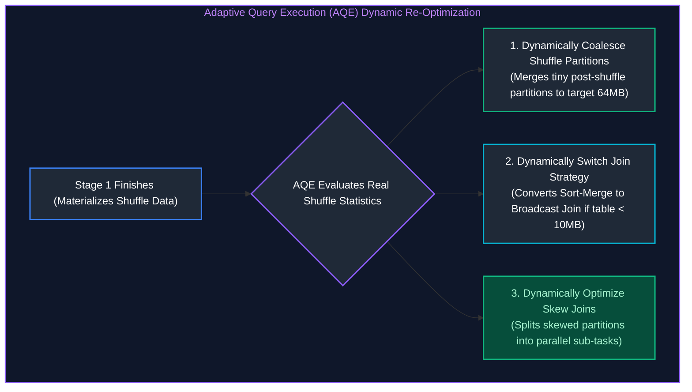

---

### Q22 & Q26. Optimizing Large Intermediate DataFrames & Multiple groupBy Operations
**Topic Covered:** Projection Pushing, Checkpointing Lineage Truncation & Multi-Aggregation Optimization  
**Questions Covered:**
- **Q22**: A PySpark transformation creates a very large intermediate DataFrame and causes performance issues. How would you optimize it?
- **Q26**: How would you optimize a PySpark job that performs multiple groupBy() operations?

#### Optimizing Large Intermediate DataFrames (Q22)
When an intermediate DataFrame becomes massive and degrades downstream stages:
1. **Break the Lineage via Checkpointing:** `df.checkpoint()` breaks an excessively long Catalyst lineage graph, cutting query planning time and serializing clean data to reliable storage.
2. **Selective Persist:** Use `df.persist(StorageLevel.MEMORY_AND_DISK_SER)` if the intermediate DataFrame is reused in multiple downstream actions.

---

# 6. Spark Memory Architecture, Caching, GC & OOM Debugging

---

### Q36. Spark Unified Memory Architecture Breakdown
**Topic Covered:** JVM Heap Division: Storage Memory, Execution Memory, User Memory & Overhead  
**Question:** How does Spark memory management work? Explain caching, persistence, garbage collection, and executor memory tuning.

#### Spark Unified Memory Architecture Breakdown (Q36)
Inside each Executor JVM container (e.g., 32 GB RAM):
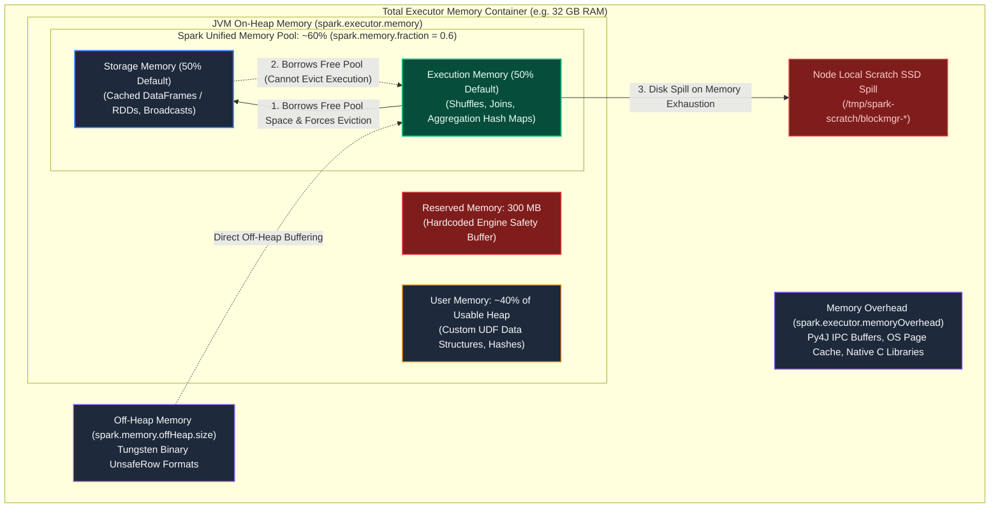

| Memory Region | Allocation / Configuration Flag | Operational Purpose & Eviction Behavior |
| :--- | :--- | :--- |
| **Reserved Memory** | Hardcoded `300 MB` | Spark internal engine execution safety buffer. Unaffected by configs. |
| **User Memory** | `(Heap - 300MB) * (1 - spark.memory.fraction)` (~40%) | User-defined data structures, custom Python/Java UDF arrays, metadata hashes. |
| **Storage Memory** | `Spark Pool * spark.memory.storageFraction` (~50% of pool) | Cached DataFrames (`persist`), broadcast variables, unrolled block buffers. |
| **Execution Memory** | `Spark Pool * (1 - storageFraction)` (~50% of pool) | Shuffle buffers, hash aggregation maps, join sorting. Can borrow from Storage memory dynamically. |
| **Off-Heap Memory** | `spark.memory.offHeap.size` | Off-heap memory managed via Project Tungsten; avoids JVM GC pauses. |
| **Overhead Memory** | `spark.executor.memoryOverhead` (`max(384MB, 10%)`) | Container OS overhead, native libraries, and PySpark daemon processes. |

---

### Q13. cache() vs persist() Storage Levels
**Topic Covered:** Default MEMORY_AND_DISK Storage Level vs Custom Deserialization Policies  
**Questions Covered:**
- Your pipeline repeatedly performs expensive transformations on the same DataFrame. Would you use cache() or persist()?
- When would you use cache() vs persist()?
*(Grouped together: DataFrame caching vs persist strategies, storage levels, and iterative pipeline reuse)*

#### cache() vs persist() (Q13)
- **`cache()`:** Shortcut syntax for `persist(StorageLevel.MEMORY_AND_DISK)`. Deserialized in memory, spills to disk when full.
- **`persist(StorageLevel)`:** Allows specifying exact custom storage tiers:
  - `MEMORY_ONLY`: Fastest, but re-computes dropped partitions on eviction.
  - `MEMORY_AND_DISK_SER`: Serialized bytes in RAM; saves 60% memory footprint compared to deserialized objects.
  - `OFF_HEAP`: Stores data outside JVM garbage collection, eliminating GC pauses.

---

### Q17. OutOfMemoryError (OOM) Diagnostic Playbook
**Topic Covered:** Driver OOM vs Executor OOM & Disk Spill Diagnostics  
**Question:** A PySpark job is running out of memory (OutOfMemoryError). What would you check first?

#### OutOfMemoryError (OOM) Diagnostic Playbook (Q17)
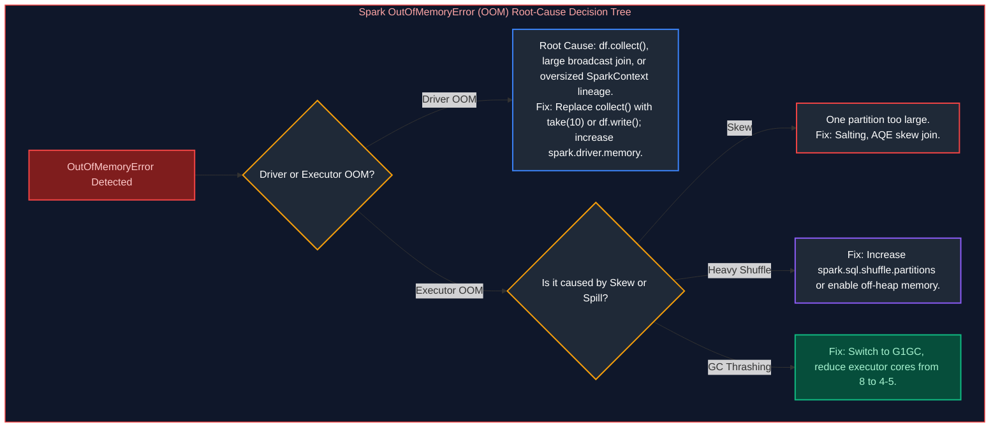

---

### Q24. Garbage Collection (GC) Optimization & Executor Sizing
**Topic Covered:** G1GC Tuning, Object Churn Elimination & Safe Core-to-Executor Ratios  
**Question:** A Spark job has frequent Garbage Collection and executor failures. What would you check and how would you fix it?

#### Garbage Collection (GC) Optimization (Q24)
- **Root Cause:** Large numbers of long-lived Java objects cause full stop-the-world GC pauses. If GC pause exceeds heartbeat timeout (default 120s), the Driver assumes the executor is dead and kills it (`ExecutorLostFailure`).
- **Remediation:**
  1. Use the **G1GC** collector:
     `--conf "spark.executor.extraJavaOptions=-XX:+UseG1GC -XX:InitiatingHeapOccupancyPercent=35"`
  2. Optimal executor core sizing: **Never allocate $>5$ cores per executor**. High core counts (e.g., 16 cores) lead to severe memory allocation thrashing. Best configuration is 4–5 cores and 20–30 GB RAM per executor.

---

# 7. Production Troubleshooting Playbook & Scaling to 10 TB

---

### Q9, Q11 & Q12. Production Troubleshooting Playbook for 2hr vs 20min Slowdowns
**Topic Covered:** Systematic Pipeline Performance Diagnostics & Intermittent Failure Resolution  
**Questions Covered:**
- **Q9**: A Spark job is taking 2 hours instead of 20 minutes. How would you troubleshoot it?
- **Q11**: How would you optimize a slow PySpark job processing billions of records?
- **Q12**: Scenario-based question: "You have a Spark pipeline failing randomly in production. How would you debug and fix it?"

---

### Q10. Why Spark Jobs Run Fine in Dev but Crash in Production
**Topic Covered:** Data Volume Multipliers, Unseen Data Skew & Cluster Contention  
**Questions Covered:**
- How would you systematically debug a Spark job that is running significantly slower in production than in testing?
- A Spark job works fine in development but is very slow in production. How would you troubleshoot it?
*(Grouped together: Debugging performance disparities between development/test and production environments)*

#### Why Jobs Run Fine in Dev but Crash in Prod (Q10)
1. **Data Volume & Partition Sizing:** Dev has 10 MB (runs in 1 partition); Prod has 10 TB. Default `spark.sql.shuffle.partitions=200` means each partition in Prod receives 50 GB of data, causing immediate memory spill and crash.
2. **Data Distribution & Real-World Skew:** Dev mock data is uniformly distributed. Prod data has millions of `NULL` customer IDs or extreme holiday spikes.
3. **Cluster Allocation Differences:** Dev runs locally or with dedicated resources; Prod shares multi-tenant cluster capacity subject to preemption.

---

### Q19. Scaling Playbook for Processing 10 TB Datasets
**Topic Covered:** Petabyte-Scale Architecture, Executor Cluster Sizing & Storage Compaction  
**Question:** How would you process a 10 TB dataset efficiently using PySpark?

#### Scaling Playbook for 10 TB Dataset (Q19)
1. **Storage Layout:** Ingest as columnar Snappy/ZSTD **Parquet** or **Delta Lake** with partition pruning on date.
2. **Shuffle Partition Tuning:** Set shuffle partitions to handle 10 TB appropriately:
   $$\text{Partitions} = \frac{10,000,000\text{ MB}}{150\text{ MB}} \approx 65,000\text{ partitions}$$
3. **Turn on Adaptive Query Execution (AQE):** Auto-tunes post-shuffle partitions and mitigates data skew.
4. **Executor Topology:** Allocate balanced instances: 4–5 cores, 28 GB RAM per executor with 10% overhead memory.
5. **Off-Heap Execution:** Enable Project Tungsten off-heap allocation to bypass JVM GC overhead:
   `spark.memory.offHeap.enabled = true`, `spark.memory.offHeap.size = 6g`.

---

# 8. Transformations: Built-in Functions vs UDFs, Schemas & JSON

---

### Q27 & Q38. Built-in transform() vs Python UDF vs Pandas UDF
**Topic Covered:** JVM Py4J Serialization Overhead vs Vectorized Arrow Batches  
**Questions Covered:**
- Can you walk me through how to implement a PySpark transformation using a custom UDF?
- A PySpark job uses a Python UDF and is running slowly. How would you identify the issue and optimize it?
- Explain the difference between transform() and udf(). Which is more efficient?
*(Grouped together: Custom UDF implementation, Py4J serialization costs, and native vs pandas UDF optimization)*

#### Built-in `transform()` vs Standard Python UDF vs Pandas UDF (Q27, Q38)
- **Standard Python UDF (Extremely Slow):** Serializes JVM data, sends it through a Unix pipe to a separate Python worker process, computes row-by-row, and serializes back to JVM. **Bypasses Catalyst Optimizer and Tungsten code-gen!**
- **Pandas UDF (Vectorized via PyArrow):** Transmits data in batches using Apache Arrow memory format. Fast, but still incurs JVM-Python context switching.
- **Built-in `DataFrame.transform()` / Spark SQL Functions (Fastest):** Compiles directly into high-performance JVM bytecode via Whole-Stage Code Generation. **Always preferred.**

```python
# SLOW: Standard Python UDF
@F.udf(returnType="string")
def slow_upper(val):
    return val.upper() if val else None

# FAST: Native Spark SQL expression (10x faster)
fast_df = df.withColumn("name_upper", F.upper(F.col("name")))
```

---

### Q29 & Q31. Handling Inconsistent Schemas, Null Values & Incorrect Casing
**Topic Covered:** Schema Merging, Defensive Casting & Null Sanitization  
**Questions Covered:**
- **Q29**: A Spark job reads a large number of files with different schemas. How would you handle schema inconsistencies efficiently?
- **Q31**: How would you handle null values and incorrect casing in a PySpark DataFrame?

#### Handling Inconsistent Schemas Across Large Files (Q29)
When files have varying schemas over time:
```python
# Enable schema merging
df = spark.read.option("mergeSchema", "true").parquet("path/to/files/")

# Or use permissive mode with explicit schema
df_json = spark.read.option("mode", "PERMISSIVE") \
                    .option("columnNameOfCorruptRecord", "_corrupt_record") \
                    .json("path/to/json/")
```

---

### Q39. Parsing & Flattening Nested JSON in PySpark
**Topic Covered:** Recursive Schema Traversal, StructType Unpacking & Array Explodes  
**Question:** Given a nested JSON file, how would you parse and flatten it in PySpark?

#### Parsing & Flattening Nested JSON in PySpark (Q39)
```python
from pyspark.sql import functions as F

# Sample nested schema: customer: { name: str, address: { city: str } }, items: [ { sku: str, price: float } ]
flat_df = (
    raw_df
    # Access nested struct fields using dot notation
    .withColumn("customer_name", F.col("customer.name"))
    .withColumn("customer_city", F.col("customer.address.city"))
    # Explode nested array into separate rows
    .withColumn("item", F.explode("items"))
    .withColumn("item_sku", F.col("item.sku"))
    .withColumn("item_price", F.col("item.price"))
    .drop("customer", "items", "item")
)
```

---

# 9. Production PySpark Live Coding Scenarios

---

### Q32. PySpark Live Coding: Days Between Status Changes per User
**Topic Covered:** Window Lead/Lag Offset & Date Difference Calculation  
**Question:** Write a PySpark logic to compute the difference in days between two status changes for each user.

#### Scenario 1: Days Between Status Changes per User (Q32)
```python
from pyspark.sql import Window, functions as F

window_spec = Window.partitionBy("user_id").orderBy("status_timestamp")

status_diff_df = (
    user_status_df
    .withColumn("prev_status_time", F.lag("status_timestamp", 1).over(window_spec))
    .withColumn("prev_status", F.lag("status", 1).over(window_spec))
    .withColumn(
        "days_between_change", 
        F.datediff(F.col("status_timestamp"), F.col("prev_status_time"))
    )
    .filter(F.col("prev_status_time").isNotNull())
)
```

---

### Q33. PySpark Live Coding: Upserting New Files into Delta Tables
**Topic Covered:** DeltaTable MERGE Python API & Match Predicates  
**Question:** How would you write a PySpark job to merge (upsert) data from a new file into an existing Delta table?

#### Scenario 2: Upserting New File into Existing Delta Table (Q33)
```python
from delta.tables import DeltaTable

delta_table = DeltaTable.forPath(spark, "/mnt/delta/customers")
updates_df = spark.read.parquet("/mnt/landing/customer_updates.parquet")

delta_table.alias("target").merge(
    updates_df.alias("source"),
    "target.customer_id = source.customer_id"
).whenMatchedUpdate(
    condition="source.updated_at > target.updated_at",
    set={
        "name": "source.name",
        "email": "source.email",
        "updated_at": "source.updated_at"
    }
).whenNotMatchedInsertAll().execute()
```

---

### Q35. PySpark Live Coding: Store Spending > ₹1000 in the Last Month
**Topic Covered:** Multi-Table Broadcast Joins, Rolling Date Filtering & Aggregations  
**Question:** PySpark live coding: Write code to find customers who spent more than ₹1000 from store S1 in the last month using Customer, Store, and Sales datasets (joins, add_months(), aggregation).

#### Scenario 3: Store S1 > ₹1000 Spending in Last Month (Q35)
```python
from pyspark.sql import functions as F

# Datasets: customer_df, store_df, sales_df
# Step 1: Filter Store S1
s1_store = store_df.filter(F.col("store_name") == "S1")

# Step 2: Calculate Start of Last Month (relative to current date)
# E.g., Between add_months(current_date, -1) and current_date
one_month_ago = F.add_months(F.current_date(), -1)

# Step 3: Join and Aggregate
high_spenders_df = (
    sales_df
    .filter(F.col("sales_date") >= one_month_ago)
    .join(s1_store, on="store_id", how="inner")
    .join(customer_df, on="customer_id", how="inner")
    .groupBy("customer_id", "customer_name")
    .agg(F.sum("amount").alias("total_spent"))
    .filter(F.col("total_spent") > 1000.0)
    .orderBy(F.col("total_spent").desc())
)
```

---

### Q37. PySpark Live Coding: Department-wise Employee Ranking
**Topic Covered:** Window Partitioning & Dense Ranking  
**Question:** Write a PySpark query to rank employees department-wise using Window Functions.

#### Scenario 4: Department-wise Employee Ranking (Q37)
```python
from pyspark.sql import Window, functions as F

dept_window = Window.partitionBy("department_id").orderBy(F.col("salary").desc())

ranked_employees = (
    employees_df
    .withColumn("salary_rank", F.dense_rank().over(dept_window))
    .filter(F.col("salary_rank") <= 3) # Top 3 per department
)
```


---

# 10. Severe Data Skew Mechanics & The 40% Partition Nightmare

---

### The 40% Skew Partition Breakdown: Stages, Tasks, and Execution Dynamics
**Topic Covered:** Extreme Skew Impact, Straggler Tasks, Shuffle Spills & Cluster Idle Overhead  
**Question:** One partition contains 40% of the entire dataset. What happens to stages, tasks, and overall job execution?

#### What Happens Internally: The Execution Breakdown
When 1 partition out of 200 holds 40% of the data in a 1 TB dataset:
1. **Task Execution Imbalance:** 199 tasks process $\approx 3\text{ GB}$ each and finish in 2 minutes. The 1 skewed task must process **400 GB** on a single core!
2. **Cluster Compute Starvation:** The 199 worker cores finish their tasks and enter an **idle waiting state**. The entire Spark stage cannot complete until the last task finishes because stages represent hard barrier boundaries in the DAG. You are paying for a 100-node cluster while only 1 node is doing work!
3. **Memory Spills (Disk Spilling):** The 400 GB partition exceeds the executor’s unified memory fraction (`spark.memory.fraction * 0.6`). Spark is forced to spill intermediate shuffle partitions to local disk (`Spill (Memory)` and `Spill (Disk)`), causing massive disk I/O serialization bottlenecks.
4. **Garbage Collection (GC) Freezes & OOM Crashes:** As millions of object references accumulate in the JVM heap of that single executor, Java Garbage Collection triggers prolonged "Stop-The-World" pauses. If GC cannot reclaim memory, the task fails with `java.lang.OutOfMemoryError: Java heap space` or `ExecutorLostFailure` (heartbeat timeout).
5. **Stage Retries & Zombie Cascade:** Spark retries the failed task up to `spark.task.maxFailures` (default 4 times). Each retry fails on the same 400 GB partition, eventually killing the entire multi-hour pipeline.

#### Visualizing the Stage Execution Timeline
```mermaid
gantt
    title Spark Stage Execution with 40% Skew Straggler
    dateFormat  X
    axisFormat %s sec

    section Normal Tasks (199 tasks)
    Tasks 1 to 199 (3GB each)     :active, t1, 0, 120
    Cluster Idling (Waiting...)   :crit, t2, 120, 7200

    section Skewed Task (1 task)
    Task 200 (400GB data + disk spills) :done, t3, 0, 7200
```

#### Remediation Playbook
1. **Enable Spark 3.x Adaptive Query Execution (AQE):**
   ```python
   spark.conf.set("spark.sql.adaptive.enabled", "true")
   spark.conf.set("spark.sql.adaptive.skewJoin.enabled", "true")
   spark.conf.set("spark.sql.adaptive.skewJoin.skewedPartitionFactor", "5")
   spark.conf.set("spark.sql.adaptive.skewJoin.skewedPartitionThresholdInBytes", "268435456") # 256MB
   ```
   AQE automatically splits the 400 GB partition into multiple sub-partitions and runs them concurrently!
2. **Manual Key Salting (Pre-Spark 3 or Complex Joins):**
   Append a random integer `[0, N-1]` to the skewed key on the large table and replicate (explode) matching keys on the dimension table.

---

### Petabyte-Scale Strategic Partitioning Heuristics
**Topic Covered:** Partition Column Selection, Cardinality Traps & Directory Tree Limits  
**Question:** How do you strategically manage data partitioning in a petabyte-scale dataset to avoid data skew and optimize query performance?

#### The Goldilocks Heuristic: Partition Sizing Rules
At petabyte scale, bad partitioning destroys both cloud storage performance and distributed query engines.
- **Target File / Partition Size:** Aim for **128 MB to 1 GB** per file/partition on disk.
- **Total Partition Count per Table:** Keep total leaf directories under **10,000 to 50,000**. Beyond 100,000 directories, file metastores (Hive Metastore, cloud storage directory listings) experience massive latency bottlenecks.

#### Decision Matrix: Choosing the Right Partition Column
| Partition Column Candidate | Cardinality Evaluation | Suitability | Consequence |
| :--- | :--- | :--- | :--- |
| **`timestamp` (Millisecond)** | Extreme ($10^9$) | ❌ **Fatal** | Generates billions of 1 KB files; crashes metadata catalogs. |
| **`country_code` / `state`** | Highly Skewed ($10^1 - 10^2$) | ⚠️ **Dangerous** | 80% of data lands in US/IN partition; 20% across 50 other countries. Skew stragglers. |
| **`year` / `month` / `day`** | Balanced ($365 \times Y$) | ✅ **Optimal** | Natural ingestion lifecycle, uniform data volume, enables daily partition pruning. |
| **Liquid Clustering (Delta)** | Dynamic (Z-Order / Hilbert) | 🏆 **Industry Standard**| Eliminates physical folder partitioning entirely; dynamically clusters across multiple keys. |

---

# 11. External Source Bottlenecks & JDBC Ingestion Tuning

---

### Spark Executor JDBC Read Stalls: The 4-Step Diagnosis
**Topic Covered:** Parallel JDBC Reads, Connection Pool Saturation, Bounds Partitioning  
**Questions Covered:**
- Every Spark executor is waiting while reading from the database. What would you check first: connection limits, partitioning, query performance, or source-system bottlenecks?
- Every Spark executor is waiting while reading from a relational database. What would you check first: connection limits, partitioning, query performance, or source-system bottlenecks?
*(Grouped together: JDBC ingestion stalls, single-partition bottlenecks, and connection pool saturation)*

#### Why Executors Wait: The Single-Threaded JDBC Trap
If you execute:
```python
df = spark.read.format("jdbc").option("url", url).option("dbtable", "massive_orders").load()
```
Spark launches **only 1 single task on 1 single executor core**! All other 99 executors sit 100% idle because no partitioning parameters were specified.

#### The 4-Step Systematic Diagnostic Checklist
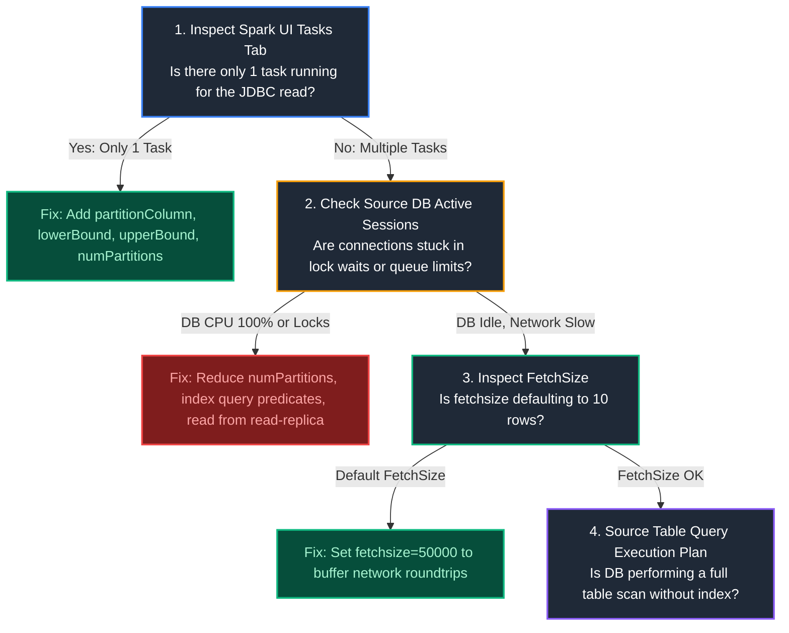

#### Production-Tuned Distributed JDBC Read
```python
# To achieve true multi-executor parallel reads:
df = (
    spark.read.format("jdbc")
    .option("url", "jdbc:postgresql://db.prod.internal:5432/orders_db")
    .option("dbtable", "orders")
    .option("partitionColumn", "order_id") # Must be indexed numeric/date column
    .option("lowerBound", "1")
    .option("upperBound", "100000000")
    .option("numPartitions", "64")          # Concurrently reads 64 partition ranges
    .option("fetchsize", "50000")          # Buffers 50k rows per network trip (prevents network chat)
    .load()
)
```

---

# 12. Driver & Executor Memory Leaks in Iterative / Streaming Pipelines

---

### Progressive Memory Creep & Py4J Object Retention Debugging
**Topic Covered:** Py4J Gateway Leak, Unbounded RDD Lineage Trees, Driver Heap Growth  
**Questions Covered:**
- Your PySpark job memory usage keeps increasing after every batch. What do you suspect, and which metrics or Spark UI details would you inspect?
- Your PySpark job memory usage keeps increasing after every batch in a continuous or iterative pipeline. What do you suspect, and which metrics or Spark UI details would you inspect?
*(Grouped together: Memory leak diagnosis, Py4J reference retention, and lineage graph unbounded growth)*

#### The 3 Primary Root Causes of Spark Memory Creep
1. **Unbounded Catalyst Plan / Lineage Tree Accumulation:**
   In iterative loops (e.g., machine learning loops, graph algorithms, or continuous micro-batches), executing `df = df.union(new_df)` in a loop does not execute data immediately—it builds an infinitely growing DAG lineage tree! The Driver JVM runs out of memory storing the syntax graph.
   - *Fix:* Break the lineage periodically using `df = df.localCheckpoint()` or `df.checkpoint()`.
2. **Py4J Python-Java Gateway Reference Retention:**
   When Python creates PySpark DataFrame references inside long-running loops without garbage collection, the underlying Java objects remain pinned in the JVM heap because Py4J holds active pointer references.
   - *Fix:* Explicitly invoke `del df` and run `import gc; gc.collect()`.
3. **Driver Accumulator & Metrics Sprawl:**
   Using accumulators or collecting metrics (`df.collect()`, `df.toPandas()`) inside every batch appends objects to Driver memory without purging.

#### Inspection & Diagnostic Checklist in Spark UI:
- **Environment Tab:** Inspect `spark.driver.memory` vs allocated physical RAM.
- **Executors Tab:** Monitor **JVM Heap Usage** over time. If heap usage climbs steadily without returning to baseline after Garbage Collection (sawtooth pattern failing to drop), a reference leak exists.
- **Storage Tab:** Look for un-persisted cached DataFrames (`rdd_xxx`) that were cached with `.cache()` inside a loop and never freed via `.unpersist()`.

---

# 13. Engine Abstractions: RDDs vs DataFrames vs Datasets & Context vs Session

---

### RDDs vs DataFrames vs Datasets: Catalyst & Tungsten Internals
**Topic Covered:** Resilient Distributed Datasets, Schema Optimization, Tungsten Binary Encoders  
**Questions Covered:**
- What are the differences between RDDs, DataFrames, and Datasets in PySpark?
- What are the structural and execution differences between RDDs, DataFrames, and Datasets in PySpark?
*(Grouped together: In-depth comparison of RDDs, DataFrames, and Datasets across type safety, memory, and Catalyst)*

#### Architecture Comparison Matrix
| Architectural Dimension | RDD (Resilient Distributed Dataset) | DataFrame | Dataset |
| :--- | :--- | :--- | :--- |
| **Data Representation** | Unstructured collection of Java/Python objects. | Distributed table of named columns (`Row` objects). | Strongly-typed domain objects (`Dataset[T]`). |
| **Optimization Engine** | None. User writes imperative execution instructions. | **Catalyst Optimizer** & **Tungsten Binary Engine**. | **Catalyst Optimizer** & **Tungsten Encoders**. |
| **Language Availability**| Scala, Java, Python, R. | Scala, Java, Python, R. | **Scala & Java only** (Python lacks compile-time type safety). |
| **Memory Format** | Serialized Java objects (heavy GC overhead). | **Tungsten off-heap binary format** (Zero GC, cache-aware). | Tungsten binary encoders. |
| **Python Overhead** | Heavy serialization across Python worker & JVM via Py4J. | Minimal. Python expressions compile directly to JVM Catalyst physical plans. | N/A (Not available in Python). |

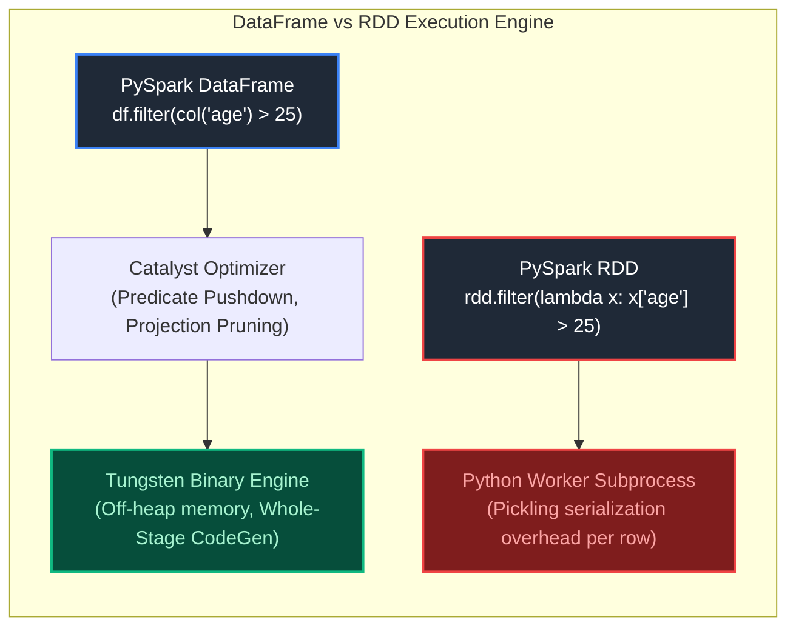

---

### SparkContext vs SparkSession from a Modern Data Architecture Perspective
**Topic Covered:** Legacy Contexts (`SQLContext`, `HiveContext`) vs Unified `SparkSession`  
**Questions Covered:**
- Explain SparkContext vs SparkSession from a data analysis perspective.
- Explain SparkContext vs SparkSession from a data engineering and analysis perspective.
*(Grouped together: Comparison of legacy SparkContext with unified SparkSession abstraction)*

- **`SparkContext` (Spark 1.x Legacy):** The raw connection to the Spark execution cluster. Configured memory, resource allocation, and created fundamental RDDs. In Spark 1.x, developers had to manage multiple distinct contexts simultaneously:
  - `SparkContext` for RDD operations.
  - `SQLContext` for SQL queries.
  - `HiveContext` for connecting to Hive Metastore tables.
  - `StreamingContext` for DStreams.
- **`SparkSession` (Spark 2.x+ Standard):** The unified entry point. Internally encapsulates `SparkContext`, `SQLContext`, and `HiveContext` into a single, cohesive programmatic interface.
- **Multi-Tenant Session Isolation:** Multiple `SparkSession` instances can share a single underlying `SparkContext` on a cluster while maintaining separate SQL configurations, temporary views, and UDF catalogs (`spark.newSession()`).

---

### Broadcast Variables Internals & Torrent Protocol
**Topic Covered:** Read-Only Distributed Cache, P2P Torrent Protocol, Deserialization Efficiency  
**Questions Covered:**
- Explain broadcast variables - what are they and when would you use them?
- Explain broadcast variables in Spark. What are they, how do they distribute data internally, and when should you use them?
*(Grouped together: Broadcast variable mechanics, torrent distribution protocol, and memory caching)*

#### Internals: The BitTorrent Broadcast Protocol
When a driver sends a standard Python variable into a transformation closure (e.g., `rdd.map(lambda x: lookup[x])`), Spark serializes and transmits that copy **with every single task**! If you run 10,000 tasks across 100 executors, the network transmits 10,000 duplicates.

A **Broadcast Variable** distributes a single read-only copy **per worker machine (executor)**, caching it in executor memory:
1. The Driver breaks the broadcast data into small 4 MB chunks.
2. Spark uses a **BitTorrent-style peer-to-peer protocol**: Executors download chunks from the Driver and immediately upload downloaded chunks to peer executors concurrently!
3. Eliminates Driver network bottlenecks and reduces task dispatch serialization latency from $O(N_{tasks})$ to $O(N_{executors})$.

#### Production Usage
```python
# Broadcast a 20 MB machine learning feature lookup dictionary
lookup_table = {f"k_{i}": i * 1.5 for i in range(500000)}
broadcast_lookup = spark.sparkContext.broadcast(lookup_table)

# In executor tasks: Access via .value
@F.udf("double")
def apply_lookup(key):
    return broadcast_lookup.value.get(key, 0.0)

df_transformed = df.withColumn("feature_weight", apply_lookup(F.col("key")))
```

---

### Bloom Filters in Spark & Delta Lake for Runtime File Skipping
**Topic Covered:** Probabilistic Data Structures, False Positives, Dynamic File Pruning  
**Question:** How can Bloom Filters help reduce unnecessary data scans in distributed queries?

#### Mechanics of a Bloom Filter
A **Bloom Filter** is a space-efficient probabilistic data structure that tests whether an element is a member of a set.
- **Possible Returns:** "Definitely not in set" (Zero False Negatives) OR "Might be in set" (Low, controlled False Positive rate).
- **Parquet / Delta Lake Indexing:** Delta Lake and Parquet store Bloom Filter bit vectors in file footer metadata for indexed columns.
- **Query Optimization:** When a query filters `WHERE user_uuid = 'e3b0c442...'`:
  1. The engine checks the file footer Bloom filter.
  2. If the filter returns "Definitely not in file", Spark **skips downloading and scanning the entire 500 MB Parquet file completely**!
  3. Eliminates terabytes of cloud storage network transfer for high-cardinality lookups (UUIDs, transaction IDs) where standard min/max dictionary pruning fails.

---

# 14. Distributed Massive Joins & Snowflake Lakehouse Integration

---

### Joining Two Massive Multi-Terabyte Datasets Beyond Memory Spills
**Topic Covered:** Sort-Merge Join Tuning, Bucketing / Pre-shuffling & Key Salting  
**Questions Covered:**
- How would you join two massive datasets that are too large to fit into memory efficiently in a distributed environment?
- You need to join two massive datasets (e.g., 2 TB and 5 TB) that are far too large for memory. How would you architect this join to avoid disk spills and failures?
*(Grouped together: Terabyte-scale distributed joins beyond memory capacity, pre-bucketing, and spill avoidance)*

#### The 3-Pillar Architecture for Multi-TB Joins
1. **Pre-Bucketing on the Join Key:**
   If both tables are joined frequently, pre-bucket both tables on the join key into the exact same number of buckets ($K=2000$):
   ```sql
   CREATE TABLE orders_bucketed USING delta 
   CLUSTERED BY (customer_id) INTO 2000 BUCKETS;
   ```
   *Outcome:* Spark performs a **Bucket Join** with **zero network shuffle**! Matching buckets are co-located on matching executor partitions.
2. **Sort-Merge Join (SMJ) with Off-Heap Tungsten Sizing:**
   Ensure `spark.sql.join.preferSortMergeJoin = true`. Allocate adequate `spark.executor.memoryOverhead` (at least 20-30% of executor memory) to handle off-heap sorting buffers during external sort merges.
3. **AQE Auto-Coalescing & Skew Joins:**
   Enable AQE to dynamically split skewed keys and eliminate partition stragglers.

---

### Best Practices for Analysing Snowflake Data Using Python & Snowpark
**Topic Covered:** Snowflake Connector, Snowpark DataFrames, Pushdown Predicates & Storage Staging  
**Question:** What are the best practices for analysing Snowflake data using Python?

1. **Leverage Snowpark Python (Push Computation to Snowflake Virtual Warehouses):**
   Avoid `cursor.fetchall()` or downloading millions of records into a local Pandas DataFrame. Snowpark Python builds an AST (Abstract Syntax Tree) and compiles DataFrame transformations directly into native SQL, executing on Snowflake's distributed compute engines.
2. **Enforce Predicate & Projection Pushdown:**
   Always filter rows (`.filter()`) and prune columns (`.select()`) prior to executing `.collect()` or `.to_pandas()`.
3. **Use Arrow-Optimized Batches for Necessary Client Transfers:**
   When local client transfer is required, use `fetch_pandas_batches()` from `snowflake-connector-python`, which leverages Apache Arrow shared memory IPC rather than row-by-row Python tuple serialization.

---

### PySpark Live Coding: DataFrame Deduplication & Department Sales Aggregations
**Topic Covered:** `dropDuplicates()` vs Window Dedup, Multi-Column GroupBy Aggregation  
**Questions Covered:**
- You've discovered duplicate records in a critical production dataset. What is your immediate plan to handle them, and what long-term strategy would you implement to prevent recurrence?
- How do you remove duplicate records in a PySpark DataFrame?
- Write a PySpark transformation to calculate total sales by department.
*(Grouped together: Immediate and programmatic DataFrame deduplication, window ranking, and department-wise aggregations)*

#### Scenario 1: PySpark Deduplication (Exact vs Window Dedup)
```python
from pyspark.sql import functions as F
from pyspark.sql.window import Window

# Method 1: Drop Duplicates (Keeps an arbitrary record if not ordered)
deduped_df = raw_df.dropDuplicates(subset=["customer_id", "email"])

# Method 2: Deterministic Window Dedup (Preserves latest record by UpdatedDate)
dedup_window = Window.partitionBy("customer_id").orderBy(F.col("updated_date").desc())

latest_records_df = (
    raw_df
    .withColumn("row_num", F.row_number().over(dedup_window))
    .filter(F.col("row_num") == 1)
    .drop("row_num")
)
```

#### Scenario 2: Department Sales Aggregation
```python
dept_sales_summary = (
    sales_df
    .groupBy("department_id", "department_name")
    .agg(
        F.sum("sale_amount").alias("total_sales"),
        F.round(F.avg("sale_amount"), 2).alias("avg_sale_amount"),
        F.count("order_id").alias("total_transactions")
    )
    .orderBy(F.col("total_sales").desc())
)
```

---

# 15. Senior Whiteboarding & Production Join Scenarios (Without an IDE)

---

### Q46. Solving Data Transformations Without an IDE (Whiteboarding Best Practices)
**Topic Covered:** Clean Syntax, PySpark Declarative Fluency, Edge-Case Handling  
**Questions Covered:**
- Write Python/PySpark code to join two datasets and rank records using window functions.
- Solve data transformation tasks without an IDE, demonstrating clear logic and accurate syntax.
*(Grouped together: Whiteboarding fluency, multi-table joins, aggregations, and window rankings)*

#### Definition & Core Concepts
In technical whiteboard and screen-share interviews without IDE autocompletion or linters, interviewers evaluate:
1. **Clean Method Chaining:** Structuring multi-step transformations in a single fluent DataFrame expression wrapped in parentheses.
2. **Column Alias Discipline:** Explicit naming of computed columns via `.alias()`.
3. **Correct Import Conventions:** Using `from pyspark.sql import functions as F, Window as W`.
4. **Deterministic Tie-Breaking:** Never leaving window ranking non-deterministic.

#### Visual Flow
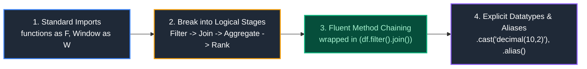

#### Production Implementation / Code Solution
```python
from pyspark.sql import SparkSession
from pyspark.sql import functions as F
from pyspark.sql.window import Window

spark = SparkSession.builder.appName("WhiteboardETL").getOrCreate()

# Clean Whiteboarding Template: Join, Aggregate, and Dense Rank Top Performers
dept_salary_window = Window.partitionBy("department_id").orderBy(F.col("total_revenue").desc())

clean_transformed_df = (
    sales_df
    .filter(F.col("status") == "COMPLETED")
    .join(
        departments_df.select("department_id", "department_name"),
        on="department_id",
        how="inner"
    )
    .groupBy("department_id", "department_name", "employee_id")
    .agg(
        F.sum("sale_amount").alias("total_revenue"),
        F.count("order_id").alias("transaction_count")
    )
    .withColumn("revenue_rank", F.dense_rank().over(dept_salary_window))
    .filter(F.col("revenue_rank") <= 3)
    .orderBy("department_id", "revenue_rank")
)
```
- **Time Complexity:** $O(N \log N)$ distributed sort-merge join and window evaluation.
- **Space Complexity:** $O(N)$ execution frame memory.

#### Engineering Implications & Production Pitfalls
1. **The Python `lambda` Anti-Pattern:** Writing `rdd.map(lambda row: ...)` in PySpark discards Catalyst optimization and inflicts heavy Py4J pickling overhead. Always use native `pyspark.sql.functions` expressions.
2. **Interview Talking Point:** In a whiteboard interview, explicitly mention that you are avoiding wide transformations before filtering (enforcing predicate pushdown early) to minimize shuffle size across network boundaries.

---

### Q47. Joining 2 TB Fact Table with 200 MB Dimension Table
**Topic Covered:** Broadcast Hash Join Thresholds, Network Transfer Optimization  
**Questions Covered:**
- You need to join two tables with a big size difference: one is 2 TB, the other is 200 MB. How would you optimize this join?
- You join a 500 GB fact table with a 200 MB dimension table. Would you use a Broadcast Join? Why?
- You need to join two tables with a big size difference: one is 2 TB (or 500 GB), the other is 200 MB. Would you use a Broadcast Join? Why?
*(Grouped together: Broadcast join threshold overrides and memory-vs-network trade-offs for asymmetric joins)*

#### Definition & Core Concepts
By default, Spark’s `spark.sql.autoBroadcastJoinThreshold` is **10 MB**.
- At **200 MB on disk**, the dimension table is compressed as Parquet. When decompressed into Java heap objects in executor memory, it expands to **500 MB – 800 MB**!
- If an executor has 8 GB of memory, broadcasting 800 MB across all nodes consumes substantial memory, but completely **eliminates shuffling the 2 TB fact table** across the network!

#### Visual Flow
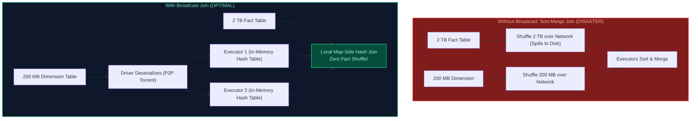

#### Production Implementation / Code Solution
```python
from pyspark.sql import functions as F

# Tune broadcast threshold for this session
spark.conf.set("spark.sql.autoBroadcastJoinThreshold", 524288000) # 500 MB threshold

# Explicit broadcast hint
fact_2tb_df = spark.read.table("gold.fact_web_traffic")
dim_200mb_df = spark.read.table("gold.dim_campaigns")

joined_df = fact_2tb_df.join(
    F.broadcast(dim_200mb_df),
    on="campaign_id",
    how="inner"
)
```
- **Time Complexity:** $O(N_{\text{fact}})$ linear scan without any network shuffle sort.
- **Space Complexity:** $O(M_{\text{dim}})$ hash table per executor.

#### Engineering Implications & Production Pitfalls
1. **Driver OOM Risk:** The Driver node must collect the entire 200 MB dimension table before broadcasting it to executors. If the Driver memory is sized at default 1 GB (`spark.driver.memory = 1g`), collecting and deserializing an 800 MB in-memory table triggers `java.lang.OutOfMemoryError: Java heap space` on the Driver! Ensure driver memory is configured to $\ge 4\text{ GB}$.
2. **Interview Talking Point:** In Spark 3.x with AQE (`Adaptive Query Execution`), if the optimizer dynamically realizes a filtered dimension table shrinks below the broadcast threshold at runtime, it automatically converts a Sort-Merge Join into a Broadcast Join on the fly.

---

### Q48. High Memory Usage & Slow Data Processing Diagnostic Framework
**Topic Covered:** Off-Heap vs Heap Memory, GC Pause Profiling, Storage vs Execution Memory  
**Question:** How would you investigate high memory usage and slow data processing in a production Spark cluster?

#### Systematic 4-Stage Diagnostic Framework
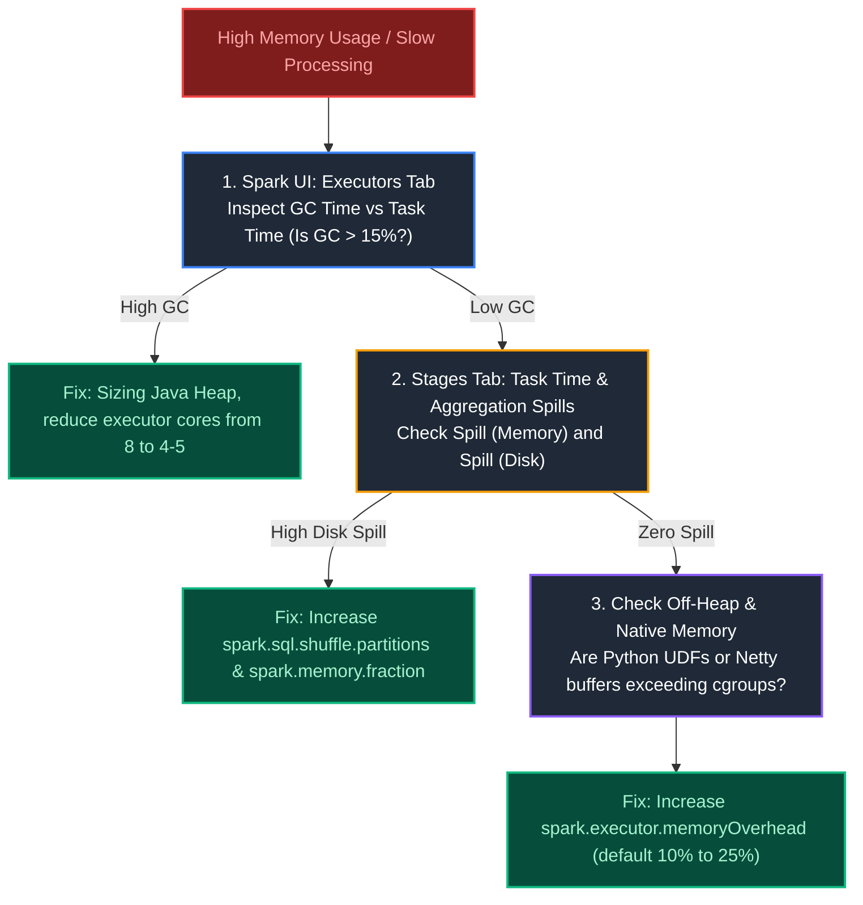

#### Production Diagnostic Checklist:
1. **GC Time Ratio:** If $(\text{GC Time} / \text{Task Time}) > 15\%$, worker threads are starving. Allocate larger heap space or reduce cores per executor from 8 to 4–5 to reduce concurrent thread pressure on the JVM garbage collector.
2. **Shuffle Spill Metrics:** Inspect `Spill (Memory)` and `Spill (Disk)`. If spill is non-zero, execution memory is exhausted; increase `spark.sql.shuffle.partitions` (e.g. from 200 to 1,000) so each task sorts smaller chunks.
3. **Container Killed by YARN / Kubernetes (`137 Exit Code`):** The off-heap memory exceeded the allocated cgroup limit. PySpark worker processes run outside the JVM. Allocate extra overhead via `spark.executor.memoryOverhead = 2g`.

---

### Q49. Performance Impact of Window Functions in Distributed Spark Execution
**Topic Covered:** Windowing Mechanics, Single-Partition Skew & Memory Buffer Spill  
**Question:** How do window functions affect Spark performance? What are the biggest performance hazards?

#### Definition & Core Concepts
In Apache Spark, window functions (`over(Window.partitionBy(...).orderBy(...))`) enforce physical data clustering: all records sharing the same `partitionBy` key must be shuffled across the network and colocated onto the **exact same executor partition**.
- **The Empty partitionBy Disaster:** Calling `Window.orderBy("created_at")` without `partitionBy` forces Spark to route **100% of the dataset onto a single executor core**, completely neutralizing cluster parallelism and causing catastrophic OOM.
- **Frame Memory Consumption:** An unbounded frame (`rowsBetween(Window.unboundedPreceding, Window.currentRow)`) requires the executor to buffer historical partition states in execution memory, triggering disk spills when partitions are large.

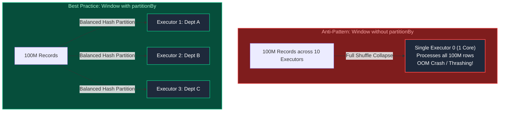

#### Production Implementation / Code Solution
```python
from pyspark.sql import functions as F
from pyspark.sql.window import Window

# Production Rule: Always define partitionBy and bounded frame specifications
dept_window = (
    Window.partitionBy("department_id")
    .orderBy(F.col("salary").desc())
)

ranked_df = df.withColumn("salary_rank", F.dense_rank().over(dept_window))

# When calculating cumulative sums, specify explicit bounded frames to avoid full buffering
cumulative_window = (
    Window.partitionBy("user_id")
    .orderBy("transaction_time")
    .rowsBetween(-100, Window.currentRow)  # Bounded to previous 100 rows
)
```

---

### Q50. Spark Lazy Evaluation: Lineage Graph Construction, Pipelining & Fault Recovery
**Topic Covered:** DAG Execution Engine, Catalyst Optimizer, Lineage Fault Tolerance  
**Question:** How does Spark's lazy evaluation affect job execution, query optimization, and fault tolerance?

#### Definition & Core Concepts
In Apache Spark, transformations (`map`, `filter`, `join`, `groupBy`) are **lazy**; they do not process data when defined. Instead, Spark builds an internal directed acyclic graph (**DAG**) representing the computation lineage. Execution is triggered only when an **action** (`count`, `collect`, `write`, `show`) is called.

#### Key Benefits of Lazy Evaluation:
1. **Whole-Stage Code Generation & Pipelining:** Catalyst merges multiple consecutive narrow transformations (e.g. `filter().map().withColumn()`) into a single generated Java bytecode loop, eliminating intermediate memory materialization.
2. **Predicate & Projection Pushdown:** Catalyst pushes `filter()` and `select()` down to the Parquet/Delta storage reader, skipping unneeded columns and file row groups before data crosses the network.
3. **Deterministic Fault Tolerance:** If an executor node crashes during task execution, Spark does not restart the entire multi-hour pipeline. The DAG Scheduler inspects the lineage graph and re-computes only the lost partition from the upstream shuffle checkpoint.

---

### Q51. Decoupled Architecture: Apache Parquet vs Delta Lake vs Spark Executors
**Topic Covered:** Separation of Compute and Storage, File vs Table Formats  
**Question:** Discuss the interplay and separation of concerns between Parquet, Delta Lake, and Spark executors.

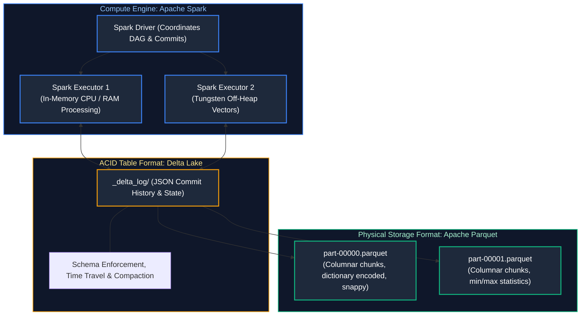

| Component | Layer / Classification | Primary Role & Responsibility |
| :--- | :--- | :--- |
| **Apache Spark** | **Distributed Compute Engine** | Executes memory and CPU calculations, schedules DAG tasks, coordinates network shuffles. Completely stateless. |
| **Delta Lake** | **ACID Table Protocol** | Sits on top of storage; manages ACID transactions, multi-version concurrency control (MVCC), schema evolution, and Time Travel via `_delta_log/`. |
| **Apache Parquet** | **Physical File Format** | Immutable on-disk columnar storage format; provides binary compression (Snappy/ZSTD), dictionary encoding, and columnar statistics (Min/Max). |

---

### Q52. Production Data Cleansing: Filtering Null Identifiers & Dead-Letter Routing
**Topic Covered:** Defensive Data Quality, Quarantine Routing & Silver Layer Cleansing  
**Question:** Write a PySpark job to clean incoming events by isolating records with a null `user_id` into a dead-letter quarantine sink before persisting valid records to the clean target table.

#### Production Implementation / Code Solution
```python
from pyspark.sql import functions as F
from pyspark.sql import DataFrame

def process_and_quarantine_events(raw_events_df: DataFrame, silver_path: str, dead_letter_path: str):
    """
    Cleans incoming stream/batch events:
    - Clean records (valid user_id) persisted to Silver Medallion table.
    - Poison records (null user_id) diverted to Dead-Letter Sink with audit reasons.
    """
    # Step 1: Annotate validation flag
    validated_df = raw_events_df.withColumn(
        "is_valid",
        F.col("user_id").isNotNull() & (F.trim(F.col("user_id")) != "")
    ).withColumn(
        "processed_timestamp",
        F.current_timestamp()
    )

    # Step 2: Extract clean records
    clean_events_df = (
        validated_df
        .filter(F.col("is_valid") == True)
        .drop("is_valid")
    )

    # Step 3: Extract and enrich quarantine records
    quarantine_df = (
        validated_df
        .filter(F.col("is_valid") == False)
        .withColumn("rejection_reason", F.lit("CRITICAL_MISSING_USER_ID"))
        .drop("is_valid")
    )

    # Step 4: Write Clean Data to Silver Delta Table
    (
        clean_events_df.write
        .format("delta")
        .mode("append")
        .option("mergeSchema", "true")
        .save(silver_path)
    )

    # Step 5: Write Quarantine Data to Dead-Letter Sink
    (
        quarantine_df.write
        .format("delta")
        .mode("append")
        .save(dead_letter_path)
    )
```

---

### Q53. Diagnosing Spark Job Slowdown: Scaling from 1M to 100M Records
**Topic Covered:** 100x Volume Scaling Bottlenecks, Shuffle Partition Sizing & GC Thrashing  
**Question:** A Spark job that runs smoothly on 1 million records slows down drastically and times out when data volume increases to 100 million records. How would you investigate and resolve the issue?

#### Root Causes & Resolution Summary
1. **Default Shuffle Partitions (`spark.sql.shuffle.partitions = 200`):**
   - At 1M records: $1\text{M} / 200 = 5,000$ records per partition (runs fast in RAM).
   - At 100M records: $100\text{M} / 200 = 500,000$ records per partition. Partitions exceed available executor execution memory and trigger **Spill (Memory) and Spill (Disk)**.
   - **Resolution:** Scale shuffle partitions dynamically: `spark.conf.set("spark.sql.shuffle.partitions", 1000)` or enable `spark.sql.adaptive.enabled = true`.
2. **Data Skew Amplification:**
   - At 1M rows, a skewed customer with 5% volume is only 50k rows. At 100M rows, that same customer represents 5M rows, causing a single task straggler to bottleneck the entire cluster stage.
   - **Resolution:** Enable AQE Skew Join (`spark.sql.adaptive.skewJoin.enabled = true`) or salt the join key.
3. **Driver Memory Exhaustion:**
   - Calling `.collect()` or reading large broadcast lookup tables triggers Driver OutOfMemory when data volume scales 100x.
   - **Resolution:** Replace `.collect()` with batch partitioned writes or increase `spark.driver.memory`.


---

# 18. Broadcast Memory Limits, Distributed Locks & Kubernetes Diagnostics

---

### Q66. Spark Broadcast Join Exceeding Executor Memory: Failure Modes & Safeguards
**Topic Covered:** Broadcast Hash Join (BHJ) Internals, Driver OOM, Torrent Broadcast & Auto-Broadcast Threshold  
**Question:** What happens under the hood when a Spark Broadcast Join exceeds available executor or driver memory? How do you diagnose and prevent this in high-scale production pipelines?

#### Definition & Core Concepts
In a Broadcast Hash Join (BHJ):
1. The driver node collects the entire broadcast DataFrame into its local JVM memory (`driver.collect()`).
2. The driver serializes the data and distributes it to all executor nodes via the peer-to-peer **Torrent Broadcast protocol**.
3. Each executor deserializes the dataset into an in-memory hash table in its execution memory pool.
When the broadcast table is too large:
- **Driver Failure Mode:** If the table exceeds `spark.driver.memory`, the driver crashes with `java.lang.OutOfMemoryError: Java heap space` during the collect phase.
- **Executor Failure Mode:** If the broadcast hash table exceeds the executor's available execution memory (`(executor.memory - 300MB) * spark.memory.fraction * spark.memory.executionFraction`), or if multiple broadcast tables are loaded concurrently across multiple CPU task cores, the executor JVM throws an `OutOfMemoryError` or dies from GC pause thrashing.
- **Broadcast Timeout:** If the driver takes longer than `spark.sql.broadcastTimeout` (default: 300 seconds) to collect and serialize the table, the job fails with `SparkException: Could not execute broadcast in 300 secs`.

#### Visual Flow
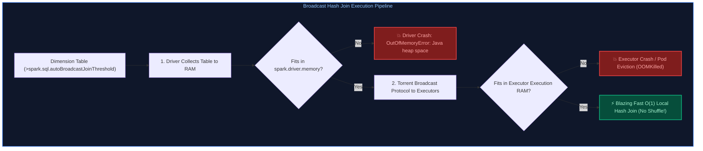

#### Production Implementation / Code Solution
```python
from pyspark.sql import SparkSession
from pyspark.sql.functions import broadcast

spark = SparkSession.builder.appName("BroadcastJoinSafeguards").getOrCreate()

# 1. Inspect and tune automatic broadcast threshold (Default is 10MB: 10485760 bytes)
# In production, set to -1 to disable automatic broadcast joins if table statistics are unreliable
spark.conf.set("spark.sql.autoBroadcastJoinThreshold", "64MB")
spark.conf.set("spark.sql.broadcastTimeout", "600") # Increase timeout for multi-GB queries

fact_df = spark.table("sales_fact")       # 500 GB fact table
dim_df = spark.table("product_dimension")  # 200 MB dimension table

# Defensive Check: Explicitly verify size before applying broadcast() hint
table_size_bytes = spark._jsparkSession.sessionState().executePlan(
    dim_df._jdf.logicalPlan()
).optimizedPlan().stats().sizeInBytes()

MAX_SAFE_BROADCAST_BYTES = 100 * 1024 * 1024 # 100 MB Safe Upper Bound

if table_size_bytes <= MAX_SAFE_BROADCAST_BYTES:
    # Safe to broadcast: No shuffle network exchange
    joined_df = fact_df.join(broadcast(dim_df), "product_id", "inner")
else:
    # Exceeds safe memory limit: Fall back gracefully to Sort-Merge Join (SMJ)
    # or Shuffle Hash Join (SHJ) to prevent Driver/Executor OOM
    joined_df = fact_df.join(dim_df, "product_id", "inner")

joined_df.write.format("delta").mode("append").saveAsTable("sales_enriched")
```
- **Time Complexity:** $O(N)$ linear time when broadcast fits in memory (eliminates $O(N \log N)$ network shuffle sort); degrades to $O(N \log N)$ under Sort-Merge fallback.
- **Space Complexity:** $O(M)$ memory on the driver and every single executor, where $M$ is the size of the broadcast dimension.

#### Engineering Implications & Production Pitfalls
1. **Uncompressed In-Memory Expansion:** A Parquet dimension table that takes 30MB on cloud storage expands to $150	ext{MB}	ext{--}300	ext{MB}$ once deserialized as Java objects in executor memory. Calculating safety based on disk file size rather than memory footprint is the #1 cause of unexpected broadcast OOM crashes.
2. **Multi-Core Amplification:** An executor configured with `spark.executor.cores = 5` runs 5 tasks concurrently. If each task performs a join with a 200MB broadcast table, all 5 tasks share the cached broadcast reference, but intermediate hash probe states can thrash executor memory.

#### Core Curriculum Cross-Reference
*Deep-dive theoretical reference: See [08. Apache Spark & PySpark: Distributed Join Strategies](../08_apache_spark_pyspark.md#4-distributed-join-strategies--performance-optimization)*

---

### Q67. Distributed Lock Expiration & Split-Brain Hazard During Long Spark GC Pauses
**Topic Covered:** Distributed Locks, Lease Expiration, GC Stop-The-World Pauses & Fencing Tokens  
**Question:** Your distributed ETL lock has a 30-second TTL. A Spark job experiences a 40-second Stop-The-World (STW) Garbage Collection pause. What happens when another worker acquires the lock, and how do you prevent catastrophic data corruption?

#### Definition & Core Concepts
In distributed systems, distributed locks (via Redis Redlock, ZooKeeper, or DynamoDB) coordinate exclusive pipeline writes:
1. **The Race Condition:**
   - Worker A acquires Lock with a 30-second Time-To-Live (TTL).
   - Worker A enters a severe Java **Full GC Stop-The-World (STW) pause** lasting 40 seconds (pausing all application threads, heartbeats, and lock renewal loops).
   - At second 30, the lock lease expires. The lock coordinator grants the lock to **Worker B**.
   - At second 40, Worker A's JVM awakens from the GC pause. Believing it still owns the lock, Worker A issues a write to cloud storage.
   - **Split-Brain Disaster:** Both Worker A and Worker B mutate storage simultaneously, generating corrupted duplicate files or race-condition overwrites.
2. **The Fundamental Distributed Solution: Fencing Tokens:**
   A lock must **never** grant bare access. Every time a lock is acquired, the coordinator increments and issues a monotonically increasing **Fencing Token** (e.g., Token 42 for Worker A, Token 43 for Worker B). Downstream storage (or Delta Lake transaction log) verifies that writes have a token $\ge$ the latest seen token. When Worker A awakens with Token 42, storage rejects its write because Token 43 was already committed.

#### Visual Flow
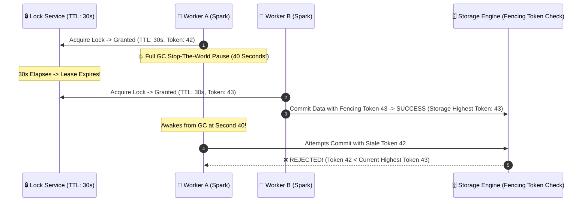

#### Production Implementation / Code Solution
```python
import time
from typing import Optional

class FencedStorageWriter:
    """
    Demonstrates optimistic storage concurrency with monotonically increasing fencing tokens.
    Prevents zombie writes caused by GC pauses or network partitions.
    """
    def __init__(self):
        self._current_fencing_token = 0

    def commit_transaction(self, token: int, file_path: str, record_count: int) -> bool:
        # Atomic check-and-set: Storage rejects any token older than the highest committed token
        if token < self._current_fencing_token:
            raise RuntimeError(
                f"ZOMBIE WRITE DETECTED: Stale fencing token {token} rejected. "
                f"Storage has already committed transaction with token {self._current_fencing_token}."
            )

        # Commit write and advance atomic watermark
        self._current_fencing_token = token
        print(f"Successfully committed {record_count} records to {file_path} with token {token}")
        return True
```
- **Time Complexity:** $O(1)$ atomic token comparison in storage metadata.
- **Space Complexity:** $O(1)$ storage memory for atomic sequence register.

#### Engineering Implications & Production Pitfalls
1. **Delta Lake Invariant:** Delta Lake eliminates this hazard natively via **Optimistic Concurrency Control (OCC)** on its JSON transaction log (`000042.json`). Even if a Spark worker pauses for 10 minutes, when it attempts to commit `000042.json`, storage detects that Worker B already committed `000042.json` and raises `ConcurrentAppendException` or `ConcurrentTransactionException`, forcing Worker A to re-read and reconcile.
2. **GC Tuning Mitigation:** While fencing tokens protect storage integrity, tuning the JVM to prevent 40-second pauses is essential. Switching from standard ParallelGC to **Shenandoah GC or ZGC** (`-XX:+UseZGC` or `-XX:+UseG1GC -XX:MaxGCPauseMillis=200`) eliminates multi-second STW pauses.

#### Core Curriculum Cross-Reference
*Deep-dive theoretical reference: See [05. Distributed Systems and APIs: Distributed Locks & Consensus](../05_distributed_systems_and_apis.md#3-distributed-consensus--state-machines)*

---

### Q68. Kubernetes OOMKilled Executor Pod with Low JVM Heap Usage
**Topic Covered:** Container Cgroups, JVM Heap vs Off-Heap, MemoryOverhead & Native Netty Buffers  
**Question:** In a Spark-on-Kubernetes (or Databricks) cluster, an executor pod is abruptly OOMKilled by the OS kernel, but the Spark Web UI shows JVM heap usage never exceeded 60%. Where is the memory being consumed, and how do you resolve it?

#### Definition & Core Concepts
When running Spark on Kubernetes, Linux enforces container memory limits via **Control Groups (cgroups)**:
$$	ext{Total Container Memory} = 	ext{JVM Heap} + 	ext{Off-Heap Execution} + 	ext{JVM Overhead (Metaspace, Threads)} + 	ext{OS Page Cache / Native}$$
In Spark configuration:
$$	ext{Container Limit} = 	ext{spark.executor.memory} + 	ext{spark.executor.memoryOverhead}$$
If the total physical memory consumed by all processes in the container exceeds the cgroup quota, the Linux kernel **OOM Killer** immediately terminates the pod (`Exit Code 137 / OOMKilled`), regardless of JVM heap health.
The memory is consumed in 4 off-heap locations:
1. **PySpark Python Worker Daemons:** Python code (UDFs, Pandas, NumPy) runs in separate OS child processes (`python3`) outside the JVM heap. If a Pandas UDF processes a 2GB Arrow batch, memory is consumed in native C-memory!
2. **Off-Heap Netty Shuffle Buffers:** Network shuffle data transfer allocates off-heap direct byte buffers via Netty. High shuffle volume with dozens of concurrent streams spikes off-heap memory.
3. **JVM Metaspace & Native Stacks:** Class definitions, JIT compiler memory, and thread stack allocations (`1MB` per thread).
4. **PyArrow / Parquet Decompression:** Native columnar C++ decoders allocate native memory outside the JVM.

#### Visual Flow
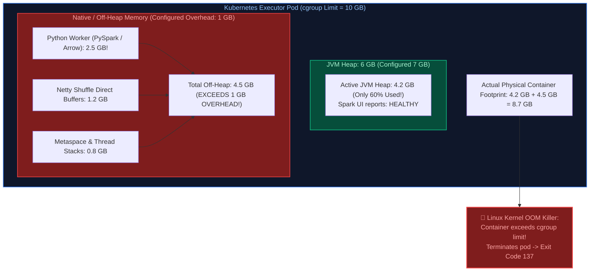

#### Production Implementation / Tuning Playbook
```bash
# 1. Inspect Pod Termination Reason in Kubernetes CLI
kubectl describe pod spark-executor-10492 -n spark-jobs | grep -E "OOMKilled|Exit Code"
# Output: Last State: Terminated, Reason: OOMKilled, Exit Code: 137

# 2. Adjust Spark Sizing Configurations
# Increase memory overhead from default (max(384MB, 10% of executor.memory)) to 25%-40%
# for pipelines using PySpark, Pandas UDFs, or heavy shuffling:
spark-submit   --master k8s://https://k8s-apiserver:443   --conf spark.executor.memory=8g   --conf spark.executor.memoryOverhead=3g   --conf spark.executor.pyspark.memory=2g   --conf spark.sql.execution.arrow.pyspark.enabled=true   --conf spark.sql.execution.arrow.maxRecordsPerBatch=10000   --conf spark.memory.offHeap.enabled=true   --conf spark.memory.offHeap.size=1g
```

#### Engineering Implications & Production Pitfalls
1. **The `maxRecordsPerBatch` Arrow Throttle:** PyArrow converts Spark row batches into vectorized Arrow RecordBatches. If a batch contains 500,000 wide rows, the native Arrow memory footprint spikes to multiple gigabytes before Python processes it. Restricting `spark.sql.execution.arrow.maxRecordsPerBatch = 10000` bounds native memory consumption cleanly.
2. **The `spark.executor.pyspark.memory` Guard:** By default, Spark sets no ceiling on how much memory a Python worker process can allocate. Setting `spark.executor.pyspark.memory` forces Python workers to spill or throw memory errors within Python rather than allowing the kernel to kill the entire executor pod.

#### Core Curriculum Cross-Reference
*Deep-dive theoretical reference: See [08. Apache Spark & PySpark: Memory Architecture & OOM Debugging](../08_apache_spark_pyspark.md#5-memory-management-and-garbage-collection-internals)*

---

### Q69. Spark Repartition vs Coalesce vs RepartitionByRange Execution Mechanics
**Topic Covered:** Hash Partitioning, Shuffle Elimination, Range Partitioning & Data Slicing  
**Question:** Compare `repartition()`, `coalesce()`, and `repartitionByRange()` in Apache Spark. Explain the internal execution mechanics, shuffle implications, and when to use each in production ETL.

#### Definition & Core Concepts
Controlling the physical distribution of data across partitions dictates network shuffle cost, downstream file sizes, and query performance:
1. **`repartition(numPartitions)`:**
   - **Mechanism:** Performs a **Full Network Shuffle** using round-robin or hash partitioning (`hash(col) % N`).
   - **Use Case:** Increasing partition count (e.g. from 20 to 500) or balancing severe data skew across worker nodes.
2. **`coalesce(numPartitions)`:**
   - **Mechanism:** Collapses adjacent existing partitions on the same worker node **without a network shuffle** (exploits locality).
   - **Limitation:** Can **only decrease** partition count. Attempting to increase partitions with `coalesce()` is a silent no-op.
   - **Use Case:** Reducing partition count before writing to storage (e.g. merging 200 small partitions into 10 target files).
3. **`repartitionByRange(numPartitions, *cols)`:**
   - **Mechanism:** Performs a network shuffle using **Reservoir Sampling** to calculate partition boundary split points, ensuring rows with similar key ranges land in the same partition.
   - **Use Case:** Preparing data for sorted ranged file output or range-bounded time-series queries.

#### Visual Flow
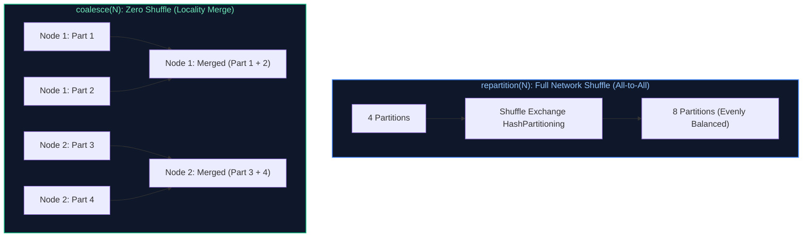

#### Production Implementation / Code Solution
```python
from pyspark.sql import SparkSession
from pyspark.sql.functions import col

spark = SparkSession.builder.appName("PartitioningMechanics").getOrCreate()
raw_df = spark.read.parquet("raw_telemetry/") # 1,000 input partitions

# Scenario 1: Downstream computation is heavy; balance data evenly across cluster
# Full shuffle balances load across 200 workers
balanced_df = raw_df.repartition(200)

# Scenario 2: Heavy filtering reduces dataset by 95% (only 50MB remains across 200 tasks)
filtered_df = balanced_df.filter(col("status") == "CRITICAL_ERROR")

# Avoid writing 200 tiny 250KB files to S3/ADLS
# Use coalesce(1) to avoid an unnecessary network shuffle before write
filtered_df.coalesce(2).write.format("delta").mode("append").save("alerts_gold/")

# Scenario 3: Pre-sort time series data across partitions for high-efficiency range scans
range_sorted_df = raw_df.repartitionByRange(50, col("event_date"), col("event_timestamp"))
range_sorted_df.write.format("parquet").save("time_series_curated/")
```
- **Time Complexity:**
  - `repartition()`: $O(N \log N)$ shuffle exchange with disk I/O serialization.
  - `coalesce()`: $O(N)$ linear scan without network transfer.
  - `repartitionByRange()`: $O(N \log N)$ with two-phase reservoir sampling.
- **Space Complexity:** `coalesce()` uses $O(1)$ intermediate network buffer; `repartition()` requires disk shuffle spool memory.

#### Engineering Implications & Production Pitfalls
1. **The Coalesce Upstream Collapse Trap:** Calling `df.coalesce(1)` at the end of a DAG can cause Spark's Catalyst optimizer to collapse the *entire upstream pipeline* into a single task! A pipeline intended to process 500GB across 100 workers runs on 1 core and OOMs. If upstream work must remain parallel, use `repartition(1)` or enforce a cache barrier.
2. **Skew Hazard in Coalesce:** Coalesce merges partitions greedily based on node locality. If Node 1 had 500MB and Node 2 had 10MB, `coalesce(2)` can produce 1 massive 500MB partition and 1 tiny 10MB partition. Use `repartition()` if uniform partition sizing is essential.

#### Core Curriculum Cross-Reference
*Deep-dive theoretical reference: See [08. Apache Spark & PySpark: Partition Management](../08_apache_spark_pyspark.md#3-core-transformations-actions-and-rdddataframe-mechanics)*

---

### Q70. Multi-Source Customer Record Deduplication Across CRM and ERP in PySpark
**Topic Covered:** Record Linkage, Source Precedence Rules, Window Deduplication & PySpark Live Coding  
**Question:** How would you deduplicate customer records arriving from two distinct sources (CRM and ERP) with conflicting addresses and timestamps using PySpark, giving precedence to ERP updates?

#### Definition & Core Concepts
In enterprise customer master data management (MDM), customer profiles arrive asynchronously from heterogeneous systems:
- **ERP:** Source of truth for billing, tax IDs, and financial addresses.
- **CRM:** Source of truth for sales contacts and phone numbers, but frequently out of date.
When conflicting records share the same `customer_id` or unified `tax_identifier`:
1. Assign priority weighting to source systems: `CASE WHEN source = 'ERP' THEN 1 ELSE 2 END`.
2. Apply `Window.partitionBy("customer_id").orderBy(col("source_priority").asc(), col("updated_at").desc())`.
3. Filter where `ROW_NUMBER() = 1` to extract the authoritative golden record.

#### Visual Flow
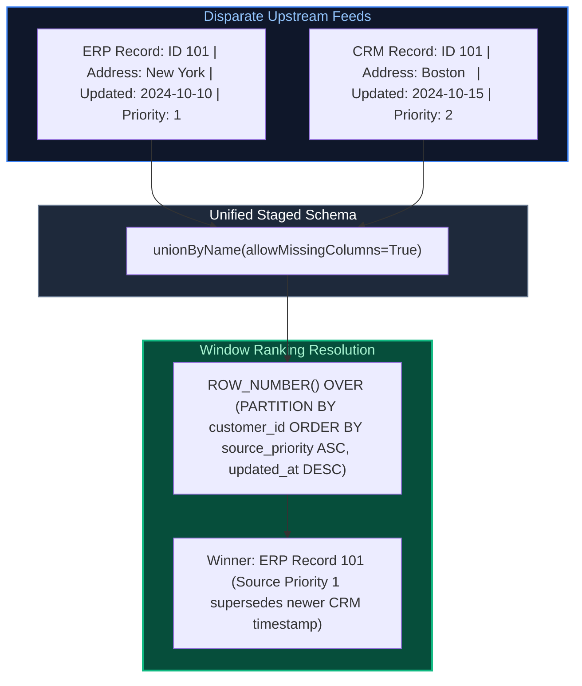

#### Production Implementation / Code Solution
```python
from pyspark.sql import SparkSession, Window
from pyspark.sql import functions as F

spark = SparkSession.builder.appName("MDM_Customer_Deduplication").getOrCreate()

crm_df = spark.table("raw_crm.customers").withColumn("source_system", F.lit("CRM"))
erp_df = spark.table("raw_erp.customers").withColumn("source_system", F.lit("ERP"))

# Standardize and union across schemas
combined_df = crm_df.unionByName(erp_df, allowMissingColumns=True)

# Assign deterministic source priority: ERP (1) supersedes CRM (2)
prioritized_df = combined_df.withColumn(
    "source_priority",
    F.when(F.col("source_system") == "ERP", 1)
     .when(F.col("source_system") == "CRM", 2)
     .otherwise(99)
)

# Window specification: Prioritize source authority first, then newest timestamp
dedup_window = (
    Window.partitionBy("customer_id")
    .orderBy(
        F.col("source_priority").asc(),
        F.col("updated_at").desc(),
        F.col("ingestion_id").desc() # Final deterministic tiebreaker
    )
)

golden_customers_df = (
    prioritized_df
    .withColumn("rank_order", F.row_number().over(dedup_window))
    .filter(F.col("rank_order") == 1)
    .drop("rank_order", "source_priority")
)

golden_customers_df.write.format("delta").mode("overwrite").saveAsTable("silver.dim_customer_golden")
```
- **Time Complexity:** $O(N \log(N/K))$ distributed sort across partitioned customer keys.
- **Space Complexity:** $O(N)$ distributed shuffle memory for window execution.

#### Engineering Implications & Production Pitfalls
1. **Survivorship Merging (Field-Level Coalesce):** In advanced MDM, business rules require taking the *address* from ERP, but preserving the *marketing email* from CRM if ERP has NULL. In PySpark, this is achieved by applying `F.first(col, ignorenulls=True).over(window)` for individual attributes before filtering.
2. **Data Skew on Generic IDs:** If corrupted upstream records populate dummy IDs (e.g. `customer_id = '00000000'` or `NULL`), millions of rows hash to a single partition, triggering severe task stragglers. Filter null/dummy keys into a quarantine table before executing the window deduplication.

#### Core Curriculum Cross-Reference
*Deep-dive theoretical reference: See [08. Apache Spark & PySpark: Production PySpark Engineering](../08_apache_spark_pyspark.md#7-production-pyspark-job-design-and-maintenance)*

---

### Q71. PySpark Regional Top 3 Products Sold (Window Ranking Live Coding)
**Topic Covered:** PySpark Window Functions, Dense Ranking & Aggregation Pipelines  
**Question:** Write a PySpark job to calculate the top 3 best-selling products by quantity sold in each geographical region from a fact sales DataFrame.

#### Definition & Core Concepts
Finding top $N$ items per partition requires a multi-stage distributed execution:
1. **Aggregate:** Compute total volume per `(region, product_id)`. Pre-aggregating reduces record volume by orders of magnitude before ranking.
2. **Window Specification:** Partition by `region` and order by `total_quantity_sold DESC`.
3. **Ranking Semantics:** Use `DENSE_RANK()` if ties should share the same spot without skipping positions, or `ROW_NUMBER()` for strict top 3 cutoff.
4. **Filter:** Restrict to `rank <= 3`.

#### Visual Flow
```mermaid
flowchart LR
    Fact["fact_sales:<br/>(order_id, region, product_id, qty)"] --> Agg["1. groupBy('region', 'product_id')<br/>.agg(sum('qty'))"]
    Agg --> WindowRank["2. dense_rank().over(<br/>Window.partitionBy('region')<br/>.orderBy(desc('total_sold')))"]
    WindowRank --> Filter["3. filter(col('rank') <= 3)"]
    Filter --> Output["Final Regional Top 3 Matrix"]

    style Fact fill:#0f172a,stroke:#3b82f6,stroke-width:1.5px,color:#93c5fd
    style Agg fill:#1e293b,stroke:#f59e0b,stroke-width:1.5px,color:#fff
    style WindowRank fill:#0f172a,stroke:#10b981,stroke-width:1.5px,color:#6ee7b7
    style Output fill:#064e3b,stroke:#10b981,stroke-width:2px,color:#a7f3d0
```

#### Production Implementation / Code Solution
```python
from pyspark.sql import SparkSession, Window
from pyspark.sql import functions as F

spark = SparkSession.builder.appName("Top3ProductsPerRegion").getOrCreate()

# Sample Schema: fact_sales (sale_id, region, product_id, quantity_sold, sale_timestamp)
sales_df = spark.table("gold.fact_sales")

# Stage 1: Pre-aggregate volume per region and product
regional_product_sales = (
    sales_df
    .groupBy("region", "product_id")
    .agg(F.sum("quantity_sold").alias("total_units_sold"))
)

# Stage 2: Define window ranking specification
region_window = (
    Window.partitionBy("region")
    .orderBy(F.col("total_units_sold").desc())
)

# Stage 3: Rank and extract top 3 products
top_3_regional_products = (
    regional_product_sales
    .withColumn("product_rank", F.dense_rank().over(region_window))
    .filter(F.col("product_rank") <= 3)
    .orderBy("region", "product_rank")
)

top_3_regional_products.show(truncate=False)
```
- **Time Complexity:** $O(S + U \log(U/R))$ where $S$ is sales rows, $U$ is unique region-product pairs, and $R$ is regions.
- **Space Complexity:** $O(U)$ shuffle memory across execution tasks.

#### Engineering Implications & Production Pitfalls
1. **The Pre-Aggregation Mandate:** Never run the window ranking function directly on raw line-item transactions! Applying `dense_rank()` across 500 million unaggregated sales transactions incurs massive shuffle costs and executor memory spills. Grouping by `(region, product_id)` first shrinks the dataset to a few thousand rows per region.
2. **Handling Regional Data Skew:** If one region (e.g. `US-EAST`) accounts for 70% of total global sales, that single window partition will become a straggler task. Enable Spark 3.x Adaptive Query Execution (`spark.sql.adaptive.skewJoin.enabled = true`) to dynamically split skewed partitions.

#### Core Curriculum Cross-Reference
*Deep-dive theoretical reference: See [08. Apache Spark & PySpark: PySpark Transformations & Windowing](../08_apache_spark_pyspark.md#3-core-transformations-actions-and-rdddataframe-mechanics)*
