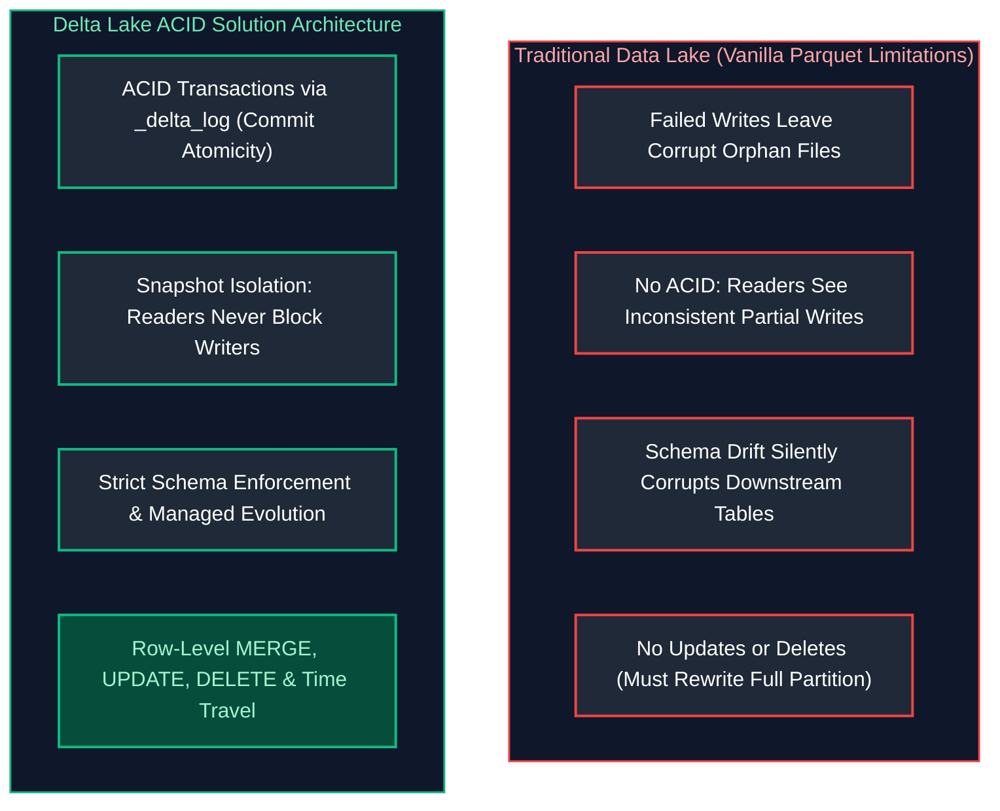
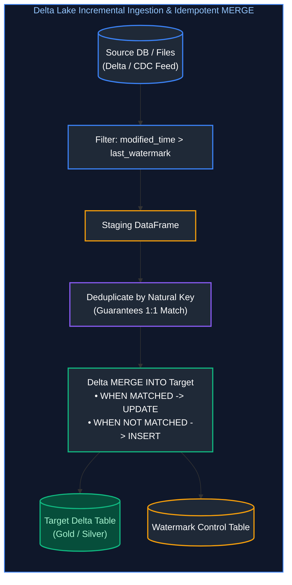
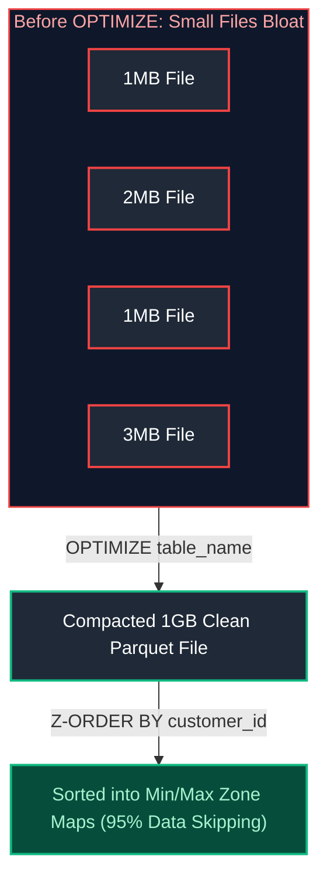
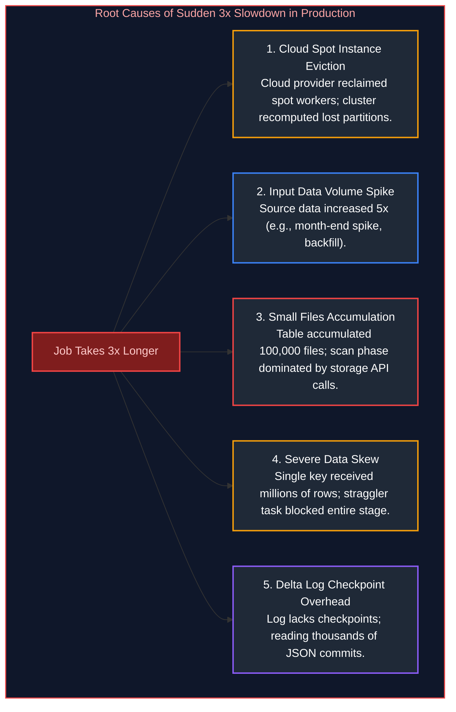
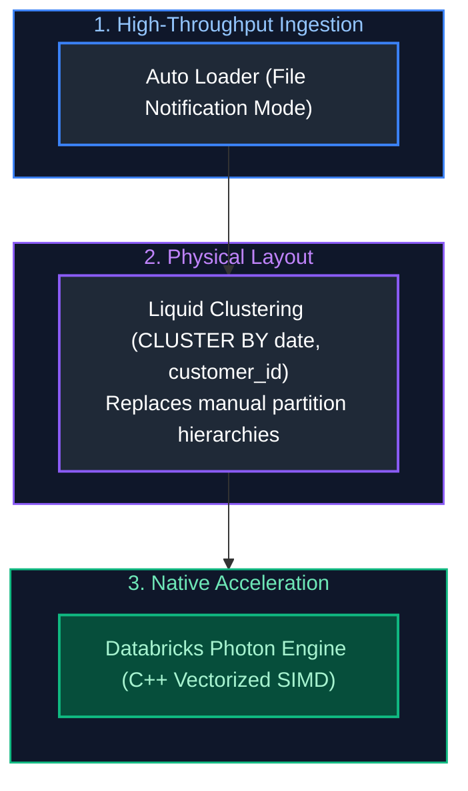

# 06. Databricks & Delta Lake: Interview Questions & Deep-Dive Solutions

A comprehensive, production-grade guide answering Databricks and Delta Lake interview scenarios for Data Engineers. Covers ACID transaction internals, Delta transaction logs, incremental loading, SCD Type 1 & 2, OPTIMIZE and Z-ORDER mechanics, VACUUM, Time Travel disaster recovery, Optimistic Concurrency Control (OCC), Change Data Feed (CDF), and cluster performance debugging.

---

## Table of Contents & Question Mapping

1. **Delta Lake Architecture & ACID Transaction Internals**
   - [Q22. Delta Lake Architecture & ACID Transaction Internals](#q22-delta-lake-architecture--acid-transaction-internals)
2. **Incremental Loading, MERGE Semantics & Multiple-Match Trap**
   - [Q3. When to Use MERGE vs INSERT](#q3-when-to-use-merge-vs-insert)
   - [Q1 & Q2. Incremental Loading Architecture & CDC Ingestion](#q1--q2-incremental-loading-architecture--cdc-ingestion)
   - [Q5. The Multiple-Match MERGE Trap & Resolution](#q5-the-multiple-match-merge-trap--resolution)
3. **Slowly Changing Dimensions (SCD 1 & 2) in Delta Lake**
   - [Q4. Slowly Changing Dimensions (SCD Types 1 & 2) in Delta Lake](#q4-slowly-changing-dimensions-scd-types-1--2-in-delta-lake)
4. **Physical Table Maintenance: OPTIMIZE, Z-ORDER & VACUUM**
   - [Q7. Physical Table Maintenance: OPTIMIZE, Z-ORDER & VACUUM](#q7-physical-table-maintenance-optimize-z-order--vacuum)
   - [Q13, Q15 & Q19. Optimizing Multi-TB Tables with Frequent Mutations & Small Files](#q13-q15--q19-optimizing-multi-tb-tables-with-frequent-mutations--small-files)
5. **Time Travel, Disaster Recovery & Deployment Rollbacks**
   - [Q6. Recovering Deleted or Overwritten Delta Data via Time Travel](#q6-recovering-deleted-or-overwritten-delta-data-via-time-travel)
   - [Q16. Automated Rollback Strategy for Failed Deployments](#q16-automated-rollback-strategy-for-failed-deployments)
6. **Databricks Cluster Architecture & 3x Slowdown Diagnostics**
   - [Q12. Job Clusters vs All-Purpose Clusters](#q12-job-clusters-vs-all-purpose-clusters)
   - [Q8 & Q9. Root-Cause Analysis for 3x Production Job Slowdowns](#q8--q9-root-cause-analysis-for-3x-production-job-slowdowns)
7. **Partial Failure Restartability & Billion-Record Architecture**
   - [Q10. Restarting Failed Jobs Without Reprocessing from Scratch](#q10-restarting-failed-jobs-without-reprocessing-from-scratch)
   - [Q11. Designing Databricks Solutions for Billions of Records](#q11-designing-databricks-solutions-for-billions-of-records)
8. **Data Quality Constraints, Schema Governance & Concurrency**
   - [Q14. Enforcing Data Quality Constraints in Delta Lake](#q14-enforcing-data-quality-constraints-in-delta-lake)
   - [Q21. Schema Enforcement vs Schema Evolution](#q21-schema-enforcement-vs-schema-evolution)
   - [Q20. Delta Lake Change Data Feed (CDF) Implementation](#q20-delta-lake-change-data-feed-cdf-implementation)
   - [Q17. Concurrent Writes & Optimistic Concurrency Control (OCC)](#q17-concurrent-writes--optimistic-concurrency-control-occ)
9. **Production Table Health Monitoring & Governance**
   - [Q18. Monitoring and Maintaining Delta Tables in Production](#q18-monitoring-and-maintaining-delta-tables-in-production)
---

# 1. Delta Lake Architecture & ACID Transaction Internals

---

### Q22. Delta Lake Architecture & ACID Transaction Internals
**Topic Covered:** Open-Source Storage Layer, Parquet Formats & JSON Transaction Logs  
**Question:** What is Delta Lake and what problems does it solve?

#### Core Definition & The Problems Solved
**Delta Lake** is an open-source storage framework that brings **ACID transactions**, data versioning, schema enforcement, and unified streaming/batch processing to Apache Spark and Cloud Object Storage (S3, ADLS, GCS).



#### Under the Hood: Delta Transaction Log (`_delta_log`)
Delta Lake stores raw data as standard compressed Apache Parquet files, but wraps them with an ordered directory of JSON commit files called the **Delta Transaction Log** (`_delta_log/`):
- Every transaction writes a new monotonic commit file: `000000.json`, `000001.json`, `000002.json`.
- At every 10 commits, Delta writes a consolidated **Checkpoint Parquet file** (e.g., `000010.checkpoint.parquet`) caching the entire table state.
- Readers read the latest checkpoint and replay subsequent JSON commits to construct an exact, consistent snapshot of valid data files, ignoring uncommitted or aborted writes.

---

# 2. Incremental Loading, MERGE Semantics & Multiple-Match Trap

---

### Q3. When to Use MERGE vs INSERT
**Topic Covered:** Conditional Mutation Semantics vs Append-Only Ingestion  
**Question:** When would you use MERGE instead of INSERT?

#### When to Use MERGE vs INSERT (Q3)
- **`INSERT`:** Append-only data streams (e.g., clickstreams, immutable server logs, raw bronze events). Extremely fast because it does not inspect existing data.
- **`MERGE`:** Mutable entity datasets (e.g., Customer Master, Order Statuses). Performs an atomic Upsert: updates existing matching records while inserting new records.

---

### Q1 & Q2. Incremental Loading Architecture & CDC Ingestion
**Topic Covered:** Daily High-Watermark Offsets, Change Data Feed & Target Upserts  
**Questions Covered:**
- **Q1**: How would you implement an incremental load using Delta Lake?
- **Q2**: You need to load only changed records from a source into a Delta table every day. How would you design the incremental load?

#### Incremental Load Design Architecture (Q1, Q2)


---

### Q5. The Multiple-Match MERGE Trap & Resolution
**Topic Covered:** Non-Deterministic Mutations & Source Pre-Deduplication  
**Question:** What happens when multiple records match the same MERGE condition?

#### The Multiple-Match MERGE Trap (Q5)
##### What Happens?
If the incoming source dataset contains **duplicate rows for the same join key**, Spark fails with a fatal error:
```
DeltaAnalysisException: Cannot perform MERGE as multiple source rows matched the same target row.
Please ensure that the source data has no duplicates on the merge condition.
```
Delta Lake enforces strict relational consistency: it cannot determine *which* of the conflicting incoming values should overwrite the target row.

##### Production Defensive Resolution
Always deduplicate the incoming source batch on the join key (retaining the latest timestamp) before triggering the `MERGE`:
```python
from delta.tables import DeltaTable
from pyspark.sql import Window, functions as F

target_table = DeltaTable.forName(spark, "silver.customers")

# 1. Deduplicate source records prior to merge
window_spec = Window.partitionBy("customer_id").orderBy(F.col("updated_at").desc())
clean_source_df = (
    incoming_updates_df
    .withColumn("rn", F.row_number().over(window_spec))
    .filter("rn = 1")
    .drop("rn")
)

# 2. Safe MERGE execution
target_table.alias("target").merge(
    clean_source_df.alias("source"),
    "target.customer_id = source.customer_id"
).whenMatchedUpdate(
    condition="source.updated_at > target.updated_at",
    set={
        "name": "source.name",
        "email": "source.email",
        "updated_at": "source.updated_at"
    }
).whenNotMatchedInsertAll().execute()
```

---

# 3. Slowly Changing Dimensions (SCD 1 & 2) in Delta Lake

---

### Q4. Slowly Changing Dimensions (SCD Types 1 & 2) in Delta Lake
**Topic Covered:** Historical Record Tracking & 2-Stage Staging MERGE Architecture  
**Question:** How would you implement SCD Type 1 and Type 2 using Delta Lake?

#### SCD Type 1 (In-Place Overwrite)
```sql
MERGE INTO dim_customer AS tgt
USING staging_customer AS src
ON tgt.customer_id = src.customer_id
WHEN MATCHED THEN
    UPDATE SET tgt.address = src.address, tgt.phone = src.phone, tgt.updated_at = src.updated_at
WHEN NOT MATCHED THEN
    INSERT (customer_id, address, phone, created_at, updated_at)
    VALUES (src.customer_id, src.address, src.phone, src.created_at, src.updated_at);
```

#### SCD Type 2 (Historical Audit Trail)
In Delta Lake, SCD Type 2 is implemented via a **two-pass merge**:
1. Close out the existing current record by updating `is_current = false` and `end_date = src.effective_date`.
2. Insert a new record with `is_current = true`, `start_date = src.effective_date`, and `end_date = '9999-12-31'`.

---

# 4. Physical Table Maintenance: OPTIMIZE, Z-ORDER & VACUUM

---

### Q7. Physical Table Maintenance: OPTIMIZE, Z-ORDER & VACUUM
**Topic Covered:** File Compaction, Multidimensional Clustering & Tombstone Purging  
**Question:** When would you use OPTIMIZE, Z-ORDER, and VACUUM?

#### Deep-Dive Maintenance Matrix
| Operation | Physical Mechanism | Impact on Query Performance | When to Run |
| :--- | :--- | :--- | :--- |
| **`OPTIMIZE`** | Bin-packs thousands of small Parquet files into uniform 1 GB files. | Eliminates filesystem metadata overhead; speeds up scans by $5\times$ to $20\times$. | Daily/weekly or after large ingestion batches. |
| **`Z-ORDER BY (col)`** | Multi-dimensional space-filling curve clustering. Colocates related column data in the same files. | Maximizes **Data Skipping via Min/Max Zone Maps**. Allows queries filtering on clustered columns to skip 90%+ of files. | After `OPTIMIZE` on high-cardinality query filter columns. |
| **`VACUUM`** | Deletes tombstoned physical Parquet files older than the retention threshold (default 7 days). | Frees petabytes of cloud storage; cleans up stale metadata. | Scheduled weekly maintenance (never set retention to 0 hours in production!). |



---

### Q13, Q15 & Q19. Optimizing Multi-TB Tables with Frequent Mutations & Small Files
**Topic Covered:** Deletion Vectors, Target File Sizing & Automated Maintenance  
**Questions Covered:**
- **Q13**: A Delta table has grown to several TB and queries are becoming slow. How would you optimize it?
- **Q15**: A Delta table has frequent UPDATE and DELETE operations and is becoming slow. How would you optimize the table?
- **Q19**: A Delta table contains thousands of small files and query performance has degraded. How would you optimize it?

#### Production Maintenance Script for Multi-TB Slow Tables (Q13, Q15)
Tables experiencing heavy row-level updates accumulate millions of tombstoned obsolete Parquet files.
```sql
-- Step 1: Compact small files and apply Z-Ordering
OPTIMIZE silver.orders
Z-ORDER BY (customer_id, order_date);

-- Step 2: Purge obsolete tombstoned files older than 7 days
VACUUM silver.orders RETAIN 168 HOURS; -- 7 days

-- Step 3: Compute detailed table statistics for Catalyst
ANALYZE TABLE silver.orders COMPUTE STATISTICS FOR ALL COLUMNS;
```

---

# 5. Time Travel, Disaster Recovery & Deployment Rollbacks

---

### Q6. Recovering Deleted or Overwritten Delta Data via Time Travel
**Topic Covered:** Timestamp & Version Time Travel Restoration  
**Question:** How would you recover accidentally deleted, overwritten, or modified Delta data (e.g. last 3 days)?

#### Time Travel Mechanics
Because Delta Lake's transaction log never deletes old files until `VACUUM` runs, the table preserves a complete historical timeline.

#### Recovering Accidentally Deleted Data (Q6)
```sql
-- Step 1: Inspect transaction history to identify the bad commit
DESCRIBE HISTORY silver.customers;

-- Step 2: Query the exact state from 3 days ago or specific version
SELECT * FROM silver.customers TIMESTAMP AS OF '2024-10-02 12:00:00';
SELECT * FROM silver.customers VERSION AS OF 142;

-- Step 3: Instant Disaster Recovery: Rollback the table state in 1 second!
RESTORE TABLE silver.customers TO TIMESTAMP AS OF '2024-10-02 12:00:00';
```

---

### Q16. Automated Rollback Strategy for Failed Deployments
**Topic Covered:** Atomic Commit Rollbacks & Production Table Restoration  
**Question:** How would you implement a rollback strategy for a failed Delta Lake deployment?

#### Automated Rollback Strategy for Failed Deployments (Q16)
1. **Pre-Deployment Anchor:** Capture the latest Delta commit version prior to running pipeline transformations:
   ```python
   pre_deploy_version = spark.sql("DESCRIBE HISTORY gold.finance").select("version").first()[0]
   ```
2. **Automated Assertion Gate:** Execute automated data quality tests against the new data (e.g., Great Expectations / Soda).
3. **Automated Rollback Hook:** If validation tests fail:
   ```python
   try:
       run_pipeline_transformation()
       validate_data_quality()
   except DataQualityFailure:
       spark.sql(f"RESTORE TABLE gold.finance TO VERSION AS OF {pre_deploy_version}")
       alert_oncall_engineer("Pipeline failed validation; rolled back automatically.")
   ```

---

# 6. Databricks Cluster Architecture & 3x Slowdown Diagnostics

---

### Q12. Job Clusters vs All-Purpose Clusters
**Topic Covered:** Ephemeral Isolated Clusters vs Shared Interactive Workspaces  
**Question:** When would you use a Job Cluster vs an All-Purpose Cluster?

#### Job Cluster vs All-Purpose Cluster Comparison (Q12)
| Dimension | All-Purpose Cluster | Job Cluster (Automated) |
| :--- | :--- | :--- |
| **Purpose** | Interactive ad-hoc analysis, exploratory notebook development. | Automated production workflows (scheduled ADF/Airflow tasks). |
| **Lifecycle** | Remains active until manually stopped or auto-termination timer fires. | Spawns automatically when job starts; terminates immediately when job finishes. |
| **Cost (DBUs)** | Standard DBU rate (**$3\times$ to $4\times$ more expensive**). | Discounted Automated DBU rate (**60–75% cheaper**). |
| **State Isolation** | Shared across developers; risk of state corruption and memory leaks. | Dedicated, clean isolated JVM environment per job execution. |

---

### Q8 & Q9. Root-Cause Analysis for 3x Production Job Slowdowns
**Topic Covered:** Production Cluster Contention, Spark UI Bottleneck Isolation & Data Drift  
**Questions Covered:**
- **Q8**: A Databricks job suddenly starts taking 3× longer than usual. What would you investigate?
- **Q9**: You notice a DataBricks job that runs fine in dev but takes 3× longer in production — how do you debug this?

#### Systematic Root-Cause Analysis: 3x Slowdown in Production (Q8, Q9)


---

# 7. Partial Failure Restartability & Billion-Record Architecture

---

### Q10. Restarting Failed Jobs Without Reprocessing from Scratch
**Topic Covered:** Checkpoint Directories, Idempotent Partitions & Atomic Batch Tracking  
**Question:** A production job fails after processing 80% of the data. How would you restart it without processing everything again?

#### Restarting Without Reprocessing from Scratch (Q10)
1. **Partition-Level Granularity:** Design the ingestion to process and commit at partitioned boundaries (e.g., date-by-date or file-by-file micro-batches).
2. **Delta Lake Idempotent MERGE:** Because `MERGE` is idempotent, re-running the job over the full batch updates already-processed records safely without creating duplicates.
3. **High-Watermark Staging:** Write processed records to a temporary staging Delta table with partition flags. Downstream consumers read only marked batches.

---

### Q11. Designing Databricks Solutions for Billions of Records
**Topic Covered:** High-Scale Data Modeling, Auto Loader, Liquid Clustering & Photon Engine  
**Question:** How would you design a Databricks solution for billions of records?

#### Designing for Billions of Records (Q11)


---

# 8. Data Quality Constraints, Schema Governance & Concurrency

---

### Q14. Enforcing Data Quality Constraints in Delta Lake
**Topic Covered:** CHECK Constraints, NOT NULL Enforcement & Quarantine Logic  
**Question:** How would you implement data quality checks before writing data into a Delta table?

#### Data Quality Constraints in Delta Lake (Q14)
Delta Lake supports database-level constraints that reject invalid writes atomically:
```sql
-- Enforce non-null and value bounds
ALTER TABLE silver.orders ADD CONSTRAINT check_valid_amount CHECK (order_amount > 0);
ALTER TABLE silver.orders ADD CONSTRAINT check_valid_date CHECK (order_date >= '2020-01-01');
```

---

### Q21. Schema Enforcement vs Schema Evolution
**Topic Covered:** AnalysisException Protection vs mergeSchema Options  
**Question:** A source schema changes unexpectedly during a Delta load. How would you handle schema enforcement versus schema evolution?

#### Schema Enforcement vs Schema Evolution (Q21)
- **Schema Enforcement (Default):** Rejects any write containing columns not present in the target Delta table. Prevents silent table corruption.
- **Schema Evolution (`mergeSchema`):** Automatically adds new columns to the target schema when present in the incoming DataFrame:
```python
df_with_new_col.write.format("delta") \
    .mode("append") \
    .option("mergeSchema", "true") \
    .saveAsTable("silver.customers")
```

---

### Q20. Delta Lake Change Data Feed (CDF) Implementation
**Topic Covered:** Row-Level Change Auditing, _change_type & Downstream Propagation  
**Question:** How would you use Delta Lake Change Data Feed (CDF) to capture INSERT, UPDATE, and DELETE changes?

#### Change Data Feed (CDF) Implementation (Q20)
CDF enables capturing row-level row modifications:
```sql
-- 1. Enable CDF on the table
ALTER TABLE silver.customers SET TBLPROPERTIES (delta.enableChangeDataFeed = true);

-- 2. Query change feed between versions
SELECT customer_id, name, _change_type, _commit_version, _commit_timestamp
FROM table_changes('silver.customers', 2, 5);
-- Output _change_type: 'insert', 'update_preimage', 'update_postimage', 'delete'
```

---

### Q17. Concurrent Writes & Optimistic Concurrency Control (OCC)
**Topic Covered:** ConcurrentAppendException, Mutually Exclusive Partition Predicates  
**Question:** How would you handle concurrent writes to the same Delta table?

#### Concurrent Writes & Optimistic Concurrency Control (OCC) (Q17)
Delta Lake uses **Optimistic Concurrency Control (OCC)**:
1. Two transactions read the table snapshot simultaneously.
2. The first transaction commits successfully.
3. The second transaction verifies if files it modified were touched by the first. If mutually exclusive partitions/files were touched, both succeed. If the exact same files were touched, a `ConcurrentAppendException` is thrown.
4. **Resolution:** Partition table logically or isolate batch updates by partition keys so concurrent writers touch distinct directories.

---

# 9. Production Table Health Monitoring & Governance

---

### Q18. Monitoring and Maintaining Delta Tables in Production
**Topic Covered:** DESCRIBE DETAIL/HISTORY, Automated Databricks Workflows & Telemetry  
**Question:** How would you monitor and maintain Delta tables in a production environment?

#### Production Maintenance Blueprint
1. **Automated Weekly Maintenance Job:**
   - Execute `OPTIMIZE` followed by `VACUUM` every Sunday morning.
2. **Metadata Inspection:**
   ```sql
   DESCRIBE DETAIL silver.orders; -- Inspects numFiles, sizeInBytes, partitionColumns
   DESCRIBE HISTORY silver.orders; -- Inspects operations, user identity, execution metrics
   ```
3. **Databricks Lakehouse Monitoring & System Tables:**
   - Query `system.billing.usage` to audit cluster costs.
   - Query `system.access.audit` to detect unauthorized data access.
