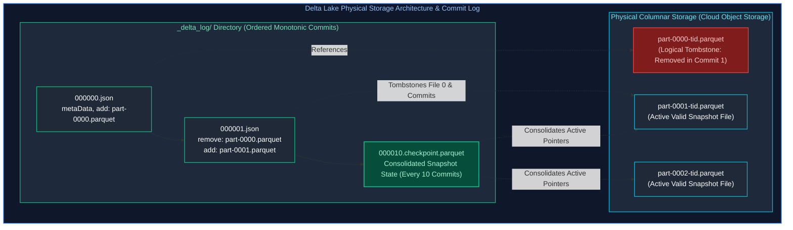
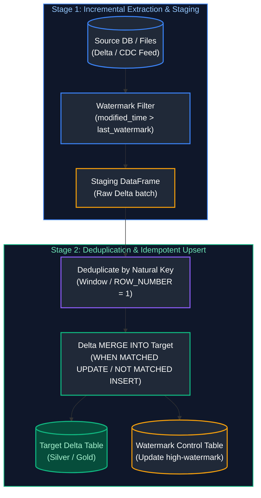
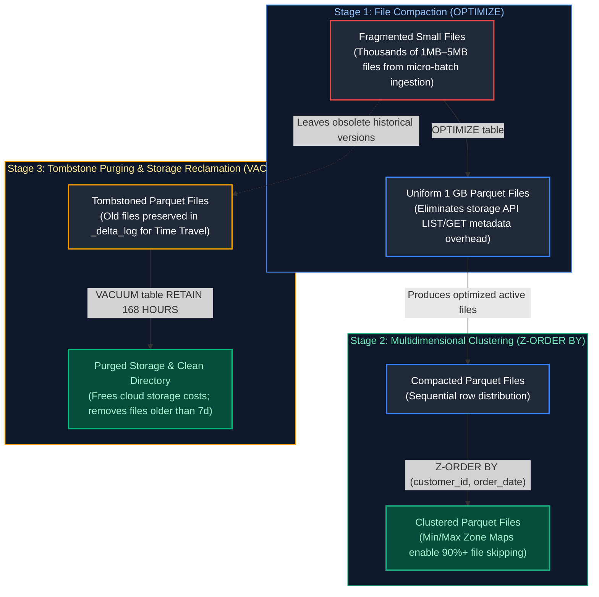
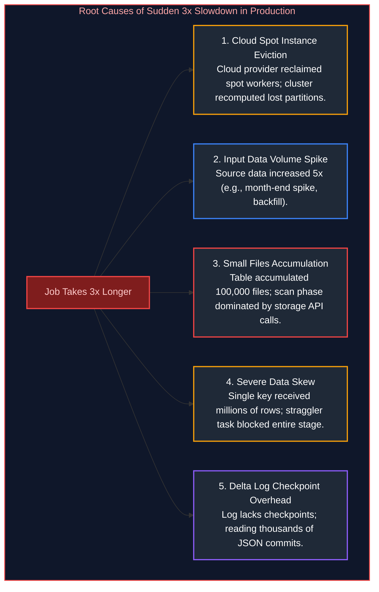
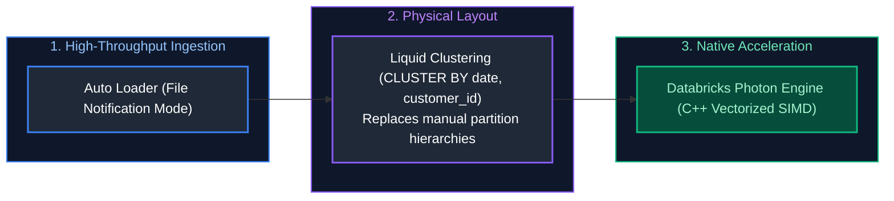
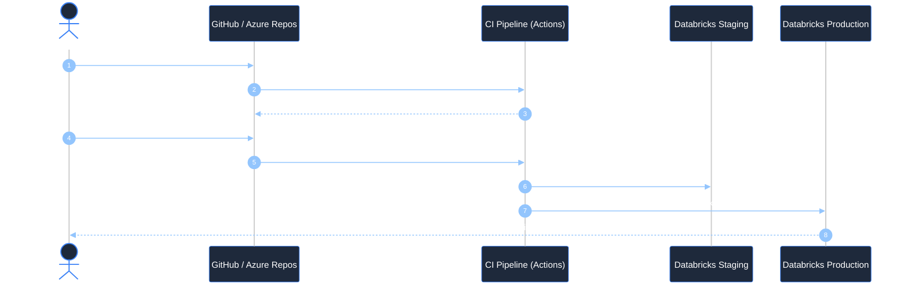
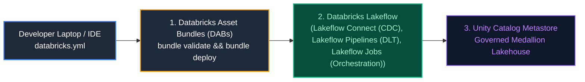
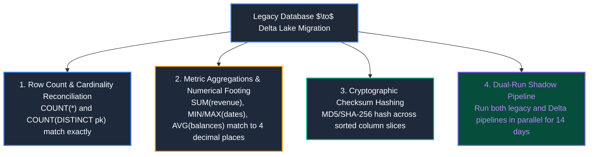

```mermaid
flowchart TD
    subgraph ProblemArea ["The ADLS Small File Bottleneck"]
        ADLS["ADLS Gen2 Raw Folder<br/>(Millions of 500KB JSON/Parquet Files)"]
        Glob["Driver Globbing: ListBlobs API Calls<br/>(HTTP 429 Throttling + Driver OOM)"]
        Tasks["Millions of Micro-Tasks<br/>(Scheduler RPC Congestion)"]
        ADLS --> Glob --> Tasks
    end

    subgraph SolutionArchitecture ["Databricks Remediation Pipeline"]
        AL["1. Ingest via Auto Loader (cloudFiles)<br/>Uses Azure Event Grid + Storage Queue<br/>Zero File Listing!"]
        Conv["2. In-Place Conversion<br/>CONVERT TO DELTA parquet.`abfss://...`"]
        Opt["3. Scheduled Compaction<br/>OPTIMIZE table<br/>Bin-packs into 1 GB Parquet files"]
        WriteOpt["4. Prevent Recurrence<br/>Set autoCompact & optimizeWrite = true"]
        AL --> Conv --> Opt --> WriteOpt
    end

    style ProblemArea fill:#7f1d1d,stroke:#ef4444,stroke-width:1.5px,color:#fca5a5
    style SolutionArchitecture fill:#0f172a,stroke:#10b981,stroke-width:1.5px,color:#6ee7b7
    style Opt fill:#064e3b,stroke:#10b981,stroke-width:2px,color:#a7f3d0
    style AL fill:#1f2937,stroke:#3b82f6,stroke-width:2px,color:#fff
```

# 06. Databricks & Delta Lake: Interview Questions & Deep-Dive Solutions

A comprehensive, production-grade guide answering Databricks and Delta Lake interview scenarios for Data Engineers. Covers ACID transaction internals, Delta transaction logs, incremental loading, SCD Type 1 & 2, OPTIMIZE and Z-ORDER mechanics, VACUUM, Time Travel disaster recovery, Optimistic Concurrency Control (OCC), Change Data Feed (CDF), and cluster performance debugging.

---

## Table of Contents & Question Mapping

1. **Delta Lake Architecture & ACID Transaction Internals**
   - [Q22. Delta Lake Architecture & ACID Transaction Internals](#q22-delta-lake-architecture--acid-transaction-internals)
2. **Incremental Loading, MERGE Semantics & Multiple-Match Trap**
   - [Q3. When to Use MERGE vs INSERT](#q3-when-to-use-merge-vs-insert)
   - [Q1 & Q2. Incremental Loading Architecture & CDC Ingestion](#q1--q2-incremental-loading-architecture--cdc-ingestion)
   - [Q5. The Multiple-Match MERGE Trap & Resolution](#q5-the-multiple-match-merge-trap--resolution)
3. **Slowly Changing Dimensions (SCD 1 & 2) in Delta Lake**
   - [Q4. Slowly Changing Dimensions (SCD Types 1 & 2) in Delta Lake](#q4-slowly-changing-dimensions-scd-types-1--2-in-delta-lake)
4. **Physical Table Maintenance: OPTIMIZE, Z-ORDER & VACUUM**
   - [Q7. Physical Table Maintenance: OPTIMIZE, Z-ORDER & VACUUM](#q7-physical-table-maintenance-optimize-z-order--vacuum)
   - [Q13, Q15 & Q19. Optimizing Multi-TB Tables with Frequent Mutations & Small Files](#q13-q15--q19-optimizing-multi-tb-tables-with-frequent-mutations--small-files)
   - [Q23. Millions of Small Files in ADLS: Root Causes & Resolution in Databricks](#q23-millions-of-small-files-in-adls-root-causes--resolution-in-databricks)
   - [Q24. Partitioning Strategy & Liquid Clustering in Azure Databricks](#q24-partitioning-strategy--liquid-clustering-in-azure-databricks)
5. **Time Travel, Disaster Recovery & Deployment Rollbacks**
   - [Q6. Recovering Deleted or Overwritten Delta Data via Time Travel](#q6-recovering-deleted-or-overwritten-delta-data-via-time-travel)
   - [Q16. Automated Rollback Strategy for Failed Deployments](#q16-automated-rollback-strategy-for-failed-deployments)
6. **Databricks Cluster Architecture & 3x Slowdown Diagnostics**
   - [Q12. Job Clusters vs All-Purpose Clusters](#q12-job-clusters-vs-all-purpose-clusters)
   - [Q8 & Q9. Root-Cause Analysis for 3x Production Job Slowdowns](#q8--q9-root-cause-analysis-for-3x-production-job-slowdowns)
7. **Partial Failure Restartability & Billion-Record Architecture**
   - [Q10. Restarting Failed Jobs Without Reprocessing from Scratch](#q10-restarting-failed-jobs-without-reprocessing-from-scratch)
   - [Q11. Designing Databricks Solutions for Billions of Records](#q11-designing-databricks-solutions-for-billions-of-records)
8. **Data Quality Constraints, Schema Governance & Concurrency**
   - [Q14. Enforcing Data Quality Constraints in Delta Lake](#q14-enforcing-data-quality-constraints-in-delta-lake)
   - [Q21. Schema Enforcement vs Schema Evolution](#q21-schema-enforcement-vs-schema-evolution)
   - [Q20. Delta Lake Change Data Feed (CDF) Implementation](#q20-delta-lake-change-data-feed-cdf-implementation)
   - [Q17. Concurrent Writes & Optimistic Concurrency Control (OCC)](#q17-concurrent-writes--optimistic-concurrency-control-occ)
9. **Production Table Health Monitoring & Governance**
   - [Q18. Monitoring and Maintaining Delta Tables in Production](#q18-monitoring-and-maintaining-delta-tables-in-production)
10. **Enterprise Platform Engineering: Multi-Tenancy, CI/CD & Secret Security**
    - [Designing a Multi-Tenant Lakehouse Platform on Databricks](#designing-a-multi-tenant-lakehouse-platform-on-databricks)
    - [Enterprise CI/CD for Databricks Asset Bundles (DABs) & Repos](#enterprise-cicd-for-databricks-asset-bundles-dabs--repos)
    - [Databricks Secret Scopes & Azure Key Vault Integration](#databricks-secret-scopes--azure-key-vault-integration)
    - [Multi-Terabyte Table Performance Optimization Strategy](#multi-terabyte-table-performance-optimization-strategy)
11. **Modern Lakehouse Ingestion & Infrastructure as Code**
    - [Q25. Databricks Lakeflow Architecture & Databricks Asset Bundles (DABs)](#q25-databricks-lakeflow-architecture--databricks-asset-bundles-dabs)
    - [Q26. Catalog Table Referencing vs Direct File Path Ingestion in Delta Lake](#q26-catalog-table-referencing-vs-direct-file-path-ingestion-in-delta-lake)
12. **Migration Reconciliation, Dashboard Tuning & Parquet Snapshots**
    - [Q27. Source-to-Target Data Validation Framework for Delta Lake Migrations](#q27-source-to-target-data-validation-framework-for-delta-lake-migrations)
    - [Q28. Diagnosing and Tuning Gold-Layer Delta Table Dashboard Performance](#q28-diagnosing-and-tuning-gold-layer-delta-table-dashboard-performance)
    - [Q29. Manual Versioning & Snapshots in Parquet vs Delta ACID Transaction Logs](#q29-manual-versioning--snapshots-in-parquet-vs-delta-acid-transaction-logs)
---

# 1. Delta Lake Architecture & ACID Transaction Internals

---

### Q22. Delta Lake Architecture & ACID Transaction Internals
*(Grouped together: Delta Lake core architecture, Parquet/transaction log underpinnings, reliability advantages, and lakehouse problem solving)*  
**Topic Covered:** Open-Source Storage Layer, Parquet Formats & JSON Transaction Logs  
**Questions Covered:**
- What is Delta Lake, and what are its advantages?
- Explain the architecture of Delta Lake and how it solves data lake reliability challenges.
- What is Delta Lake and what problems does it solve?

#### Core Definition & The Problems Solved
**Delta Lake** is an open-source storage framework that brings **ACID transactions**, data versioning, schema enforcement, and unified streaming/batch processing to Apache Spark and Cloud Object Storage (S3, ADLS, GCS).



#### Vanilla Parquet Limitations vs. Delta Lake ACID Solutions

| Vanilla Parquet Failure Mode | Delta Lake ACID Architecture Solution | Underlying Storage Mechanism |
| :--- | :--- | :--- |
| **Partial Write Failures / Orphans** | **Atomic All-or-Nothing Commits** | Parquet files written by failed tasks are never appended to `_delta_log/*.json`; readers ignore uncommitted files. |
| **Inconsistent Concurrent Reads** | **Snapshot Isolation (MVCC)** | Readers read table state as of a specific commit; writers generate new versions without locking readers. |
| **Schema Drift & Silent Corruption** | **Schema Enforcement & Evolution** | Incoming DataFrame schema is strictly validated against table metadata; mismatches throw `AnalysisException` unless `mergeSchema=true`. |
| **Costly Deletes & Updates** | **Row-Level ACID MERGE / Tombstones** | Rewrites only affected files; records atomic `remove` and `add` actions in the commit log without rewriting untouched partitions. |

#### Under the Hood: Delta Transaction Log (`_delta_log`)
Delta Lake stores raw data as standard compressed Apache Parquet files, but wraps them with an ordered directory of JSON commit files called the **Delta Transaction Log** (`_delta_log/`):
- Every transaction writes a new monotonic commit file: `000000.json`, `000001.json`, `000002.json`.
- At every 10 commits, Delta writes a consolidated **Checkpoint Parquet file** (e.g., `000010.checkpoint.parquet`) caching the entire table state.
- Readers read the latest checkpoint and replay subsequent JSON commits to construct an exact, consistent snapshot of valid data files, ignoring uncommitted or aborted writes.

---

# 2. Incremental Loading, MERGE Semantics & Multiple-Match Trap

---

### Q3. When to Use MERGE vs INSERT
**Topic Covered:** Conditional Mutation Semantics vs Append-Only Ingestion  
**Question:** When would you use MERGE instead of INSERT?

#### When to Use MERGE vs INSERT (Q3)
- **`INSERT`:** Append-only data streams (e.g., clickstreams, immutable server logs, raw bronze events). Extremely fast because it does not inspect existing data.
- **`MERGE`:** Mutable entity datasets (e.g., Customer Master, Order Statuses). Performs an atomic Upsert: updates existing matching records while inserting new records.

---

### Q1 & Q2. Incremental Loading Architecture & CDC Ingestion
**Topic Covered:** Daily High-Watermark Offsets, Change Data Feed & Target Upserts  
**Questions Covered:**
- **Q1**: How would you implement an incremental load using Delta Lake?
- **Q2**: You need to load only changed records from a source into a Delta table every day. How would you design the incremental load?

#### Incremental Load Design Architecture (Q1, Q2)


---

### Q5. The Multiple-Match MERGE Trap & Resolution
**Topic Covered:** Non-Deterministic Mutations & Source Pre-Deduplication  
**Question:** What happens when multiple records match the same MERGE condition?

#### The Multiple-Match MERGE Trap (Q5)
##### What Happens?
If the incoming source dataset contains **duplicate rows for the same join key**, Spark fails with a fatal error:
```
DeltaAnalysisException: Cannot perform MERGE as multiple source rows matched the same target row.
Please ensure that the source data has no duplicates on the merge condition.
```
Delta Lake enforces strict relational consistency: it cannot determine *which* of the conflicting incoming values should overwrite the target row.

##### Production Defensive Resolution
Always deduplicate the incoming source batch on the join key (retaining the latest timestamp) before triggering the `MERGE`:
```python
from delta.tables import DeltaTable
from pyspark.sql import Window, functions as F

target_table = DeltaTable.forName(spark, "silver.customers")

# 1. Deduplicate source records prior to merge
window_spec = Window.partitionBy("customer_id").orderBy(F.col("updated_at").desc())
clean_source_df = (
    incoming_updates_df
    .withColumn("rn", F.row_number().over(window_spec))
    .filter("rn = 1")
    .drop("rn")
)

# 2. Safe MERGE execution
target_table.alias("target").merge(
    clean_source_df.alias("source"),
    "target.customer_id = source.customer_id"
).whenMatchedUpdate(
    condition="source.updated_at > target.updated_at",
    set={
        "name": "source.name",
        "email": "source.email",
        "updated_at": "source.updated_at"
    }
).whenNotMatchedInsertAll().execute()
```

---

# 3. Slowly Changing Dimensions (SCD 1 & 2) in Delta Lake

---

### Q4. Slowly Changing Dimensions (SCD Types 1 & 2) in Delta Lake
*(Grouped together: Dimension mutation patterns, in-place overwrites, and historical audit tracking)*  
**Topic Covered:** Historical Record Tracking & 2-Stage Staging MERGE Architecture  
**Questions Covered:**
- How would you implement Slowly Changing Dimensions (SCD Type 2) using Delta Lake?
- How would you implement SCD Type 1 and Type 2 using Delta Lake?

#### SCD Type 1 (In-Place Overwrite)
```sql
MERGE INTO dim_customer AS tgt
USING staging_customer AS src
ON tgt.customer_id = src.customer_id
WHEN MATCHED THEN
    UPDATE SET tgt.address = src.address, tgt.phone = src.phone, tgt.updated_at = src.updated_at
WHEN NOT MATCHED THEN
    INSERT (customer_id, address, phone, created_at, updated_at)
    VALUES (src.customer_id, src.address, src.phone, src.created_at, src.updated_at);
```

#### SCD Type 2 (Historical Audit Trail)
In Delta Lake, SCD Type 2 is implemented via a **two-pass merge**:
1. Close out the existing current record by updating `is_current = false` and `end_date = src.effective_date`.
2. Insert a new record with `is_current = true`, `start_date = src.effective_date`, and `end_date = '9999-12-31'`.

---

# 4. Physical Table Maintenance: OPTIMIZE, Z-ORDER & VACUUM

---

### Q7. Physical Table Maintenance: OPTIMIZE, Z-ORDER & VACUUM
*(Grouped together: Delta Lake file compaction, multidimensional clustering, and tombstone purging)*  
**Topic Covered:** File Compaction, Multidimensional Clustering & Tombstone Purging  
**Questions Covered:**
- Explain the purpose of the OPTIMIZE and VACUUM commands in Delta Lake.
- When would you use OPTIMIZE, Z-ORDER, and VACUUM?

#### Deep-Dive Maintenance Matrix
| Operation | Physical Mechanism | Impact on Query Performance | When to Run |
| :--- | :--- | :--- | :--- |
| **`OPTIMIZE`** | Bin-packs thousands of small Parquet files into uniform 1 GB files. | Eliminates filesystem metadata overhead; speeds up scans by $5\times$ to $20\times$. | Daily/weekly or after large ingestion batches. |
| **`Z-ORDER BY (col)`** | Multi-dimensional space-filling curve clustering. Colocates related column data in the same files. | Maximizes **Data Skipping via Min/Max Zone Maps**. Allows queries filtering on clustered columns to skip 90%+ of files. | After `OPTIMIZE` on high-cardinality query filter columns. |
| **`VACUUM`** | Deletes tombstoned physical Parquet files older than the retention threshold (default 7 days). | Frees petabytes of cloud storage; cleans up stale metadata. | Scheduled weekly maintenance (never set retention to 0 hours in production!). |



---

### Q13, Q15 & Q19. Optimizing Multi-TB Tables with Frequent Mutations & Small Files
**Topic Covered:** Deletion Vectors, Target File Sizing & Automated Maintenance  
**Questions Covered:**
- **Q13**: A Delta table has grown to several TB and queries are becoming slow. How would you optimize it?
- **Q15**: A Delta table has frequent UPDATE and DELETE operations and is becoming slow. How would you optimize the table?
- **Q19**: A Delta table contains thousands of small files and query performance has degraded. How would you optimize it?

#### Production Maintenance Script for Multi-TB Slow Tables (Q13, Q15)
Tables experiencing heavy row-level updates accumulate millions of tombstoned obsolete Parquet files.
```sql
-- Step 1: Compact small files and apply Z-Ordering
OPTIMIZE silver.orders
Z-ORDER BY (customer_id, order_date);

-- Step 2: Purge obsolete tombstoned files older than 7 days
VACUUM silver.orders RETAIN 168 HOURS; -- 7 days

-- Step 3: Compute detailed table statistics for Catalyst
ANALYZE TABLE silver.orders COMPUTE STATISTICS FOR ALL COLUMNS;
```

---

### Q23. Millions of Small Files in ADLS: Root Causes & Resolution in Databricks
**Topic Covered:** ADLS Gen2 Metadata Bottlenecks, Rate Throttling, Auto Loader, CONVERT TO DELTA & Compaction  
**Question:** Your ADLS folder contains millions of small files. What problems can this cause in Databricks, and how would you solve them?

#### Definition & Core Concepts
When an ADLS Gen2 folder accumulates millions of small files (e.g. <10 MB from IoT streams or un-compacted batch writes), processing within Databricks degrades severely:
1. **ADLS Gen2 Storage Driver Throttling (HTTP 429):** ADLS limits metadata operations (`ListBlobs`, `GetFileStatus`) to a fixed rate per storage account. Recursive path globbing causes repeated API calls, resulting in `StorageException: Server busy (429)`.
2. **Driver JVM Heap Exhaustion (OOM):** The Spark driver must fetch metadata (file paths, block locations, lengths) for every single file before distributing tasks. For 10 million files, this metadata requires several gigabytes of JVM heap, triggering driver OutOfMemoryError.
3. **Task Scheduling Overhead Dwarfs Compute:** Default input partition sizing (`spark.sql.files.maxPartitionBytes = 128MB`) assigns each small file to an individual task. Generating and dispatching millions of tasks creates massive RPC overhead in the scheduler where scheduling latency (50–100ms per task) far exceeds execution time (1–2ms).
4. **Storage Space Amplification & Footer Overhead:** Parquet file footers, metadata dictionaries, and compression headers occupy a disproportionate percentage of total bytes in tiny files.

#### Visual Flow


#### Production Implementation / Code Solution
```python
from pyspark.sql import SparkSession

spark = SparkSession.builder.appName("ADLSSmallFileResolution").getOrCreate()

# -------------------------------------------------------------------------
# Phase 1: Ingest Ongoing Streams Without Directory Listing (Auto Loader)
# -------------------------------------------------------------------------
# Uses Azure Event Grid + Storage Queue notifications instead of recursive scanning
raw_stream_df = (
    spark.readStream
    .format("cloudFiles")
    .option("cloudFiles.format", "parquet")
    .option("cloudFiles.useNotifications", "true")  # Bypasses ADLS ListBlobs
    .option("cloudFiles.schemaLocation", "abfss://checkpoints@datalakeprod.dfs.core.windows.net/orders_schema")
    .load("abfss://raw@datalakeprod.dfs.core.windows.net/incoming_orders/")
)

# -------------------------------------------------------------------------
# Phase 2: In-Place Conversion of Existing Historical Raw Parquet Files
# -------------------------------------------------------------------------
# Indexes existing physical files into Delta log without data movement
spark.sql("""
    CONVERT TO DELTA parquet.`abfss://raw@datalakeprod.dfs.core.windows.net/historical_landing/`
    NO CHECKPOINTS;
""")

# -------------------------------------------------------------------------
# Phase 3: Bin-Pack Small Files into Uniform 1 GB Parquet Files
# -------------------------------------------------------------------------
# Set target file size to 1 GB (1,073,741,824 bytes)
spark.sql("ALTER TABLE bronze.orders SET TBLPROPERTIES ('delta.targetFileSize' = '1073741824');")
spark.sql("OPTIMIZE bronze.orders;")

# -------------------------------------------------------------------------
# Phase 4: Configure Write-Time Auto-Compaction to Prevent Recurrence
# -------------------------------------------------------------------------
spark.conf.set("spark.databricks.delta.optimizeWrite.enabled", "true")
spark.conf.set("spark.databricks.delta.autoCompact.enabled", "true")
```
- **Time Complexity:** $O(N)$ one-time bin-pack rewrite; $O(1)$ event-driven arrival latency for ongoing stream.
- **Space Complexity:** $O(1)$ stream state memory.

#### Engineering Implications & Production Pitfalls
1. **The Dangerous `VACUUM RETAIN 0 HOURS` Trap:** When dealing with millions of small files, engineers frequently attempt to run `VACUUM table RETAIN 0 HOURS;` immediately after `OPTIMIZE` to reclaim disk space. This breaks active concurrent reader snapshots with `FileNotFoundException` and requires overriding safety checks (`SET spark.databricks.delta.vacuum.parallelDelete.enabled = true`). Never drop retention below 168 hours (7 days) without offline downtime.
2. **Interview Talking Point:** Emphasize that Databricks Auto Loader (`cloudFiles`) solves the cloud listing scalability limit at ingestion by delegating discovery to Azure Event Grid webhooks and Queue Storage, reducing ingestion latency from hours to seconds.

---

### Q24. Partitioning Strategy & Liquid Clustering in Azure Databricks
**Topic Covered:** Partition Column Selection, High vs Low Cardinality, Liquid Clustering vs Hive Partitioning  
**Question:** Explain partitioning in Azure Databricks. How do you decide the appropriate partition column?

#### Definition & Core Concepts
Partitioning physically separates a table's data into separate directories based on column values. In modern Azure Databricks, choosing a partitioning strategy requires evaluating data volume, query patterns, and architectural evolution:

1. **Volume Heuristic (The 1 GB Rule):**
   - A partition should contain **at least 1 GB of compressed data**.
   - If a table has only 50 GB total data, creating 365 daily partitions produces ~140 MB per partition, leading directly to the small file problem. Do not partition tables under 500 GB–1 TB.
2. **Cardinality Selection:**
   - **Good Candidates:** Low-to-medium cardinality columns (between 10 and 1,000 distinct values, e.g. `order_date`, `region_code`, `business_unit`).
   - **Severe Anti-Patterns:** High-cardinality columns (e.g. `customer_id`, `device_id`, `timestamp` with millions of unique values creates millions of directories), or boolean/binary columns (`is_active` creates severe data skew into 2 gigantic directories).
3. **Query Filter Alignment:**
   - Partitioning is only valuable if downstream queries consistently filter on that column in their `WHERE` predicates, allowing the Catalyst optimizer to perform **Static and Dynamic Partition Pruning**.
4. **Modern Paradigm Shift: Liquid Clustering (`CLUSTER BY`):**
   - Available in Databricks Runtime 13.3+ (Delta 3.0+), **Liquid Clustering** obsoletes rigid Hive-style directory partitioning.
   - Liquid Clustering clusters data dynamically inside Delta files using a multidimensional space-filling Hilbert curve without creating physical directory hierarchies.
   - Allows clustering on high-cardinality columns (`customer_id`), prevents partition skew, allows redefining clustering keys (`ALTER TABLE ... CLUSTER BY ...`) without full table rewrites, and enables incremental clustering during normal writes.

#### Visual Flow
```mermaid
flowchart TD
    Start["New Delta Table Design"] --> SizeCheck{"Total Table Volume?"}
    SizeCheck -->|< 500 GB| NoPartition["Do NOT Partition<br/>Rely on standard Delta file sizing + Min/Max Data Skipping"]
    SizeCheck -->|>= 500 GB - Multi-TB| WorkloadCheck{"Databricks Runtime Version?"}
    
    WorkloadCheck -->|DBR >= 13.3| Liquid["Use Liquid Clustering:<br/>CREATE TABLE ... CLUSTER BY (date, customer_id)<br/>Flexible, supports high-cardinality, no directory skew"]
    WorkloadCheck -->|Legacy DBR / Hive Engine| CardCheck{"Candidate Column Cardinality?"}
    
    CardCheck -->|High: >1,000 values (e.g. user_id)| Reject["REJECT: Will create millions of directories<br/>Use Z-ORDER instead"]
    CardCheck -->|Tiny: 2-5 values (e.g. status)| RejectSkew["REJECT: Causes massive partition skew"]
    CardCheck -->|Moderate: 10 - 1,000 values<br/>(e.g. year_month, region)| AcceptHive["Accept Hive Partition:<br/>PARTITIONED BY (order_date)<br/>Verify >= 1 GB per partition"]

    style Start fill:#1f2937,stroke:#3b82f6,stroke-width:2px,color:#fff
    style NoPartition fill:#064e3b,stroke:#10b981,stroke-width:2px,color:#a7f3d0
    style Liquid fill:#064e3b,stroke:#10b981,stroke-width:2px,color:#a7f3d0
    style Reject fill:#7f1d1d,stroke:#ef4444,stroke-width:2px,color:#fca5a5
    style RejectSkew fill:#7f1d1d,stroke:#ef4444,stroke-width:2px,color:#fca5a5
    style AcceptHive fill:#1f2937,stroke:#f59e0b,stroke-width:2px,color:#fff
```

#### Production Implementation / Code Solution
```sql
-- Pattern 1: Legacy Hive-Style Partitioning (For DBR < 13.3 or External Hive Metastore compatibility)
-- Only use when daily partitions contain >= 1 GB of Parquet data
CREATE TABLE silver.retail_orders (
    order_id STRING,
    customer_id STRING,
    store_id STRING,
    order_amount DECIMAL(10, 2),
    order_date DATE
)
USING DELTA
PARTITIONED BY (order_date)
LOCATION 'abfss://silver@datalakeprod.dfs.core.windows.net/retail_orders';

-- Pattern 2: Modern Production Standard — Liquid Clustering (Databricks Runtime 13.3+)
-- Replaces PARTITIONED BY + Z-ORDER BY; handles both date and high-cardinality customer_id
CREATE TABLE silver.modern_retail_orders (
    order_id STRING,
    customer_id STRING,
    store_id STRING,
    order_amount DECIMAL(10, 2),
    order_date DATE
)
USING DELTA
CLUSTER BY (order_date, customer_id);

-- Evolving clustering keys without rewriting historical table data:
ALTER TABLE silver.modern_retail_orders CLUSTER BY (order_date, store_id);

-- Run incremental clustering
OPTIMIZE silver.modern_retail_orders;
```
- **Time Complexity:** $O(\log N)$ file pruning for filtered queries.
- **Space Complexity:** $O(1)$ file directory metadata overhead.

#### Engineering Implications & Production Pitfalls
1. **The Over-Partitioning Trap:** Partitioning by `year/month/day/hour` on low-throughput pipelines produces hundreds of thousands of directories containing 50 KB files. Directory traversal in ADLS requires sequential metadata calls, creating catastrophic latency. Always aggregate to `date` or `year_month`, or adopt Liquid Clustering.
2. **Interview Talking Point:** In interviews, highlight that Databricks officially recommends **Liquid Clustering** for all new Delta tables starting with DBR 13.3. It decouples physical data layout from rigid directory paths, completely eliminating the painful migration cost of changing partition columns later.

---

# 5. Time Travel, Disaster Recovery & Deployment Rollbacks

---

### Q6. Recovering Deleted or Overwritten Delta Data via Time Travel
*(Grouped together: Delta Lake time travel, table versioning, and disaster recovery rollback)*  
**Topic Covered:** Timestamp & Version Time Travel Restoration  
**Questions Covered:**
- What are Delta Lake Time Travel and Versioning, and when would you use them?
- How would you recover accidentally deleted, overwritten, or modified Delta data (e.g. last 3 days)?

#### Time Travel Mechanics
Because Delta Lake's transaction log never deletes old files until `VACUUM` runs, the table preserves a complete historical timeline.

#### Recovering Accidentally Deleted Data (Q6)
```sql
-- Step 1: Inspect transaction history to identify the bad commit
DESCRIBE HISTORY silver.customers;

-- Step 2: Query the exact state from 3 days ago or specific version
SELECT * FROM silver.customers TIMESTAMP AS OF '2024-10-02 12:00:00';
SELECT * FROM silver.customers VERSION AS OF 142;

-- Step 3: Instant Disaster Recovery: Rollback the table state in 1 second!
RESTORE TABLE silver.customers TO TIMESTAMP AS OF '2024-10-02 12:00:00';
```

---

### Q16. Automated Rollback Strategy for Failed Deployments
**Topic Covered:** Atomic Commit Rollbacks & Production Table Restoration  
**Question:** How would you implement a rollback strategy for a failed Delta Lake deployment?

#### Automated Rollback Strategy for Failed Deployments (Q16)
1. **Pre-Deployment Anchor:** Capture the latest Delta commit version prior to running pipeline transformations:
   ```python
   pre_deploy_version = spark.sql("DESCRIBE HISTORY gold.finance").select("version").first()[0]
   ```
2. **Automated Assertion Gate:** Execute automated data quality tests against the new data (e.g., Great Expectations / Soda).
3. **Automated Rollback Hook:** If validation tests fail:
   ```python
   try:
       run_pipeline_transformation()
       validate_data_quality()
   except DataQualityFailure:
       spark.sql(f"RESTORE TABLE gold.finance TO VERSION AS OF {pre_deploy_version}")
       alert_oncall_engineer("Pipeline failed validation; rolled back automatically.")
   ```

---

# 6. Databricks Cluster Architecture & 3x Slowdown Diagnostics

---

### Q12. Job Clusters vs All-Purpose Clusters
**Topic Covered:** Ephemeral Isolated Clusters vs Shared Interactive Workspaces  
**Question:** When would you use a Job Cluster vs an All-Purpose Cluster?

#### Job Cluster vs All-Purpose Cluster Comparison (Q12)
| Dimension | All-Purpose Cluster | Job Cluster (Automated) |
| :--- | :--- | :--- |
| **Purpose** | Interactive ad-hoc analysis, exploratory notebook development. | Automated production workflows (scheduled ADF/Airflow tasks). |
| **Lifecycle** | Remains active until manually stopped or auto-termination timer fires. | Spawns automatically when job starts; terminates immediately when job finishes. |
| **Cost (DBUs)** | Standard DBU rate (**$3\times$ to $4\times$ more expensive**). | Discounted Automated DBU rate (**60–75% cheaper**). |
| **State Isolation** | Shared across developers; risk of state corruption and memory leaks. | Dedicated, clean isolated JVM environment per job execution. |

---

### Q8 & Q9. Root-Cause Analysis for 3x Production Job Slowdowns
**Topic Covered:** Production Cluster Contention, Spark UI Bottleneck Isolation & Data Drift  
**Questions Covered:**
- **Q8**: A Databricks job suddenly starts taking 3× longer than usual. What would you investigate?
- **Q9**: You notice a DataBricks job that runs fine in dev but takes 3× longer in production — how do you debug this?

#### Systematic Root-Cause Analysis: 3x Slowdown in Production (Q8, Q9)


---

# 7. Partial Failure Restartability & Billion-Record Architecture

---

### Q10. Restarting Failed Jobs Without Reprocessing from Scratch
**Topic Covered:** Checkpoint Directories, Idempotent Partitions & Atomic Batch Tracking  
**Question:** A production job fails after processing 80% of the data. How would you restart it without processing everything again?

#### Restarting Without Reprocessing from Scratch (Q10)
1. **Partition-Level Granularity:** Design the ingestion to process and commit at partitioned boundaries (e.g., date-by-date or file-by-file micro-batches).
2. **Delta Lake Idempotent MERGE:** Because `MERGE` is idempotent, re-running the job over the full batch updates already-processed records safely without creating duplicates.
3. **High-Watermark Staging:** Write processed records to a temporary staging Delta table with partition flags. Downstream consumers read only marked batches.

---

### Q11. Designing Databricks Solutions for Billions of Records
**Topic Covered:** High-Scale Data Modeling, Auto Loader, Liquid Clustering & Photon Engine  
**Question:** How would you design a Databricks solution for billions of records?

#### Designing for Billions of Records (Q11)


---

# 8. Data Quality Constraints, Schema Governance & Concurrency

---

### Q14. Enforcing Data Quality Constraints in Delta Lake
**Topic Covered:** CHECK Constraints, NOT NULL Enforcement & Quarantine Logic  
**Question:** How would you implement data quality checks before writing data into a Delta table?

#### Data Quality Constraints in Delta Lake (Q14)
Delta Lake supports database-level constraints that reject invalid writes atomically:
```sql
-- Enforce non-null and value bounds
ALTER TABLE silver.orders ADD CONSTRAINT check_valid_amount CHECK (order_amount > 0);
ALTER TABLE silver.orders ADD CONSTRAINT check_valid_date CHECK (order_date >= '2020-01-01');
```

---

### Q21. Schema Enforcement vs Schema Evolution
**Topic Covered:** AnalysisException Protection vs mergeSchema Options  
**Question:** A source schema changes unexpectedly during a Delta load. How would you handle schema enforcement versus schema evolution?

#### Schema Enforcement vs Schema Evolution (Q21)
- **Schema Enforcement (Default):** Rejects any write containing columns not present in the target Delta table. Prevents silent table corruption.
- **Schema Evolution (`mergeSchema`):** Automatically adds new columns to the target schema when present in the incoming DataFrame:
```python
df_with_new_col.write.format("delta") \
    .mode("append") \
    .option("mergeSchema", "true") \
    .saveAsTable("silver.customers")
```

---

### Q20. Delta Lake Change Data Feed (CDF) Implementation
**Topic Covered:** Row-Level Change Auditing, _change_type & Downstream Propagation  
**Question:** How would you use Delta Lake Change Data Feed (CDF) to capture INSERT, UPDATE, and DELETE changes?

#### Change Data Feed (CDF) Implementation (Q20)
CDF enables capturing row-level row modifications:
```sql
-- 1. Enable CDF on the table
ALTER TABLE silver.customers SET TBLPROPERTIES (delta.enableChangeDataFeed = true);

-- 2. Query change feed between versions
SELECT customer_id, name, _change_type, _commit_version, _commit_timestamp
FROM table_changes('silver.customers', 2, 5);
-- Output _change_type: 'insert', 'update_preimage', 'update_postimage', 'delete'
```

---

### Q17. Concurrent Writes & Optimistic Concurrency Control (OCC)
**Topic Covered:** ConcurrentAppendException, Mutually Exclusive Partition Predicates  
**Question:** How would you handle concurrent writes to the same Delta table?

#### Concurrent Writes & Optimistic Concurrency Control (OCC) (Q17)
Delta Lake uses **Optimistic Concurrency Control (OCC)**:
1. Two transactions read the table snapshot simultaneously.
2. The first transaction commits successfully.
3. The second transaction verifies if files it modified were touched by the first. If mutually exclusive partitions/files were touched, both succeed. If the exact same files were touched, a `ConcurrentAppendException` is thrown.
4. **Resolution:** Partition table logically or isolate batch updates by partition keys so concurrent writers touch distinct directories.

---

# 9. Production Table Health Monitoring & Governance

---

### Q18. Monitoring and Maintaining Delta Tables in Production
**Topic Covered:** DESCRIBE DETAIL/HISTORY, Automated Databricks Workflows & Telemetry  
**Question:** How would you monitor and maintain Delta tables in a production environment?

#### Production Maintenance Blueprint
1. **Automated Weekly Maintenance Job:**
   - Execute `OPTIMIZE` followed by `VACUUM` every Sunday morning.
2. **Metadata Inspection:**
   ```sql
   DESCRIBE DETAIL silver.orders; -- Inspects numFiles, sizeInBytes, partitionColumns
   DESCRIBE HISTORY silver.orders; -- Inspects operations, user identity, execution metrics
   ```
3. **Databricks Lakehouse Monitoring & System Tables:**
   - Query `system.billing.usage` to audit cluster costs.
   - Query `system.access.audit` to detect unauthorized data access.


---

# 10. Enterprise Platform Engineering: Multi-Tenancy, CI/CD & Secret Security

---

### Designing a Multi-Tenant Lakehouse Platform on Databricks
**Topic Covered:** Multi-Tenant Isolation, Unity Catalog Catalogs, Cluster Policies & Cost Allocation  
**Question:** How would you design a multi-tenant data platform using Databricks?

#### The 4-Pillar Multi-Tenant Lakehouse Architecture

```mermaid
flowchart TD
    subgraph MultiTenantLakehouse ["Enterprise Multi-Tenant Databricks Architecture"]
        subgraph GovernancePlane ["1. Governance Isolation (Unity Catalog)"]
            TenantA_Cat["tenant_a_catalog<br/>(Dedicated Storage Account A)"]
            TenantB_Cat["tenant_b_catalog<br/>(Dedicated Storage Account B)"]
        end

        subgraph ComputePlane ["2. Compute Isolation (Cluster Policies)"]
            PolicyA["Tenant A Policy: Restricted Node Types, Auto-Shutdown 15m, Max 5 Workers"]
            PolicyB["Tenant B Policy: Memory-Optimized, High-Concurrency Shared Cluster"]
        end

        subgraph NetworkPlane ["3. Network & Identity Isolation"]
            SCIM["SCIM Azure AD / Okta Sync<br/>Group-Based RBAC"]
            VNet["VNet Injection & Private Link<br/>Zero Public Storage Endpoints"]
        end

        subgraph CostPlane ["4. FinOps & Cost Attribution"]
            Tags["Cluster Custom Tags: Tenant=A, CostCenter=CC101<br/>System Billing Tables (system.billing.usage)"]
        end
    end

    GovernancePlane --> ComputePlane
    ComputePlane --> NetworkPlane
    NetworkPlane --> CostPlane

    style MultiTenantLakehouse fill:#0f172a,stroke:#3b82f6,stroke-width:1.5px,color:#93c5fd
    style GovernancePlane fill:#1f2937,stroke:#10b981,stroke-width:1.5px,color:#fff
    style ComputePlane fill:#1f2937,stroke:#f59e0b,stroke-width:1.5px,color:#fff
    style NetworkPlane fill:#1f2937,stroke:#8b5cf6,stroke-width:1.5px,color:#fff
    style CostPlane fill:#1f2937,stroke:#ec4899,stroke-width:1.5px,color:#fff
```


#### Layer Breakdown:
1. **Catalog Isolation:** Each tenant is provisioned with their own Unity Catalog (`catalog_tenant_a`), mapped to a dedicated cloud storage container with tenant-isolated IAM credentials. Tenant A cannot see or query Tenant B's catalog.
2. **Compute Isolation & Cluster Policies:**
   - Enforce Cluster Policies so tenants can only spin up approved VM types and cannot disable auto-termination.
   - Use **Shared Access Mode** clusters with user isolation for interactive queries, or isolated **Single User / Job Clusters** for heavy production workloads.
3. **FinOps & Cost Allocation:**
   - Every compute resource is tagged automatically via policy: `tenant_id: marketing`, `environment: prod`.
   - Query Databricks system billing tables (`system.billing.usage`) to calculate daily chargebacks per tenant down to the exact dollar.

---

### Enterprise CI/CD for Databricks Asset Bundles (DABs) & Repos
**Topic Covered:** Databricks Asset Bundles (DABs), Git Workflows, Multi-Environment Deployment  
**Question:** How would you implement CI/CD for Databricks notebooks, workflows, and data pipelines?

#### Modern Best Practice: Databricks Asset Bundles (DABs)
Legacy approaches relied on fragile REST API scripts or UI syncs. The modern production standard is **Databricks Asset Bundles (DABs)**:
- Code, workflows, Delta Live Tables (DLT) pipelines, and cluster configurations are declared as Infrastructure-as-Code (IaC) in a `databricks.yml` project file.
- Tracked in Git and deployed deterministically across `dev`, `staging`, and `prod` targets.

#### Production CI/CD Lifecycle Blueprint


#### Production `databricks.yml` Bundle Specification
```yaml
bundle:
  name: revenue_analytics_pipeline

targets:
  dev:
    workspace:
      host: https://adb-dev.azuredatabricks.net
    mode: development

  prod:
    workspace:
      host: https://adb-prod.azuredatabricks.net
    mode: production
    run_as:
      service_principal_name: 00000000-0000-0000-0000-000000000000

resources:
  jobs:
    nightly_revenue_job:
      name: "[${bundle.target}] Nightly Revenue Processing"
      tasks:
        - task_key: run_dbt_transformations
          job_cluster_key: job_cluster
          notebook_task:
            notebook_path: ./src/revenue_dbt.py
      job_clusters:
        - job_cluster_key: job_cluster
          new_cluster:
            spark_version: 14.3.x-scala2.12
            node_type_id: Standard_D8s_v5
            num_workers: 4
```

---

### Databricks Secret Scopes & Azure Key Vault Integration
**Topic Covered:** Credential Isolation, Azure Key Vault Backed Scopes & Secrets API  
**Question:** How do you secure secrets and credentials in Azure Databricks without exposing them in code?

#### Core Security Principle
**Zero Plaintext Secrets:** Connection strings, database passwords, and API tokens must **never** be hardcoded in notebooks, configuration files, or Git repositories.

#### Two Types of Secret Scopes:
1. **Azure Key Vault-Backed Scope (Enterprise Standard):**
   - Secrets reside in Azure Key Vault.
   - When a notebook reads the secret, Databricks authenticates via Azure AD managed identity, retrieves the value in memory, and immediately redacts it from output logs (`[REDACTED]`).
2. **Databricks-Backed Scope:**
   - Secrets encrypted and stored in the Databricks control plane database.

#### Production Implementation
```bash
# 1. Create Azure Key Vault-backed Scope via Databricks CLI
databricks secrets create-scope \
  --scope akv-finance-scope \
  --scope-backend-type AZURE_KEYVAULT \
  --resource-id "/subscriptions/.../vaults/kv-finance-prod" \
  --dns-name "https://kv-finance-prod.vault.azure.net/"
```

```python
# 2. In PySpark Notebook: Access secret securely
db_password = dbutils.secrets.get(scope="akv-finance-scope", key="postgres-db-password")
db_user = dbutils.secrets.get(scope="akv-finance-scope", key="postgres-db-user")

# Even if a malicious user prints it, Databricks redacts the value:
print(db_password) # Prints: [REDACTED]
```

---

### Multi-Terabyte Table Performance Optimization Strategy
**Topic Covered:** Liquid Clustering vs Z-Order, Predictive I/O & File Size Tuning  
**Question:** A Delta table has grown to several terabytes, and query performance has degraded significantly. How would you optimize it?

#### The 5-Step Optimization Playbook:
1. **Migrate from Z-Ordering to Delta Liquid Clustering:**
   - Legacy Z-Ordering (`OPTIMIZE z USING (col1, col2)`) requires costly full-table rewrites and degrades as data grows beyond 5 TB.
   - **Liquid Clustering** dynamically adjusts layout incrementally with every write without requiring full-table compaction:
     ```sql
     -- Enable Liquid Clustering on high-cardinality query keys
     ALTER TABLE transactions CLUSTER BY (customer_id, transaction_date);
     OPTIMIZE transactions;
     ```
2. **Tune Target File Size to Avoid Small File Inflation:**
   - For multi-terabyte tables, default 128 MB files cause excessive metadata overhead. Increase target file size to 512 MB or 1 GB:
     ```sql
     ALTER TABLE transactions SET TBLPROPERTIES (
       'delta.targetFileSize' = '1073741824' -- 1 GB file size target
     );
     ```
3. **Automate Bin-Packing and Garbage Collection:**
   - Run nightly `OPTIMIZE` to combine small files.
   - Schedule weekly `VACUUM transactions RETAIN 168 HOURS` (7 days) to purge deleted Parquet snapshots from disk.
4. **Enable Predictive I/O & Deletion Vectors:**
   - Deletion vectors write lightweight bitmaps of deleted rows instead of rewriting the entire 1 GB Parquet file on `UPDATE`/`DELETE`:
     ```sql
     ALTER TABLE transactions SET TBLPROPERTIES (
       'delta.enableDeletionVectors' = true
     );
     ```

---

### Q25. Databricks Lakeflow Architecture & Databricks Asset Bundles (DABs)
**Topic Covered:** Declarative Ingestion, Lakeflow Connect, Lakeflow Pipelines & DABs CI/CD  
**Question:** Explain Lakeflow and Databricks Asset Bundles (DABs). How do they modernize lakehouse data engineering and operational workflows?

#### Definition & Core Concepts
1. **Databricks Lakeflow:** A unified serverless data engineering solution combining:
   - **Lakeflow Connect:** Native, serverless connectors for transactional databases (PostgreSQL, MySQL, SQL Server, Oracle) and SaaS apps (Salesforce, Workday) with sub-minute log-based CDC into Unity Catalog.
   - **Lakeflow Pipelines:** The declarative evolution of Delta Live Tables (DLT) providing automatic incremental computation, schema evolution, and data quality enforcement.
   - **Lakeflow Jobs:** Serverless orchestration with automated failure triage, lineage tracking, and SLA alerts.
2. **Databricks Asset Bundles (DABs):** The Infrastructure-as-Code (IaC) standard for packaging, testing, and deploying lakehouse projects (Jobs, DLT pipelines, ML models, notebooks) across multi-stage environments (`dev`, `staging`, `prod`) using declarative YAML.



#### Production Implementation (`databricks.yml`)
```yaml
bundle:
  name: enterprise_lakeflow_pipeline

include:
  - resources/*.yml

targets:
  dev:
    mode: development
    default: true
    workspace:
      host: https://adb-dev.azuredatabricks.net

  prod:
    mode: production
    workspace:
      host: https://adb-prod.azuredatabricks.net
      root_path: /Shared/.bundles/${bundle.name}
    run_as:
      service_principal_name: 00000000-0000-0000-0000-000000000000
```

---

### Q26. Catalog Table Referencing vs Direct File Path Ingestion in Delta Lake
**Topic Covered:** Unity Catalog Table Virtualization vs Legacy DBFS File Path Reading  
**Question:** What is the difference between reading a Delta table from the catalog (`spark.read.table("catalog.schema.table")`) and loading it from a direct storage path (`spark.read.format("delta").load("path")`)?

#### Architectural Comparison Matrix

| Architectural Dimension | Catalog Referencing (`spark.read.table`) | Direct File Path (`spark.read.format("delta").load`) |
| :--- | :--- | :--- |
| **Governance & Security** | Centrally managed by **Unity Catalog**. Enforces Dynamic Row Filters, Column Masking, and RBAC grants. | **Zero catalog governance**. Requires direct cloud storage read permissions (`Storage Blob Data Reader` / `s3:GetObject`). |
| **Physical Path Decoupling** | **Complete Abstraction**. If the underlying storage bucket changes or data is migrated, queries do not break. | **Hard-Coded Fragility**. Renaming or migrating cloud containers breaks all downstream pipelines and notebooks. |
| **Data Lineage** | Automatically captured in **Unity Catalog System Tables** (`system.access.table_lineage`). | Lineage tracking is lost or reduced to raw ephemeral file paths. |
| **Performance & Caching** | Utilizes Unity Catalog metastore statistics, table constraints, and metadata caching. | Requires inspecting raw cloud storage `_delta_log/` directly, increasing storage API call latency. |

#### Production Implementation
```python
# Anti-Pattern: Direct file path loading (Bypasses Unity Catalog governance & leaks storage paths)
raw_df = spark.read.format("delta").load("abfss://silver@storageaccount.dfs.core.windows.net/orders")

# Production Standard: 3-Level Namespace referencing via Unity Catalog
governed_df = spark.read.table("prod_catalog.finance.orders")
```

---

### Q27. Source-to-Target Data Validation Framework for Delta Lake Migrations
**Topic Covered:** Data Reconciliation, Cryptographic Checksumming & Dual-Run Auditing  
**Question:** How would you validate source and target data during a large-scale migration to Delta Lake?

#### Comprehensive 4-Pillar Validation Framework


#### Production PySpark Checksum Validation
```python
from pyspark.sql import functions as F

def reconcile_source_and_delta(source_df, delta_df, primary_key: str):
    """
    Computes cryptographic checksum hashes across all row attributes 
    to guarantee bit-for-bit data parity between source and migrated Delta table.
    """
    # Exclude technical audit columns added during Delta ingestion
    common_cols = [c for c in source_df.columns if c in delta_df.columns and not c.startswith("_")]

    # Compute row-level SHA-256 hash across concatenated sorted column values
    hash_expr = F.sha2(F.concat_ws("||", *[F.coalesce(F.col(c).cast("string"), F.lit("###NULL###")) for c in sorted(common_cols)]), 256)

    source_hashed = source_df.select(F.col(primary_key), hash_expr.alias("source_row_hash"))
    delta_hashed = delta_df.select(F.col(primary_key), hash_expr.alias("delta_row_hash"))

    # Join on primary key and isolate mismatches
    discrepancies = (
        source_hashed.join(delta_hashed, on=primary_key, how="full_outer")
        .filter((F.col("source_row_hash") != F.col("delta_row_hash")) | F.col("source_row_hash").isNull() | F.col("delta_row_hash").isNull())
    )

    mismatch_count = discrepancies.count()
    if mismatch_count > 0:
        raise ValueError(f"MIGRATION VALIDATION FAILED: {mismatch_count} mismatched or missing rows detected!")
    print("SUCCESS: 100% row-for-row bit parity confirmed across source and target Delta table.")
```

---

### Q28. Diagnosing and Tuning Gold-Layer Delta Table Dashboard Performance
**Topic Covered:** BI Latency RCA, Liquid Clustering, Deletion Vectors & Materialized Views  
**Question:** Your Gold-layer Delta table feeds critical business dashboards. Processing time has increased significantly, and business users are complaining. How would you identify the bottleneck and improve performance?

#### Root-Cause Diagnostic Workflow
1. **Analyze Query Execution Plans via Spark UI / Query History:**
   - Check **Files Read vs Files Pruned**. If queries read 50,000 files to return 1,000 rows, data skipping has failed.
   - Check **Deletion Vector Overhead:** If the table has thousands of updates, queries must read base Parquet files AND parse deletion vectors in memory.
2. **Apply Multi-Dimensional Liquid Clustering:**
   - Migrate from rigid partition folders or Z-Ordering to **Liquid Clustering** on the most frequent dashboard filter/group-by predicates (e.g. `CLUSTER BY (tenant_id, order_date, region)`).
3. **Execute File Compaction (`OPTIMIZE`):**
   - Consolidate millions of small 1MB files into uniform 128MB to 512MB columnar files:
     ```sql
     OPTIMIZE gold.executive_metrics;
     ```
4. **Purge Deletion Vectors via Full Table Rewrite:**
   - If updates exceed 20% of rows, trigger full rewrite to bake deleted rows out of the physical Parquet files:
     ```sql
     OPTIMIZE gold.executive_metrics FULL;
     ```
5. **Implement Materialized Views on Databricks SQL:**
   - For recurring complex aggregations (`SUM(revenue) GROUP BY month, vendor`), define a **Materialized View** that incrementally refreshes, delivering sub-second BI dashboard response times.

---

### Q29. Manual Versioning & Snapshots in Parquet vs Delta ACID Transaction Logs
**Topic Covered:** Parquet Partitioning Limitations, Delta Transaction Log & Time Travel  
**Question:** How would you manually add versioning to Parquet or Delta files in PySpark? What are the limitations compared to native Delta Lake time travel?

#### Manual Parquet Versioning Pattern
Before ACID table formats existed, data engineers implemented versioning manually by embedding version numbers or timestamps into storage directory paths:
```python
from datetime import datetime

# Pattern: Partitioning by explicit version directory
snapshot_timestamp = datetime.utcnow().strftime("%Y%m%d_%H%M%S")
output_path = f"/mnt/lake/orders_archive/version_{snapshot_timestamp}/"

df.write.parquet(output_path)
```

#### Why Manual Parquet Versioning Fails in Enterprise Production:
1. **Zero Atomic Guarantees:** Writing to a folder is not atomic. If a cluster node fails halfway through the write, consumers reading the directory encounter corrupt partial datasets.
2. **Exponential Storage Bloat:** Every snapshot duplicates 100% of the entire table, even if only 10 rows changed.
3. **Native Delta Lake Solution:** Delta Lake uses copy-on-write Parquet files tracked by an atomic JSON transaction log (`_delta_log/`). Only modified files are rewritten, providing full point-in-time **Time Travel** (`AS OF version` or `AS OF timestamp`) without redundant whole-dataset cloning:
   ```sql
   -- Native Delta Time Travel (Instant, zero-copy, fully atomic)
   SELECT * FROM gold.orders TIMESTAMP AS OF '2025-01-01 00:00:00';
   SELECT * FROM gold.orders VERSION AS OF 42;
   ```

