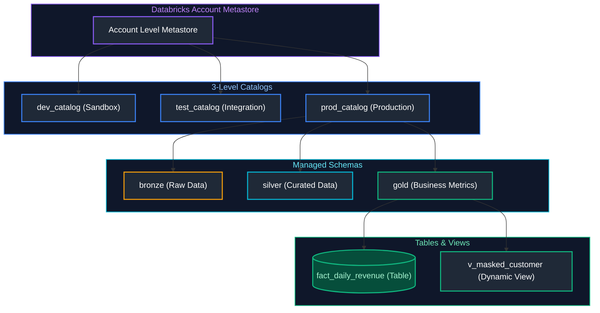
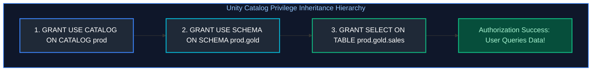
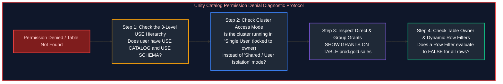
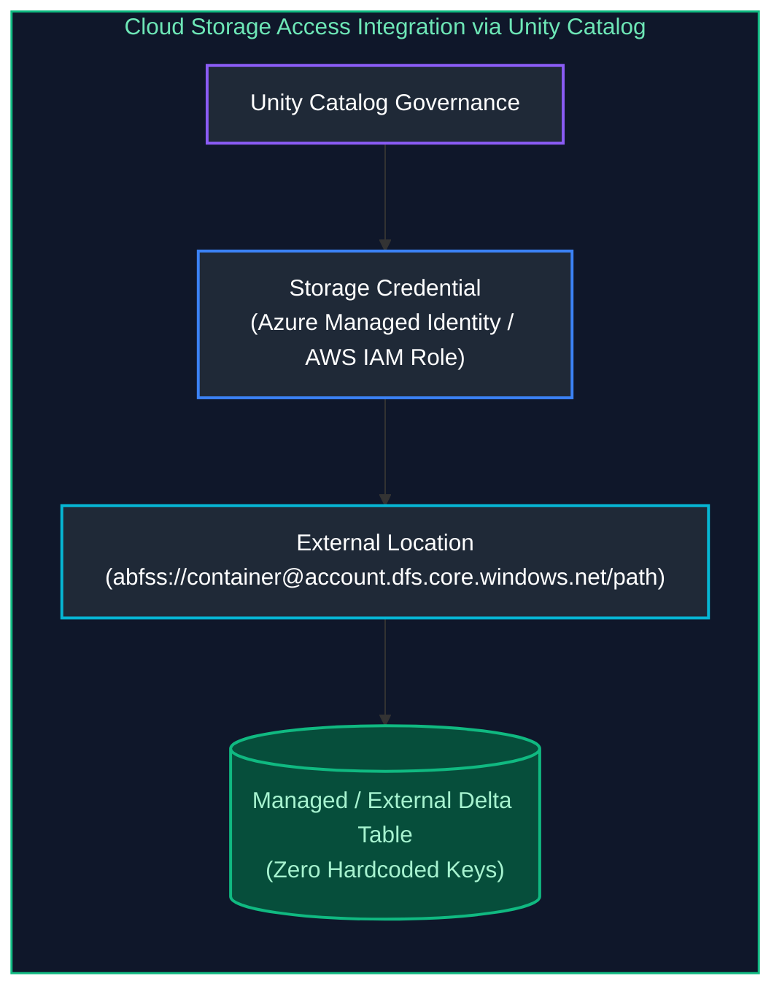

# 07. Unity Catalog & Data Governance: Interview Questions & Deep-Dive Solutions

A comprehensive, production-grade guide answering Databricks Unity Catalog, access governance, fine-grained data security, and compliance interview scenarios. Covers 3-level namespaces, row-level filters, dynamic column masking, permission troubleshooting, automated data lineage, system audit tables, and secure cloud storage credential integration.

---

## Table of Contents & Question Mapping

1. **Unity Catalog 3-Level Namespace & Multi-Environment Architecture**
   - [Q8, Q13 & Q14. Unity Catalog 3-Level Namespace & Multi-Environment Architecture](#q8-q13--q14-unity-catalog-3-level-namespace--multi-environment-architecture)
2. **Role-Based Access Control & Privilege Inheritance**
   - [Q1. Role-Based Access Control & Privilege Hierarchy](#q1-role-based-access-control--privilege-hierarchy)
   - [Q9. Granting Read Access Across Multiple Tables Cleanly](#q9-granting-read-access-across-multiple-tables-cleanly)
3. **Fine-Grained Security: Column Masking & Row-Level Filters**
   - [Q2, Q3 & Q4. Dynamic Column Masking for PII Protection](#q2-q3--q4-dynamic-column-masking-for-pii-protection)
   - [Q10. Row-Level Security with Dynamic User and Group Filtering](#q10-row-level-security-with-dynamic-user-and-group-filtering)
4. **Permission Diagnostics & Troubleshooting Playbook**
   - [Q5 & Q6. Permission Diagnostics & 4-Step Access Denial Troubleshooting](#q5--q6-permission-diagnostics--4-step-access-denial-troubleshooting)
5. **Automated Lineage, System Tables & Audit Tracking**
   - [Q7. Automated Data Lineage for Root-Cause Analysis](#q7-automated-data-lineage-for-root-cause-analysis)
   - [Q11. Auditing Sensitive PII Access via System Tables](#q11-auditing-sensitive-pii-access-via-system-tables)
6. **Cloud Object Storage Security: Storage Credentials & External Locations**
   - [Q12. Storage Credentials & External Locations Cloud Security](#q12-storage-credentials--external-locations-cloud-security)
---

# 1. Unity Catalog 3-Level Namespace & Multi-Environment Architecture

---

### Q8, Q13 & Q14. Unity Catalog 3-Level Namespace & Multi-Environment Architecture
**Topic Covered:** 3-Level Namespace Hierarchy, Service Principal Isolation & Environment Governance  
**Questions Covered:**
- **Q8**: Your company has Development, Testing, and Production environments. How would you design Unity Catalog catalogs, schemas, and access permissions for them?
- **Q13**: How would you use groups and service principals to manage access for developers, testers, and production jobs?
- **Q14**: What is Unity Catalog, data lineage, and what do OPTIMIZE vs VACUUM actually do?

#### Core Architecture: The 3-Level Namespace
Unlike legacy Hive Metastore (which only provided a 2-level `database.table` namespace tied to a single workspace), Unity Catalog introduces an enterprise-wide **3-level namespace**:
$$\text{catalog} \boldsymbol{.} \text{schema} \boldsymbol{.} \text{table\_or\_view}$$



#### Multi-Environment Governance Design (Q8, Q13)
To ensure isolation and security across Development, Testing, and Production:
1. **Catalog per Environment:**
   - `dev_catalog`: Sandbox for engineers; schema changes permitted.
   - `test_catalog`: Mirror of production data with masked PII for integration testing.
   - `prod_catalog`: Strictly protected production data.
2. **Access Control via Identity Federation:**
   - **Developers (`grp_developers`):** Full DDL/DML on `dev_catalog`; strictly `SELECT` (read-only) on `test_catalog`; zero access to `prod_catalog`.
   - **Testers (`grp_qa_testers`):** `SELECT` and execute on `test_catalog`.
   - **Production Pipelines (`sp_production_etl`):** Service Principal possesses `ALL PRIVILEGES` on `prod_catalog`. No human interactive user holds write permissions in production!

```sql
-- DDL Governance: Setting up Prod Catalog Privileges
CREATE CATALOG prod_catalog;
GRANT USE CATALOG ON CATALOG prod_catalog TO `grp_data_analysts`;
GRANT USE SCHEMA, SELECT ON SCHEMA prod_catalog.gold TO `grp_data_analysts`;

-- Assign write permissions strictly to the automated Service Principal
GRANT ALL PRIVILEGES ON CATALOG prod_catalog TO `sp_production_etl`;
```

---

# 2. Role-Based Access Control & Privilege Inheritance

---

### Q1. Role-Based Access Control & Privilege Hierarchy
**Topic Covered:** Hierarchical RBAC, Object Privileges & Account-Level Identities  
**Question:** How would you implement different access levels for different teams?

#### Privilege Hierarchy & The Prerequisite "USE" Chain
In Unity Catalog, privileges are inherited hierarchically. To query a table `prod.gold.sales`, a user requires:
1. `USE CATALOG` on `prod`
2. `USE SCHEMA` on `gold`
3. `SELECT` on `sales`



---

### Q9. Granting Read Access Across Multiple Tables Cleanly
**Topic Covered:** Schema-Level Inheritance vs Table-Level Enumeration  
**Question:** How would you give a team read access to multiple tables without granting unnecessary permissions?

#### Giving a Team Read Access to Multiple Tables Cleanly (Q9)
Instead of granting `SELECT` table-by-table across 200 tables:
```sql
-- Grant read access to ALL current and future tables in the schema with 2 commands
GRANT USE CATALOG ON CATALOG prod_catalog TO `finance_team`;
GRANT USE SCHEMA, SELECT ON SCHEMA prod_catalog.finance TO `finance_team`;
```

---

# 3. Fine-Grained Security: Column Masking & Row-Level Filters

---

### Q2, Q3 & Q4. Dynamic Column Masking for PII Protection
**Topic Covered:** SQL UDF Column Masks, Group-Based Redaction & Transparent Access Control  
**Questions Covered:**
- **Q2**: How would you secure sensitive columns such as PII?
- **Q3**: A developer can access a table but should not be able to see sensitive columns. How would you implement this requirement?
- **Q4**: A user needs access to a table but should only see selected columns. How would you design this using Unity Catalog?

#### Architectural Approaches: Dynamic Masking vs Views
1. **Legacy Approach (Dynamic Views):** Requires creating separate view layers (`SELECT user_id, CASE WHEN ... END FROM table`) and granting access to the view while revoking the base table.
2. **Modern Unity Catalog Approach (Native Column Masks & Row Filters):** Applied directly to the physical base table. Enforced transparently across all BI tools, notebooks, and queries!

#### Column Masking: Securing PII (Email / SSN) (Q2, Q3, Q4)
```sql
-- Step 1: Create a reusable SQL User-Defined Masking Function
CREATE OR REPLACE FUNCTION mask_email_fn(email STRING)
RETURN CASE 
    WHEN is_account_group_member('security_compliance_team') THEN email
    ELSE CONCAT('****@', SPLIT(email, '@')[1])
END;

-- Step 2: Apply the masking function directly to the column on the base table
ALTER TABLE prod_catalog.customer.users 
ALTER COLUMN email SET MASK mask_email_fn;
```

---

### Q10. Row-Level Security with Dynamic User and Group Filtering
**Topic Covered:** Row Filters, `is_account_group_member()` & Geographic Partitioning  
**Question:** How would you implement row-level security for different users or departments?

#### Row-Level Security: Filtering by Department or Region (Q10)
Restricts users so that EU analysts see only EU rows, and US analysts see only US rows:
```sql
-- Step 1: Create a row filter function
CREATE OR REPLACE FUNCTION region_filter_fn(region STRING)
RETURN 
    is_account_group_member('global_executives') OR 
    (is_account_group_member('eu_analysts') AND region = 'EU') OR
    (is_account_group_member('us_analysts') AND region = 'US');

-- Step 2: Bind the row filter directly to the table
ALTER TABLE prod_catalog.sales.orders 
SET ROW FILTER region_filter_fn ON (customer_region);
```

---

# 4. Permission Diagnostics & Troubleshooting Playbook

---

### Q5 & Q6. Permission Diagnostics & 4-Step Access Denial Troubleshooting
**Topic Covered:** Privilege Revocations, Metastore Ownership & Broken USE Chains  
**Questions Covered:**
- **Q5**: How would you troubleshoot a user who suddenly loses access to a table?
- **Q6**: A user can access a catalog but cannot query a particular table. How would you troubleshoot the permissions?

#### The 4-Step Diagnostic Protocol for Permission Denials


#### Diagnostic Commands
```sql
-- Check effective grants for the user
SHOW GRANTS ON TABLE prod_catalog.gold.orders;
SHOW GRANTS ON SCHEMA prod_catalog.gold;
SHOW GRANTS ON CATALOG prod_catalog;

-- Verify if the table is masked or filtered
DESCRIBE TABLE EXTENDED prod_catalog.gold.orders;
```

---

# 5. Automated Lineage, System Tables & Audit Tracking

---

### Q7. Automated Data Lineage for Root-Cause Analysis
**Topic Covered:** Column & Table Lineage Graph Traversal & Upstream Failure Tracking  
**Question:** How would you use data lineage and audit logs during troubleshooting?

#### Automated Data Lineage (Q7)
Unity Catalog automatically captures column-level and table-level lineage in real time across SQL, Python, R, and Scala without any manual instrumentation:
- **Upstream Impact Analysis:** If a pipeline fails, view lineage to identify all downstream dashboards (PowerBI, Tableau) and tables impacted.
- **Root-Cause Analysis:** If a column in a Gold table has corrupt values, inspect upstream lineage to trace the issue back through Silver transformations to the exact raw Bronze source file.

---

### Q11. Auditing Sensitive PII Access via System Tables
**Topic Covered:** `system.access.audit`, Event Log Analysis & Regulatory Compliance  
**Question:** How would you track which users accessed sensitive data in Unity Catalog?

#### Auditing Sensitive PII Access via System Tables (Q11)
All queries executed in Unity Catalog are logged immutably into `system.access.audit`:
```sql
-- Query to audit who accessed customer PII over the last 30 days
SELECT 
    event_time,
    user_identity.email AS queried_by_user,
    action_name,
    request_params.table_full_name AS accessed_table,
    request_params.command_text AS executed_sql
FROM system.access.audit
WHERE request_params.table_full_name = 'prod_catalog.customer.users'
  AND event_date >= CURRENT_DATE() - INTERVAL 30 DAYS
ORDER BY event_time DESC;
```

---

# 6. Cloud Object Storage Security: Storage Credentials & External Locations

---

### Q12. Storage Credentials & External Locations Cloud Security
**Topic Covered:** Azure Managed Identities, Storage Credentials & External Location Delegation  
**Question:** How would you configure Storage Credentials and External Locations to securely access ADLS data through Unity Catalog?

#### The Problem Solved: Eliminating Hardcoded Storage Keys
In legacy data lakes, notebooks used hardcoded storage access keys or SAS tokens:
```python
# ANTI-PATTERN: Dangerous hardcoded secret
spark.conf.set("fs.azure.account.key.datalake.dfs.core.windows.net", "secret_key...")
```

#### Modern Unity Catalog Cloud Storage Integration Architecture


#### Configuration Steps
```sql
-- Step 1: Create a Storage Credential referencing an Azure Managed Identity
CREATE STORAGE CREDENTIAL azure_prod_identity
WITH AZURE_MANAGED_IDENTITY (
    CLIENT_ID = 'e8b3b320-...'
);

-- Step 2: Create an External Location pointing to the specific ADLS container
CREATE EXTERNAL LOCATION adls_gold_container
URL 'abfss://gold@datalakeprod.dfs.core.windows.net/'
WITH STORAGE CREDENTIAL azure_prod_identity;

-- Step 3: Grant access to specific teams to read from this cloud storage path
GRANT READ FILES, WRITE FILES ON EXTERNAL LOCATION adls_gold_container TO `sp_production_etl`;
```
