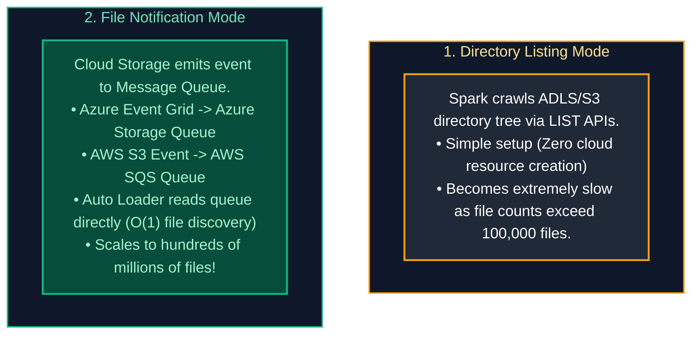
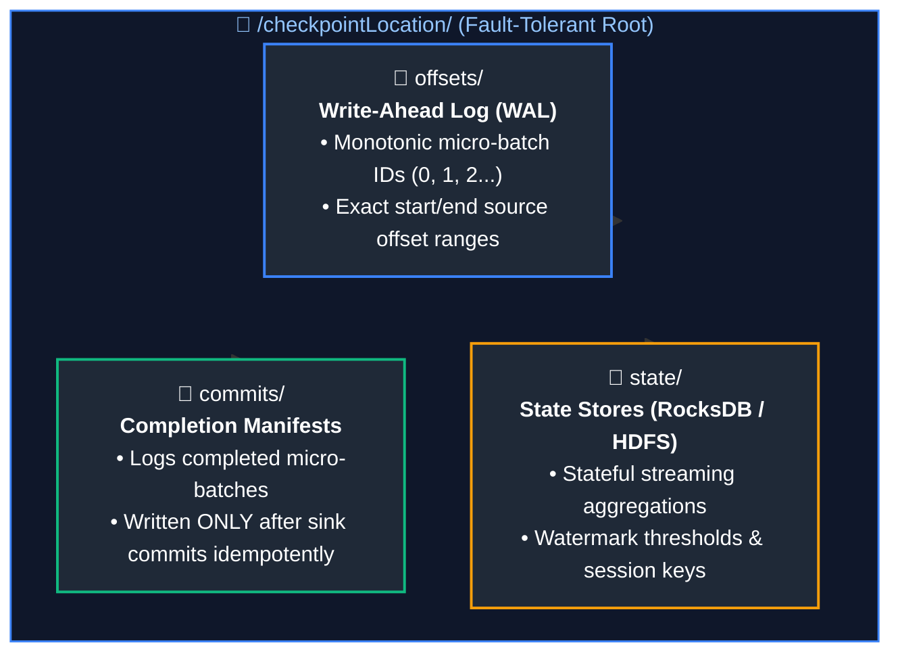
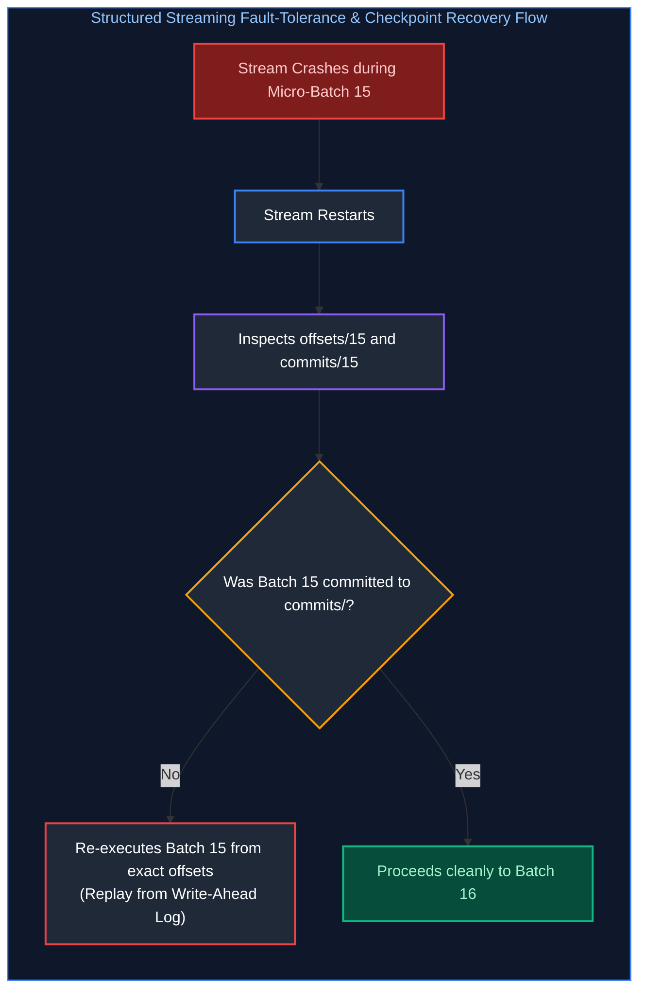
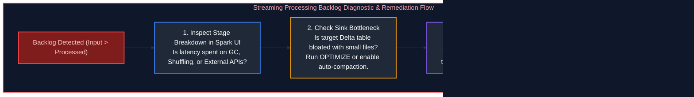
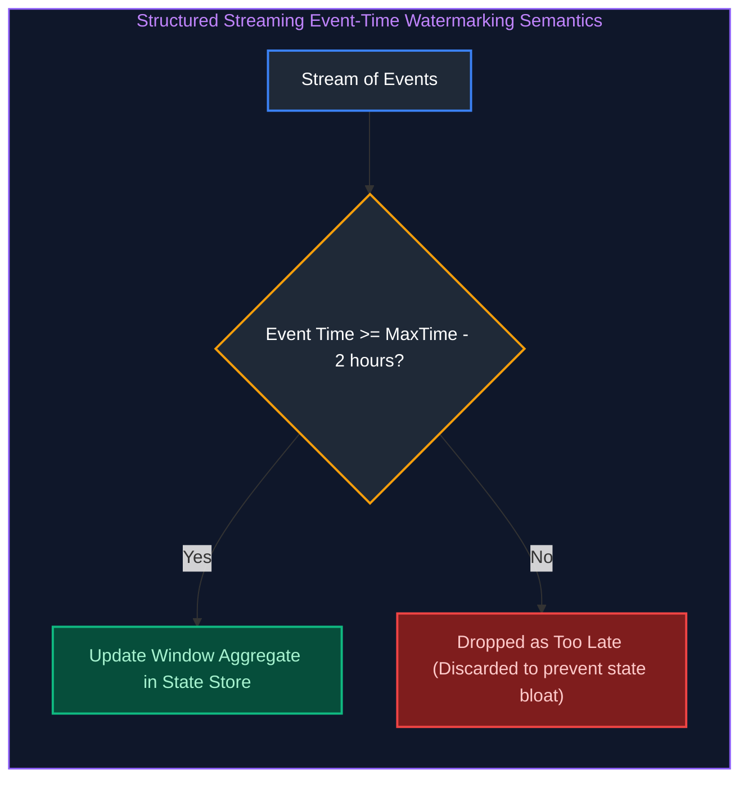
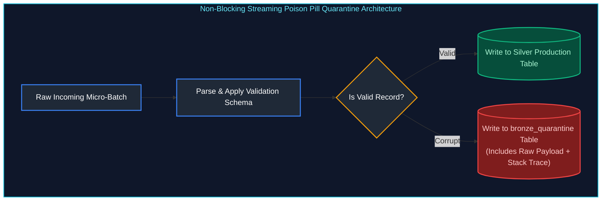

# 08. Auto Loader & Structured Streaming: Interview Questions & Deep-Dive Solutions

A comprehensive, production-grade guide answering Databricks Auto Loader, Spark Structured Streaming, and real-time processing interview scenarios. Covers continuous file ingestion, directory listing vs file notification modes, checkpointing internals, exactly-once semantics, schema evolution, rescued data columns, stream deduplication, backlogs, watermarking, and poison-pill error isolation.

---

## Table of Contents & Question Mapping

1. **Batch vs Streaming Foundations & High-Scale Ingestion**
   - [Streaming Q1. Batch vs Streaming Pipelines Architectural Comparison](#streaming-q1-batch-vs-streaming-pipelines-architectural-comparison)
   - [Auto Loader Q1. Ingesting Millions of Continuously Arriving Files](#auto-loader-q1-ingesting-millions-of-continuously-arriving-files)
2. **Auto Loader Discovery Modes & Micro-Batch Rate Limiting**
   - [Auto Loader Q15. Directory Listing vs File Notification Mode](#auto-loader-q15-directory-listing-vs-file-notification-mode)
   - [Auto Loader Q12 & Q16. File Type Filtering & Micro-Batch Rate Limiting](#auto-loader-q12--q16-file-type-filtering--micro-batch-rate-limiting)
3. **Fault Tolerance, Checkpointing & End-to-End Exactly-Once Processing**
   - [Auto Loader Q3. Structured Streaming Checkpointing Architecture](#auto-loader-q3-structured-streaming-checkpointing-architecture)
   - [Auto Loader Q2 & Q11. Stream Failure Recovery & End-to-End Exactly-Once Processing](#auto-loader-q2--q11-stream-failure-recovery--end-to-end-exactly-once-processing)
4. **Schema Evolution & The Rescued Data Column**
   - [Auto Loader Q4 & Q5. Schema Evolution Modes in Auto Loader](#auto-loader-q4--q5-schema-evolution-modes-in-auto-loader)
   - [Auto Loader Q17. The Rescued Data Column Pattern for Malformed Data](#auto-loader-q17-the-rescued-data-column-pattern-for-malformed-data)
5. **Stream Deduplication & State Store Memory Management**
   - [Auto Loader Q6 & Q7. Stream Deduplication & State Store Memory Management](#auto-loader-q6--q7-stream-deduplication--state-store-memory-management)
6. **Streaming Backlog Diagnostics & Progress Telemetry**
   - [Auto Loader Q13. Monitoring Streaming Progress via StreamingQueryProgress](#auto-loader-q13-monitoring-streaming-progress-via-streamingqueryprogress)
   - [Auto Loader Q8 & Q9. Diagnosing & Troubleshooting Streaming Backlogs](#auto-loader-q8--q9-diagnosing--troubleshooting-streaming-backlogs)
7. **Late-Arriving Data & Event-Time Watermarking**
   - [Auto Loader Q10 & Streaming Q2. Late-Arriving Data & Event-Time Watermarking](#auto-loader-q10--streaming-q2-late-arriving-data--event-time-watermarking)
8. **Poison Pill Quarantine & Dead-Letter Stream Handling**
   - [Auto Loader Q14. Poison Pill Quarantine & Dead-Letter Stream Handling](#auto-loader-q14-poison-pill-quarantine--dead-letter-stream-handling)
---

# 1. Batch vs Streaming Foundations & High-Scale Ingestion

---

### Streaming Q1. Batch vs Streaming Pipelines Architectural Comparison
**Topic Covered:** Latency Boundaries, Stateful Windows & Compute Profiles  
**Question:** What are the differences between batch and streaming pipelines? Give real-life examples.

#### Batch vs Streaming Architectural Comparison
| Dimension | Batch Processing | Streaming Processing |
| :--- | :--- | :--- |
| **Data Scope** | Bounded dataset (all data up to a fixed timestamp). | Unbounded continuous data stream. |
| **Latency** | High latency (Hours / Daily). | Low latency (Sub-second to Seconds / Minutes). |
| **State Management**| Stateless; recomputes transformations over complete batch. | Stateful; maintains in-memory state stores for windows/aggregates. |
| **Real-Life Example** | Nightly payroll calculation; end-of-month financial ledger reconciliation. | Real-time credit card fraud detection; IoT smart meter anomaly alerting. |

---

### Auto Loader Q1. Ingesting Millions of Continuously Arriving Files
**Topic Covered:** High-Scale Cloud Storage Ingestion, Metadata Bottlenecks & Incremental Processing  
**Question:** How would you design a pipeline to process millions of files arriving continuously?

#### Ingesting Millions of Continuously Arriving Files (Auto Loader Q1)
Traditional `spark.readStream` scans the cloud storage directory on every micro-batch. When a folder accumulates hundreds of thousands of files, listing storage files takes longer than processing the data.

**The Solution:** Use **Databricks Auto Loader (`cloudFiles`)**:
1. Uses cloud-native event queues to notify Spark of new files asynchronously.
2. Ingests files incrementally without directory listing overhead.
3. Automatically infers schemas and handles schema evolution.

```python
# Production Auto Loader Ingestion Pipeline
raw_stream_df = (
    spark.readStream.format("cloudFiles")
    .option("cloudFiles.format", "json")
    .option("cloudFiles.useNotifications", "true") # Event-driven ingestion
    .option("cloudFiles.schemaLocation", "/mnt/checkpoints/sales_schema")
    .load("abfss://raw@datalake.dfs.core.windows.net/sales_landing/")
)

# Stream into Bronze Delta Table
query = (
    raw_stream_df.writeStream.format("delta")
    .outputMode("append")
    .option("checkpointLocation", "/mnt/checkpoints/sales_bronze")
    .toTable("bronze.raw_sales")
)
```

---

# 2. Auto Loader Discovery Modes & Micro-Batch Rate Limiting

---

### Auto Loader Q15. Directory Listing vs File Notification Mode
**Topic Covered:** File Discovery Mechanics, Storage Queue Notifications & Scalability Thresholds  
**Question:** What is the difference between Auto Loader's directory listing mode and file notification mode, and when would you use each?

#### Directory Listing Mode vs File Notification Mode (Q15)


---

### Auto Loader Q12 & Q16. File Type Filtering & Micro-Batch Rate Limiting
**Topic Covered:** `pathGlobFilter`, `maxFilesPerTrigger` & Backpressure Protection  
**Questions Covered:**
- **Q12**: How would you process only specific file types from an ADLS folder using Auto Loader?
- **Q16**: How would you control the number of files processed in each micro-batch when the incoming file rate is very high?

#### Rate Limiting & File Type Filtering (Q12, Q16)
When millions of backlogged files arrive, unconstrained micro-batches can cause Executor OutOfMemory (OOM) errors. We throttle micro-batches using `maxFilesPerTrigger` or `maxBytesPerTrigger`:
```python
stream_df = (
    spark.readStream.format("cloudFiles")
    .option("cloudFiles.format", "parquet")
    .option("cloudFiles.pathGlobFilter", "*.parquet") # Q12: Filter specific file type
    .option("cloudFiles.maxFilesPerTrigger", 1000)     # Q16: Throttle: 1,000 files per micro-batch
    .option("cloudFiles.maxBytesPerTrigger", "10g")    # Q16: Throttle: Max 10 GB per micro-batch
    .load("abfss://landing@datalake.dfs.core.windows.net/events/")
)
```

---

# 3. Fault Tolerance, Checkpointing & End-to-End Exactly-Once Processing

---

### Auto Loader Q3. Structured Streaming Checkpointing Architecture
**Topic Covered:** Write-Ahead Logs (WAL), Offsets, Commits & State Directories  
**Question:** How does checkpointing help Structured Streaming?

#### Checkpoint Directory Architecture (Q3)
Inside the `checkpointLocation`, Structured Streaming maintains three critical directories:


---

### Auto Loader Q2 & Q11. Stream Failure Recovery & End-to-End Exactly-Once Processing
**Topic Covered:** Crash Resilience, State Reconstruction & Idempotent Sinks  
**Questions Covered:**
- **Q2**: What happens if a streaming job fails in the middle of processing?
- **Q11**: A streaming pipeline restarts after a failure and you notice some records are processed again. How would you ensure exactly-once or effectively-once processing?

#### What Happens Upon Stream Failure? (Q2, Q11)


#### Achieving End-to-End Exactly-Once Processing
Replaying a micro-batch after failure guarantees **At-Least-Once** ingestion. To achieve **End-to-End Exactly-Once**:
1. **Replayability at Source:** Source must support offset replays (Auto Loader / Kafka).
2. **Deterministic Processing:** Transformations must be purely functional.
3. **Idempotent Sink:** Output sink must support atomic overwrites or idempotent Upserts (such as **Delta Lake**).

```python
# Exactly-once Sink using Delta Lake Idempotent Upsert
def idempotent_delta_upsert(micro_batch_df, batch_id):
    delta_target = DeltaTable.forName(spark, "silver.orders")
    
    delta_target.alias("t").merge(
        micro_batch_df.alias("s"),
        "t.order_id = s.order_id"
    ).whenMatchedUpdateAll(
    ).whenNotMatchedInsertAll(
    ).execute()

query = (
    streaming_df.writeStream
    .foreachBatch(idempotent_delta_upsert)
    .option("checkpointLocation", "/mnt/checkpoints/orders_silver")
    .start()
)
```

---

# 4. Schema Evolution & The Rescued Data Column

---

### Auto Loader Q4 & Q5. Schema Evolution Modes in Auto Loader
**Topic Covered:** `addNewColumns`, `rescue`, `failOnNewColumns` & Non-Stop Schema Changes  
**Questions Covered:**
- **Q4**: How would you handle schema evolution with Auto Loader?
- **Q5**: An Auto Loader pipeline needs to handle files with new columns without stopping the pipeline. How would you implement schema evolution?

#### Schema Evolution Modes (Q4, Q5)
Auto Loader supports four schema evolution behaviors:
- `addNewColumns` (Default): Automatically appends new columns to the schema without failing the stream.
- `failOnNewColumns`: Halts stream upon schema change so engineers can review the schema change.
- `rescue`: Directs all new/malformed columns to a designated rescue column without changing table schema.
- `none`: Silently ignores new columns.

---

### Auto Loader Q17. The Rescued Data Column Pattern for Malformed Data
**Topic Covered:** `_rescued_data` JSON Extraction, Type Mismatch Handling & Data Loss Prevention  
**Question:** How would you handle unexpected or malformed columns using Auto Loader's rescuedDataColumn?

#### The Rescued Data Column Pattern (Q17)
To prevent unexpected data types (e.g., string `"abc"` in an `integer` column) from failing the stream or corrupting typed data, Auto Loader automatically populates `_rescued_data`:
```python
streaming_df = (
    spark.readStream.format("cloudFiles")
    .option("cloudFiles.format", "json")
    .option("cloudFiles.schemaLocation", "/mnt/checkpoints/schema")
    .option("cloudFiles.schemaEvolutionMode", "addNewColumns")
    .option("cloudFiles.schemaHints", "user_id INT, amount DOUBLE")
    # Auto Loader captures type mismatches and extra fields in _rescued_data JSON string!
    .load("abfss://landing@datalake.dfs.core.windows.net/users/")
)
```
- If a record arrives as `{"user_id": "NOT_AN_INT", "extra_promo": "VIP"}`, `user_id` becomes `NULL`, and `_rescued_data` stores `{"user_id": "NOT_AN_INT", "extra_promo": "VIP"}` for auditing!

---

# 5. Stream Deduplication & State Store Memory Management

---

### Auto Loader Q6 & Q7. Stream Deduplication & State Store Memory Management
**Topic Covered:** `dropDuplicates()` with Watermarks, State Store Pruning & RocksDB State Store  
**Questions Covered:**
- **Q6**: How would you prevent duplicate records in a streaming pipeline?
- **Q7**: A streaming pipeline suddenly starts producing duplicate records. How would you identify and prevent them?

#### Preventing State Store OOMs during Deduplication
In streaming, executing `df.dropDuplicates(["event_id"])` without a watermark forces Spark to remember **every event ID ever seen since the inception of the stream** inside executor memory (RocksDB State Store). Over weeks, this state store grows indefinitely and causes an executor Out-Of-Memory crash.

#### Production Solution: Watermark-Bounded Deduplication
```python
from pyspark.sql import functions as F

deduped_stream = (
    raw_stream
    # 1. Define watermark threshold (e.g., retain state for 24 hours of event-time)
    .withWatermark("event_timestamp", "24 hours")
    # 2. Deduplicate including the timestamp column
    .dropDuplicates(["event_id", "event_timestamp"])
)
```
Spark automatically purges event IDs older than 24 hours from executor RAM, keeping the state store lean and preventing OOMs.

---

# 6. Streaming Backlog Diagnostics & Progress Telemetry

---

### Auto Loader Q13. Monitoring Streaming Progress via StreamingQueryProgress
**Topic Covered:** Input Rate vs Process Rate, Batch Duration Telemetry & SLA Tracking  
**Question:** How would you monitor whether a streaming pipeline is keeping up with incoming data?

#### Detecting Backlogs via `StreamingQueryProgress` (Q13)
```python
# Inspect streaming telemetry listener metrics
progress = query.lastProgress
input_rate = progress["inputRowsPerSecond"]        # E.g., 5,000 rows/sec arriving
process_rate = progress["processedRowsPerSecond"]  # E.g., 1,200 rows/sec processed
```
If **Input Rate > Processed Rate** continuously, the stream is accumulating an unsustainable processing backlog.

---

### Auto Loader Q8 & Q9. Diagnosing & Troubleshooting Streaming Backlogs
**Topic Covered:** Downstream Sink Latencies, Micro-Batch Sizing & Scaling Worker Nodes  
**Questions Covered:**
- **Q8**: A streaming pipeline starts building a large processing backlog. How would you troubleshoot it?
- **Q9**: Files are arriving continuously in ADLS, but the Auto Loader pipeline is processing them slower than they arrive. How would you troubleshoot the backlog?

#### Diagnostic & Troubleshooting Steps (Q8, Q9)


---

# 7. Late-Arriving Data & Event-Time Watermarking

---

### Auto Loader Q10 & Streaming Q2. Late-Arriving Data & Event-Time Watermarking
**Topic Covered:** Event Time vs Processing Time, Watermark Cutoff Boundaries & Delayed Metric Aggregation  
**Questions Covered:**
- **Auto Loader Q10**: How would you handle late-arriving events in Spark Structured Streaming?
- **Streaming Q2**: How do you handle late-arriving data or out-of-order events in streaming?

#### Event Time vs Processing Time
- **Event Time:** The exact wall-clock timestamp when the user action occurred at the client device (e.g., mobile app click at 10:00 AM).
- **Processing Time:** The timestamp when the record arrives at the Spark streaming cluster (e.g., 10:45 AM due to airplane offline mode).

#### Watermarking Semantics
A **Watermark** is a dynamic threshold ($T_{\text{watermark}} = \max(\text{event\_time}) - \text{delay}$) that defines how long Spark waits for late-arriving data before finalizing an analytical window:


```python
from pyspark.sql import functions as F

windowed_counts = (
    events_df
    # Allow data to arrive up to 2 hours late
    .withWatermark("event_time", "2 hours")
    .groupBy(
        F.window("event_time", "1 hour", "30 minutes"), # Sliding window
        "device_id"
    )
    .count()
)
```

---

# 8. Poison Pill Quarantine & Dead-Letter Stream Handling

---

### Auto Loader Q14. Poison Pill Quarantine & Dead-Letter Stream Handling
**Topic Covered:** Malformed Payload Isolation, Non-Blocking Streaming & Dead-Letter Delta Tables  
**Question:** How would you design a streaming pipeline so that bad records do not stop the entire stream?

#### The Poison Pill Anti-Pattern
A single corrupt record (e.g., malformed binary payload, invalid date string) that triggers an unhandled parsing exception terminates the entire streaming query. When the stream restarts from its checkpoint, it reads the exact same bad record and crashes again in an infinite loop.

#### Non-Blocking Quarantine Architecture


```python
from pyspark.sql import functions as F

def split_and_quarantine(micro_batch_df, batch_id):
    # Tag invalid rows based on business validation rules
    validated_df = micro_batch_df.withColumn(
        "is_invalid",
        F.when(F.col("order_id").isNull(), F.lit(True))
         .when(F.col("amount") < 0, F.lit(True))
         .otherwise(F.lit(False))
    )
    
    # 1. Valid stream -> Curated Table
    valid_df = validated_df.filter("is_invalid = false").drop("is_invalid")
    valid_df.write.format("delta").mode("append").saveAsTable("silver.valid_orders")
    
    # 2. Poison pills -> Quarantine Dead-Letter Table
    bad_df = validated_df.filter("is_invalid = true")
    if not bad_df.rdd.isEmpty():
        bad_df.write.format("delta").mode("append").saveAsTable("bronze.quarantined_orders")

streaming_df.writeStream.foreachBatch(split_and_quarantine).start()
```
