# 08. Auto Loader & Structured Streaming: Interview Questions & Deep-Dive Solutions

A comprehensive, production-grade guide answering Databricks Auto Loader, Spark Structured Streaming, and real-time processing interview scenarios. Covers continuous file ingestion, directory listing vs file notification modes, checkpointing internals, exactly-once semantics, schema evolution, rescued data columns, stream deduplication, backlogs, watermarking, and poison-pill error isolation.

---

## Table of Contents & Question Mapping

1. **Batch vs Streaming Foundations & High-Scale Ingestion**
   - [Streaming Q1. Batch vs Streaming Pipelines Architectural Comparison](#streaming-q1-batch-vs-streaming-pipelines-architectural-comparison)
   - [Auto Loader Q1. Ingesting Millions of Continuously Arriving Files](#auto-loader-q1-ingesting-millions-of-continuously-arriving-files)
2. **Auto Loader Discovery Modes & Micro-Batch Rate Limiting**
   - [Auto Loader Q15. Directory Listing vs File Notification Mode](#auto-loader-q15-directory-listing-vs-file-notification-mode)
   - [Auto Loader Q12 & Q16. File Type Filtering & Micro-Batch Rate Limiting](#auto-loader-q12--q16-file-type-filtering--micro-batch-rate-limiting)
3. **Fault Tolerance, Checkpointing & End-to-End Exactly-Once Processing**
   - [Auto Loader Q3. Structured Streaming Checkpointing Architecture](#auto-loader-q3-structured-streaming-checkpointing-architecture)
   - [Auto Loader Q2 & Q11. Stream Failure Recovery & End-to-End Exactly-Once Processing](#auto-loader-q2--q11-stream-failure-recovery--end-to-end-exactly-once-processing)
4. **Schema Evolution & The Rescued Data Column**
   - [Auto Loader Q4 & Q5. Schema Evolution Modes in Auto Loader](#auto-loader-q4--q5-schema-evolution-modes-in-auto-loader)
   - [Auto Loader Q17. The Rescued Data Column Pattern for Malformed Data](#auto-loader-q17-the-rescued-data-column-pattern-for-malformed-data)
5. **Stream Deduplication & State Store Memory Management**
   - [Auto Loader Q6 & Q7. Stream Deduplication & State Store Memory Management](#auto-loader-q6--q7-stream-deduplication--state-store-memory-management)
6. **Streaming Backlog Diagnostics & Progress Telemetry**
   - [Auto Loader Q13. Monitoring Streaming Progress via StreamingQueryProgress](#auto-loader-q13-monitoring-streaming-progress-via-streamingqueryprogress)
   - [Auto Loader Q8 & Q9. Diagnosing & Troubleshooting Streaming Backlogs](#auto-loader-q8--q9-diagnosing--troubleshooting-streaming-backlogs)
7. **Late-Arriving Data & Event-Time Watermarking**
   - [Auto Loader Q10 & Streaming Q2. Late-Arriving Data & Event-Time Watermarking](#auto-loader-q10--streaming-q2-late-arriving-data--event-time-watermarking)
8. **Poison Pill Quarantine & Dead-Letter Stream Handling**
   - [Auto Loader Q14. Poison Pill Quarantine & Dead-Letter Stream Handling](#auto-loader-q14-poison-pill-quarantine--dead-letter-stream-handling)
9. **Execution Modes: Batch vs Micro-Batch vs Continuous Processing**
   - [Spark Streaming Execution Modes: Micro-Batch vs Continuous Processing](#spark-streaming-execution-modes-micro-batch-vs-continuous-processing)
10. **Kafka Distributed Commit Log Architecture & Partition Rebalances**
    - [Kafka Consumer Group Allocation: 12 Partitions vs 15 Consumers](#kafka-consumer-group-allocation-12-partitions-vs-15-consumers)
    - [Kafka Rebalance Event Duplication & Idempotent Consumer Design](#kafka-rebalance-event-duplication--idempotent-consumer-design)
11. **High-Frequency Real-Time Deduplication & Delta Lake Ingestion**
    - [Burst Deduplication: 50 Duplicate Updates in 10 Seconds](#burst-deduplication-50-duplicate-updates-in-10-seconds)
    - [Preventing and Resolving Duplicate Records in Streaming Writes to Delta](#preventing-and-resolving-duplicate-records-in-streaming-writes-to-delta)
12. **Streaming Lag Diagnostics & Peak Traffic Troubleshooting**
    - [Structured Streaming Falling Behind During Traffic Bursts: RCA Playbook](#structured-streaming-falling-behind-during-traffic-bursts-rca-playbook)
    - [End-to-End Exactly-Once Processing across Kafka, Spark & Lakehouse](#end-to-end-exactly-once-processing-across-kafka-spark--lakehouse)
13. **Streaming Ingestion Engines & Cloud Broker Selection**
    - [Streaming Q3. Streaming Ingestion Engine Evaluation: Apache Kafka vs AWS Kinesis vs Azure Event Hubs vs GCP Pub/Sub](#streaming-q3-streaming-ingestion-engine-evaluation-apache-kafka-vs-aws-kinesis-vs-azure-event-hubs-vs-gcp-pubsub)
14. **High-Scale File Streaming & Production Pipeline Design**
    - [Auto Loader Q18. Resilient High-Scale ADLS Ingestion: Auto Loader & Checkpointed Delta MERGE](#auto-loader-q18-resilient-high-scale-adls-ingestion-auto-loader--checkpointed-delta-merge)
    - [Auto Loader Q19. End-to-End Streaming Pipeline: Kafka to Spark Structured Streaming to Delta Lake](#auto-loader-q19-end-to-end-streaming-pipeline-kafka-to-spark-structured-streaming-to-delta-lake)
---

# 1. Batch vs Streaming Foundations & High-Scale Ingestion

---

### Streaming Q1. Batch vs Streaming Pipelines Architectural Comparison
*(Grouped together: Batch vs stream processing foundations, latency boundaries, and video-streaming platform trade-offs)*  
**Topic Covered:** Latency Boundaries, Stateful Windows & Compute Profiles  
**Questions Covered:**
- Explain batch vs stream processing in the context of a video-streaming platform.
- What are the differences between batch and streaming pipelines? Give real-life examples.

#### Batch vs Streaming Architectural Comparison
| Dimension | Batch Processing | Streaming Processing |
| :--- | :--- | :--- |
| **Data Scope** | Bounded dataset (all data up to a fixed timestamp). | Unbounded continuous data stream. |
| **Latency** | High latency (Hours / Daily). | Low latency (Sub-second to Seconds / Minutes). |
| **State Management**| Stateless; recomputes transformations over complete batch. | Stateful; maintains in-memory state stores for windows/aggregates. |
| **Video Platform Example** | Nightly subscriber billing, monthly watch-time royalties, offline recommender retraining. | Real-time adaptive bitrate adjustment, live buffering rate anomaly detection, real-time concurrent viewer counters. |

---

### Auto Loader Q1. Ingesting Millions of Continuously Arriving Files
**Topic Covered:** High-Scale Cloud Storage Ingestion, Metadata Bottlenecks & Incremental Processing  
**Question:** How would you design a pipeline to process millions of files arriving continuously?

#### Ingesting Millions of Continuously Arriving Files (Auto Loader Q1)
Traditional `spark.readStream` scans the cloud storage directory on every micro-batch. When a folder accumulates hundreds of thousands of files, listing storage files takes longer than processing the data.

**The Solution:** Use **Databricks Auto Loader (`cloudFiles`)**:
1. Uses cloud-native event queues to notify Spark of new files asynchronously.
2. Ingests files incrementally without directory listing overhead.
3. Automatically infers schemas and handles schema evolution.

```python
# Production Auto Loader Ingestion Pipeline
raw_stream_df = (
    spark.readStream.format("cloudFiles")
    .option("cloudFiles.format", "json")
    .option("cloudFiles.useNotifications", "true") # Event-driven ingestion
    .option("cloudFiles.schemaLocation", "/mnt/checkpoints/sales_schema")
    .load("abfss://raw@datalake.dfs.core.windows.net/sales_landing/")
)

# Stream into Bronze Delta Table
query = (
    raw_stream_df.writeStream.format("delta")
    .outputMode("append")
    .option("checkpointLocation", "/mnt/checkpoints/sales_bronze")
    .toTable("bronze.raw_sales")
)
```

---

# 2. Auto Loader Discovery Modes & Micro-Batch Rate Limiting

---

### Auto Loader Q15. Directory Listing vs File Notification Mode
**Topic Covered:** File Discovery Mechanics, Storage Queue Notifications & Scalability Thresholds  
**Question:** What is the difference between Auto Loader's directory listing mode and file notification mode, and when would you use each?

#### Directory Listing Mode vs File Notification Mode Architecture

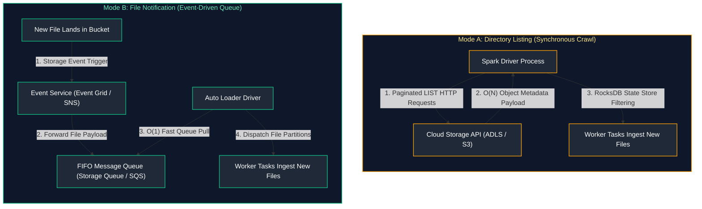

#### Auto Loader Discovery Mode Comparison Matrix

| Evaluation Dimension | Directory Listing Mode (`useNotifications=false`) | File Notification Mode (`useNotifications=true`) |
| :--- | :--- | :--- |
| **Discovery Mechanism** | Repeated recursive REST API `LIST` calls over storage prefixes. | Event-driven queue polling from Azure Storage Queue or AWS SQS. |
| **Discovery Complexity** | $\mathcal{O}(N)$ where $N$ is total historical file count in directory tree. | $\mathcal{O}(1)$ direct queue dequeue of newly arrived files. |
| **Scalability Threshold** | Severely degrades when directories contain $> 100,000$ files. | Infinitely scalable; tested on hundreds of millions of files. |
| **Cloud Infrastructure Footprint** | Zero additional infrastructure; requires only read permissions on storage. | Requires Cloud Event Grid / SNS, IAM role permissions, and Storage Queue / SQS. |
| **Discovery Latency** | High crawl latency; grows linearly with bucket file accumulation. | Real-time (sub-second event notification propagation). |
| **Production Recommendation** | Ad-hoc dev/testing or strictly partitioned paths with $< 10,000$ daily files. | **Mandatory** for enterprise production streaming and high-volume Bronze landing paths. |

---

### Auto Loader Q12 & Q16. File Type Filtering & Micro-Batch Rate Limiting
**Topic Covered:** `pathGlobFilter`, `maxFilesPerTrigger` & Backpressure Protection  
**Questions Covered:**
- **Q12**: How would you process only specific file types from an ADLS folder using Auto Loader?
- **Q16**: How would you control the number of files processed in each micro-batch when the incoming file rate is very high?

#### Rate Limiting & File Type Filtering (Q12, Q16)
When millions of backlogged files arrive, unconstrained micro-batches can cause Executor OutOfMemory (OOM) errors. We throttle micro-batches using `maxFilesPerTrigger` or `maxBytesPerTrigger`:
```python
stream_df = (
    spark.readStream.format("cloudFiles")
    .option("cloudFiles.format", "parquet")
    .option("cloudFiles.pathGlobFilter", "*.parquet") # Q12: Filter specific file type
    .option("cloudFiles.maxFilesPerTrigger", 1000)     # Q16: Throttle: 1,000 files per micro-batch
    .option("cloudFiles.maxBytesPerTrigger", "10g")    # Q16: Throttle: Max 10 GB per micro-batch
    .load("abfss://landing@datalake.dfs.core.windows.net/events/")
)
```

---

# 3. Fault Tolerance, Checkpointing & End-to-End Exactly-Once Processing

---

### Auto Loader Q3. Structured Streaming Checkpointing Architecture
**Topic Covered:** Write-Ahead Logs (WAL), Offsets, Commits & State Directories  
**Question:** How does checkpointing help Structured Streaming?

#### Checkpoint Directory Architecture (Q3)
Inside the `checkpointLocation`, Structured Streaming maintains three critical directories:
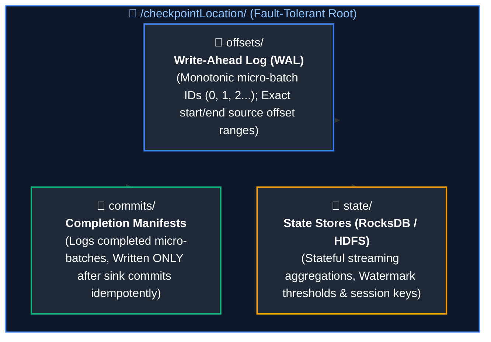

---

### Auto Loader Q2 & Q11. Stream Failure Recovery & End-to-End Exactly-Once Processing
**Topic Covered:** Crash Resilience, State Reconstruction & Idempotent Sinks  
**Questions Covered:**
- **Q2**: What happens if a streaming job fails in the middle of processing?
- **Q11**: A streaming pipeline restarts after a failure and you notice some records are processed again. How would you ensure exactly-once or effectively-once processing?

#### What Happens Upon Stream Failure? (Q2, Q11)
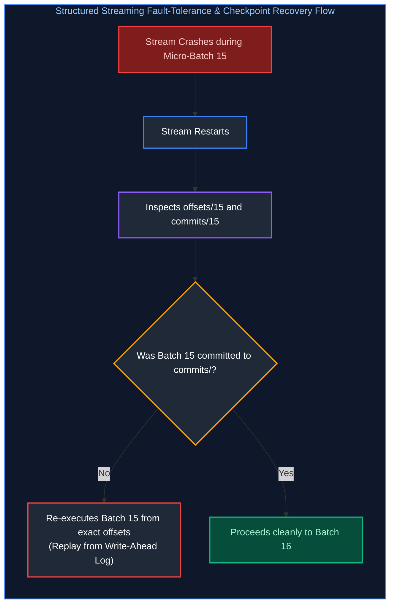

#### Achieving End-to-End Exactly-Once Processing
Replaying a micro-batch after failure guarantees **At-Least-Once** ingestion. To achieve **End-to-End Exactly-Once**:
1. **Replayability at Source:** Source must support offset replays (Auto Loader / Kafka).
2. **Deterministic Processing:** Transformations must be purely functional.
3. **Idempotent Sink:** Output sink must support atomic overwrites or idempotent Upserts (such as **Delta Lake**).

```python
# Exactly-once Sink using Delta Lake Idempotent Upsert
def idempotent_delta_upsert(micro_batch_df, batch_id):
    delta_target = DeltaTable.forName(spark, "silver.orders")
    
    delta_target.alias("t").merge(
        micro_batch_df.alias("s"),
        "t.order_id = s.order_id"
    ).whenMatchedUpdateAll(
    ).whenNotMatchedInsertAll(
    ).execute()

query = (
    streaming_df.writeStream
    .foreachBatch(idempotent_delta_upsert)
    .option("checkpointLocation", "/mnt/checkpoints/orders_silver")
    .start()
)
```

---

# 4. Schema Evolution & The Rescued Data Column

---

### Auto Loader Q4 & Q5. Schema Evolution Modes in Auto Loader
**Topic Covered:** `addNewColumns`, `rescue`, `failOnNewColumns` & Non-Stop Schema Changes  
**Questions Covered:**
- **Q4**: How would you handle schema evolution with Auto Loader?
- **Q5**: An Auto Loader pipeline needs to handle files with new columns without stopping the pipeline. How would you implement schema evolution?

#### Schema Evolution Modes (Q4, Q5)
Auto Loader supports four schema evolution behaviors:
- `addNewColumns` (Default): Automatically appends new columns to the schema without failing the stream.
- `failOnNewColumns`: Halts stream upon schema change so engineers can review the schema change.
- `rescue`: Directs all new/malformed columns to a designated rescue column without changing table schema.
- `none`: Silently ignores new columns.

---

### Auto Loader Q17. The Rescued Data Column Pattern for Malformed Data
**Topic Covered:** `_rescued_data` JSON Extraction, Type Mismatch Handling & Data Loss Prevention  
**Question:** How would you handle unexpected or malformed columns using Auto Loader's rescuedDataColumn?

#### The Rescued Data Column Pattern (Q17)
To prevent unexpected data types (e.g., string `"abc"` in an `integer` column) from failing the stream or corrupting typed data, Auto Loader automatically populates `_rescued_data`:
```python
streaming_df = (
    spark.readStream.format("cloudFiles")
    .option("cloudFiles.format", "json")
    .option("cloudFiles.schemaLocation", "/mnt/checkpoints/schema")
    .option("cloudFiles.schemaEvolutionMode", "addNewColumns")
    .option("cloudFiles.schemaHints", "user_id INT, amount DOUBLE")
    # Auto Loader captures type mismatches and extra fields in _rescued_data JSON string!
    .load("abfss://landing@datalake.dfs.core.windows.net/users/")
)
```
- If a record arrives as `{"user_id": "NOT_AN_INT", "extra_promo": "VIP"}`, `user_id` becomes `NULL`, and `_rescued_data` stores `{"user_id": "NOT_AN_INT", "extra_promo": "VIP"}` for auditing!

---

# 5. Stream Deduplication & State Store Memory Management

---

### Auto Loader Q6 & Q7. Stream Deduplication & State Store Memory Management
**Topic Covered:** `dropDuplicates()` with Watermarks, State Store Pruning & RocksDB State Store  
**Questions Covered:**
- **Q6**: How would you prevent duplicate records in a streaming pipeline?
- **Q7**: A streaming pipeline suddenly starts producing duplicate records. How would you identify and prevent them?

#### Preventing State Store OOMs during Deduplication
In streaming, executing `df.dropDuplicates(["event_id"])` without a watermark forces Spark to remember **every event ID ever seen since the inception of the stream** inside executor memory (RocksDB State Store). Over weeks, this state store grows indefinitely and causes an executor Out-Of-Memory crash.

#### Production Solution: Watermark-Bounded Deduplication
```python
from pyspark.sql import functions as F

deduped_stream = (
    raw_stream
    # 1. Define watermark threshold (e.g., retain state for 24 hours of event-time)
    .withWatermark("event_timestamp", "24 hours")
    # 2. Deduplicate including the timestamp column
    .dropDuplicates(["event_id", "event_timestamp"])
)
```
Spark automatically purges event IDs older than 24 hours from executor RAM, keeping the state store lean and preventing OOMs.

---

# 6. Streaming Backlog Diagnostics & Progress Telemetry

---

### Auto Loader Q13. Monitoring Streaming Progress via StreamingQueryProgress
**Topic Covered:** Input Rate vs Process Rate, Batch Duration Telemetry & SLA Tracking  
**Question:** How would you monitor whether a streaming pipeline is keeping up with incoming data?

#### Detecting Backlogs via `StreamingQueryProgress` (Q13)
```python
# Inspect streaming telemetry listener metrics
progress = query.lastProgress
input_rate = progress["inputRowsPerSecond"]        # E.g., 5,000 rows/sec arriving
process_rate = progress["processedRowsPerSecond"]  # E.g., 1,200 rows/sec processed
```
If **Input Rate > Processed Rate** continuously, the stream is accumulating an unsustainable processing backlog.

---

### Auto Loader Q8 & Q9. Diagnosing & Troubleshooting Streaming Backlogs
**Topic Covered:** Downstream Sink Latencies, Micro-Batch Sizing & Scaling Worker Nodes  
**Questions Covered:**
- **Q8**: A streaming pipeline starts building a large processing backlog. How would you troubleshoot it?
- **Q9**: Files are arriving continuously in ADLS, but the Auto Loader pipeline is processing them slower than they arrive. How would you troubleshoot the backlog?

#### Diagnostic & Troubleshooting Steps (Q8, Q9)
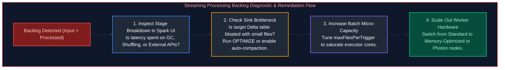

---

# 7. Late-Arriving Data & Event-Time Watermarking

---

### Auto Loader Q10 & Streaming Q2. Late-Arriving Data & Event-Time Watermarking
*(Grouped together: Event-time watermarking, state store lifecycle, and late-arrival window eviction)*  
**Topic Covered:** Event Time vs Processing Time, Watermark Cutoff Boundaries & Delayed Metric Aggregation  
**Questions Covered:**
- Explain how you handle late-arriving data in real-time processing (with watermarks and state cleanup).
- How would you handle late-arriving events in Spark Structured Streaming?
- How do you handle late-arriving data or out-of-order events in streaming?

#### Event Time vs Processing Time
- **Event Time:** The exact wall-clock timestamp when the user action occurred at the client device (e.g., mobile app click at 10:00 AM).
- **Processing Time:** The timestamp when the record arrives at the Spark streaming cluster (e.g., 10:45 AM due to airplane offline mode).

#### Watermarking Semantics
A **Watermark** is a dynamic threshold ($T_{\text{watermark}} = \max(\text{event\_time}) - \text{delay}$) that defines how long Spark waits for late-arriving data before finalizing an analytical window:
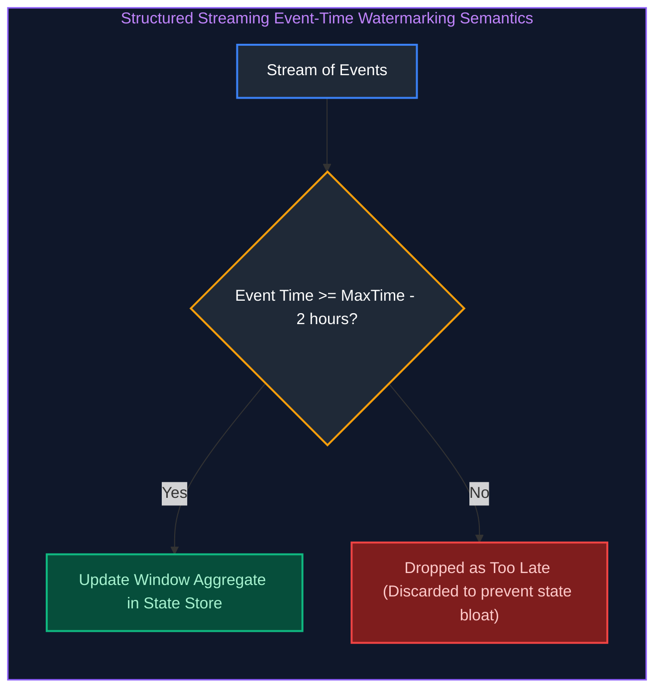

```python
from pyspark.sql import functions as F

windowed_counts = (
    events_df
    # Allow data to arrive up to 2 hours late
    .withWatermark("event_time", "2 hours")
    .groupBy(
        F.window("event_time", "1 hour", "30 minutes"), # Sliding window
        "device_id"
    )
    .count()
)
```

---

# 8. Poison Pill Quarantine & Dead-Letter Stream Handling

---

### Auto Loader Q14. Poison Pill Quarantine & Dead-Letter Stream Handling
**Topic Covered:** Malformed Payload Isolation, Non-Blocking Streaming & Dead-Letter Delta Tables  
**Question:** How would you design a streaming pipeline so that bad records do not stop the entire stream?

#### The Poison Pill Anti-Pattern
A single corrupt record (e.g., malformed binary payload, invalid date string) that triggers an unhandled parsing exception terminates the entire streaming query. When the stream restarts from its checkpoint, it reads the exact same bad record and crashes again in an infinite loop.

#### Non-Blocking Quarantine Architecture
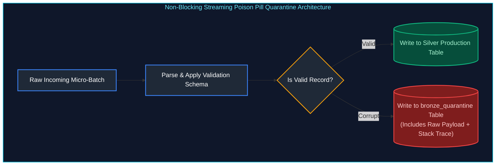

```python
from pyspark.sql import functions as F

def split_and_quarantine(micro_batch_df, batch_id):
    # Tag invalid rows based on business validation rules
    validated_df = micro_batch_df.withColumn(
        "is_invalid",
        F.when(F.col("order_id").isNull(), F.lit(True))
         .when(F.col("amount") < 0, F.lit(True))
         .otherwise(F.lit(False))
    )
    
    # 1. Valid stream -> Curated Table
    valid_df = validated_df.filter("is_invalid = false").drop("is_invalid")
    valid_df.write.format("delta").mode("append").saveAsTable("silver.valid_orders")
    
    # 2. Poison pills -> Quarantine Dead-Letter Table
    bad_df = validated_df.filter("is_invalid = true")
    if not bad_df.rdd.isEmpty():
        bad_df.write.format("delta").mode("append").saveAsTable("bronze.quarantined_orders")

streaming_df.writeStream.foreachBatch(split_and_quarantine).start()
```


---

# 9. Execution Modes: Batch vs Micro-Batch vs Continuous Processing

---

### Spark Streaming Execution Modes: Micro-Batch vs Continuous Processing
*(Grouped together: Execution paradigms across classic batch, micro-batching, and low-latency continuous streaming)*  
**Topic Covered:** Latency Boundaries, Epoch Coordination & Processing Guarantees  
**Questions Covered:**
- Explain the difference between batch processing, micro-batch processing, and continuous streaming in Spark.
- Explain the difference between batch processing, micro-batch processing, and continuous streaming in Spark Structured Streaming.

#### The Latency-Throughput Spectrum
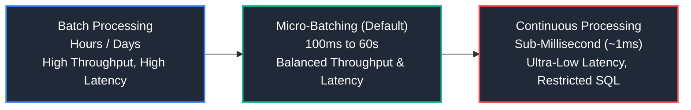

#### Detailed Architectural Comparison Matrix
| Architectural Dimension | Micro-Batch Processing (Default Engine) | Continuous Processing (`Trigger.Continuous("1 millisecond")`) |
| :--- | :--- | :--- |
| **End-to-End Latency** | **100 ms to seconds**. | **Sub-millisecond (~1 ms)**. |
| **Execution Mechanics** | Repeatedly schedules short Spark jobs that process discrete batches of records accumulated over the trigger interval. | Long-running tasks running continuously on worker cores; processes records event-by-event as they arrive. |
| **Fault Tolerance & Guarantees** | **End-to-end exactly-once** semantics via checkpoint WAL offsets and idempotent sinks. | **At-least-once** semantics (epoch coordination markers written asynchronously). |
| **SQL Transformation Support** | **Full SQL Support:** Complex joins, windowed aggregations, watermarking, multiple stateful operations. | **Restricted SQL:** Only map-like projections and simple filters (`SELECT`, `WHERE`). No aggregations, no joins. |
| **Source / Sink Ecosystem** | All standard sources (Kafka, Auto Loader, Kinesis, Delta Lake). | Restricted: Currently Kafka source and Kafka sink only. |

---

# 10. Kafka Distributed Commit Log Architecture & Partition Rebalances

---

### Kafka Consumer Group Allocation: 12 Partitions vs 15 Consumers
**Topic Covered:** Consumer Group Cardinality Invariant, Partition Assignment & Idle Overheads  
**Question:** Your Kafka topic has 12 partitions and 15 consumers in the same consumer group. What are the remaining 3 consumers doing?

#### The Kafka Partition Allocation Invariant
In Apache Kafka, a fundamental architecture rule states:
$$\text{Max Active Consumers per Topic} \le \text{Number of Partitions}$$
- Each partition can be consumed by **at most one consumer** in a given consumer group at any given point in time (to guarantee strict in-order message processing per partition).
- If there are 12 partitions and 15 consumers in consumer group `order-processing-group`:
  - **12 consumers** are assigned exactly 1 partition each and actively process records.
  - **The remaining 3 consumers are 100% IDLE**. They consume zero partitions, process zero records, and consume compute resources doing nothing except sending heartbeat pings to the Group Coordinator.

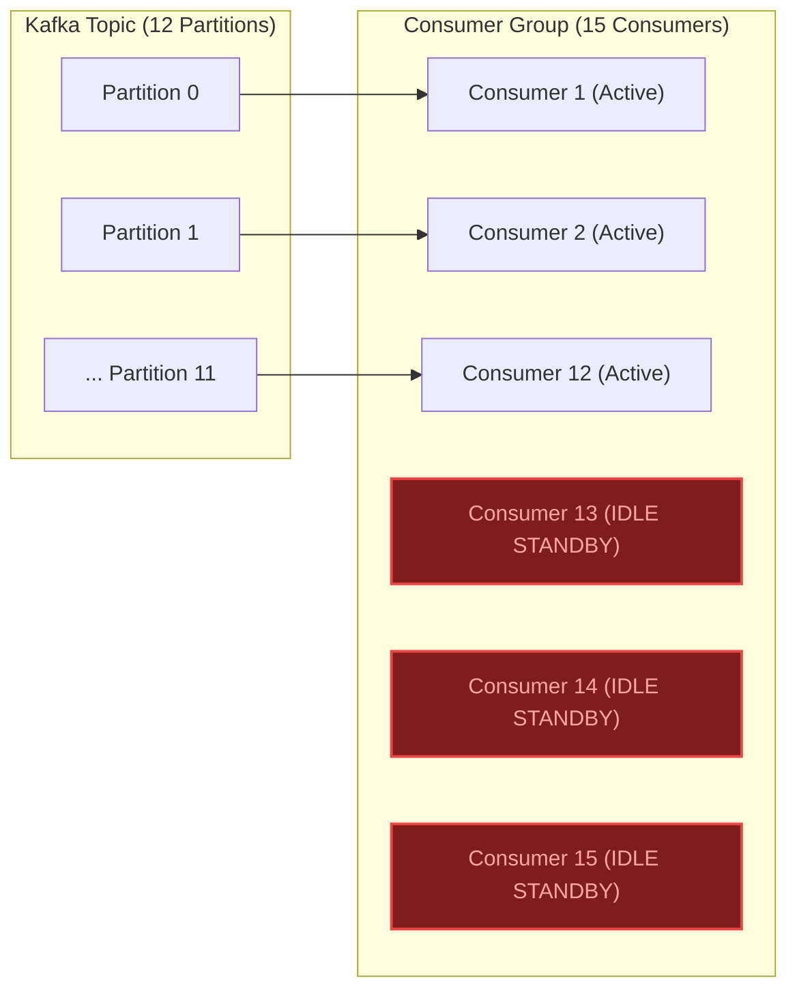

#### Production Implications & Recommended Action:
1. **Idle Standbys:** The 3 idle consumers act purely as hot standbys. If any of the active 12 consumers crash, the Group Coordinator immediately triggers a rebalance and reallocates the orphaned partition to one of the 3 standby consumers without spinning up new pods.
2. **Resource Optimization:** If you need more parallel processing throughput, **you must increase the topic partition count** (e.g., scale from 12 to 24 partitions). Adding more consumers beyond the partition count yields zero throughput gain.

---

### Kafka Rebalance Event Duplication & Idempotent Consumer Design
**Topic Covered:** Heartbeat Timeouts, `max.poll.interval.ms`, Zombie Consumers & Idempotency  
**Question:** After a Kafka consumer rebalance, the same event gets processed twice. How can this happen, and how would you make the pipeline idempotent?

#### Why Duplicates Occur During a Rebalance
1. Consumer $A$ pulls a batch of 500 records from Partition 3.
2. Processing record 250 triggers a slow downstream database call or garbage collection freeze exceeding `max.poll.interval.ms` (e.g., 5 minutes).
3. The Kafka Group Coordinator marks Consumer $A$ as **dead** and triggers a cluster-wide **Consumer Rebalance**.
4. The coordinator assigns Partition 3 to Consumer $B$.
5. Because Consumer $A$ never committed the offset for record 250, Consumer $B$ restarts consuming from the **last committed offset** (record 0).
6. Records 1 to 249 are now processed a second time!

#### 3 Architectural Controls for Pipeline Idempotency:
1. **Tune Consumer Polling Parameters:**
   - Reduce `max.poll.records` (e.g., from 500 to 50) so each batch finishes well within `max.poll.interval.ms`.
2. **Idempotent Storage Sink via Upsert / Merge:**
   - Never use raw `APPEND`. Use Delta Lake `MERGE` or relational `UPSERT` using the event's primary key (`order_id` or `kafka_partition_offset`):
     ```python
     def upsert_to_delta(micro_batch_df, batch_id):
         (
             target_delta_table.alias("t")
             .merge(
                 micro_batch_df.alias("s"),
                 "t.event_id = s.event_id"
             )
             .whenMatchedUpdateAll()
             .whenNotMatchedInsertAll()
             .execute()
         )
     ```
3. **Deduplication State Store / Redis Fingerprint Cache:**
   - Store processed message UUIDs in a distributed cache (Redis) with a TTL (e.g., 24 hours). Before executing business logic, check `SETNX(event_id, 1)`. If key exists, discard the duplicate immediately.

---

# 11. High-Frequency Real-Time Deduplication & Delta Lake Ingestion

---

### Burst Deduplication: 50 Duplicate Updates in 10 Seconds
*(Grouped together: High-frequency burst deduplication, state store eviction, and micro-batch watermarking)*  
**Topic Covered:** Rapid-Fire Duplicate Bursts, Event-Time Watermarking & Micro-Batch Dedup  
**Questions Covered:**
- Your Kafka topic receives restaurant menu update events. Same restaurant sends 50 duplicate updates in 10 seconds. How do you handle deduplication at scale?
- Your Kafka topic receives restaurant menu update events. The same restaurant sends 50 duplicate updates within 10 seconds. How do you handle deduplication at scale without exhausting state memory?

#### The Problem: State Memory Explosion
If you deduplicate unbounded streaming records naively (`dropDuplicates(["restaurant_id", "menu_id"])` without a watermark), Spark Structured Streaming must retain every restaurant key in memory **forever**. Within days, the executor state store runs out of memory (`OutOfMemoryError: Java heap space`).

#### The Production Solution: Watermarked Deduplication + In-Batch Rank
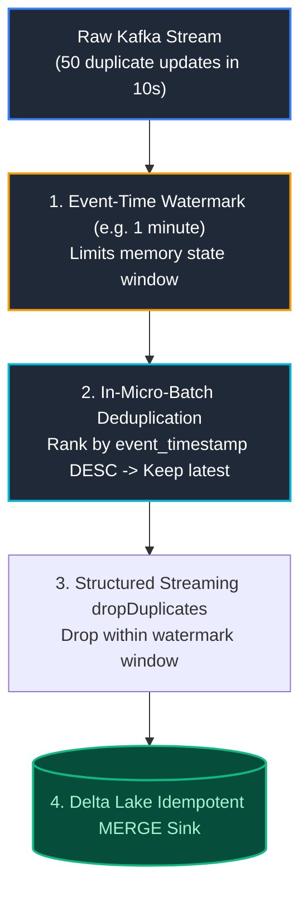

#### Production Implementation in PySpark
```python
from pyspark.sql import functions as F
from pyspark.sql.window import Window

# Step 1: Read Stream with Watermark
streaming_df = (
    spark.readStream
    .format("kafka")
    .option("subscribe", "restaurant_menu_updates")
    .load()
    .select(F.from_json(F.col("value").cast("string"), menu_schema).alias("data"))
    .select("data.*")
    # Define event-time watermark: allow at most 1 minute of late data
    .withWatermark("event_timestamp", "1 minute")
    # Deduplicate within the watermark window
    .dropDuplicates(["restaurant_id", "item_id", "event_timestamp"])
)

# Step 2: Write with foreachBatch Idempotent Merge
def merge_menu_updates(batch_df, batch_id):
    # Within each micro-batch, resolve duplicates down to the single latest update
    window_spec = Window.partitionBy("restaurant_id", "item_id").orderBy(F.col("event_timestamp").desc())
    deduped_batch = (
        batch_df
        .withColumn("rn", F.row_number().over(window_spec))
        .filter(F.col("rn") == 1)
        .drop("rn")
    )
    
    (
        target_menu_table.alias("t")
        .merge(
            deduped_batch.alias("s"),
            "t.restaurant_id = s.restaurant_id AND t.item_id = s.item_id"
        )
        .whenMatchedUpdate(
            condition="s.event_timestamp > t.event_timestamp",
            set={"price": "s.price", "is_available": "s.is_available", "event_timestamp": "s.event_timestamp"}
        )
        .whenNotMatchedInsertAll()
        .execute()
    )

query = (
    streaming_df.writeStream
    .foreachBatch(merge_menu_updates)
    .option("checkpointLocation", "/mnt/checkpoints/menu_updates")
    .start()
)
```

---

### Preventing and Resolving Duplicate Records in Streaming Writes to Delta
**Topic Covered:** Streaming Checkpoint Synchronization, Atomic Commit Logs & Target De-duplication  
**Question:** A streaming job is writing duplicate records to a Delta table. How would you prevent and resolve the issue?

#### Root Causes of Streaming Duplicates in Delta
1. **Using `.format("delta").outputMode("append")` Without Unique Constraints:**
   If a cluster node fails mid-microbatch or an upstream replay occurs, reprocessed rows are appended again as new Parquet files.
2. **Corrupted or Reset Checkpoints:**
   Deleting the checkpoint directory forces the streaming engine to reprocess all historic Kafka offsets or cloud files from timestamp 0 into the Delta table.

#### Prevention Architecture:
- Never use simple `.writeStream.format("delta").outputMode("append")` if source streams can replay records.
- Use **`foreachBatch` with Delta `MERGE`** (as shown above) to ensure that replayed messages are matched against existing primary keys and updated rather than inserted as duplicates.

---

# 12. Streaming Lag Diagnostics & Peak Traffic Troubleshooting

---

### Structured Streaming Falling Behind During Traffic Bursts: RCA Playbook
*(Grouped together: Real-time dashboard lag, streaming backpressure, Kafka consumer lag, and traffic burst troubleshooting)*  
**Topic Covered:** `StreamingQueryProgress`, Processing vs Input Rate, Micro-Batch Sizing & Backpressure  
**Questions Covered:**
- A Structured Streaming job falls behind during peak traffic and cannot keep up with incoming events. How would you troubleshoot it?
- Your real-time dashboard is lagging because of Kafka pipeline delays. What’s your troubleshooting methodology?
- A Structured Streaming job falls behind during peak traffic and cannot keep up with incoming events. How would you troubleshoot and resolve it?

#### Diagnostic Methodology via `StreamingQueryProgress`
Inspect the streaming metric JSON emitted after every micro-batch:
```python
query.lastProgress
```
Key metrics to diagnose:
1. `inputRowsPerSecond`: Arrival rate from source.
2. `processedRowsPerSecond`: Consumption/throughput capacity of cluster.
3. `batchDuration`: Total time to execute one micro-batch.

$$\text{Healthy Stream Condition: } \text{processedRowsPerSecond} \ge \text{inputRowsPerSecond} \quad \text{AND} \quad \text{batchDuration} \le \text{triggerInterval}$$

If `batchDuration` (e.g. 45s) > `triggerInterval` (e.g. 10s), latency compounds and Kafka lag grows continuously!

#### Systematic Remediation Steps:
1. **Apply Rate Limiting (Backpressure Control):**
   Prevent the cluster from crashing on giant micro-batches by capping records per batch:
   ```python
   # Kafka Source:
   .option("maxOffsetsPerTrigger", 50000)
   # Auto Loader Source:
   .option("cloudFiles.maxFilesPerTrigger", 1000)
   ```
2. **Switch State Store Provider to RocksDB:**
   The default HDFS backing state store keeps streaming state in JVM heap, triggering GC pauses. Switch to **RocksDB state store**, which offloads state to off-heap native memory and NVMe SSDs:
   ```python
   spark.conf.set("spark.sql.streaming.stateStore.providerClass",
                  "org.apache.spark.sql.execution.streaming.state.RocksDBStateStoreProvider")
   ```
3. **Scale Worker Nodes & Increase Partitions:**
   Ensure Kafka topic partition count matches or exceeds total executor cores so all cores consume data in parallel.

---

### End-to-End Exactly-Once Processing across Kafka, Spark & Lakehouse
*(Grouped together: End-to-end exactly-once delivery, commit log coordinates, and transactional storage idempotency)*  
**Topic Covered:** 3-Pillar Exactly-Once Invariant, Transactional Commit Logs & Idempotent Sinks  
**Questions Covered:**
- How would you implement exactly-once delivery in a Kafka + Spark Structured Streaming setup?
- How would you implement exactly-once delivery in a Kafka + Spark Structured Streaming + Delta Lake setup?

#### The 3 Architectural Prerequisites for End-to-End Exactly-Once:
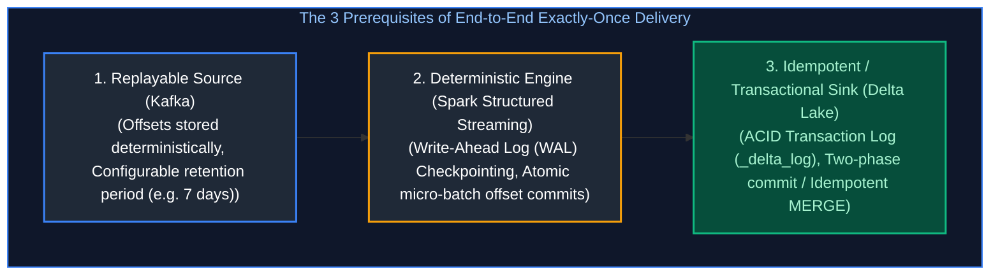

1. **Replayable Source:** Kafka retains messages with fixed offsets for $N$ days. If a node fails, Spark can re-read the exact byte offsets.
2. **Deterministic Processing Engine:** Spark records the exact start and end Kafka offsets in its persistent checkpoint directory before processing.
3. **Idempotent / Transactional Sink:**
   - Delta Lake writes files and commits the write in a single atomic JSON transaction in `_delta_log`.
   - If a failure occurs before the transaction commit finishes, the orphan files are ignored by Delta readers. Upon restart, Spark reads the checkpoint WAL, reprocesses the batch, and commits the transaction once.

---

### Streaming Q3. Streaming Ingestion Engine Evaluation: Apache Kafka vs AWS Kinesis vs Azure Event Hubs vs GCP Pub/Sub
**Topic Covered:** Cloud Message Brokers, Consumer Models, Partition Scaling & Protocol Compatibility  
**Question:** How do you decide between using Apache Kafka, AWS Kinesis, Azure Event Hubs, or Google Cloud Pub/Sub for streaming ingestion?

#### Architectural Comparison Matrix

| Feature / Dimension | Apache Kafka | AWS Kinesis Data Streams | Azure Event Hubs | GCP Cloud Pub/Sub |
| :--- | :--- | :--- | :--- | :--- |
| **Architectural Model** | Distributed append-only commit log (Pull-based). | Distributed append-only commit log (Pull-based). | Distributed append-only commit log (Pull/Kafka wire protocol). | Serverless publish-subscribe broker (Push or Pull). |
| **Partition Scaling** | Manual / Rebalance: adding partitions requires topic reconfiguration. | Dynamic Shard splitting and merging (On-demand or provisioned mode). | Throughput Units (TUs) or auto-inflating partitions (up to 100+ partitions). | **Completely Serverless**; dynamic auto-scaling without partition management. |
| **Ordering Guarantees** | Strict FIFO ordering **per partition key**. | Strict FIFO ordering **per partition key**. | Strict FIFO ordering **per partition key**. | Best-effort by default; strict FIFO when using explicit ordering keys. |
| **Message Retention** | Configurable: hours to indefinite (Compact log or Tiered Storage). | 24 hours default, extendable up to 365 days. | 1 to 90 days (Dedicated tier supports longer). | Up to 7 days unacknowledged; 31 days with snapshot storage. |
| **Ecosystem Fit** | Multi-cloud, on-prem, enterprise standard with Kafka Streams / Flink. | Deep native integration with AWS Lambda, EMR, Athena, and S3 Firehose. | Native first-party integration with Azure Databricks, Fabric, Synapse, and ADF. | Deep native integration with Google Cloud Dataflow (Apache Beam) and BigQuery. |

---

### Auto Loader Q18. Resilient High-Scale ADLS Ingestion: Auto Loader & Checkpointed Delta MERGE
**Topic Covered:** High-Volume File Ingestion, Idempotency, Late Arrivals & File Recovery  
**Question:** Your ADLS pipeline ingests millions of files daily. Some arrive late, some get reprocessed, and failures must not create duplicate records. How would you design a reliable ingestion pipeline?

#### The 5-Layer Resilience Architecture
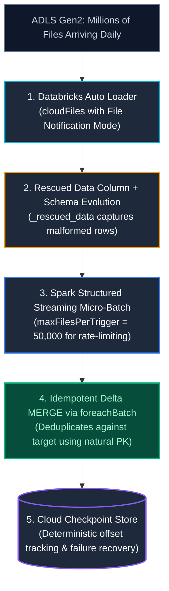

#### Production PySpark Implementation
```python
from pyspark.sql import functions as F
from delta.tables import DeltaTable

def upsert_to_delta(micro_batch_df, batch_id):
    """
    Idempotent Micro-Batch Writer:
    Uses Delta MERGE to guarantee that re-run batches or duplicate files
    never produce duplicate records in the target Silver table.
    """
    target_table = DeltaTable.forName(spark, "silver_catalog.telemetry.events")

    # In-batch deduplication before merging into target
    deduped_batch = micro_batch_df.dropDuplicates(["event_id"])

    (
        target_table.alias("target")
        .merge(
            deduped_batch.alias("source"),
            "target.event_id = source.event_id"
        )
        .whenMatchedUpdateAll(
            condition="source.event_timestamp >= target.event_timestamp"
        )
        .whenNotMatchedInsertAll()
        .execute()
    )

# High-Scale Auto Loader Streaming Reader
raw_stream = (
    spark.readStream.format("cloudFiles")
    .option("cloudFiles.format", "parquet")
    .option("cloudFiles.useNotifications", "true")           # Event Grid queue discovery (bypasses directory listing)
    .option("cloudFiles.schemaLocation", "/mnt/lake/checkpoints/events_schema")
    .option("cloudFiles.schemaEvolutionMode", "addNewColumns")
    .option("cloudFiles.maxFilesPerTrigger", "25000")        # Backpressure guard preventing driver OOM
    .load("abfss://raw-data@datalakeprod.dfs.core.windows.net/events/")
)

# Start Stream with foreachBatch and dedicated checkpoint
query = (
    raw_stream.writeStream
    .foreachBatch(upsert_to_delta)
    .option("checkpointLocation", "/mnt/lake/checkpoints/events_stream")
    .trigger(processingTime="1 minute")
    .start()
)
```

---

### Auto Loader Q19. End-to-End Streaming Pipeline: Kafka to Spark Structured Streaming to Delta Lake
**Topic Covered:** End-to-End Real-Time Ingestion, Kafka JSON Deserialization, Watermarking & Delta Sinks  
**Question:** Write an end-to-end production PySpark Structured Streaming application to consume events from an Apache Kafka topic, parse JSON payloads, filter corrupt events, and write directly into a Delta Lake table with checkpointing.

#### Production Implementation / Code Solution
```python
from pyspark.sql import functions as F
from pyspark.sql.types import StructType, StructField, StringType, DoubleType, LongType, TimestampType

# Step 1: Define explicit JSON schema contract for payload
order_schema = StructType([
    StructField("order_id", StringType(), False),
    StructField("customer_id", StringType(), True),
    StructField("order_amount", DoubleType(), True),
    StructField("currency", StringType(), True),
    StructField("event_timestamp", TimestampType(), True)
])

# Step 2: Ingest continuous byte stream from Kafka
kafka_stream_df = (
    spark.readStream.format("kafka")
    .option("kafka.bootstrap.servers", "kafka-broker1.corp:9092,kafka-broker2.corp:9092")
    .option("subscribe", "prod.ecommerce.orders")
    .option("startingOffsets", "latest")
    .option("failOnDataLoss", "false")
    .load()
)

# Step 3: Decode Kafka key/value bytes and parse JSON payload
parsed_orders_df = (
    kafka_stream_df
    .selectExpr("CAST(key AS STRING) AS kafka_key", "CAST(value AS STRING) AS json_payload", "timestamp AS kafka_arrival_time")
    .withColumn("data", F.from_json(F.col("json_payload"), order_schema))
    .select("kafka_key", "kafka_arrival_time", "data.*")
    # Step 4: Defense-in-depth data quality filtering
    .filter(F.col("order_id").isNotNull() & (F.col("order_amount") > 0.0))
    # Step 5: Event-time watermarking for late-arriving events
    .withWatermark("event_timestamp", "2 hours")
    .dropDuplicates(["order_id", "event_timestamp"])
)

# Step 6: Write parsed events to Delta Lake with checkpointing
streaming_query = (
    parsed_orders_df.writeStream
    .format("delta")
    .outputMode("append")
    .option("checkpointLocation", "/mnt/lakehouse/checkpoints/kafka_orders_bronze")
    .trigger(processingTime="15 seconds")
    .toTable("bronze_catalog.orders.raw_stream")
)

streaming_query.awaitTermination()
```
- **Time Complexity:** $O(B)$ per micro-batch where $B$ is the number of arrived Kafka records.
- **Space Complexity:** $O(W)$ state store memory for tracking deduplication keys within the 2-hour watermark.

