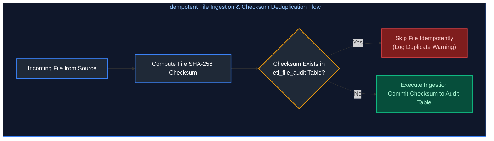
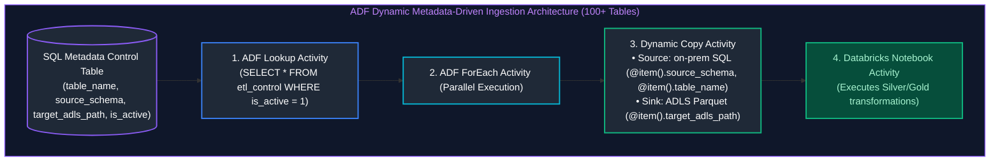
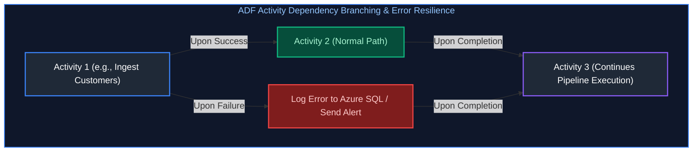
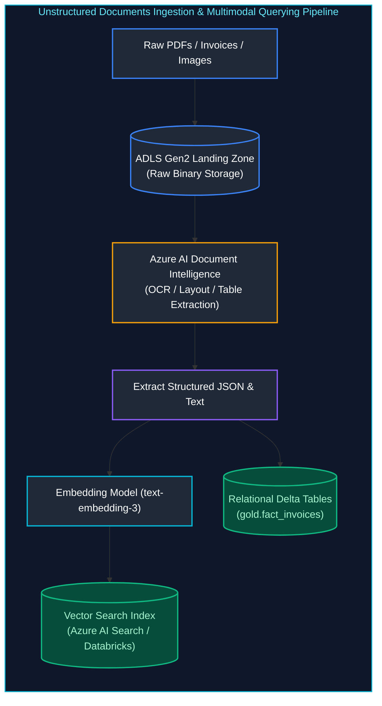

# 09. Azure Data Factory (ADF) & ETL Pipelines: Interview Questions & Deep-Dive Solutions

A comprehensive, production-grade guide answering Azure Data Factory (ADF), ETL pipeline design, orchestration, and enterprise integration interview scenarios. Covers metadata-driven ingestion, dynamic Databricks parameter passing, activity dependency branching, self-hosted vs Azure IR, pipeline idempotency, checkpoint restarts, dbt transformation architecture, data quality frameworks, and unstructured file ingestion.

---

## Table of Contents & Question Mapping

1. **Core ETL Architecture: Idempotency, Checkpointing & Deduplication**
   - [ETL Q1 & Q2. End-to-End Batch Data Pipeline Architecture](#etl-q1--q2-end-to-end-batch-data-pipeline-architecture)
   - [ETL Q8 & Q9. Pipeline Idempotency & Re-execution Safety](#etl-q8--q9-pipeline-idempotency--re-execution-safety)
   - [ETL Q5. Deduplicating Duplicate Source Files Idempotently](#etl-q5-deduplicating-duplicate-source-files-idempotently)
   - [ETL Q3. Designing Restartability via Checkpointing](#etl-q3-designing-restartability-via-checkpointing)
2. **Metadata-Driven Ingestion in ADF & Dynamic Databricks Invocation**
   - [ADF Q6 & Q13. Metadata-Driven Ingestion Architecture](#adf-q6--q13-metadata-driven-ingestion-architecture)
   - [ADF Q1, Q4, Q5 & Q15. Dynamic Databricks Invocation & Parameter Passing](#adf-q1-q4-q5--q15-dynamic-databricks-invocation--parameter-passing)
3. **ADF Resilience Engineering: Dependency Branching, Retries & Error Bubbling**
   - [ADF Q2 & Q3. Activity Dependency Branching Rules & Retry Handling](#adf-q2--q3-activity-dependency-branching-rules--retry-handling)
   - [ADF Q11, Q12 & Q16. Capturing Databricks Notebook Errors in ADF & Alerting](#adf-q11-q12--q16-capturing-databricks-notebook-errors-in-adf--alerting)
   - [ADF Q14. Deleting Files Across Multiple Containers Daily](#adf-q14-deleting-files-across-multiple-containers-daily)
4. **ADF Operational Diagnostics & Integration Runtimes**
   - [ADF Q17. Azure Integration Runtime (IR) vs Self-Hosted IR (SHIR)](#adf-q17-azure-integration-runtime-ir-vs-self-hosted-ir-shir)
   - [ADF Q7, Q8 & Q10. Copy Activity Performance Bottlenecks & Failure Isolation](#adf-q7-q8--q10-copy-activity-performance-bottlenecks--failure-isolation)
   - [ETL Q14. Pipeline Stuck in Queued State: Top 3 Checks](#etl-q14-pipeline-stuck-in-queued-state-top-3-checks)
5. **Transformation Engines: dbt Framework & Pipeline Audit Trails**
   - [ETL Q4. The dbt Transformation Framework & ELT Benefits](#etl-q4-the-dbt-transformation-framework--elt-benefits)
   - [ETL Q7, Q10 & Q11. Dimension Audit Columns, Late-Arriving Data & Schema Evolution](#etl-q7-q10--q11-dimension-audit-columns-late-arriving-data--schema-evolution)
6. **Data Quality Gates, SLA Observability & Secret Management**
   - [ETL Q6, Q12 & Q13. The 5 Essential Data Quality Gates & SLA Observability](#etl-q6-q12--q13-the-5-essential-data-quality-gates--sla-observability)
   - [ETL Q15. Enterprise Secret Management in Production Pipelines](#etl-q15-enterprise-secret-management-in-production-pipelines)
7. **Unstructured Data Pipeline Design: Ingesting PDFs & Images**
   - [ETL Q16. Unstructured Data Pipeline Design: Ingesting PDFs & Images](#etl-q16-unstructured-data-pipeline-design-ingesting-pdfs--images)
---

# 1. Core ETL Architecture: Idempotency, Checkpointing & Deduplication

---

### ETL Q1 & Q2. End-to-End Batch Data Pipeline Architecture
**Topic Covered:** End-to-End Batch Architecture, Modular Stages & Operational Trade-offs  
**Questions Covered:**
- **ETL Q1**: End-to-End Design of Data Pipelines (Trade-offs, Scaling, Challenges & Handling).
- **ETL Q2**: Designing a batch data pipeline.

---

### ETL Q8 & Q9. Pipeline Idempotency & Re-execution Safety
**Topic Covered:** Re-run Safety, Deterministic Overwrites & Upsert Idempotency  
**Questions Covered:**
- **ETL Q8**: What is idempotency in a data pipeline and why does it matter for reruns?
- **ETL Q9**: How would you make a data pipeline idempotent?

#### What is Idempotency and Why Does it Matter? (ETL Q8, Q9)
A data pipeline is **idempotent** if running it multiple times with the exact same input produces the **exact same final state**, with zero duplicate records and zero unintended side effects.
$$f(f(x)) = f(x)$$
- **Why it matters:** If a nightly pipeline fails at 90% completion and an on-call engineer triggers a re-run, a non-idempotent pipeline (`INSERT INTO`) duplicates existing rows, corrupting financial reporting.

#### How to Make Pipelines Idempotent: 3 Production Patterns
1. **Atomic Partition Overwrites:** Overwrite the target partition rather than appending:
   ```sql
   INSERT OVERWRITE TABLE fact_sales PARTITION (order_date = '2024-10-05')
   SELECT ... FROM staging_sales;
   ```
2. **Delta Lake / SQL MERGE:** Atomic Upsert on Natural Business Keys.
3. **Atomic Staging Table Swaps:** Load into `#staging_table`, then perform an atomic rename or partition switch.

---

### ETL Q5. Deduplicating Duplicate Source Files Idempotently
**Topic Covered:** File Fingerprinting, SHA-256 Hashes & Atomic Upserts  
**Question:** Scenario: A source sends the same file twice on some days. How do you dedupe idempotently at load time?

#### Deduplicating Duplicate Source Files Idempotently (ETL Q5)
When external vendors accidentally send the identical file twice on the same day:
1. Compute the **SHA-256 / MD5 Checksum** of the incoming file at landing.
2. Query the pipeline metadata control table:
   - If the checksum already exists for that partition date, log a warning and **skip processing**.
   - If the checksum is new, record it in the metadata control table and proceed.



---

### ETL Q3. Designing Restartability via Checkpointing
**Topic Covered:** Staged State Markers, Step-Level Checkpointing & Automated Recovery  
**Question:** Scenario: A nightly load must be restartable from the point of failure. How do you design checkpointing?

#### Designing Restartability via Checkpointing (ETL Q3)
To ensure a 10-step nightly load restarts from the exact step that failed:
- Store pipeline state in an **Audit Control Table**:
  ```sql
  CREATE TABLE etl_pipeline_checkpoint (
      batch_id VARCHAR(64),
      pipeline_name VARCHAR(100),
      step_name VARCHAR(100),
      status VARCHAR(20), -- 'PENDING', 'IN_PROGRESS', 'SUCCESS', 'FAILED'
      start_time TIMESTAMP,
      end_time TIMESTAMP,
      PRIMARY KEY (batch_id, step_name)
  );
  ```
- Before executing Step $K$, the orchestrator checks `SELECT status FROM etl_pipeline_checkpoint WHERE batch_id = @id AND step_name = 'StepK'`. If status is `SUCCESS`, it skips directly to Step $K+1$.

---

# 2. Metadata-Driven Ingestion in ADF & Dynamic Databricks Invocation

---

### ADF Q6 & Q13. Metadata-Driven Ingestion Architecture
**Topic Covered:** Control Tables, Lookup Activities & Dynamic ForEach Parallelism  
**Questions Covered:**
- **ADF Q6**: How would you design a metadata-driven pipeline instead of creating separate pipelines for every table (e.g. 100+ tables)?
- **ADF Q13**: How can you dynamically copy multiple tables from an on-prem SQL Server to Azure Data Lake using ADF?

#### Metadata-Driven Ingestion Architecture (ADF Q6, Q13)
Instead of building 100 individual ADF pipelines for 100 tables, build **ONE generic pipeline** driven by a SQL Control Table.



---

### ADF Q1, Q4, Q5 & Q15. Dynamic Databricks Invocation & Parameter Passing
**Topic Covered:** Base Parameters, `dbutils.widgets`, Pipeline Expression Language & Dynamic Content  
**Questions Covered:**
- **ADF Q1**: How would you design an ADF pipeline that triggers Databricks notebooks dynamically?
- **ADF Q4**: How would you pass parameters from ADF to Databricks?
- **ADF Q5**: You need to pass table name, load type, source path, and execution date from ADF to Databricks. How would you design the parameter flow?
- **ADF Q15**: How do you handle parameterization and dynamic content in ADF pipelines for reusability?

#### Parameter Flow: ADF to Databricks Notebook (ADF Q1, Q4, Q5)

##### Step 1: Configure Base Parameters in ADF Databricks Notebook Activity
Inside the ADF Databricks Activity settings under **Base Parameters**:
- `p_table_name`: `@item().table_name`
- `p_load_type`: `@item().load_type`
- `p_source_path`: `@concat('abfss://raw@datalake.dfs.core.windows.net/', item().target_path)`
- `p_execution_date`: `@formatDateTime(pipeline().TriggerTime, 'yyyy-MM-dd')`

##### Step 2: Access Parameters in the Databricks PySpark Notebook
```python
# Extract parameters passed from ADF widgets
table_name = dbutils.widgets.get("p_table_name")
load_type = dbutils.widgets.get("p_load_type")
source_path = dbutils.widgets.get("p_source_path")
execution_date = dbutils.widgets.get("p_execution_date")

print(f"Executing {load_type} ingestion for {table_name} from {source_path} on {execution_date}")

# Dynamic PySpark Processing Logic
raw_df = spark.read.parquet(source_path)
raw_df.write.format("delta").mode("append").saveAsTable(f"bronze.{table_name}")
```

---

# 3. ADF Resilience Engineering: Dependency Branching, Retries & Error Bubbling

---

### ADF Q2 & Q3. Activity Dependency Branching Rules & Retry Handling
**Topic Covered:** `UponCompletion`, `UponFailure`, Exponential Backoffs & Fault Tolerant Iteration  
**Questions Covered:**
- **ADF Q2**: If one activity fails in a pipeline containing 20 activities, how would you continue processing the remaining activities?
- **ADF Q3**: How would you implement retry and failure handling in ADF?

#### Activity Dependency Branching Rules (ADF Q2, Q3)
ADF supports four conditional activity dependencies:
1. **Upon Success (Green):** Dependent activity runs only if predecessor succeeds.
2. **Upon Failure (Red):** Runs only if predecessor fails (used for failure alerting/logging).
3. **Upon Completion (Blue):** Runs regardless of whether predecessor succeeded or failed.
4. **Upon Skip (Gray):** Runs if predecessor was skipped.

##### Continuing When 1 of 20 Activities Fails (ADF Q2)
- Connect downstream activities using **Upon Completion** dependencies.
- Alternatively, wrap independent activities inside a **ForEach Activity** with `isSequential: false`. An individual iteration failure does not abort other iterations.



---

### ADF Q11, Q12 & Q16. Capturing Databricks Notebook Errors in ADF & Alerting
**Topic Covered:** `dbutils.notebook.exit()`, Custom Error Bubbling & Automated Teams/Slack Alerts  
**Questions Covered:**
- **ADF Q11/Q12**: ADF successfully triggers a Databricks notebook, but the notebook fails. How would you capture the error and make the ADF pipeline fail correctly?
- **ADF Q16**: Describe how you implement error handling, alerting, and monitoring in ADF.

#### Capturing Databricks Notebook Errors in ADF (ADF Q12)
If a notebook contains an unhandled exception, Databricks reports an error status, and the ADF notebook activity fails automatically.
However, if Python code catches the exception with `try...except`, ADF sees the notebook as successful!
- **How to properly bubble the error to ADF:**
```python
import sys

try:
    process_data()
except Exception as e:
    # Option A: Re-raise the exception so Databricks exits with code 1
    raise e
    
    # Option B: Explicitly exit with error JSON string
    # dbutils.notebook.exit(json.dumps({"status": "FAILED", "error": str(e)}))
```

---

### ADF Q14. Deleting Files Across Multiple Containers Daily
**Topic Covered:** Multi-Container Metadata Enumeration & Child Pipeline Invocation  
**Question:** You need to delete files from multiple containers daily before writing new data. ADF doesn't support wildcards across containers in one delete activity. How would you design this?

#### Deleting Files Across Multiple Containers Daily (ADF Q14)
Because a single Delete Activity cannot span multiple storage containers:
1. Define a pipeline array parameter: `["bronze-landing", "staging-temp", "quarantine"]`.
2. Use an **ADF ForEach Activity** iterating through the array.
3. Inside the ForEach loop, invoke a parameterized **Delete Activity** with container set to `@item()`.

---

# 4. ADF Operational Diagnostics & Integration Runtimes

---

### ADF Q17. Azure Integration Runtime (IR) vs Self-Hosted IR (SHIR)
**Topic Covered:** Cloud Serverless Compute vs On-Premises Private Gateway Nodes  
**Question:** What is the difference between an Azure Integration Runtime (IR) and a Self-Hosted IR?

#### Azure IR vs Self-Hosted Integration Runtime (SHIR) (ADF Q17)
| Dimension | Azure Integration Runtime (Azure IR) | Self-Hosted Integration Runtime (SHIR) |
| :--- | :--- | :--- |
| **Infrastructure** | Fully managed serverless compute hosted in Azure cloud. | Customer-managed VM installed on-prem or in a private cloud VNet. |
| **Network Reach** | Public cloud endpoints and Azure PaaS services. | Connects to private on-premises databases (SQL Server, Oracle) behind firewalls. |
| **Maintenance** | Zero OS patching or maintenance required. | Requires manual OS updates, VM monitoring, and HA node clustering. |

---

### ADF Q7, Q8 & Q10. Copy Activity Performance Bottlenecks & Failure Isolation
**Topic Covered:** DIU Sizing, Degree of Copy Parallelism, Network Throttling & Silent Row Drops  
**Questions Covered:**
- **ADF Q7**: A pipeline succeeds, but the target table contains incomplete or 0 records. How would you troubleshoot it?
- **ADF Q8**: An ADF pipeline fails randomly. How would you determine whether the problem is with ADF, the source, or the target?
- **ADF Q10**: An ADF Copy Activity suddenly becomes very slow. What would you investigate?

#### Copy Activity Performance Bottlenecks (ADF Q10)
Inspect the **Copy Activity Execution Details** window:
1. **Network Throttling:** Check throughput (MB/s). Increase **Data Integration Units (DIUs)** (from default 4 to 32).
2. **Degree of Copy Parallelism:** Increase parallel threads reading source data.
3. **Source Database Reads:** Check if the source database is throttling queries due to CPU/Memory saturation.
4. **Staging Storage:** Enable Staging in Blob/ADLS to optimize ingestion into Synapse PolyBase/COPY INTO.

---

### ETL Q14. Pipeline Stuck in Queued State: Top 3 Checks
**Topic Covered:** Concurrent Pipeline Limits, SHIR Node Resource Saturation & Spark Cluster Warmup  
**Question:** Your pipeline is stuck in a Queued state. What are the top 3 things you would check?

#### Pipeline Stuck in "Queued" State: Top 3 Checks (ETL Q14)
1. **ADF Pipeline Concurrency Limit:** The maximum concurrent pipeline runs limit has been reached for the factory.
2. **Self-Hosted IR Saturated or Offline:** The SHIR node has 0 available concurrent job slots (CPU/RAM exhausted) or the SHIR service lost heartbeat.
3. **Target Data Store Throttling:** Target database (e.g., Azure SQL DW or Databricks cluster) is pausing, auto-scaling, or rejecting connections.

---

# 5. Transformation Engines: dbt Framework & Pipeline Audit Trails

---

### ETL Q4. The dbt Transformation Framework & ELT Benefits
**Topic Covered:** SQL Compilation, Jinja Templating, DAG Dependencies & In-Warehouse Pushdown  
**Question:** What is dbt, and what problem does it solve in the transformation layer?

#### What is dbt and What Problems Does it Solve? (ETL Q4)
**dbt (data build tool)** is an open-source transformation framework that enables data engineers to write modular SQL `SELECT` models while automating:
- **Dependency DAG Graph:** Resolves model execution order automatically using the `{{ ref('model_name') }}` macro.
- **Built-in Testing:** Validates data quality (`unique`, `not_null`, `relationships`) out-of-the-box.
- **Materialization Abstraction:** Switches a model between a `view`, `table`, or `incremental` table simply by changing a configuration header!

---

### ETL Q7, Q10 & Q11. Dimension Audit Columns, Late-Arriving Data & Schema Evolution
**Topic Covered:** Ingestion Metadata Columns, SCD Type 2 Auditability & Schema Evolution Strategies  
**Questions Covered:**
- **ETL Q7**: How would you implement audit columns and change tracking in a dimension load?
- **ETL Q10**: How do you handle duplicate records and late-arriving data in ETL pipelines?
- **ETL Q11**: How do you handle schema evolution in data pipelines (like Avro, Parquet, or JSON)?

#### Audit Columns Implementation in Dimension Loads (ETL Q7)
Every enterprise dimension and fact table should include mandatory audit columns:
```sql
ALTER TABLE dim_customers ADD COLUMNS (
    etl_batch_id VARCHAR(64),      -- Maps to pipeline execution run ID
    etl_created_at TIMESTAMP,      -- Insertion timestamp
    etl_updated_at TIMESTAMP,      -- Last update timestamp
    etl_source_file VARCHAR(255),  -- Originating storage filename
    etl_hash_diff VARCHAR(64)      -- MD5 hash of monitored attributes for change detection
);
```

---

# 6. Data Quality Gates, SLA Observability & Secret Management

---

### ETL Q6, Q12 & Q13. The 5 Essential Data Quality Gates & SLA Observability
**Topic Covered:** Pre-Ingestion & Post-Ingestion Quality Assertions, Freshness SLAs & Circuit Breakers  
**Questions Covered:**
- **ETL Q6**: How do you monitor pipeline SLAs and alert on data-freshness breaches?
- **ETL Q12**: What are common data quality checks you implement in pipelines?
- **ETL Q13**: How do you ensure pipeline reliability and monitoring in production?

#### The 5 Essential Data Quality Gates (ETL Q12)
1. **Uniqueness:** Primary keys must contain zero duplicate values.
2. **Completeness:** Mandatory columns (`customer_id`, `transaction_date`) must be $0\%$ NULL.
3. **Referential Integrity:** Foreign keys in fact tables must resolve to valid surrogate keys in dimension tables.
4. **Domain / Range Validity:** Numeric metrics must fall within expected boundaries (e.g., `amount >= 0`, `age BETWEEN 18 AND 120`).
5. **Volume Anomaly Detection:** Compares daily row volume against 7-day moving averages (flags alert if volume drops by $>30\%$).

---

### ETL Q15. Enterprise Secret Management in Production Pipelines
**Topic Covered:** Azure Key Vault, Managed Identities, Scope Permissions & Zero-PlainText Secrets  
**Question:** How do you manage secrets securely in a production pipeline?

#### Enterprise Secret Management (ETL Q15)
- Never store connection strings or passwords in code or pipeline JSON.
- **Azure Key Vault Integration:** Use **Azure System-Assigned Managed Identity** on Azure Data Factory and Databricks.
- ADF connects to Azure Key Vault via Linked Service, fetching database passwords dynamically at runtime.

---

# 7. Unstructured Data Pipeline Design: Ingesting PDFs & Images

---

### ETL Q16. Unstructured Data Pipeline Design: Ingesting PDFs & Images
**Topic Covered:** Binary Storage, OCR Extraction, Vector Embeddings & Lakehouse Cataloging  
**Question:** If you are asked to ingest PDF and image files into your pipeline and make them queryable, how would you design it?

#### End-to-End Architectural Blueprint


#### Step-by-Step Processing Pipeline
1. **Storage Landing:** Stream raw PDF/TIFF files into ADLS Gen2 raw container.
2. **OCR & Document Extraction:** A Databricks job or Azure Function sends documents to **Azure AI Document Intelligence** (Form Recognizer).
   - Extracts structured key-value pairs (Invoice Number, Total Due, Vendor Name).
   - Extracts tabular invoice line items into relational rows.
3. **Structured Lakehouse Storage:** Extracted tabular data is written to a **Delta Lake table** (`gold.vendor_invoices`) for SQL and BI querying.
4. **Vector Embeddings for Semantic Search:** Full text is chunked, converted to dense vector embeddings, and indexed in **Azure AI Search** or Databricks Vector Search for LLM-powered RAG querying.
