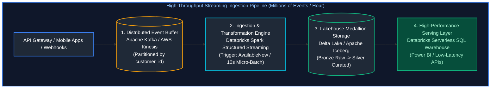
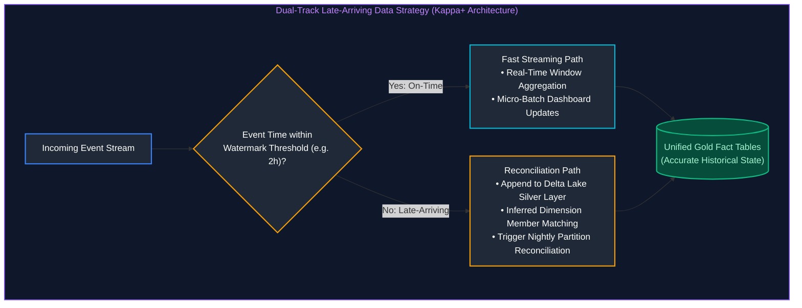
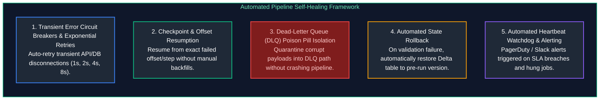
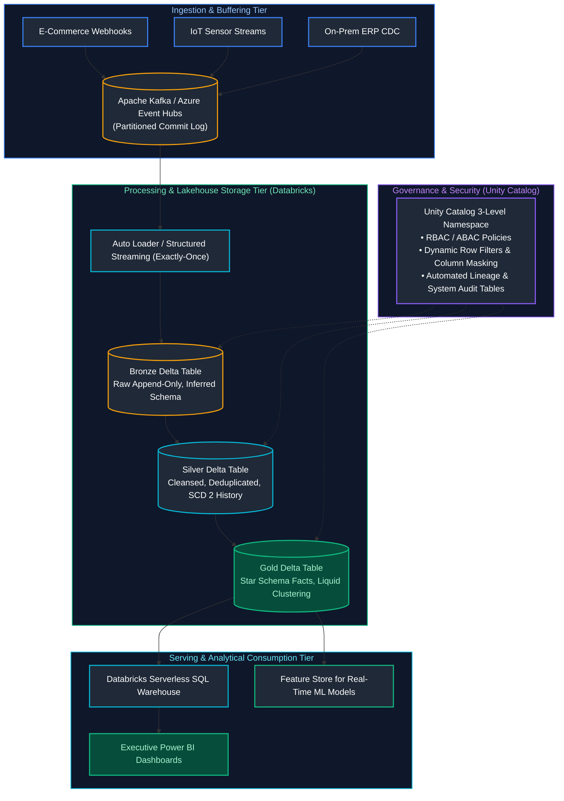

# 10. Data Engineering Architecture & System Design: Interview Questions & Deep-Dive Solutions

A comprehensive, production-grade guide answering enterprise Data Engineering Architecture and System Design interview scenarios. Covers high-throughput stream ingestion (millions of records/hour), comprehensive late-arriving data strategies, self-healing automated failure recovery pipelines, and end-to-end multi-cloud lakehouse architectures.

---

## Table of Contents & Question Mapping

1. **High-Throughput Pipeline Architecture: Millions of Records per Hour**
   - [Q1. High-Throughput Pipeline Architecture: Millions of Records per Hour](#q1-high-throughput-pipeline-architecture-millions-of-records-per-hour)
2. **Comprehensive Strategy for Late-Arriving & Out-of-Order Data**
   - [Q2. Comprehensive Strategy for Late-Arriving & Out-of-Order Data](#q2-comprehensive-strategy-for-late-arriving--out-of-order-data)
3. **Self-Healing & Automated Failure Recovery Pipelines**
   - [Q3. Self-Healing & Automated Failure Recovery Pipelines](#q3-self-healing--automated-failure-recovery-pipelines)
4. **Enterprise System Design Capstone: Global Real-Time Analytics Lakehouse**
   - [Enterprise System Design Capstone: Global Real-Time Analytics Lakehouse](#enterprise-system-design-capstone-global-real-time-analytics-lakehouse)
---

# 1. High-Throughput Pipeline Architecture: Millions of Records per Hour

---

### Q1. High-Throughput Pipeline Architecture: Millions of Records per Hour
**Topic Covered:** High-Throughput Stream Ingestion, Throughput Math, Partition Sizing & Delta Liquid Clustering  
**Question:** How would you design a pipeline for millions of records arriving every hour?

#### Architectural Requirements & Calculations
- **Throughput Profile:** 5,000,000 records/hour $\approx 1,400\text{ records/sec}$ steady state, with peak bursts of $5,000\text{ records/sec}$.
- **Average Record Size:** 2 KB $\to 10\text{ MB/sec}$ sustained write throughput ($36\text{ GB/hour}$).
- **Key Architectural Objectives:** Zero data loss, sub-minute latency to analytical queries, automated backpressure handling, cost-efficient resource provisioning.

#### End-to-End Architectural Blueprint


#### Layer-by-Layer Design Decisions
1. **Buffering & Decoupling Layer (Kafka / Kinesis):**
   - Direct database ingestion fails during traffic spikes. A distributed commit log buffers spikes and absorbs producer backpressure.
   - **Partitioning Strategy:** Hash partition on `customer_id` or `device_id` into 16 partitions to distribute load evenly across cluster nodes.
2. **Compute & Ingestion Engine (Spark Structured Streaming):**
   - Operates in micro-batches with trigger intervals of 10–30 seconds.
   - Dynamically scales worker nodes using cluster autoscaling based on Kafka consumer lag metrics.
3. **Storage & Compaction Layer (Delta Lake / Parquet):**
   - Writes raw append-only Bronze tables.
   - Uses **Liquid Clustering** or partitioning on `date` and `hour` (`date=2024-10-05/hour=14/`).
   - Automatically executes bin-packing compaction (`OPTIMIZE`) to eliminate small file overhead.

---

# 2. Comprehensive Strategy for Late-Arriving & Out-of-Order Data

---

### Q2. Comprehensive Strategy for Late-Arriving & Out-of-Order Data
**Topic Covered:** Watermarking, Dual-Track Kappa+ Architecture, Event-Time Partitions & Delta Table Merges  
**Question:** How would you handle late-arriving data in pipeline design?

#### Why Data Arrives Late
1. **Mobile Device Offline Caching:** A passenger buys an airline ticket while in flight (offline). The transaction syncs 12 hours later when landing.
2. **Network Partitions & Retries:** Upstream third-party webhooks experience downtime and replay backlogged batches.
3. **Source System Batch Syncs:** Legacy ERPs sync transactions once every 24 hours.

#### The Dual-Track Late Data Architecture (Kappa+ Architecture)


#### Core Remediation Mechanisms
1. **Event-Time Processing with Watermarking:** Always aggregate and window on `event_timestamp` (when the action occurred), never on ingestion arrival time.
2. **Inferred Dimension Members:** When a fact arrives referencing a customer ID not yet present in the Customer dimension, create an **Inferred Member** (`customer_sk = Hash(ID)`, `is_inferred = TRUE`), backfilling attributes when the dimension arrives.
3. **Idempotent Partition Overwrites / Merges:** Nightly reconciliation jobs use `MERGE` to update historical partitions safely without duplicating rows.

---

# 3. Self-Healing & Automated Failure Recovery Pipelines

---

### Q3. Self-Healing & Automated Failure Recovery Pipelines
**Topic Covered:** Idempotent Design, Dead-Letter Queues, Dynamic Checkpointing & Circuit Breakers  
**Question:** How would you design a pipeline that can recover automatically after failure?

#### The 5 Pillars of Self-Healing Data Engineering


#### Production Architecture Implementation
1. **Idempotent Execution by Design:** Re-running any pipeline stage (whether manually or via automated orchestrator retry) must produce identical results.
2. **Automated State Tracking via Control Tables:** Orchestrators check an audit table before each task. If a task completed successfully, the step is skipped; if failed, it re-executes.
3. **Data Quality Circuit Breakers:**
   ```python
   # Automated Validation & Self-Healing Rollback Pattern
   pre_run_version = spark.sql("DESCRIBE HISTORY gold.sales").first()["version"]
   
   try:
       execute_gold_transformations()
       run_automated_data_quality_tests()
   except DataQualityError as dq_err:
       # Self-healing rollback: table reverts instantly to healthy state!
       spark.sql(f"RESTORE TABLE gold.sales TO VERSION AS OF {pre_run_version}")
       send_pagerduty_alert(f"Gold pipeline rolled back automatically: {dq_err}")
       raise dq_err
   ```

---

# 4. Enterprise System Design Capstone: Global Real-Time Analytics Lakehouse

---

### Enterprise System Design Capstone: Global Real-Time Analytics Lakehouse
**Topic Covered:** End-to-End Enterprise Lakehouse Architecture (Edge IoT, Event Hubs, Auto Loader, Medallion, Power BI)  

#### End-to-End Multi-Layer Architecture


#### Architectural Key Points
- **Zero-Copy Data Sharing:** Downstream BI dashboards and machine learning models query the single unified Gold Delta layer without exporting copies to separate proprietary systems.
- **Unified Governance:** Unity Catalog enforces security policies, column masks, and access control across all tools and languages uniformly.
- **Cost-Efficiency:** Automated Job clusters and Serverless SQL warehouses auto-suspend when idle, reducing cloud compute expenditures by 60%+.
