# 10. Data Engineering Architecture & System Design: Interview Questions & Deep-Dive Solutions

A comprehensive, production-grade guide answering enterprise Data Engineering Architecture and System Design interview scenarios. Covers high-throughput stream ingestion (millions of records/hour), comprehensive late-arriving data strategies, self-healing automated failure recovery pipelines, and end-to-end multi-cloud lakehouse architectures.

---

## Table of Contents & Question Mapping

1. **High-Throughput Pipeline Architecture: Millions of Records per Hour**
   - [Q1. High-Throughput Pipeline Architecture: Millions of Records per Hour](#q1-high-throughput-pipeline-architecture-millions-of-records-per-hour)
2. **Comprehensive Strategy for Late-Arriving & Out-of-Order Data**
   - [Q2. Comprehensive Strategy for Late-Arriving & Out-of-Order Data](#q2-comprehensive-strategy-for-late-arriving--out-of-order-data)
3. **Self-Healing & Automated Failure Recovery Pipelines**
   - [Q3. Self-Healing & Automated Failure Recovery Pipelines](#q3-self-healing--automated-failure-recovery-pipelines)
4. **Enterprise System Design Capstone: Global Real-Time Analytics Lakehouse**
   - [Enterprise System Design Capstone: Global Real-Time Analytics Lakehouse](#enterprise-system-design-capstone-global-real-time-analytics-lakehouse)
5. **Real-Time Fraud & Anomaly Detection Pipeline (<500ms Latency)**
   - [Real-Time Fraud & Anomaly Detection Architecture (<500ms SLA, 3M Daily Orders)](#real-time-fraud--anomaly-detection-architecture-500ms-sla-3m-daily-orders)
6. **Geospatial Real-Time Stream Ingestion & Dynamic Surge Pricing**
   - [Event-Driven Real-Time Surge Pricing Engine with Spatial Indexing](#event-driven-real-time-surge-pricing-engine-with-spatial-indexing)
   - [High-Throughput GPS Stream Ingestion: 100M GPS Pings/Day Under 1-Second Analytics](#high-throughput-gps-stream-ingestion-100m-gps-pingsday-under-1-second-analytics)
7. **High-Concurrency Flash Sale Systems & 48-Hour Emergency Scaling**
   - [Real-Time Flash Sale Inventory Management: 50M Products & Zero Overselling](#real-time-flash-sale-inventory-management-50m-products--zero-overselling)
   - [Emergency 48-Hour 100x Traffic Surge Architecture: 500 to 50,000 Orders/Sec](#emergency-48-hour-100x-traffic-surge-architecture-500-to-50000-orderssec)
8. **Real-Time Recommendation Systems & Cold-Start Architecture**
   - [Personalized Real-Time Recommendation Engine at Scale (80M to 400M Users, <200ms)](#personalized-real-time-recommendation-engine-at-scale-80m-to-400m-users-200ms)
9. **Algorithmic Catastrophe Mitigation & Production Reconciliation**
   - [Algorithmic Pricing Bug Containment: 800,000 Faulty Orders in 20 Minutes](#algorithmic-pricing-bug-containment-800000-faulty-orders-in-20-minutes)
10. **Config-Driven Ingestion Framework for 500,000 Heterogeneous Producers**
    - [Metadata-Driven Multi-Tenant Seller Ingestion Engine](#metadata-driven-multi-tenant-seller-ingestion-engine)
11. **Global Video Streaming Watch-History & Lakehouse Serving Architecture**
    - [Global Video Watch-History Lakehouse Architecture (Ingest -> Transform -> Serve)](#global-video-watch-history-lakehouse-architecture-ingest---transform---serve)
12. **Banking Regulatory & Compliance Data Platform (BCBS 239 / Basel III)**
    - [Enterprise Regulatory Data Platform: Bitemporal Modeling & Audit Lineage](#enterprise-regulatory-data-platform-bitemporal-modeling--audit-lineage)
13. **High-Scale E-Commerce Data Platform Architecture**
    - [High-Scale E-Commerce Data Platform Architecture](#high-scale-e-commerce-data-platform-architecture)
14. **Multi-Source Pipeline Design: Structured, Semi-Structured & Unstructured Data**
    - [Multi-Source Pipeline Design: Integrating Structured, Semi-Structured & Unstructured Data](#multi-source-pipeline-design-integrating-structured-semi-structured--unstructured-data)
15. **Production Pipeline Optimization & Observability for 100 GB Daily Scale**
    - [Production Pipeline Optimization & Observability for 100 GB Daily Processing Under Strict SLAs](#production-pipeline-optimization--observability-for-100-gb-daily-processing-under-strict-slas)
16. **Multi-Team Dependency Management, Data Contracts & Pipeline SLA Governance**
    - [Multi-Team Dependency Management, Data Contracts & Pipeline SLA Governance](#multi-team-dependency-management-data-contracts--pipeline-sla-governance)
17. **Enterprise Data Platform Modernization & 10x Load Surge Engineering**
    - [Q22. Legacy Data Platform Modernization: Migration Strategy & Domain Prioritization](#q22-legacy-data-platform-modernization-migration-strategy--domain-prioritization)
    - [Q23. 10x Data Volume Surge Readiness: Load Testing & End-to-End Optimization Playbook](#q23-10x-data-volume-surge-readiness-load-testing--end-to-end-optimization-playbook)
---


# 1. High-Throughput Pipeline Architecture: Millions of Records per Hour

---

### Q1. High-Throughput Pipeline Architecture: Millions of Records per Hour
*(Grouped together: High-throughput ingestion architecture at millions of records per hour and millions of events per minute)*  
**Topic Covered:** High-Throughput Stream Ingestion, Throughput Math, Partition Sizing & Delta Liquid Clustering  
**Questions Covered:**
- How would you design a pipeline for millions of records arriving every hour?
- Explain how you would build a near real-time ingestion system for millions of events per minute. Which components would you choose and why?

#### Architectural Requirements & Calculations
- **Throughput Profile:** 5,000,000 records/hour $\approx 1,400\text{ records/sec}$ steady state, with peak bursts of $5,000\text{ records/sec}$.
- **Average Record Size:** 2 KB $\to 10\text{ MB/sec}$ sustained write throughput ($36\text{ GB/hour}$).
- **Key Architectural Objectives:** Zero data loss, sub-minute latency to analytical queries, automated backpressure handling, cost-efficient resource provisioning.

#### End-to-End Architectural Blueprint
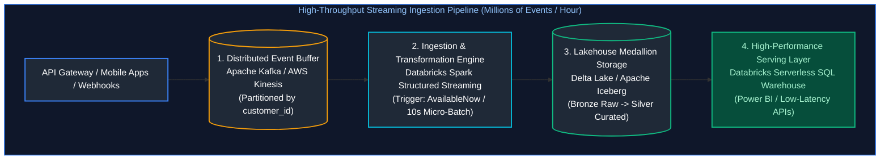

#### Layer-by-Layer Design Decisions
1. **Buffering & Decoupling Layer (Kafka / Kinesis):**
   - Direct database ingestion fails during traffic spikes. A distributed commit log buffers spikes and absorbs producer backpressure.
   - **Partitioning Strategy:** Hash partition on `customer_id` or `device_id` into 16 partitions to distribute load evenly across cluster nodes.
2. **Compute & Ingestion Engine (Spark Structured Streaming):**
   - Operates in micro-batches with trigger intervals of 10–30 seconds.
   - Dynamically scales worker nodes using cluster autoscaling based on Kafka consumer lag metrics.
3. **Storage & Compaction Layer (Delta Lake / Parquet):**
   - Writes raw append-only Bronze tables.
   - Uses **Liquid Clustering** or partitioning on `date` and `hour` (`date=2024-10-05/hour=14/`).
   - Automatically executes bin-packing compaction (`OPTIMIZE`) to eliminate small file overhead.

---

# 2. Comprehensive Strategy for Late-Arriving & Out-of-Order Data

---

### Q2. Comprehensive Strategy for Late-Arriving & Out-of-Order Data
**Topic Covered:** Watermarking, Dual-Track Kappa+ Architecture, Event-Time Partitions & Delta Table Merges  
**Question:** How would you handle late-arriving data in pipeline design?

#### Why Data Arrives Late
1. **Mobile Device Offline Caching:** A passenger buys an airline ticket while in flight (offline). The transaction syncs 12 hours later when landing.
2. **Network Partitions & Retries:** Upstream third-party webhooks experience downtime and replay backlogged batches.
3. **Source System Batch Syncs:** Legacy ERPs sync transactions once every 24 hours.

#### The Dual-Track Late Data Architecture (Kappa+ Architecture)
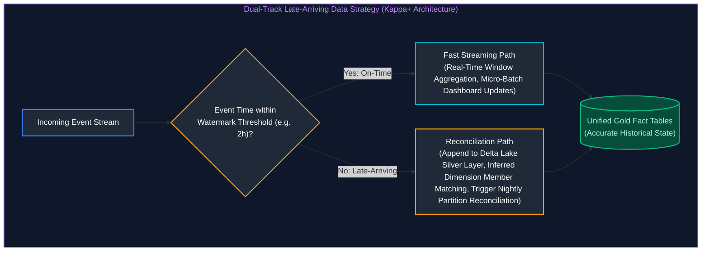

#### Core Remediation Mechanisms
1. **Event-Time Processing with Watermarking:** Always aggregate and window on `event_timestamp` (when the action occurred), never on ingestion arrival time.
2. **Inferred Dimension Members:** When a fact arrives referencing a customer ID not yet present in the Customer dimension, create an **Inferred Member** (`customer_sk = Hash(ID)`, `is_inferred = TRUE`), backfilling attributes when the dimension arrives.
3. **Idempotent Partition Overwrites / Merges:** Nightly reconciliation jobs use `MERGE` to update historical partitions safely without duplicating rows.

---

# 3. Self-Healing & Automated Failure Recovery Pipelines

---

### Q3. Self-Healing & Automated Failure Recovery Pipelines
**Topic Covered:** Idempotent Design, Dead-Letter Queues, Dynamic Checkpointing & Circuit Breakers  
**Question:** How would you design a pipeline that can recover automatically after failure?

#### Automated Pipeline Failure Triage & Self-Healing Decision Tree

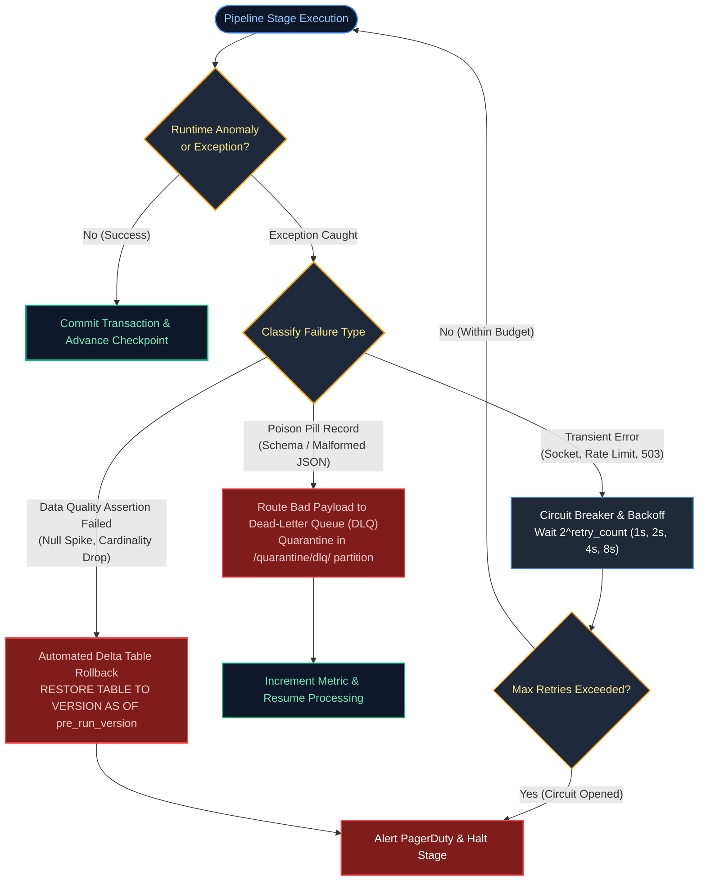

#### Self-Healing Engineering Reference Matrix

| Pillar | Target Failure Scenario | Automated Self-Healing Mechanism | Production Invariant Guaranteed |
| :--- | :--- | :--- | :--- |
| **1. Transient Retries & Circuit Breaking** | Upstream API 429/503 rate limits, network blips, ephemeral DB connection drops. | Exponential backoff ($1\text{s}, 2\text{s}, 4\text{s}, 8\text{s}$) with jitter; opens circuit after $N$ attempts. | Prevents cascading hammering; auto-recovers without engineer intervention. |
| **2. Checkpoint & Offset Resumption** | Executor OOM, node spot eviction, mid-batch container crash. | Persists committed streaming offsets to distributed metadata logs (`_spark_metadata/checkpoint`). | Exactly-once state recovery; zero duplicate records on stage restart. |
| **3. DLQ Poison Pill Isolation** | Corrupted JSON schemas, unparseable date strings, truncated payloads. | Routes malformed records to an isolated Dead-Letter Queue path (`/quarantine/dlq/`); continues pipeline. | Isolates bad records without blocking streaming ingestion SLA. |
| **4. Automated Transaction Rollbacks** | Business logic assertions fail (e.g. null keys, total revenue $< 0$). | Issues atomic table restore: `RESTORE TABLE db.table TO VERSION AS OF pre_run_version`. | Downstream BI and analytical dashboards never see corrupted or partial states. |
| **5. Watchdog Heartbeats & SLA Alerting** | Silently hung streaming queries, zombie worker threads, consumer lag spikes. | Health check probes monitor consumer lag and commit timestamps; triggers PagerDuty escalation. | Guarantees pipeline staleness is detected and reported within minutes. |

#### Production Architecture Implementation
1. **Idempotent Execution by Design:** Re-running any pipeline stage (whether manually or via automated orchestrator retry) must produce identical results.
2. **Automated State Tracking via Control Tables:** Orchestrators check an audit table before each task. If a task completed successfully, the step is skipped; if failed, it re-executes.
3. **Data Quality Circuit Breakers:**
   ```python
   # Automated Validation & Self-Healing Rollback Pattern
   pre_run_version = spark.sql("DESCRIBE HISTORY gold.sales").first()["version"]
   
   try:
       execute_gold_transformations()
       run_automated_data_quality_tests()
   except DataQualityError as dq_err:
       # Self-healing rollback: table reverts instantly to healthy state!
       spark.sql(f"RESTORE TABLE gold.sales TO VERSION AS OF {pre_run_version}")
       send_pagerduty_alert(f"Gold pipeline rolled back automatically: {dq_err}")
       raise dq_err
   ```

---

# 4. Enterprise System Design Capstone: Global Real-Time Analytics Lakehouse

---

### Enterprise System Design Capstone: Global Real-Time Analytics Lakehouse
**Topic Covered:** End-to-End Enterprise Lakehouse Architecture (Edge IoT, Event Hubs, Auto Loader, Medallion, Power BI)  

#### End-to-End Multi-Layer Architecture
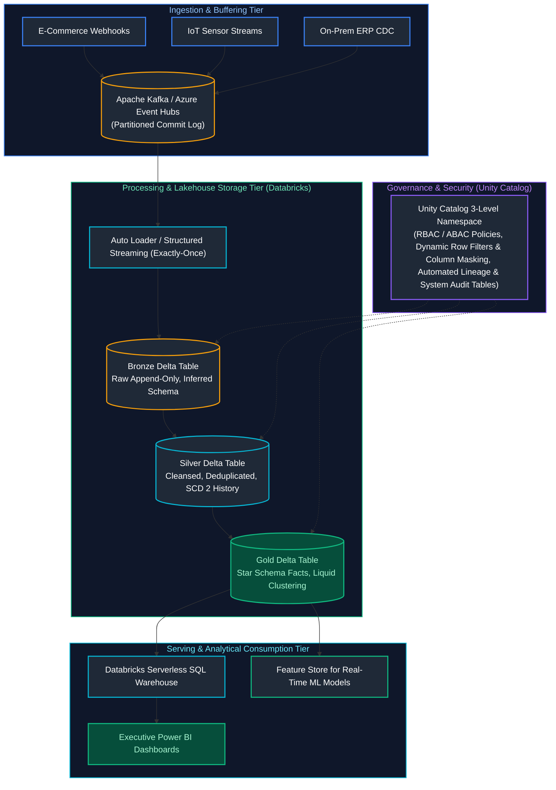

#### Architectural Key Points
- **Zero-Copy Data Sharing:** Downstream BI dashboards and machine learning models query the single unified Gold Delta layer without exporting copies to separate proprietary systems.
- **Unified Governance:** Unity Catalog enforces security policies, column masks, and access control across all tools and languages uniformly.
- **Cost-Efficiency:** Automated Job clusters and Serverless SQL warehouses auto-suspend when idle, reducing cloud compute expenditures by 60%+.


---

# 5. Real-Time Fraud & Anomaly Detection Pipeline (<500ms Latency)

---

### Real-Time Fraud & Anomaly Detection Architecture (<500ms SLA, 3M Daily Orders)
*(Grouped together: Sub-second stream anomaly detection, delivery partner fraud, ride route deviations, and financial transaction scoring)*  
**Topic Covered:** Sub-Second Stream Processing, Low-Latency Feature Stores, In-Flight ML Scoring  
**Questions Covered:**
- A restaurant processes 3 million orders daily. Design a real-time pipeline to detect delivery partner fraud (fake deliveries) with latency under 500ms
- Design a distributed pipeline to detect ride anomalies in real time using stream processing.
- How would you design a real-time data pipeline to process millions of financial transactions for fraud detection?

#### SLA & Throughput Budget: The 500ms Breakdown
$$\text{Total Budget: 500 ms} = T_{\text{ingest}} (50\text{ms}) + T_{\text{feature\_lookup}} (30\text{ms}) + T_{\text{ml\_eval}} (120\text{ms}) + T_{\text{decision\_action}} (50\text{ms}) + T_{\text{network\_buffer}} (250\text{ms})$$

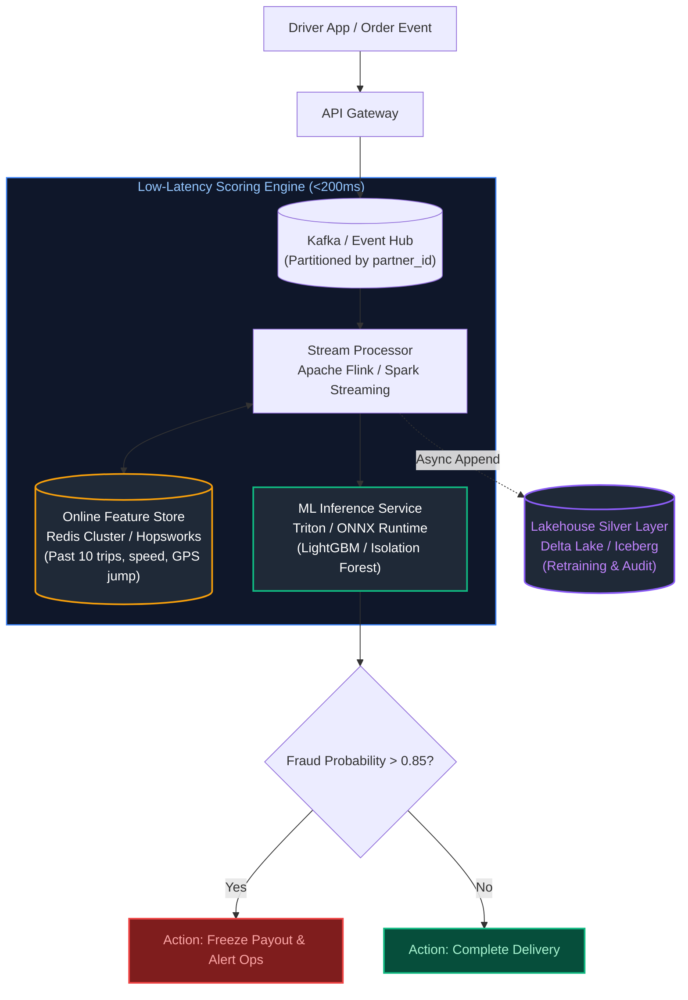

#### Key Architecture Components:
1. **Event Ingestion (Kafka):** Partitioned by `partner_id` or `driver_id` to guarantee in-order delivery of GPS pings and state transitions.
2. **Stream Processing (Apache Flink):** Flink provides true event-driven streaming with sub-50ms window evaluation (e.g. calculating impossible transit speeds like 150 km/h between two deliveries).
3. **Low-Latency Feature Store (Redis Cluster):** Pre-materialized partner features (e.g., cancellation rate over last 2 hours, GPS distance from customer doorstep) retrieved in $<5\text{ ms}$.
4. **Model Serving (ONNX / Triton):** Lightweight compiled decision tree models return fraud risk probabilities in $<30\text{ ms}$.
5. **Asynchronous Lakehouse Append:** Scored events are streamed into Delta Lake Silver tables for daily offline model re-training and regulatory compliance audits.

---

# 6. Geospatial Real-Time Stream Ingestion & Dynamic Surge Pricing

---

### Event-Driven Real-Time Surge Pricing Engine with Spatial Indexing
**Topic Covered:** Geospatial Indexing (Uber H3 / Google S2), Real-Time Supply/Demand Balance  
**Question:** Design an event-driven pipeline for surge pricing. Input: live order demand + delivery partner availability. Output: real-time price adjustment per zone.

#### Architectural Mechanics & Geospatial Hexagonal Indexing
Standard latitude/longitude bounding box queries in SQL are prohibitively slow for real-time streams.
- **The Solution:** Quantize global coordinates into discrete **Uber H3 Hexagonal Grid Cells** (Resolution 8 $\approx 460\text{m}$ diameter).
- Every order event and driver GPS ping is converted into a 64-bit integer `h3_index`.

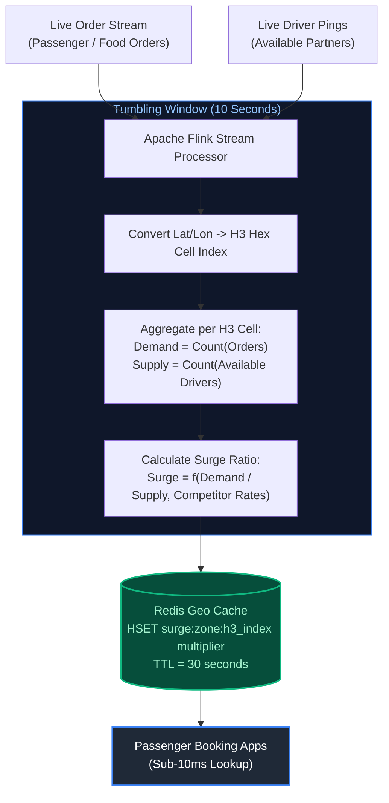

#### Production Algorithm:
1. Aggregate demand $D$ and supply $S$ over a 10-second tumbling window per `h3_index`.
2. Compute smoothed surge multiplier:
   $$M = \max\left(1.0, \; 1.0 + \alpha \cdot \left(\frac{D - S}{S + \epsilon}\right)\right)$$
3. Write multipliers to Redis with a 30-second TTL. If streaming pipeline halts, multipliers gracefully decay back to 1.0x baseline pricing.

---

### High-Throughput GPS Stream Ingestion: 100M GPS Pings/Day Under 1-Second Analytics
**Topic Covered:** High-Write Telemetry Ingestion, Columnar Time-Series Engines (ClickHouse / Pinot)  
**Question:** How would you scale a pipeline that ingests 100M GPS events per day and still serves analytics queries under 1 second?

- **Daily Throughput Math:** $100,000,000\text{ events/day} \approx 1,200\text{ events/sec}$ average, $5,000\text{ events/sec}$ peak. Raw volume $\approx 25\text{ GB/day}$.
- **Storage & Query Engine Choice:**
  - Relational databases (PostgreSQL) fail on concurrent spatial analytics.
  - Standard Spark + Delta Lake is ideal for batch ETL, but analytical dashboards require **sub-second interactive query response**.
  - **Optimal Engine:** **ClickHouse** or **Apache Pinot** with native H3 indexing and MergeTree columnar storage.
- **Architectural Flow:**
  `GPS Devices -> Kafka Topic (16 partitions) -> ClickHouse Kafka Engine -> Materialized Views (Aggregated by minute and H3 hex)`
- **Query Performance:** Pre-aggregated spatial tiles allow business dashboards to render city-wide driver heatmaps across 100M rows in **$<250\text{ ms}$**.

---

# 7. High-Concurrency Flash Sale Systems & 48-Hour Emergency Scaling

---

### Real-Time Flash Sale Inventory Management: 50M Products & Zero Overselling
**Topic Covered:** High-Concurrency Mutex, Redis Lua Scripts, Transactional Outbox Pattern  
**Question:** Design a real-time inventory management system. 50 million products. Inventory must reflect within 500ms of a purchase. How do you prevent overselling during flash sales?

#### The Core Concurrency Dilemma: Preventing Race Conditions
If 10,000 users click "Buy" at the exact same millisecond for a product with only 10 items remaining:
- Traditional relational `SELECT stock WHERE id=1; UPDATE stock SET stock = stock - 1;` causes deadlocks and overselling.
- **The Solution:** Atomic In-Memory Decrement via **Redis Lua Scripting** + Asynchronous Relational Persistence via **Kafka Transactional Outbox**.

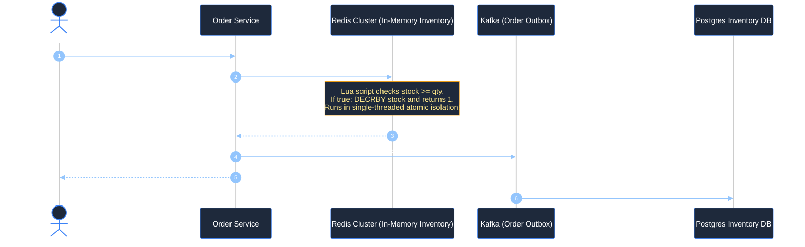

#### Production Redis Lua Script (Zero Overselling Guarantee)
```lua
-- KEYS[1]: product_stock:{product_id}
-- ARGV[1]: requested_quantity
local current_stock = tonumber(redis.call('GET', KEYS[1]) or '0')
local requested_qty = tonumber(ARGV[1])

if current_stock >= requested_qty then
    redis.call('DECRBY', KEYS[1], requested_qty)
    return 1 -- SUCCESS: Stock reserved
else
    return 0 -- FAILED: Out of stock!
end
```

---

### Emergency 48-Hour 100x Traffic Surge Architecture: 500 to 50,000 Orders/Sec
*(Grouped together: Flash sale traffic spikes, emergency decoupling, and elastic buffering without data loss)*  
**Topic Covered:** Emergency Triage, Asynchronous Decoupling, Rate Shedding & Degradation  
**Questions Covered:**
- A sale starts in 48 hours. Orders per second jumped from 500 to 50,000. Your pipeline is not designed for this. What do you do right now?
- Your Kafka pipeline processes order events. During a sale traffic spikes 100x. How do you design for elasticity without data loss or duplicate processing?

#### The 48-Hour Emergency Triage Playbook: 3 Immediate Levers
You cannot rewrite your entire codebase in 48 hours. You must apply defensive architectural shock absorbers:

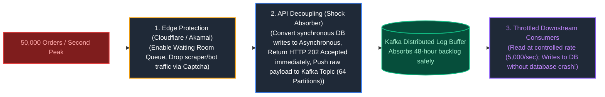

1. **Lever 1: Decouple Ingestion from Processing (Return HTTP 202 Accepted):**
   - Eliminate synchronous database inserts during order checkout.
   - The API Gateway writes the purchase event directly into a **Kafka topic with 64 partitions** and returns `HTTP 202 Accepted` with a tracking ID in $<50\text{ ms}$.
   - Kafka acts as an elastic shock absorber, holding hours of orders on disk without dropping a single byte.
2. **Lever 2: Scale Relational Database Read Replicas & Cache Hot SKUs:**
   - Pre-warm Redis cache with the top 5,000 products on sale so database read queries drop by 95%.
   - Add 5 read replicas to PostgreSQL/MySQL to absorb order confirmation read queries.
3. **Lever 3: Throttled Batch Processing (Rate-Controlled Ingestion):**
   - Downstream Spark / worker microservices consume from Kafka at a controlled rate of 5,000 records/sec (the maximum the database can handle) until the peak queue drains.

---

# 8. Real-Time Recommendation Systems & Cold-Start Architecture

---

### Personalized Real-Time Recommendation Engine at Scale (80M to 400M Users, <200ms)
*(Grouped together: Real-time personalization engines across 80M to 400M users and cold-start onboarding heuristics)*  
**Topic Covered:** Two-Stage Recommender (Retrieval + Ranking), Vector Embeddings, Cold Start  
**Questions Covered:**
- Design a restaurant recommendation engine. 80M users. Personalized results under 200ms. How do you handle cold start for new users?
- Design a product recommendation engine. 400M users. Recommendations must be personalized, real-time, and update within minutes of a purchase. How do you handle cold start for new users?

#### The Two-Stage Recommender Architecture
Recommending from 50 million catalog items in $<200\text{ ms}$ for 400 million users is impossible with complex deep learning models over the full catalog. Production systems use a **Two-Stage Funnel**:

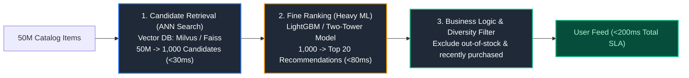

#### Solving the Real-Time Update Requirement (<5 Minutes):
1. When a user buys an item, a Kafka event triggers a streaming Flink job.
2. Flink updates the user’s real-time feature vector in the Redis Feature Store (e.g. updating recent category interest vector: `{"electronics": 0.9, "gaming": 0.8}`).
3. On the very next app refresh, candidate retrieval retrieves items matching the updated embedding.

#### Handling the Cold-Start Problem (New Users with Zero History):
1. **Demographic / Contextual Heuristics:** Match user on geolocation, device type, referral channel, and popular/trending items in their city.
2. **Multi-Armed Bandit Exploration (Thompson Sampling / $\epsilon$-Greedy):** Display 80% proven popular items and 20% diverse exploratory items across different categories to rapidly learn the user's affinity profile.
3. **Onboarding Micro-Surveys:** Capture 3 preferred genres/cuisines during account registration to seed the initial feature vector.

---

# 9. Algorithmic Catastrophe Mitigation & Production Reconciliation

---

### Algorithmic Pricing Bug Containment: 800,000 Faulty Orders in 20 Minutes
*(Grouped together: Algorithmic pricing glitch containment, circuit breakers, and financial ledger audit reconciliation)*  
**Topic Covered:** Algorithmic Catastrophe Containment, Kill Switches & Financial Reconciliation  
**Questions Covered:**
- A pricing algorithm bug gave 90% discount on 10,000 products for 20 minutes. 800,000 orders came in. How do you detect this in real-time, stop it, and handle the orders?
- A deployment pushed bad discount logic. 200,000 orders received wrong discounts in 15 minutes. How do you detect, stop, and reconcile this in production?

#### The 3-Phase Emergency Incident Runbook
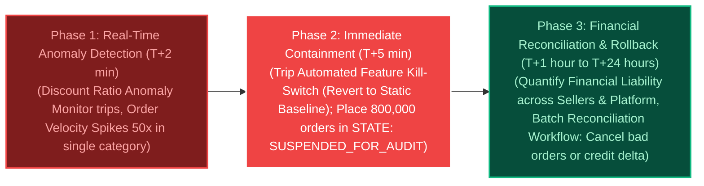

1. **Phase 1: Real-Time Detection:**
   - A streaming monitor calculates the hourly average discount rate. If aggregate discount $\ge 40\%$ across $> 100$ products, an automatic Sev-0 alert fires.
2. **Phase 2: Automated Circuit Breaker Kill-Switch:**
   - Deploy dynamic feature flags (LaunchDarkly / Consul). Tripping the kill-switch bypasses the dynamic pricing algorithm and falls back to base MSRP pricing in $<10\text{ seconds}$.
   - All 800,000 affected orders are programmatically set to `HOLD_ORDER_STATE` in the database, halting fulfillment warehouse printing.
3. **Phase 3: Algorithmic Reconciliation Workflow:**
   - Run a batch reconciliation pipeline in Spark/SQL comparing actual purchase price against base cost.
   - Execute an automated remediation script based on business policy: cancel orders violating gross margin bounds ($>70\%$ loss) with automated customer discount vouchers, and fulfill smaller threshold orders.

---

# 10. Config-Driven Ingestion Framework for 500,000 Heterogeneous Producers

---

### Metadata-Driven Multi-Tenant Seller Ingestion Engine
*(Grouped together: Metadata-driven ingestion engines and dynamic multi-tenant schema parsing)*  
**Topic Covered:** Config-Driven Pipelines, JSON Schema Mapping DSL, Dynamic Ingestion  
**Questions Covered:**
- A seller analytics pipeline ingests data from 500,000 sellers daily. Each seller has a different data format. Design a scalable ingestion framework without 500,000 separate pipelines.
- A seller analytics pipeline ingests data from 500,000 sellers daily. Each seller has a different data format (CSV, JSON, varied column names). Design a scalable ingestion framework without building 500,000 separate pipelines.

#### The Anti-Pattern: 500,000 Individual Pipelines
Building 500,000 pipelines results in impossible maintenance, orchestration overhead, and fatal deployment costs.

#### The Solution: The Single Metadata-Driven Engine
Decouple the **execution engine** from the **seller schema configuration**.

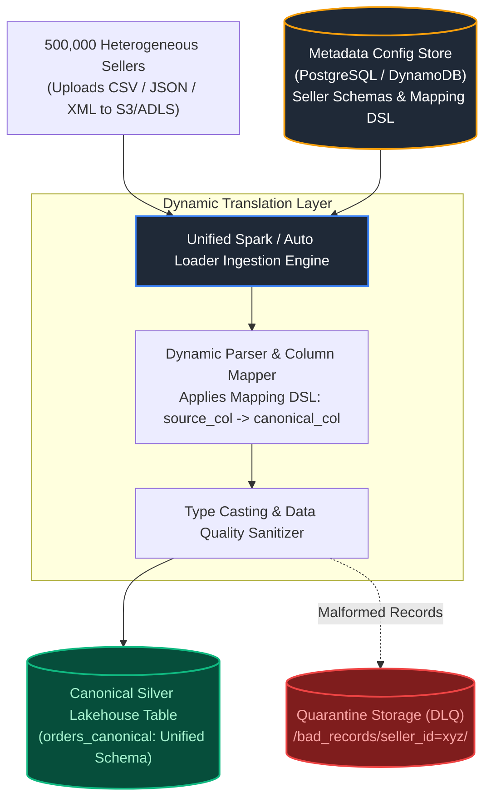

#### Production Seller Mapping Configuration DSL (Stored in Database)
```json
{
  "seller_id": "SELLER_99182",
  "file_type": "csv",
  "delimiter": ",",
  "has_header": true,
  "column_mappings": {
    "item_code": "product_id",
    "tx_timestamp": "order_timestamp",
    "sale_price_cents": {"target": "total_amount", "transform": "divide_100"}
  },
  "date_format": "yyyy-MM-dd HH:mm:ss"
}
```

---

# 11. Global Video Streaming Watch-History & Lakehouse Serving Architecture

---

### Global Video Watch-History Lakehouse Architecture (Ingest -> Transform -> Serve)
**Topic Covered:** Global Scale Event Streaming, Medallion Architecture, Dual-Layer Serving  
**Questions Covered:**
- You’re ingesting real-time viewing events from millions of devices globally into your data lakehouse. How would you design the pipeline (ingest → transform → serve) to support near-real-time analytics?
- Design an end-to-end architecture for user-watch-history and recommendation feed, including ingestion, storage, and reporting layers.

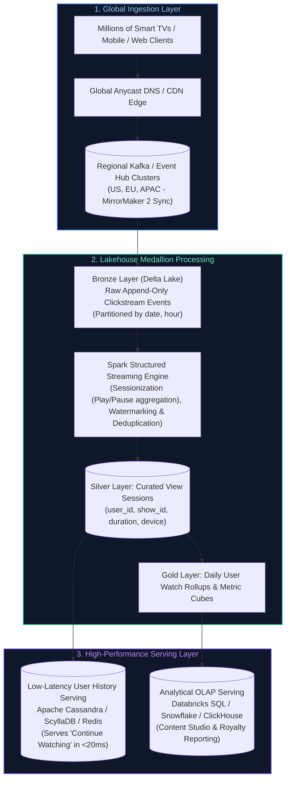

#### Layer Breakdown:
1. **Global Ingestion Layer:** Regional Kafka clusters absorb global edge traffic with zero cross-continental latency. Kafka MirrorMaker 2 replicates streams to central cloud data lakehouses.
2. **Lakehouse Transformation Layer:** Bronze captures raw telemetry. Silver runs sessionization logic to collapse fragmented play/pause/seek events into unified viewing session duration records.
3. **Dual-Layer Serving:**
   - Analytical reporting (Executive BI, Royalty calculations) queries Delta Lake Gold tables via Databricks Serverless SQL.
   - User-facing mobile apps query a low-latency NoSQL store (Cassandra / DynamoDB) to load the user's "Continue Watching" carousel in $<20\text{ ms}$.

---

# 12. Banking Regulatory & Compliance Data Platform (BCBS 239 / Basel III)

---

### Enterprise Regulatory Data Platform: Bitemporal Modeling & Audit Lineage
**Topic Covered:** Regulatory Reporting (BCBS 239, Basel III, SOX), Bitemporal Modeling, Lineage Graphs  
**Questions Covered:**
- How would you design a data platform to support regulatory and compliance reporting in a banking environment?
- A critical regulatory report contains inconsistent customer balances. How would you investigate and resolve the issue?

#### The 4 Regulatory Principles of BCBS 239
1. **Completeness & Accuracy:** Zero missing transactions; automated ledger balancing.
2. **Timeliness:** Rapid risk data aggregation during market crashes.
3. **Auditability & Traceability:** Every balance must trace back to raw source journal entries.
4. **Immutability:** WORM (Write Once, Read Many) compliance with zero unrecorded mutations.

#### Bitemporal Data Modeling Architecture
Financial balances must track two independent time dimensions:
- **Valid Time (Business Time):** When the financial transaction physically occurred in the real world.
- **Transaction Time (System Time):** When the transaction was physically committed into the database engine.

```sql
CREATE TABLE general_ledger_bitemporal (
    account_id BIGINT,
    transaction_id VARCHAR(64),
    amount NUMERIC(18, 4),
    -- Business Time
    valid_from TIMESTAMP WITH TIME ZONE,
    valid_to TIMESTAMP WITH TIME ZONE,
    -- System Audit Time
    system_recorded_at TIMESTAMP WITH TIME ZONE DEFAULT CURRENT_TIMESTAMP,
    system_deleted_at TIMESTAMP WITH TIME ZONE,
    is_current BOOLEAN
);
```

#### Inconsistent Customer Balance RCA Playbook:
1. **Check General Ledger Double-Entry Equality:** Validate $\sum \text{Debits} == \sum \text{Credits}$ across all journal entries for the reporting period.
2. **Trace Transformation Lineage via Unity Catalog / Purview:** Inspect column-level lineage graph from the final regulatory dashboard back through Silver aggregation to raw Bronze Core Banking System (CBS) logs.
3. **Detect Inferred Dimension & Late-Arriving Postings:** Identify transactions posted back-dated to prior accounting periods after the monthly ledger close date.
4. **Automated Audit Balancing Gate:** Implement an automated reconciliation check between the analytical data warehouse and the core banking ledger; if balance delta $> \$0.00$, the regulatory publishing pipeline automatically halts and alerts the compliance officer.

---

# 13. High-Scale E-Commerce Data Platform Architecture

---

### High-Scale E-Commerce Data Platform Architecture
**Topic Covered:** End-to-End Enterprise Lakehouse, Microservices CDC, Stream-Stream Joins, Dual-Layer Serving  
**Questions Covered:**
- Design the architecture of an e-commerce platform.
- Explain your end-to-end data pipeline architecture — ingestion, transformation, storage, and serving layers.

#### Architectural Requirements & Scale
- **Scale:** 50,000 events/second during peak promotions, 20 million daily active users (DAUs), 5 million daily orders.
- **Latency SLAs:** 
  - Transactional inventory reservation: $<50\text{ ms}$ (zero overselling).
  - Near-real-time recommendation & fraud detection: $<500\text{ ms}$.
  - Executive financial & merchant fulfillment reporting: $<15\text{ minutes}$ data freshness.
- **Data Ingestion Sources:**
  - Microservices transactional DBs (PostgreSQL, MySQL) via Debezium CDC.
  - Web/Mobile client clickstream (searches, impressions, cart operations) via Kafka.
  - Logistics & third-party carrier status webhooks.

#### End-to-End Architectural Blueprint
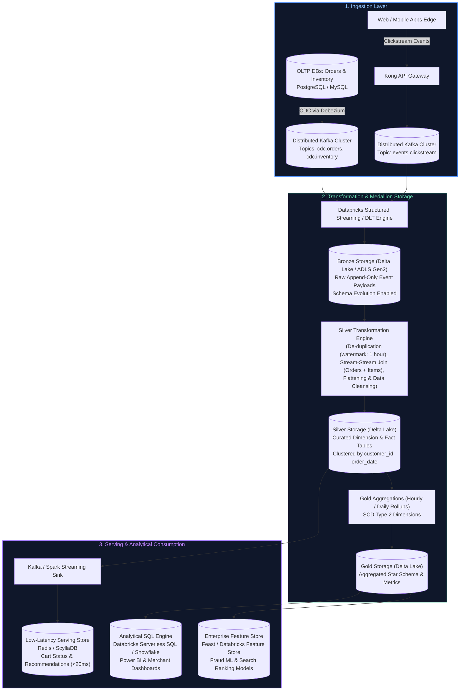

#### Production PySpark Stream-Stream Join with Watermarking
Stream-stream joins require watermarks on both sides to allow Spark state store garbage collection.

```python
from pyspark.sql import SparkSession
from pyspark.sql.functions import col, expr, from_json
from pyspark.sql.types import (
    DoubleType,
    IntegerType,
    StringType,
    StructField,
    StructType,
    TimestampType,
)

spark = (
    SparkSession.builder.appName("ECommerceStreamJoin")
    .config("spark.sql.streaming.stateStore.providerClass", "org.apache.spark.sql.execution.streaming.state.RocksDBStateStoreProvider")
    .getOrCreate()
)

# 1. Read Orders CDC Stream with Watermark
orders_schema = StructType([
    StructField("order_id", StringType(), False),
    StructField("customer_id", StringType(), False),
    StructField("total_amount", DoubleType(), False),
    StructField("order_status", StringType(), False),
    StructField("order_time", TimestampType(), False),
])

orders_stream = (
    spark.readStream.format("kafka")
    .option("kafka.bootstrap.servers", "kafka:9092")
    .option("subscribe", "cdc.orders")
    .load()
    .select(from_json(col("value").cast("string"), orders_schema).alias("data"))
    .select("data.*")
    .withWatermark("order_time", "30 minutes")
)

# 2. Read Payment Confirmation Stream with Watermark
payments_schema = StructType([
    StructField("payment_id", StringType(), False),
    StructField("order_id", StringType(), False),
    StructField("payment_method", StringType(), False),
    StructField("payment_status", StringType(), False),
    StructField("payment_time", TimestampType(), False),
])

payments_stream = (
    spark.readStream.format("kafka")
    .option("kafka.bootstrap.servers", "kafka:9092")
    .option("subscribe", "cdc.payments")
    .load()
    .select(from_json(col("value").cast("string"), payments_schema).alias("data"))
    .select("data.*")
    .withWatermark("payment_time", "30 minutes")
)

# 3. Stream-Stream Join with Range Condition for State Eviction
enriched_orders = orders_stream.join(
    payments_stream,
    expr("""
        order_id = payment_id AND
        payment_time >= order_time AND
        payment_time <= order_time + interval 15 minutes
    """),
    joinType="inner",
)

# 4. Idempotent Write to Delta Silver Table
query = (
    enriched_orders.writeStream.format("delta")
    .outputMode("append")
    .option("checkpointLocation", "abfss://checkpoints@datalake.dfs.core.windows.net/orders_silver")
    .toTable("silver.ecommerce_enriched_orders")
)
```

#### Key Architecture Trade-Offs:
1. **State Store Management:** Using RocksDB instead of in-memory HDFS state store prevents executor OOM crashes during long streaming state windows.
2. **Dual-Layer Serving:** Low-latency online operations (Redis, sub-20ms) are separated from heavy analytical aggregation queries (Delta Lake + Serverless SQL), avoiding contention on operational stores.

---

# 14. Multi-Source Pipeline Design: Structured, Semi-Structured & Unstructured Data

---

### Multi-Source Pipeline Design: Integrating Structured, Semi-Structured & Unstructured Data
**Topic Covered:** Multi-Modal Lakehouse Ingestion, Schema Evolution, Unstructured Vector Embeddings, Quarantine DLQ  
**Questions Covered:**
- You are working on a data pipeline that requires integrating data from multiple sources, including structured and unstructured data. How would you design the pipeline to handle different data formats and ensure data quality and consistency across the pipeline?

#### Architectural Framework for Multi-Format Ingestion
Enterprise lakehouses must unify three fundamentally different data paradigms:
1. **Structured Data:** Tabular transactional data (PostgreSQL, Oracle, ERP systems). High schema rigidity, ACID guarantees.
2. **Semi-Structured Data:** Webhook payloads, clickstream logs, IoT telemetry (JSON, Avro, XML). Dynamic schemas, nested arrays, high risk of schema drift.
3. **Unstructured Data:** PDF invoices, customer review text, product catalog images, audio call recordings. No tabular schema; requires AI extraction (OCR, embedding vectors, transcription) to yield queryable metadata.

#### Multi-Modal Unified Lakehouse Blueprint
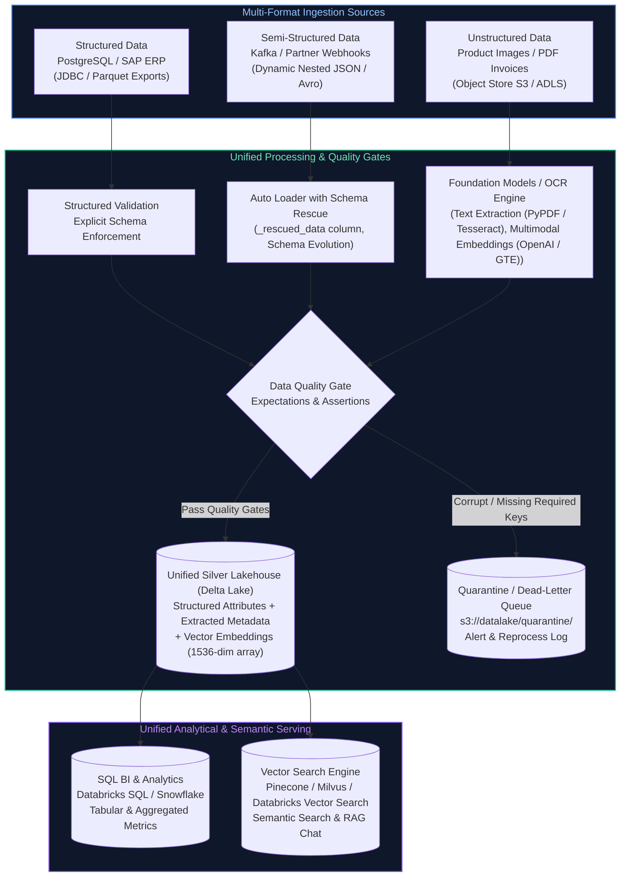

#### Production PySpark Pipeline Handling JSON Rescue & Unstructured Metadata
```python
from pyspark.sql import SparkSession
from pyspark.sql.functions import col, current_timestamp, input_file_name, lit, when
from pyspark.sql.types import (
    ArrayType,
    DoubleType,
    FloatType,
    StringType,
    StructField,
    StructType,
    TimestampType,
)

spark = SparkSession.builder.appName("MultiSourceUnifiedIngest").getOrCreate()

# 1. Ingest Semi-Structured JSON with Auto Loader & Rescue Column
json_schema = StructType([
    StructField("vendor_id", StringType(), False),
    StructField("invoice_number", StringType(), False),
    StructField("invoice_amount", DoubleType(), True),
    StructField("invoice_date", StringType(), True),
])

raw_json_stream = (
    spark.readStream.format("cloudFiles")
    .option("cloudFiles.format", "json")
    .option("cloudFiles.schemaLocation", "abfss://checkpoints@datalake.dfs.core.windows.net/invoice_json_schema")
    .option("cloudFiles.schemaEvolutionMode", "rescue")
    .schema(json_schema)
    .load("abfss://raw@datalake.dfs.core.windows.net/invoices_json/")
)

# 2. Enrich with Processing Metadata & Separate Valid vs Corrupt Rows
validated_stream = raw_json_stream.withColumn("ingested_at", current_timestamp()).withColumn(
    "is_corrupt",
    when(
        col("_rescued_data").isNotNull() | col("invoice_amount").isNull() | (col("invoice_amount") <= 0),
        lit(True),
    ).otherwise(lit(False)),
)

# 3. Route to Clean Silver vs Quarantine via ForeachBatch
def route_microbatch(batch_df, batch_id):
    # Valid records to Silver Delta
    clean_records = batch_df.filter(col("is_corrupt") == False).drop("is_corrupt", "_rescued_data")
    clean_records.write.format("delta").mode("append").saveAsTable("silver.vendor_invoices")

    # Corrupt / unexpected records to Quarantine DLQ for root-cause alerting
    quarantine_records = batch_df.filter(col("is_corrupt") == True)
    if not quarantine_records.isEmpty():
        quarantine_records.write.format("delta").mode("append").saveAsTable("quarantine.failed_vendor_invoices")

query = (
    validated_stream.writeStream
    .foreachBatch(route_microbatch)
    .option("checkpointLocation", "abfss://checkpoints@datalake.dfs.core.windows.net/invoice_routing")
    .start()
)
```

#### Quality & Consistency Strategies
- **Schema Rescue (`_rescued_data`):** Unmapped new columns or type mismatches are saved in JSON format without dropping the record or throwing an execution exception.
- **Dead-Letter Quarantine:** Prevents invalid JSON or malformed records from contaminating downstream financial aggregates while maintaining zero data loss.
- **Unified Query Layer:** Downstream consumers query a single Silver table that joins relational attributes with AI-generated semantic metadata.

---

# 15. Production Pipeline Optimization & Observability for 100 GB Daily Scale

---

### Production Pipeline Optimization & Observability for 100 GB Daily Processing Under Strict SLAs
**Topic Covered:** 100 GB Scale Pipeline Optimization, Adaptive Query Execution, Liquid Clustering, Observability Gates  
**Questions Covered:**
- You are responsible for maintaining a production data pipeline that processes millions of records daily (100 GB daily). How would you optimize the pipeline and implement monitoring and alerting to ensure SLAs are met?
- You are working on a data pipeline that ingests data from multiple sources, transforms it, and loads it into a data warehouse. How would you ensure data quality, reliability, and observability throughout the pipeline?

#### Sizing & Throughput Math for 100 GB Daily Processing
- **Volume:** $100\text{ GB/day}$ compressed Parquet $\approx 400\text{ GB to } 500\text{ GB}$ uncompressed in-memory data ($\approx 80\text{M to } 120\text{M}$ records).
- **SLA Requirement:** Silver + Gold transformation completed within a **30-minute window** every morning at 06:00 UTC.
- **Compute Sizing:**
  - Ingestion rate needed: $100\text{ GB} / 1800\text{ sec} \approx 55.5\text{ MB/sec}$.
  - Cluster configuration: 8 worker nodes (Standard_E16s_v5: 16 vCPU, 128 GB RAM per worker $\to$ 128 cores, 1 TB RAM total).
  - Target partition count: $100\text{ GB} / 128\text{ MB (optimal Delta file size)} \approx 800\text{ partitions}$.

#### End-to-End Optimization & Observability Architecture
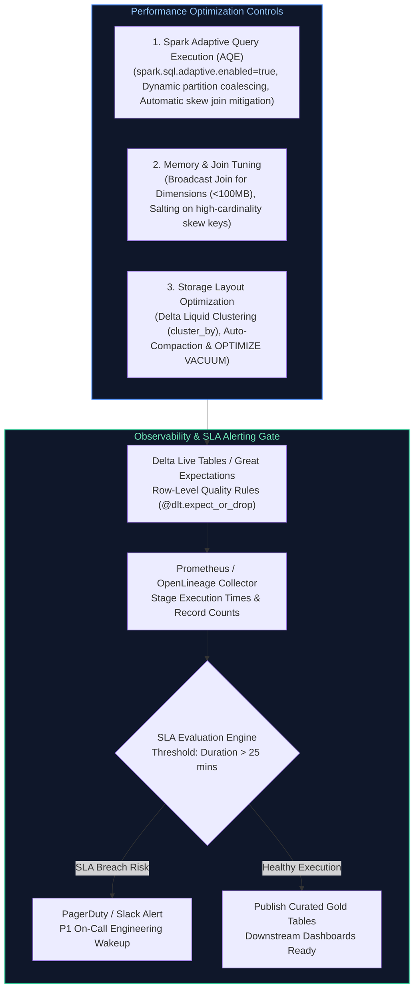

#### Production PySpark Pipeline with Built-in Expectations & Instrumentation
```python
import time
from pyspark.sql import SparkSession
from pyspark.sql.functions import broadcast, col, count, current_timestamp, sum as _sum

spark = (
    SparkSession.builder.appName("Production100GBPipeline")
    .config("spark.sql.adaptive.enabled", "true")
    .config("spark.sql.adaptive.coalescePartitions.enabled", "true")
    .config("spark.sql.adaptive.skewJoin.enabled", "true")
    .config("spark.sql.files.maxPartitionBytes", "134217728")  # 128MB
    .getOrCreate()
)

def run_production_pipeline_with_observability():
    start_time = time.time()
    
    # 1. Read Daily Ingestion Data (100 GB Parquet / Delta)
    daily_transactions = spark.read.table("bronze.raw_transactions").filter(
        col("transaction_date") == "2026-10-15"
    )
    
    # 2. Observability Check: Row Count Baseline
    input_count = daily_transactions.count()
    if input_count < 10_000_000:
        raise ValueError(f"SLA Violation Risk: Incomplete daily load. Expected >10M rows, received {input_count}")
        
    # 3. Optimized Join with Small Dimension via Broadcast
    dim_merchants = spark.read.table("silver.dim_merchants")
    
    enriched_df = daily_transactions.join(
        broadcast(dim_merchants),
        daily_transactions.merchant_id == dim_merchants.merchant_id,
        "inner",
    ).drop(dim_merchants.merchant_id)
    
    # 4. Inline Data Quality Gate
    clean_df = enriched_df.filter(
        (col("amount").isNotNull()) & (col("amount") > 0) & (col("customer_id").isNotNull())
    )
    
    clean_count = clean_df.count()
    dropped_rows = input_count - clean_count
    drop_percentage = (dropped_rows / input_count) * 100
    
    if drop_percentage > 2.0:
        # Alert when more than 2% of transactions fail validation
        print(f"CRITICAL WARNING: High data rejection rate: {drop_percentage:.2f}% dropped!")
    
    # 5. Write to Silver Delta Lake with Liquid Clustering
    (
        clean_df.write.format("delta")
        .mode("append")
        .option("mergeSchema", "false")
        .clusterBy("customer_id", "transaction_date")
        .saveAsTable("silver.fact_transactions")
    )
    
    # 6. Pipeline Duration Observability Check
    elapsed_minutes = (time.time() - start_time) / 60
    print(f"Pipeline completed successfully in {elapsed_minutes:.2f} minutes.")
    if elapsed_minutes > 25.0:
        print("WARNING: SLA Threshold exceeded 25 minutes! Triggering engineering alert.")

run_production_pipeline_with_observability()
```

#### Optimization Summary:
- **Liquid Clustering:** Replaces static folder partitioning (`year/month/day`) with multi-column clustering (`customer_id`, `transaction_date`), eliminating partition skew and small-file proliferation.
- **Adaptive Query Execution (AQE):** Dynamically coalesces shuffle partitions from 800 to the actual active number post-filter, preventing task scheduling overhead.
- **Broadcast Joins:** Eliminates shuffle exchange across all 8 worker nodes for tables under 100 MB.

---

# 16. Multi-Team Dependency Management, Data Contracts & Pipeline SLA Governance

---

### Multi-Team Dependency Management, Data Contracts & Pipeline SLA Governance
**Topic Covered:** Cross-Team Dependency Management, Data Contracts, Event-Driven Orchestration, Breaking Change Mitigation  
**Questions Covered:**
- You are working on a data pipeline that requires integrating data from multiple teams with different priorities and timelines. How would you manage dependencies and ensure that the pipeline is delivered on time and meets business requirements?

#### The Multi-Team Data Integration Dilemma
In modern enterprises, data pipelines depend on upstream operational engineering teams (e.g., Checkout Team, Inventory Team, Logistics Team). Common challenges include:
1. **Unannounced Upstream Schema Changes:** Changing column names (`user_id` $\to$ `customer_uuid`) breaks downstream models silently.
2. **Unaligned Release Cycles:** Operational teams ship microservices continuously, while analytics pipelines require historical consistency.
3. **Flaky Point-to-Point Cron Dependencies:** Running downstream jobs on a static schedule (e.g., "Run at 04:00 AM") leads to race conditions when upstream pipelines run late.

#### Governance Framework: Data Contracts & Decoupled Architecture
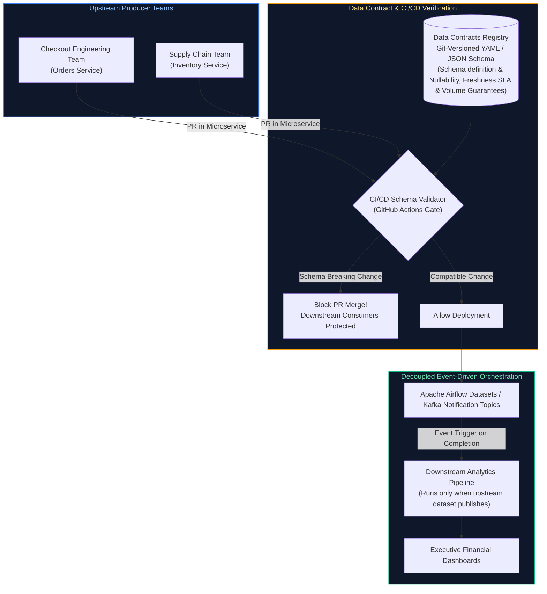

#### Production Data Contract Specification (YAML)
```yaml
# data-contracts/orders_stream_contract.yaml
contract_version: "2.1.0"
dataset: "orders_stream"
producer:
  team: "Checkout Platform Team"
  slack_channel: "#team-checkout-data"
  service: "order-management-service"
service_level_agreements:
  freshness: "15 minutes"
  completeness: "99.9% of expected daily orders"
  availability: "99.95%"
schema:
  type: object
  required:
    - order_id
    - customer_id
    - order_amount
    - currency
    - order_status
    - event_timestamp
  properties:
    order_id:
      type: string
      format: uuid
    customer_id:
      type: string
    order_amount:
      type: number
      minimum: 0.01
    currency:
      type: string
      enum: ["USD", "EUR", "GBP", "CAD"]
    order_status:
      type: string
      enum: ["PENDING", "COMPLETED", "CANCELLED", "REFUNDED"]
    event_timestamp:
      type: string
      format: date-time
compatibility_policy: "BACKWARD"
```

#### Automated Python Contract Validator for CI/CD Pipeline Gates
```python
import sys
import yaml
from pydantic import BaseModel, Field, ValidationError
from typing import Literal
from datetime import datetime

class OrderContract(BaseModel):
    order_id: str
    customer_id: str
    order_amount: float = Field(..., gt=0.0)
    currency: Literal["USD", "EUR", "GBP", "CAD"]
    order_status: Literal["PENDING", "COMPLETED", "CANCELLED", "REFUNDED"]
    event_timestamp: datetime

def validate_producer_payload(sample_payload: dict):
    """
    CI/CD contract gate: executes against upstream staging payloads.
    Fails build if payload violates the downstream data contract.
    """
    try:
        validated = OrderContract(**sample_payload)
        print(f"Contract Validation Passed for order: {validated.order_id}")
        return True
    except ValidationError as e:
        print(f"FATAL: Contract violation detected!\n{e}", file=sys.stderr)
        return False

# Test run
sample_event = {
    "order_id": "ord-88392",
    "customer_id": "cust-1029",
    "order_amount": 149.99,
    "currency": "USD",
    "order_status": "COMPLETED",
    "event_timestamp": "2026-10-15T08:30:00Z"
}
assert validate_producer_payload(sample_event) is True
```

#### Dependency Management Rules for High Delivery Confidence:
1. **Never Depend on Upstream Wall-Clock Times:** Replace static cron schedules (`0 4 * * *`) with Airflow 2.4+ `Dataset` triggers or message-driven sensors that wake up only when upstream publishes an ingestion event.
2. **Backward-Compatible Schema Policy:** Enforce `BACKWARD` compatibility in CI/CD. Upstream teams may add optional columns, but cannot rename, delete, or change existing field types without a major version contract negotiation.
3. **Formal SLA & Fallback Degraded Mode:** If an upstream pipeline fails its 15-minute freshness SLA, the downstream pipeline runs in "degraded mode" (serving cached aggregates from $T-1$) with automated alerts rather than completely halting corporate reporting.


---

# 17. Enterprise Data Platform Modernization & 10x Load Surge Engineering

---

### Q22. Legacy Data Platform Modernization: Migration Strategy & Domain Prioritization
**Topic Covered:** Platform Modernization, Strangler Fig Pattern, Domain Complexity Matrix & Dual-Run Reconciliation  
**Question:** You are leading the modernization of a legacy on-premise data platform (Hadoop/SSIS/Oracle) to a modern cloud lakehouse (Databricks/Snowflake). Which pipeline or business domain would you migrate first, and why? Detail your phased rollout strategy.

#### Definition & Core Concepts
Modernizing a legacy data platform cannot be executed as a "Big Bang" migration; doing so carries an unacceptable risk of multi-million dollar data outages and business disruption.
The industry standard methodology is the **Strangler Fig Application Pattern** combined with a **Domain Complexity vs. Business Value Prioritization Matrix**:
1. **Pilot Domain Selection (Low Coupling, High Visibility):**
   - **Never migrate core financial ledgers or billing first.** An error in general ledger accounting creates severe legal and regulatory liability.
   - **Never migrate obscure, low-value internal logs first.** Success provides zero organizational buy-in or momentum.
   - **Choose a high-visibility, read-heavy analytical domain with moderate upstream coupling** (e.g., *Marketing Campaign Analytics, Web Clickstream Attribution, or Daily Sales Reporting*). Success demonstrates immediate cloud ROI and query speedups to executive stakeholders.
2. **The 4-Phase Migration Lifecycle:**
   - **Phase 1: Dual-Ingestion & Parallel Staging:** Replicate raw source streams to both on-prem and cloud lakehouse.
   - **Phase 2: Shadow Run & Automated Bi-Directional Reconciliation:** Execute the new cloud pipelines in parallel with on-prem jobs daily, running automated hash and aggregate reconciliation checks.
   - **Phase 3: Consumer Read Cutover:** Re-point downstream BI dashboards (Tableau/PowerBI) to the cloud lakehouse.
   - **Phase 4: Legacy Sunsetting:** Deprecate and power down on-prem SSIS/Hadoop clusters once consumers sign off on SLA parity for 30 consecutive days.

#### Visual Flow
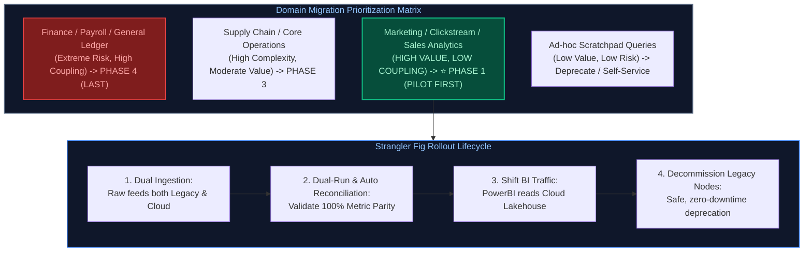

#### Production Implementation / Dual-Run Reconciliation Suite
```python
from pyspark.sql import SparkSession
from pyspark.sql import functions as F

spark = SparkSession.builder.appName("MigrationReconciliationSuite").getOrCreate()

def reconcile_daily_domain_migration(report_date: str):
    """
    Automated dual-run reconciliation validating metric parity between legacy Oracle
    and modern Databricks Delta Lakehouse prior to consumer cutover.
    """
    # 1. Read legacy snapshot and modern lakehouse table
    legacy_df = spark.read.format("jdbc").options(
        url="jdbc:oracle:thin:@legacy-db:1521/PROD",
        dbtable=f"(SELECT store_id, SUM(revenue) as legacy_rev, COUNT(*) as legacy_cnt FROM sales WHERE dt='{report_date}' GROUP BY store_id)",
        user="read_agent", password="secret_password"
    ).load()

    cloud_df = (
        spark.table("gold.fact_sales")
        .filter(F.col("order_date") == report_date)
        .groupBy("store_id")
        .agg(
            F.sum("revenue").alias("cloud_rev"),
            F.count("*").alias("cloud_cnt")
        )
    )

    # 2. Outer Join to detect missing stores or metric divergence
    comparison = legacy_df.join(cloud_df, "store_id", "full_outer").select(
        F.coalesce(legacy_df.store_id, cloud_df.store_id).alias("store_id"),
        legacy_df.legacy_rev,
        cloud_df.cloud_rev,
        F.abs(F.coalesce(legacy_df.legacy_rev, F.lit(0)) - F.coalesce(cloud_df.cloud_rev, F.lit(0))).alias("revenue_diff"),
        F.abs(F.coalesce(legacy_df.legacy_cnt, F.lit(0)) - F.coalesce(cloud_df.cloud_cnt, F.lit(0))).alias("count_diff")
    )

    # Tolerant threshold: Flag if revenue divergence exceeds $0.01 (accounting for rounding)
    discrepancies = comparison.filter((F.col("revenue_diff") > 0.01) | (F.col("count_diff") > 0))
    failed_count = discrepancies.count()

    if failed_count > 0:
        print(f"RECONCILIATION FAILED: {failed_count} stores have divergent metrics!")
        discrepancies.show(20, truncate=False)
        raise AssertionError("Migration validation failed: Parity not met.")
    
    print(f"SUCCESS: 100% Metric Parity verified across all stores for date {report_date}.")
```
- **Time Complexity:** $O(S + C)$ distributed hash join across store partitions.
- **Space Complexity:** $O(U)$ where $U$ is the distinct count of stores in the business domain.

#### Engineering Implications & Production Pitfalls
1. **The Behavioral Semantics Drift:** On-prem SQL engines (e.g. Oracle / SQL Server) handle NULL comparisons, integer divisions (`1/2 = 0`), and whitespace stripping differently than Spark/Trino. Translating SQL queries line-by-line without automated data diffing leads to subtle metric drifts that go unnoticed for months.
2. **Dual-Run Cost Governance:** Running both platforms in parallel incurs duplicate infrastructure costs. Set a strict time-box for dual-running (typically 30 to 45 days maximum per domain) to prevent budget overruns.

#### Core Curriculum Cross-Reference
*Deep-dive theoretical reference: See [15. System Design for Data Engineering: Platform Modernization](../15_system_design_for_data_engineering.md#1-end-to-end-enterprise-system-design-methodology)*

---

### Q23. 10x Data Volume Surge Readiness: Load Testing & End-to-End Optimization Playbook
**Topic Covered:** Capacity Planning, 10x Load Surges, Spark Autoscaling, Kafka Partition Scaling & Warehouse Concurrency  
**Question:** A major business event (e.g., Black Friday or Super Bowl) is scheduled for next week, and incoming data volume is projected to surge 10x (from 5M to 50M events/day). Outline your end-to-end load testing strategy and technical optimization playbook across ingestion, Spark, orchestration, storage, and data warehousing.

#### Definition & Core Concepts
Handling an abrupt $10	imes$ volume surge requires identifying and eliminating the system's **non-linear bottlenecks**:
1. **Ingestion Layer (Kafka / Event Hubs):**
   - **Throughput Math:** $10	imes$ volume means steady-state throughput surges from $1,000 	o 10,000 	ext{ msgs/sec}$, with peak bursts hitting $30,000 	ext{ msgs/sec}$.
   - **Partition Bottleneck:** A Kafka partition handles $pprox 1	ext{ MB/sec}$. If a topic has only 4 partitions, max throughput is capped at $4	ext{ MB/sec}$. Scale out topic partitions to at least 16–32 partitions to allow parallel consumer scaling.
2. **Compute & Processing Layer (Spark / Databricks):**
   - **Autoscaling Pre-Warming:** Turn off slow cold-start autoscaling during peak windows; pre-provision and warm worker nodes to prevent initialization thrashing.
   - **Shuffle Partition Sizing:** Scale `spark.sql.shuffle.partitions` from 200 to 1,000–2,000 to keep task partition memory safely under 128MB.
3. **Storage & Cloud Throttling Layer (ADLS / S3):**
   - Cloud storage accounts enforce request rate limits (e.g. AWS S3 enforces 3,500 PUT/POST/DELETE per second per prefix). Sharding output partition prefixes avoids HTTP 503 SlowDown throttling.
4. **Data Warehouse Concurrency (Snowflake / Synapse):**
   - Enable Multi-Cluster Warehouses with auto-scaling to absorb concurrent BI dashboard spikes without queue queuing delays.

#### Visual Flow
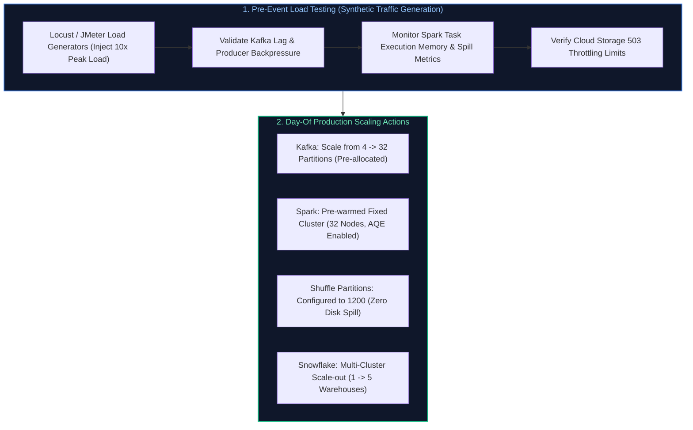

#### Production Engineering Scaling Matrix
| Pipeline Layer | Current Baseline (1x) | 10x Surge Provisioning | Technical Optimization Rule |
| :--- | :--- | :--- | :--- |
| **Ingestion (Kafka)** | 4 Partitions, 2 Brokers | 24 Partitions, 6 Brokers | Set `compression.type=zstd` and `batch.size=64KB` on producers |
| **Processing (Spark)** | 4 Workers, 200 Shuffle Parts | 24 Workers, 1,200 Shuffle Parts | Enable AQE: `spark.sql.adaptive.coalescePartitions.enabled=true` |
| **Storage (Delta Lake)** | Standard `OPTIMIZE` weekly | `OPTIMIZE` + `Z-ORDER` every 2 hours | Auto-compact small files: `spark.databricks.delta.autoCompact.enabled=true` |
| **Orchestration (Airflow)** | 16 Worker Concurrency | 64 Worker Concurrency | Increase Celery/K8s worker pool slots to prevent queue wait times |
| **Serving (Data Warehouse)** | Medium Warehouse (1 Cluster) | Auto-Scaling Multi-Cluster (Max 5) | Enforce query result caching and read replica routing |

#### Core Curriculum Cross-Reference
*Deep-dive theoretical reference: See [15. System Design for Data Engineering: High-Throughput System Design](../15_system_design_for_data_engineering.md#2-high-throughput-batch--streaming-pipeline-design)*
