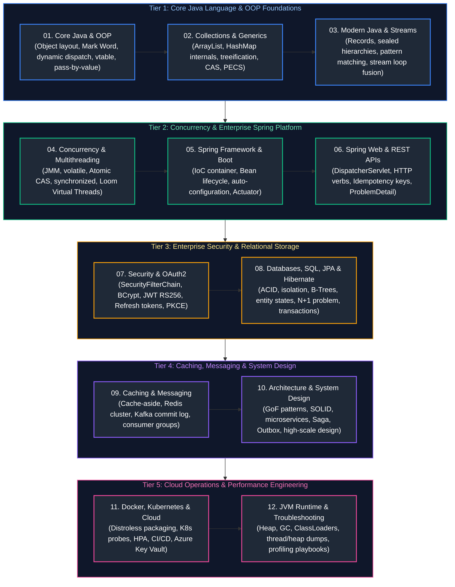

# Java Backend Engineering Master Curriculum & Comprehensive Study Guide

This master guide provides the definitive, production-grade learning roadmap, conceptual index, and chronological study order for modern Java Backend Engineering. The curriculum spans JVM memory mechanics, Core Java language foundations, collections and generics, functional programming (Java 8–21), high-concurrency multithreading, software architecture and GoF design patterns, Spring Framework and Spring Boot internals, RESTful web services, enterprise persistence (JPA, Hibernate, transactions), modern security (OAuth2, JWT), caching and messaging (Redis, Kafka, RabbitMQ), distributed microservices and system design, cloud operations (Docker, Kubernetes, Azure, AWS), and production performance engineering.

Every guide includes formal architectural definitions, Mermaid topological diagrams, memory/hardware mechanics, production code implementations with detailed line-by-line commentary, edge-case mitigation, and production troubleshooting playbooks.

---

## Recommended Chronological Study Order

---

## Master Topic Guides & Curriculum Coverage Overview

| Study Order | Guide File | Conceptual Domain | Corresponding Interview Guide | Key Topics & Production Scenarios Covered |
| :---: | :--- | :--- | :--- | :--- |
| **01** | [`01_core_java_and_oop.md`](01_core_java_and_oop.md) | Object Model & OOP Language Mechanics | [`01_core_java_and_oop_faq.md`](frequently_asked_questions/01_core_java_and_oop_faq.md) | 64-bit JVM object headers (Mark Word, Klass Word), dynamic method dispatch via `vtable`, inheritance vs composition, keyword semantics (`final`, `static`), access modifiers, pass-by-value, and the `Object` contract (`equals` & `hashCode`). |
| **02** | [`02_java_collections_and_generics.md`](02_java_collections_and_generics.md) | Data Structures, Hashing & Generics | [`02_java_collections_and_generics_faq.md`](frequently_asked_questions/02_java_collections_and_generics_faq.md) | Collections hierarchy, `ArrayList` contiguous array vs `LinkedList`, `HashMap` capacity, load factor, threshold, bitwise hashing and Red-Black treeification, `ConcurrentHashMap` CAS, `Comparable` vs `Comparator`, and PECS wildcard generics. |
| **03** | [`03_modern_java_streams_and_records.md`](03_modern_java_streams_and_records.md) | Modern Java, Functional & Streams API | [`03_modern_java_streams_and_records_faq.md`](frequently_asked_questions/03_modern_java_streams_and_records_faq.md) | Functional interfaces, `@FunctionalInterface`, Method references, `Optional` monad, Stream pipeline lazy execution and `Sink` loop fusion, `map` vs `flatMap`, Java 16 Records, Java 17 Sealed hierarchies, and Java 21 Pattern Matching `switch`. |
| **04** | [`04_java_concurrency_and_multithreading.md`](04_java_concurrency_and_multithreading.md) | Concurrency, JMM & Async Programming | [`04_java_concurrency_and_multithreading_faq.md`](frequently_asked_questions/04_java_concurrency_and_multithreading_faq.md) | Java Memory Model (JMM) happens-before rules, `volatile` memory barriers, `AtomicInteger` CAS, intrinsic monitors (`synchronized`, `wait`/`notify`), `ThreadPoolExecutor` queue policies, `CompletableFuture` pipelining, and Java 21 Virtual Threads (Loom). |
| **05** | [`05_spring_boot_and_rest_apis.md`](05_spring_boot_and_rest_apis.md) | Spring Boot & RESTful APIs | [`05_spring_boot_and_rest_apis_faq.md`](frequently_asked_questions/05_spring_boot_and_rest_apis_faq.md) | `ApplicationContext` vs `BeanFactory`, DI constructor injection mechanics, stereotype annotations, Bean lifecycle, auto-configuration engine, Actuator, `DispatcherServlet` pipeline, REST statelessness, HTTP verbs (`PUT` vs `PATCH`), RFC 7807 ProblemDetail, and gRPC/REST trade-offs. |
| **06** | [`06_security_and_cryptography.md`](06_security_and_cryptography.md) | Spring Security, OAuth2 & Identity | [`06_security_and_cryptography_faq.md`](frequently_asked_questions/06_security_and_cryptography_faq.md) | `SecurityFilterChain` filter sequence, `AuthenticationManager`, BCrypt password hashing, `@PreAuthorize` SpEL, CSRF tokens, stateless JWT RS256 token verification, HttpOnly cookies, refresh token rotation, and OAuth2 Authorization Code Flow with PKCE. |
| **07** | [`07_databases_jpa_and_hibernate.md`](07_databases_jpa_and_hibernate.md) | Relational Storage, JPA & Hibernate | [`07_databases_jpa_and_hibernate_faq.md`](frequently_asked_questions/07_databases_jpa_and_hibernate_faq.md) | Relational engines, ACID, transaction isolation levels, execution plans, Spring Data JPA, entity lifecycle states, N+1 query problem, 1st/2nd level caching, `@Transactional` propagation, and optimistic/pessimistic locking. |
| **08** | [`08_caching_redis_and_kafka.md`](08_caching_redis_and_kafka.md) | Distributed Caching & Event Messaging | [`08_caching_redis_and_kafka_faq.md`](frequently_asked_questions/08_caching_redis_and_kafka_faq.md) | Cache-aside and write-through patterns, Redis data structures and distributed locking, AMQP RabbitMQ exchanges, Apache Kafka commit log architecture, partitions, consumer groups, Spring Boot `@KafkaListener`, and Dead Letter Queue. |
| **09** | [`09_microservices_and_system_design.md`](09_microservices_and_system_design.md) | Architecture, Microservices & System Design | [`09_microservices_and_system_design_faq.md`](frequently_asked_questions/09_microservices_and_system_design_faq.md) | GoF design patterns, SOLID principles, Clean/Hexagonal Architecture, Service discovery, API Gateway, Circuit Breakers, Saga Orchestration, Transactional Outbox, CQRS, and high-scale system design. |
| **10** | [`10_cloud_devops_and_observability.md`](10_cloud_devops_and_observability.md) | Cloud Native, DevOps & Troubleshooting | [`10_cloud_devops_and_observability_faq.md`](frequently_asked_questions/10_cloud_devops_and_observability_faq.md) | Multi-stage distroless Temurin Docker packaging, Kubernetes Pod architecture, probes, HPA autoscaling, CI/CD pipelines, JVM Heap generation zones, Metaspace, GC tuning (G1, ZGC), Prometheus/Grafana, JDWP, and thread/heap dump triage. |

---

## Production Problem-Solution Cross-Reference Index

The table below maps **50 canonical Java backend engineering production problems** to their architectural solutions and corresponding curriculum chapters.

| Problem | Canonical Solution | Module Reference |
| :--- | :--- | :--- |
| **Object Identity Confusion** | Value-based `equals()` and `hashCode()` contract override | [`01_core_java_and_oop.md`](01_core_java_and_oop.md#9-the-object-class-master-contract) |
| **String Allocation Overhead** | JVM `StringTable` interning & `StringBuilder` | [`01_core_java_and_oop.md`](01_core_java_and_oop.md#6-java-value-semantics-primitives--wrappers) [`10_cloud_devops_and_observability.md`](10_cloud_devops_and_observability.md) |
| **HashMap Collision Skew** | Balanced Red-Black Treeification & uniform `hashCode()` | [`02_java_collections_and_generics.md`](02_java_collections_and_generics.md#6-collection-internals--advanced-topics) |
| **Concurrent Map Corruption** | Lock-free volatile reads & CAS bucket updates | [`02_java_collections_and_generics.md`](02_java_collections_and_generics.md#5-map-implementations) |
| **Iterator Concurrent Modification** | Fail-safe iterators & `Collection.removeIf()` | [`02_java_collections_and_generics.md`](02_java_collections_and_generics.md#6-collection-internals--advanced-topics) |
| **Memory Boxing Overhead** | Primitive arrays (`int[]`) & zero-allocation collections | [`02_java_collections_and_generics.md`](02_java_collections_and_generics.md#6-collection-internals--advanced-topics) |
| **Null Pointer Exceptions (NPE)** | Monadic `Optional` return types & defensive validation | [`03_modern_java_streams_and_records.md`](03_modern_java_streams_and_records.md) |
| **Shared Pool Starvation** | Avoiding blocking I/O in `ForkJoinPool.commonPool()` | [`03_modern_java_streams_and_records.md`](03_modern_java_streams_and_records.md) [`04_java_concurrency_and_multithreading.md`](04_java_concurrency_and_multithreading.md) |
| **Lost Updates / Race Conditions** | Hardware-level CAS (`AtomicLong`) & Optimistic Locking | [`04_java_concurrency_and_multithreading.md`](04_java_concurrency_and_multithreading.md) [`07_databases_jpa_and_hibernate.md`](07_databases_jpa_and_hibernate.md) |
| **Thread Memory Visibility Lag** | Memory barriers via `volatile` & monitor release | [`04_java_concurrency_and_multithreading.md`](04_java_concurrency_and_multithreading.md) |
| **Cyclic Deadlocks** | Global lock acquisition ordering & `ReentrantLock.tryLock()` | [`04_java_concurrency_and_multithreading.md`](04_java_concurrency_and_multithreading.md) |
| **Thread Pool Queue Saturation** | Bounded queues with `CallerRunsPolicy` backpressure | [`04_java_concurrency_and_multithreading.md`](04_java_concurrency_and_multithreading.md) |
| **Silent Async Task Failures** | Explicit exception callbacks on `CompletableFuture` | [`04_java_concurrency_and_multithreading.md`](04_java_concurrency_and_multithreading.md) |
| **High OS Thread Footprint** | Java 21 Lightweight Virtual Threads (Project Loom) | [`04_java_concurrency_and_multithreading.md`](04_java_concurrency_and_multithreading.md) |
| **Premature Old Gen Promotion** | Survivor space sizing & tenuring threshold tuning | [`10_cloud_devops_and_observability.md`](10_cloud_devops_and_observability.md) [`10_cloud_devops_and_observability.md`](10_cloud_devops_and_observability.md) |
| **Stop-The-World (STW) Pauses** | Ultra-low-latency concurrent garbage collection (ZGC) | [`10_cloud_devops_and_observability.md`](10_cloud_devops_and_observability.md) [`10_cloud_devops_and_observability.md`](10_cloud_devops_and_observability.md) |
| **Metaspace Memory Exhaustion** | Dynamic class bytecode leak profiling & class unloading | [`10_cloud_devops_and_observability.md`](10_cloud_devops_and_observability.md) |
| **Native Direct Buffer Leak** | Native Memory Tracking (NMT) & Netty buffer pooling | [`10_cloud_devops_and_observability.md`](10_cloud_devops_and_observability.md) [`10_cloud_devops_and_observability.md`](10_cloud_devops_and_observability.md) |
| **Tight Architectural Coupling** | Hexagonal / Clean Architecture & Dependency Inversion | [`09_microservices_and_system_design.md`](09_microservices_and_system_design.md) |
| **Fragile Inheritance Hierarchies** | Preferring composition over class inheritance | [`01_core_java_and_oop.md`](01_core_java_and_oop.md#2-the-four-core-oop-pillars-in-depth) [`09_microservices_and_system_design.md`](09_microservices_and_system_design.md) |
| **Circular Bean Dependencies** | Refactoring to events or constructor injection boundaries | [`05_spring_boot_and_rest_apis.md`](05_spring_boot_and_rest_apis.md) |
| **Slow Spring Boot Startup** | Spring AOT compilation & lazy bean initialization | [`05_spring_boot_and_rest_apis.md`](05_spring_boot_and_rest_apis.md) |
| **Actuator Endpoint Exposure** | Spring Security role lockdown & management port isolation | [`05_spring_boot_and_rest_apis.md`](05_spring_boot_and_rest_apis.md) [`06_security_and_cryptography.md`](06_security_and_cryptography.md) |
| **REST Mass Assignment** | Strict DTO boundaries & Jakarta Bean Validation (`@Valid`) | [`05_spring_boot_and_rest_apis.md`](05_spring_boot_and_rest_apis.md) |
| **Duplicate Payment Requests** | Distributed Idempotency Keys with Redis `SETNX` lock | [`05_spring_boot_and_rest_apis.md`](05_spring_boot_and_rest_apis.md) [`09_microservices_and_system_design.md`](09_microservices_and_system_design.md) |
| **API Error Standardization** | Global `@RestControllerAdvice` emitting RFC 7807 ProblemDetail | [`05_spring_boot_and_rest_apis.md`](05_spring_boot_and_rest_apis.md) |
| **Slow Database Table Scans** | B-Tree indexing & Covering Index queries | [`07_databases_jpa_and_hibernate.md`](07_databases_jpa_and_hibernate.md) |
| **PostgreSQL Table Bloat** | Autovacuum scale-factor tuning & online `pg_repack` | [`07_databases_jpa_and_hibernate.md`](07_databases_jpa_and_hibernate.md) |
| **PostgreSQL XID Wraparound** | Autovacuum freeze thresholds & emergency single-user maintenance mode | [`07_databases_jpa_and_hibernate.md`](07_databases_jpa_and_hibernate.md) |
| **Replication Slot Disk Bloat** | Setting `max_slot_wal_keep_size` & `hot_standby_feedback` | [`07_databases_jpa_and_hibernate.md`](07_databases_jpa_and_hibernate.md) |
| **Transaction Dirty Reads** | Enforcing ANSI Read Committed or Repeatable Read isolation | [`07_databases_jpa_and_hibernate.md`](07_databases_jpa_and_hibernate.md) |
| **Connection Pool Starvation** | HikariCP pool right-sizing & PgBouncer / RDS Proxy | [`07_databases_jpa_and_hibernate.md`](07_databases_jpa_and_hibernate.md) [`10_cloud_devops_and_observability.md`](10_cloud_devops_and_observability.md) |
| **JPA LazyInitializationException** | DTO projections & query-level `JOIN FETCH` | [`07_databases_jpa_and_hibernate.md`](07_databases_jpa_and_hibernate.md) |
| **N+1 Select Query Storm** | `@EntityGraph`, `JOIN FETCH`, and Hibernate `@BatchSize` | [`07_databases_jpa_and_hibernate.md`](07_databases_jpa_and_hibernate.md) |
| **Self-Invocation Proxy Bypass** | Extracting methods to separate Spring service beans | [`07_databases_jpa_and_hibernate.md`](07_databases_jpa_and_hibernate.md) |
| **Concurrent Seat Double-Booking** | Pessimistic Write Lock (`SELECT ... FOR UPDATE`) | [`07_databases_jpa_and_hibernate.md`](07_databases_jpa_and_hibernate.md) |
| **Plain Text Password Theft** | BCrypt adaptive work factor hashing with random salts | [`06_security_and_cryptography.md`](06_security_and_cryptography.md) |
| **JWT Token Invalidation** | Distributed Redis blacklist cache with matching TTL | [`06_security_and_cryptography.md`](06_security_and_cryptography.md) |
| **Credential Interception (SPAs)** | OAuth2 Authorization Code Flow with PKCE | [`06_security_and_cryptography.md`](06_security_and_cryptography.md) |
| **Cache Stampede / Avalanche** | Cache-aside with random TTL jitter & mutual exclusion lock | [`08_caching_redis_and_kafka.md`](08_caching_redis_and_kafka.md) |
| **Kafka Slow Consumer Lag** | Tuning `max.poll.records` & background worker delegation | [`08_caching_redis_and_kafka.md`](08_caching_redis_and_kafka.md) |
| **Poison Pill Message Hangs** | Dead Letter Queues (DLQ) with exponential backoff retries | [`08_caching_redis_and_kafka.md`](08_caching_redis_and_kafka.md) |
| **Cascading Microservice Outage** | Resilience4j Circuit Breakers & Thread Bulkheads | [`09_microservices_and_system_design.md`](09_microservices_and_system_design.md) |
| **Dual-Write Consistency Loss** | Transactional Outbox Pattern with Debezium CDC | [`09_microservices_and_system_design.md`](09_microservices_and_system_design.md) |
| **Cross-Service Transactions** | Saga Orchestration with compensating rollback actions | [`09_microservices_and_system_design.md`](09_microservices_and_system_design.md) |
| **Distributed Latency Blackholes** | OpenTelemetry W3C context trace propagation & Zipkin | [`09_microservices_and_system_design.md`](09_microservices_and_system_design.md) [`10_cloud_devops_and_observability.md`](10_cloud_devops_and_observability.md) |
| **Thundering Herd Retry Storms** | Exponential backoff with randomized Full Jitter | [`09_microservices_and_system_design.md`](09_microservices_and_system_design.md) [`10_cloud_devops_and_observability.md`](10_cloud_devops_and_observability.md) |
| **Synchronous Logging Bottleneck** | Asynchronous Logback / Log4j2 appenders via LMAX Disruptor | [`10_cloud_devops_and_observability.md`](10_cloud_devops_and_observability.md) |
| **Production Thread Starvation** | Thread dump triage (`jstack` / `jcmd`) for `BLOCKED` states | [`10_cloud_devops_and_observability.md`](10_cloud_devops_and_observability.md) |
| **Container Image Bloat & CVEs** | Multi-stage Docker builds on Temurin Alpine / Distroless | [`10_cloud_devops_and_observability.md`](10_cloud_devops_and_observability.md) |
| **Kubernetes Traffic to Cold Pods** | Actuator `/health/readiness` probe decoupling | [`10_cloud_devops_and_observability.md`](10_cloud_devops_and_observability.md) |
| **Deployment Downtime in K8s** | `RollingUpdate` with `maxUnavailable: 0` and graceful shutdown | [`10_cloud_devops_and_observability.md`](10_cloud_devops_and_observability.md) |
| **Hardcoded Cloud Credentials** | Azure Managed Identities & Key Vault CSI Secrets Driver | [`10_cloud_devops_and_observability.md`](10_cloud_devops_and_observability.md) |

---

## Practical Interview Preparation Track

For real-world enterprise scenario-based interview questions, technical cross-examinations, live coding implementations, and production troubleshooting playbooks, see the companion guides and master question bank in [`frequently_asked_questions/00_java_faq_study_guide_and_index.md`](frequently_asked_questions/00_java_faq_study_guide_and_index.md):
- [01. Core Java, OOP & Algorithms (Q1–Q45)](frequently_asked_questions/01_core_java_and_oop_faq.md)
- [02. Java Collections Framework, Generics & Data Handling (Q1–Q38)](frequently_asked_questions/02_java_collections_and_generics_faq.md)
- [03. Java 8+ Modern Features, Lambdas & Functional Streams (Q1–Q17)](frequently_asked_questions/03_modern_java_streams_and_records_faq.md)
- [04. Multithreading, Concurrency & Asynchronous Programming (Q1–Q21)](frequently_asked_questions/04_java_concurrency_and_multithreading_faq.md)
- [05. Spring Framework Core & Spring Boot Architecture (Q1–Q22)](frequently_asked_questions/05_spring_boot_and_rest_apis_faq.md)
- [06. RESTful Web Services, API Design & Communication Protocols (Q1–Q22)](frequently_asked_questions/05_spring_boot_and_rest_apis_faq.md)
- [07. Spring Security, OAuth2, OpenID Connect & JWT Architecture (Q1–Q22)](frequently_asked_questions/06_security_and_cryptography_faq.md)
- [08. Relational Databases, SQL Optimization, JPA & Hibernate ORM (Q1–Q27)](frequently_asked_questions/07_databases_jpa_and_hibernate_faq.md)
- [09. Distributed Messaging Systems: Apache Kafka & RabbitMQ (Q1–Q11)](frequently_asked_questions/08_caching_redis_and_kafka_faq.md)
- [10. Microservices Architecture, Distributed Systems & System Design (Q1–Q31)](frequently_asked_questions/09_microservices_and_system_design_faq.md)
- [11. Cloud Platforms, DevOps, Docker Containers & Kubernetes (Q1–Q20)](frequently_asked_questions/10_cloud_devops_and_observability_faq.md)
- [12. Production Troubleshooting, Observability, Memory Diagnostics & Real-World Triage (Q1–Q22)](frequently_asked_questions/10_cloud_devops_and_observability_faq.md)

---

## Production Engineering Takeaways & Architectural Invariants

1. **Memory Discipline & HotSpot Ergonomics:**
   Always size JVM generational boundaries and metaspace explicitly. Prevent memory leaks by scoping thread pools and clearing `ThreadLocal` variables in containerized runtimes.

2. **Concurrency & Thread Safety Guarantees:**
   Prefer Java 21 Virtual Threads for high-volume blocking I/O workloads. Enforce lock-free concurrency using atomic references and compute methods on `ConcurrentHashMap` rather than compound check-then-act statements.

3. **Resilience & Transaction Scoping:**
   Keep `@Transactional` scopes minimal. Never wrap third-party HTTP network calls within database transactions to prevent connection pool exhaustion.

4. **Zero-Downtime Observability:**
   Instrument all service boundaries with OpenTelemetry distributed tracing and structured JSON logging. Expose Actuator health checks with properly tuned liveness and readiness probe timeouts.

---

## References & Further Reading

- [Oracle Java SE Documentation](https://docs.oracle.com/en/java/javase/21/)
- [Effective Java (3rd Edition) by Joshua Bloch](https://www.oreilly.com/library/view/effective-java-3rd/9780134686097/)
- [Java Concurrency in Practice by Brian Goetz](https://jcip.net/)
- [Spring Framework & Spring Boot Reference Documentation](https://spring.io/projects/spring-boot)
- [OpenJDK Project Loom & Virtual Threads Documentation](https://openjdk.org/projects/loom/)
