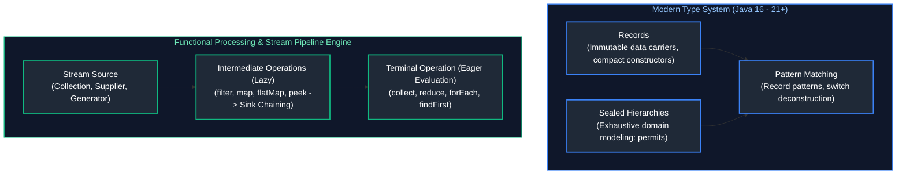
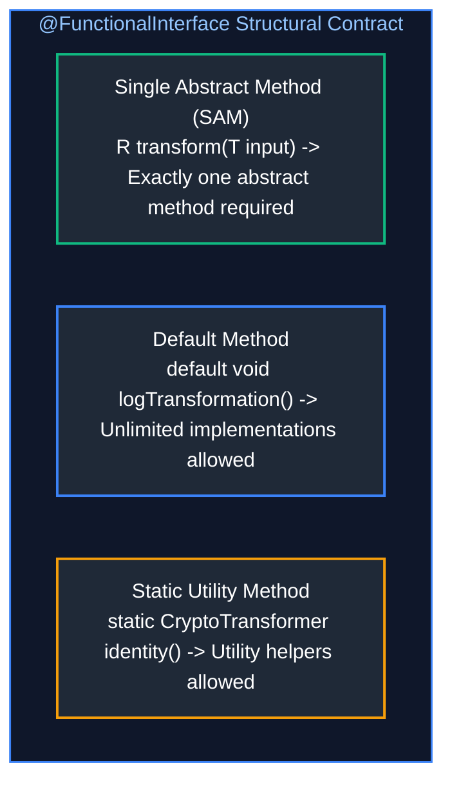
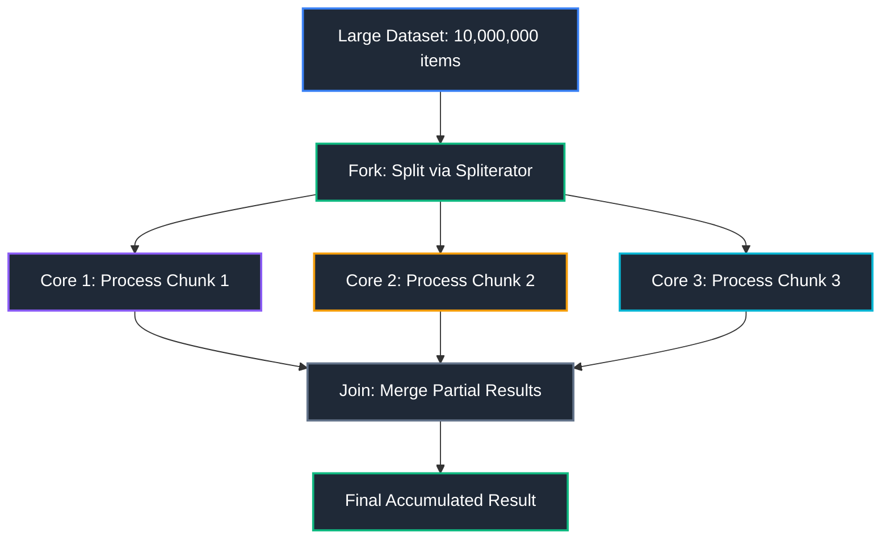
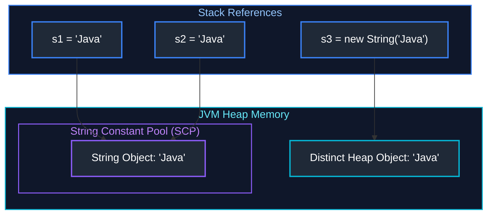
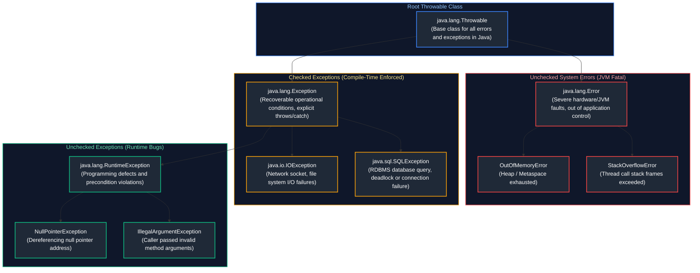
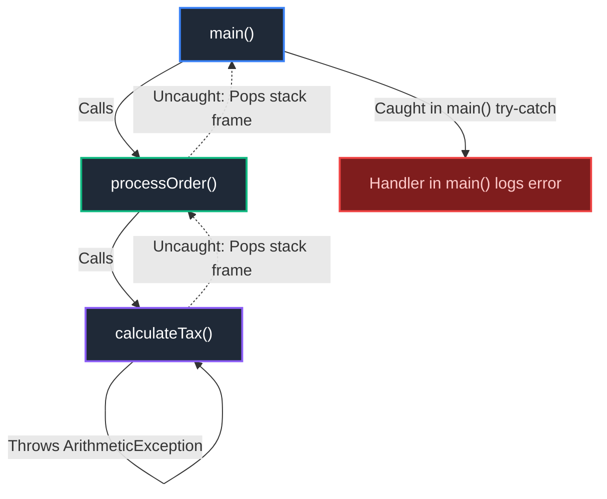
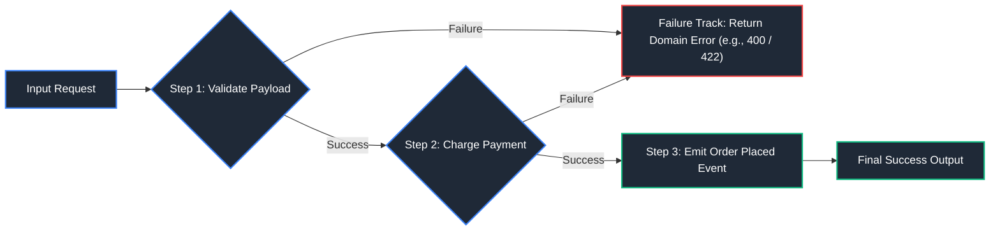

# 03. Modern Java: Records, Sealed Classes, Streams & Functional Architecture

A comprehensive guide covering Java functional programming paradigms, Stream API, Optional semantics, String internals and immutability, and robust exception-handling architectures.

---

## Architectural Overview: Modern Java Language & Functional Pipeline Architecture



---

## Table of Contents
1. [Modern Java Language Features (Java 14 – 21+)](#1-modern-java-language-features-java-14-21)
   - [1.1 Java Records & Compact Constructors](#11-java-records-compact-constructors)
   - [1.2 Sealed Classes & Sealed Interfaces](#12-sealed-classes-sealed-interfaces)
   - [1.3 Pattern Matching (Type Patterns, Switch & Record Deconstruction)](#13-pattern-matching-type-patterns-switch-record-deconstruction)
   - [1.4 Text Blocks (`"""`)](#14-text-blocks)
   - [1.5 Advanced Enums (State Machines & Specialized Collections)](#15-advanced-enums-state-machines-specialized-collections)
   - [1.6 Interface Evolution: Default & Static Methods](#16-interface-evolution-default-static-methods)
2. [Lambda & Functional Programming](#2-lambda-functional-programming)
3. [Stream API](#3-stream-api)
4. [`Optional` Type](#4-optional-type)
5. [String & Immutability](#5-string-immutability)
6. [Exception Handling](#6-exception-handling)
7. [Functional Error Handling & Railway-Oriented Programming](#7-functional-error-handling-railway-oriented-programming)
8. [Modern Java Performance, Escape Analysis & JIT Inlining](#8-modern-java-performance-escape-analysis-jit-inlining)
9. [Summary Comparison & Engineering Reference Matrix](#9-summary-comparison-engineering-reference-matrix)
10. [References & Further Reading](#10-references-further-reading)

---

# 1. Modern Java Language Features (Java 14 – 21+)

---

### 1.1 Java Records & Compact Constructors

Records (`java.lang.Record`, Java 16+) are immutable data carriers that eliminate traditional POJO and Lombok boilerplate:
* Fields are implicitly `private final`.
* The class is implicitly `final` and cannot extend another class.
* The compiler automatically generates: canonical constructor, accessors (`name()`, not `getName()`), `equals()`, `hashCode()`, and `toString()`.

```java
// 1. Record definition with compact constructor validation
public record OrderItem(String sku, int quantity, BigDecimal unitPrice) {
    // Compact Constructor: No parameter list; runs before field assignment
    public OrderItem {
        Objects.requireNonNull(sku, "SKU must not be null");
        if (quantity <= 0) {
            throw new IllegalArgumentException("Quantity must be positive: " + quantity);
        }
        if (unitPrice.compareTo(BigDecimal.ZERO) < 0) {
            throw new IllegalArgumentException("Unit price cannot be negative");
        }
        // Normalize SKU
        sku = sku.trim().toUpperCase();
    }

    // Custom helper method
    public BigDecimal calculateTotal() {
        return unitPrice.multiply(BigDecimal.valueOf(quantity));
    }
}
```

---

### 1.2 Sealed Classes & Sealed Interfaces

Sealed classes (Java 17+) restrict which classes or interfaces may extend or implement them, enabling domain modeling with strict compiler-enforced exhaustiveness:

```java
// Top-level sealed interface
public sealed interface PaymentMethod permits CreditCard, Upi, BankTransfer {}

public final class CreditCard implements PaymentMethod {
    private final String cardNumber;
    public CreditCard(String cardNumber) { this.cardNumber = cardNumber; }
}

public final class Upi implements PaymentMethod {
    private final String vpaAddress;
    public Upi(String vpaAddress) { this.vpaAddress = vpaAddress; }
}

public non-sealed class BankTransfer implements PaymentMethod {
    // non-sealed allows further open extension if desired
}
```

* **Constraints on Permitted Subclasses**:
  1. Must reside in the same package (or module).
  2. Must directly extend/implement the sealed type.
  3. Must explicitly declare one modifier: `final` (cannot be extended), `sealed` (extends hierarchy), or `non-sealed` (opens hierarchy).

---

### 1.3 Pattern Matching (Type Patterns, Switch & Record Deconstruction)

Java 21 provides unified Pattern Matching that eliminates boilerplate casting and enables clean functional data decomposition:

```java
public class PatternMatchingDemo {
    // Java 21 Pattern Matching for switch with exhaustiveness (no default branch needed for sealed types!)
    public static String getPaymentStatusDescription(PaymentMethod payment) {
        return switch (payment) {
            case CreditCard cc when cc.isExpired() -> "Credit Card expired";
            case CreditCard cc -> "Card payment valid";
            case Upi upi -> "UPI payment via " + upi.getVpaAddress();
            case BankTransfer bt -> "Wire transfer pending";
        };
    }

    // Java 21 Record Patterns with nested deconstruction
    public static void processOrder(Object obj) {
        if (obj instanceof OrderItem(String sku, int qty, BigDecimal price)) {
            System.out.println("Item: " + sku + " x " + qty + " @ $" + price);
        }
    }
}
```

---

### 1.4 Text Blocks (`"""`)

Text blocks (Java 15+) simplify multi-line strings (SQL queries, JSON payloads, HTML templates) without messy string concatenation or escape characters:

```java
public class QueryRepository {
    // Multi-line formatted SQL with proper indentation stripping
    public static final String FIND_CUSTOMER_ORDERS_SQL = """
            SELECT o.id, o.order_number, o.total_amount, o.status
            FROM orders o
            JOIN customers c ON o.customer_id = c.id
            WHERE c.status = 'ACTIVE'
              AND o.created_at >= :sinceDate
            ORDER BY o.created_at DESC
            LIMIT :limit;
            """;

    // JSON Payload template with String.formatted()
    public static String buildWebhookJson(String eventId, String status) {
        return """
            {
                "eventId": "%s",
                "timestamp": "%s",
                "status": "%s"
            }
            """.formatted(eventId, Instant.now(), status);
    }
}
```

---

### 1.5 Advanced Enums (State Machines & Specialized Collections)

Java `enum` types are specialized classes that can encapsulate behavior, abstract methods, and drive state machines:

```java
public enum OrderStatus {
    PENDING {
        @Override public boolean canTransitionTo(OrderStatus next) {
            return next == PAID || next == CANCELLED;
        }
    },
    PAID {
        @Override public boolean canTransitionTo(OrderStatus next) {
            return next == SHIPPED || next == REFUNDED;
        }
    },
    SHIPPED {
        @Override public boolean canTransitionTo(OrderStatus next) {
            return next == DELIVERED;
        }
    },
    DELIVERED {
        @Override public boolean canTransitionTo(OrderStatus next) {
            return false;
        }
    },
    CANCELLED {
        @Override public boolean canTransitionTo(OrderStatus next) {
            return false;
        }
    },
    REFUNDED {
        @Override public boolean canTransitionTo(OrderStatus next) {
            return false;
        }
    };

    public abstract boolean canTransitionTo(OrderStatus next);
}
```

* **High-Performance Collections**:
  * `EnumSet`: Implemented internally as a 64-bit bit-vector (`long`), offering faster than $O(1)$ operations with zero heap allocation overhead for elements.
  * `EnumMap`: Implemented internally as a compact Java array indexed by the enum's ordinal, dramatically outperforming `HashMap` with zero hashing overhead.

---

### 1.6 Interface Evolution: Default & Static Methods

Java 8+ introduced concrete method implementations in interfaces:
* **`default` methods**: Enable backward-compatible API evolution (adding new capabilities to interfaces without breaking existing implementing classes).
* **`static` methods**: Utility helper methods directly attached to the interface type.
* **The Diamond Problem Resolution**: If a class implements two interfaces declaring identical default method signatures, the compiler requires the implementing class to explicitly override the method and resolve the conflict using `InterfaceName.super.method()`:

```java
interface Auditor {
    default void log(String msg) { System.out.println("Audit: " + msg); }
}

interface Logger {
    default void log(String msg) { System.out.println("Log: " + msg); }
}

class TransactionService implements Auditor, Logger {
    @Override
    public void log(String msg) {
        // Explicitly disambiguate diamond conflict
        Auditor.super.log(msg);
    }
}
```

---

# 2. Lambda & Functional Programming

---

### Lambda Expressions

#### Definition
A Lambda Expression is an anonymous function (a method without a name, return type, or explicit access modifier) that can be passed around as if it were a first-class value. Introduced in Java 8, it provides a concise syntax for implementing single-method interfaces.

#### Syntax Breakdown
```
(parameters) -> { body }
(a, b) -> a + b           // Expression body: Implicit return
(x) -> { doWork(x); }     // Block body: Explicit statement
```

#### Working Code Example
```java
import java.util.Arrays;
import java.util.Collections;
import java.util.List;

public class LambdaDemo {
    public static void main(String[] args) {
        List<String> names = Arrays.asList("Sophia", "Liam", "Noah", "Olivia");

        // Anonymous inner class approach (Pre-Java 8)
        Collections.sort(names, (s1, s2) -> s1.compareTo(s2)); // Lambda expression

        // Method reference shorthand
        names.forEach(System.out::println);
    }
}
```

**Primary Source Reference**: [GeeksforGeeks - Lambda Expressions in Java 8](https://www.geeksforgeeks.org/lambda-expressions-java-8/)

---

### Functional Interfaces

#### Definition
A Functional Interface is an interface that contains **exactly one abstract method (Single Abstract Method - SAM)**. It can contain any number of `default` or `static` methods. The `@FunctionalInterface` annotation informs the compiler to enforce this rule.

#### Visual Diagram


#### Working Code Example
```java
@FunctionalInterface
public interface CryptoTransformer<T, R> {
    // Single Abstract Method
    R transform(T rawInput);

    // Default methods do not violate the SAM rule
    default void logTransformation() {
        System.out.println("Executing cryptographic transformation...");
    }
}

class FunctionalInterfaceUsage {
    public static void main(String[] args) {
        CryptoTransformer<String, String> reverser = input -> new StringBuilder(input).reverse().toString();
        reverser.logTransformation();
        System.out.println("Result: " + reverser.transform("SecureData123"));
    }
}
```

**Primary Source Reference**: [GeeksforGeeks - Functional Interfaces in Java](https://www.geeksforgeeks.org/functional-interfaces-java/)

---

### Core Built-in Functional Interfaces

Java 8 provides standard functional interfaces in `java.util.function`:

| Interface | Method Signature | Purpose | Real-World Use Case |
| :--- | :--- | :--- | :--- |
| **`Predicate<T>`** | `boolean test(T t)` | Evaluates a boolean condition | Filtering lists, input validation |
| **`Consumer<T>`** | `void accept(T t)` | Accepts input, performs side effect | Printing, emitting events, audit logging |
| **`Supplier<T>`** | `T get()` | Takes no input, produces a result | Factory methods, lazy loading |
| **`Function<T, R>`** | `R apply(T t)` | Transforms input of type T to R | Entity to DTO mapping |
| **`BiFunction<T, U, R>`**| `R apply(T t, U u)` | Combines two arguments into a result | Merging objects, calculating tax |
| **`UnaryOperator<T>`** | `T apply(T t)` | Special `Function<T, T>` | String trimming, incrementing values |
| **`BinaryOperator<T>`**| `T apply(T t1, T t2)`| Special `BiFunction<T, T, T>` | Reductions, summing numbers |

#### Working Code Example
```java
import java.util.function.*;

public class BuiltInFunctionalInterfacesDemo {
    public static void main(String[] args) {
        // 1. Predicate: Check if balance is positive
        Predicate<Double> isSolvent = bal -> bal > 0.0;

        // 2. Consumer: Log message
        Consumer<String> logger = msg -> System.out.println("[AUDIT] " + msg);

        // 3. Supplier: Generate transaction ID
        Supplier<String> txIdGen = () -> "TX-" + System.currentTimeMillis();

        // 4. Function: Transform String to Length
        Function<String, Integer> lengthMapper = String::length;

        // 5. BinaryOperator: Sum two numbers
        BinaryOperator<Integer> adder = Integer::sum;

        if (isSolvent.test(150.0)) {
            logger.accept("Generated Tx: " + txIdGen.get() + " with length: " + lengthMapper.apply("Success"));
            System.out.println("Total: " + adder.apply(100, 250));
        }
    }
}
```

**Primary Source Reference**: [GeeksforGeeks - Java 8 Functional Interfaces](https://www.geeksforgeeks.org/functional-interfaces-java/)

---

# 3. Stream API

---

### Stream Architecture

#### Definition
A `Stream` represents a sequence of elements supporting sequential and parallel aggregate operations. Streams do **not** store elements in memory; they carry values from a source (collection, array, I/O channel) through a pipeline of computational steps.

#### Stream vs Collection
| Dimension | Collection | Stream |
| :--- | :--- | :--- |
| **Data Storage** | Stores data in physical memory structures | Holds no storage; operates on demand |
| **Evaluation** | Eagerly evaluated | **Lazily evaluated** (executes on terminal call) |
| **Reusability** | Can be traversed multiple times | **Single use only** (traversing twice throws exception) |
| **Internal vs External** | External iteration (`for-each`) | Internal iteration managed by JVM runtime |

#### Visual Pipeline Architecture


**Primary Source Reference**: [GeeksforGeeks - Stream in Java](https://www.geeksforgeeks.org/stream-in-java/)

---

### Intermediate Operations

Intermediate operations return a new `Stream` and are **lazy**—computation is deferred until a terminal operation is invoked.

- `filter(Predicate<T>)`: Selects elements satisfying a boolean condition.
- `map(Function<T, R>)`: Transforms elements one-to-one into another type.
- `flatMap(Function<T, Stream<R>>)`: Flattens nested streams (one-to-many).
- `sorted()`: Sorts elements naturally or via `Comparator`.
- `distinct()`: Eliminates duplicates based on `equals()`.
- `limit(n)`: Truncates the stream to at most $n$ elements.
- `skip(n)`: Discards the first $n$ elements.

#### Working Code Example
```java
import java.util.Arrays;
import java.util.List;

public class IntermediateOpsDemo {
    public static void main(String[] args) {
        List<List<String>> nestedSkills = Arrays.asList(
            Arrays.asList("Java", "Spring", "Docker"),
            Arrays.asList("Java", "Kubernetes", "AWS")
        );

        List<String> uniqueSkills = nestedSkills.stream()
            .flatMap(List::stream)             // 1. Flatten nested lists
            .map(String::toUpperCase)          // 2. Transform to uppercase
            .distinct()                        // 3. Remove duplicates
            .sorted()                          // 4. Sort alphabetically
            .skip(1)                           // 5. Skip first
            .limit(3)                          // 6. Take next 3
            .toList();                         // Terminal operation (Java 16+)

        System.out.println("Processed Skills: " + uniqueSkills);
    }
}
```

**Primary Source Reference**: [GeeksforGeeks - Java 8 Stream Intermediate Operations](https://www.geeksforgeeks.org/intermediate-and-terminal-operations-in-java-stream/)

---

### Terminal Operations

Terminal operations trigger the stream pipeline execution and produce a non-stream result (primitive, collection, void).

- `collect(Collector)`: Gathers elements into a container (`List`, `Set`, `Map`).
- `reduce(BinaryOperator)`: Combines elements into a single aggregate value.
- `forEach(Consumer)`: Executes side effects on each element.
- `count()`: Returns the total number of elements.
- `findFirst()` / `findAny()`: Returns an `Optional` element matching conditions.
- `anyMatch()` / `allMatch()` / `noneMatch()`: Short-circuiting boolean checks.

#### Working Code Example
```java
import java.util.List;
import java.util.Optional;

public class TerminalOpsDemo {
    public static void main(String[] args) {
        List<Integer> numbers = List.of(10, 25, 30, 45, 50);

        // reduce: sum of elements
        int totalSum = numbers.stream().reduce(0, Integer::sum);
        System.out.println("Total Sum: " + totalSum);

        // anyMatch: short-circuiting check
        boolean hasLargeNumber = numbers.stream().anyMatch(n -> n > 40);
        System.out.println("Contains > 40: " + hasLargeNumber);

        // findFirst: retrieves first match wrapped in Optional
        Optional<Integer> firstEven = numbers.stream().filter(n -> n % 2 == 0).findFirst();
        firstEven.ifPresent(n -> System.out.println("First even: " + n));
    }
}
```

**Primary Source Reference**: [GeeksforGeeks - Java 8 Stream Terminal Operations](https://www.geeksforgeeks.org/intermediate-and-terminal-operations-in-java-stream/)

---

### Collectors Advanced

`java.util.stream.Collectors` provides powerful accumulation strategies:
- `groupingBy`: Partitions elements into a `Map<K, List<V>>` based on a classification function.
- `partitioningBy`: Special grouping into a `Map<Boolean, List<V>>` based on a `Predicate`.
- `mapping`: Adapts a collector to accept elements through a transformation function.

#### Working Code Example
```java
import java.util.List;
import java.util.Map;
import java.util.stream.Collectors;

public class CollectorsAdvancedDemo {
    record Employee(String name, String department, double salary) {}

    public static void main(String[] args) {
        List<Employee> employees = List.of(
            new Employee("Alice", "Engineering", 90000),
            new Employee("Bob", "Engineering", 80000),
            new Employee("Carol", "Marketing", 70000),
            new Employee("David", "Marketing", 65000),
            new Employee("Eve", "HR", 60000)
        );

        // 1. Group employees by Department
        Map<String, List<Employee>> byDept = employees.stream()
            .collect(Collectors.groupingBy(Employee::department));
        System.out.println("By Department: " + byDept.keySet());

        // 2. Average salary per department
        Map<String, Double> avgSalaryPerDept = employees.stream()
            .collect(Collectors.groupingBy(
                Employee::department,
                Collectors.averagingDouble(Employee::salary)
            ));
        System.out.println("Average Salaries: " + avgSalaryPerDept);

        // 3. Partition by high earners (> 75,000)
        Map<Boolean, List<String>> partitioned = employees.stream()
            .collect(Collectors.partitioningBy(
                e -> e.salary() > 75000,
                Collectors.mapping(Employee::name, Collectors.toList())
            ));
        System.out.println("High Earners: " + partitioned.get(true));
    }
}
```

**Primary Source Reference**: [GeeksforGeeks - Collectors in Java](https://www.geeksforgeeks.org/collectors-in-java/)

---

### Parallel Streams

#### Definition & Mechanism
Parallel streams decompose tasks across multiple CPU cores using the **ForkJoinPool.commonPool()**. Elements are recursively split into chunks (via `Spliterator`), processed independently, and merged.



#### When to Use vs Avoid
- **Use When**: The dataset is massive ($N \times Q > 10,000$, where $N$ is element count and $Q$ is work per element), operations are CPU-bound and computationally intensive, and elements are independent.
- **Avoid When**:
  - Operations involve blocking I/O (database, HTTP calls)—this starves the shared `ForkJoinPool.commonPool()`.
  - Collections have poor splitting characteristics (e.g., `LinkedList` has $O(n)$ splitting; `ArrayList` has $O(1)$ splitting).
  - Preserving sequential encounter order matters.

**Primary Source Reference**: [GeeksforGeeks - Parallel Streams in Java](https://www.geeksforgeeks.org/parallel-streams-in-java/)

---

# 4. `Optional` Type

---

### `Optional` Fundamentals

#### Definition
`Optional<T>` is a container object introduced in Java 8 that may or may not contain a non-null value. It was designed primarily as a **method return type** to explicitly communicate the possibility of "no result" without resorting to returning `null` (preventing `NullPointerException`).

#### Core Methods
- `Optional.of(val)`: Creates Optional; throws NPE if `val` is null.
- `Optional.ofNullable(val)`: Safe creation; returns `Optional.empty()` if null.
- `map(Function)`: Transforms contained value if present.
- `flatMap(Function)`: Flattens an operation returning another `Optional`.
- `orElse(defaultValue)`: Returns value or fallback immediately.
- `orElseGet(Supplier)`: **Lazy evaluation**: Only computes default if absent.
- `orElseThrow(Supplier)`: Throws exception if empty.

#### Working Code Example
```java
import java.util.Optional;

public class OptionalDemo {
    public static Optional<String> findUserEmail(String userId) {
        if ("USR-101".equals(userId)) {
            return Optional.of("john.doe@company.com");
        }
        return Optional.empty();
    }

    public static void main(String[] args) {
        String email = findUserEmail("USR-101")
            .map(String::toUpperCase)
            .orElseGet(() -> "default@company.com"); // Lazy fallback evaluation
        System.out.println("Resolved email: " + email);

        // Safe exception throwing
        try {
            findUserEmail("NON-EXISTENT")
                .orElseThrow(() -> new IllegalArgumentException("User not found in registry"));
        } catch (IllegalArgumentException e) {
            System.out.println("Caught expected error: " + e.getMessage());
        }
    }
}
```

**Primary Source Reference**: [GeeksforGeeks - Java 8 Optional Class](https://www.geeksforgeeks.org/java-8-optional-class/)

---

### Optional Best Practices

#### Anti-Patterns vs Proper Usage
| Anti-Pattern | Correct Modern Idiom |
| :--- | :--- |
| `if (opt.isPresent()) { opt.get(); }` | Use `opt.ifPresent(v -> ...)` or `opt.map(...).orElse(...)` |
| Using `Optional` for class fields / entity attributes | Use standard nullable fields; Optional is not `Serializable` |
| Passing `Optional` as a method argument | Use standard method overloading or null checks |
| Using `orElse(computeExpensive())` | Use `orElseGet(() -> computeExpensive())` for lazy evaluation |
| Wrapping Collections: `Optional<List<T>>` | Return an empty `List<T>` (`Collections.emptyList()`) directly |

**Primary Source Reference**: [GeeksforGeeks - Best Practices for Java Optional](https://www.geeksforgeeks.org/best-practices-for-using-optional-in-java/)

---

# 5. String & Immutability

---

### String Pool & Immutability

#### Definition
`java.lang.String` objects in Java are **immutable**—once created, their character sequence cannot be changed. The JVM optimizes string storage using the **String Constant Pool (SCP)**, a specialized memory area located inside the Heap.

#### Visual Memory Layout: Literal vs `new String()`


#### Why Strings are Immutable
1. **Security**: Strings store database credentials, file paths, and network URLs. Immutability prevents malicious tampering.
2. **Thread Safety**: Immutable objects are inherently thread-safe without synchronization.
3. **Caching & HashCode**: Hash code is cached upon creation (`hash` field); essential for fast `HashMap` lookups.
4. **String Pooling**: Allows multiple references to point to the same memory instance, saving heap space.

Immutability makes sharing a `String` between threads safe; mutable shared state still needs coordination. See [Topic 04: Java Concurrency & Multithreading](./04_java_concurrency_multithreading.md#2-synchronization-thread-safety).

**Primary Source Reference**: [GeeksforGeeks - String Constant Pool in Java](https://www.geeksforgeeks.org/string-constant-pool-in-java/)

---

### `StringBuilder` vs `StringBuffer`

| Feature | `String` | `StringBuilder` (Java 5) | `StringBuffer` (Java 1.0) |
| :--- | :--- | :--- | :--- |
| **Immutability** | Immutable | Mutable | Mutable |
| **Thread Safety** | Thread-safe | Not thread-safe | Thread-safe (`synchronized` methods) |
| **Performance** | Slow for concatenation loops | **Fastest** (No locking overhead) | Slower due to lock contention |
| **Memory** | Allocates new object per edit | Modifies internal char/byte buffer | Modifies internal char/byte buffer |

**Primary Source Reference**: [GeeksforGeeks - StringBuilder vs StringBuffer](https://www.geeksforgeeks.org/stringbuffer-vs-stringbuilder-in-java/)

---

### String Intern & Concatenation

#### `String.intern()`
When invoked, `intern()` checks the String Pool. If the pool contains an equal string, the pool instance is returned; otherwise, the string is added to the pool and returned.

#### Concatenation Internals
- Pre-Java 9: `s1 + s2` was compiled into `new StringBuilder().append(s1).append(s2).toString()`.
- Java 9+: Uses `invokedynamic` with `StringConcatFactory.makeConcatWithConstants()`, enabling the JVM to optimize string assembly dynamically at runtime without allocating intermediate `StringBuilder` instances.

**Primary Source Reference**: [GeeksforGeeks - String intern() in Java](https://www.geeksforgeeks.org/string-intern-method-in-java/)

---

### `char[]` vs `String` for Passwords

#### Why Security Guidelines Mandate `char[]`
1. **Garbage Collection Delay**: `String` remains in heap memory indefinitely until GC runs. An attacker obtaining a memory dump can extract plaintext passwords.
2. **Deterministic Zeroing**: With a `char[]`, the application can immediately overwrite the memory with zeroes (`Arrays.fill(pwd, '0')`) as soon as authentication finishes.
3. **Log Prevention**: Strings are easily logged accidentally via `toString()`.

```java
import java.util.Arrays;

public class PasswordSecurityDemo {
    public static void main(String[] args) {
        char[] password = new char[]{'S', 'e', 'c', 'u', 'r', 'e', '!', '9'};

        try {
            // Perform authentication with char[]
            System.out.println("Authenticated successfully.");
        } finally {
            // Immediate zeroing of sensitive memory
            Arrays.fill(password, '0');
        }
    }
}
```

**Primary Source Reference**: [GeeksforGeeks - Why char array is preferred over String for passwords in Java](https://www.geeksforgeeks.org/why-char-array-is-preferred-over-string-for-storing-passwords-in-java/)

---

### Immutable Classes & Defensive Copying

#### Rules to Create a Truly Immutable Class
1. Declare the class `final` (prevents subclassing).
2. Make all fields `private` and `final`.
3. Do not provide any setter methods.
4. Perform **Defensive Copying** on mutable constructor parameters and mutable getter returns.

#### Working Code Example
```java
import java.util.ArrayList;
import java.util.Collections;
import java.util.List;

public final class ImmutableUserProfile {
    private final String username;
    private final List<String> roles; // Mutable internal object

    public ImmutableUserProfile(String username, List<String> roles) {
        this.username = username;
        // Defensive Copy on input: prevents caller from mutating internal state
        this.roles = new ArrayList<>(roles);
    }

    public String getUsername() { return username; }

    public List<String> getRoles() {
        // Defensive Copy or Unmodifiable wrapper on output
        return Collections.unmodifiableList(roles);
    }
}
```

**Primary Source Reference**: [GeeksforGeeks - How to create an Immutable Class in Java](https://www.geeksforgeeks.org/create-immutable-class-java/)

---

# 6. Exception Handling

---

### Exception Hierarchy

#### Visual Hierarchy


**Primary Source Reference**: [GeeksforGeeks - Exceptions in Java](https://www.geeksforgeeks.org/exceptions-in-java/)

---

### Checked vs Unchecked Exceptions

| Feature | Checked Exceptions | Unchecked Exceptions (`RuntimeException`) | `Error` |
| :--- | :--- | :--- | :--- |
| **Subclass Of** | `Exception` (excluding `RuntimeException`) | `RuntimeException` | `Error` |
| **Compiler Enforced**| **Yes**: Must declare (`throws`) or catch | **No**: Optional to catch | **No**: Should not attempt to catch |
| **Nature** | Foreseeable environmental failures | Programmer bugs, contract violations | Serious JVM system crashes |
| **Examples** | `IOException`, `SQLException` | `NullPointerException`, `IndexOutOfBoundsException` | `OutOfMemoryError`, `StackOverflowError` |

**Primary Source Reference**: [GeeksforGeeks - Checked vs Unchecked Exceptions in Java](https://www.geeksforgeeks.org/checked-vs-unchecked-exceptions-in-java/)

---

### Try-With-Resources

#### Definition
Introduced in Java 7, try-with-resources automatically closes any resource that implements `java.lang.AutoCloseable` at block exit, eliminating resource leaks and verbose `finally` blocks.

#### Working Code Example
```java
import java.io.BufferedReader;
import java.io.FileReader;
import java.io.IOException;

public class TryWithResourcesDemo {
    public static void readFirstLine(String path) {
        // Multiple AutoCloseable resources automatically closed in reverse order of declaration
        try (BufferedReader br = new BufferedReader(new FileReader(path))) {
            System.out.println("First line: " + br.readLine());
        } catch (IOException e) {
            System.err.println("File read failed: " + e.getMessage());
        }
        // No explicit finally required!
    }
}
```

**Primary Source Reference**: [GeeksforGeeks - Try with resources in Java](https://www.geeksforgeeks.org/try-with-resources-feature-in-java/)

---

### Custom Exceptions & Chaining

#### Exception Chaining
Wrapping an underlying low-level technical exception (`SQLException`) inside a high-level business exception (`PaymentProcessingException`) while preserving the original root cause stack trace via `super(message, cause)`.

#### Working Code Example
```java
// Custom Unchecked Business Exception
class InsufficientFundsException extends RuntimeException {
    private final double deficit;

    public InsufficientFundsException(String message, double deficit, Throwable cause) {
        super(message, cause); // Preserving root cause chain
        this.deficit = deficit;
    }

    public double getDeficit() { return deficit; }
}

public class ExceptionChainingDemo {
    public static void withdraw(double balance, double amount) {
        if (amount > balance) {
            throw new InsufficientFundsException(
                "Withdrawal exceeds balance",
                amount - balance,
                new IllegalStateException("Account balance below floor threshold")
            );
        }
    }

    public static void main(String[] args) {
        try {
            withdraw(50.0, 150.0);
        } catch (InsufficientFundsException e) {
            System.err.println("Business Error: " + e.getMessage() + " | Deficit: $" + e.getDeficit());
            System.err.println("Underlying Root Cause: " + e.getCause());
        }
    }
}
```

**Primary Source Reference**: [GeeksforGeeks - Chained Exceptions in Java](https://www.geeksforgeeks.org/chained-exception-in-java/)

---

### `throw` vs `throws`

- **`throw`**: Keyword used inside a method body to explicitly trigger/raise an exception instance (`throw new IllegalArgumentException();`).
- **`throws`**: Keyword in a method signature indicating that the method may propagate specified checked exceptions to its caller (`public void read() throws IOException`).

**Primary Source Reference**: [GeeksforGeeks - Difference between throw and throws in Java](https://www.geeksforgeeks.org/difference-between-throw-and-throws-in-java/)

---

### Multiple Catch Blocks & Multi-Catch Syntax

#### Definition
Java permits catching multiple distinct exception types either in separate `catch` blocks or grouped together in a single `catch` block using the **Multi-Catch pipe operator (`|`)** introduced in Java 7.

#### Working Code Example
```java
public class MultiCatchDemo {
    public static void executeOperation(String input) {
        try {
            int num = Integer.parseInt(input);
            int result = 100 / num;
            System.out.println("Result: " + result);
        } catch (NumberFormatException | ArithmeticException e) {
            // Multi-catch: 'e' is implicitly final
            System.err.println("Input computation error: " + e.getClass().getSimpleName() + " - " + e.getMessage());
        } catch (Exception e) {
            // Generic fallback catch block placed last
            System.err.println("Unexpected failure: " + e.getMessage());
        }
    }

    public static void main(String[] args) {
        executeOperation("invalid"); // Caught by multi-catch (NumberFormatException)
        executeOperation("0");       // Caught by multi-catch (ArithmeticException)
    }
}
```

**Primary Source Reference**: [GeeksforGeeks - Multiple Catch Blocks in Java](https://www.geeksforgeeks.org/multicatch-in-java/)

---

### Exception Propagation

#### Definition
When an exception is thrown inside a method, if not caught locally, it drops down the method call stack to the previous calling method. This unwinding continues until an appropriate `catch` handler is encountered or it reaches the JVM `main()` thread entry point, terminating the thread.

#### Visual Call Stack Unwinding


**Primary Source Reference**: [GeeksforGeeks - Exception Propagation in Java](https://www.geeksforgeeks.org/exception-propagation-in-java/)

---

### Business vs Technical Exceptions

| Dimension | Technical Exception | Business / Domain Exception |
| :--- | :--- | :--- |
| **Origin** | System infrastructure, networks, databases | Domain invariant or business rule violation |
| **Examples** | `SQLException`, `IOException`, `SocketTimeoutException` | `InsufficientFundsException`, `ProductOutOfStockException` |
| **Target Audience** | System administrators & DevOps engineers | End users (mapped to user-friendly UI messages) |
| **Recovery** | Retry, failover, circuit breaking | User correction (e.g. enter valid card or lower quantity) |
| **HTTP Status Code** | `500 Internal Server Error`, `502 Bad Gateway` | `400 Bad Request`, `404 Not Found`, `422 Unprocessable` |

#### Working Code Example: Handling Business vs Technical Failures
```java
public class OrderCheckoutWorkflow {
    public void checkout(String cartId) {
        try {
            // Domain validation
            validateInventory(cartId);
            // Low-level network call
            callPaymentGateway();
        } catch (ProductOutOfStockException e) {
            // Handled as Business Error -> Return HTTP 422 to user
            System.out.println("[USER ALERT] Item out of stock. Please adjust cart.");
        } catch (NetworkGatewayTimeoutException e) {
            // Handled as Technical Error -> Trigger retry or return HTTP 503
            System.err.println("[DEVOPS ALERT] Downstream payment gateway unreachable. Initiating retry.");
        }
    }

    private void validateInventory(String cartId) {}
    private void callPaymentGateway() {}
}

class ProductOutOfStockException extends RuntimeException {}
class NetworkGatewayTimeoutException extends RuntimeException {}
```

---

### Exception Best Practices

1. **Never swallow exceptions**: Avoid empty catch blocks (`catch (Exception e) {}`). Always log with context or rethrow.
2. **Favor Unchecked Exceptions for Business Logic**: Modern enterprise architectures (Spring) use unchecked runtime exceptions to avoid polluting API signatures.
3. **Catch Specific Exceptions First**: Order catch blocks from most specific subclass to most general (`catch (FileNotFoundException e)` before `catch (IOException e)`).
4. **Preserve the Cause**: Always pass the caught exception as the `cause` parameter when wrapping exceptions (`new BusinessException("msg", e)`).
5. **Use Standard Exceptions First**: Prefer `IllegalArgumentException`, `IllegalStateException`, and `NullPointerException` before creating custom classes.

> [!TIP]
> In enterprise web APIs, domain and technical exceptions are centralized and mapped to standard HTTP response bodies (RFC 9457 Problem Details) using `@RestControllerAdvice`. See [07. Spring Web & REST APIs - Section 7: API Error Handling & Resilience](08_spring_web_rest_apis.md#7-api-error-handling-resilience).


---

# 7. Functional Error Handling & Railway-Oriented Programming

Traditional Java error handling relies on throwing exceptions. However, throwing exceptions carries heavy performance and architectural penalties:
1. **Stack Trace Cost**: `Throwable.fillInStackTrace()` traverses the native execution stack, consuming hundreds of CPU cycles per throw.
2. **Control Flow Hijacking**: Exceptions break local control flow like an arbitrary `goto`, obscuring the caller's reasoning.
3. **Hidden Invariants**: Unchecked exceptions are invisible in the method signature, leading to uncaught runtime failures.

**Railway-Oriented Programming (ROP)** treats execution as a two-track railway: a **Success Track** and a **Failure Track**. Operations transform the success value or automatically bypass subsequent steps if a failure occurs.



#### Production Code: The `Result<T, E>` Monad via Sealed Interfaces
```java
import java.util.Objects;
import java.util.function.Consumer;
import java.util.function.Function;

// Sealed Monadic Result Carrier
public sealed interface Result<T, E> permits Result.Success, Result.Failure {
    record Success<T, E>(T value) implements Result<T, E> {
        public Success { Objects.requireNonNull(value); }
    }
    record Failure<T, E>(E error) implements Result<T, E> {
        public Failure { Objects.requireNonNull(error); }
    }

    // Static factories
    static <T, E> Result<T, E> ok(T value) { return new Success<>(value); }
    static <T, E> Result<T, E> err(E error) { return new Failure<>(error); }

    // Monadic bind (flatMap)
    default <R> Result<R, E> flatMap(Function<? super T, Result<R, E>> mapper) {
        return switch (this) {
            case Success<T, E> s -> mapper.apply(s.value());
            case Failure<T, E> f -> Result.err(f.error());
        };
    }

    // Functor map
    default <R> Result<R, E> map(Function<? super T, ? extends R> mapper) {
        return flatMap(val -> Result.ok(mapper.apply(val)));
    }

    // Pattern matching fold / match
    default <R> R fold(Function<? super T, ? extends R> onSuccess, Function<? super E, ? extends R> onFailure) {
        return switch (this) {
            case Success<T, E> s -> onSuccess.apply(s.value());
            case Failure<T, E> f -> onFailure.apply(f.error());
        };
    }
}
```

---

# 8. Modern Java Performance, Escape Analysis & JIT Inlining

Java's HotSpot JVM employs sophisticated Just-In-Time (JIT) compiler optimizations that make modern functional idioms (Records, Lambdas, Streams) achieve near-native execution speeds.

### 8.1 Escape Analysis & Scalar Replacement
When an object is instantiated, the C2 JIT compiler analyzes its lifetime to determine if its reference "escapes" outside the allocating method or thread:
1. **GlobalEscape**: Object escapes the method and thread (e.g. stored in a static field, returned to caller). Must be allocated on the heap.
2. **ArgEscape**: Object is passed as an argument to another method but does not outlive the calling method.
3. **NoEscape**: Object is strictly local to the method.
   - **Scalar Replacement**: If an object does not escape, the JIT deconstructs the object into its constituent primitive and pointer fields, allocating them directly into **CPU Registers** or on the **Thread Stack**.
   - **Zero GC Allocation**: Small records or closure objects created in streams produce zero Garbage Collection pressure when scalar-replaced.

### 8.2 Stream Inlining vs. Primitive For-Loops

While Stream code is expressive, understanding its mechanical sympathy is crucial for sub-microsecond low-latency services:

| Dimension | Classic Primitive `for` Loop | Java Stream Pipeline |
| :--- | :--- | :--- |
| **Object Allocation** | Zero heap allocation (operates directly on stack frames) | Intermediate pipeline stages allocate `Stream`, `Spliterator`, and functional interface instances (unless scalar-replaced by C2 JIT). |
| **Primitive Boxing** | Keeps primitives unboxed (`long`, `double`) | `Stream<Integer>` incurs $16\text{B}$ `Integer` wrapper boxing. Always prefer `IntStream`, `LongStream`, or `DoubleStream`. |
| **JIT Optimization** | Trivial loop unrolling, SIMD auto-vectorization | Requires C2 monomorphic call-site inlining through nested lambda chains. |
| **Optimal Use Case** | Ultra-hot computational loops ($>10^7$ iterations/sec), hardware packet processing | Business logic, complex queries, concurrent collections, declarative ETL. |

---

# 9. Summary Comparison & Engineering Reference Matrix

| Feature | Introduced JDK | Low-Level Bytecode / JVM Mechanism | Memory & Performance Impact | Production Engineering Rule |
| :--- | :---: | :--- | :--- | :--- |
| **Records** | JDK 16 | Extends `java.lang.Record`, generated canonical constructor & accessors | Value-based identity; candidate for Scalar Replacement | Ideal for DTOs, Kafka payloads, and immutable domain events. |
| **Sealed Classes** | JDK 17 | `PermittedSubclasses` attribute in classfile header | Zero runtime overhead; compile-time exhaustiveness checking | Model closed algebraic domain types; eliminates runtime defensive `default:` blocks. |
| **Pattern Matching** | JDK 17–21 | `instanceof` with type binding + switch dynamic dispatch | Translates to synthetic tableswitch or chained bytecode comparisons | Replaces fragile `if-else` casting chains with clean deconstruction. |
| **Lambdas** | JDK 8 | `invokedynamic` with `LambdaMetafactory` generates anonymous class | Single call-site bootstrap; non-capturing lambdas are cached flyweights | Prefer non-capturing method references (`String::trim`) over capturing closures. |
| **Streams** | JDK 8 | Pull-based pipeline over `Spliterator` with chained terminal reducer | Lazy evaluation; pipeline overhead amortized over $>1,000$ elements | Never mutate shared state inside `.map()` or `.peek()`; use primitive streams. |
| **Optional** | JDK 8 | Value wrapper reference (`value` field) | Incurs $16\text{B}$ heap overhead if not scalar-replaced | Use strictly as return type for absent values; never as method params or entity fields. |
| **Text Blocks** | JDK 15 | Compile-time string literal constant pool entry | Zero runtime overhead; compiler strips incidental indentation | Standard for SQL queries, JSON schemas, and multiline documentation. |

---

# 10. References & Further Reading

- [Oracle OpenJDK - JDK 21 Features and Specifications](https://openjdk.org/projects/jdk/21/)
- [JEP 395: Records](https://openjdk.org/jeps/395) — OpenJDK specification for immutable data carriers.
- [JEP 409: Sealed Classes](https://openjdk.org/jeps/409) — OpenJDK specification for restricted class hierarchies.
- [JEP 440: Record Patterns](https://openjdk.org/jeps/440) — Deconstruction patterns for record values in Java 21.
- [Baeldung - Java Functional Programming, Records, and Streams](https://www.baeldung.com/category/java/java-core/)
- [Brian Goetz: Data-Oriented Programming in Java](https://www.infoq.com/articles/data-oriented-programming-java/) — Architectural paradigm for modeling state with records and sealed hierarchies.
